# 11 客户管理
## 客户管理

在本章中，我们将涵盖以下主题：
- 管理客户账户
- 客户群组

## 管理客户账户

客户可以在商店前台注册账户，以跟踪订单、保存个人信息以备未来订单使用等。

你可以在管理后台的“客户 | 所有客户”部分管理商店中的客户账户。

### 客户管理

你将在屏幕上看到以下页面：

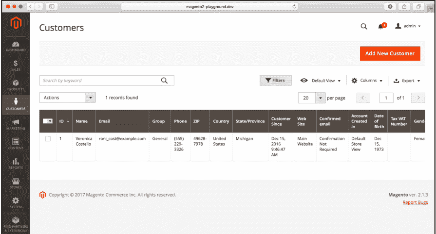

Magento 管理后台的网格中，最有用的元素之一是“操作”下拉菜单。该下拉菜单包含批量操作，可将特定操作应用于网格中所选的项目。

客户网格中提供以下批量操作：
- 删除
- 订阅新闻通讯
- 取消订阅新闻通讯
- 分配客户群组
- 编辑

此外，你可以在网格中筛选和排序客户列表，设置每页显示的客户数量，选择要显示的列，按关键字搜索，以及将客户列表导出为 CSV 和 Excel XML。

### 客户管理

你可以通过单击“操作”网格中最后一列的**编辑**链接来查看和编辑客户信息。

点击该链接后，你将跳转到**客户**编辑页面：

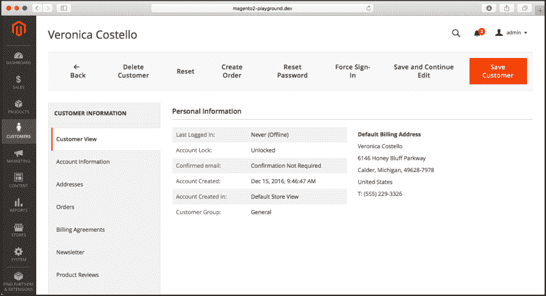

我们可以看到顶部有几个按钮，可对客户账户执行不同操作：
- **删除客户**
- **重置**：重置你打开**客户**编辑页面以来对客户信息所做的所有更改
- **创建订单**：为客户创建订单
- **重置密码**
- **强制登录**：撤销客户账户的 API 令牌

左侧边栏提供以下部分：
- **客户视图**：查看以下截图：

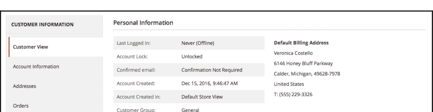

你可以看到客户的个人信息，包括：
- 客户上次登录的时间
- 账户是锁定还是解锁（Magento 会在六次登录失败后锁定账户）
- 如果需要确认电子邮件，你可以查看账户是否已验证
- 账户创建的日期
- 创建账户的商店视图
- 客户账户所属的客户群组
- 默认账单地址和送货地址

- **账户信息**：你可以在此部分编辑个人信息，并指定客户账户所属的客户群组：

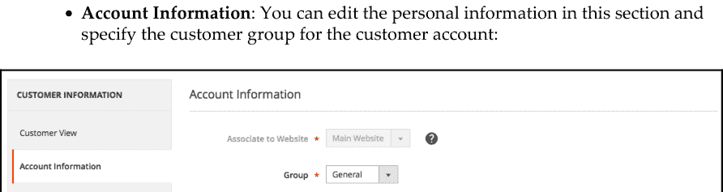

- **地址：** 你可以为客户账户添加新地址，并指定其中哪一个应为默认账单地址和送货地址：
- **订单：** 你可以查看客户下的订单列表。你可以打开订单查看所有详细信息，甚至可以直接从网格中重新订购（如果在系统配置中启用了重新订购——销售 | 销售 | 重新订购 | 允许重新订购）：

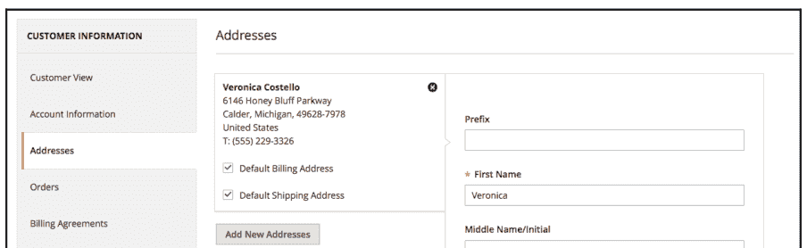

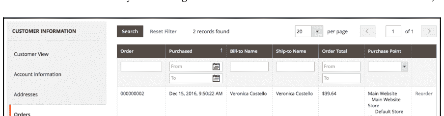

- **账单协议**：为了简化结账流程，客户可以与支付服务提供商 PayPal 签订账单协议。客户在结账时选择账单协议作为支付方式，PayPal 通过其唯一编号识别账单协议，并继续进行收费。**账单协议**部分包含该客户的所有账单协议：

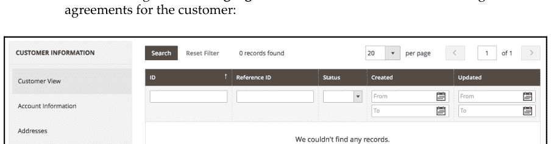

- **新闻通讯**：你可以检查客户是否订阅了新闻通讯，并查看新闻通讯列表，且能够按**ID**、**开始日期**、**结束日期**、**接收日期**、**主题**和**状态**进行筛选：

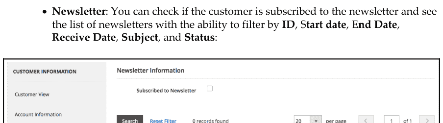

- **产品评论：** 你可以查看客户撰写的产品评论列表：

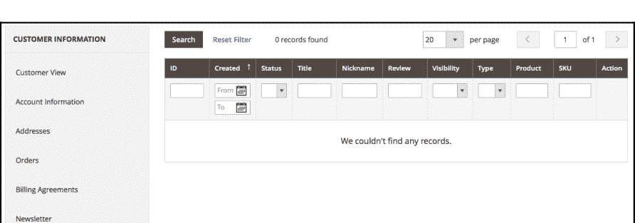

- **愿望清单：** 你可以查看客户愿望清单中的产品列表，包括重要信息，例如自产品添加到愿望清单以来的天数：

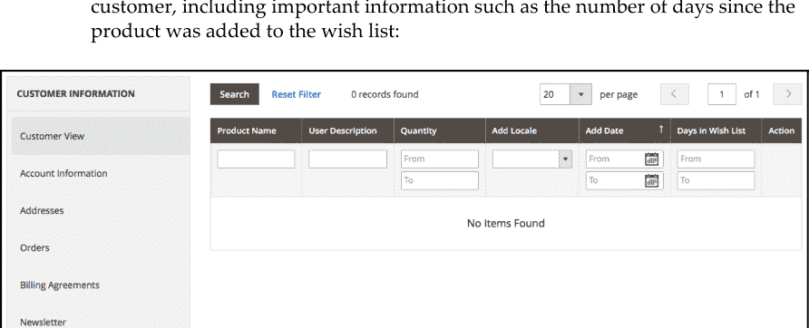

### 添加新客户

尽管客户可以从商店前台创建账户，但管理员也可以从管理后台创建账户。你可以通过单击“客户”页面（客户 | 客户 | 所有客户）中的“添加新客户”按钮来添加新客户：

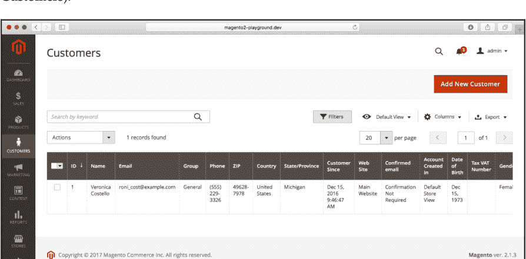

现在，点击屏幕右上角的**保存客户**按钮。你将跳转到**客户**页面，并看到成功消息，确认账户已创建：

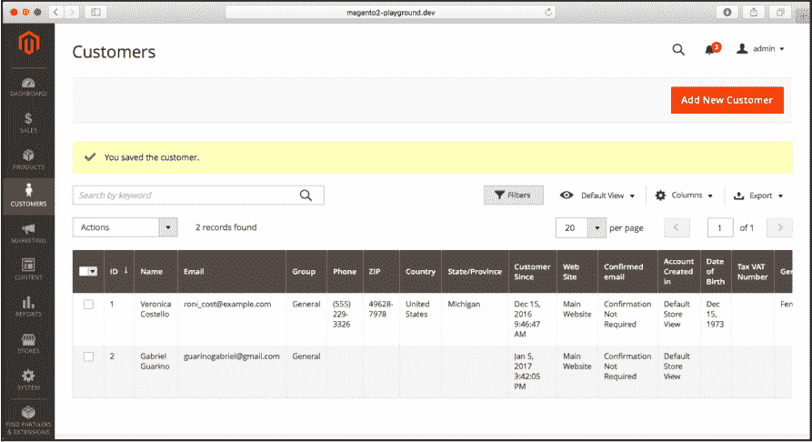

### 总结

你已经看到，在 Magento 中管理客户确实非常简单，从查看所有客户列表到应用有用的批量操作，例如*订阅新闻通讯*。创建和编辑客户也是一个简单的过程，你可以查看客户的所有信息，包括他们的订单、评论等。

在下一章中，我们将介绍为你的 Magento 商店设置和管理税费的过程。
