## 12 管理员用户和角色
# 管理员用户和角色

在本章中，我们将涵盖以下概念：
- 管理管理员用户
- 管理角色和授予权限

## 管理管理员用户

在管理电子商务网站时，你需要不同的管理员来访问管理后台中的不同页面。例如，如果你的团队成员负责在 Magento 商店中添加和更新产品，那么你需要该人员仅访问**产品 | 目录**页面。如果另一位团队成员负责营销，那么你可以创建一个具有特定角色的新管理员用户，使其仅访问**营销**和**内容**部分。

### 管理员用户和角色

你可以为 Magento 管理后台创建用户，并为每个用户角色授予特定权限。你可以通过打开管理后台中的“系统 | 权限 | 所有用户”页面查看现有管理员用户列表：

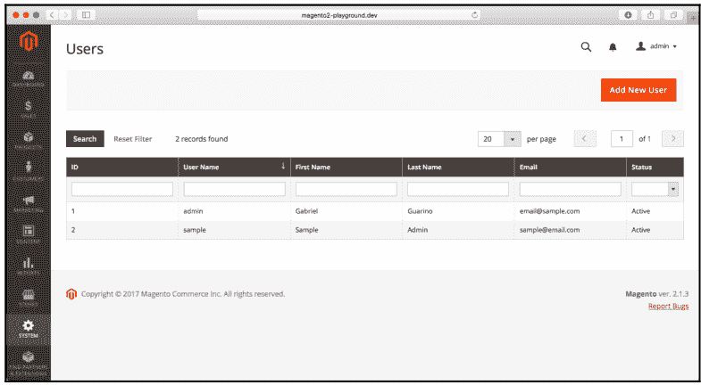

你可以通过单击屏幕右上角的“添加新用户”按钮来添加新用户。你将跳转到以下表单：

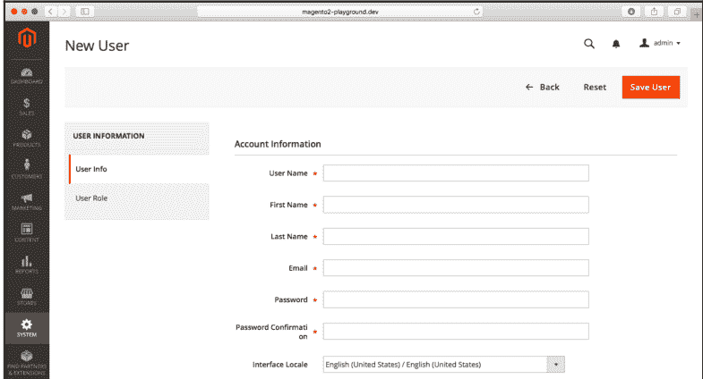

### 管理员用户和角色

在此，你可以设置新管理员用户的个人信息、密码、界面语言、账户状态和管理员角色。

如果我们查看“用户角色”选项卡，可以看到 Magento 默认只包含一个用户角色，即“管理员”：

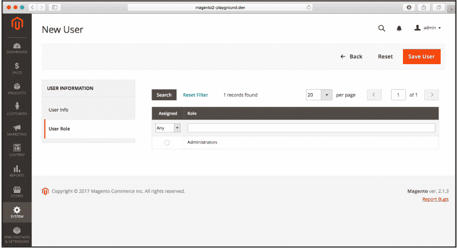

让我们通过向表单中添加以下信息来创建一个示例管理员用户：

#### 用户信息：
- **名字**：你的名字
- **姓氏**：你的姓氏
- **电子邮件**：你的电子邮件地址
- **密码**：为账户设置一个密码
- **确认密码**：为账户重复输入相同密码
- **界面语言**：英语（美国）/ 英语（美国）
- **你的密码**：当前管理员用户的密码

#### 用户角色：

- 角色：管理员

在表单中填写完这些信息后，点击“保存用户”。系统会将您重定向到用户网格页面，并在屏幕上显示以下消息：

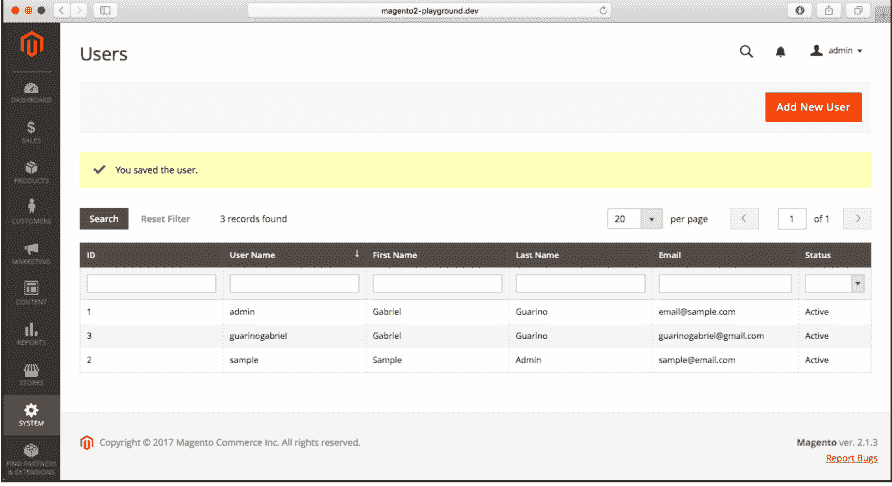

#### 管理角色

您可以为管理员用户创建新角色，从而为不同的管理页面授予特定权限。您可以在管理面板中转到“系统 | 权限 | 用户角色”页面来管理用户角色。系统会将您重定向到以下页面：

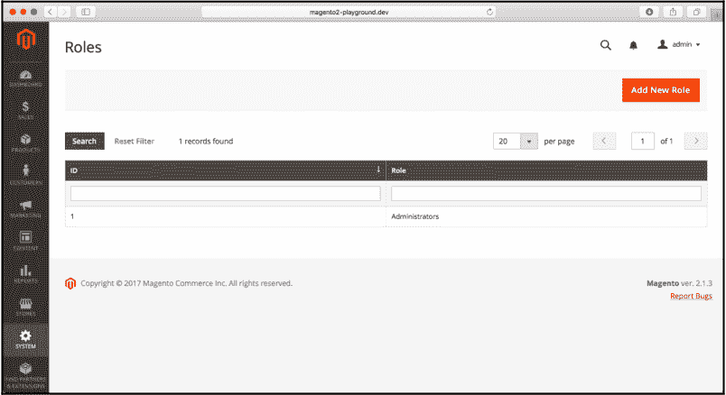

我们可以看到，Magento 默认提供的唯一管理员角色拥有管理面板中的所有权限。我们将通过点击屏幕右上角的**添加新角色**来创建一个新的用户角色。点击该按钮后，屏幕上会显示以下页面：

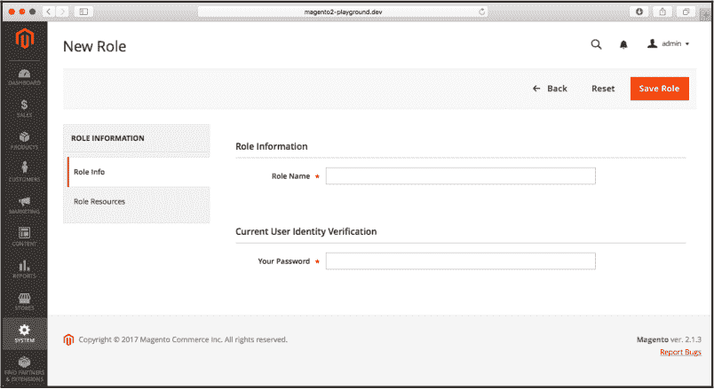

在第一个选项卡**角色信息**中，您可以设置角色名称，并指定当前管理员用户的密码，以便保存更改。在第二个选项卡**角色资源**中，您会看到可以分配给用户角色的所有资源列表：

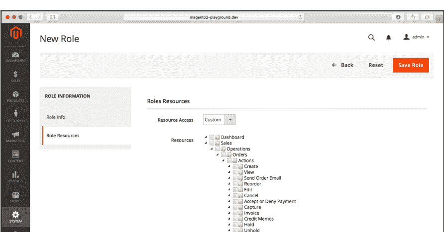

我们将创建一个示例用户角色，使其只能访问管理面板中的**仪表盘**和**销售**部分。

首先，我们将名称设置为`Sample User Role`，并在**角色信息**选项卡中指定当前管理员用户的密码。然后，我们将在“角色资源”选项卡中勾选“仪表盘”和“销售”复选框，如下面的屏幕截图所示：

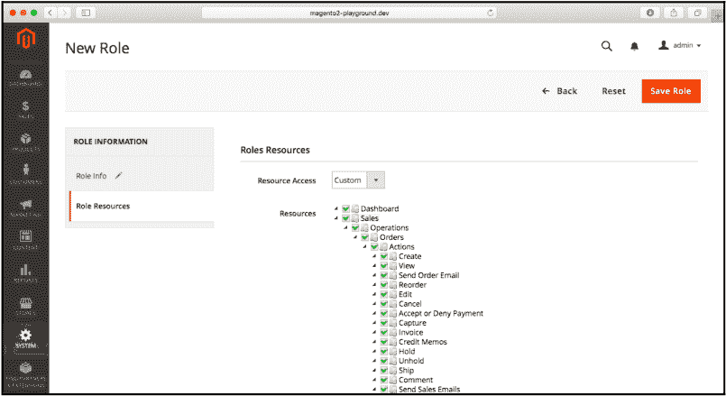

最后，点击**保存角色**，将新的管理员用户角色添加到 Magento。您将在角色网格中看到确认消息：

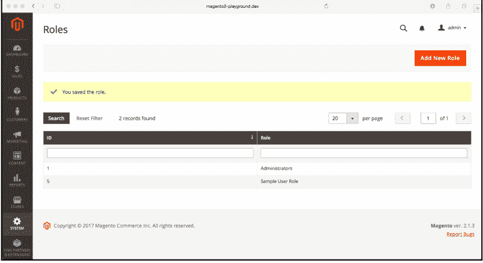

如果我们返回用户网格页面（系统 | 权限 | 所有用户），并点击刚刚创建的用户，就可以将该用户分配到新的用户角色：

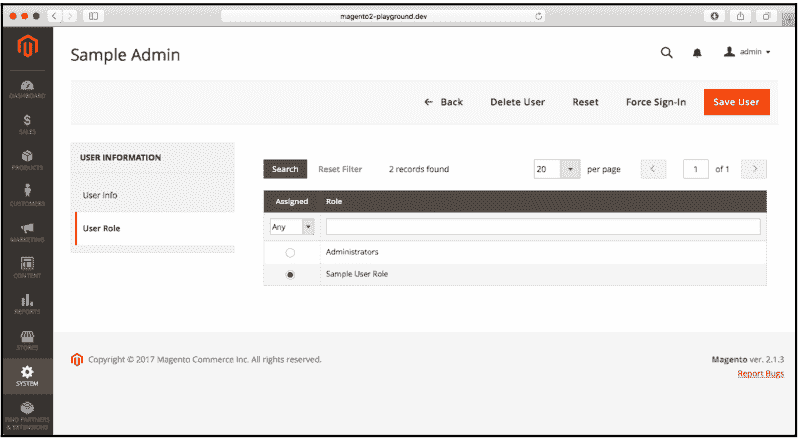

如果我们保存更改，退出当前管理员用户账户，然后以新用户身份登录，就会看到该用户只能访问“仪表盘”和“销售”部分：

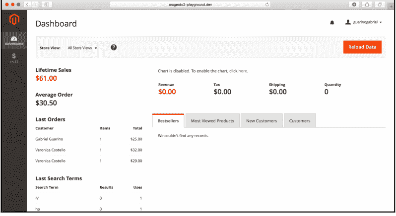

## 总结

在本章中，您学习了如何创建新的管理员用户，并为不同的管理区域授予特定权限。在下一章中，我们将介绍 Magento 中的税费配置，包括税类、税率规则、税区和税率。
