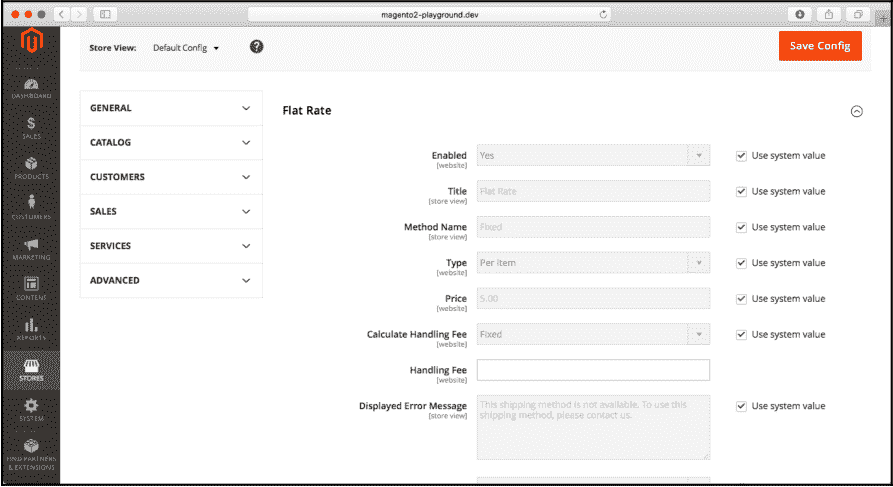
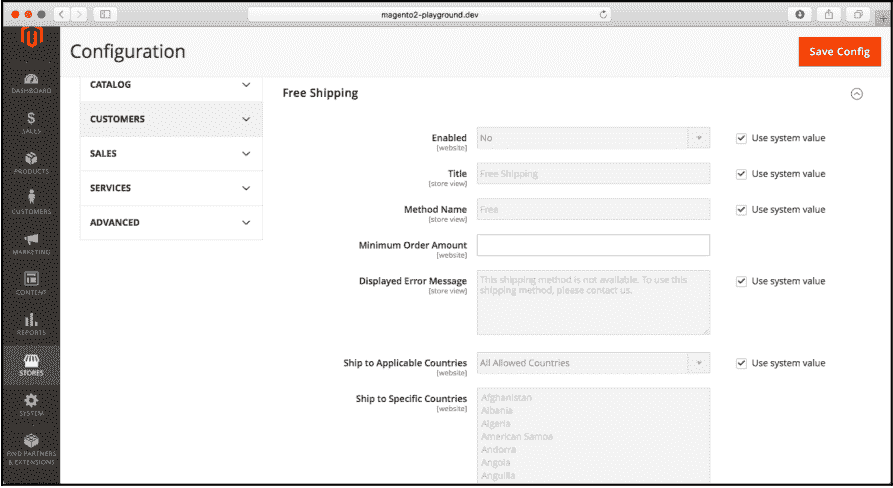
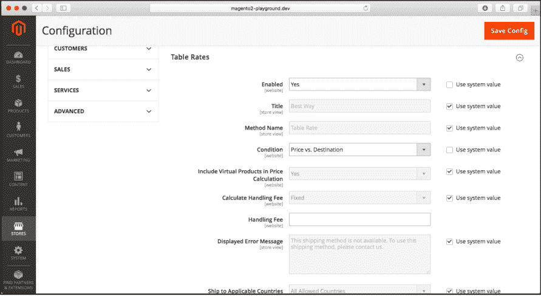
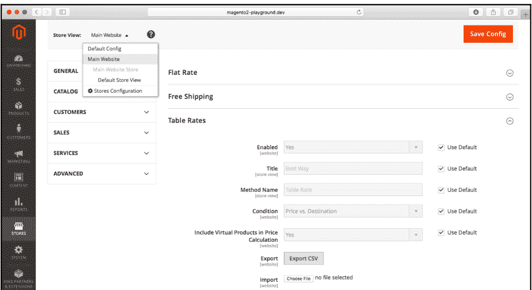
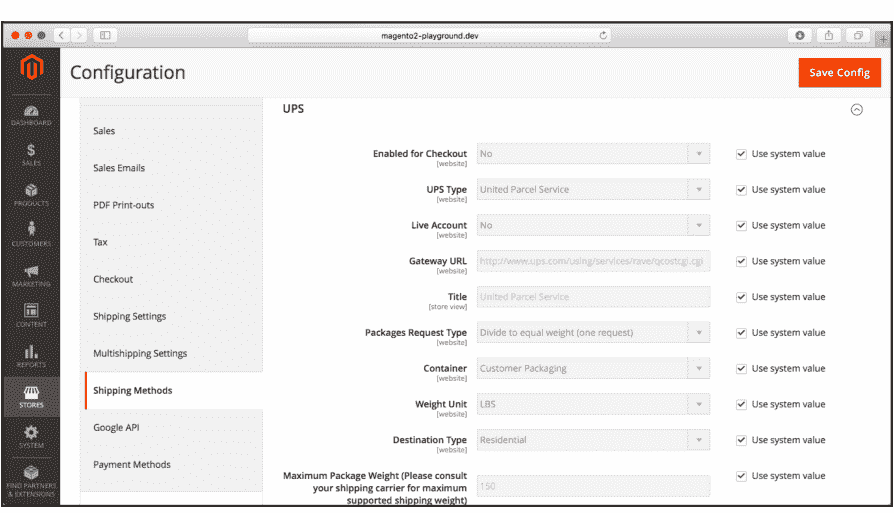
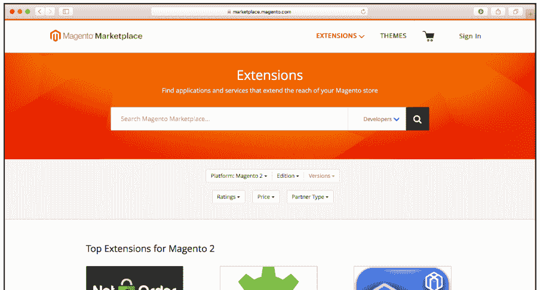

# 16 配置配送

我们将在本章中介绍以下内容：

- Magento 默认配送方式概述
- 如何设置 UPS 配送
- 其他承运商

## Magento 默认配送方式概述

在本章中，我们将逐步介绍 Magento 配送方式的配置。所有配置部分都位于 STORES | Configuration | SALES | Shipping Methods 页面。

## 统一费率

让我们从查看 **统一费率** 开始。如果您展开此部分，将看到以下表单：

这是将应用于您商店订单的预定义费用。定义为配送成本的金额是固定的，取决于您在管理面板中设置的配置。

要配置此方法，您应该更新以下字段：

- **启用：** 指定 **统一费率** 是否应作为店面（Storefront）上的配送方式可用。
- **标题：** 配送方式的描述性标题。
- **方法名称：** 这是在店面（Storefront）上显示在费率旁边的标签。

- **类型：** 这是 Magento 为配送方式设置费率所进行的计算。可用的类型如下：
  - **无：** 统一费率作为配送方式在店面（Storefront）上可用，但费率为零（免费配送）
  - **按订单：** 定义为 **统一费率** 配送方式价格的金额将按订单收取
  - **按项目：** 定义为 **统一费率** 配送方式价格的金额将乘以购物车中的项目数量，以设置订单的配送费率
- **价格：** 这是将根据前一个字段中选择的选项用于计算最终配送费率的金额。
- **计算手续费：** 设置手续费是根据前一个字段中定义的价格计算的固定金额还是百分比。
- **手续费：** 这将是用于计算手续费的固定金额或百分比。
- **显示的错误消息：** 当配送方式不可用时要显示的错误消息。
- **运送到适用的国家/地区：** 指定配送方式应对所有国家/地区可用，还是仅对特定国家/地区可用。如果您选择特定国家/地区，将启用 **运送到特定国家/地区** 下拉列表，以选择此配送方式可用的国家/地区。
- **排序顺序：** 设置顺序以确定 **统一费率** 在店面（Storefront）可用配送方式列表中的位置。数字越低，它在列表中显示的位置越高。

## 免费配送

下一个可用的配送方式是 **免费配送**。如果您展开该部分，将看到以下表单：

**免费配送** 方法，顾名思义，是专门为免费配送配置特定配送方式的功能。这是在线商店中最常见的促销活动之一，您可以指定规则，使免费配送在特定场景下可用，从最低订单金额到应满足的购物车价格规则，以允许订单享受 **免费配送**。

以下字段可用于配置配送方式：

- **启用：** 指定 **免费配送** 是否应作为店面（Storefront）中的配送方式可用。
- **标题：** 配送方式的描述性标题。
- **方法名称：** 这是在店面（Storefront）上显示在费率旁边的标签。
- **最低订单金额：** 设置订单符合免费配送条件所需的最低金额。

- **显示的错误消息：** 当配送方式不可用时要显示的错误消息。
- **运送到适用的国家/地区：** 指定配送方式应对所有国家/地区可用，还是仅对特定国家/地区可用。如果您选择特定国家/地区，将启用 **运送到特定国家/地区** 下拉列表，以选择此配送方式可用的国家/地区。
- **排序顺序：** 设置顺序以确定 **免费配送** 在店面（Storefront）可用配送方式列表中的位置。数字越低，它在列表中显示的位置越高。

## 表费率

接下来，我们将找到可作为配送方式配置的 **表费率**。如果您展开 **表费率** 部分，将看到以下表单：

这种配送方式允许您定义一个 CSV 文件来计算配送费率。CSV 文件的格式取决于配送计算的条件。您可以选择以下任一条件：

- **重量与目的地**
- **价格与目的地**
- **商品数量与目的地**

表费率配送方式配置中提供以下字段：

- **启用：** 指定表费率是否应作为店面（Storefront）上的配送方式可用。
- **标题：** 配送方式的描述性标题。
- **方法名称：** 这是在店面（Storefront）上显示在费率旁边的标签。
- **条件：** 这是根据您上传的表格计算费率的条件。可用的条件有：
  - **重量与目的地**
  - **价格与目的地**
  - **商品数量与目的地**
- **在价格计算中包括虚拟产品：** 定义是否应将虚拟产品包含在费率计算中。由于表费率配送用于根据客户地址（距离）计算价格，因此大多数情况下此选项设置为“否”，因为虚拟产品是通过电子邮件交付的。
- **计算手续费：** 设置手续费是根据前一个字段中定义的价格计算的固定金额还是百分比。
- **手续费：** 这将是用于计算手续费的固定金额或百分比。
- **显示的错误消息：** 当配送方式不可用时要显示的错误消息。
- **运送到适用的国家/地区：** 指定配送方式应对所有国家/地区可用，还是仅对特定国家/地区可用。如果您选择特定国家/地区，将启用“运送到特定国家/地区”下拉列表，以选择此配送方式可用的国家/地区。
- **排序顺序：** 设置顺序以确定统一费率在店面（Storefront）可用配送方式列表中的位置。数字越低，它在列表中显示的位置越高。

现在，要为表费率方法上传 CSV 文件，您应该使用屏幕左上角的下拉列表按网站进行筛选。之后，表费率表单中将出现两个新字段：导出和导入。您可以在以下截图中看到用于按网站筛选的下拉列表和新字段：

您可以使用“导出”字段中的“导出 CSV”按钮导出表费率配送方式的当前 CSV。如果您尚未上传 CSV，则可以下载 Magento 默认附带的 CSV。尤其重要的是，要有一个可用于为您的商店创建自己的 CSV 文件的模板。

这是 Magento 默认附带的 CSV：

### 配置 UPS 配送

如果你在“商店 | 配置”页面中转到“销售 | 配送方式 | UPS”部分，将看到以下表单：

我们将逐一介绍此表单中的各个字段：

- **常规配置：**
  - **启用结账**：指定 UPS 是否应作为店面的一种配送方式提供。
  - **UPS 类型**：你可以选择 **United Parcel Service** 或 **United Parcel Service XML**。使用 **United Parcel Service**，你可以获取实时运费；使用 **United Parcel Service XML**，你可以获取实时费率并打印 UPS 标签。
- **取决于 UPS 类型的 UPS 特定配置**：以下字段取决于你在上一个字段中所选的 **UPS 类型**。如果你选择 **United Parcel Service** 作为 **UPS 类型**，将显示以下字段：

  - **正式账户**：选择 **是** 可在线启用 UPS（生产环境）。如果你选择 **否**，则会在测试模式下将 UPS 启用为配送方式。
  - **网关 URL**：Magento 中已包含默认网关 URL。如果需要更改网关 URL，可以在此字段中进行更改。
  - **标题：** 配送方式的描述性标题。
  - **包裹请求类型：** 你可以选择 **按等重拆分（一个请求）** 或 **使用原重量（少量请求）**。

如果你选择 **United Parcel Service XML** 作为 UPS 类型，将显示以下字段：

- **正式账户：** 选择 **是** 可在线启用 UPS（生产环境）。如果你选择 **否**，则会在测试模式下将 UPS 启用为配送方式。
- **访问许可证号：** 你的 UPS 访问密钥。
- **网关 XML URL：** Magento 中已包含默认网关 XML URL。如果需要更改网关 XML URL，可以在此字段中进行更改。
- **模式：** 如该字段的注释所示，此设置可启用或禁用 UPS 对 Magento 服务器的 SSL 验证。
- **用户 ID：** 你的 UPS 用户 ID。
- **发货地：** 从下拉列表中选择一个选项以指定货件的发货地。
- **密码：** 你的 UPS 账户密码。
- **标题：** 配送方式的描述性标题。
- **启用协商费率：** 启用与 UPS 的协商运费费率。
- **包裹请求类型：** 你可以选择 **按等重拆分（一个请求）** 或 **使用原重量（多个请求）**。
- **发货人编号：** 这是一个由六个字符组成的 UPS 代码，是协商费率所必需的。
- **跟踪 XML URL：** Magento 中已包含默认跟踪 XML URL。如果需要更改跟踪 XML URL，可以在此字段中进行更改。

**其他配置：** 以下字段适用于 **United Parcel Service** 和 **United Parcel Service XML UPS** 两种类型：

- **容器：** 设置货件的容器。
- **重量单位：** 设置配送方式的重量单位。
- **目的地类型：** 选择目的地类型是住宅还是商业。
- **最大包裹重量：** 设置承运人中的最大包裹重量数值。
- **取件方式：** 将取件方式设置为以下任一方法：
  - **常规每日取件**
  - **按需空运**
  - 一次性取件
  - 信件中心
  - 客户柜台
- **最小包裹重量：** 设置承运人中的最小包裹重量数值。
- **计算处理费：** 设置处理费是基于上一个字段中定义的价格的固定金额还是百分比。
- **处理费：** 这将是一个固定金额或百分比，用于计算处理费。
- **允许的配送方式：** 选择将在店面可供选择的 UPS 配送方式。
- **免费配送方式：** 选择应可作为免费配送方式供选择的 UPS 配送方式。
- **免费配送金额阈值：** 当订单总金额高于此数字时，上一个字段中选择的 UPS 配送方式将可作为免费配送方式供选择。
- **显示的错误消息：** 当配送方式不可用时显示的错误消息。
- **配送至适用国家：** 指定配送方式应对所有国家可用，还是仅对特定国家可用。如果你选择特定国家，将启用 **配送至特定国家** 下拉列表，以选择可为此配送方式提供的国家。
- **不适用时显示配送方式：** 指定当配送方式不可用时，是否应在店面显示该配送方式。
- **调试：** 启用调试模式，以在开发过程中记录有用的调试信息。
- **排序顺序：** 设置顺序以确定 **UPS** 在店面可用配送方式列表中的位置。数字越低，在列表中显示的位置越高。

设置好配送方式后，客户将能够从 UPS 获取费率，并为其订单选择配送方式。

在那里，你会看到可以按 Magento 版本（edition）、版本号、扩展评分、价格和扩展开发者类型进行筛选：

## 总结

在本章中，我们回顾了 Magento 默认包含的配送方式。在下一章中，我们将回顾订单履行的过程，包括 Magento 中订单生命周期的概述。
