# 17 订单履行

在本章中，我们将介绍以下概念：

- 订单管理
- 状态（State）和状态（Status）
- 发票、发货和退款单

## 订单管理

Magento 提供了一种强大而简单的方式来管理你的商店中生成的订单。如果客户通过电话订购并想购买商店中的产品，你甚至可以从管理后台创建订单。

你可以在管理后台的“销售 | 订单”页面查看和管理订单：

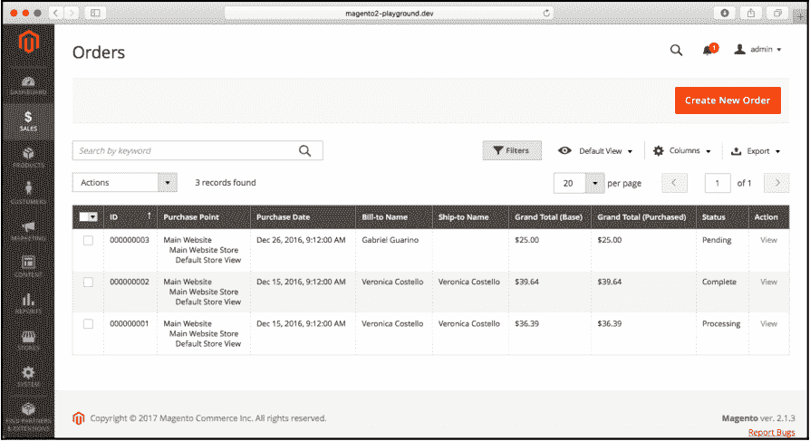

此页面一个非常重要的方面是，你可以选择非常有用的批量操作来管理订单：

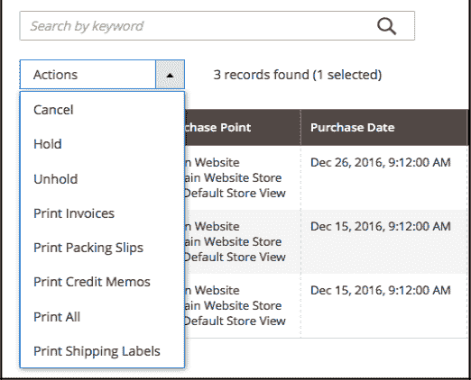

如你所见，你可以同时挂起多个订单、打印多个订单的发票等等。除此之外，订单网格还允许你继续使用 Magento 2 管理后台网格的所有工具，例如以下功能：

- 筛选器
- 可选择的列
- 导出为 CSV 和 XML
- 按关键字搜索

如果你单击网格中的任意订单，将跳转到订单页面：

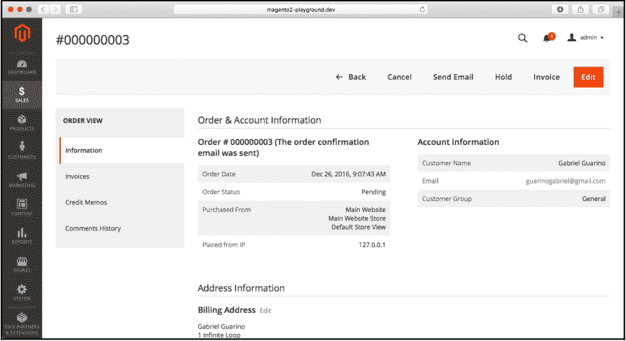

你首先会注意到，在屏幕右上角有几个针对此订单的操作：

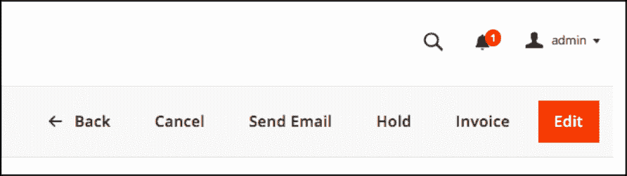

你可以单击这些按钮快速执行操作——从向客户发送订单邮件，到挂起订单、创建发票，甚至编辑订单。

- **信息**选项卡

让我们逐一查看**信息**选项卡中的各个部分：

| 订单与账户信息 |  |
|---|---|
| **订单 # 000000003 （订单确认邮件已发送）** | **账户信息** |
| 订单日期 | 2016年12月26日 上午9:07:43 |
| 订单状态 | 待处理 |
| 购买自 | 主网站 主网站商店 默认商店视图 |
| 下单 IP | 127.0.0.1 |
| 客户名称 | Gabriel Guarino |
| 电子邮件 | guarinogabriel@gmail.com |
| 客户组 | 一般 |

在这里，你可以看到订单的基本信息。了解该订单对应的商店（对于多商店 Magento 网站而言）、客户名称、电子邮件甚至 IP 地址非常重要，以防订单可疑。

接下来的两个部分是**地址信息**和**付款与配送方式**：

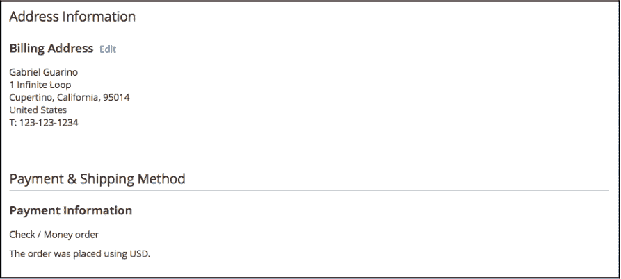

如你在第一部分中所见，如果客户在下单时出现任何拼写错误或失误，你可以编辑客户地址（包括配送地址和账单地址）。

最后，在**订单总计**部分，你可以跟踪**总计**、已支付总额、已退款总额和应付总额。

- **发票选项卡**

如果你转到**发票**选项卡，你将看到一个包含为此订单生成的所有发票的网格。在前面的示例中，你可以看到没有发票的网格（我们将在本章后面生成一张发票）：

此网格唯一可用的批量操作是**PDF 发票**，它会以 PDF 格式下载所选每张发票的副本。

- **贷项通知单选项卡**

在此部分，你可以看到为此订单生成的所有贷项通知单的完整列表：

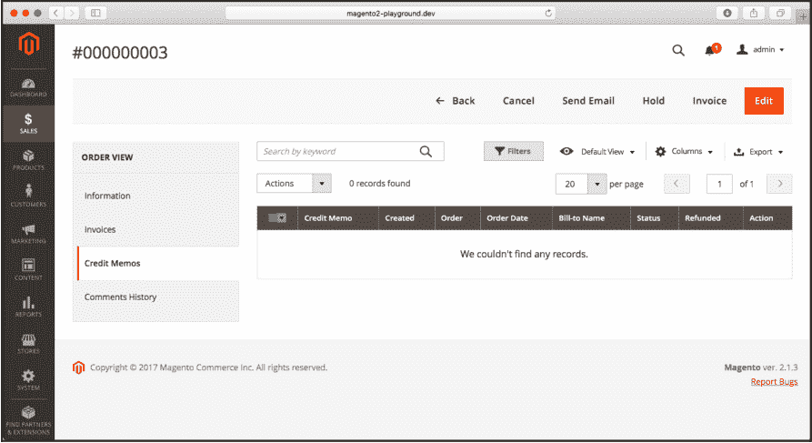

与**发票**选项卡一样，此网格上有一个批量操作，可为所有选中的贷项通知单下载 PDF。

### 履行订单

- **发货选项卡**

在此部分，你可以看到为此订单生成的所有发货记录的完整列表。需要注意的是，该选项卡在之前的图片中不可用。这是因为发货选项卡仅适用于实物订单，而我们到目前为止所查看的订单是一个仅包含 1 个可下载产品的订单。

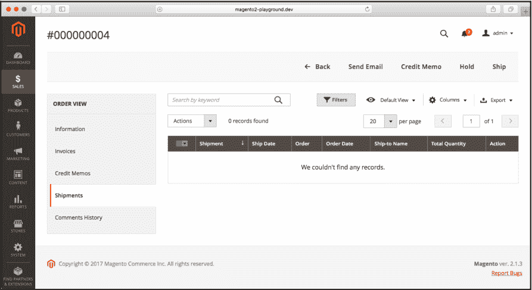

- 评论历史选项卡

除了**信息**选项卡中的**此订单备注**部分之外，你还可以从**评论历史**选项卡查看订单的完整评论列表：

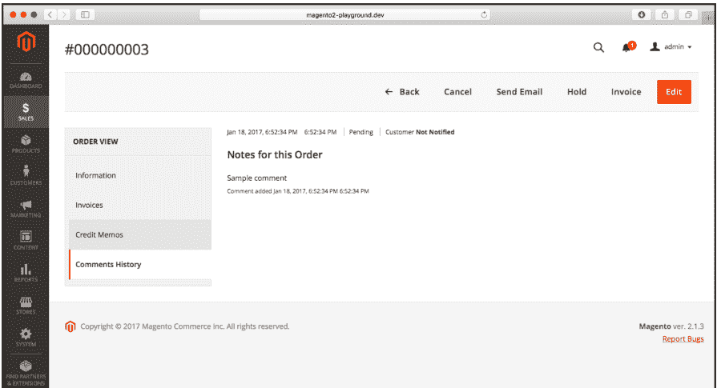

### 履行订单

如果你需要编辑客户订单，可以通过单击屏幕右上角的“编辑”按钮来完成。但是，如果你单击该按钮，你将看到以下消息：

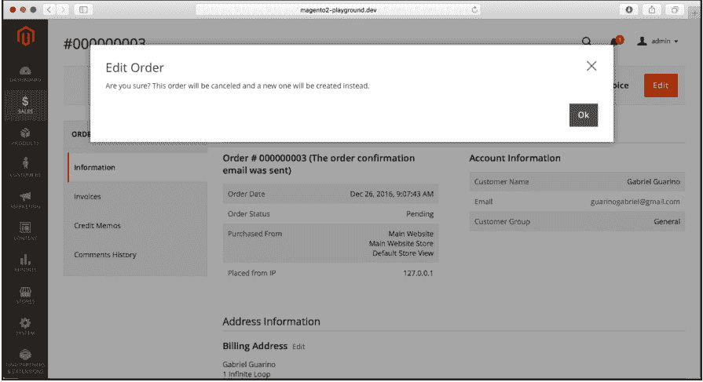

尽管该操作的名称是“编辑”，但实际上当前订单将被取消，并且你将被重定向到一个包含与当前订单相同信息的表单，但在创建订单之前可以编辑这些信息。

### 履行订单

如果你需要编辑客户购买的物品，则需要编辑订单，但更改地址信息则没有必要。如果你单击账单地址或发货地址旁边的“编辑”按钮，你将被重定向到以下表单以编辑这些详细信息：

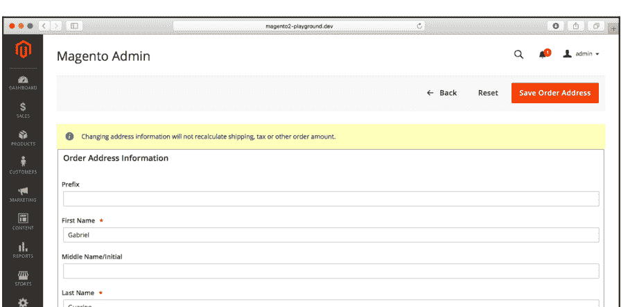

正如你在前面截图中的消息中所看到的，更改发货地址不会改变订单总额，因为运费、税金和订单金额不会被重新计算。

### 履行订单

这意味着，例如，当街道名称中存在拼写错误时，编辑地址很有用；但如果地址完全不同，则应取消订单并创建一个新订单（基本上，通过单击“编辑”按钮）以获得更新的运费和税率。

现在，让我们回到订单网格。你会在屏幕右上角看到一个用于创建新订单的按钮：

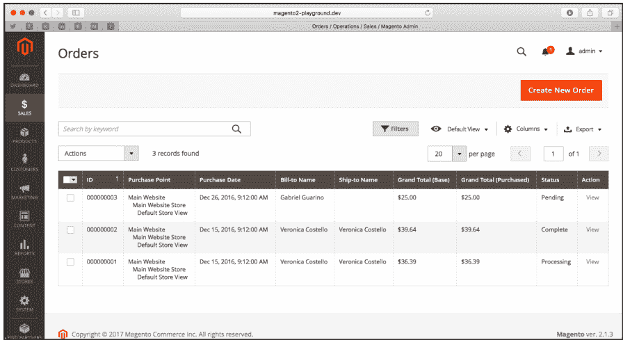

### 履行订单

如果你单击该按钮，你将被重定向到以下屏幕：

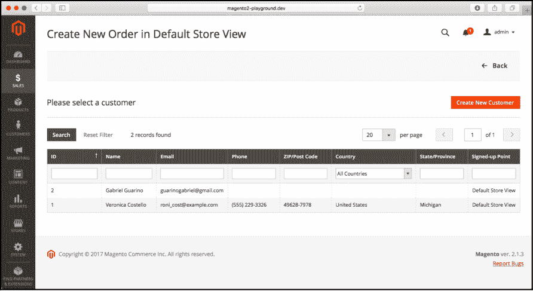

创建新订单流程的第一步是选择客户。你可以从列表中选择客户，也可以使用屏幕右上角的按钮创建新客户。

选择客户后，下一步是在以下页面上添加与订单相关的所有信息：

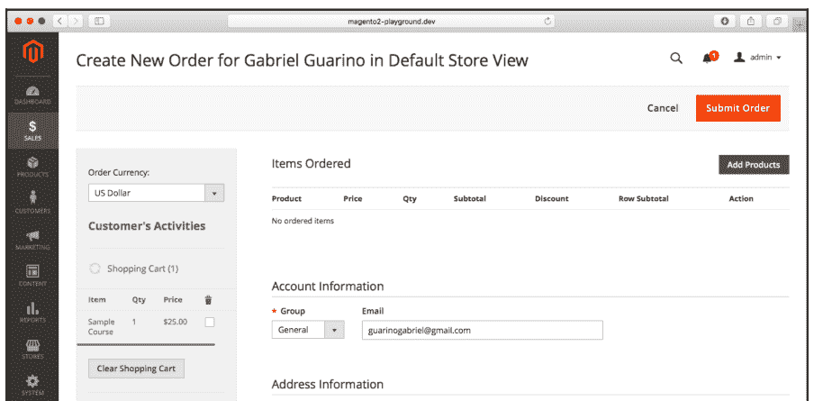

这是一个非常长的表单，包含许多用于配置订单的选项。

首先要注意的是左侧的侧边栏。你可以选择订单的货币，还可以根据客户活动更新订单。

你将能够看到客户在店面购物车中的所有物品、心愿单中的物品列表、最近订购的物品、比较列表中的产品、最近比较过的产品以及最近查看过的产品。这是一种基于客户在店面中的操作历史快速选择订单产品的方法。

现在，让我们从第一个部分“已订购物品”开始。

### 履行订单

如果你单击此部分右侧的**添加产品**按钮，将显示以下网格：

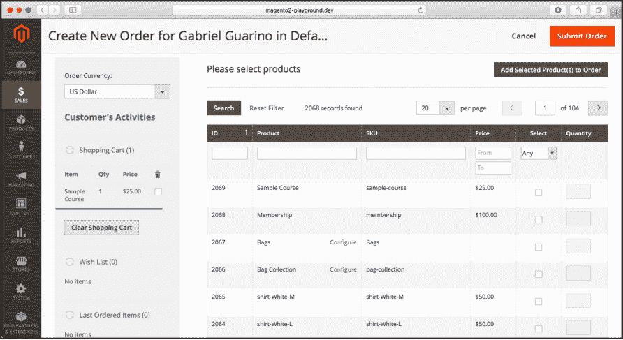

正如你在**产品**列中所看到的，对于捆绑产品、分组产品和可配置产品，有一个**配置**链接。如果你单击该按钮，你将能在以下窗口中为客户配置这些产品：

### 履行订单

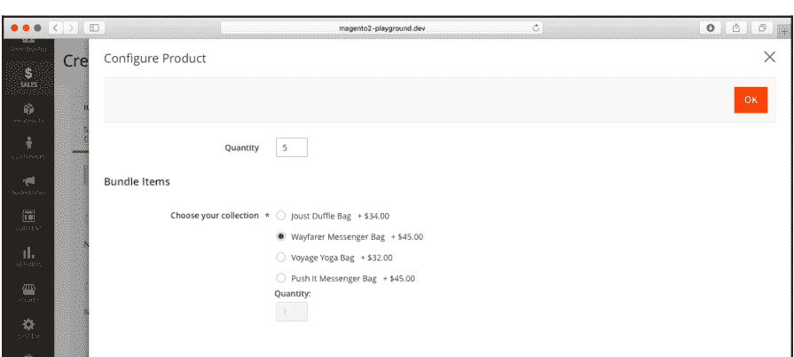

一旦你为订单选择了所有产品，你可以单击“将所选产品添加到订单”按钮来更新“已订购物品”网格：

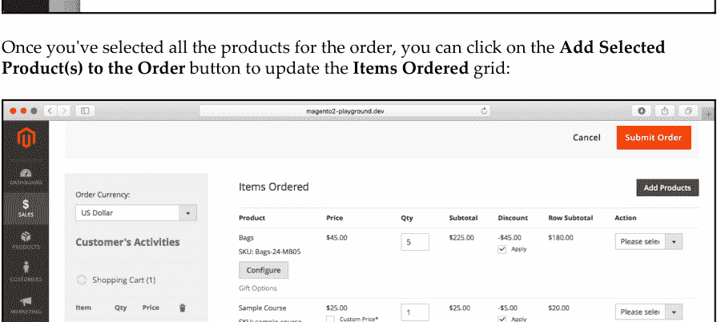

### 履行订单

最后，在**已订购物品**部分，你可以看到**应用优惠券代码**字段。假设我们接到客户电话，并在管理面板中下订单；如果客户有商店促销活动的优惠券代码，你可以将优惠券代码添加到该字段中，促销活动将被应用。

接下来，我们有**账户信息**和**地址信息**部分：

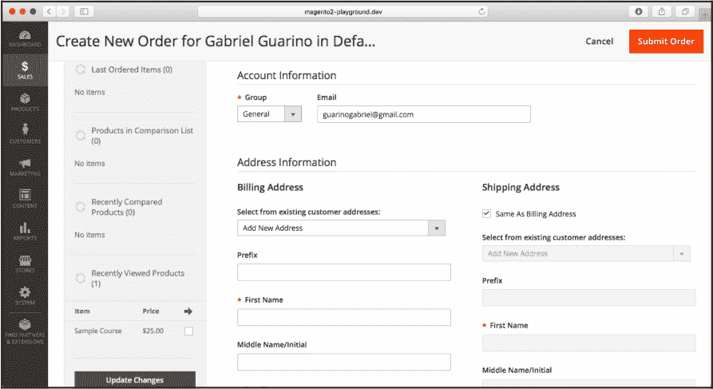

在第一个部分中，你可以更改订单的客户组和客户电子邮件。在第二个部分中，你可以从客户账户中选择现有地址，或者在客户没有可用地址或订单需要不同地址时添加新地址。此外，你可以选择**与账单地址相同**，以使用发货地址作为账单地址（此选项在新订单中默认选中）。

### 履行订单

最后，我们可以看到**付款与发货信息**和**订单总计**部分：

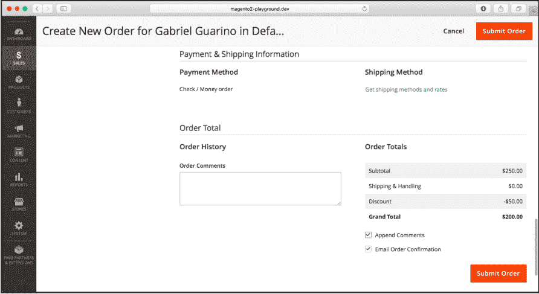

在**付款与发货信息**部分，你可以为订单选择付款方式和发货方式，运费将使用你在上一部分中指定的地址进行计算。

如果你单击**获取发货方式和运费**链接，系统将使用订单的发货地址即时计算运费，然后你就可以选择客户偏好的发货方式。

最后，在**订单总计**部分，你可以像我们之前看到的那样向订单添加评论、查看订单总计，并选择是否要在订单确认邮件中附上评论并发送给客户。

### 状态和状态值

从订单在 Magento 中创建的那一刻起，它就会被处理并经历不同的状态和状态值。

Magento 在内部使用订单状态来标识订单的当前阶段。这些状态不可自定义，且在后台中不可见；它们只能在 Magento 的代码库和数据库中看到。

订单状态值由商店管理员使用，用来为订单设置流程，从购买开始到订单开票和产品交付为止。这些状态值可由商店管理员在 Magento 管理面板中进行自定义。

你可以在 `sales_order_status_state` 数据库表中查看所有内部订单状态的列表：

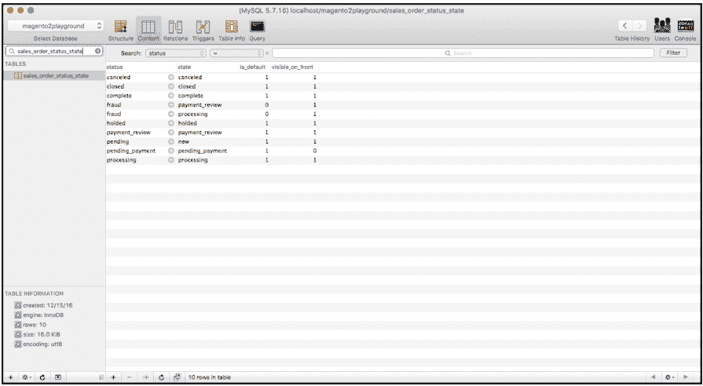

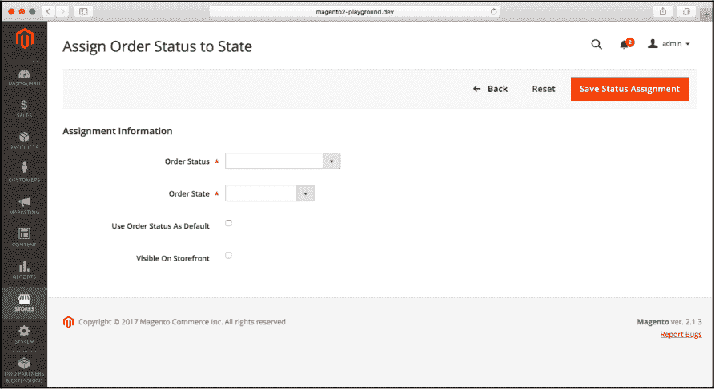

## 发票、发货和贷项通知单

生成和管理发票、发货以及贷项通知单的过程非常简单，且对它们而言流程相同。

如果进入订单页面，你会看到之前介绍过的标签页，包括以下内容：

- Invoices
- Credit Memos
- Shipments

从这两个部分中，如我们之前所见，可以看到该订单的发票和贷项通知单列表。

### 履行订单

你可以通过点击屏幕右上角编辑按钮旁边的 Invoices 按钮为订单创建发票：

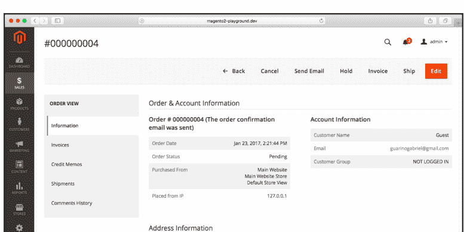

点击该按钮后，你将看到发票中将包含的所有信息的预览，并且可以添加注释并通过电子邮件发送发票副本：

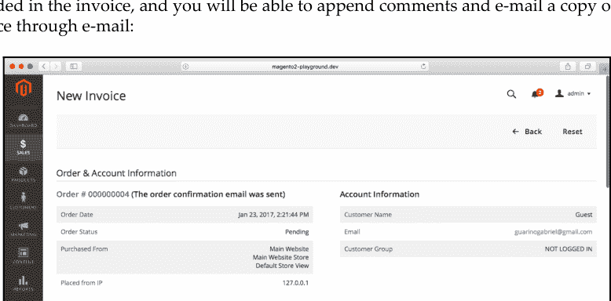

点击 **Submit Invoice** 后，发票将被生成且订单状态会被更新。接下来，你可以为订单创建发货。

如果进入 **Shipments** 标签页，你将看到为当前订单创建的发货列表：

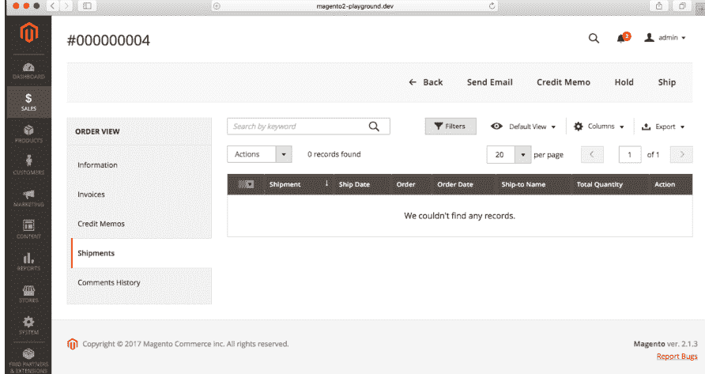

要创建发货，应点击屏幕右上角的 Ship。你将被重定向到以下页面：

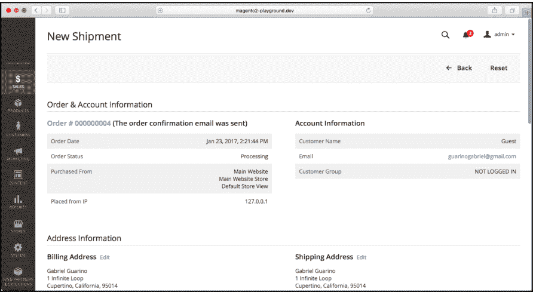

在该页面上，你可以编辑收货和账单地址，为已发货产品添加追踪号码，指定将要发货的商品，添加注释，并通过电子邮件发送发货副本。一旦点击 Submit Shipment，发货将被创建，订单状态会被更新，且发货信息可从发货标签页中查看：

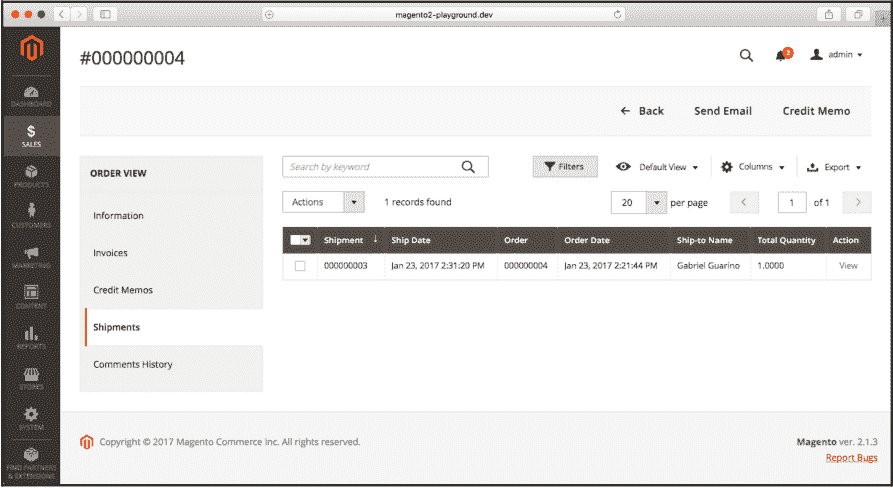

当订单已开具发票后，你可以通过点击屏幕右上角的 **Credit Memo** 按钮创建贷项通知单。你将被重定向到以下页面：

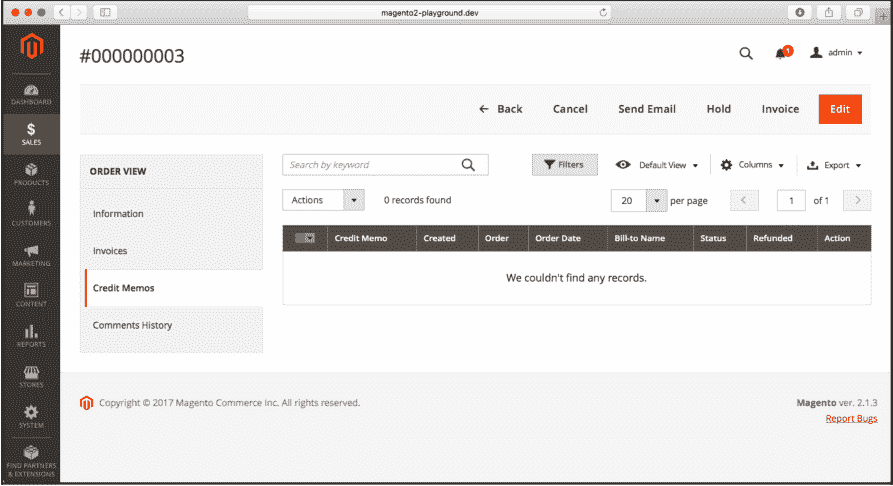

在那里，你可以标记要退回库存的商品，设置退款数量，为运费退款指定特定金额，并调整退款和费用。此外，如我们对发票和发货所见，你可以添加注释并通过电子邮件发送副本：

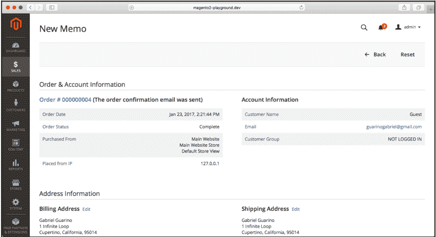

如果点击 **Refund Offline**，贷项通知单将被生成，并在屏幕上显示以下消息：

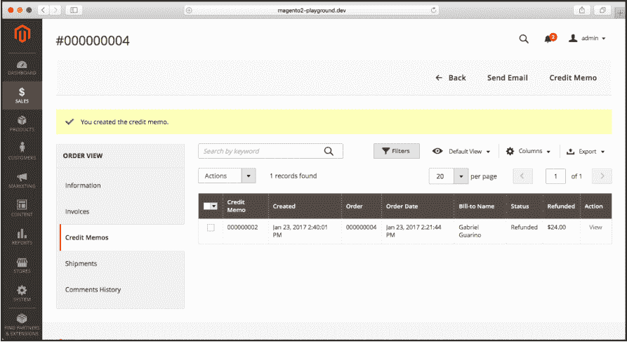

## Summary

在本章中，我们回顾了 Magento 中订单的生命周期。在下一章中，我们将介绍如何在 Magento 中修改交易性电子邮件并管理商店通讯。
