# 18 交易性电子邮件和通讯

# 交易性电子邮件和通讯

在本章中，我们将涵盖以下主题：

- Modifying transactional e-mail templates
- Modifying newsletter templates
- Handling newsletters and their subscribers

### Modifying transactional e-mail templates

Magento 提供了启动你的电子商务商店所需的所有交易性电子邮件模板。交易性电子邮件是 Magento 在商店中发生特定操作时自动发送给客户的电子邮件，例如用户创建客户账户或下达新订单时。

你可以通过管理面板中的 **MARKETING | Communications | Email Templates** 页面修改 Magento 2 中包含的默认交易性电子邮件。

如果首次打开该页面，你会看到网格为空：

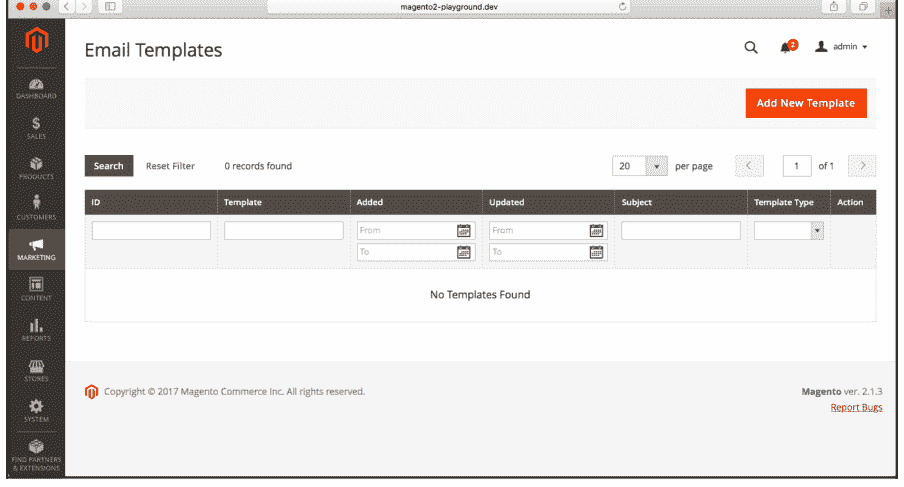

只有由管理员修改过的交易性电子邮件才会显示在 Email Templates 网格上。你可以通过点击 Add New Template 按钮修改或添加交易性电子邮件模板。

**New Template** 页面将会显示：

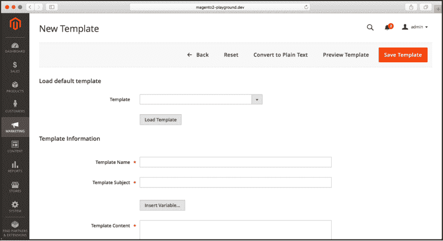

如 **Template** 下拉列表中所示，这是 Magento 2 中包含的交易性电子邮件列表：

- **Customer Account:**
  - New Account
  - New Account Confirmation Key
  - New Account Confirmed
  - New Account Without Password
  - Forgot Password
  - Remind Password
  - Reset Password
  - Change Email
  - Change Email and Password
- **Customer Activity:**
  - Contact Form
  - Send Product Link to Friend
  - Wishlist Sharing
- **Newsletters:**
  - Subscription Confirmation
  - Subscription Success
  - Unsubscription Success
- **Product Alert:**
  - Cron Error Warning
  - Price Alert
  - Stock Alert
- **Promotions:**
  - Promotion Notification / Reminder
  - Admin Activity
  - Forgot Admin Password
  - Reset Password
- **Email Templates:**
  - Email – Header
  - Export Failed
  - Import Failed
- **Product Alert:**
  - Product Alerts Cron Error
  - Product Price Alert
  - Product Stock Alert
- **Order:**
  - New Order
  - New Order for Guest
  - Order Update
  - Order Update for Guest
  - Payment Failed
- **Invoice:**
  - New Invoice
  - New Invoice for Guest
  - Invoice Update
  - Invoice Update for Guest
- **Shipment:**
  - New Shipment
  - New Shipment for Guest
  - Shipment Update
  - Shipment Update for Guest
- **Credit Memo:**
  - Credit Memo Update
  - Credit Memo Update for Guest
  - New Credit Memo
  - New Credit Memo for Guest
- **System Notifications:**
  - Sitemap Generate Warnings
  - Currency Update Warnings

如果选择模板并点击 **Load Template** 按钮，模板内容将被加载到表单中，如以下截图所示：

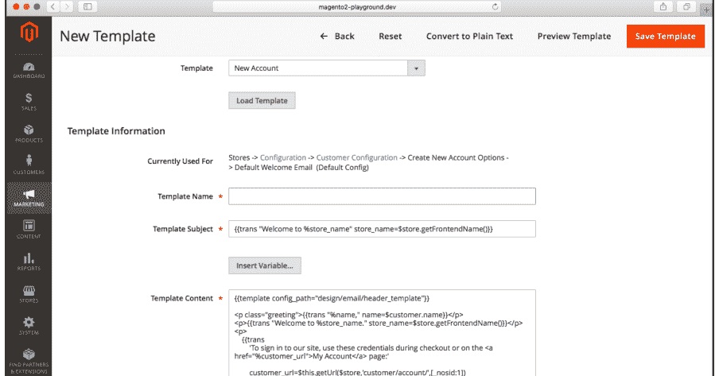

在该表单中，你可以为模板设置描述性名称，设置主题和内容，并添加自定义样式以渲染模板布局。

此外，你可以通过点击屏幕顶部的 **Convert to Plain Text** 按钮移除模板中的所有 HTML 标签。

在该按钮旁边，你会找到 **Preview Template**，它允许你确切地看到模板将如何显示给客户。

如以下截图所示，模板已加载到 Magento 管理面板中：

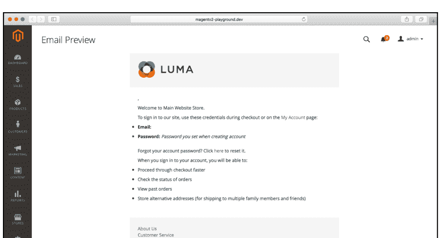

电子邮件的标志在管理面板的以下部分配置：

**CONTENT | Design | Configuration**

我们将在 `Chapter 20`，*Customizing your Magento Store* 中介绍该部分。

在添加详细信息并预览电子邮件模板后，你可以通过点击 **Save Template** 按钮保存新模板。

你将被重定向到 **Email Templates** 网格，并会看到确认消息：

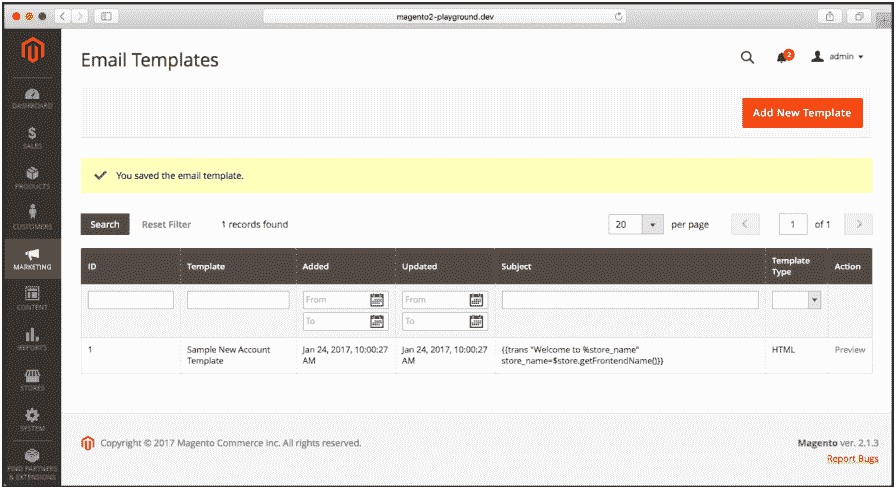

### Modifying newsletter templates

你可以在管理面板的 **MARKETING | Communications | Newsletter Templates** 页面中查看现有通讯模板列表。

如以下截图所示，在默认的 Magento 2 安装中，网格为空：

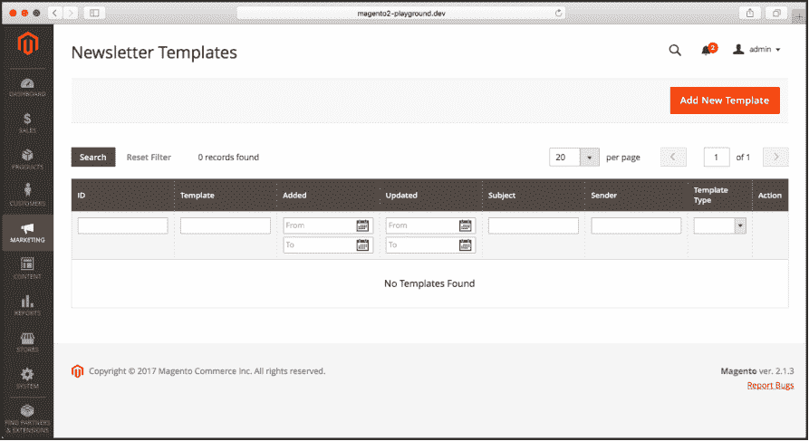

你可以通过点击屏幕右上角的 **Add New Template** 按钮添加通讯模板。该表单与新的交易性电子邮件模板表单非常相似，并在顶部包含相同的操作：

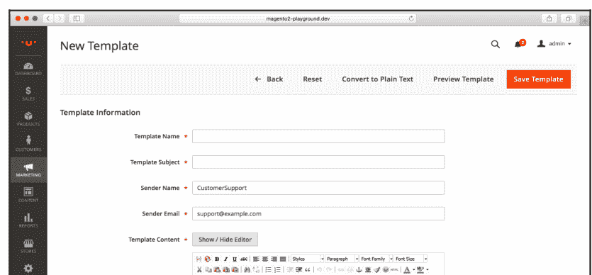

由于表单非常相似，且操作与我们之前回顾的表单相同，我们将继续保存新模板。

新模板已保存，并在屏幕上显示确认消息：

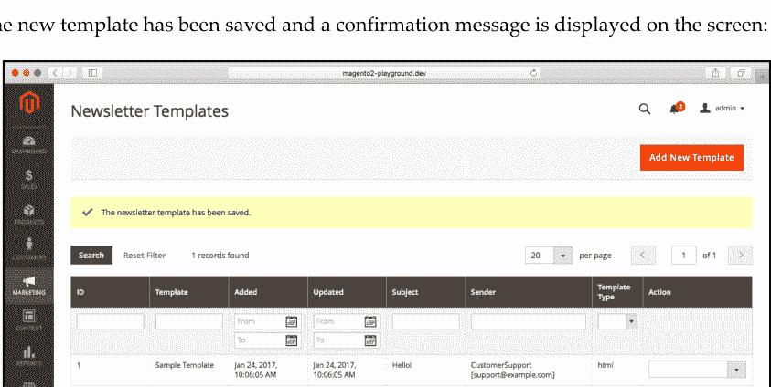

### 交易邮件和新闻通讯

## 处理新闻通讯及其订阅者

您可以在管理面板的 MARKETING | Communications | Newsletter Subscribers 页面中查看 Magento 商店的电子邮件订阅者列表。

如以下屏幕截图所示，在您首次安装 Magento 2 时，网格是空的：

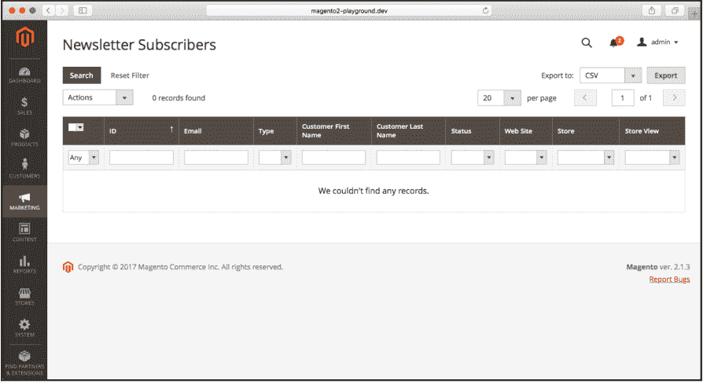

如果我们前往 Storefront，我们将在页脚中找到订阅框：

如果您点击订阅，将在屏幕上显示以下确认消息：

现在，如果我们返回到 Newsletter Subscribers 页面，我们将在网格中看到新的订阅者：

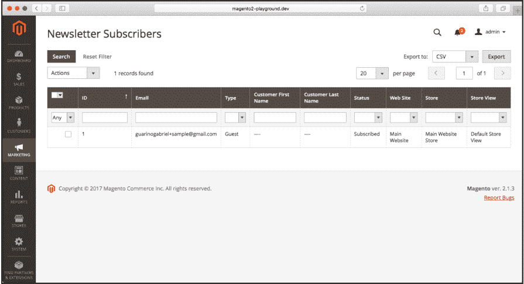

从该网格中，您可以使用网格批量操作取消订阅或删除电子邮件账户；您可以导出所有订阅者，对其进行筛选，并按列对订阅者进行排序。

现在，如果您返回到 Newsletter Templates 页面（MARKETING | Communications | Newsletter Templates），您将能够通过使用最后一列中的下拉菜单将新闻通讯模板添加到队列中：

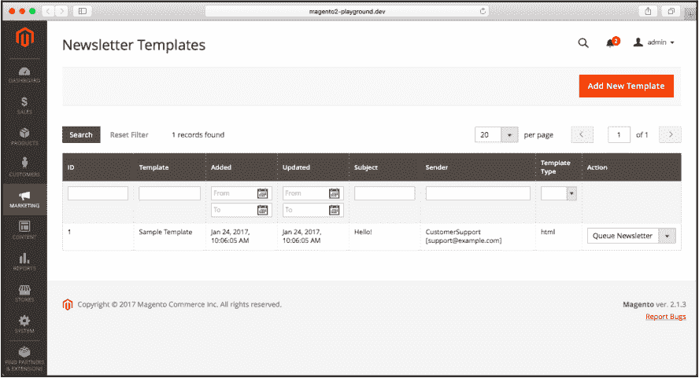

您将被重定向到 **Edit Queue** 页面，您可以在此设置 **Queue Date Start** 以指定何时发送新闻通讯电子邮件并编辑新闻通讯详细信息：

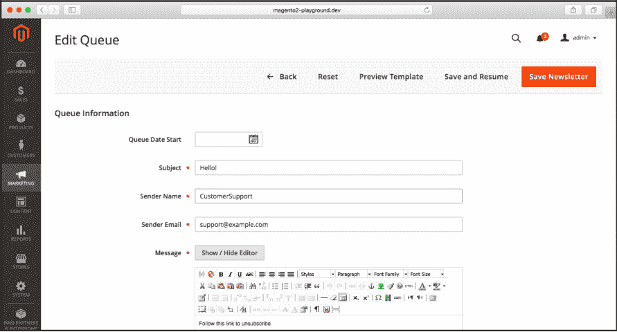

保存模板以将其包含在队列中后，您会发现该模板处于待处理状态，等待发送到 **Newsletter Queue** 页面（**MARKETING | Communications | Newsletter Queue**）：

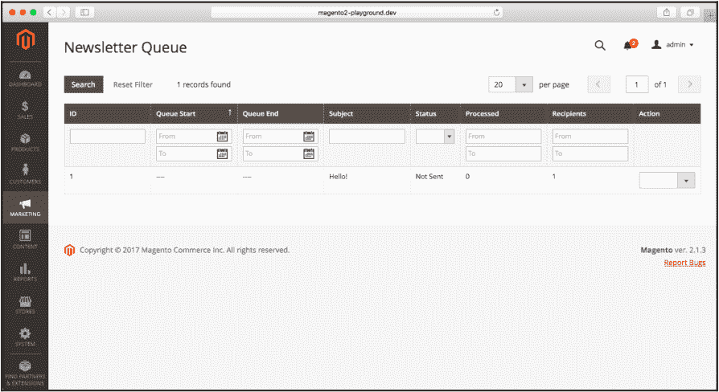

如果您点击该行，您将被重定向到之前的同一页面，您可以在此设置 **Queue Date Start** 以指定何时发送新闻通讯并修改新闻通讯信息。

## 总结

在本章中，我们介绍了修改交易邮件和新闻通讯的过程，并安排了一个新闻通讯模板发送给新闻通讯订阅者。在下一章中，我们将创建报告以跟踪商店销售、客户活动以及与商店目录相关的统计数据。
