### 20 自定义您的 Magento 商店

本章我们将介绍以下主题：

- How to manage Magento themes
- How Inline Translation works
- Magento marketplace

## 如何管理 Magento 主题

Magento 中的主题定义了客户 Storefront 的外观和感觉。默认情况下，Magento 包含以下主题：

- Magento Blank
- Magento Luma

### 自定义您的 Magento 商店

您可以在 **CONTENT | Design | Configuration** 管理面板部分查看 Magento 商店中可用的主题列表：

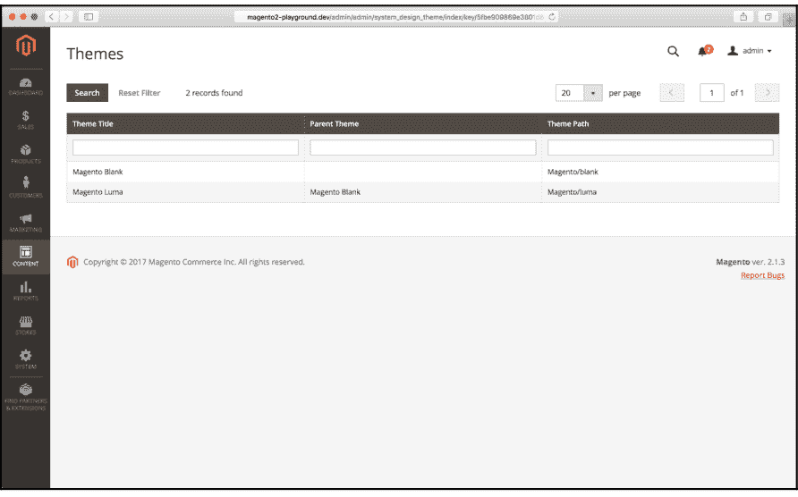

按照惯例，主题文件位于 `app/design/frontend/<vendor>/` 文件夹中。随 Magento 一起提供的默认主题位于 `vendor/magento/theme-frontend-<theme-code>` 文件夹中，如以下屏幕截图所示：

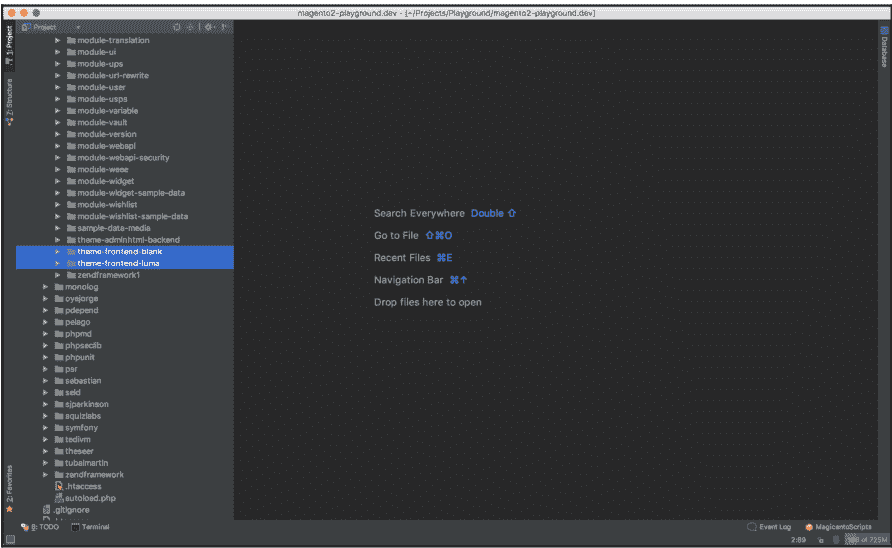

如果您在 CONTENT | Design | Themes 页面上的网格中单击一个主题，您将看到该主题的信息和预览图像：

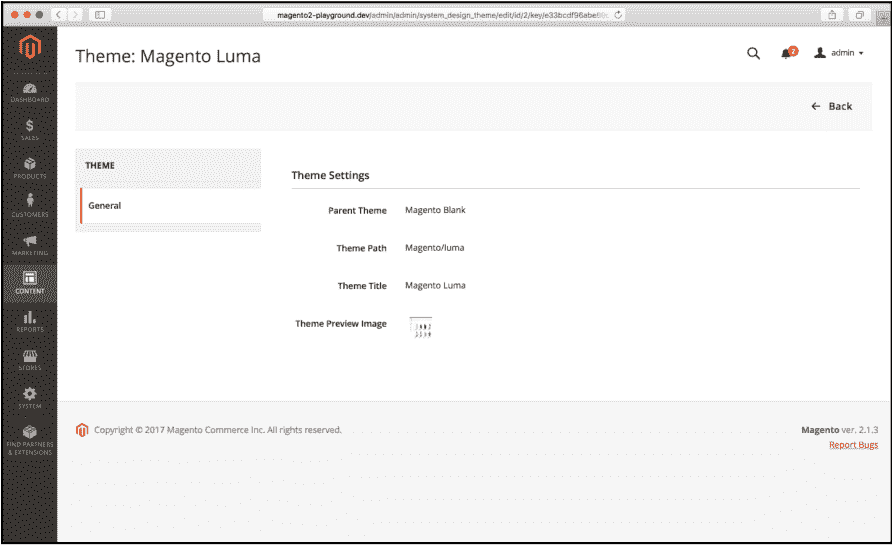

您可以在 **CONTENT | Design | Configuration** 管理面板页面上查看和更改分配给每个网站、商店和商店视图的主题：

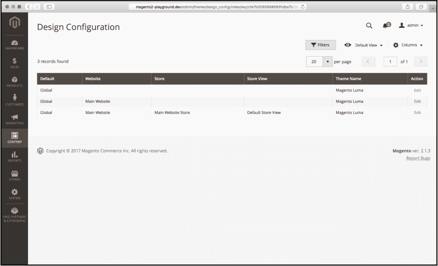

如果您单击最后一列中的 **Edit** 链接，您将被重定向到以下表单：

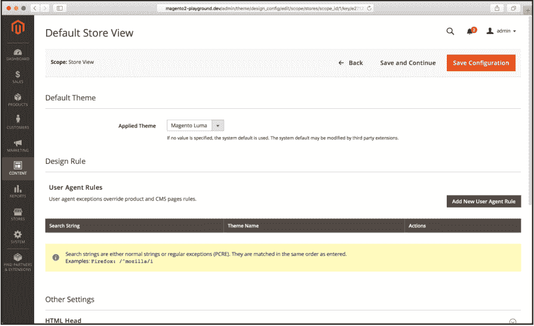

从那里，您可以使用 **Applied Theme** 下拉菜单更改主题，设置用户代理规则，并配置以下设置：

- **HTML Head:**
  - **Favicon icon:** 更改 favicon 图标。支持以下格式：
    - ICO
    - PNG
    - GIF
    - JPG
    - JPEG
    - APNG
    - SVG
  - **Default title:** 设置页面的默认标题。
  - **Title prefix:** 在默认标题前添加字符串。
  - **Title suffix:** 在默认标题后添加字符串。
- **Default description**: 设置默认描述元标签。
- **Default keywords**: 设置默认关键词元标签。
- **Scripts and stylesheets**: 在 HTML head 标签中包含自定义脚本和样式表。
- **Display demo store notice**: 如果网站目前正在开发或测试中，您可以在 Storefront 的所有页面顶部显示演示商店通知：

  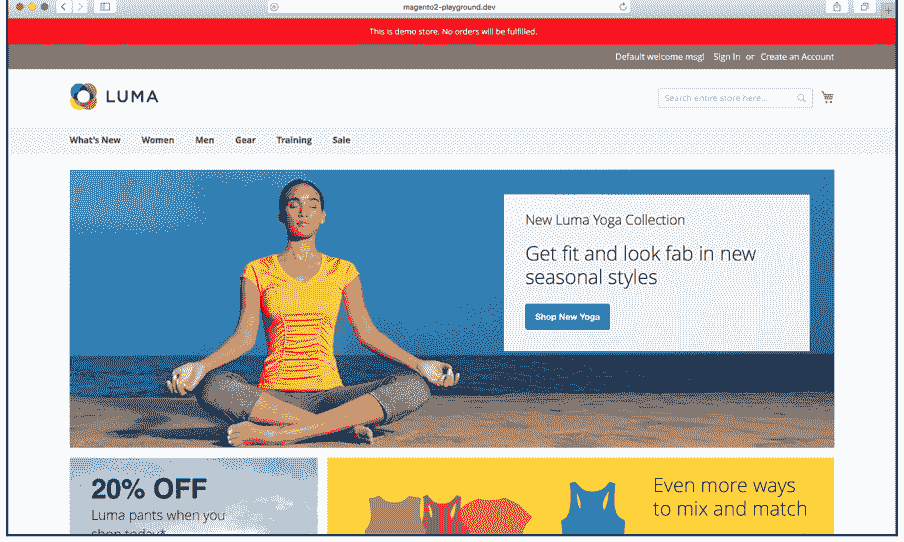

  演示通知也将在管理面板中显示：

  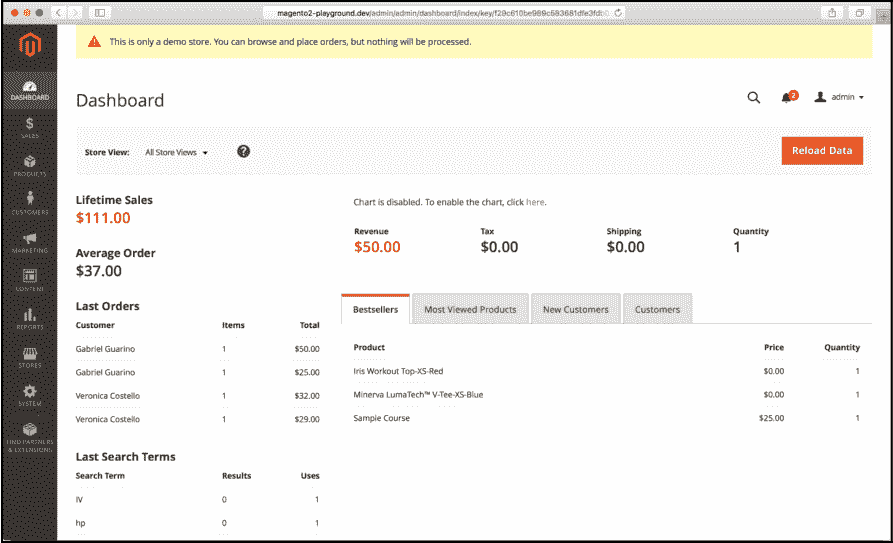

- **Header:**
  - **Logo image:** 设置页眉的 Logo 图像。允许的文件类型为：
    - PNG
    - GIF
    - JPG
    - JPEG
    - SVG
  - **Logo image width:** 以像素为单位设置 Logo 图像宽度。
  - **Logo image height:** 以像素为单位设置 Logo 图像高度。
  - **Welcome text:** 设置要在页眉中显示的文本。欢迎文本的实际外观和位置取决于主题。以下是 Luma 主题中欢迎文本的显示方式（页面顶部 **Sign In** 旁边的 **This is the welcome text message!**）：

    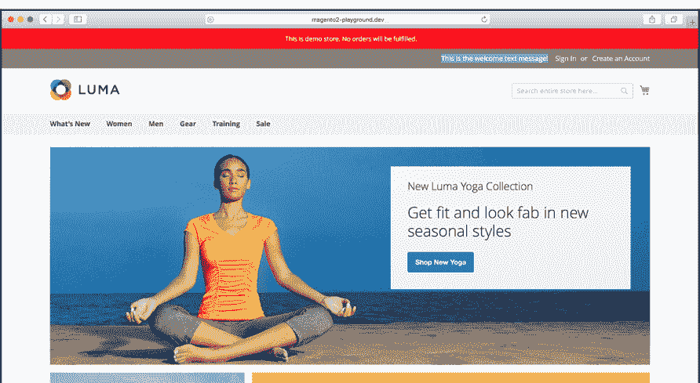

  - **Logo image alt**: 用于 Logo 图像的 alt 标签文本。
- **Footer:**
  - **Miscellaneous HTML**: 您在此复选框中添加的 HTML 将在所有页面的 body 标签关闭前显示
  - **Copyright**: 在页脚中显示的版权文本
- **Pagination:**
  - **Pagination frame:** 在 Storefront 的分页控件上显示的链接数量。在以下示例中，分页框架已设置为 4：

    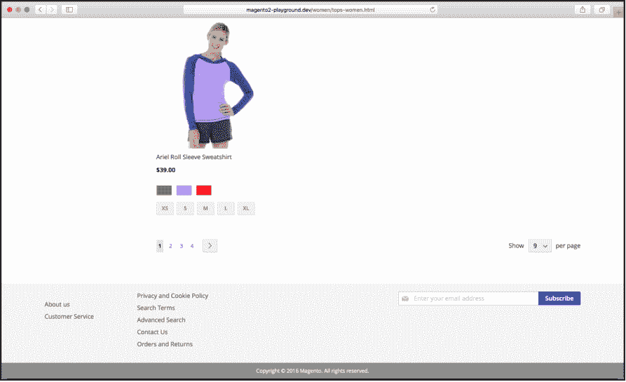

  - **Pagination Frame Skip**: 设置在显示下一组分页链接之前跳过的链接数量。在以下示例中，分页框架跳过已设置为 2：

    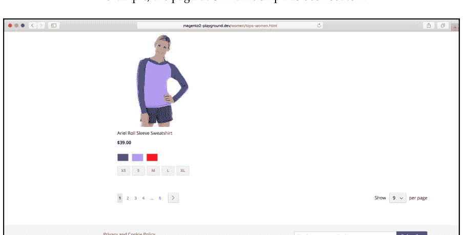

  - **Anchor text for previous/anchor text for next**: 如果您为上一个和下一个链接设置锚文本，则箭头图像将被您设置的锚文本替换。在以下示例中，上一个的锚文本已设置为 **Previous**，下一个的锚文本已设置为 **Next**：

    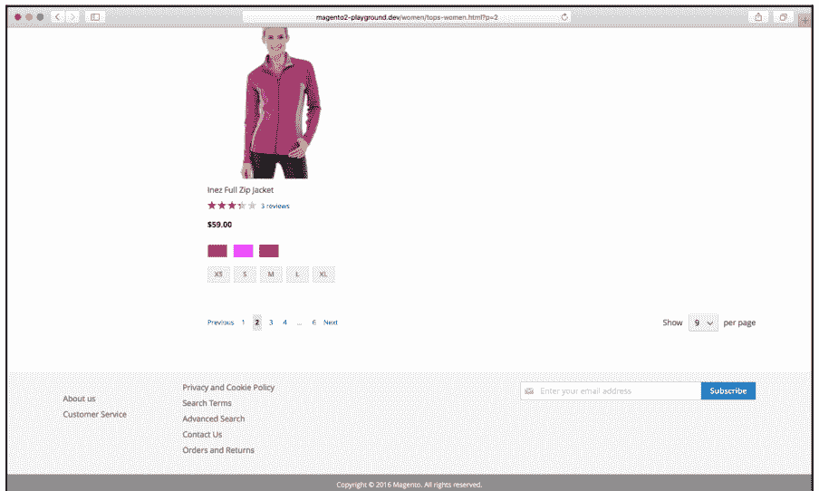

- **Product image watermarks**: 在此部分，您可以上传基础图像、小图像、缩略图和色板图像的水印图像，并可以设置图像不透明度、大小和位置等属性。
- **Transactional Emails:**
  - **Logo image:** 上传要在交易电子邮件中用作 Logo 的图像。允许的文件类型为：
    - JPG
    - JPEG
    - GIF
    - PNG
  - **Logo image alt:** 用于 Logo 图像的替代文本。
  - **Logo width:** 设置 Logo 图像的宽度。像素数应输入且末尾不附加 px。
  - **Logo height:** 设置 Logo 图像的高度。像素数应输入且末尾不附加 px。
  - **Header template/footer template:** 选择要在交易电子邮件中用作页眉和页脚的模板。

### 内联翻译的工作原理

在 Magento 中翻译 Storefront 的正确方法是使用 Magento 代码库中的翻译词典（`.csv` 文件）和语言包。

话虽如此，Magento 也为商店管理员提供了一种快速更新和翻译 Storefront 文本的方法：内联翻译。

内联翻译存储在数据库中并且是主题特定的，这意味着如果在完成内联翻译后为 Magento 商店选择了另一个主题，则内联翻译将不适用。因此，如果更改了主题，商店管理员应再次进行内联翻译。

要启用内联翻译工具，您应转到管理面板中的 **Stores | Configuration** 页面。

到达后，您应进入 Advanced | Developer 部分，您将看到用于在 Storefront 和管理面板上启用内联翻译的下拉菜单：

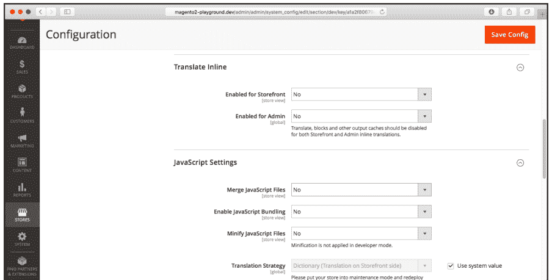

如果您将 Enable for Storefront 设置为 Yes 并保存新设置，则内联翻译工具将在 Storefront 上启用。如果已启用缓存，则在查看 Storefront 之前应清除缓存。

如以下屏幕所示，内联翻译工具现已启用，每个可翻译的字符串都用红色框标记：

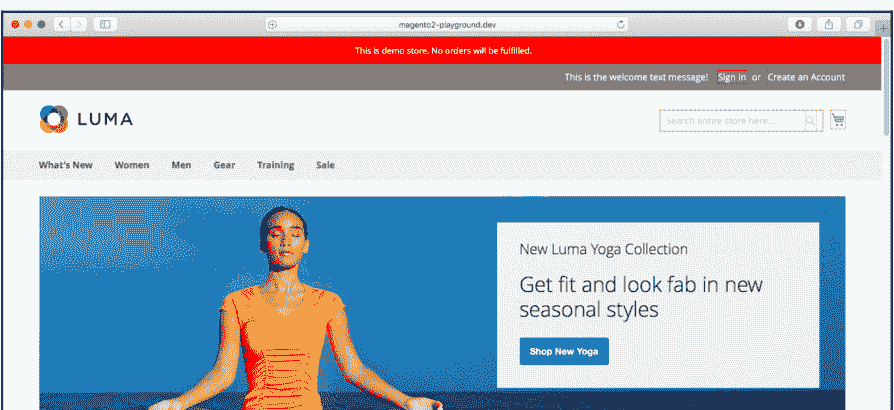

如果将鼠标悬停在红色框上，您将看到与前一屏幕截图中可见的相同书籍图标。如果单击该图标，将显示以下窗口：

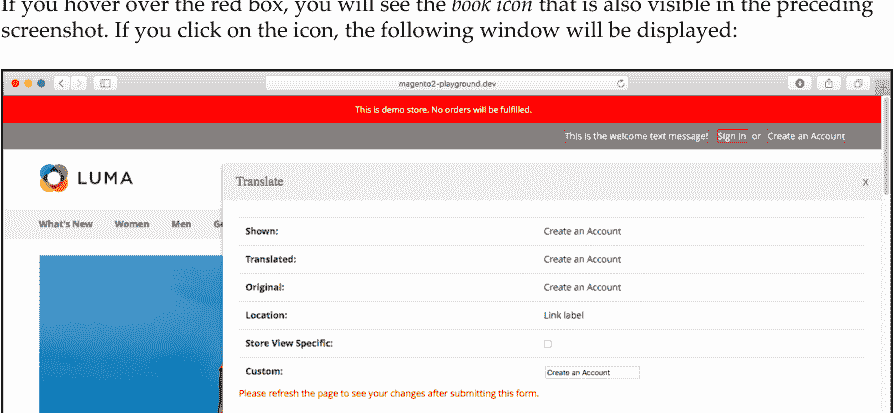

从那里，您可以指定翻译是否特定于当前商店视图，然后设置自定义文本。在下面的示例中，我们将 `Create an Account` 替换为 **Register**。

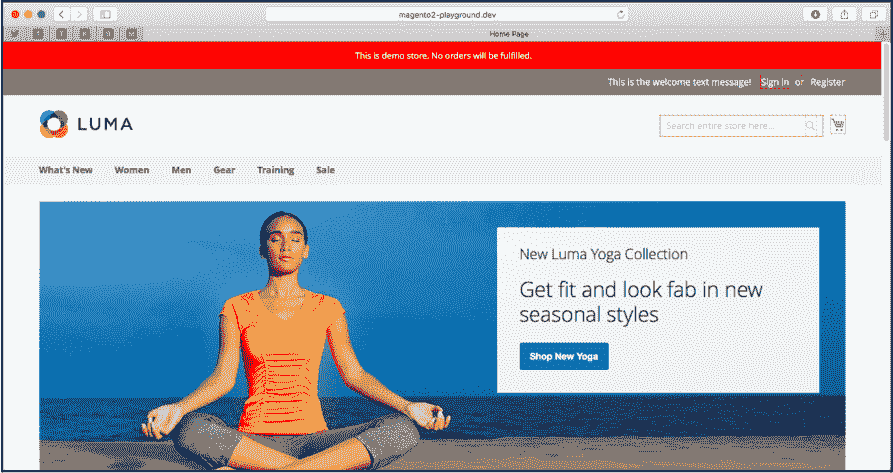

现在，假设内联翻译工具已启用且无限制。这意味着任何有权访问网站的人都可以看到该工具，并且可以更改您的 Magento 商店中的文本。这很危险，应避免。

为了防止这种情况，Magento 允许您仅将内联翻译工具限制为您自己的计算机。您可以通过在商店的 **Configuration** 页面（**Stores | Configuration**）的 **ADVANCED | Developer | Allowed IPs (comma-separated)** 部分指定您的 IP 地址来做到这一点：

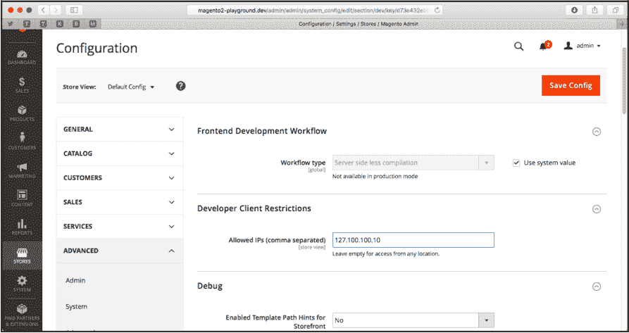

您可以将多个 IP 添加到允许的 IP 列表中，只有这些 IP 才可以访问 **ADVANCED | Developer** 工具。

### Magento Marketplace

选择 Magento 作为平台的优势之一是市场中可用的扩展数量，可为您的 Magento 商店添加新功能。

您可以在 Magento Marketplace 中查看可用的扩展列表，访问 https://marketplace.magento.com：

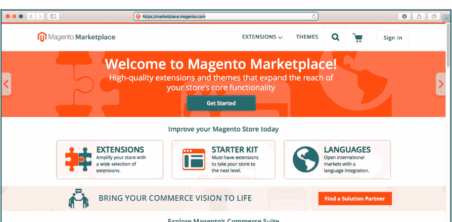

当您选择某个扩展时，您将在扩展列表页面看到所需的全部信息，包括：

- 扩展的可用版本
- 供应商提供的可用支持
- 安装服务
- 价格
- 描述
- 当前版本
- 更新日期
- 分类
- 兼容的 Magento 2 版本
- 评论
- 发布说明
- 支持

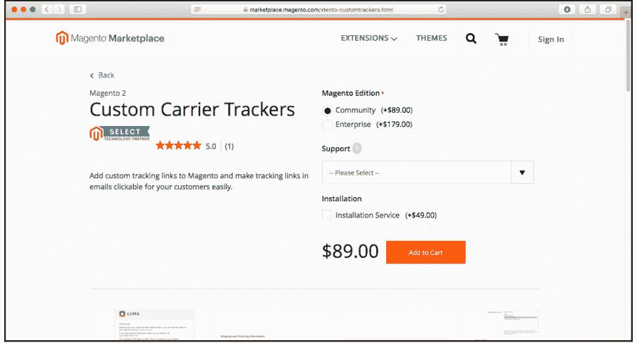

我建议您将 Magento Marketplace 视为一个可以为您的商店找到三种不同类型定制方案的地方：

- **扩展：** https://marketplace.magento.com/extensions
- **主题：** https://marketplace.magento.com/themes.html
- **语言包：** https://marketplace.magento.com/extensions/content-customizations/translations-localization.html

除此之外，Marketplace 非常直观，提供了一种非常简单的方法来查找您需要的扩展并查看这些扩展的所有信息，包括供应商信息。

这些扩展可以由供应商安装，也可以由经验丰富的 Magento 开发人员安装，他们会审查扩展代码，以便将扩展集成到您的 Magento 商店中。

### 本章小结

在本章中，我们回顾了管理 Magento 主题、使用内联翻译工具翻译字符串，以及使用 Magento Marketplace 下载主题、扩展和语言包的过程。

在下一章中，我们将回顾如何备份、恢复和管理您的 Magento 数据库，如何提高 Magento 实例的性能，如何优化网站的 SEO，如何管理缓存和索引，以及如何将 Magento 升级到最新版本。
