# 21 商店维护

## 商店维护

在本章中，我们将涵盖以下主题：

- 备份、恢复和数据库管理
- 性能调优
- 搜索引擎优化
- 缓存和索引管理
- 将 Magento 升级到新版本

## 备份、恢复和数据库管理

创建备份至关重要，因为这能确保在发生意外情况时，我们可以恢复 Magento 商店。Magento 允许我们通过管理后台和 Magento 2 命令行工具创建代码库和数据库备份。

若要从管理后台创建备份，您应进入以下部分：
系统 | 工具 | 备份

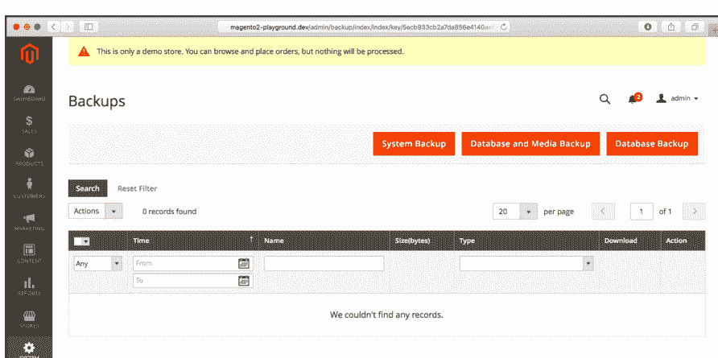

在该部分中，您将看到已创建的所有备份列表。此外，您还可以创建三种类型的备份：

- **系统备份**：创建代码库和数据库备份，并可以选择包含或排除媒体文件夹
- **数据库和媒体备份**：创建数据库和媒体文件夹备份
- **数据库备份**：创建数据库备份

对于所有这些备份类型，您都可以将 Magento 商店置于维护模式，因为备份过程会占用大量服务器资源。

如果您单击**系统备份**，将显示以下窗口：

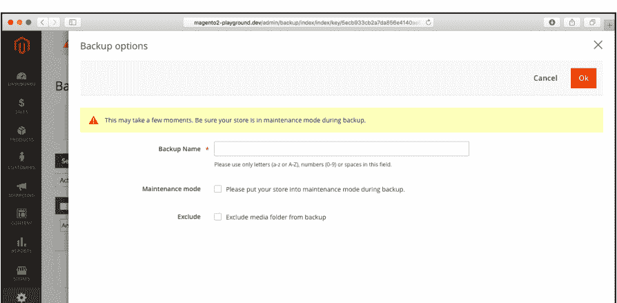

当您继续执行备份时，系统会显示一个旋转加载器图像，并由系统创建备份。由于此备份包含代码库和数据库，因此该过程需要一些时间才能完成。

备份创建完成后，您将在屏幕上看到一条确认消息，并且备份将列在网格中：

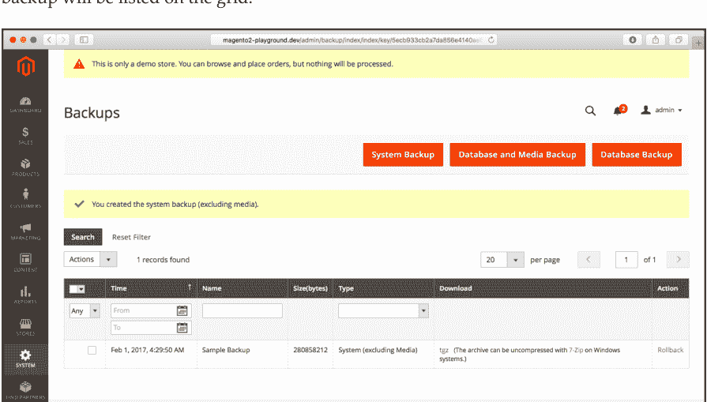

此外，备份文件将位于代码库中的 var/backups 文件夹中。

正如您在网格中所见，您可以下载 .tgz 格式的备份，或使用最后一列中的“回滚”操作进行恢复。

**数据库和媒体备份**与**数据库备份**的过程相同。现在，我们确实应考虑自动化此过程，以便始终为我们的 Magento 商店保留备份。

Magento 允许您安排系统定期自动创建备份。为此，您应进入商店配置页面（**商店 | 配置**），并单击**高级 | 系统**。

在此页面上，您将看到**计划备份设置**部分：

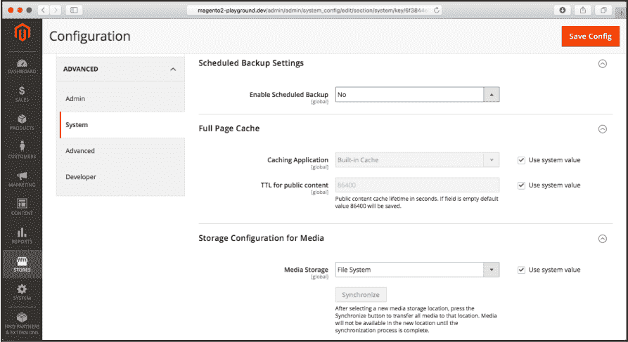

如果在“启用计划备份”字段中选择“是”，将显示以下表单：

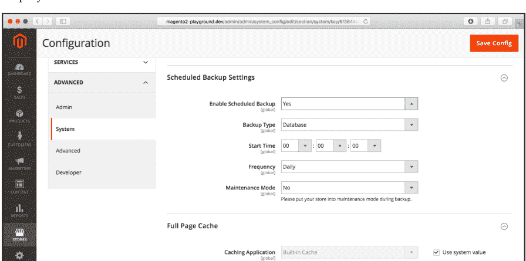

在那里，您可以选择计划备份的备份类型、开始时间和频率，还可以定义在备份期间是否将网站置于维护模式。建议将备份安排在每天夜间商店流量较少时进行，例如每天凌晨 2 点。

除管理后台备份外，您还可以使用 Magento 2 命令行工具创建备份。

为此，您应打开终端，并将当前目录更改为 Magento 2 实例的文档根目录。

如果您运行 php bin/magento，您将看到用于创建备份的 setup:backup 命令，该命令会备份 Magento 应用程序的代码库、媒体和数据库。

此外，setup:rollback 命令可用于恢复备份，该命令会回滚 Magento 应用程序的代码库、媒体和数据库。

要创建备份，您应将要创建的备份类型作为参数传递。可用的参数有：

- `--code`
- `--media`
- `--db`

从每个参数的名称可以看出，您可以指定备份中是否包含代码库、媒体和数据库。

例如，要创建代码库和数据库备份，您应运行以下命令：

```
php bin/magento setup:backup --code --db
```

如下面的截图所示，您可以从命令行输出中跟踪进度：

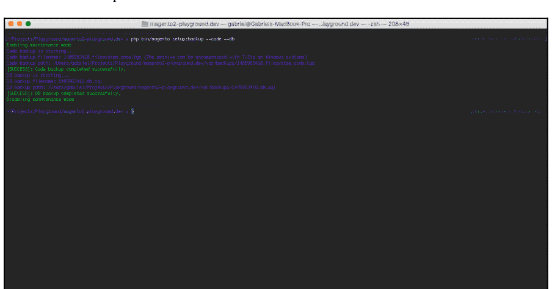

您可以通过运行 `magento info:backups:list` 命令查看可用备份列表：

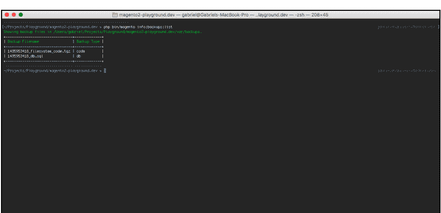

这一点至关重要，因为 `setup:rollback` 命令要求您指定要恢复的每个参数对应的文件名：

```
magento setup:rollback [-c|--code-file="<name>"] [-m|--media-file="<name>"]
[-d|--db-file="<name>"]
```

## 性能调优

对于 Magento 商店的转化率而言，性能是获得高转化率的关键。没有人喜欢等待页面加载，而您希望客户在决定购买哪些商品后尽快下单。

在本节中，我们将回顾如何优化 Magento 以获得尽可能快的性能，包括 Magento 配置、服务器优化等。

为了比较平台旧版本与新版本的性能，我们将在本书中收录 Magento 提供的性能统计信息。请注意，这些统计信息是基于 Magento Enterprise Edition 2.0 生成的，但它们是不错的参考数据：

- **每小时订单数：** Magento Enterprise Edition 2.0 每小时可处理 597 个订单，与 Magento Enterprise Edition 1.14.2 相比，每小时增加了 130 个订单：

  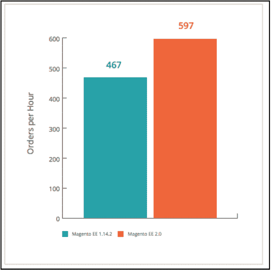

- **目录浏览：** 使用 Varnish 时，Magento Enterprise Edition 2.0 中目录浏览的响应时间几乎是即时的：

  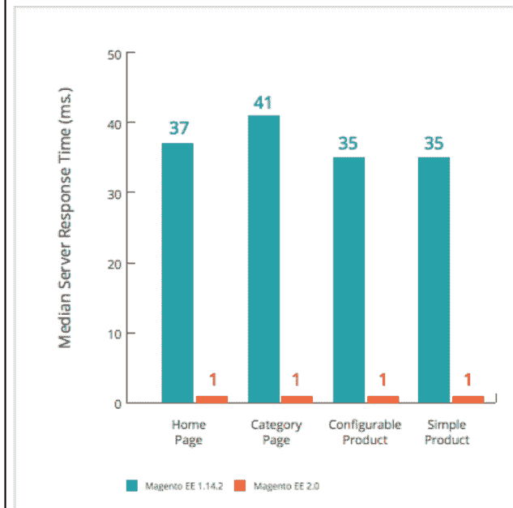

- **加入购物车：** 与 Magento Enterprise Edition 1.14.2 相比，Magento Enterprise Edition 2 中的“加入购物车”操作快 66%：

  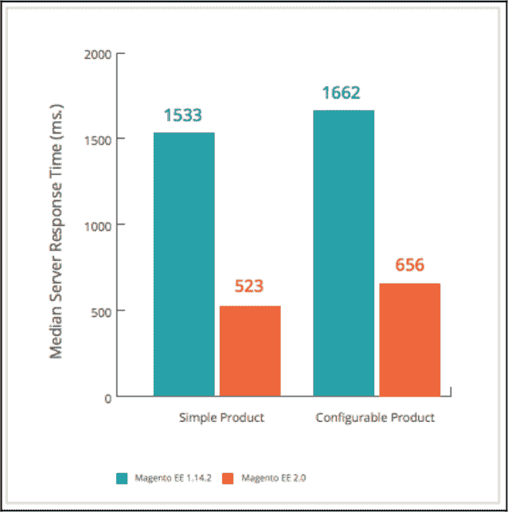


- **结账流程：** 结账流程（所有步骤合计）在 Magento Enterprise Edition 2 中，访客结账比 Magento Enterprise Edition 1.14.2 快 48%，客户结账快 36%：

    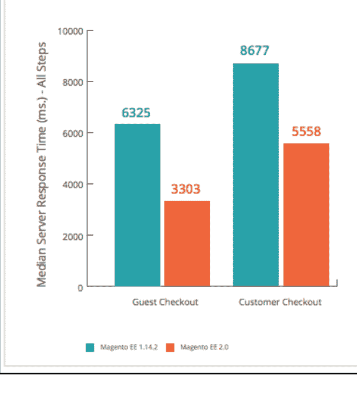

现在让我们看看如何提高 Magento 商店的性能：

- **服务器配置：** 尽管 Magento 2 与 PHP 5.6 兼容，但建议使用 PHP 7 搭配 Varnish 以获得最佳性能效果。
- **Magento 配置 - Varnish：** 我们之前提到过 Varnish；要启用它，您应先部署并配置 Varnish。之后，您可以从管理面板的商店配置页面（**STORES | Configuration**）中启用它并打开 **ADVANCED | System** 页面。从那里，您可以选择 Varnish 作为缓存应用程序并设置配置：

    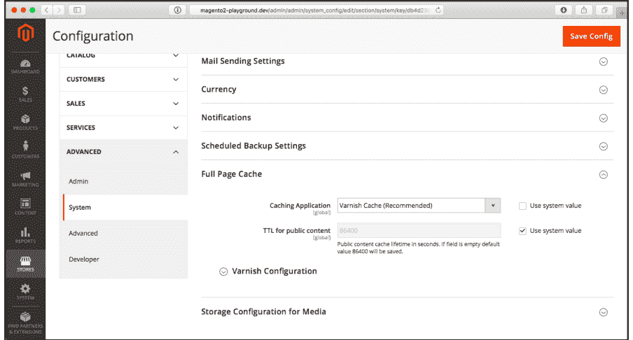

- **Magento 配置 - Redis：** Redis 可用于替代 `Zend_Cache_Backend_File` 作为后端缓存，也可用于 PHP 会话存储。
- **Magento 配置 - 开发人员设置：** 建议使用以下开发人员设置来提高 Magento 商店的性能；您可以从 **STORES | Configuration | ADVANCED | Developer** 设置这些配置。在该页面中您将看到以下部分：

    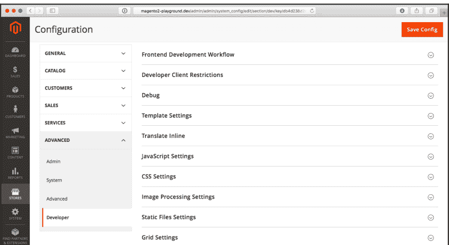

    设置以下配置：

    - **Grid Settings | Asynchronous indexing：** Enable
    - **CSS Settings | Minify CSS Files：** Yes
    - **JavaScript Settings | Minify JS Files：** Yes
    - **JavaScript Settings | Merge JavaScript Files：** No
    - **Template Settings | Minify HTML：** Yes
    - **JavaScript Settings | Enable JavaScript Bundling：** Yes

### Store Maintenance

- **Magento 配置：邮件：** 您可以在 **STORES | Configuration | Sales | Sales Emails** 部分将邮件设置为异步生成。如以下截图所示，您可以标记 **Asynchronous** 发送为已启用：

    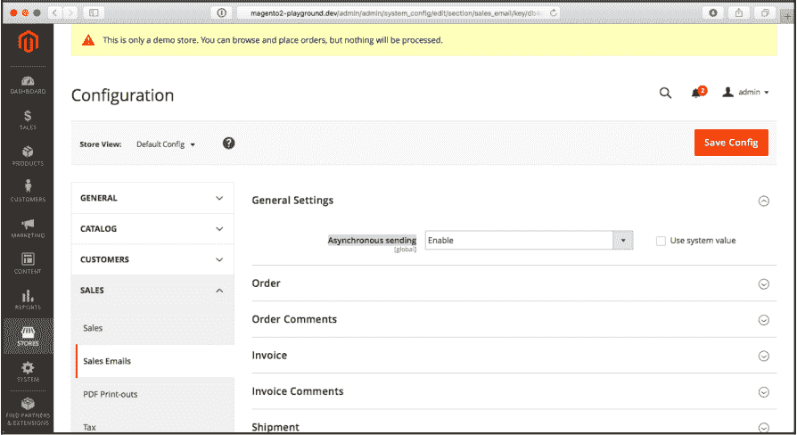

- **Magento 配置 - 平面目录：** 我们在第 10 章 *System Configuration* 中描述了类别和产品的平面目录功能。正如我们在该章中所提到的，此设置通过将所有类别和产品信息合并到一个平面表中以单次查询获取数据，从而提高商店性能。您可以在 **CATALOG | Catalog** 商店配置页面启用平面目录；这些设置在 Storefront 下为 **Use Flat Catalog Category** 和 **Use Flat Catalog Product**，如以下截图所示：

    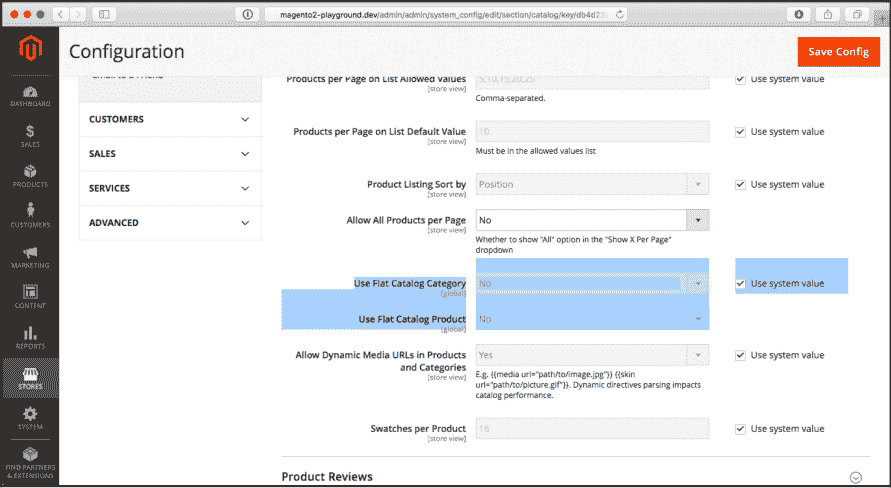

- **Magento 配置 - 索引：** 而不是在通过管理面板对目录进行更改时立即更新索引，您可以设置重新索引过程根据 cron 作业配置按计划执行。您可以在 **SYSTEM | Index Management** 管理面板页面进行此更改。从那里，您将看到可以使用批量操作将索引设置为按计划更新：

    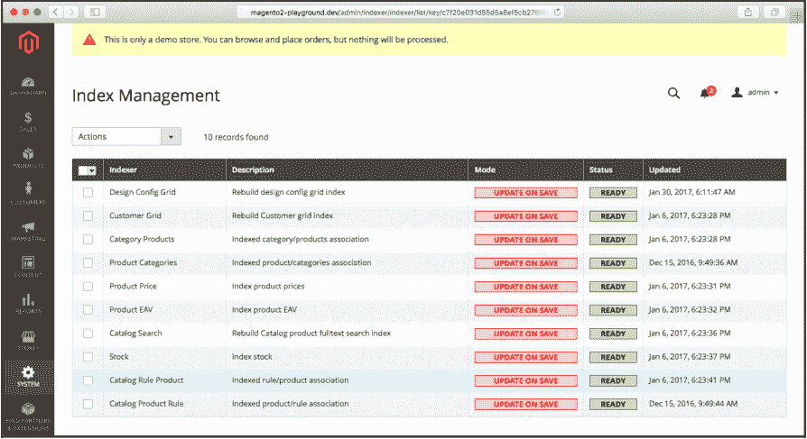

- **Magento 配置 - 生产模式：** 当服务器和 Magento 已配置好后，您应将 Magento 设置为在 **Production Mode** 下运行。在生产模式下，静态视图文件从缓存提供，而不是通过 Magento 的回退机制。此外，错误会由 Magento 记录在 `var` 文件夹中，并且不会在商店前端显示给用户。您可以通过在 Magento 2 命令行工具中运行以下命令来启用生产模式：

    ```
    php bin/magento deploy:mode:set production
    ```

    您将看到与以下截图类似的输出：

    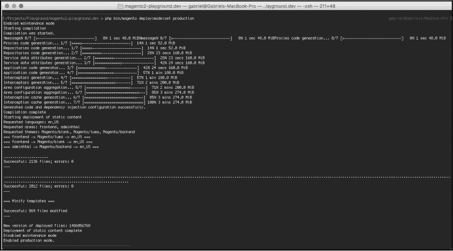

### Search engine optimization

除了反向链接等站外 SEO 因素外，站内 SEO 因素在您控制之下，您可以从 Magento 管理面板优化 Magento 商店的 SEO。在本节中，我们将介绍 Magento 2 开箱即用的所有 SEO 设置。

Magento 2 中的一个非常方便的功能是产品的元标签自动生成。您可以从以下管理面板部分设置该功能（**STORES | Configuration | CATALOG | Catalog | Product Fields Auto-Generation**）：

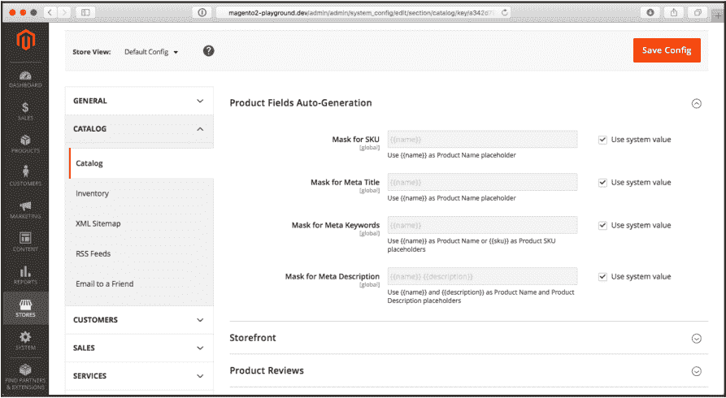

从那里，您可以使用占位符和自定义文本为目录中的所有产品自动生成 SEO 元标签。

需要明确的是，您无法为每个商店视图单独设置此功能，因为这些字段对您的 Magento 实例是全局的，并且自动生成配置的新更改不会应用于现有产品。

此外，您可以随时从产品设置中的搜索引擎优化中覆盖自动生成的值。

在以下截图中，您还可以看到您可以为产品指定 SEO 友好的 **URL key**。您也可以从同一页面通过在 **Images and Videos** 部分的 **Image Detail** 窗口中更新 **ALT Text** 来为所有产品图片配置 **ALT Text**：

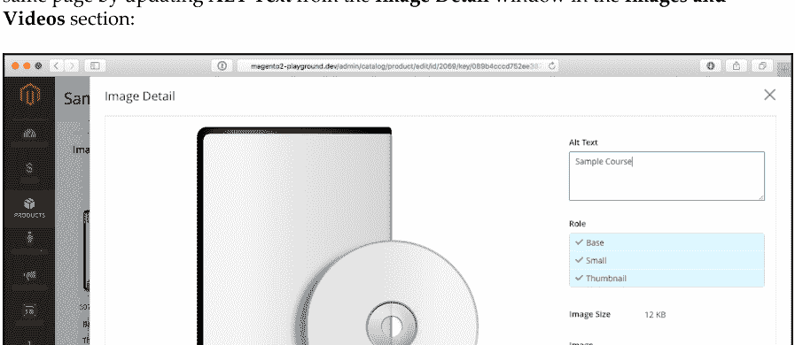

如果您进入 **PRODUCTS | Categories**，您也可以为每个类别设置 URL 键、Meta Title、Meta Keywords 和 Meta Description：

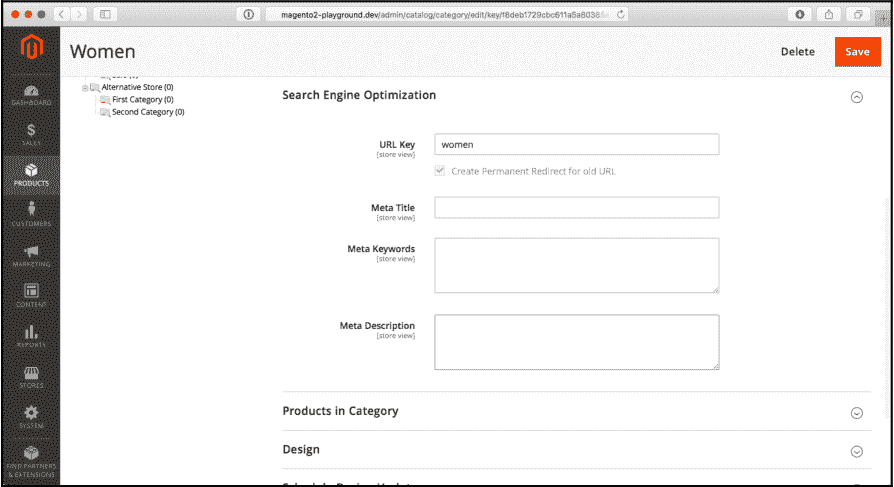

最后，SEO 的两个非常重要的方面是网站的 XML 网站地图和 Robots.txt 文件。您可以从 **STORES | Configuration | Catalog | XML Sitemap** 部分为商店设置 XML 网站地图：

Robots.txt 设置可在 STORES | Configuration | General | Design | Search Engine Robots 部分找到：

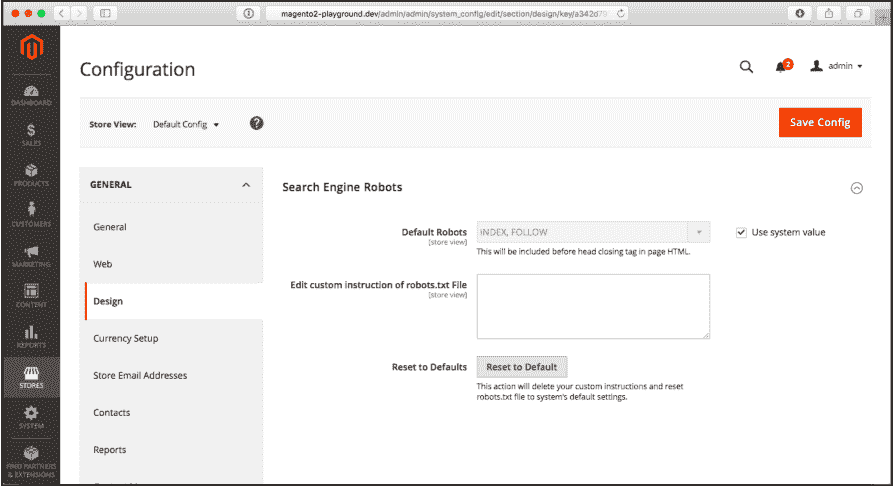

在此页面中，您可以设置：

- **Default robots**：选择默认的 robots 规则：
    - INDEX, FOLLOW
    - NOINDEX, FOLLOW
    - INDEX, NOFOLLOW
    - NOINDEX, NOFOLLOW
- **Edit the custom instruction of robots.txt file**：如有需要，输入 Robots.txt 文件的自定义指令
- **Reset to Defaults**：删除自定义指令并将 Robots.txt 配置重置为默认值

### Cache and Index Management

管理 Magento 商店时需要考虑的两个方面是缓存和索引。

每次您对商店前端进行更改，例如添加新横幅或更改标题，如果启用了缓存，您必须清除它，以便客户能够在商店前端看到更新。

同样，每次您对目录进行更改时，都必须重新索引它，以便客户可以看到更新的信息。

如果您在 Magento 管理面板中打开 **SYSTEM** 选项卡，您会看到两个部分都位于 **Tools** 子菜单下：

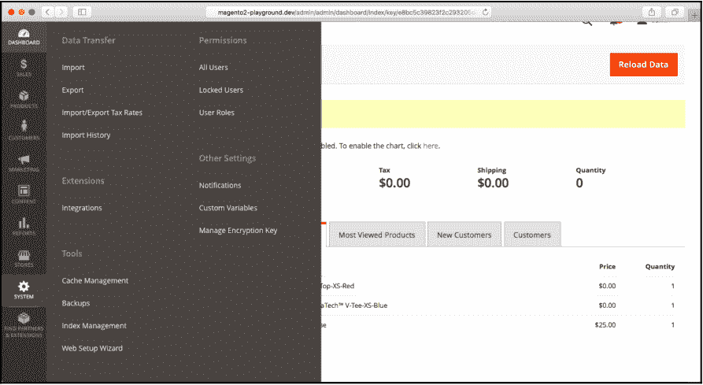

现在，如果您进入 SYSTEM | Tools | Index Management，您将在屏幕上看到以下网格：

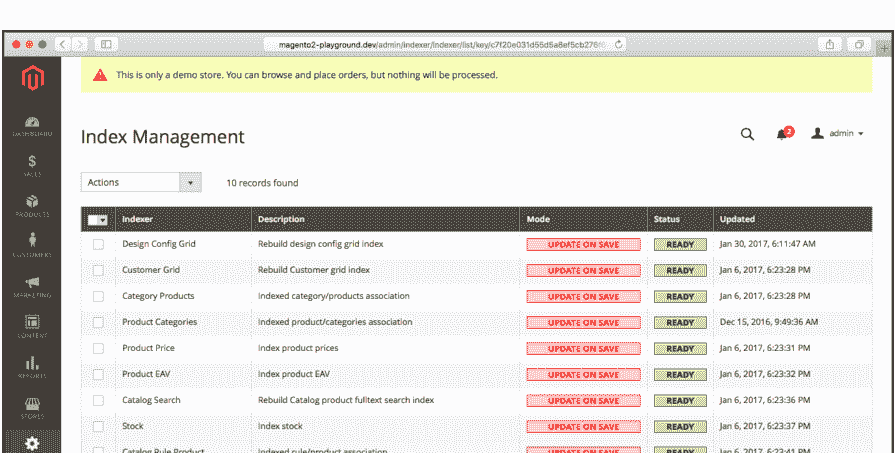

索引器有两种模式：

- **Update on Save**：当通过管理面板对目录进行更改时，索引数据会更新
- **Update on Schedule**：重新索引过程由 cron 作业根据其配置执行

### Upgrading Magento to a new version

在本节中，我们将回顾如何将 Magento 2 升级到最新版本。作为示例，我们将把本书中一直在审查的网站从 Magento 2.1.3 升级到 2.1.4。

在进行升级之前，您可以在页脚中看到我们使用的 Magento 版本是之前提到的那个：

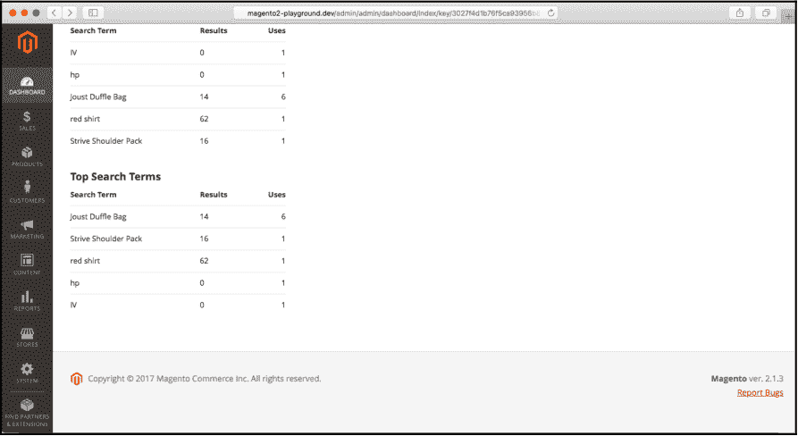

要运行系统升级，您应进入管理面板中的以下部分：

**SYSTEM | Tools | Web Setup Wizard**

以下页面将显示在屏幕上：


使用我们在*第3章“迁移”*中为你的 Magento 商店生成的访问密钥，然后点击**提交**。

之后，Magento 将检查是否有新版本可用：

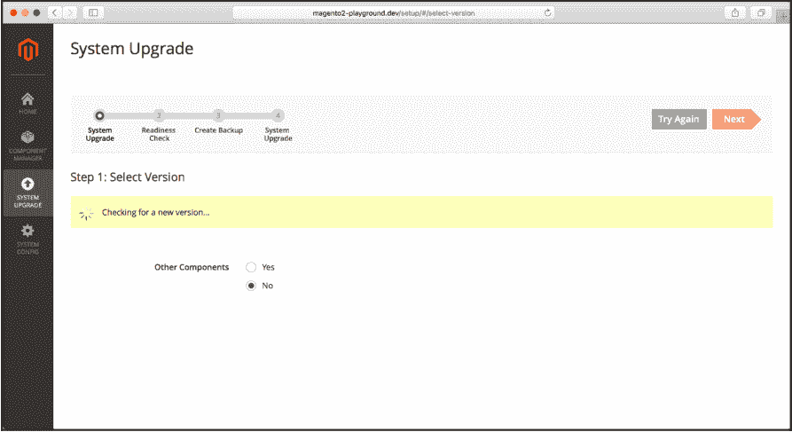

如果你的商店有可用的 Magento 新版本，你会看到它们列在下拉列表中，如下所示：

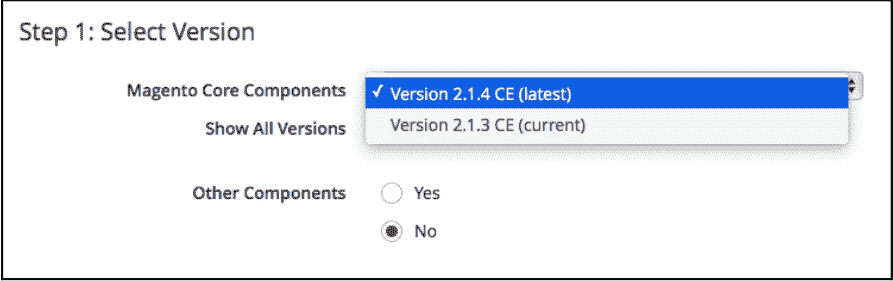

选择要升级的 Magento 版本后，你可以点击**下一步**进入下一步，**就绪检查**：

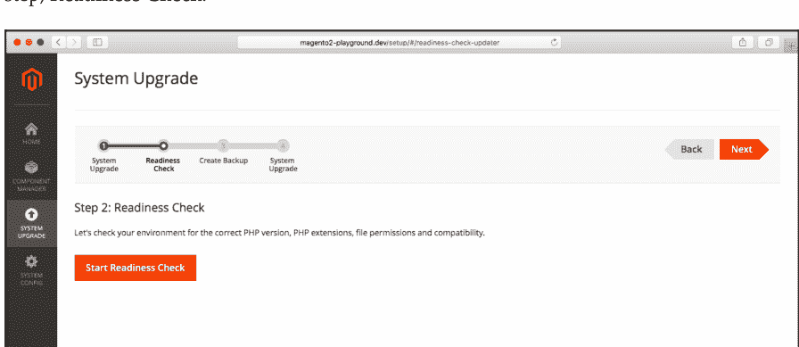

与我们在*第2章“安装”*中介绍的 Magento 安装第一步类似，系统将检查你的 Magento 实例是否准备好继续执行向导。

安装过程中的**就绪检查**与升级过程中的**就绪检查**之间的区别在于，升级需要配置 cron 作业。

如果 cron 作业、PHP 版本、设置或扩展存在错误，那么你应该考虑检查 cron 的状态和配置。

如果**就绪检查**成功，你应该看到所有项目都带有勾选标记：

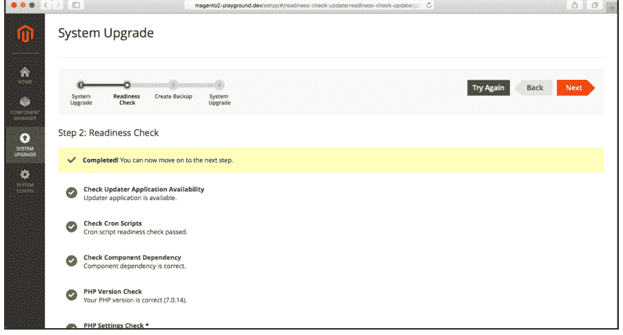

**就绪检查**完成后，你可以进入下一步，该步骤允许你创建代码库、媒体和数据库备份：

### 商店维护

最后一步会通知你，网站将暂时离线，并且你的商店将启用维护模式：

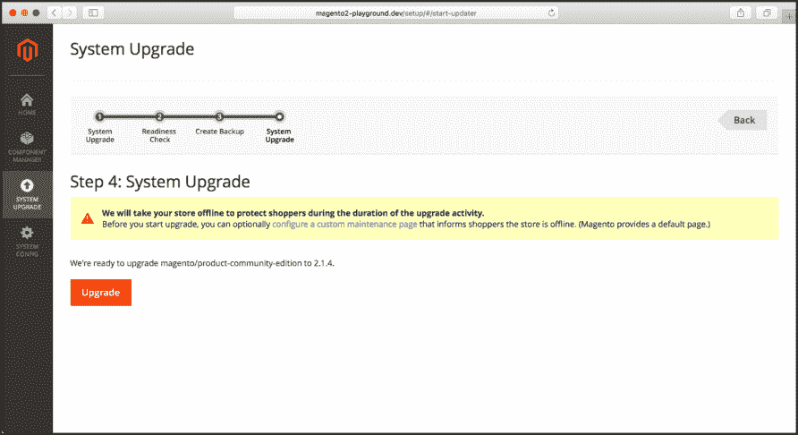

如果你点击**升级**，则过程将开始，你就可以从浏览器中跟踪其进度：

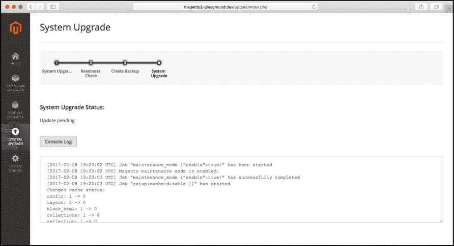

升级完成后，你将在屏幕上看到以下页面：

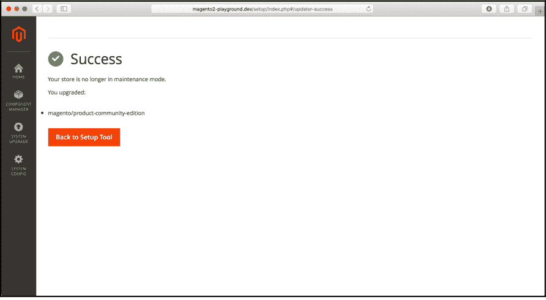

维护模式将被禁用，你的 Magento 商店将运行所选的 Magento 版本，正如你将在 Magento 管理面板页脚中看到的那样：

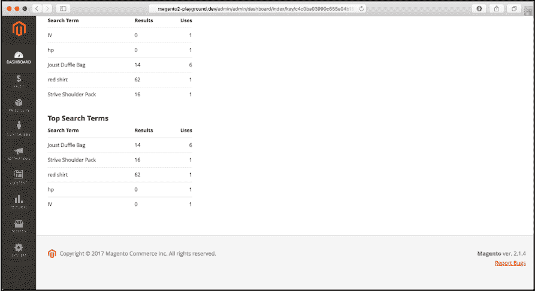

### 总结

在本章中，你学习了如何备份和恢复你的 Magento 商店、如何提高其性能、如何更新商店配置以进行 SEO、如何管理 Magento 缓存和索引，以及如何将你的网站升级到最新版本。

这是本书的结尾，但却是你管理 Magento 商店之旅的开始。我们已经涵盖了 Magento 商店所有者和管理员的所有活动，你现在拥有足够的知识来取得成功。请将本书放在手边，因为当你使用 Magento 平台时，它能帮助你快速查阅相关页面。祝你好运！
