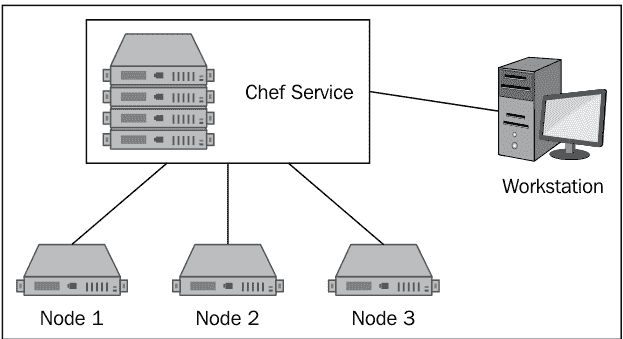
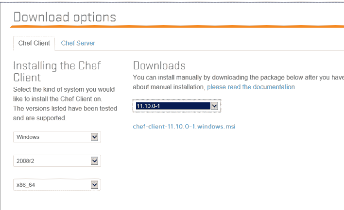
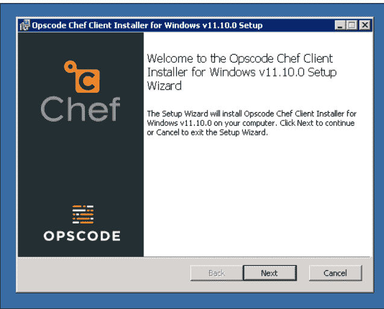
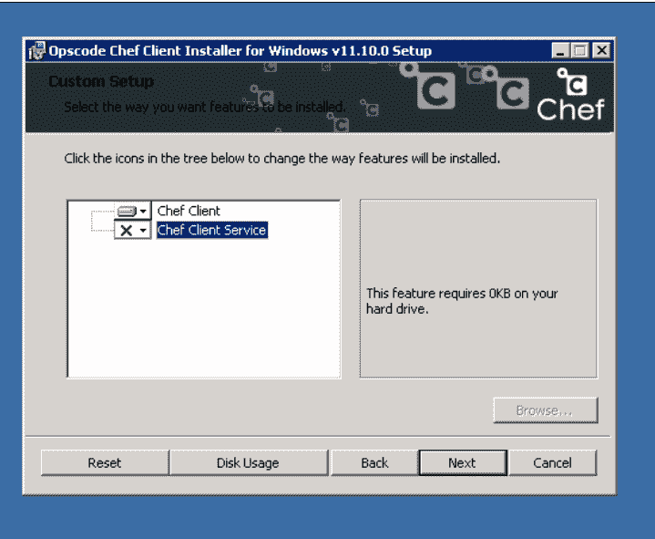
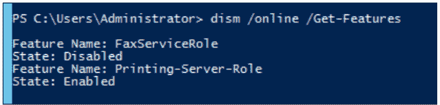
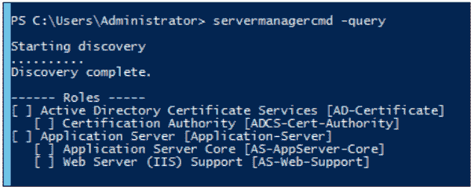

# 2 安装客户端 – Chef 概念概述

与所有指南一样，旅程必须从某处开始。在本章中，我们将从头开始，介绍在 Windows 上使用 Chef 的一些重要信息。它包含一些您可能已经了解的材料的简要回顾（如果您之前使用过 Chef），然后我们继续介绍如何将 Chef 安装到 Windows 主机上。

在本章中，我们将涵盖以下主题：

- 回顾关键 Chef 术语
- 描述整体 Chef 系统架构
- 在 Windows 系统上手动安装 Chef 客户端
- 使用 Chef 提供的引导脚本安装客户端

## 更好地了解 Chef

与任何其他技术一样，Chef 有一套自己的术语，用于标识 Chef 生态系统的各种组件。以下是本书中使用的一些关键术语及其定义：

- **Node**：节点是由 Chef 管理的系统。这些可以是服务器、桌面系统、路由器或任何能够运行 Chef 客户端并具有受支持操作系统的其他设备。
- **Workstation**：工作站是系统管理员用于与 Chef 服务器和节点交互的特殊节点。这是执行命令行工具的地方，特别是 `knife` 命令行工具。
- **Bootstrap**：引导是将节点设置为用作 Chef 客户端的过程。这涉及执行安装 Chef 依赖项以及 Chef 本身所需的任何工作。
- **Bootstrap script**：安装 Chef、Ruby 和其他核心要求以及针对特定系统所需的任何其他配置有多种可能的方式。为了提供这种灵活性，引导过程是脚本化的；在 Windows 上，这是一个批处理文件。
- **Recipe**：配方提供实现目标所需的指令，例如安装软件包、配置防火墙、配置用户和打印机或管理其他系统资源。这些是用 Ruby 编写的，并在系统管理员通过 Chef 控制台指定的节点上执行。
- **Cookbook**： cookbook 是配方的集合。通常，cookbook 提供一组特定的操作，例如安装 Apache 或 MySQL、为特定软件工具提供 Chef 资源等。
- **Attributes**：系统的各种组件都有自己的属性；描述软件需要如何配置的属性。这些属性在各种级别定义，从节点特定设置到 cookbook 或角色的一般默认值。
- **Role**：角色是一个数据结构，描述应用了该角色的节点应如何配置。它包含要运行的配方列表以及要应用于与该角色关联的节点的配置数据。角色示例可能包括 MSSQL 服务器、Exchange 服务器、IIS 服务器、文件服务器等。请注意，角色本身对节点一无所知；节点与其角色之间的关联是由管理员通过将角色应用于节点来创建的。
- **Run list**：“运行列表”是要应用于给定节点的配方列表，按特定顺序。运行列表可以由零个或多个角色或配方组成，顺序很重要，因为运行列表的项目按指定的顺序执行。因此，如果一个配方依赖于另一个配方的执行，您需要确保它们按正确的顺序运行。
- **Resource**：资源是描述配方正在处理 _什么_ 的方式。资源示例包括文件、目录、打印机、用户、软件包等。资源是提供者中具体实现的抽象。
- **Provider**：提供者是资源的具体实现。例如，用户是通用资源，但 LDAP 用户或 Active Directory 用户是用户资源的具体实现。所选提供者的类型将取决于平台等因素。
- **Data bags**：数据包包含有关基础设施的共享数据。不特定于角色或资源的信息（例如防火墙规则、用户帐户等）将存储在数据包中。这是存储系统范围配置数据的好地方。
- **Environments**：环境为资源提供了一级封装。例如，您可能有两个相同的环境，一个用于测试，一个用于生产。这些环境可能具有类似的设置，但配置不同，例如 IP 地址和用户。

### Chef 架构概述

Chef 的整体架构中有三个主要参与者：正在被管理的节点（服务器、桌面客户端、路由器等）、系统管理员用于运行 `knife` 命令的工作站，以及负责存储和管理要应用于最终主机的所有角色、配方和配置数据的 Chef 服务。以下图表表示了 Chef 架构：



节点通过 HTTP（最好是 HTTPS）使用 Chef 客户端安装中提供的 `chef-client` 脚本与 Chef 服务进行通信。这是一个 Ruby 脚本，负责连接到配置的 Chef 服务（自托管或使用托管 Chef）并下载为该节点配置的运行列表以及所需的任何 cookbook 和配置数据。完成此操作后，`chef-client` 将评估运行列表，以按指定顺序执行配方。

工作站也使用 HTTP(S) 与 Chef 服务进行通信，但其工作略有不同。工作站是系统管理员使用命令行实用程序与存储在 Chef 服务中的数据进行交互的地方。从那里，管理员可以读取和修改任何系统数据为 JSON，执行搜索，并通过 knife 命令行实用程序与节点进行交互。

除了命令行实用程序外，Chef 还提供了一个基于 Web 的界面来修改系统数据。Web 界面可以执行的任何操作也可以使用 knife 实现；但是，有一些高级操作无法在没有 knife 的情况下执行，例如在一组主机上执行远程命令和搜索数据。

### 在 Windows 上安装 Chef 客户端

要在 Windows 上安装 Chef 客户端，有三个基本选项，如下所示：

1. 使用 knife-windows 插件引导主机，如前所述。
2. 下载并使用 MSI 安装程序手动安装客户端。
3. 通过原位更新工具（如 WSUS）部署软件（此机制不会讨论，因为它超出了本书的范围）。

### 准备引导 Windows 主机

如前一章所述，引导主机是安装将主机最初纳入基础设施所需的任何组件的过程。通常，这将涉及安装 Ruby 以及 Chef 客户端和身份验证所需的任何证书，以及将主机注册到您的 Chef 服务器或托管 Chef 帐户。为此，您需要配置一个已安装 knife-windows gem 的工作站。您可以使用以下命令轻松安装该 gem：
`gem install knife-windows`


> 在 Windows 上，您可能需要以管理员身份执行此操作；在 Linux 系统上，如果使用系统 Ruby 安装，则可能需要通过 sudo 执行。
> 或者，您可能希望使用 Ruby 版本管理器（如 RVM、rbenv 或 pik）来安装 Chef 及任何后续 gem。
> knife-windows gem 在 Ruby 版本大于 1.9 时可能存在字符编码问题。如果您遇到如 https://tickets.opscode.com/browse/KNIFE-410 中概述的问题，
> 请尝试使用 Ruby 1.9 安装 chef 和 knife-windows gem。（这就是 Ruby 版本管理工具派上用场的地方。）

在进入引导阶段之前，您需要确保 Windows 主机上已配置以下内容：

- 已启用 Windows 远程管理
- 您与 Windows 主机之间的任何防火墙都允许 WinRM 流量
- 您能够通过 WinRM 进行身份验证

### 启用 Windows 远程管理

大多数现代 Windows 服务器操作系统安装默认启用 Windows RM，
但如果尚未启用（或您不确定），您可以通过从命令提示符（以管理员身份）运行以下命令快速配置它：

```
winrm quickconfig
```

前面的命令执行以下任务：

- 启动 Windows 远程管理服务并将其设置为开机自动启动
- 为 Windows 远程管理服务定义防火墙规则，并打开 HTTP 和 HTTPS 端口

### 配置防火墙端口

为了使用 WinRM，端主机上的防火墙需要配置为允许 WinRM 使用的端口的流量。WinRM 有两个版本，1.0
和 2.0；每个版本都有一组不同的默认端口。对于 Windows 远程管理版本 2.0，默认端口如下：

| 协议 | 端口 |
|----------|------|
| HTTP     | 5985 |
| HTTPS    | 5986 |

对于版本 1.0，默认端口如下：

| 协议 | 端口 |
|----------|------|
| HTTP     | 80   |
| HTTPS    | 443  |

### 启用基本身份验证

要允许从外部通过基本的非加密 HTTP 身份验证对 WinRM 进行身份验证，您需要从命令提示符（而不是通过 PowerShell 提示符）运行以下命令：

```
winrm set winrm/config/client/auth @{Basic="true"}
winrm set winrm/config/service/auth @{Basic="true"}
winrm set winrm/config/service @{AllowUnencrypted="true"}
```

> 由于这允许未加密的基本 HTTP 身份验证，请不要在公共主机上执行此操作，因为这可能会带来重大的安全风险。
> 请使用适当定义的策略和 HTTPS 证书来实现更安全的身份验证机制。

### 引导 Windows 主机

一旦 knife-windows gem 在工作站上安装，您就可以继续执行引导过程，例如引导 EC2 Windows 主机：

```
knife bootstrap windows winrm ec2-54-204-177-250.compute-1.amazonaws.com
-x Administrator
```

在前面的命令中，我们正在执行带有 bootstrap 命令的 knife 实用程序，指定我们希望通过 Windows 远程管理协议在主机 ec2-54-204-177-250.compute-1.amazonaws.com 上使用 Windows 引导脚本，以 Administrator 用户身份（通过 -x 命令行标志）。

这将花费一些时间，因为它需要下载并安装 Chef 客户端，然后向 Chef 服务器注册自身。在运行过程中，以下是它正在执行的操作概述：

1. `knife` 命令将从工作站（发起引导的那一台）上位于某个 ERB 模板的批处理文件进行渲染，并将其写入目标节点上的文件。
2. 从 ERB 文件模板生成批处理文件后，节点将执行新创建的批处理文件。
3. 生成的脚本将在节点上下载 Chef 客户端 MSI 安装程序并执行安装。
4. 一旦客户端安装成功，`knife` 将存储使主机注册所需的任何文件，包括证书和配置数据。
5. Chef 客户端将执行初始遍历，以执行命令行中指定的任何初始运行列表（在我们的例子中，没有）。
6. 一旦 Chef 客户端完成其初始工作集，它将打印出它做了什么以及完成该任务花了多长时间。

一旦目标节点完成引导，您应该使用以下命令验证它是否已被配置：

`[user@workstation]% knife node list`

WIN-7QKOA4QQ21M
`[user@workstation:~]`

### 通过 MSI 安装

对于那些已经有工具部署软件使用 **Microsoft 安装程序包 (MSI)** 的人来说，另一种选择是使用可用于在 Microsoft Windows 机器上安装 Chef 客户端的 MSI。要下载 Windows 系统的 Chef 客户端，请执行以下步骤：

1. 转到 `http://www.opscode.com/chef/install`。
2. 单击 **Chef Client** 选项卡。
3. 单击 **Windows** 并选择适当的版本和架构。
4. 在 **Downloads** 下，选择要下载的 Chef 客户端版本，然后单击下拉菜单下方出现的链接以下载软件包。

执行前面的步骤后，将出现以下截图所示的网页：



5. 安装程序下载成功后，按如下方式启动安装程序：



6. 选择默认选项（有关服务的信息，请参阅以下截图后的信息框）：



默认情况下，Chef 客户端仅手动运行——某人必须通过 WinRM 会话或在控制台上执行命令。为了在后台定期运行客户端，您必须启用服务或配置计划任务。如果在安装阶段选中 **Chef Client Service** 复选框，该服务将设置为自动运行。如果您想稍后启用它，可以使用以下命令：

```
chef-service-manager -a install
```

如果您选择在后台运行客户端，则无法看到控制台输出。要查找执行日志，请参阅 `c:\chef` 下的文件 `chef-client.log`。

> 通过 MSI 下载选项手动安装 Chef 客户端不会自动将主机注册到 Chef 服务。要执行此操作，您需要将验证器密钥和功能正常的 client.rb 配置文件复制到目标主机。

作为参考，自管理 Chef 服务的示例 client.rb 文件将如下所示：

```
log_level :info
log_location STDOUT
chef_server_url 'https://yourchefserver.com/'
validation_client_name 'chef-validator'
validation_key "C:/chef/validator.pem"
```

使用托管 Chef 服务时的 client.rb 文件将如下所示：

```
log_level :info
log_location STDOUT
chef_server_url 'https://api.opscode.com/organizations/ORGNAME'
validation_key "C:/chef/ORGNAME-validator.pem"
validation_client_name 'ORGNAME-validator'
```

对于自管理 Chef 服务，validator.pem 文件可能位于 /etc/chef 下。对于托管 Chef 服务，您可以从管理控制台下载验证器密钥。

### 摘要

到现在为止，您应该对 Chef 架构的关键组件（包括重要术语）以及如何通过两种不同的机制在基于 Windows 的主机上安装 Chef 客户端有了良好的了解：

- 从工作站使用 knife 引导主机
- 使用 MSI 包手动将客户端安装到节点

在下一章中，我们将查看通过 Chef 可用的 Windows 特定资源和功能。

### Windows 特定资源

使用 Chef 管理 Windows 时，有一些作为 Windows 堆栈一部分可用的 Windows 特定资源。本章涵盖了特定于 Windows 的资源，例如 Windows 注册表、角色、MSI 等；这些资源在 Linux 系统上不可用。

#### 使用 Windows 特定资源

正如大多数系统管理员所预期的那样，管理 Windows 意味着有非 Windows 系统无法使用的资源和配置数据。这些资源列表包括以下内容：

- 角色和功能
- 批处理脚本
- 自动运行脚本
- 软件包 (MSI、安装程序等)
- 打印机
- 注册表操作
- 路径
- 任务 (需要 Windows Server 2008)
- 页文件
- 系统重启
- ZIP 文件


### Chef 支持的平台

并非所有版本的 Windows 都受 Chef 支持，并且并非所有功能在所有平台上都受支持。已知可与 Chef 配合使用的 Windows 版本列表如下：

- Windows XP
- Windows Vista
- Windows Server 2003 R2
- Windows 7
- Windows Server 2008
- Windows Server 2012

这些资源由 `windows` cookbook (`https://github.com/opscode-cookbooks/windows`) 提供，其行为与任何其他 Chef 资源类似，只是它们是特定于平台的资源，并且在非 Windows 系统上没有提供程序。让我们详细了解一下这些资源，并附上如何使用它们的示例。

要使用 `windows` cookbook，您需要安装一些依赖项，具体是 `chef_handler` 和 `powershell` 配方。

> 我们不能明确依赖 Chef 的 `powershell` cookbook，因为 `powershell` 依赖于此 cookbook——如果不小心，这会创建循环依赖。因此，不要添加依赖，而是确保 `recipe [powershell]` 存在于节点的扩展运行列表中。

### 管理角色和功能

类似于 Linux 发行版具有包管理工具和包存储库，Windows 长期以来一直带有随操作系统一起提供的内置包。Windows 的桌面版和服务器版都带有可安装的组件，服务器上的组件比桌面版更多。

在 Windows 术语中，角色类似于 Chef 的角色概念——一组协同工作以提供某一组功能（例如 Web 应用程序服务或 DNS）的软件包和服务。在 Windows 服务器上，可能需要多个服务来提供特定角色。但是，由于这些角色作为 Windows 的一部分进行管理，因此通过 Chef 对它们的控制程度有些有限。您可以通过 `windows_feature` 资源启用或禁用它们，但是 Windows（而不是 Chef）决定安装什么。

另一方面，功能更像是包；它们提供可能对参与特定角色并不关键，或者可能根本与角色无关的功能。Chef 将角色和功能都称为 _features_，`windows_feature` 资源提供了一种通过 Chef 管理这两者的机制。

目前 `windows_feature` 有两个提供程序：**Deployment Image Servicing and Management (DISM)** 和 `servermanagercmd`（服务器管理器命令行工具）。`servermanagercmd` 命令已被弃用，推荐使用 DISM 作为管理角色和功能的机制。因此，如果被管理系统上存在 DISM，Chef 使用的默认提供程序是 DISM，如果不存在，则回退到使用 `servermanagercmd`。

要获取节点上可用的所有角色和功能的完整列表，请使用以下机制之一。在启用 DISM 的系统上，按如下方式运行 `dism` 命令：

```
dism /online /Get-Features
```

此命令的输出会给出功能及其当前状态的列表。以下截图是在主机上运行此命令时获得的输出摘录：



在这里，`Feature Name` 键将用于映射到 `windows_feature` 资源中的 `feature_name` 属性。对于没有 DISM 的主机，请按如下方式使用 `servermanagercmd` 工具：

```
servermanagercmd -query
```

此命令的输出将如下截图所示：



在上述截图中，方括号中的字符串将是提供给 feature_name 属性以管理该组件的值。

为了安装这些，Chef 为我们提供了 windows_feature 资源，如下表所述：

| windows_feature |
|-----------------|
| **Action**      | **Description** |
| install         | 这将安装指定的 Windows 角色或功能。 |
| remove          | 这将卸载指定的 Windows 角色或功能。 |
| **Parameter**   | **Description** |
| feature_name    | 这是名称属性 – 要管理的功能或角色的 Windows 完全限定名称。名称可能因所使用的提供程序而异。 |

### 使用不同机制安装角色

如前所述，Windows 功能资源有多个后端——DISM 和 servermanagercmd。每个后端都有一个特定的 Ruby 类，将根据确定的后端按如下方式使用：

- Chef::Provider::WindowsFeature::DISM: 这使用 DISM 来管理角色/功能（除非 DISM 不存在，否则为默认值）
- Chef::Provider::WindowsFeature::ServerManagerCmd: 这使用服务器管理器来管理角色/功能（当 DISM 不存在时的回退提供程序）

### 使用功能和角色的示例

启用打印机服务器角色（Printing-Server-Role），如下面 DISM 的示例输出所示：

```
windows_feature "Printing-Service-Role" do
  action :install
end
```

由于您可以在配方中使用任意 Ruby 代码，因此您可以轻松地对多个组件执行操作。例如，要同时删除传真服务器和打印服务器，您可以使用以下代码：

```
to_remove = ["Printing-Service-Role", "FaxServiceRole"]
to_remove.each do |feat|
  windows_feature feat do
    action :remove
  end
end
```

要在 DISM 不可用的系统上启用 IIS，您需要使用 servermanagercmd 输出的角色名称，如下所示：

```
windows_feature "AS-Web-Support" do
  action :install
end
```

### 执行批处理脚本

类似于 Linux 脚本资源（用于 bash、ruby 等），Chef 可以通过命令解释器执行任意定义的 Windows 批处理脚本。使用这些资源时，Chef 会编译资源块的 code 属性中定义的批处理脚本内容，然后将其部署到受管主机并从那里执行。

> 使用脚本资源时要小心；它们是非结构化的，很容易执行产生意外副作用的操作。类似于软件构建的方式，对节点连续两次运行 Chef 客户端应该与只运行一次具有相同的效果，以保证可靠且一致的系统配置。确保您开发的脚本具有幂等性（即，可以多次运行且效果与只运行一次相同），或使用条件来防止多次执行。

由于脚本是任意且自由形式的，您可以使用它们来实现无法使用现有资源建模的任何功能。但是，必须小心防止重复执行导致负面副作用。避免执行可能具有破坏性操作的一种方法是使用 not_if 和 only_if 条件来防止多次执行。也就是说，如果您发现自己反复执行相同类型的操作，请考虑尽可能编写自定义资源和提供程序。

> Chef 11.6.0 及更高版本包含内置批处理资源；在实现早期 Chef 版本时使用 windows_batch。

在使用早期版本的 Chef 在 Windows 主机上运行批处理脚本时，可以使用 windows_batch 资源。下表显示了使用 windows_batch 资源时可用的操作和参数：

| Action | Description |
|---|---|
| run | 这将运行指定的批处理脚本。 |
| Parameter | Description |
| code | 这是要执行的批处理脚本。它是任意字符串（请参阅表格后面的示例）。 |
| command | 这是名称属性 — 正在执行的块的名称。通常，这应该有一个有意义的值。 |
| creates | 一个文件将用作此脚本的信号量。如果指定的文件存在，则不会执行此脚本，因为预期该文件将由脚本创建。 |
| cwd | 在运行批处理脚本之前，将工作目录更改为此目录。 |
| flags | 这些是运行此批处理脚本时传递给 cmd.exe 解释器的命令行标志。 |
| group | 这指定了应以其身份执行此脚本的组名称/ID。 |
| user | 这指定了应以其身份执行此脚本的用户名称/ID。 |


### 批处理脚本示例

在以下代码中，我们将探讨如何构建一个命令来执行 rsync，并使用节点属性指定一些参数：

```ruby
windows_batch 'synchronize_files' do
  code <<-EOH
  rsync.exe -a -v -z #{node[:rsyncserver]} #{node[:rsyncdest]}
  EOH
end
```

或者，您可能希望在节点上执行 Ruby 脚本，如下所示：

```ruby
windows_batch 'execute_some_ruby' do
  cwd "C:/Temp"
  code "C:\\Ruby210\\ruby.exe C:\\Temp\\run_me.rb"
end
```

### 在启动时运行脚本

此资源允许您创建一个在系统登录时执行的自动运行条目。这对于任何需要在用户登录系统时运行的内容都很有用，例如会计、设置用户配置文件、路径、环境变量、下载补丁或更新、确保特定程序正在运行等等。

在以下表格中，我们描述了 `windows_auto_run` 资源及其可用操作和参数：

| windows_auto_run    |    |
|---------------------|-----|
| **操作**          | **描述** |
| create              | 这会创建一个在登录时执行的新项目。 |
| remove              | 这会删除先前创建的自动运行条目。 |
| **参数**       | **描述** |
| args                | 这些是要传递给自动运行程序的参数。 |
| name                | 这是用于命名自动运行脚本的资源名称参数。 |
| program             | 这是要执行的程序。 |

### 创建自动运行脚本示例

使用以下代码安装自动运行项目，该项目在登录时执行会计工具以跟踪各种会计数据，仅在尚未安装自动运行项目时进行安装：

```ruby
windows_auto_run 'ACCOUNTING' do
  program 'C:/MyOrg/accountingtool.exe'
  args '/NOTIFYTHEBOSS /PLAYAPRILFOOLSJOKE'
  action :create
  not_if { Registry.value_exists?(AUTO_RUN_KEY, 'ACCOUNTING') }
end
```

### 安装软件包

大量受管系统需要配置超出内置 Windows 角色和功能范围的软件。Chef 提供了一个非常方便的资源，用于通过 windows_package 资源在 Windows 主机上安装任意软件，其行为类似于基于 Linux 的包资源，但仅用于 Windows 特定安装。windows_package 资源能够通过多种流行的安装机制安装软件。目前，该列表包括以下内容：

- MSI 包
- InstallShield
- Wise InstallMaster
- Inno Setup
- Nullsoft Scriptable Install System

如果在资源的属性中未提供安装程序类型，则 Chef 将通过检查包来尝试识别安装程序。对于不使用受支持安装机制之一的软件，Chef 提供了通过提供自定义安装类型来描述自定义安装程序工作流的功能。

> 为了让 Chef 管理软件的安装，它必须支持某种无人值守或静默模式，该模式不依赖任何用户输入即可成功安装软件包。这适用于安装和卸载。

以下表格列出了 windows_package 资源的可用操作和参数：

| 操作 | 描述 |
|---|---|
| install | 这会安装一个软件包。 |
| remove | 这会删除指定的包。 |
| 参数 | 描述 |
| package_name | 这指定名称属性，即应用程序安装包的显示名称；这是 DisplayName 注册表项中的值，通常位于以下注册表项之一的 CurrentVersion\Uninstall 下：* HKLM\Software\Microsoft\Windows * HKCU\Software\Microsoft\Windows * HKLM\Software\Wow6464Node\Microsoft\Windows |
| installer_type | 安装程序类型的可能值为 :msi、:inno、:nsis、:wise；:installsheild 和 :custom。如果没有此值，提供程序将尝试通过检查文件来猜测机制。 |
| source | 这决定了查找安装程序的位置；这可以是本地路径或 URL。在路径为 URL 的情况下，安装程序将被下载并执行。 |
| checksum | 这是文件的 SHA-256 校验和。它通常与下载 URL 结合使用——如果缓存的文件与校验和匹配，Chef 将不会重新下载 URL 中存在的文件。它还禁止安装意外的包。 |
| options | 这包括要传递给安装程序的任何命令行选项。 |
| timeout | 这是下载超时（默认值为 10 分钟）。 |
| version | 这是正在安装的包的版本。这可以在应用程序注册表设置的 DisplayVersion 值中找到。如果当前安装的版本（注册表中的值）与此不匹配，则将安装/升级该包。 |
| success_codes | 这是一个返回码数组，指示包已成功安装。通常，这与自定义安装程序一起使用，但还有许多其他可能的情况这很有用。默认值为 (0, 42, 127) |

### 安装 Windows 包示例

使用本地提供的文件安装 Ruby 1.9.3-p448。此包使用 Inno Setup 打包程序并提供了一个提示，但请记住，即使没有它，提供程序也会尝试确定安装程序类型：

```ruby
windows_package "Ruby 1.9.3-p448" do
  source File.join("C:", "temp", "rubyinstaller-1.9.3-p448.exe")
  options '/dir="C:/Ruby193" /tasks="modpath"'
  installer_type :inno
  action :install
end
```

您可以指定任意标志传递给不使用已知打包系统之一的安装程序。一个示例是 Firefox，它支持传递 -ms 命令行参数给安装程序以运行静默模式：

```ruby
ff_url = "http://archive.mozilla.org/pub/mozilla.org/mozilla.org/firefox/releases/28.0b4/win32/en-US/Firefox%20Setup%2028.0b4.exe"
windows_package 'Mozilla Firefox 28.0b4 (x86 en-US)' do
  source ff_url
  action :install
  installer_type :custom
  options '-ms'
end
```

Firefox 的选项可以在 https://wiki.mozilla.org/Installer:Command_Line_Arguments 中找到。

要删除先前安装的包（例如 iTunes），请按如下方式使用 :remove 操作：

```ruby
windows_package "iTunes" do
  action :remove
end
```

### 操作打印机

Chef 提供了两种不同的资源来管理打印机——端口和打印机本身。windows_printer_port 资源允许您在 Windows 主机上安装 TCP/IP 打印机端口以连接打印机。windows_printer 资源负责实际打印机安装，两者协同使用。

### 管理打印机端口

使用 `windows_printer_port` 资源，您可以创建和删除 TCP/IPv4 打印机端口。当您需要控制端口配置时，此资源对于创建具有特定设置的打印机端口很有用。`windows_printer` 资源使用 `windows_printer_port` 资源根据需要动态创建打印机端口，因此通常只有在默认设置不足时才有用。

`windows_printer_port` 资源的可用操作和参数在以下表格中描述：

| 操作 | 描述 |
|---|---|
| `create` | 这会创建一个新的 TCP/IP 打印机端口（默认操作）。 |
| `delete` | 这会删除一个命名的 TCP/IP 打印机端口。 |
| **参数** | **描述** |
| `ipv4_address` | 这指定资源名称属性，即端口配置的 IPv4 地址。 |
| `port_name` | 这给出可选端口名称。默认值为 `IP_#{ipv4_address}` |
| `port_number` | 这给出可选端口号。默认值为 9100。 |
| `port_description` | 这给出可选端口描述。 |
| `snmp_enabled` | 这给出可选标志，用于标记 SNMP 是启用还是禁用。默认值为 false。 |
| `port_protocol` | 这给出可选端口协议。支持以下值：* 1 (RAW) * 2 (LPR) 默认值为 1。 |

> > 打印机资源依赖于 PowerShell，以确保 `recipe[powershell]` 包含在节点的扩展运行列表中，以确保 powershell cookbook 被下载以避免循环依赖。


### 管理打印机端口示例

仅指定 IP 地址（其余设置均为默认值）来创建名为 `10.0.0.1` 的 TCP/IP 打印机端口，如以下代码所示：

```ruby
windows_printer_port '10.0.0.1' do
end
```

删除刚刚创建的打印机端口，如下所示：

```ruby
windows_printer_port '10.0.0.1' do
  action :delete
end
```

创建带有非默认选项（如名称、端口号、描述和 SNMP 支持）的端口，如以下代码所示：

```ruby
windows_printer_port '10.0.0.1' do
  port_name 'Remote office port'
  port_number 8080
  port_description 'This is my newly created port'
  snmp_enabled true
end
```

删除先前创建的端口，如下所示：

```ruby
windows_printer_port '10.0.0.1' do
  port_name 'Remote office port'
  action :delete
end
```

### 管理打印机

要创建新打印机，系统上需要已安装驱动程序。如果驱动程序不在目标主机上，可以使用 `windows_package` 资源轻松安装，并从中央网络位置分发，以便将打印机驱动程序分发到目标主机。

> `windows_printer` 资源将使用 `ipv4_address` 属性自动为您创建 TCP/IP 打印机端口。如果您希望对打印机端口进行更精细的控制，请在创建打印机之前使用 `windows_printer_port` 资源创建端口。

下表显示了可与 `windows_printer` 资源一起使用的可用操作和参数：

| 操作 | 描述 |
| --- | --- |
| create | 创建新打印机资源（默认操作）。 |
| delete | 删除名为的打印机。 |
| 参数 | 描述 |
| device_id | 这是资源名称属性—设置为打印机队列名称，例如，Tokyo Office HP LaserJet。 |
| driver_name | 这必须是打印机驱动程序的确切名称。这需要提前安装（如前所述）—如有需要，使用 `windows_package` 资源在创建打印机之前安装它。 |
| ipv4_address | 这是打印机的 IPv4 地址，例如，10.4.64.23。创建时无需网络可访问。如果不存在，我们将创建端口。 |
| location | 这是用于打印机元数据的打印机位置。 |
| shared | 这是一个布尔标志，指示此打印机是否需要共享。默认值为 false。 |
| share_name | 这是打印机的共享名称，如果需要共享。 |
| comment | 这将包含打印机的可选描述。 |
| default | 这决定打印机是否为默认打印机。默认值为 false。 |

如前所述，如果不存在，此资源将自动为此打印机创建打印机端口。在当前形式中，底层打印机提供程序期望打印机端口的名称为 `IP_#{ipv4_address}`—因此，如果您有自定义命名的端口，它将不会被使用。

### 管理打印机示例

创建名为 `HP LaserJet, Bldg. A Floor 20` 并由 `10.0.0.5` IP 地址的新打印机。这将在构建打印机端口时使用默认设置，因此新端口将命名为 `IP_10.0.0.0.15` 并使用端口 `9001` 和 RAW 协议，且无 SNMP，如下所示：

```ruby
windows_printer 'HP LaserJet, Bldg. A Floor 20' do
 driver_name 'HP LaserJet 1320'
 ipv4_address '10.0.0.5'
end
```

使用以下代码创建更精细的打印机和端口配置：

```ruby
windows_printer_port '10.0.0.10' do
 port_name 'IP_10.0.0.10'
 port_number 9001
 port_description 'Building B print server'
 snmp_enabled true
end
```

以下代码将创建我们的端口 `IP_10.0.0.10`，然后我们可以将打印机绑定到该端口：

```ruby
windows_printer 'HP LaserJet 6L - Copy Room' do
 driver_name 'HP LaserJet 6L'
 ipv4_address '10.0.0.10'
 location 'Building B, Floor 13, Copy Room'
 comment 'Haunted floor, look out for ghosts.'
end
```

现在，当提供程序构建打印机时，它将使用我们先前用自定义设置构建的 `IP_10.0.0.10` 端口。

要删除打印机，请使用 `:delete` 操作。请注意，这不会删除端口，因为该位置可能有其他打印机。要删除端口，必须单独使用 `windows_printer_port` 资源和 `:delete` 操作，如下所示：

```ruby
windows_printer 'HP LaserJet, Bldg. A Floor 20' do
  action :delete
end
```

### 与 Windows 注册表交互

管理类 UNIX 系统和 Windows 系统之间最著名的区别之一是 Windows 注册表。Chef 拥有用于创建、修改和删除 Windows 注册表项的资源。请注意，这些操作是不可逆的（值没有隐式备份，因此在修改值之前最好准备备份），并且它们可能非常具有破坏性。

注册表项的路径还必须包含注册表配置单元。可以完全指定配置单元，也可以使用以下缩写：

- HKLM for `HKEY_LOCAL_MACHINE`
- HKCC for `HKEY_CURRENT_CONFIG`
- HKCR for `HKEY_CLASSES_ROOT`
- HKU for `HKEY_USERS`
- HKCU for `HKEY_CURRENT_USER`

> Chef 10.x 使用名为 `windows_registry` 的资源，这里将为使用旧版 Chef 客户端和服务器的用户进行描述。对于使用 11.x 的新安装版本，资源是 `registry_key`，是使用较新版本 Chef 时与注册表值交互的首选方式。请使用与您的 Chef 版本对应的资源。

### Chef 10.x 资源

`windows_registry` 资源允许您控制注册表设置，但其操作和属性与 `registry_key` 资源不同。当需要迁移时，从 `windows_registry` 迁移到 `registry_key` 应该是一个相当直接的操作。

下表提供了与 `windows_registry` 资源一起使用的操作和参数的描述：

| 操作 | 描述 |
| --- | --- |
| `create` | 使用提供的数据创建新注册表项。 |
| `modify` | 使用所需值更新现有注册表项。 |
| `force_modify` | 修改现有注册表项的值，但这样做不一致。此操作会多次检查值，以确保键包含您所需的值。 |
| `remove` | 从现有注册表项中删除一个值。 |
| **参数** | **描述** |
| `key_name` | 这是资源名称属性，指定要创建、修改或删除的注册表项。 |
| `values` | 这是要在注册表项下设置的值的哈希。单个哈希项将成为注册表项中的相应 `'Value name' => 'Value data'` 项。 |
| `type` | 这决定要创建的键的类型。以下是选项列表： |
| | • `:binary`: REG_BINARY |
| | • `:dword`: REG_DWORD |
| | • `:dword_big_endian`: REG_DWORD_BIG_ENDIAN |
| | • `:expand_string`: REG_EXPAND_SZ |
| | • `:multi_string`: REG_MULTI_SZ |
| | • `:string`: REG_SZ |
| | • `:qword`: REG_QWORD |
| | 默认值为 `:string`。 |

### 管理注册表项示例

通过注册表管理 NTP 服务器，以允许与 NTP 池进行异地 NTP 同步，并每 45 分钟更新一次，直到执行三次良好同步，然后每 8 小时一次，使用以下代码：

```ruby
regkey = 'HKLM\SYSTEM\CurrentControlSet\Services\W32Time\Parameter'
windows_registry regkey do
  values 'AvoidTimeSyncOnWan' => 0,
         'NtpServer' => "0.pool.ntp.org",
         'Period' => 'SpecialSkew'
end
```

如以下代码所示，从给定位置删除注册表中的两个特定键/值对—将值设置为空可实现以下结果：

```ruby
windows_registry 'HKCU\Software\SomeApp\SomeKey' do
  values 'UnwantedValueOne' => '',
         'UnwantedValueTwo' => ''
  action :remove
end
```

还有可用的辅助方法，用于确定键是否存在和/或从注册表中获取数据。在编写围绕其他块的守卫或为其他资源提取注册表数据时，这些方法非常有用。

使用以下代码确定值是否存在：

```ruby
Windows::RegistryHelper.value_exists?(path, value)
```

使用以下代码检查键是否存在：

```ruby
Windows::RegistryHelper.key_exists?(path)
```

使用以下代码从注册表项中获取值：

```ruby
result = Windows::RegistryHelper.get_value(path, value)
```


### Chef 0.11.x 资源

在较新版本的 Chef 中，`registry_key` 资源用于设置 Windows 注册表中的值，如下表所示：

| registry_key |
| --- |
| **Action** | **Description** |
| `create` | 这将使用提供的数据创建一个新的注册表项。 |
| `create_if_missing` | 如果不存在，这将创建一个键或值。 |
| `delete` | 这将删除指定注册表项的指定值。 |
| `delete_key` | 这将删除特定键及其所有子项。 |
| **Parameter** | **Description** |
| `key` | 这是资源名称属性，用于指定要创建、修改或删除的注册表项。 |
| `architecture` | 这指定将创建键的架构。可能的值如下：

• :x86: 强制 32 位注册表
• :x86_64: 强制 64 位注册表
• :machine: 允许客户端确定

默认值为 :machine。 |
| `provider` | 这确定用于操作注册表的提供程序。目前只有一个（Chef::Provider::Windows::Registry），其短名为 registry_key，但将来可能会更改。

默认值为 registry_key。 |
| `recursive` | 这确定是否应递归执行此操作。创建新注册表项时，创建任何所需的路径组件；删除时，删除所有子项。 |
| `values` | 这是一个哈希数组，包含要在指定注册表项下设置的值。每个哈希由三个键组成，如下：

• :name: 值的名称
• :type: 存储的值的类型
• :data: 要存储的数据

:type 键具有与 windows_registry 条目的类型相同的选项，默认值为 :string。 |

### 管理注册表值示例

要以与使用 windows_registry 资源相同的方式设置 NTP 配置，匹配的 registry_key 资源将如下代码所示：

```ruby
regkey = 'HKLM\\SYSTEM\\CurrentControlSet\\Services\\W32Time\\Parameter'

registry_key regkey do
  values [
    {
      :name => 'AvoidTimeSyncOnWan',
      :type => :reg_dword,
      :data => 0
    }, {
      :name => 'NtpServer',
      :data => "0.pool.ntp.org"
    }, {
      :name => 'Period',
      :type => :reg_string,
      :data => 'SpecialSkew'
    }]
  action :create
end
```

### 管理系统路径

Chef 有资源支持操作系统路径。在安装需要对系统路径进行更改的新软件或配置时，这很有用。

下表说明了使用 windows_path 资源时可用的操作和参数：

| windows_path | |
|---------------|----|
| **Action** | **Description** |
| add | 这将向系统路径添加一个新条目。 |
| remove | 这将从系统路径中删除一个条目。 |
| **Parameter** | **Description** |
| path | 这是资源名称属性，用于指定要添加到系统路径的目录。 |

### 修改路径示例

将 Ruby 2.1.0 的二进制文件添加到系统路径，如下所示：

```ruby
windows_path 'C:\Ruby\2.1.0\bin' do
  action :add
end
```

从系统路径中删除 Ruby 1.9.3，如下所示：

```ruby
windows_path 'C:\Ruby\1.9.3\bin' do
  action :remove
end
```

### 计划任务

`windows_task` 资源允许您创建、删除或执行 Windows 计划任务。这些任务在定期间隔执行，对于定期运行 Chef 客户端、检查更新、清理临时文件、下载缓存数据或任何其他需要计划的操作很有用。

> 此资源提供程序需要 Windows Server 2008，因为它使用的 API。

下表列出了通过 `windows_task` 资源创建计划任务时可用的操作和参数：

| Action | Description |
|---|---|
| `create` | 这将创建一个新的计划任务。 |
| `delete` | 这将删除一个任务。 |
| `run` | 这将运行指定的任务。 |
| `change` | 这将更新指定任务的属性。 |

| Parameter | Description |
|---|---|
| name | 这是资源名称属性，用于指定任务的名称（任意名称）。 |
| command | 这是按间隔执行的命令。 |
| cwd | 这指定运行命令的目录。 |
| user | 这是执行命令的用户。 |
| password | 这是用户的密码。 |
| run_level | 运行的权限级别列表如下：

* :highest
* :limited

默认值为 :limited。 |
| frequency | 这是命令执行的时间单位；选项如下：

* :minute
* :hourly
* :daily
* :weekly
* :monthly
* :once
* :on_login
* :onstart
* :on_idle

默认值为 :hourly |
| frequency_modifier | 这是频率间隔，例如 15、2、30 等。这与时间单位相乘，因此将 15 作为修饰符并结合 :minute 作为频率，会导致命令每 15 分钟重复一次。

默认值为 1。 |
| start_day | 这是开始间隔的可选日期，格式为 MM/DD/YYYY。这是命令首次执行的日期，然后按指定的频率间隔运行。如果未指定此参数，命令将立即运行。 |
| start_time | 这确定执行首次操作的时间（如果为 nil 则立即执行）。格式为 HH:MM。 |

### 管理 Windows 任务示例

使用以下代码每 15 分钟运行一次 Chef：

```ruby
windows_task 'Chef client' do
  user 'Administrator'
  password '$ecR3t'
  cwd 'C:\chef\bin'
  command 'chef-client -L C:\tmp\'
  run_level :highest
  frequency :minute
  frequency_modifier 15
end
```

删除 Chef 客户端任务，如下所示：

```ruby
windows_task 'Chef client' do
  action :delete
end
```

### 与 Windows 页面文件交互

此资源允许您设置默认页面文件（如果不存在则创建）或删除 Windows 页面文件。Chef 可以为新创建的页面文件指定初始大小、最大大小和管理模式。

下表说明了可与 windows_pagefile 资源一起使用的操作和参数：

| windows_pagefile | |
|-----------------------|----|
| **Action** | **Description** |
| set | 这将默认系统页面文件设置为指定的页面文件。如果页面文件不存在，提供程序将自动创建它。 |
| delete | 这将删除指定的页面文件。 |
| **Parameter** | **Description** |
| name | 这是资源名称属性，用于指定页面文件的路径。 |
| system_managed | 这允许系统管理此页面文件（初始大小 = 0，最大大小 = 0）。 |
| automatic_managed | 页面文件的大小是否应自动管理？如果是，则忽略初始大小和最大大小。

默认值为 false。 |
| initial_size | 这是页面文件的初始大小（以字节为单位）。 |
| maximum_size | 这是页面文件的最大大小（以字节为单位）。 |

### 管理页面文件示例

使用以下代码将默认页面文件设置为 `D:\pagefile.sys`，初始大小为 8 GB，最大大小为 16 GB（如有需要则创建）：

```ruby
one_gb = 1024 * 1024 * 1024
windows_pagefile 'D:\\pagefile.sys' do
  initial_size (8 * one_gb)
  maximum_size (16 * one_gb)
  system_managed false
  automatic_managed false
  action :set
end
```

删除 `X:\pagefile.sys` 处的页面文件，如下代码所示：

```ruby
windows_pagefile 'X:\\pagefile.sys' do
  action :delete
end
```

### ZIP 文件

在所有 Windows 平台上，没有一种一致的本地方式来管理 ZIP 文件的打包或解包。为解决此问题，`windows_zipfile` 资源提供了一个纯 Ruby 实现，用于在 Windows 平台上操作 ZIP 文件。

下表列出了 `windows_zipfile` 资源可用的操作和参数：

| Action | Description |
| --- | --- |
| `unzip` | 这将解压缩源中指定的 ZIP 文件到目标。 |
| `zip` | 这将从源在目标处创建一个 ZIP 文件。 |
| **Parameter** | **Description** |
| `path` | 这是资源名称属性，用于指定路径——解压缩时指定解压缩文件的位置，而压缩时指定创建 ZIP 文件的位置。 |
| `source` | 这指示解压缩时要解压缩的 ZIP 文件位置，或压缩时包含要压缩文件的目录。 |
| `checksum` | 这是可选的校验和，用于在解压缩前验证 ZIP 文件是否为预期文件。 |
| `overwrite` | 这确定此操作是否应覆盖文件。

默认值为 false。 |


### 与 ZIP 文件交互的示例

以下代码会压缩位于 `D:\\backups\\`、以当前日期命名的 ZIP 文件，其中包含 `C:\\development\\webapp\\` 下的文件：

```ruby
require 'date'
today = Date.today.strftime('%Y-%m-%d')
windows_zipfile 'D:\\backups\\#{today}.zip' do
  source 'C:\\development\\webapp'
  action :zip
end
```

以下代码会将位于 `D:\\dist\\ruby-1.9.3.zip` 的 ZIP 文件解压缩到 `C:\\ruby`，仅在校验和与指定值匹配时才会覆盖文件：

```ruby
windows_zipfile 'C:\\ruby' do
  source 'D:\\dist\\ruby-1.9.3.zip'
  checksum 'bfed985c4f0e44cd6b97f93b9440940335313384'
  overwrite true
end
```

### 重启 Windows

通常情况下，Windows 需要重启以更新在安装或重新配置过程中更改的系统设置。windows cookbook 提供了 `windows_reboot` 资源，用于通知 `WindowsRebootHandler` 需要重启。如果 `WindowsRebootHandler` 已注册为报告处理程序，则在 Chef 客户端完整且成功执行后，将请求重启。

通常，当需要重启时，此资源会由其他资源块通知，通常是在安装新软件或更改系统设置之后。

您的配方需要确保通过以下命令包含重启处理程序：

```ruby
include_recipe 'windows::reboot_handler'
```

下表概述了可以与 `windows_reboot` 资源关联的操作和参数：

| 操作 | 描述 |
|--------|-------------|
| request | 这会请求在 Chef 客户端执行完成后安排重启。这需要 `WindowsRebootHandler` 已注册为报告处理程序。 |
| cancel | 这会通过更改节点 `run_state` 设置来取消任何待处理的重启请求。 |
| **参数** | **描述** |
| reason | 这是系统重启的文本原因。默认值为 `Chef initiated reboot`。 |
| timeout | 这是名称属性，指定命令在重启前等待的秒数。默认值为 60。 |

### 安排重启的示例

以下示例展示了如何通过 `windows_package` 成功安装软件包时通知重启块，在 Chef 客户端运行结束时安排一个三分钟超时的重启：

```ruby
windows_reboot 180 do
  reason "Installed a new package"
  action :nothing
end
```

```ruby
windows_package 'sql_server' do
  action :install
  notifies :request, 'windows_reboot[180]'
end
```

如果您需要取消重启，可以使用以下代码从资源块中执行此操作：

```ruby
windows_reboot do
  action :cancel
end
```

### 摘要

本章向您介绍了使用 Chef 时提供的各种 Windows 特定资源。如您所见，这些资源与您在管理基于 Linux 的系统时可能遇到的资源非常相似，只是针对 Windows 环境进行了定制。

在下一章中，我们将探讨如何使用可用于 Windows 管理的资源，以使用 IIS、.NET 框架和数据库服务器来配置应用程序堆栈。
