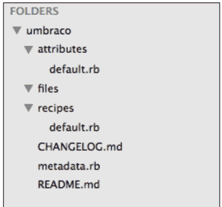
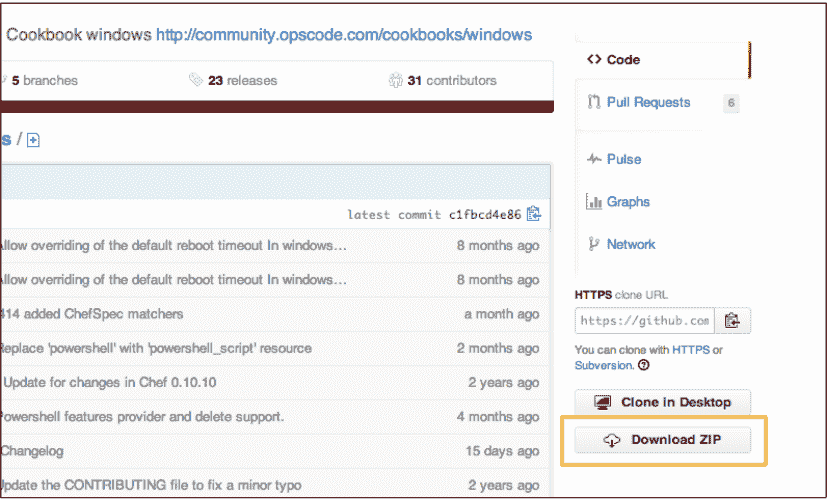

# 配置应用程序堆栈

现在您已经了解了 Windows 特定资源以及在 Windows 上使用 Chef 的一些背景信息，让我们来看看如何配置一个完整的应用程序堆栈。在本章中，我们将剖析一个负责安装开源 CMS 应用程序 Umbraco 的 cookbook。请注意，此 cookbook 中的配方要求目标平台为 Windows Server 2012，如果您打算亲自运行，请相应规划。

在本章中，我们将涵盖以下主题：

- 引导新的 Windows 主机
- 安装 Umbraco CMS 的依赖项
- 在 Windows 主机上安装 Umbraco CMS
- 在 IIS 中配置站点以运行 Umbraco CMS

## 检查 cookbook

我们将深入研究一个专门为解决 Umbraco CMS 及其要求的安装而编写的 cookbook。此 cookbook 的源代码可在 GitHub 上找到，地址为 `http://github.com/johnewart/umbraco-cookbook`。

### 配置应用程序堆栈

无论针对 Windows 还是其他平台，Chef cookbook 都共享相同的布局和结构。支持 Windows 的 cookbook 的主要区别在于，其 `metadata.rb` 文件声明该 cookbook 支持 Windows，而 cookbook 中包含的配方将通过 Windows 特定资源和条件逻辑的组合来支持 Windows，这些逻辑在 Windows 平台上的行为可能有所不同。以下截图显示了 `umbraco` cookbook 的布局：



在这里，您会注意到 cookbook 看起来就像任何其他 cookbook 一样；它可以包含配方、属性、模板、资源、提供程序以及任何其他 Chef 资源的文件夹。在此示例中，cookbook 仅包含一些默认属性和配方，因为它旨在作为 Windows 的紧凑示例。

如果您查看此 cookbook 的 `metadata.rb` 文件，您将看到以下内容：

```
name              'umbraco'
maintainer        'John Ewart'
maintainer_email  'john@johnewart.net'
license           'Apache 2.0'
```

description 'Installs and configures umbraco, an open source CMS for ASP.NET (http://www.umbraco.com)'
long_description 'Install and configure the Umbraco CMS'
version '1.0'

## Cookbook dependencies (IIS and Windows)
depends iis
depends windows

## Supported platforms
supports 'windows'

对于那些对 Chef 仍有些陌生的人来说，`metadata.rb` 文件描述了 cookbook 的维护者是谁，它遵循什么许可证，版本号是多少，它依赖哪些 cookbook，以及支持哪些平台。

在此示例中，我们可以看到 cookbook 支持 Windows 平台，并且需要 `iis` 和 `windows` cookbook 才能正常工作。这些 cookbook 对于您想要通过 Chef 安装的几乎任何 IIS Web 应用程序都是必需的。

### 安装 cookbook

如前所述，此 cookbook 有两个直接依赖项，`windows` 和 `iis`，而它们又是第三个依赖项 `chef_handler` 所必需的。所有这些 cookbook 都可以在以下位置找到：

- `https://github.com/opscode-cookbooks/windows`
- `https://github.com/opscode-cookbooks/iis`
- `https://github.com/opscode-cookbooks/chef_handler`
- `https://github.com/johnnewart/umbraco-cookbook`

### 从 GitHub 获取

为了使用这些资源，您可以从 GitHub 下载它们，或者使用 Git 将它们克隆到本地系统。如果您不希望将它们作为 Git 仓库（即受版本控制的源代码）来处理，下载它们将是获取它们的最简单方式。如果您访问上述 URL，您将在屏幕右侧看到一个名为 **Download ZIP** 的链接，如下面的截图所示：



如果您选择下载 ZIP 文件而不是使用 Git 克隆它们，您需要确保目录名称与 cookbook 的正确名称匹配（`chef_handler`、`windows`、`iis` 和 `umbraco`）。例如，如果您克隆 `umbraco` cookbook，它将被放置在 `umbraco-cookbook` 目录中，而解压缩 ZIP 文件可能会导致 `umbraco-cookbook-master` 目录。下载并重命名后，请从包含所有四个 cookbook 的目录运行以下命令将它们安装到您的 Chef 服务器上：

`knife cookbook upload -o . chef_handler windows iis umbraco`

在上传过程中，Chef 将验证每个 cookbook 的依赖项是否已满足（或正在上传中）。`chef_handler` cookbook 必须安装才能使 `windows` cookbook 工作，而 `windows` cookbook 又是支持 `iis` cookbook 所必需的，然后最后可以安装 `umbraco` cookbook，因为其依赖项已满足。


### 检查食谱

现在你已将 `umbraco` 食谱的源码下载到本地计算机，让我们来看看它在做什么。Umbraco 是一个非常易于安装的 ASP.net CMS 应用程序，它能让你很好地了解如何使用 Chef 安装和配置 IIS 应用程序。选择 Umbraco 作为本示例食谱是因为它不需要数据库（尽管支持数据库），并且其单个 ZIP 文件安装使其易于跟随操作。

让我们深入了解包含在 `umbraco` 食谱中的 `default.rb` 食谱。即将介绍的章节中的代码片段位于 `umbraco/recipes/default.rb` 中。

### 安装先决条件

在设置 IIS 应用程序之前，我们的食谱需要确保主机上已安装 IIS Web 服务器 Windows 角色。如前一章所示，Chef 有一个名为 `windows_feature` 的资源，允许我们确保该角色已可用或作为食谱执行的一部分进行安装。让我们逐个查看食谱的组件：

1. 首先，使用 `IIS-WebServerRole` 角色安装该角色，如下所示：

   ```ruby
   windows_feature 'IIS-WebServerRole' do
     action :install
   end
   ```

2. 安装完成后，在 IIS 中安装 ASP.net 功能；不过，它还有一些其他先决条件，即 ISAPI 筛选器、ISAPI 扩展、.NET 3 服务器功能、ASP.net 4.5 支持以及 .NET 4.5 可扩展性库。这些是 Windows Server 2012 上所需的角色；可以使用 `dism` 或 `servermanagercmd` 等命令行工具发现角色的名称。以下代码片段显示了 IIS ASP.net 功能的安装：

   ```ruby
   features = %w{IIS-ISAPIFilter IIS-ISAPIExtensions
   NetFx3ServerFeatures NetFx4Extended-ASPNET45 IIS-
   NetFxExtensibility45}

   features.each do |f|
     windows_feature f do
       action :install
     end
   end
   ```

### 准备 IIS 服务

至此，我们的食谱已完成所需角色和功能的安装，以便管理 IIS 应用程序。让我们看看它如何通过从服务器中删除默认 IIS 站点和应用程序池来准备 IIS 服务。

iis 食谱有一个默认食谱，用于启动名为 W3SVC 的服务。我们不希望这样做，而是希望添加自己的 IIS 服务。我们可以通过将 action 属性覆盖为 :nothing 来实现这一点。这将阻止默认 W3SVC 服务被安装，如以下代码片段所示：

```ruby
service "iis" do
  service_name "W3SVC"
  action :nothing
end
```

我们不希望默认 IIS 应用程序提供流量，因此我们将使用 iis 食谱中的 remove_default_site 食谱将其删除，如下所示：

```ruby
include_recipe "iis::remove_default_site"
```

如果你深入研究 iis 食谱，你会发现这只是执行以下操作的一种便捷方式，两种机制都能实现相同的目标：

```ruby
iis_site 'Default Web Site' do
  action [:stop, :delete]
end
iis_pool 'DefaultAppPool' do
  action [:stop, :delete]
end
```

### 获取应用程序

Umbraco 的分发版本以 ZIP 文件形式提供，我们需要下载并解压缩它。这里，资源名称（传递给资源的参数）是我们要解压缩 ZIP 文件的目标目录。目标位置在哈希元素 `node['umbraco']['approot']` 中找到，如果未覆盖，它将定义为 `attributes/default.rb` 文件中指定的 `#{ENV['SYSTEMDRIVE']}\\inetpub\\apps`。如果你使用的是简单的服务器设置（如 EC2 或原始安装），这很可能映射到目标主机上的 `C:\\inetpub\\apps`。要下载的文件由 `source` 属性指定，默认情况下将指向 `http://our.umbraco.org/ReleaseDownload?id=92348`。如果包已下载并解压缩，则由于 `not_if` 检查，该资源将被跳过，如以下代码片段所示：

```ruby
windows_zipfile node['umbraco']['app_root'] do
    source node['umbraco']['dist']
    action :unzip
    not_if {{::File.exists?(::File.join(node['umbraco']['app_root'],
    "umbraco"))}}
end
```

### 配置应用程序

Umbraco 有一些目录，IIS 用户需要有权访问。以下代码块将确保我们授予 IIS 用户修改所需目录的权限：

```ruby
%w{App_Data Views css config media masterpages xslt usercontrols bin
umbraco scripts images macroscripts}.each do |d|
    directory win_friendly_path(::File.join(node['umbraco']['app_root'],
    d)) do
        rights [:read,:modify], 'IIS_IUSRS'
    end
end
```

同样，IIS 用户需要能够更新 `web.config` 文件，以便在运行基于 Web 的安装实用程序时用一些设置对其进行更新。我们需要使用以下代码片段授予 IIS 用户对 `web.config` 文件的修改权限：

```ruby
file win_friendly_path(::File.join(node['umbraco']['app_root'], "web.config")) do
    rights :modify, 'IIS_IUSRS'
end
```

### 生成 IIS 池和站点

一旦 IIS 服务已安装且应用程序代码已下载，我们需要为应用程序配置一个 IIS 池，指定要使用的 .NET 运行时版本（本例中为 4.0），如下所示：

```ruby
iis_pool node['umbraco']['pool_name'] do
  runtime_version "4.0"
  action :add
end
```

配置好池并部署文件后，指示 IIS 定义一个使用应用程序池的站点，路径指向我们站点根目录上的端口 80。添加后，我们希望启动它（通过向 action 属性提供包含 :add 和 :start 的数组来指示）。路径指向解压缩的 Umbraco 安装目录 #{node['umbraco']['approot']}\umbraco，默认情况下将展开为 C:\inetpub\apps\umbraco，如以下代码片段所示：

```ruby
iis_site 'umbraco' do
  protocol :http
  port 80
  path node['umbraco']['app_root']
  application_pool node['umbraco']['pool_name']
  action [:add,:start]
end
```

### 执行安装

现在你知道食谱及其食谱在做什么了，让我们继续将食谱应用到我们的 Windows 主机上。这里，我们将通过以下步骤在 Windows 主机上安装 Umbraco CMS：

- 使用 Chef 客户端引导 Windows 服务器
- 为 Umbraco CMS 应用程序创建角色
- 将 `umbraco` 食谱添加到 Umbraco 角色的 `run_list`
- 将新创建的角色应用到主机
- 通过 Web 浏览器完成 CMS 的配置

### 引导主机

在以下示例中，我们使用的是新安装 Windows 的 Windows Server 2012 主机。像往常一样，我们将使用 knife 引导主机，如下所示：

```ruby
knife bootstrap windows winrm HOSTIP -x Administrator -d windows-chef-client-msi
```

这将在位于 HOSTIP 的主机上执行 windows-chef-client-msi.rb 引导模板的内容，安装 Chef 客户端并将主机注册到 Chef 服务。完成后，你将看到类似于以下屏幕截图的输出：

```
WARN: Node WIN-CJDQ9DE0JFK has an empty run list.
INFO: Chef Run complete in 1.985377 seconds
INFO: Running report handlers
INFO: Report handlers complete
INFO: Sending resource update report (run-id: 2b919690-3496-447a-a764-08aae2c705b9)
```

你可以从前面的屏幕截图中看到，主机是 WIN-CJDQ9DE0JFK，并且没有分配任何运行列表。这很合理，因为我们尚未为其分配任何 Chef 角色，因此没有可运行的内容。为了为我们的新主机分配角色，我们必须为新的 CMS 应用程序创建一个角色；这里，我们将创建一个名为 umbraco 的角色。

### 创建角色

上传食谱后（如前一章中所述），从以下 JSON 创建一个角色，保存到文件 umbraco.json 中：

```json
{
 "name": "umbraco",
 "description": "Umbraco CMS",
 "json_class": "Chef::Role",
 "default_attributes": {
 },
 "override_attributes": {
 },
 "chef_type": "role",
 "run_list": [
  "recipe[umbraco]"
 ],
 "env_run_lists": {
 }
}
```


从 JSON 文件创建角色，使用以下 `knife` 命令：

`knife role from file umbraco.json`

如你所见，前面的 JSON 文件定义了一个角色（由 `"chef_type": "role"` 指定），该角色声明其 `run_list` 包含一个条目，即 umbraco 配方，如下面的代码片段所示：

"run_list": [
    "recipe[umbraco]"
],

## 将角色应用到节点

为了将角色应用到我们新引导的节点，我们需要获取主机列表，然后编辑其配置，并将新角色应用到主机的配置中，具体步骤如下：

1. 首先，使用 `knife node list` 获取节点列表，如下所示（在我们的例子中，只有一个主机，即新创建的主机）：

   `knife node list`

   `WIN-CJDQ9DEOJFK`

2. 使用 `knife node edit HOSTNAME` 编辑要在其中安装 Umbraco 的主机的节点配置，例如：

   `knife node edit WIN-CJDQ9DEOJFK`

这将在编辑器中打开节点的配置 JSON，如下所示（在我们的例子中，是刚创建的主机的默认配置）：

```
{
    "name": "WIN-CJDQ9DEOJFK",
    "chef_environment": "_default",
    "normal": {
        "tags": [
        ]
    },
    "run_list": [
    ]
}
```

请注意，`run_list` 属性当前为空（如果你使用的是现有主机而不是新配置的主机，可能会略有不同）。按照以下方式，将 `umbraco` 角色添加到节点 JSON 的 `run_list` 属性下：

```
"run_list": [
	"role[umbraco]"
]
```

3. 使用 `knife` 将角色应用到所需节点，只需搜索所有带有 `umbraco` 角色的主机，如下所示：

   ```
   knife winrm 'role:umbraco' 'chef-client' -x Administrator
   ```

4. 你将在屏幕上看到 Chef 客户端的输出。完成后，假设一切顺利，你可以通过在主机上访问默认 HTTP 服务的 `/install` URL 来访问新安装的 Umbraco CMS（在此示例场景中，即 `http://WIN-CJDQ9DEOJFK/install`）。你将被引导完成最终 Umbraco 安装所需的步骤，例如选择数据库、创建管理员用户以及选择任何入门工具包和主题。

### 摘要

此时，你应该已经在 Windows 服务器上拥有一个完全正常运行的 Umbraco 安装，无需手动配置任何内容。如你所见，如果需要，你可以通过简单地引导并配置这些主机的角色，将此过程重复到一台、几十台或几百台主机上。

在下一章中，让我们看看如何在引导阶段需要自定义配置时自动化主机配置，以及如何使用 Chef 管理云主机。
