# 前言

AutoCAD已有四十多年的历史，并拥有众多版本。AutoCAD完整版提供2D制图功能和3D建模工具，这些工具可以进行专业的灯光和渲染处理，生成可用于专业演示的照片级可视化效果。可以创建精确的2D图形，并包含准确的制图注释，如尺寸、引线和数据表格。

本书鼓励读者掌握AutoCAD，介绍各种技术和流程，使读者能够更加熟练地使用AutoCAD应用程序，并运用本书所学知识来改进和增强现有的AutoCAD技能。

# 本书读者对象

本书面向在职业生涯中已经专业使用过AutoCAD的现有用户。理想情况下，读者应已具备AutoCAD基础知识，以便理解本书中提到的概念、工作流程和过程。典型读者包括中级CAD技术人员、CAD管理人员以及日常频繁使用AutoCAD的人员。

# 本书内容

*第1章“自定义AutoCAD界面”*，介绍AutoCAD界面以及如何快速轻松地对其进行自定义。凭借这种可自定义性，您可以快速轻松地更改AutoCAD界面，从而提高工作效率。

*第2章“开发自己的AutoCAD工作空间”*，帮助您学习如何有效使用AutoCAD中的工作空间，并进行必要的界面更改以创建自定义工作空间。您还将学习如何删除不需要的工作空间。

*第3章“巧用AutoCAD界面”*，展示AutoCAD如何提供众多功能和特性，让您能够更聪明地工作，而不是更辛苦地工作。这些功能包括文件选项卡、“模型”和“布局”选项卡、状态栏上的草绘设置、AutoCAD ViewCube以及AutoCAD导航栏。本章教您如何有效使用这些工具，提升AutoCAD工作效率。

*第4章“使用高级草绘设置”*，讲述AutoCAD及其状态栏上丰富多样的草绘设置。本章将带您了解一些较少使用的高级草绘设置，以便您通过更聪明地工作而不是更辛苦地工作来提高效率和生产力。

*第5章“使用对象捕捉开发高级几何图形”*，详细说明AutoCAD是一款精确的设计应用程序，绘制图形时必须保持准确性。本章将向您展示如何使用特定的草绘设置和对象捕捉（通常称为Osnaps），使您能够精确、准确地进行绘图和建模。

*第6章“测量和修改几何对象”*，为了达到高精度，AutoCAD用户花费大量时间修改图形中的几何对象，常常需要测量长度、面积和角度。AutoCAD提供了一套全面的草绘和建模工具，可快速准确地修改和测量DWG文件中的几何图形。

*第7章“开发注释性标注样式”*，在本章中，您将学习在DWG文件中使用注释性标注所需的方法，包括创建文字样式来管理文字大小和字体、使用标注样式管理尺寸标注、设置特定的引线样式以及使用精确的表格样式。

*第8章“使用注释性缩放”*，本章将带您了解如何通过设置视口和不同的视口比例、在“模型”选项卡中使用注释比例以及添加和删除对象注释比例，将注释样式与注释性缩放结合使用。这使注释能够以适当的方式显示，从而有效、准确地传达设计意图。

*第9章“开发块库”*，到本章结束时，您将能够处理图形中的常规块和动态块，并使用包括剪贴板在内的各种方法创建自己的块库。您还将学习如何使用“块”选项板以及将工具选项板与块结合使用。

*第10章“使用块属性”*，随着时间的推移，图形中会包含越来越多的块。属性使您能够识别块，并为使用图形的人员提供有价值的信息。您需要的方法都在本章中，例如在块中定义属性、使用“增强属性编辑器”编辑块中的属性，以及使用“块属性管理器”（*BATTMAN*）。

*第11章“创建带参数和动作的动态块”*，动态块既需要参数，也需要关联的动作，因此如果您处理的是表示门的块，可能需要添加参数和动作来控制门在图形中门洞内的开启方向。本章介绍在图形中处理这些参数和动作的方法。

*第12章“创建带可见性状态的动态块”*，可见性状态允许您在同一个块中创建具有多种视图的动态块。本章向您展示如何创建具有顶视图、前视图和侧视图三种不同视图的洗手盆块。

*第13章“共享AutoCAD图形”*，共享图形和图形视图使您能够利用互联网和云的力量，实时共享设计的各个方面。这通过提供更加动态的图形修订路径，节省了宝贵的图形管理和协作时间。

我们还有来自我们丰富的书籍和视频目录中的其他代码包，可在 https://github.com/PacktPublishing/ 获取。快去看看吧！

## Conventions used

本书中使用了多种文本约定。

**Filenames in text:** 表示应用于练习每个章节中演示的工作流程和流程的练习文件的文件名。以下是示例：“打开 DWG 文件可确保您获得对所有 AutoCAD 界面的访问，因此请确保 Workspaces.dwg 文件在 AutoCAD 中打开且为当前文件。”

**Bold:** 表示新术语、重要词语或您在屏幕上看到的词语。例如，菜单或对话框中的词语以 **bold** 显示。以下是示例：“您也可以通过 **Application** 菜单（左上角）和 AutoCAD 中的 **Start** 屏幕访问 **New** 命令。”

> **Tips and tricks #25**
> 
> 当您选择视口时，显示的不仅仅是夹点。如果您选择所选视口中央的三角形下拉按钮，您将能够看到所有可用的视口比例。如果您从现有视口比例中选择不同的比例，视口将被重新调整大小和重新缩放，如 *Figure 8.5* 所示。这在 AutoCAD for Mac 中也适用。

## Get in touch

我们非常欢迎读者的反馈。

**General feedback:** 如果您对本书的任何方面有疑问，请发送电子邮件至 customercare@packtpub.com，并在邮件主题中提及书名。

**Errata:** 尽管我们已尽一切努力确保内容的准确性，但错误仍会发生。如果您在本書中发现错误，我们将不胜感激您向我们报告。请访问 www.packtpub.com/support/errata 并填写表格。

**Piracy:** 如果您在互联网上以任何形式发现我们作品的非法副本，我们将不胜感激您提供位置地址或网站名称。请通过 copyright@packtpub.com 联系我们并附上材料链接。

**If you are interested in becoming an author:** 如果您在某个领域具有专业知识，并且有兴趣撰写或为一本书做出贡献，请访问 authors.packtpub.com。

## Share Your Thoughts

在您阅读完 *Mastering AutoCAD 2025* 后，我们很想听听您的想法！请点击此处直接前往本书在 Amazon 的评论页面并分享您的反馈。

您的评论对我们和技术社区都很重要，并将帮助我们确保提供优质内容。

## Download a free PDF copy of this book

感谢您购买本书！

您喜欢随时随地阅读，但又无法随身携带印刷书籍吗？

您的电子书购买与您选择的设备不兼容？

不用担心，现在每本 Packt 书籍都免费提供一本无 DRM 的 PDF 版本。

在任何地方、任何地点、在任何设备上阅读。直接从您喜爱的 technical 书籍中搜索、复制和粘贴代码到您的应用程序中。

福利还不止于此，您还可以每天通过电子邮件获得独家折扣、新闻通讯和精彩免费内容。

按照以下简单步骤获取福利：

- 1. 扫描二维码或访问以下链接
- 2. 提交您的购买证明
- 3. 就这样！我们会直接将您的免费 PDF 和其他福利发送到您的电子邮件

https://packt.link/free-ebook/978-1-83763-969-4

## Technical requirements

使用 AutoCAD 需要您在台式电脑或笔记本电脑上安装有许可版本的 AutoCAD。您还需要以下内容：

- AutoCAD 的订阅（许可证）。这必须是 AutoCAD 的 *full* 版本，而不是 AutoCAD LT。理想情况下，这是 AutoCAD 的最新版本：AutoCAD 2025。您可以使用早期版本，但建议不要早于 AutoCAD 2022。
- 为了使用订阅版 AutoCAD，您需要一个 Autodesk 账户。如果您没有，可以在 https://accounts.autodesk.com/ 上设置一个。
- 本书涵盖在 Microsoft Windows **Operating System (OS)** 上运行的 AutoCAD 2025。所有图表和图形均来自 AutoCAD 2024 和 Windows 11 OS。然而，本书包含适用于 Windows 和 Mac 用户的说明。虽然为 Windows 用户提供了全面的说明，但有关 Mac 界面差异的特殊说明也已在标注框中提供。
- 本书的所有图形和绘图均可在此找到：https://github.com/PacktPublishing/Mastering-AutoCAD-2025/tree/main。

好了，现在进入本章吧！

## Introducing the default AutoCAD interface settings

在我们深入本章其余部分并学习如何为我们自身利益调整 AutoCAD 的 UI 之前，让我们先熟悉一下默认的 AutoCAD 界面设置。这些被称为工作区。作为 AutoCAD 用户，您很可能已经在使用这些工作区，而自己却不知道。

AutoCAD 中可用的默认工作区如下：

- **Drafting & Annotation:** Drafting & Annotation 工作区主要用于 AutoCAD 中的 2D 绘图。这是使用最广泛的 AutoCAD 工作区。
- **3D Basics:** 3D Basics 工作区正如其名所示：用于 3D 建模的基础 3D 界面。然而，它是一个功能有限、精简的 3D 界面，仅具有基本功能。
- **3D Modeling:** 3D Modeling 工作区是一个全面的 3D 工作区，包含所有 3D 功能区选项卡、面板和命令。它通常是您日常 3D 建模时使用的 3D 工作区。

我现在向您介绍这些默认工作区，以便您可以检查它们的位置并确定您当前使用的是哪个工作区。要检查正在使用的工作区，您可以单击状态栏上齿轮图标右侧的弹出箭头，如 *Figure 1.1* 所示。

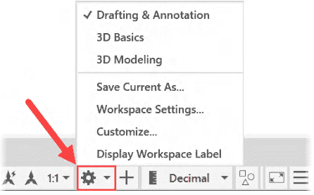

Figure 1.1: The gearwheel icon on the status bar

单击弹出箭头时，**Workspace** 菜单会出现。前图显示 **Drafting & Annotation** 工作区是当前工作区（由其旁边的复选标记表示）。

请确保检查您使用的工作区，并且为本章目的，请确保将 **Drafting & Annotation** 工作区设为当前。我们将在 *Chapter 2* 中更深入地介绍工作区。

> **AutoCAD for Mac**
> 
> 有些人可能在运行 macOS OS 的 Apple 电脑上使用 AutoCAD for Mac。AutoCAD for Mac 界面与在 Windows OS 上运行的 AutoCAD 界面截然不同。AutoCAD for Mac 中的工作区工作方式不同。您将在屏幕左侧图标菜单顶部找到 AutoCAD for Mac 中的 **Drafting** 和 **Modeling** 工作区，如 *Figure 1.2* 所示。

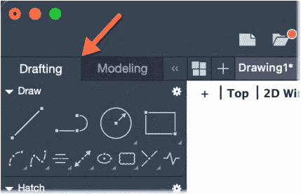

Figure 1.2: The Drafting and Modeling tabs in the AutoCAD for Mac interface

现在您对 AutoCAD 界面有了了解，下一个部分将介绍 AutoCAD 功能区及其设置。

## Understanding the AutoCAD ribbon settings

AutoCAD 功能区是您 AutoCAD 界面的基本组成部分。它为您提供功能区选项卡，每个选项卡都包含功能区面板，其中包含您有效操作 AutoCAD 所需的大多数命令。

AutoCAD 有四种功能区设置。这些有时会无意中被激活，让您以为自己弄坏了 AutoCAD。您没有，相信我！现在要弄坏 AutoCAD 可不容易！

功能区设置是通过单击功能区顶部的按钮激活的。如果您眨眼，可能会错过它，许多 AutoCAD 用户都会错过。它就是那种会被点击，然后您不确定如何让它恢复到之前样子 的按钮。

如果您检查 AutoCAD 功能区的顶部，您会看到一个带箭头的小白色矩形按钮。*Figure 1.3* 显示了您将找到它的位置。

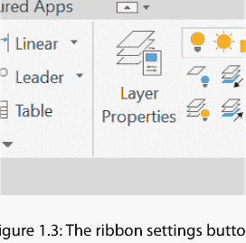

根据其大小，您可以理解为什么它很容易被忽略，对吧？如果您单击该按钮（而不是其右侧的弹出箭头），您将看到功能区的外观发生变化。不要惊慌。您所做的只是更改了功能区的外观。

这四种设置中的每一种都以不同的方式显示功能区，为您在日常 AutoCAD 工作中提供不同的使用方法。

我将简要说明每个设置的工作原理。功能区的设置会根据你是否点击了功能区顶部的功能区设置按钮以及连续点击了多少次而变化：

- **默认功能区（无需点击）**：这是你首次开始使用 AutoCAD 时的默认功能区设置。如图 1.4 所示，它提供了所有功能区选项卡、面板和图标的视图。

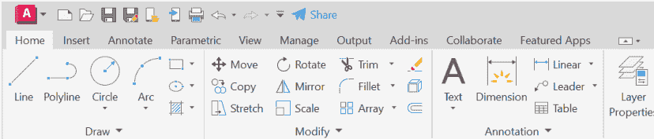

图 1.4：默认功能区显示

- **最小化为面板按钮（第一次点击）**：点击功能区设置按钮后第一次，你将把功能区设置为面板按钮。功能区选项卡仍然可用，但每个选项卡上的面板现在仅显示为按钮，如图 1.5 所示。

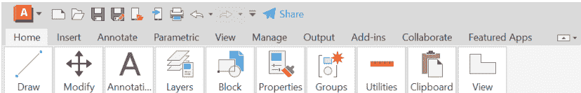

图 1.5：使用最小化为面板按钮的功能区显示

点击任意面板按钮后，所选的功能区面板将会显示，如图 1.6 所示。

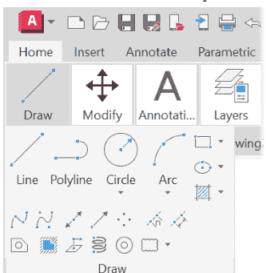

图 1.6：使用最小化为面板按钮时选中的绘图面板

上图显示 **Home** 选项卡为当前选项卡，并在点击 **Draw** 面板按钮后显示 **Draw** 面板。

正如你所见，此功能区设置通过仅显示面板按钮所选的面板，减少了功能区的占用空间，为你的 AutoCAD 绘图和建模提供了更多屏幕空间。如果你将光标移离所选面板，它将恢复为面板按钮视图。

- **最小化为面板标题（第二次点击）：** 点击功能区设置按钮第二次后，你将把功能区设置为 **Panel Titles**。面板现在仅显示其标题，从而进一步减少了功能区在屏幕上的占用，如 *Figure 1.7* 所示。

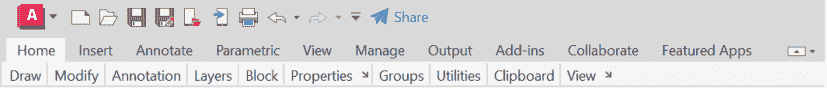

图 1.7：使用最小化为面板标题的功能区显示

点击任意面板标题后，所选的功能区面板将会显示，如 *Figure 1.8* 所示。

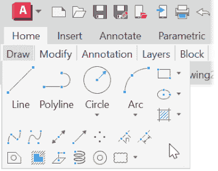

图 1.8：使用最小化为面板标题时选中的绘图面板

上图显示 **Home** 选项卡为当前选项卡，且 **Draw** 面板标题被选中。如前所述，当你将光标移离面板时，它将恢复为面板标题视图。

- **最小化为选项卡（第三次点击）：** 点击功能区设置按钮第三次后，你将把功能区设置为 **Tabs**。现在不再显示面板按钮或标题，只有功能区选项卡。这是 AutoCAD 中功能区最简洁的视图，如 *Figure 1.9* 所示。

图 1.9：使用最小化为选项卡的功能区显示

在使用最小化为选项卡设置时访问功能区面板时，你需要先选择功能区选项卡，然后在其相应面板上选择所需的命令图标，如图 1.10 所示。

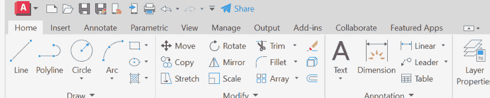

图 1.10：使用最小化为选项卡时选中的 Home 选项卡

正如前图所示，所选选项卡中的所有面板都会显示。在此例中，功能区上的 Home 选项卡已被选中，显示了 Draw 面板、Modify 面板以及功能区上 Home 选项卡下显示的所有面板

> Note
> 图 1.10 已略微裁剪以更好地适应页面。因此，仅完整显示了 Draw 和 Modify 面板。

- **返回默认（第四次点击）：** 第四次点击功能区设置按钮将带你返回默认功能区设置，如图 1.11 所示。

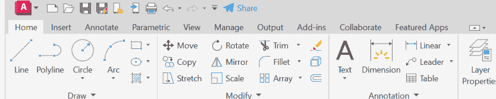

图 1.11：第四次点击时返回默认功能区设置

因此，正如你所见，很容易错误地点击功能区设置按钮并做出这些更改。如果你从未使用过功能区设置按钮，可能会产生一定的忐忑，因为你会怀疑自己对 AutoCAD 界面做了什么。然而，通过使用本节中所述的功能区设置按钮的点击序列，你现在可以在需要时返回默认功能区设置。

你现在也可以看到如何更改功能区设置以满足你的特定需求。这使你能够通过减少功能区占用空间来利用 AutoCAD 中更多的屏幕空间。当你的屏幕空间受限时，这尤其有用。一个典型的例子是在屏幕较小的笔记本电脑上运行 AutoCAD。

到目前为止，我还没有提到功能区设置按钮右侧的小弹出箭头，如 *Figure 1.12* 所示。

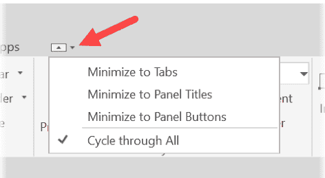

点击弹出箭头后，你将看到如前图所示的小弹出菜单。这允许你选择特定的功能区设置，而不是像前面提到的那样在功能区设置按钮上逐一点击。

一旦选择了特定的功能区设置，它将保持设置。你需要将菜单设置回 **Cycle through All** 才能使用功能区设置按钮循环浏览每个功能区设置。

AutoCAD 中的功能区设置是在较小的显示器上工作时获得更多屏幕空间的绝佳方式。随着我们转向工作站替代笔记本电脑，这将有所帮助。是的，你可以在办公室连接一个巨大的显示器，但在旅行时你只有 15 英寸的笔记本电脑显示屏可用时，那个功能区设置按钮将非常有用！

> **Tips and tricks #1**
> 你会注意到某些功能区面板的标题栏上有一个弹出箭头。如果你点击面板上的弹出箭头，该面板中的隐藏命令图标将被显示。点击小图钉图标，这些隐藏的命令图标将保持固定打开状态，并在再次点击图钉图标之前一直显示。隐藏的图标随后将恢复到功能区中。*Figure 1.13* 显示了使用功能区 **Home** 选项卡上的 **Draw** 面板时图钉图标的位置。

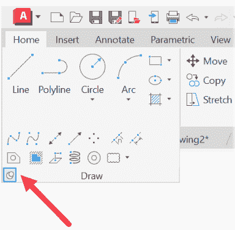

图 1.13：允许隐藏命令图标保持固定打开的图钉图标（显示为已固定）

现在你知道了如何根据你的工作流程修复 AutoCAD 功能区设置，而不会觉得自己破坏了 AutoCAD，让我们继续学习如何使用粘性面板进一步改进 UI。

## AutoCAD for Mac

AutoCAD for Mac 不像 AutoCAD for Windows 那样具有功能区界面，因此无法更改功能区外观。AutoCAD for Mac 使用位于 AutoCAD for Mac 屏幕左侧的图标菜单。你可以通过点击齿轮图标来编辑每个图标面板的图标设置。图 1.14 显示了 Draw 面板及其默认图标设置。在 AutoCAD for Mac 中，你仍然需要点击并按住以显示弹出图标菜单，就像在 AutoCAD for Windows 中一样，以访问更多命令实例，例如 Arc 弹出菜单。

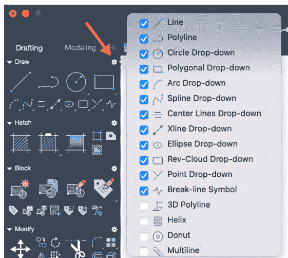

图 1.14：AutoCAD for Mac 中 Draw 面板中的图标设置

你现在对 AutoCAD 功能区及其设置和功能有了良好的理解。在下一节中，你将学习如何利用粘性面板（来自功能区）。

## 使用粘性面板

在本章中，迄今为止的假设是功能区面板保持在功能区中。事实并非如此。功能区面板可以移动到 AutoCAD 绘图区域，并可以像对话框和调色板一样浮动。

下图显示了来自 Home 选项卡的 Draw 面板浮动在 AutoCAD 绘图区域中。本节介绍如何将粘性面板放置在那里，以及如何将其放回功能区。

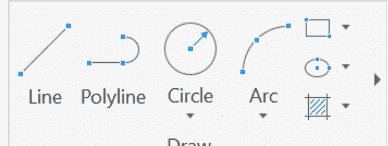

图 1.15：AutoCAD 绘图区域中浮动的 Draw 面板

为简化操作，请保持在功能区上的**主页**选项卡中。

将光标移到**绘图**面板的标题栏上。单击并拖动**绘图**面板。您会看到**绘图**面板开始移动，只需松开鼠标按钮即可将其拖放到AutoCAD绘图区域中。没错，就这么简单！

这被称为**粘性面板**。这个名称来源于您可能在办公室使用的便利贴。您可以将功能区面板固定在所需位置，以便更有效地查看和使用它。

这样做的好处是，粘性面板不再受功能区的约束。您现在可以切换到其他功能区选项卡使用其他AutoCAD命令，同时仍能快速方便地访问粘性面板上的命令。

一个典型的场景是，您需要**绘图**面板来创建几何图形，但您可能正处于**注释**选项卡中处理图纸的注释。*图1.16*展示了这一场景。

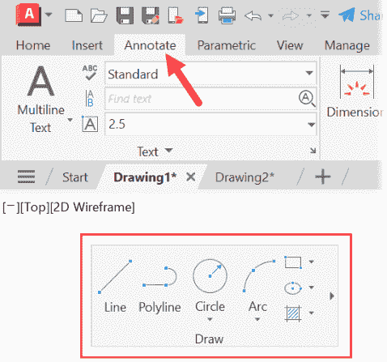

图1.16：绘图面板为粘性面板，而注释功能区选项卡为当前选项卡

将粘性面板放回功能区并不像您想象的那么困难。无需单击和拖动，AutoCAD甚至会记住您从哪个功能区选项卡取出了粘性面板。

要将粘性面板放回功能区，您需要将鼠标悬停在原位的粘性面板上。您会看到面板高亮显示，并且面板左右两侧出现侧边栏。*图1.17*显示了侧边栏，由箭头指示。

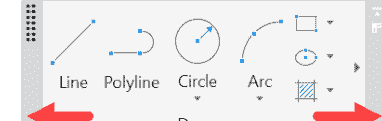

图1.17：带有侧边栏指示的粘性面板

在左侧边栏上，您会看到一个渐变或点状区域。您可以单击并拖动它来重新定位粘性面板。

在右侧边栏上，有两个小图标。这两个图标中下方的一个可以让您将粘性面板从水平旋转为垂直，反之亦然。

您需要的是右上角的图标。如果将光标悬停在上面，工具提示将显示**将面板返回至功能区**。您可以在*图1.18*中看到这一显示。

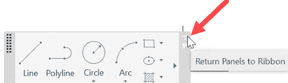

图1.18：带有“将面板返回至功能区”指示的粘性面板

单击此图标后，粘性面板将返回功能区。无论当前是哪个功能区选项卡，AutoCAD都会将面板放回相应的功能区选项卡上。

如果您处于**注释**选项卡中，并将粘性的**绘图**面板返回功能区，AutoCAD不仅会确保将其放置在相应的功能区选项卡上，还会确保其回到该功能区选项卡上的正确位置！

这是通过AutoCAD CUI设置完成的，我们将在本章后面部分涉及。

**提示和技巧 #2**
AutoCAD现在具有一项称为浮动绘图窗口的功能。这意味着任何图形文件选项卡都可以拖放到任何显示位置。当AutoCAD用于双（有时是三）显示器硬件设置时，通常会使用此功能。即使浮动图形移动到其他位置，粘性面板也会保持在原位。*图1.19*让您了解这可能是什么样子。

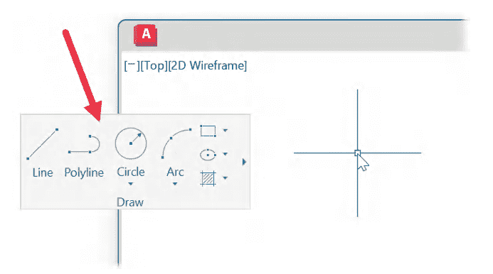

图1.19：绘图粘性面板仍在原位，浮动图形窗口在其后方

粘性面板是自定义AutoCAD界面以适应您工作方式的绝佳方法。它们可以放置在任何位置，尤其是当您需要特定功能区面板始终可用时。

现在您已经了解了如何利用粘性面板并将其放回原位，让我们将注意力转向了解QAT中的项目。

## 有效使用QAT

AutoCAD QAT位于AutoCAD 2024应用程序窗口的左上角。您在使用AutoCAD时可能已经使用过它。*图1.20*显示了默认的未自定义QAT。

图1.20：QAT（未自定义）

在本节中，我们将了解一些使用QAT的实用工作流程，这些流程将帮助您变得更加高效和多产。

## 自定义QAT

QAT上有一个非常小但功能强大的图标。对于我们这些超过一定年龄的人来说，它会让我们想起**光盘（CD）**时代。光盘主要用于音乐，取代了黑胶唱片。它们也曾用于软件安装。AutoCAD过去也是从CD介质安装的。音乐CD在CD播放器上播放。QAT上的**自定义快速访问工具栏**图标看起来非常像那些旧CD播放器上的弹出按钮。*图1.21高亮了* **自定义快速访问工具栏**按钮。

图1.21：自定义快速访问工具栏按钮

单击该图标后，将出现一个下拉菜单，如*图1.22*所示。

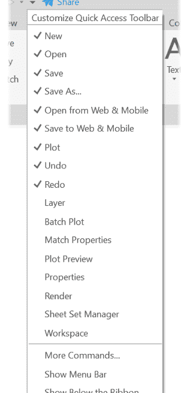

图1.22：带有默认设置的自定义快速访问工具栏下拉菜单

您会注意到有几个设置旁边有复选标记。这表明这些功能已显示在QAT上。没有复选标记的功能可以被选择显示在QAT上，以改善您日常的AutoCAD工作。这就是我们将重点介绍的自定义。

如果从下拉菜单中选择**图层**选项，您会看到**图层**下拉菜单已添加到QAT中，如*图1.23*所示。

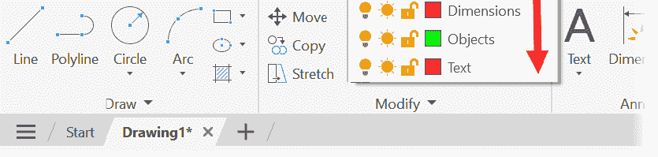

图1.23：已添加并正在使用的带图层下拉菜单的QAT

这种自定义的主要好处是您现在可以随时访问所有AutoCAD图层控件。无论您使用哪个功能区选项卡，您都可以随时控制图层特性，从而无需不断返回功能区的**主页**选项卡来更改任何特定的图层特性。*图1.23*还显示了已添加**图层**下拉菜单并正在使用的QAT。您现在可以看到访问AutoCAD图层是多么容易。

如果您想关闭QAT上的**图层**下拉菜单，您需要重复自定义过程，单击**自定义快速访问工具栏**图标。然后在下拉菜单上单击**图层**，复选标记将被移除。**图层**下拉菜单也将被移除。

另一个可以添加到QAT的有用下拉菜单是**工作空间**功能。如前所述，这是您可以在**自定义快速访问工具栏**下拉菜单中勾选的另一个功能。*图1.24*显示了已添加到QAT并正在使用的**工作空间**功能。

如您所见，向QAT添加功能为您提供了一个自定义的AutoCAD用户界面，这将增强您的工作流程，并在您每天使用AutoCAD时为您提供额外的效率。

## 其他QAT设置

在QAT的**自定义快速访问工具栏**下拉菜单上，您还会看到其他可用于进一步自定义AutoCAD界面的设置。

**显示菜单栏**选项将在AutoCAD应用程序窗口顶部显示经典的AutoCAD菜单栏，如*图1.25*所示。

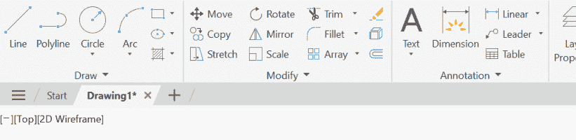

图1.25：在QAT中设置后位于相应位置的AutoCAD菜单栏

这个经典菜单栏提供了AutoCAD以前版本中更旧、更传统的AutoCAD下拉菜单。在图1.26中，选择了绘图功能，并显示了建模子选项。

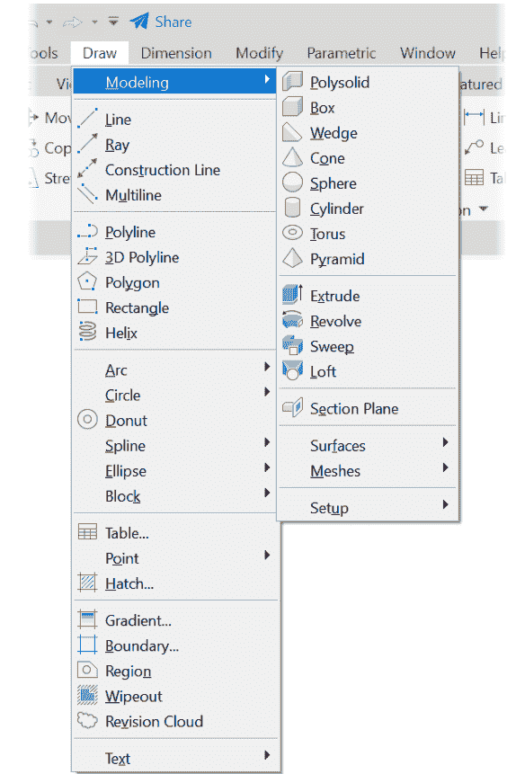

图1.26：菜单栏中的绘图下拉菜单，已选择建模子选项

如果您回到QAT自定义下拉菜单，可以单击**在功能区上方显示**，QAT将返回到功能区上方的默认位置。

虽然更改QAT的位置或向其添加功能似乎是对AutoCAD界面的一个小而不重要的更改，但令人惊讶的是，有多少用户使用这些工具来调整和调整他们的AutoCAD界面以适应他们的日常使用。正如他们所说，细节决定成败。当将这些设置保存到您自己的自定义AutoCAD工作空间时，一切就开始变得有意义了。当我们在本书后面更详细地研究工作空间时，您将开始看到它们的优势，以及它们如何让您拥有一个完全属于您自己的自定义AutoCAD工作空间。

> **AutoCAD for Mac**
> AutoCAD for Mac没有QAT。它在AutoCAD for Mac应用程序窗口顶部有一个简化的工具栏，如图1.29所示。可以通过右键单击工具栏并选择**自定义工具栏**来自定义。

## 介绍CUI命令

到目前为止，我们一直使用AutoCAD界面来自定义AutoCAD界面。还有一个AutoCAD命令允许您调整AutoCAD界面。该命令是**自定义用户界面（CUI）**命令。

开始使用CUI命令的最快方法是键入CUI并按Enter。您可以直接键入，它会出现在光标（十字准线）附近，也可以在AutoCAD屏幕底部的命令行上键入。

这将弹出**自定义用户界面**对话框。图1.30显示了**自定义用户界面**对话框，其中包含三个默认AutoCAD工作空间：**草图与注释默认**、**三维建模**和**三维基础**。这些可以在对话框的**自定义**选项卡中找到。

## 自定义 AutoCAD 界面

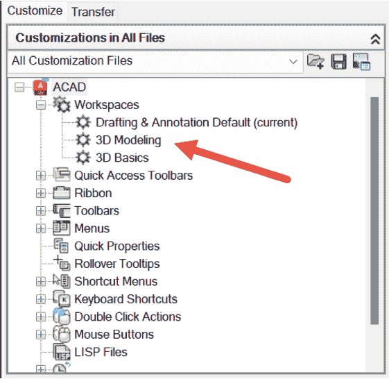

图 1.30：自定义用户界面对话框，在“自定义”选项卡中标出了默认的 AutoCAD 工作空间

如果你通过拖动对话框的一角或一侧来放大对话框，就可以开始了解如何自定义 AutoCAD 用户界面。

> **技巧与诀窍 #3**
> 
> 在提交对**自定义用户界面对话框**的任何更改之前，最好先复制一份你要使用的工作空间。这样可以避免你可能犯的错误影响到默认工作空间，使其无法挽回！只需在对话框中的特定工作空间上右键单击，然后从快捷菜单中选择**复制**。这将在以后当你意识到自己已将默认工作空间改得面目全非时，为你省去极大的麻烦。

如果你在对话框左上角窗格中选择一个工作空间（注意*技巧与诀窍 #3*），然后选中该工作空间，即可开始查看其结构，以及它如何由各个组件、功能区选项卡、面板和命令组成。

在*图 1.31* 中，可以看到选择了**草图与注释**，并展开了功能区/面板内容。可以看到列出的所有单独面板。

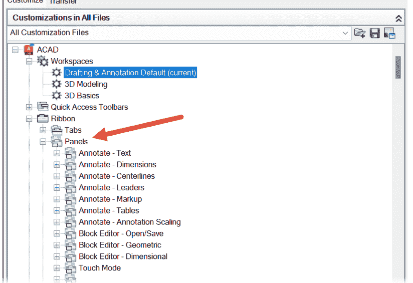

图 1.31：CUI 对话框中展开的“功能区 | 面板”内容

使用滑块，你可以向下滑动列表以找到**默认二维: 绘图**功能区面板。如果你展开此内容并展开**行 1**，就可以看到**直线**、**多段线**、**圆**和**圆弧**命令。

展开**圆**命令。你将看到所有不同的命令选项，这些选项同样会在 AutoCAD 中绘图时单击功能区中的**圆**弹出箭头时看到。*图 1.32* 中对此进行了突出显示。

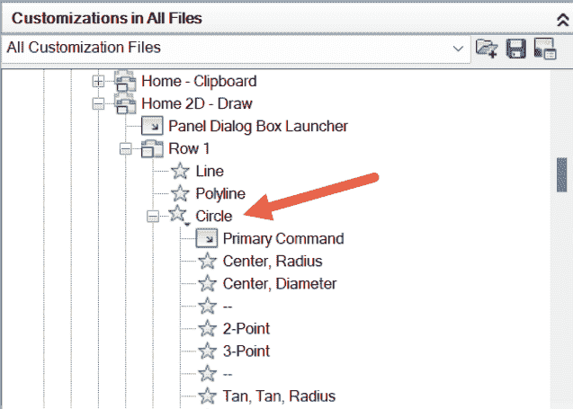

图 1.32：自定义用户界面对话框中显示的不同“圆”命令选项

如果在对话框中选择**圆心、半径**选项，该命令选项的所有设置将显示在对话框右侧窗格中，以便进行命令自定义。

右侧窗格还显示面板预览，以便你检查其在功能区上的显示效果。同时也会显示该命令的宏代码。查看*图 1.33* 可了解其在对话框中的显示效果。

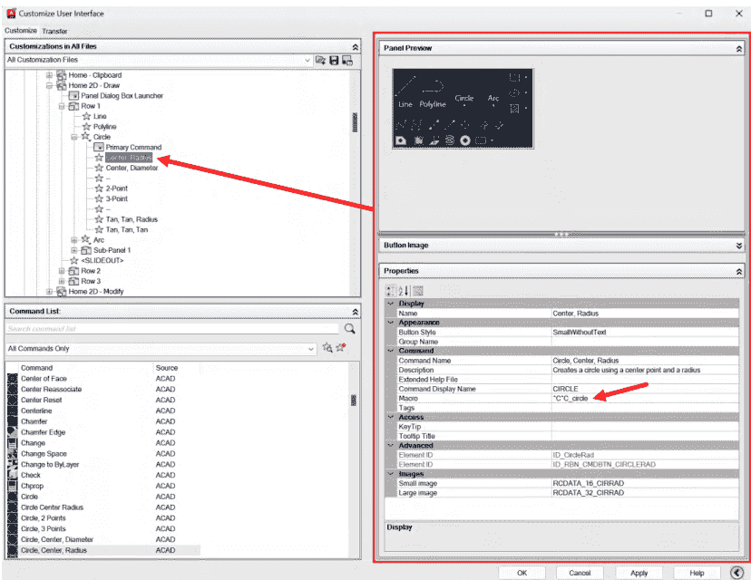

图 1.33：选择了“圆 | 圆心、半径”命令的自定义用户界面对话框

CUI 命令可以编辑或复制现有工作空间，甚至细化到命令宏级别。这意味着在（完整版）AutoCAD 中可以进行编程，以创建可能占据 AutoCAD 功能区上新型面板和选项卡的新命令。

有很多方法可以使用 CUI 命令深入自定义 AutoCAD 界面。本书不涉及这些内容，但互联网上有大量资源和社区（包括 Autodesk 社区），你可以在其中深入研究并与同行讨论。Autodesk 提供了一些很好的在线平台，供你与其他 AutoCAD 用户交流。你需要使用 Autodesk 帐户登录以下任何 Autodesk 社区：-

- Autodesk 论坛，位于：https://forums.autodesk.com
- Autodesk 知识网络 (AKN)，位于：https://knowledge.autodesk.com
- Autodesk 社区提示：AutoCAD 产品：位于 AutoCAD 论坛中
- Autodesk 社区声音博客：位于前述 Autodesk 论坛链接中

**AutoCAD for Mac**
CUI 命令也适用于 AutoCAD for Mac，但界面和对话框有所不同。*图 1.34* 显示了在启动 CUI 命令后 AutoCAD for Mac 中的“自定义”对话框。你需要单击对话框顶部的选项卡来访问 CUI 命令的必要区域。

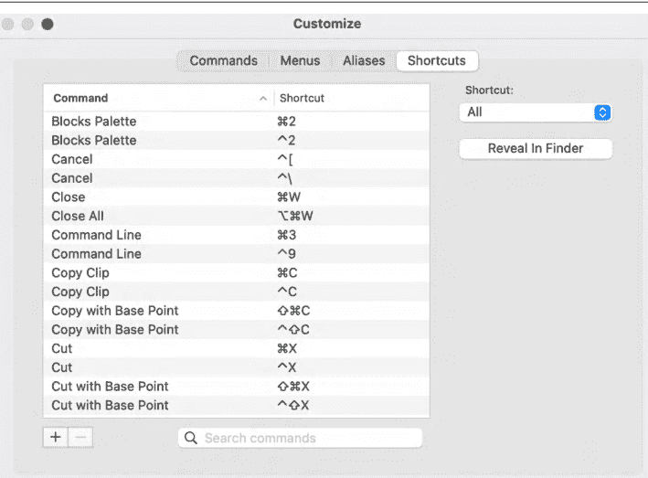

图 1.34：AutoCAD for Mac 中的“自定义”对话框

在上一节中，你学习了如何使用 **CUI** 命令和**自定义用户界面**对话框自定义 AutoCAD 用户界面。下一节将总结本章所学内容。

## 总结

在本章中，你学习了更改和管理 AutoCAD 功能区设置以及设置固定面板。我们还学习了如何有效使用 QAT，以及如何使用 AutoCAD CUI 命令和**自定义用户界面**对话框。

所有这些工作流程和概念对于你作为 AutoCAD 用户来说都很重要，可以增强和自定义 AutoCAD 界面，以符合你的偏好和理想的工作环境。在下一章中，我们将讨论如何在 AutoCAD 中开发和自定义自己的工作空间。

## 练习

在 AutoCAD 中打开一个空白图形，然后跟随本章各节中展示的界面自定义选项进行探索。这适用于 AutoCAD for Windows 和 AutoCAD for Mac。

从*第 2 章*开始，我将分享练习文件，以便你可以跟着实际操作并动手学习 AutoCAD。
