# 2 开发你自己的 AutoCAD 工作空间

AutoCAD 2025 附带了针对特定工作环境的预设默认工作空间。这些工作空间主要用于 2D 草图和 3D 建模。可以针对特定的生产环境设置单独的工作空间，从而为每个环境提供一个高效的界面。

AutoCAD 工作空间已在*第 1 章*中介绍过。学完本章后，你将能够有效地使用 AutoCAD 中的工作空间，并做出必要的界面更改以创建自定义工作空间。你还可以使用 AutoCAD **自定义用户界面** (*CUI*) 命令删除不需要的工作空间。

开发自己的工作空间可以个性化 AutoCAD 界面，并让你充分利用屏幕和显示器空间。一个典型的例子是，与台式电脑的双显示器设置相比，你可能只使用笔记本电脑屏幕来使用 AutoCAD。此时你需要优化屏幕空间才能有效使用 AutoCAD。如果需要，工作空间允许你在两种屏幕配置下工作。

在*第 1 章*的*介绍默认 AutoCAD 界面设置*一节中，我们了解了 AutoCAD 中可用的默认工作空间。请务必检查你正在使用的工作空间，并为了本章的目的，将**草图与注释**工作空间设置为当前。

本章将带你了解 AutoCAD 工作空间设置，并教你以下内容：

- 有效使用工作空间
- 将 AutoCAD 界面更改保存到自定义工作空间
- 从 AutoCAD CUI 中删除冗余工作空间

## 技术要求

对于本书中的本章及后续章节，你需要在 AutoCAD 中启用**动态输入**和**命令行**。有关如何执行此操作的说明，请访问 `https://www.autodesk.com/support/technical/article/caas/sfdcarticles/sfdcarticles/How-to-enable-or-disable-dynamic-input-in-AutoCAD.html`。

AutoCAD 命令行或*命令提示*默认始终显示在 AutoCAD 屏幕上。你可以通过输入 COMMANDLINEHIDE 并按 *Enter* 来隐藏它。你可以通过输入 COMMANDLINE 并按 *Enter* 或使用 *Ctrl + 9* 将其恢复。

**动态输入** (DYNMODE) 也是默认开启的。但是，**动态输入**图标不会显示在状态栏上。单击状态栏右端的**自定义**图标（*三条水平线*），然后在菜单中单击**动态输入**，确保其旁边有复选标记。然后它将显示在状态栏上。然后你可以关闭和打开 **DYNMODE**，并通过右键单击**动态输入**图标来访问其设置。

## 练习文件

本章使用一个简单的 DWG 文件来确保你可以完全访问 AutoCAD 中所有与工作空间相关的功能。DWG 文件的文件名是 `Workspaces.dwg`。

## 有效使用工作空间

工作空间非常有用。它们允许你在与你正在使用的 AutoCAD 环境相关的特定*空间*中工作。例如，**草图与注释**工作空间是默认的 AutoCAD 工作空间，主要用于 2D 草图绘制，而**三维基础**和**三维建模**工作空间用于 AutoCAD 中的 3D 建模。

每个工作空间都会显示一组特定的功能区选项卡、面板和图标，确保可以根据 AutoCAD 在适当时间所执行的任务，有效地利用其必要的工具和功能。但是我们如何为项目选择正确的工作空间呢？

## 选择正确的默认工作空间

在本章开头，我要求你确保默认工作空间设置为**草图与注释**。这是因为我们即将完成一个练习，以确定哪个 AutoCAD 工作空间适合你的特定项目，例如 2D 草图绘制或 3D 建模。你将学习如何更改默认工作空间或自定义工作空间以适合项目环境。

在开始之前，我想请你打开本章的练习文件 `Workspaces.dwg`，你应该已经从*前言*中提供的链接下载了该文件。

Locate the exercise file and open it in AutoCAD. It will look like *Figure 2.1*

Figure 2.1: The Workspaces.dwg file when first opened

The Workspaces.dwg file looks like a flat 2D drawing of a polyline with six regularly spaced circles. It isn’t. It is a 3D solid with six regularly spaced holes, but due to the default settings you are working with, in this case, the **Drafting & Annotation** workspace, AutoCAD is set up for 2D drafting.

Therefore, the question is, how do you set a workspace that is more suited to 3D modeling? This is where you need to change your AutoCAD workspace to fit your needs.

Return to the gearwheel icon on the status bar. Click on it, and you will see the **Workspace** menu. Select the **3D Modeling** workspace. A tick will appear next to it on the menu, and you will see the AutoCAD ribbon change to display tools that are more suited to a 3D modeling environment. *Figure 2.2* shows you the **Workspace** menu with the **3D Modeling** workspace set as current.

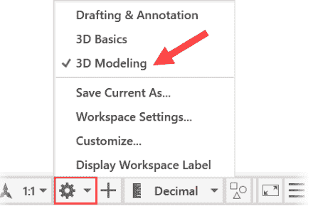

Figure 2.2: The Workspace menu with 3D Modeling set as the current workspace

The AutoCAD ribbon now displays all the necessary tools you may need to work on the 3D solid in the `Workspaces.dwg` file. *Figure 2.3* shows an excerpt of some of the 3D modeling tools available on the ribbon now that the workspace has been changed.

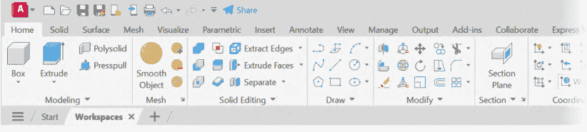

Figure 2.3: The ribbon with the 3D Modeling workspace active

With the **3D Modeling** workspace active and comparing the **Home** tab on the ribbon to the **Home** tab when using the **Drafting & Annotation** workspace, you can see that they are dramatically different. The **Home** tab now includes panels such as **Modeling**, **Mesh**, and **Solid Editing**, which are used regularly when 3D modeling.

You don’t have to use the preset workspaces in AutoCAD. You can save a workspace with its own name for your own purposes. This is often preferred if you make any changes to the ribbon, as it preserves the settings of the default workspaces.

## Creating your own AutoCAD workspace

Whenever a separate named workspace is required, you need to click on the gearwheel icon on the status bar again. On the **Workspace** menu, select **Save Current As...**, as shown in *Figure 2.4*.

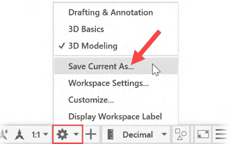

Figure 2.4: The Workspace menu with Save Current As... displayed

Staying in the **3D Modeling** workspace with the Workspaces.dwg file still open in AutoCAD, you will now make changes to the AutoCAD interface and save those changes in a saved custom workspace.

The changes to the interface are going to involve utilizing the ribbon panels. Ribbon panels can easily be moved from the ribbon and placed in the drawing area in AutoCAD. They are known as sticky panels and are similar to Post-It notes – discussed in *Chapter 1*.

Take a look at the **Home** tab on the ribbon. You will see various panels available when using the **3D Modeling** workspace. For this exercise, you will move the **Modeling** and **Mesh** panels into the AutoCAD drawing area. This will create sticky panels that can be moved around like Post-It notes in the AutoCAD drawing area, independently of their original positions on the AutoCAD ribbon.

Click and drag on the title bar of the **Modeling** ribbon panel. You will see the panel move away from the ribbon as you move the mouse. Position the **Modeling** panel in a suitable location in the drawing area and release the mouse button. The panel is now placed in the drawing area.

Repeat this workflow for the **Mesh** ribbon panel, placing it underneath the **Modeling** panel. *Figure 2.7* shows how the panels should appear in the drawing area.

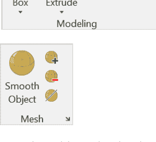

Figure 2.7: The Modeling and Mesh sticky panels

**AutoCAD for Mac**

As mentioned previously, the interface is different on AutoCAD for Mac. There is no way of moving panels in AutoCAD for Mac as the **Drafting** and **Modeling** workspaces in AutoCAD for Mac are fixed at the top of the icon menu on the left-hand side of the screen and cannot be changed.

You have now altered the AutoCAD interface to suit your needs. The two panels have been moved to a suitable location, ready for use when 3D modeling.

To maintain the location of the two *sticky panels*, you now need to save a custom workspace. The reason for this is that if you revert back to one of the default AutoCAD workspaces, the *sticky panels* will be returned to their original positions in the ribbon due to the **Customize User Interface (CUI)** settings in each preset workspace.

Saving a new custom workspace ensures that the CUI settings are set to keep your *sticky panels* where you placed them.

To save the custom workspace, you need to use the workflow covered earlier in the chapter. Click on the gearwheel icon and select **Save Current As...**, as shown in *Figure 2.8*.

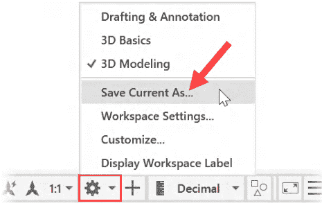

Figure 2.8: Selecting Save Current As... to save a custom workspace

The **Save Workspace** dialog box will appear. Name your custom workspace `3D Modeling-CUSTOM` and click on **Save**. *Figure 2.9* shows you the dialog box.

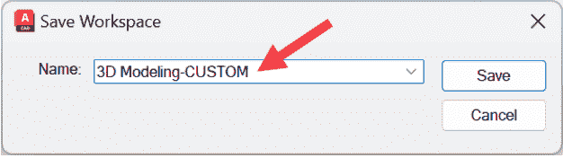

Figure 2.9: The Save Workspace dialog box with the custom workspace name

This is now a saved workspace and is now also the current workspace. This workspace includes the position of the sticky panels in the AutoCAD CUI settings.

If you click the gearwheel icon again, you will see your custom workspace listed on the **Workspace** menu, as shown in *Figure 2.10*.

You can also see the previously saved **3D Modeling-CURRENT** workspace. The check mark next to the **3D Modeling-CUSTOM** workspace indicates the current workspace.

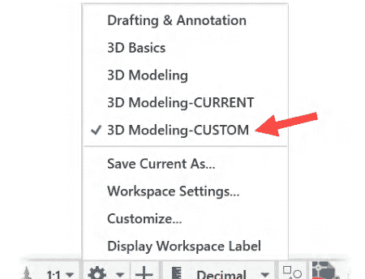

Figure 2.10: The Workspace menu displaying the new custom workspace

Your custom workspace includes your sticky panels. If you select the default **3D Modeling** workspace from the **Workspace** menu, you will see your sticky panels disappear from the drawing area to be repositioned in their respective positions on the **Home** tab on the ribbon.

> **Tips and tricks #4**
> 
> You can use sticky panels in AutoCAD in any workspace. As mentioned in this chapter and the *Using sticky panels* section in *Chapter 1*, they can be returned to the ribbon at any time using the **Return Panels to Ribbon** function. Sticky panels are a great timesaver when using a dual monitor setup for your workstation. You can set up all the necessary panels you use daily in one area of the screen and save this interface configuration as your own personalized AutoCAD workspace. Should the time come when you need to reset to default settings, you simply select the appropriate default AutoCAD workspace as the current workspace, and all the *sticky panels* will be returned to the relevant locations on the ribbon. *Figure 2.11* shows how your customized interface would look when using the **3D Modeling-CUSTOM** workspace set up in this chapter.

Select your **3D Modeling-CUSTOM** workspace from the **Workspace** menu, and you will see the sticky panels reappear in their locations in the drawing area, as shown previously in *Figure 2.7*.

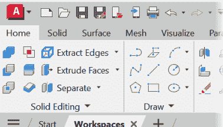

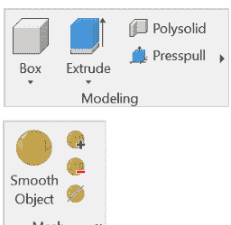

Figure 2.11: The sticky panels in the drawing area when using the 3D Modeling-CUSTOM workspace

Sometimes, after creating new workspaces, and customizing existing ones, there may be a need to remove redundant workspaces from the AutoCAD interface. In the next part of the chapter, we will look at how to do this, using the CUI tool.

## Removing a redundant workspace from the AutoCAD CUI

Workspaces are incredibly useful and versatile, but there will come a time when you need to remove redundant workspaces from the AutoCAD CUI. You may want to rationalize how many workspaces are displayed in the **Workspace** menu, or you may just want to return back to the preset workspaces AutoCAD provides.

You will need to run the AutoCAD CUI command to remove unwanted workspaces. We learned about this command in the *Introducing the AutoCAD CUI command* section in *Chapter 1*.

Having a DWG file open ensures you get access to all of the AutoCAD interface, so make sure to have the Workspaces.dwg file open and current in AutoCAD.

Using **Dynamic Input** or the **command line**, type in CUI and press *Enter*.

## 开发你自己的 AutoCAD 工作空间

**自定义用户界面**对话框将出现在屏幕上，你会在对话框左上角窗格中看到你的工作空间列表。*图 2.12* 显示了工作空间的显示方式。

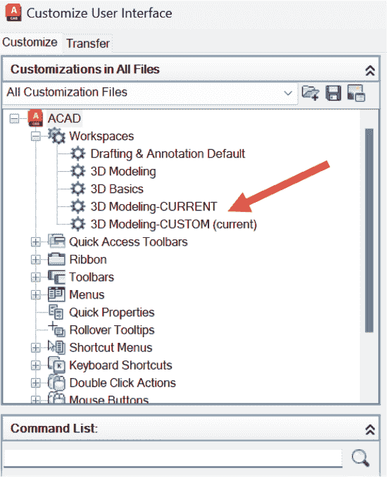

图 2.12：自定义用户界面对话框的部分视图，工作空间以箭头标出

你可以看到当前的工作空间（**3D Modeling-CUSTOM**）已列出。在这种情况下，需要移除 **3D Modeling-CURRENT** 工作空间，因为该工作空间的名称可能会误导其他用户。

单击列表中的 **3D Modeling-CURRENT** 工作空间以将其选中。工作空间的名称将以蓝色高亮显示，如 *图 2.13* 所示。然后，右键单击选中的工作空间。*图 2.13* 还显示了随之出现的右键快捷菜单。

要关闭**自定义用户界面**对话框，请单击**应用**（以应用更改），然后单击**确定**，对话框将关闭。

你也可以直接单击**确定**来应用更改并关闭对话框，但最佳实践是先单击**应用**，以确保在关闭对话框之前所有更改都已应用。

现在，你已成功从 AutoCAD CUI 中移除了不需要的工作空间，并应用了必要的更改。

如果单击状态栏上的齿轮图标，你会看到 **3D Modeling-CURRENT** 工作空间不再出现在**工作空间**菜单中。你可以在 *图 2.15* 中看到这一点。

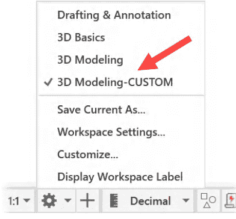

图 2.15：没有 3D Modeling-CURRENT 工作空间的工作空间菜单

你还可以看到当前工作空间是 **3D Modeling-CUSTOM** 工作空间。该工作空间包含本章前面设置的*固定面板*。

### AutoCAD for Mac

如 *第 1 章* 所述，CUI 命令同样适用于 AutoCAD for Mac，但界面和对话框有所不同。*图 2.16* 显示了在启动 CUI 命令后 AutoCAD for Mac 中的 CUI 对话框。你需要单击对话框顶部的选项卡以访问 CUI 命令的所需区域。同样需要注意的是，AutoCAD for Mac 中没有*工作空间*或*固定面板*。

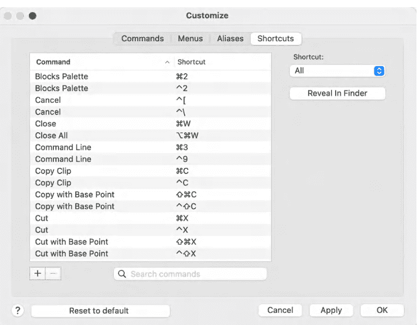

图 2.16：AutoCAD for Mac 中的自定义对话框

现在你已经学会了如何从 AutoCAD CUI 中移除多余的工作空间，确保只保留当前使用的工作空间。你的工作空间定义了你的界面，保持 CUI 井井有条非常重要。

### 小结

工作空间是至关重要的，它使你能作为 AutoCAD 用户增强和自定义 AutoCAD 界面，确保你能访问适合当前工作环境的工具。在本章中，由于练习中包含三维实体，你确保使用了与三维相关的工作空间。你学会了如何保存 AutoCAD 界面更改并移除多余的工作空间，这将帮助你在 AutoCAD 中自定义工作环境。你还学会了如何使用*固定*功能区面板，以便在 AutoCAD 绘图区域中轻松访问特定的功能区面板。

在下一章中，我们将讨论如何更智能地使用 AutoCAD 界面。你将学习如何利用文件选项卡高效地在多个图形文件之间切换，并学习如何利用**模型**和**布局**选项卡。你还将学习如何在状态栏中设置绘图设置，以及如何使用**ViewCube（三维）**和**导航栏（二维）**快速轻松地浏览图形。

## 利用 AutoCAD 界面更智能地工作

AutoCAD 已有 40 多年的历史。在此期间，AutoCAD 界面不断调整和发展，变得更加高效和直观。本章将介绍几种增强 AutoCAD 使用方法的方式，让你更智能地工作，而不是更费力。

我们将介绍一些使日常使用 AutoCAD 更加轻松的界面工具，从而提高你的效率和生产力。在本章中，你将了解以下界面工具：

- 使用文件选项卡
- 使用模型和布局选项卡
- 利用状态栏上的绘图设置
- AutoCAD ViewCube
- AutoCAD 导航栏

上述所有工具都提供了特定的方法来导航 AutoCAD 界面和 AutoCAD 绘图。AutoCAD 绘图可能很复杂，而有效使用 AutoCAD 界面可以帮助你更智能地工作，而不是更费力。学习如何使用 AutoCAD 界面更智能地工作，不仅能让你成为更熟练的 AutoCAD 用户，还能提高你日常工作的效率和生产力。

在 *第 2 章* 中，你使用了 AutoCAD 的工作空间。请确保你的 AutoCAD 工作空间现在已恢复为默认的**草图与注释**工作空间。

### 练习文件

在本章后面的 *AutoCAD ViewCube* 部分，我们将使用一个名为 `3D Solid.dwg` 的练习文件。请确保你已将其下载并准备好，以便在 AutoCAD 中使用。

### 使用文件选项卡

在 AutoCAD 会话期间，可以打开多个图形（DWG）文件。每个文件都显示为文件选项卡，位于 AutoCAD 应用程序窗口左上角功能区的正下方。如 *图 3.1* 所示。

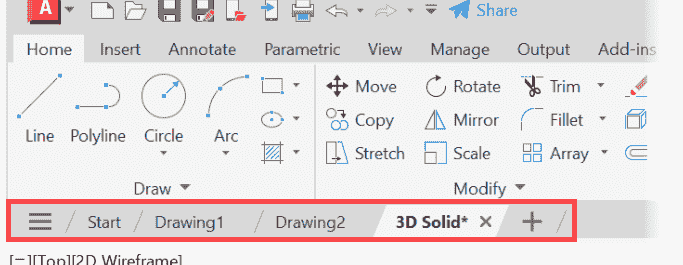

AutoCAD **开始**选项卡默认存在，并显示了三个图形文件：**Drawing1**、**Drawing2** 和 **3D Solid**。这些都是当前 AutoCAD 会话中打开的 DWG 文件。`3D Solid.dwg` 文件是本章的练习文件。如果你在 AutoCAD 中打开该文件，你会在对应的文件选项卡中看到文件名。

文件选项卡可以水平拖放以更改显示顺序。例如，如果需要，你可以将 **3D Solid** 文件选项卡拖到其他文件选项卡的前面。

你可以在文件选项卡区域的左侧看到三条水平线。这通常被称为*汉堡*图标（原因显而易见）。汉堡图标会显示一个下拉菜单，允许你使用文件选项卡进行操作。如 *图 3.2* 所示。

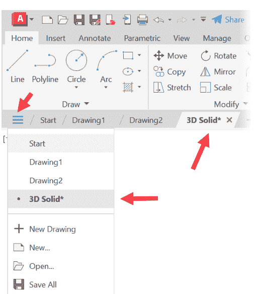

图 3.2：单击汉堡图标后显示的下拉菜单

当前文件选项卡是 **3D Solid** 文件选项卡，在文件选项卡本身和下拉菜单中均以粗体高亮显示。下拉菜单允许你选择列出的任何文件以使其成为当前文件，例如通过单击相应的文件选项卡。

*图 3.3 显示，如果将鼠标悬停在下拉列表中的文件名上，你还会看到用于跳转到所悬停文件的**模型**和**布局**选项卡的选项。这是在 AutoCAD 会话中导航打开文件的一种非常高效的方式。*

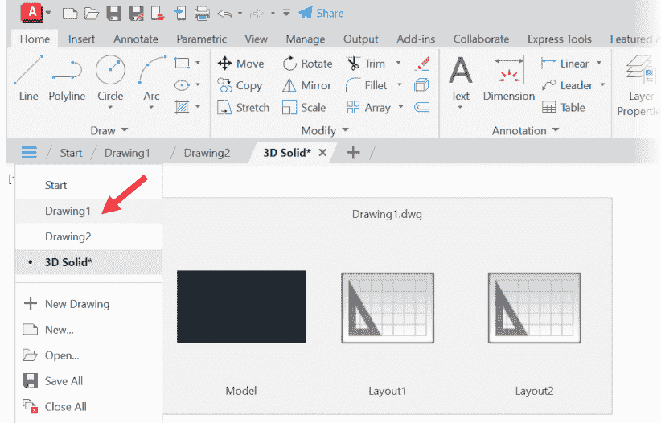

图 3.3：在下拉菜单中悬停在 Drawing1 上时，会显示模型和布局选项卡

文件选项卡旁边和下拉菜单上有一个对应的 + 符号。如图 3.3 所示，在下拉菜单中，单击此符号将打开一个新的空白图形文件。AutoCAD 会按顺序打开这些空白图形文件，并将其命名为 Drawing1.dwg、Drawing2.dwg，依此类推。因此，文件选项卡在图 3.2 和图 3.3 中显示。

下拉菜单还提供了极大的灵活性，在处理多个 AutoCAD 文件时，可以快速访问“新建...”、“打开...”、“全部保存”和“全部关闭”命令。

**技巧与诀窍 #5**

成为一名熟练的 AutoCAD 用户，不仅仅取决于图形中包含的知识，还往往取决于对 AutoCAD 本身的了解。在 AutoCAD 中工作时，熟练地在多个图形之间导航可以帮助你更智能地工作，而不是更费力，并且随着时间的推移为你节省时间。尝试将文件选项卡融入你的日常 AutoCAD 工作流程和过程中，以提高生产力和效率。

Windows 版 AutoCAD 和 Mac 版 AutoCAD 都使用文件标签来管理当前打开的绘图文件。它们是一种出色的效率工具，能够轻松地在多个打开的绘图中切换。

> **AutoCAD for Mac**
> 
> 在 AutoCAD for Mac 中，使用文件标签的方法类似。在 *Figure 3.4* 中，你可以看到类似的文件标签，其中当前绘图标签 **3D Solid** 已被高亮显示。带蓝色角的小图标（由箭头指示）是一个工具，其工作原理与 Windows 版 AutoCAD 下拉菜单中的 *hover* 工具类似。点击后，它提供了一种便捷的方法来导航当前绘图的 **Model** 和 **Layout** 标签。

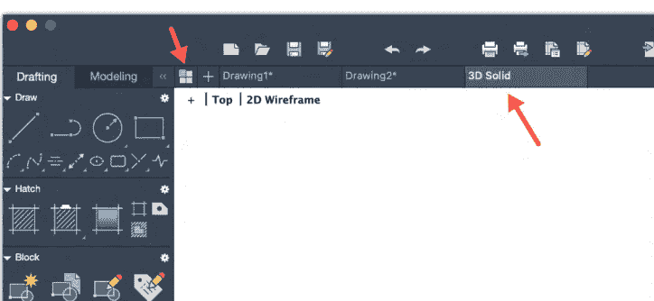

Figure 3.4 – The file tabs in AutoCAD for Mac

你现在已熟练掌握 AutoCAD 界面中的文件标签。这将使你在 AutoCAD 会话中打开多个文件时能够更智能地工作，在多个绘图文件之间进出时提供更大的灵活性。我们现在将继续学习如何使用 DWG 文件中的 **Model** 和 **Layout** 标签。

## Working with the Model and Layout tabs

AutoCAD 在两个空间中工作：*model space* 和 *paper space*。模型空间由 **Model** 标签表示，而图纸空间由 **Layout** 标签表示。你可以拥有多个布局标签，它们显示模型空间中内容的按比例缩放视图。

**Model** 和 **Layout** 标签位于 AutoCAD 应用程序窗口的左下角（适用于 Windows 和 Mac 版本）。*Figure 3.5* 显示了 Windows 版 AutoCAD 中的 **Model** 和 **Layout** 标签。

Figure 3.5: The Model and Layout tabs in AutoCAD

与文件标签一样，Model 和 Layout 标签也有一个汉堡图标。点击后，它也会提供一个菜单，允许更快地导航 Model 和 Layout 标签。Figure 3.6 显示了带有当前标签箭头的菜单。在此情况下，绘图当前在模型空间的 Model 标签中进行工作。

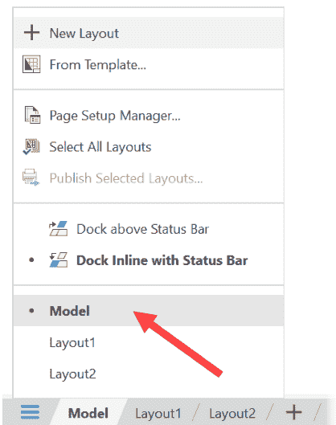

Figure 3.6: The Model and Layout tabs menu

*Figure 3.8* 显示了 **Model** 和 **Layout** 标签显示在状态栏上方。箭头指示标签下方的间隙。

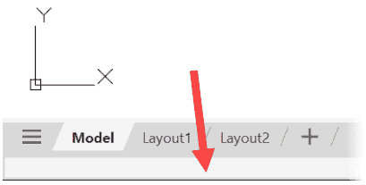

Figure 3.8: The Model and Layout tabs docked above the status bar

虽然菜单上的这些工具看起来很简单，但它们也是在绘图中管理 **Model** 和 **Layout** 标签时访问必要工具的非常有效的方法。

右键单击 **Model** 标签或 **Layout** 标签会提供特定于每种标签类型的快捷菜单。此菜单还将为你提供快速访问各种 **Model** 和 **Layout** 工具，从而在 AutoCAD 中工作时实现更快的流程。*Figure 3.9* 显示了右键单击 **Model** 标签时的快捷菜单。

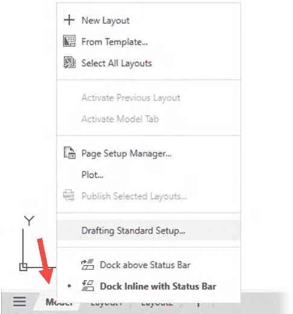

Figure 3.9: The Model tab right-click shortcut menu

正如你所见，汉堡图标中的一些内容被复制了。Plot... 选项可用，Drafting Standard Setup... 也是如此。再次强调，这些是快速快捷方式，可快速访问 AutoCAD 功能区上已有的内容，从而在上下文中更快地访问命令。你通常在 Model 标签中工作时设置绘图标准。这比在功能区上寻找要快一点，每次节省的几下鼠标点击每天都会提高你的效率。

右键单击布局标签后也会显示类似的快捷菜单。这些快捷菜单都是上下文相关的，因此会显示不同的选项。Figure 3.10 显示了显示的快捷菜单。

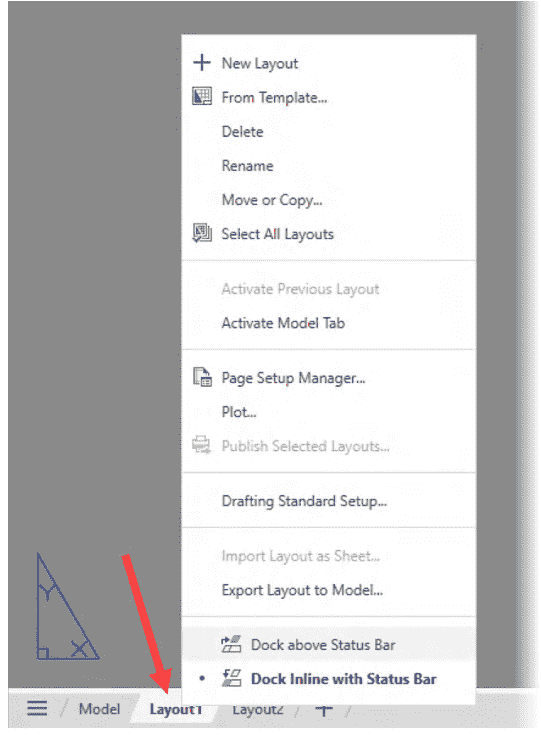

Figure 3.10: The Layout tab right-click shortcut menu

与 Model 标签版本相比，此快捷菜单上有一些不同的选项。同样，所有选项都旨在提供上下文界面并减少鼠标点击，以提高生产率。

以下是一些 **Layout** 选项及其简要说明：

- **New Layout**: 这会生成一个新的空白 **Layout** 标签，类似于点击 **Model** 和 **Layout** 标签旁边的 + 符号。
- **From Template...**: 这允许你从绘图模板文件 (*DWT*) 将布局插入到现有绘图中。
- **Delete**: 这正如其名。它允许删除 **Layout** 标签。
- **Rename**: **Layout** 标签可以重命名以便于识别和上下文。此选项会突出显示标签文本，允许重命名，类似于 Microsoft Excel 工作表。
- **Move or Copy...**: 布局可以在标签显示中移动或复制以重命名/重用。此选项打开一个对话框以加快 **Layout** 标签的移动或复制。
- **Select All Layouts**: 有时需要选择所有 **Layout** 标签以发布它们（参见 **Publish Selected Layouts...** in Figure 3.10）。你会在所有 **Layout** 标签都被选择后使用此选项）。
- **Activate Model Tab**: 这是一个简单的开关切换，允许你使 **Model** 标签处于活动状态。
- **Export Layout to Model...**: 有时 **Layout** 标签内容可能需要带入 **Model** 标签。此选项可从快捷菜单一键快速完成此操作。

> **Tips and tricks #6**
> 作为一名经验丰富的 AutoCAD 用户，你（很可能）已经在使用 **Model** 和 **Layout** 标签时拥有日常工作方法。上述选项提供了一种更具上下文相关的方法，利用 AutoCAD 2025 中增强的汉堡图标和右键单击快捷菜单。它们可以节省几次鼠标点击，并且每天重复使用时，长期来看会为你节省时间。唯一的方法就是尝试它们！

如果你记住在 **Model** 标签中执行所有设计工作，并确保 **Layout** 标签仅用于展示这些设计，你就走在正确的道路上。尝试在所有绘图工作中保持这一点，以保持你的 AutoCAD 绘图井然有序且专业。

## AutoCAD for Mac

AutoCAD for Mac 中 **Model** 和 **Layout** 标签的工作流程不同。右键单击快捷菜单需要预设页面设置，在 **Page Setup Manager** 中定义，可从 **File** 下拉菜单访问。快捷菜单仅在 **Layout** 标签上可用，并且比 AutoCAD for Windows 版本少得多。这个更小的菜单显示在 *Figure 3.11* 中。

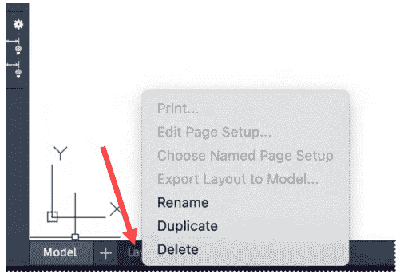

Figure 3.11: The AutoCAD for Mac right-click shortcut menu on the Layout tab

你现在知道如何在 AutoCAD 中有效地使用 **Model** 和 **Layout** 标签。这些标签在使用模型空间和图纸空间处理 DWG 文件时是基础的。我们现在将继续学习状态栏上的 AutoCAD 绘图设置。

## Utilizing the drafting settings on the status bar

大多数 AutoCAD 绘图设置都位于状态栏上。你会在屏幕右下角找到它，如 *Figure 3.12* 所示。

Figure 3.12: The AutoCAD status bar

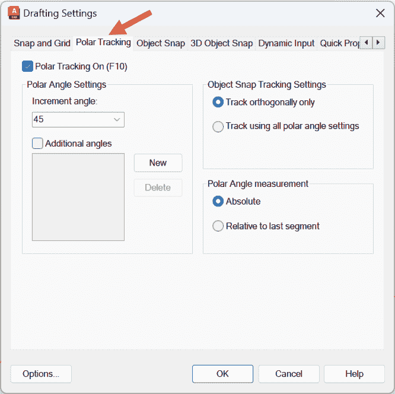

状态栏上 **Polar** 图标右侧还有一个弹出箭头。点击它将打开 **Polar Tracking** 弹出菜单，可快速将极轴追踪角度调整为预设增量。*Figure 3.15* 显示了此菜单。

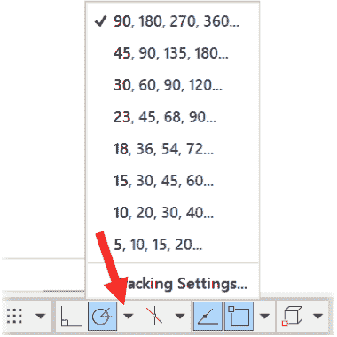

Figure 3.15: The Polar Tracking flyout menu

你也可以从弹出菜单中访问 **Tracking Settings**，以及设置预设角度增量。

- **Object Snap Tracking:** 此绘图设置纯粹是打开/关闭开关，用于打开 *AUTOSNAP* 系统变量。与 **Object Snaps (OSNAP)** 结合使用时，此绘图设置允许在绘图时使用多个对象捕捉点。

你可以右键单击此图标以选择 **Object Snap Tracking Settings**。它将打开 **Drafting Settings** 对话框，并打开 **Object Snap** 选项卡。要在对话框中启用此设置，必须确保复选框已勾选，如 *Figure 3.16* 所示。

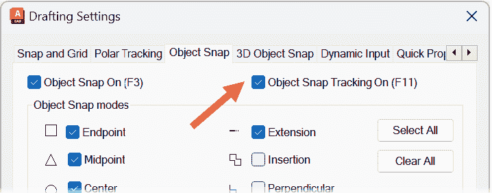

Figure 3.16: The Drafting Settings dialog box with Object Snap Tracking switched on

- **对象捕捉**：在 AutoCAD 中使用对象捕捉 (*OSNAP*) 对于精确的 2D 绘图和 3D 建模至关重要。良好的 CAD 实践是确保你始终使用对象捕捉以保证精度，但有时需要关闭对象捕捉，因此该图标位于状态栏上。

与 **极轴追踪** 一样，**对象捕捉** (*OSNAP*) 的图标可用，你可以在 *图 3.13* 中看到它。如果你右键单击该图标，可以选择 **对象捕捉设置...**，这将显示 **绘图设置** 对话框，并打开 **对象捕捉** 选项卡。

对话框显示在 *图 3.17* 中，**对象捕捉** 选项卡处于打开状态。

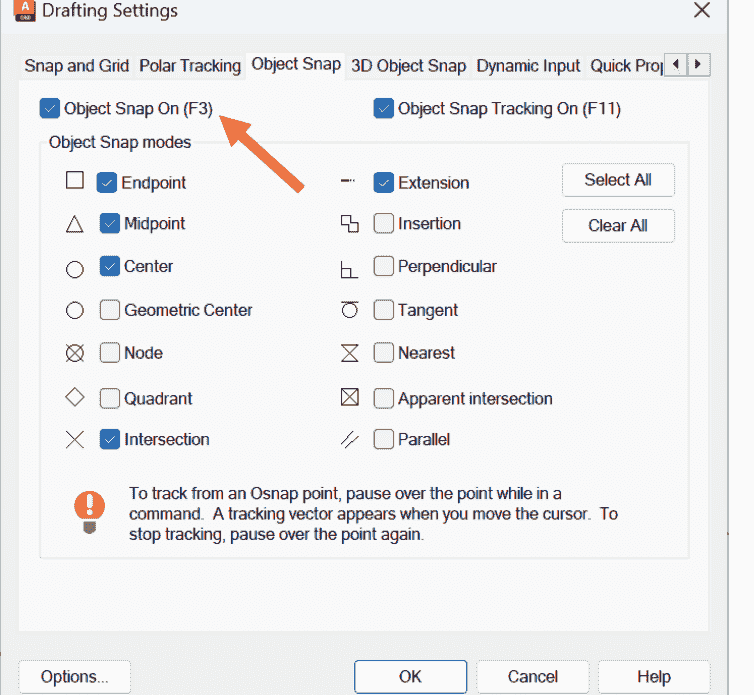

图 3.17：打开对象捕捉选项卡的绘图设置对话框

对话框中勾选了各种对象捕捉模式，已勾选的被称为运行对象捕捉。最好只勾选一些复选框。否则，这会让绘图体验变得令人沮丧！图 3.17 中选择的对象捕捉构成了一个良好的起点。设置好对象捕捉模式后，单击确定关闭对话框。

对象捕捉也有一个弹出菜单，就像极轴追踪一样。当单击弹出箭头时，会显示图 3.18 所示的弹出菜单，让你能够快速轻松地更改运行对象捕捉选择。已打开的项目在其旁边会显示一个复选标记。

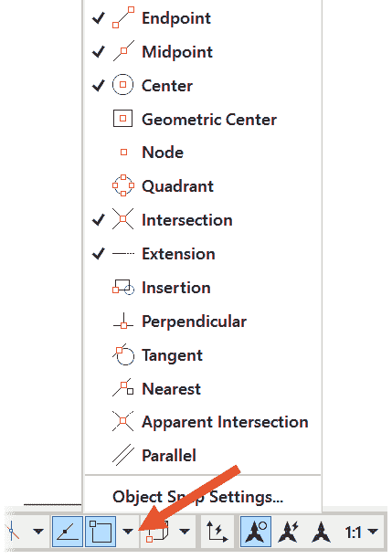

图 3.18：对象捕捉弹出菜单

你也可以在弹出菜单上选择对象捕捉设置... 来显示打开对象捕捉选项卡的绘图设置对话框。

到目前为止提到的对象捕捉通常用于 2D 绘图。在 3D 建模环境中工作时，你也可以通过单击或右键单击状态栏上的 3D 对象捕捉图标来在 AutoCAD 中使用 3D 对象捕捉 (3DOSNAP)，如图 3.19 所示。

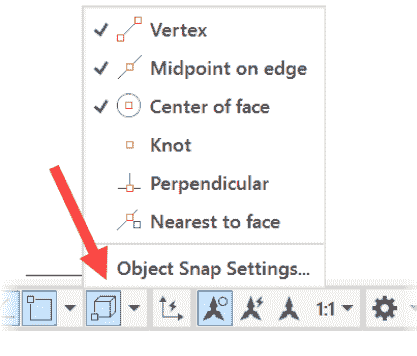

> **技巧与窍门 #7**
> 
> 本节仅触及了 AutoCAD 中主要绘图设置的一个方面。绘图设置有很多，建议你打开本章的练习文件 (3D Solid.dwg)，并按自己的节奏更深入地研究状态栏。从使用常规对象捕捉 (OSNAP) 进行 2D 绘图开始，例如，然后再使用 3D 对象捕捉 (3DOSNAP) 推进到 3D 建模。

一个绘图设置在你首次安装并运行 AutoCAD 时始终处于开启状态。那就是动态输入，称为 DYN MODE。然而，有关此绘图设置你应该知道一件事。虽然它处于开启状态，但图标最初不会显示在状态栏上。

要使其他绘图设置显示在状态栏上，你必须单击右下角的汉堡图标（在 AutoCAD for Mac 中，它显示为同一位置的齿轮图标）。将鼠标悬停在汉堡图标上时，会显示自定义工具提示。

图 3.20 显示了单击汉堡图标时出现的菜单。显而易见，这是一个很长的列表！

## AutoCAD for Mac

要在 AutoCAD for Mac 中自定义状态栏，你需要在 AutoCAD for Mac 应用程序窗口左下角单击齿轮图标。这会显示与 *图 3.20* 中类似的菜单。绘图设置的列表较短，每个设置旁边都有一个复选框来打开或关闭设置，不像 Windows 版 AutoCAD，你单击设置名称来切换其开/关并显示复选标记。要在 AutoCAD for Mac 中关闭菜单，你需要再次单击齿轮图标。

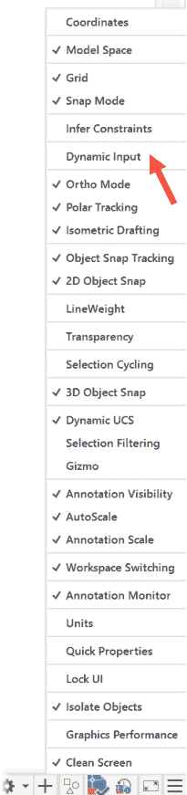

图 3.20：状态栏自定义菜单

请注意 *图 3.20* 中 **动态输入** 被箭头标出。**动态输入** 绘图设置旁边没有复选标记，表明它当前未显示在状态栏上。单击菜单上的 **动态输入** 将打开它，并且设置名称旁边会出现复选标记。

要关闭菜单，请再次单击汉堡图标。这是关闭菜单的唯一方法，你必须这样做才能返回 AutoCAD 工作。

**动态输入** 绘图设置现在显示在状态栏上。这在 *图 3.21* 中显示。

图 3.21：显示在状态栏上的动态输入图标

**动态输入** (*DYN MODE*) 非常有用。它允许你在光标（十字线）处输入命令信息，而不是使用屏幕底部的命令行。这为你提供了更动态的界面来使用 AutoCAD 命令，因此得名 **动态输入**。

与状态栏上的所有其他绘图设置一样，你可以右键单击图标并选择 **动态输入设置...**。单击此项将打开 **绘图设置** 对话框，并打开 **动态输入** 选项卡，让你更新任何需要使用的动态输入设置，以便在 AutoCAD 中有效工作。*图 3.22* 显示了 **绘图设置** 对话框中的 **动态输入** 选项卡。

图 3.22：打开动态输入选项卡的绘图设置对话框

AutoCAD 状态栏上的所有绘图设置都是独一无二的。你设置它们是为了让日常的 AutoCAD 工作更轻松。没有固定的设置。设置在你需要时存在，你根据需要和要求将其打开和关闭。利用它们来发挥你的优势，以便你能尽可能快速高效地使用 AutoCAD。

## 技巧与窍门 #8

在 AutoCAD 中进行 3D 建模时，你可以在状态栏上使用 3D 对象捕捉 (3DOSNAP)。确保它们在状态栏上可见，使用自定义（汉堡）图标，然后将其打开。你可以像在状态栏上设置常规对象捕捉一样设置运行 3D 对象捕捉，从而在 3D 工作时提高生产力。

你学到的所有先前界面工具都可以在 2D 和 3D 环境中使用。下一节将我们直接带入 3D 建模和非常有用的 AutoCAD ViewCube。

## AutoCAD ViewCube

在本章中，3D 建模已被多次提及。在 3D 工作时，需要能够以各种等轴测视图查看 3D 对象或实体。

**ViewCube** 是一个导航工具，显示在 AutoCAD 绘图区域的右上角，无论你是在 2D 模型空间工作还是在 3D 视觉样式中。**ViewCube** 允许你在标准视图和等轴测视图之间切换。

**ViewCube** 是一种持久的、可点击的、可拖动的界面，允许你在模型的标准视图和等轴测视图之间切换。*图 3.23* 显示了 **ViewCube** 位于 AutoCAD 绘图区域右上角的位置。

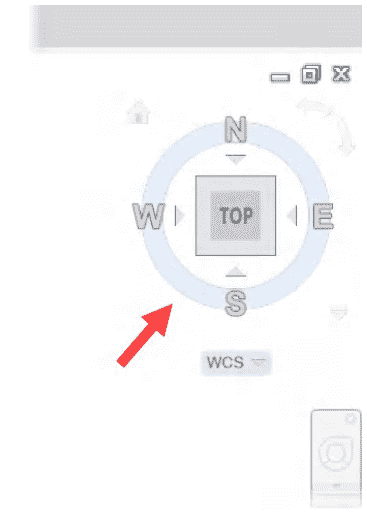

图 3.23：AutoCAD 绘图区域中的 ViewCube

**ViewCube** 使用三种类型的视图，如下所示：

- **边缘**
- **角**
- **面**

单击其中任何一个将重新对齐绘图区域中的 AutoCAD 视图，使其与 **ViewCube** 的方向相对应。使用练习文件 3D Solid.dwg，单击 **ViewCube** 默认位置的 *左下角*，如图 *图 3.24* 所示。

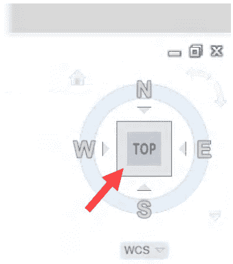

图 3.24：ViewCube 的左下角

当你将鼠标悬停在角上时，它会亮起，以便你确保单击 **ViewCube** 的正确部分。单击后，绘图将看起来像 *图 3.25*。**ViewCube** 的该角将显示切换到预设的 **SW 等轴测** 视图，正如视图控制显示所指示的那样。使用 **ViewCube** 的边缘、角和面可以让你在 AutoCAD 中有效导航，尤其是在处理 3D 模型时。

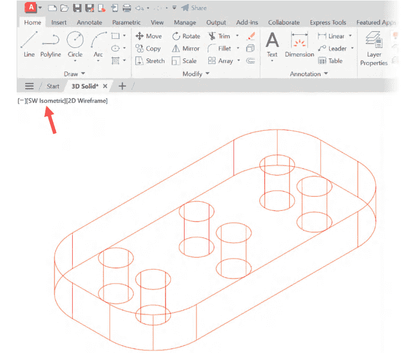

图 3.25：在 SW 等轴测视图中显示的图形

> **提示与技巧 #9**
> 
> 在使用 ViewCube 时，你可以使用指南针显示，通过点击箭头来旋转当前使用的任意视图。你还可以点击*房屋*符号返回**主视图**。右键单击 ViewCube，然后使用快捷菜单上的**将当前视图设为主视图**来设置所需的主视图。此外，请测试快捷菜单上的其他设置，以了解它们对图形视觉显示的影响。使用 AutoCAD 系统变量 *DISPLAYVIEWCUBEIN2D* 和 *DISPLAYVIEWCUBEIN3D* 可在 2D 或 3D 工作空间中开启和关闭 ViewCube 的显示。

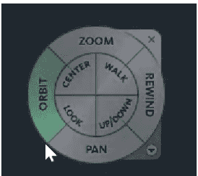

图 3.27：AutoCAD 中的完整导航轮

接下来我们来看看**实时平移**工具。

## 实时平移

**导航栏**上的**平移**图标可启动**实时平移**工具。该工具可让你在 AutoCAD 图形或模型中不间断地平移。在*实时平移*模式下，你可以右键单击并使用快捷菜单。这样你就可以使用其他**缩放**和**平移**工具。*图 3.28* 显示了激活时的快捷菜单。

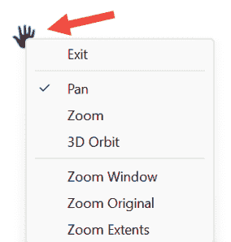

图 3.28：实时平移快捷菜单（弹出菜单）

使用**实时平移**是在 DWG 文件中移动浏览的绝佳方式。在下一节中，你将学习如何使用**缩放**来放大 DWG 中的视图，以更详细地查看设计。

## 缩放

放大和缩小图形对于查看图形中的近景细节以及能够查看整体设计至关重要。导航栏上的缩放图标提供了一个弹出菜单，可访问 AutoCAD 缩放命令。图 3.29 显示了激活的缩放弹出菜单。

该弹出菜单提供了一个列出所有 AutoCAD 缩放命令的菜单，通过点击即可选择。最近使用的缩放命令将显示在导航栏上，直到选择下一个缩放命令。当前使用的缩放命令在弹出菜单上以勾选标记高亮显示。

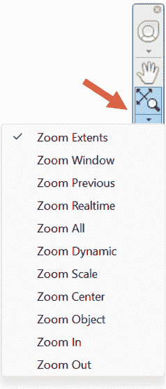

图 3.29：当前为范围缩放的缩放弹出菜单

现在你已经掌握了有效使用缩放的知识。在下一节中，你将学习如何利用 Orbit 工具快速轻松地导航模型。

## Orbit（弹出菜单）

在 3D 图形中环绕观察对于查看图形中的重要细节以及能够展示整体设计至关重要。导航栏上的 Orbit 图标提供了一个弹出菜单，可访问 AutoCAD Orbit 命令。图 3.30 显示了激活的 Orbit 弹出菜单。

该弹出菜单提供了一个列出所有 AutoCAD Orbit 命令的菜单，通过点击即可选择。最近使用的 Orbit 命令将显示在导航栏上，直到选择下一个 Orbit 命令。当前使用的 Orbit 命令在弹出菜单上以勾选标记高亮显示。

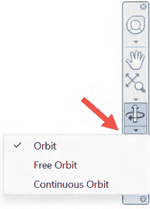

图 3.30：当前为 Orbit 的 Orbit 弹出菜单（弹出菜单）

你可以使用 Orbit 在 DWG 文件中导航模型。使用 3Dconnexion 设备可以让你在 3D 设计中环绕观察和缩放时更加精确。

## 3Dconnexion

仅当你拥有配置为与 AutoCAD 配合使用的 3Dconnexion 设备（如 SpaceMouse 或 CadMouse）时，3Dconnexion 图标才可用。这些设备增强了与 AutoCAD 的人机交互界面，其中 SpaceMouse 常用于 3D 建模。图 3.31 显示了激活的 3Dconnexion 弹出菜单。

你可以在网站 www.3dconnexion.com 上找到有关 3Dconnexion 设备的所有必要信息，也可以在那里下载任何必要的 AutoCAD 驱动程序。

该弹出菜单提供了一个列出所有可用 3Dconnexion 模式（取决于 3Dconnexion 设备）的菜单，通过点击即可选择。最近使用的 3Dconnexion 模式将显示在**导航栏**上，直到选择下一个模式。当前使用的模式在弹出菜单上以勾选标记高亮显示。你还可以在弹出菜单上访问设备的 **3Dconnexion 设置...**。

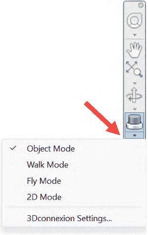

图 3.31：当前为对象模式的 3Dconnexion 弹出菜单

**3Dconnexion** 设备是 AutoCAD 的绝佳补充。将其与 AutoCAD 中的 **ShowMotion** 结合使用，可让你为 AutoCAD 中设计的特定视图创建无缝演示。

## ShowMotion

**ShowMotion** 工具提供了一个屏幕显示，用于创建和播放图形中各种视图的电影式相机动画。这些视图随后可用于设计审查、演示和书签式导航。*图 3.32* 显示了**导航栏**上的 **ShowMotion** 图标。

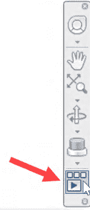

**ShowMotion** 有三个主要部分：控制栏、镜头序列缩略图和镜头缩略图。镜头是显示模型特定部分的命名位置，相关镜头可以组织成镜头序列。**图 3.33** 显示了 3D 建模环境中的 **ShowMotion**，其中显示了两个已保存的镜头和 **ShowMotion** 控制栏。

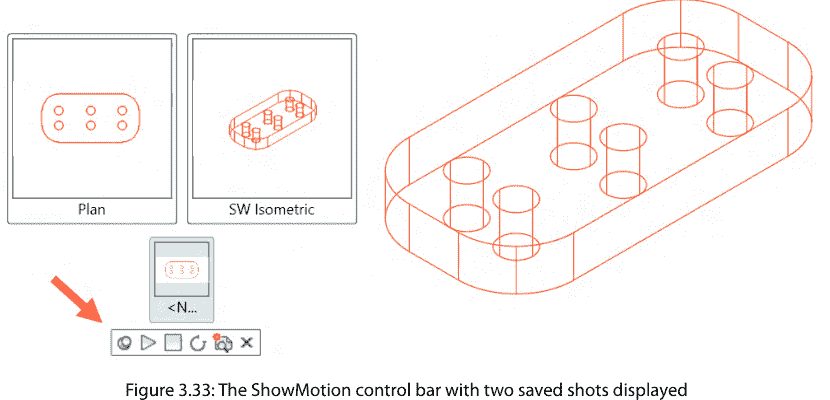

**提示与技巧 #10**
**ShowMotion** 是一个使用率极低且被低估的 AutoCAD 工具，它可以增强任何设计的视觉和演示质量。如果任何设计需要向利益相关者进行快速演示，**ShowMotion** 应该是你的首选工具。

考虑将 **ShowMotion** 作为你创建演示材料的首选工具。它集成在 AutoCAD 中，无需第三方应用程序。

**AutoCAD for Mac**
请注意，AutoCAD for Mac 中没有 **ShowMotion** 功能。

如你所见，**导航栏**功能极其多样——不仅仅用于在 2D 图形和 3D 模型中导航。它提供了一个全面的导航工具箱，可提高你日常 AutoCAD 工作流程中的生产力，并且在 **ShowMotion** 中提供了一个有用的演示工具。

## 小结

在本章中，你学习了如何使用文件选项卡和浮动图形窗口来管理已打开的图形文件。

你还学习了如何使用**模型**和**布局**选项卡，以及如何复制选项卡并设置其所需的设置。

你还学习了如何利用状态栏上的草图设置来高效、多产地绘图和建模。

你学习了在 3D 建模时如何使用 ViewCube 以及使用 ViewCube 设置，还学习了如何使用导航栏以及可用的工具。

更智能地使用 AutoCAD 界面将让你更高效。

重要的是，你不仅要了解 AutoCAD 界面，还要充分利用它。多年来，该界面经历了许多迭代，现在已达到为你出色工作的程度，让你在日常工作中更加高效。在下一章中，我们将了解高级草图设置如何提高你的 AutoCAD 生产力。
