# 4 使用高级草图设置

AutoCAD 拥有广泛的草图设置，位于 AutoCAD 状态栏上。本章将带你了解一些较少使用的高级草图设置，以便你通过更聪明而非更努力地工作来更有效、更高产地工作。

我们将向你展示如何使用特定的草图设置来增强你日常的 AutoCAD 使用，为你提供额外的技能，使你能够将 AutoCAD 用于更复杂的绘图任务。

你将了解以下草图工具：

- 使用选择循环选择对象
- 在 3D 建模时利用 3D 对象捕捉
- 使用 ISODRAFT 设置创建等轴测视图
- 通过状态栏更改单位
- 使用注释比例提高图形可读性

在 AutoCAD 中学习更高级的绘图方法有助于你建立 AutoCAD 技能组合，反过来，这将使你在日常使用 AutoCAD 时更容易提高效率和生产力。

在*第 3 章*中，我们触及了如何使用位于 AutoCAD 状态栏上的草图设置。在本章中，我们将把这一知识提升一个档次，以使用图形中的特定草图设置。


## 练习文件

对于本章，请确保您已下载以下练习文件：

- `DraftingSettings.dwg`
- `Office Project.dwg`

这两个文件将在本章的不同部分中使用，因此请确保您已在 AutoCAD 中打开它们，准备使用。

## 使用选择循环选择对象

在 AutoCAD 绘图中，总会遇到几何图形或对象 *重叠* 或共享同一条线或边的情形。确保选择正确的几何图形或对象非常重要，因为这有助于提高准确性并节省宝贵时间。这时选择循环（`SELECTIONCYCLING`）就非常有用。

选择循环也是过滤对象的绝佳方法。总是会有需要选择重叠对象进行修改或删除的时候。为了选择适当的对象，您可以使用选择循环从重叠对象的列表中选择正确的对象。随着您在本节的学习，您将看到选择循环是如何做到这一点的，并使您日常的 AutoCAD 工作变得更加轻松。

在操作选择循环之前，您需要确保它已在 AutoCAD 状态栏上可用。点击位于 AutoCAD 屏幕右下角的自定义（*汉堡*）图标。选择 **Selection Cycling**。它旁边会出现一个勾号。再次点击自定义图标以关闭菜单。

您现在可以在状态栏上看到选择循环图标。请确保它显示为蓝色，表示已打开。*图 4.1* 显示了选择循环图标已打开的状态：

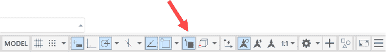

图 4.1：AutoCAD 状态栏显示选择循环并已打开

使用本章的练习文件（`DraftingSettings.dwg`），请确保您处于 AutoCAD **Model** 选项卡中。您将看到两个矩形，一个蓝色一个红色。它们显示在 **ViewCube** 上的预设 **Top** 视图中。它们都是从上方（顶部）查看的 3D 实体，并且彼此相邻，如 *图 4.2* 所示：

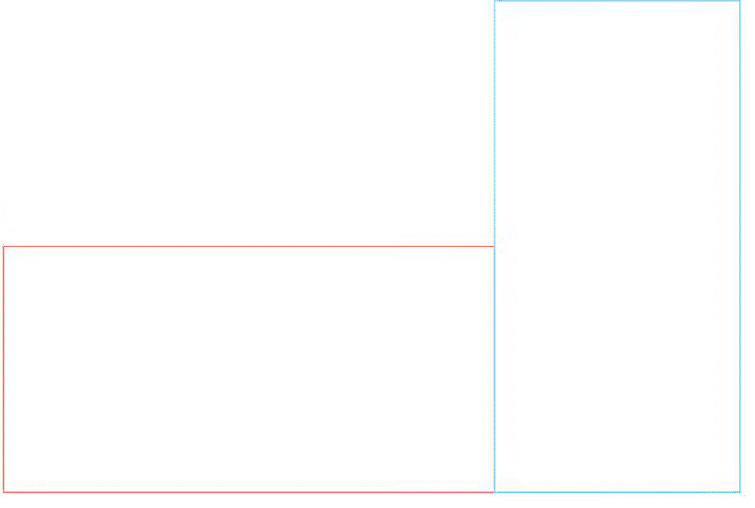

图 4.2：Model 选项卡中预设 Top 视图中的两个矩形

*图 4.2* 是两个相邻矩形的简单示例。即使在比这更复杂的绘图中，对象的几何图形也经常相邻或彼此靠近。无论我们处理的是简单还是复杂的绘图，选择循环都提供了一种高效的方法来在众多对象中选择单个对象。

现在您已经知道如何在绘图中选择对象以进行更改或删除，让我们学习如何在 3D 中准确建模，利用 3D 对象捕捉。

## 在 3D 建模时利用 3D 对象捕捉

在 AutoCAD 中进行 3D 建模时，常规对象捕捉有时会将您捕捉到 3D 模型上的错误点。例如，您可能处于模型的平面（顶部）视图中，并选择 **Endpoint** 对象捕捉以向模型添加几何图形。当您从模型顶部向下看时，该端点捕捉可能位于模型的上表面或下表面，具体取决于模型的朝向。

**3D Object Snap** (*3DOSNAP*) 是状态栏上的一个绘图设置，它为您提供仅在 3D 环境中起作用的对象捕捉选择，使您在 AutoCAD 中处理 3D 模型时更准确。

在操作 **3D Object Snap** (*3DOSNAP*) 之前，您需要确保它已在 AutoCAD 状态栏上可用。点击 **Customization**（*汉堡*）图标（如前几章所述）并选择 **3D Object Snap**。它旁边会出现一个勾号。再次点击 **Customization** 图标以关闭菜单。

您现在可以在状态栏上看到 3D 对象捕捉图标。请确保它显示为蓝色，表示已打开。*图 4.5* 显示了 **3D Object Snap** 图标已打开的状态：


图 4.5：AutoCAD 状态栏显示 3D Object Snap 并已打开

**3D Object Snap** 的操作方式与常规 **Object Snap** 绘图设置相同。您打开它并从弹出菜单中选择运行的 3D 对象捕捉。如果您点击 **3D Object Snap** 图标右侧的弹出箭头，您将看到弹出菜单上的 3D 对象捕捉。这在 *图 4.6* 中显示：

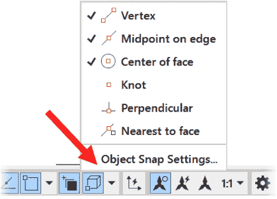

图 4.6：3D Object Snap 弹出菜单

您会在 *图 4.6* 中注意到 **Vertex**、**Midpoint on edge** 和 **Center of face** 旁边有勾号，这表示这些是当前正在运行的 3D 对象捕捉。

现在，让我们进入绘图区域并选择 **ViewCube** 的左下角。这将把绘图置于预设的 **SW Isometric 3D** 视图中。您现在可以看到矩形看起来像它们应该的那样，即 3D 实体。这在 *图 4.7* 中显示：

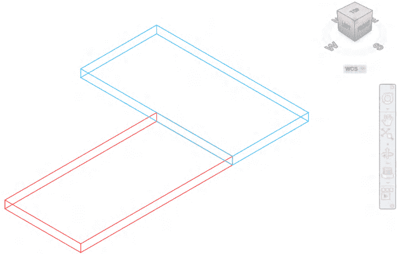

图 4.7：ViewCube 显示的 SW Isometric 预设视图中的矩形（3D 实体）

现在您处于 3D 视图中，可以更有效地利用 3D 对象捕捉。在图 4.8 中，您可以看到一条线从一个 3D 捕捉点绘制到 3D Vertex 对象捕捉点，如工具提示所示：

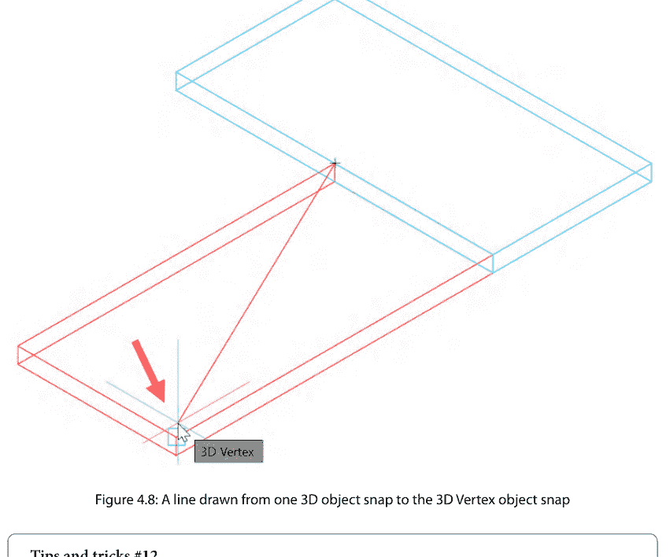

图 4.8：从一个 3D 对象捕捉到 3D Vertex 对象捕捉绘制的线

### 技巧与窍门 #12

在 3D 中工作时，您会发现 3D Object Snap (3DOSNAP) 绘图设置比常规 Object Snaps (OSNAP) 更准确，因为您可以捕捉到 3D 顶点和面，而不必不断更改 3D 视图以找到适当的对象捕捉。

3D Object Snaps (3DOSNAP) 是 3D 环境中非常有用的工具。它们在 2D 对象捕捉（OSNAP）可能捕捉到错误点时，能准确捕捉到 3D 对象上的几何点。

数字表示不同的 *ISODRAFT* 模式将用于创建 2D 等轴测视图的位置：

- **1**：isoplane Left
- **2**：isoplane Top
- **3**：isoplane Right

仅使用了 *Line (LINE)* 命令来创建视图，并借助对象捕捉（*OSNAP*）提供了一点帮助。*图 4.10* 中的等轴测视图完全由在 *ISODRAFT* 提供的等轴测角度下绘制的线段组成。在绘制第一条线段（可以是所示的任何一条线）后，打开 *ISODRAFT*，其余线条可以很容易地在适当的角度绘制，使用对象捕捉（*OSNAP*）捕捉到按顺序绘制的每条线的相关端点。

您现在已经了解如何使用 *ISODRAFT* 设置进行等轴测绘图。所有实体和几何图形都需要相关的单位，因此接下来是如何通过状态栏在 AutoCAD 中更改单位设置。

## 通过状态栏更改单位

有时您的 AutoCAD 单位设置需要更改。可能是您需要将单位从一种格式转换为另一种格式（例如从英制到公制），或者您可能只需要使用不同的单位集，因为绘图中的某个元素是英制的，而不是公制的，例如机械齿轮。

在 AutoCAD 中更新单位设置有两种方法。让我们先看第一种方法，使用 **Drawing Units** 对话框。

要在 AutoCAD 中更改单位（*UNITS*），您需要输入 UNITS 并按 *Enter*。这将显示 **Drawing Units** 对话框，如 *图 4.11* 所示。您可以输入 UNITS 在命令行中并按 *Enter*，或者，如果 **Dynamic Input** 已打开，您可以在屏幕绘图区域的任何位置输入 UNITS 并按 *Enter*。

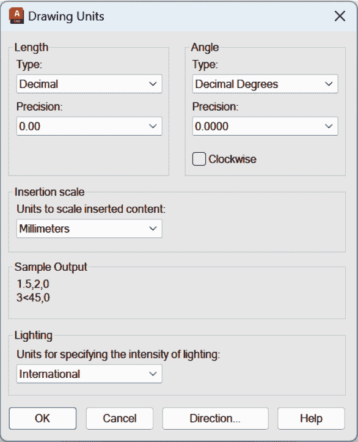

图 4.11：Drawing Units 对话框

这是一种更新绘图单位集的比较繁琐的方法。有一种更快、更简单的方法可以做到这一点。

如果您点击位于 AutoCAD 屏幕右下角的自定义（汉堡）图标（在状态栏末尾），然后从弹出菜单中选择 Units，Units 列表旁边会出现一个勾号。它还将作为绘图设置添加到状态栏中，如图 4.12 所示，该图还显示了显示的弹出菜单：


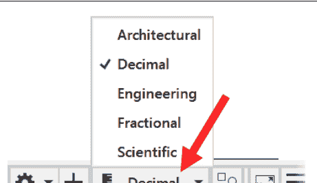

图 4.12：“单位”起草设置，显示有弹出菜单，并已选择“小数”单位

在状态栏上使用此起草设置来更改图形中的单位，比反复打开**“图形单位”对话框**要快捷方便得多。

### 技巧与窍门 #13

状态栏上的**“单位”**作为起草设置，仅用于线性单位。若要更改任何角度单位设置，仍需使用**“图形单位”对话框**。

单位只是 AutoCAD 设计工作流程中的一部分，能让您高效地进行绘图。您还需要通过图形中的注释来传达设计意图。接下来，我们将了解如何使用注释性比例和注释比例来提高图形的清晰度。

## 使用注释比例提高图形清晰度

**“注释比例”**功能（*CANNOSCALE*）用于在图形中启用注释性缩放。它通常用于尺寸、文字和填充等图形元素，以便在布局选项卡中以不同的视口比例工作时，使图形整洁易读。

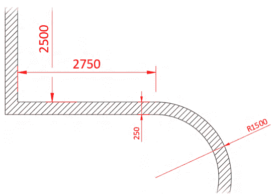

图 4.14：带有不同注释比例的尺寸

在图 4.14 中，较大的尺寸（2500 和 2750）的注释比例为 1:50，较小的尺寸（250 和 R1500）的注释比例为 1:30。这些尺寸通过与每个尺寸对象关联的注释比例，以注释性缩放的方式，与显示它们的布局视口的比例相对应。

这些注释性尺寸的优点在于，由于尺寸对象上应用了注释比例，它们在布局视口中能够保持一致的显示效果。您还可以应用多个注释比例，使注释性对象在多个不同比例的布局视口中显示。

要实现这一功能，只需一个注释性尺寸样式。在 Office Project.dwg 文件中，使用的是名为 Metric-mm 的注释性尺寸样式。如图 4.15 所示，该图展示了“尺寸”面板，您可以在 AutoCAD 功能区的“注释”选项卡中找到它：

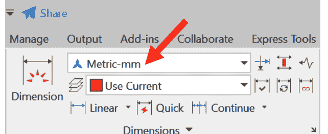

图 4.15：“尺寸”面板中显示的当前注释性尺寸样式

注释性尺寸样式使用一个蓝色的小三角形符号来表明其为注释性尺寸样式。

使用注释性尺寸样式时，您需要在**“模型”**选项卡中，通过状态栏上的弹出菜单设置注释比例，如图 4.16 所示：

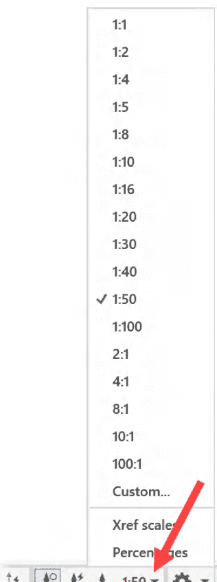

图 4.16：注释比例弹出菜单，当前注释比例为 1:50

在图形中添加尺寸是为了传达设计意图。典型的例子包括房间的长宽、门窗洞口的尺寸，或者螺栓的杆长和螺纹长度。您通常会在图形中使用对象捕捉（OSNAP）来精确捕捉代表真实世界对象的几何图形，从而添加尺寸，以传达用于施工和制造的值。通过在**“模型”**选项卡中设置注释比例，您可以让 AutoCAD 知道如何在相应的布局选项卡中缩放尺寸。

随后使用注释性尺寸样式放置的任何尺寸都将采用 1:50 的注释比例，从而确保它们显示在**1:50**布局视口中。对于**1:30**布局视口，也应采用相同的工作流程，即将注释性尺寸的注释比例设置为**1:30**。

AutoCAD DWG 文件中的所有对象都具有已知的特性，无论是**“图层”**、**“颜色”**、**“线型”**，还是本例中的**“注释比例”**。您可以通过在**“特性”**选项板中查看尺寸对象的属性来检查它是否为注释性对象。注释性尺寸的属性应如图 4.17 所示：

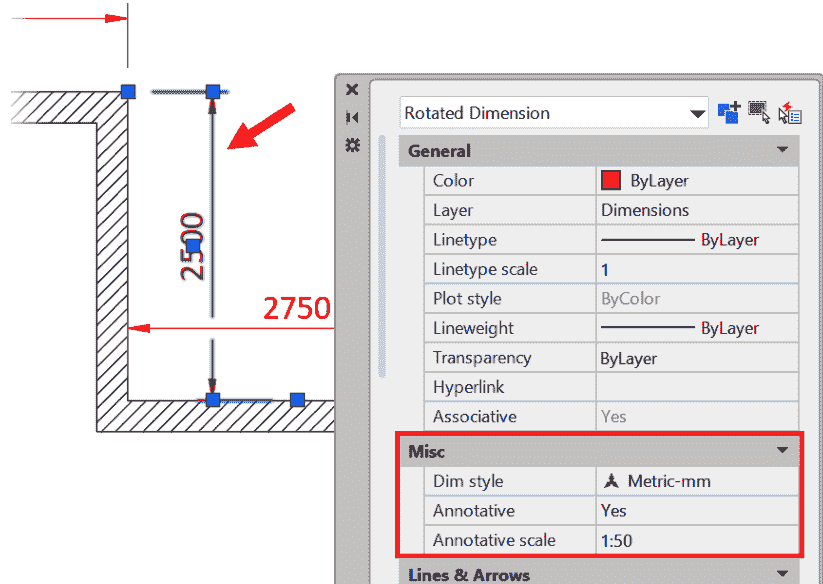

图 4.17：在“特性”选项板中显示所选注释性尺寸对象的属性

注释性缩放与注释性尺寸配合使用时最大的优点是，您可以只使用一个注释性尺寸样式和一个图层来放置所有尺寸注释，并知道它会以一致的方式显示在所有不同比例的布局视口中。

### 技巧与窍门 #14

在对注释性尺寸使用注释性缩放时，您还可以向单个尺寸对象添加多个注释比例。例如，如果某个尺寸需要同时显示在**1:50**布局视口和**1:30**布局视口中，您需要为该尺寸对象添加**1:50**和**1:30**注释比例。这可以通过**“特性”**选项板单击**“注释比例”**值来完成（见图 4.17）。单击该值后，在显示的注释比例值旁边会出现一个小按钮。单击该按钮，您将能够在弹出的对话框中添加新的注释比例值。

注释性缩放能极大地节省时间。当它与注释性尺寸配合使用时，您只需为尺寸创建一个尺寸样式和一个图层。

### AutoCAD for Mac

注释性缩放同样适用于 AutoCAD for Mac。您可以使用类似的工作流程来设置注释性尺寸样式。在**“模型”**选项卡中工作时，使用状态栏上的注释比例弹出菜单来放置注释性尺寸对象，操作方式与 AutoCAD for Windows 相同。

## 总结

在本章中，我们学习了如何选择多个重叠对象并选取所需对象进行更新或删除，以及如何使用**“三维对象捕捉”**（*3DOSNAP*）更高效地进行三维建模。

我们还学习了如何利用等轴测草图（*ISODRAFT*）设置来创建精确的二维等轴测图形。

我们还掌握了 AutoCAD 中**“单位”**（*UNITS*）功能的宝贵知识，能够快速有效地更改图形中的单位，同时也学习了如何设置和/或更改注释比例（*CANNOSCALE*），以便与图形中布局视口设置的注释比例协同工作。

本章中的高级起草设置将使您能够更高效地工作，提高生产力。它们还使您能够充分利用 AutoCAD 中的各种工具。既然您已经知道如何使用它们，您日常的 AutoCAD 使用将变得不再繁重，您将开始更聪明地使用 AutoCAD，而不是更费力。

在下一章中，我们将探讨如何使用对象捕捉在 AutoCAD 中开发高级几何图形。

## 技术要求

要使用 AutoCAD，您需要在台式机或笔记本电脑上安装 AutoCAD 许可证。您还需要以下内容：

- 一份 AutoCAD 订阅（许可证）。这必须是 AutoCAD 的*完整*版本，而不是 AutoCAD LT。理想情况下，这将是 AutoCAD 的最新版本，即撰写本书时的*AutoCAD 2025*。您可以使用更早的版本，但建议不要早于*AutoCAD 2022*。
- 要使用订阅版 AutoCAD，您需要一个 Autodesk 账户。如果没有，您可以在 https://accounts.autodesk.com/ 注册一个。
- 本书涵盖的是在 Microsoft Windows **操作系统（OS）** 上运行的 AutoCAD 2025。所有图片和图形均来自 AutoCAD 2025 和*Windows 11 操作系统*。

本书包含面向 Windows 和 Mac 用户的操作说明。虽然已为 Windows 用户提供了全面的说明，但在标注框中也为 Mac 界面存在的差异提供了特别说明。

## 练习文件

您需要确保已下载练习文件 `BearingCase.dwg` 才能完成本章。

## 使用极轴追踪（POLAR）精确测量角度

在使用**“极轴追踪”**（*POLAR*）之前，您需要确保它已出现在 AutoCAD 状态栏上。请按以下步骤操作：

1. 点击**“自定义”**（*汉堡*）图标，然后选择**“极轴追踪”**。其旁边将出现一个对勾标记。
2. 再次点击**“自定义”**图标以关闭菜单。
3. 现在您将在状态栏上看到**“极轴追踪”**图标。请确保其呈蓝色，表示已开启。

*图 5.1 显示了开启后的**“极轴追踪”**图标：*

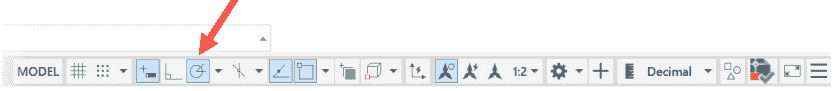

图 5.1：AutoCAD 状态栏显示“极轴追踪”并已开启


为什么需要 **极轴追踪**？它允许你使用预设的角度增量工作，并在需要时添加单独的角度增量。

现在，让我们探索一下此功能的一些属性。你会注意到状态栏上的 **极轴追踪** 图标在其右侧有一个弹出菜单箭头。如果你点击此箭头，弹出菜单将显示可用的不同预设角度增量。*图 5.2 显示了此弹出菜单：*

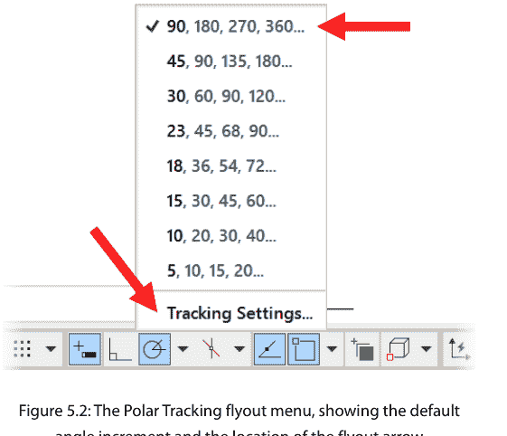

此弹出菜单显示可使用的预设角度增量。这些包括 90 度（*默认*）的增量、45 度、30 度，一直到 5 度增量。要查看更多属性，你可以点击 **追踪设置**。这将打开 **绘图设置** 对话框，其中 **极轴追踪** 选项卡当前处于打开状态。*图 5.3 显示了此对话框：*

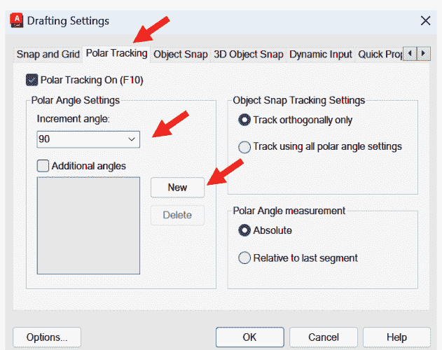

## 图 5.3：绘图设置对话框，其中极轴追踪选项卡当前处于打开状态

在此对话框中，极轴追踪 On 复选框已被选中，表示极轴追踪（POLAR）当前处于打开状态（图标在状态栏上也会高亮显示为蓝色）。预设角度增量也可以在对话框中进行更新，而不仅仅是在状态栏的弹出菜单中进行选择。你可以通过使用显示 90 度的下拉菜单（由箭头突出显示）来实现此操作。

如果选中了附加角度复选框，你可以通过点击新建按钮来添加单独的角度增量。要删除任何不需要的单独角度增量，请使用删除按钮。取消选中附加角度框将关闭之前添加的任何附加角度。

现在，让我们使用 BearingCase .dwg 练习文件来尝试极轴追踪，该文件是需要制造的小型轴承外壳的 2D 绘图。在文件中的一个清晰区域，绘制图 5.4 中所示的对称轴承板轮廓。完成的轴承板轮廓已包含在练习文件中供参考：

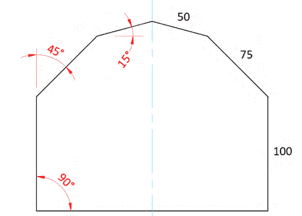

图 5.4：为清晰起见显示距离、角度和中心线的全新轴承板

在 Model 选项卡中使用极轴追踪预设的角度增量绘制轮廓。使用 90 度、45 度和 15 度角度增量设置。你可以以直线或多段线形式绘制轮廓。完成后，请确保保存你的绘图。你可以使用相同的文件名保存，也可以使用不同的文件名以将其与原始练习文件区分开。

极轴追踪允许你自动化绘制 AutoCAD 几何图形的角度，从而节省你手动输入角度的时间。不仅如此，它还能提高你的生产力，同时保持准确性并减少错误。

> 技巧和窍门 #15
> 在 AutoCAD 中使用极轴追踪（POLAR）时，状态栏上的绘图设置可以在任何时候更改，甚至在命令执行过程中更改。在绘制图 5.4 中所示的轮廓时，尝试一次性创建轮廓，在使用直线（LINE）或多段线（PLINE）命令的同时根据需要更改状态栏上的极轴角度增量。

极轴追踪是用于在绘图和建模时自动化常用角度的绝佳方法。确保将其纳入你在 AutoCAD 中设计的日常工作流程中。

> AutoCAD for Mac
> 你会在 AutoCAD for Mac 的状态栏上找到极轴追踪（POLAR）。它可以像在 AutoCAD for Windows 中一样使用。

现在我们知道了如何使用极轴追踪获得准确的角度，让我们来看看如何使用 AutoCAD 的 ORTHOMODE 实现正交移动。

板的各边长度仅为清晰起见而显示。就像 *图 5.4* 中显示的新轴承板一样，尝试一次性绘制板轮廓，使用 **直线（LINE）** 或 **多段线（PLINE）** 命令。

从板底部的左下角开始，该角由圆圈指示，并沿箭头方向前进，输入每个距离并在移动到下一线段方向之前按 *Enter*。你也可以使用 **关闭** 右键快捷菜单选项将线（或多段线）关闭到你开始的点。

当 **ORTHOMODE** 打开时绘制板轮廓时，你会注意到在移动鼠标绘制线段时，你只能水平和垂直移动光标，从而消除了考虑任何角度增量的需要。这在绘制此类规则几何图形时可以节省大量时间。

有时需要精确的水平和垂直线。典型的例子是在平面图上的网格线，或如本节所述，需要板轮廓的垂直线。使用 **ORTHOMODE** 可确保所有线条彼此呈 90 度，因此它们是垂直的。

> **技巧和窍门 #16**
> 
> 在使用 **LINE** 命令绘制线条或使用 **PLINE** 命令绘制多段线时，如果你错误地放置了线条或多段线段，可以使用一个巧妙的小技巧。只需右键单击调出快捷菜单，然后通过快捷菜单单击 **撤消**。请注意，这不会撤消整个命令——它只会撤消上一次放置的线条（或上一次多段线）段，使你回到上一个段的最后一个点。多次使用时，它也是返回到线（或多段线）中特定点的绝佳方法。

如果必须绘制大量彼此垂直（呈 90 度）的线条和几何图形，请考虑使用 **正交模式（ORTHO）**。由于 **正交模式（ORTHO）** 的方式将你限制在 X 和 Y 轴上，因此它是此用途的绝佳工具。

> **AutoCAD for Mac**
> 
> 你会在 AutoCAD for Mac 的状态栏上找到 **正交模式（ORTHO）**。它可以像在 AutoCAD for Windows 中一样使用，以限制光标正交。

现在我们已经发现了使用 **ORTHOMODE** 的好处，让我们来看看如何使用 **对象捕捉追踪（AUTOSNAP）** 处理多个捕捉。

## 使用对象捕捉追踪（AUTOSNAP）高效地使用多个捕捉进行绘图

众多 AutoCAD 绘图设置使你的日常工作更简单。**对象捕捉追踪** *（AUTOSNAP）* 就是其中之一；你会发现，一旦你打开 **AUTOSNAP** 并使用它，你就再也不会关闭它了。

此绘图设置使用 AutoCAD 内置的 **AutoTrack** 技术，该技术跟踪你选择的捕捉，并在组合它们并形成基准点（例如中心、中点或交点）时进行跟踪。

与 **对象捕捉** *（OSNAP）* 和 **极轴追踪** *（POLAR）* 结合使用时，**AUTOSNAP** 允许你使用 AutoCAD 几何图形上的多个捕捉点，从而能够在无需生成不必要的构造线的情况下创建插入点和交点。

*图 5.7 显示了你在状态栏上可以找到 **AUTOSNAP** 图标的位置。该图标仅作为开/关切换使用。然而，你需要确保你的运行 **对象捕捉** *（OSNAP）* 已定义并已打开；否则，**AUTOSNAP** 将无效：*

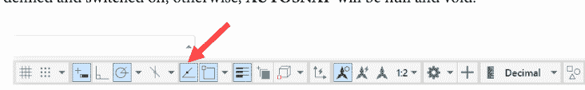

图 5.7：状态栏，其中对象捕捉追踪（AUTOSNAP）已打开（箭头用于清晰显示）

使用你在上一节中使用的绘图，BearingCase.dwg，让我们学习如何利用 **对象捕捉追踪** *（AUTOSNAP）*，以便你可以在轴承外壳中放置新几何图形，该外壳在你最初打开 DWG 文件时已存在于绘图中，如图 5.8 所示。

使用 **缩放** 和 **平移** 将轴承外壳居中于 AutoCAD 绘图区域，以便更轻松地处理几何图形：

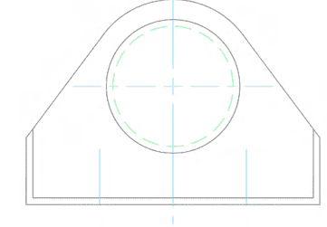

图 5.8 – 如 BearingCase.dwg 文件中所示的轴承外壳


确保你已开启以下绘图设置：

- **对象捕捉**（*OSNAP*）
- **极轴追踪**（*POLAR*）
- **对象捕捉追踪**（*AUTOSNAP*）

你需要开启以下对象捕捉模式：

- **端点**
- **中点**
- **交点**
- **圆心**

你还需要设置以下极轴角增量：90、180、270、360……

在本练习中，你将在轴承箱轮廓内放置两个圆，以表示两个钻孔。*图5.9*显示了放置两个圆后图形的效果：

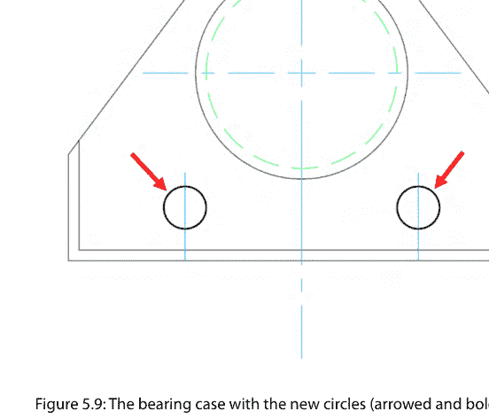

图5.9：带有新圆的轴承箱（为清晰起见，用箭头和粗体显示）

让我们开始本练习：

1. 在功能区**常用**选项卡的**绘图**面板上，选择**圆**弹出按钮以绘制新的圆。
2. 然后选择**圆心、半径**。AutoCAD将提示你输入要绘制的圆的圆心。正是在工作流程的这一步，我们将使用**对象捕捉追踪**（*AUTOSNAP*）。
3. 使用前面描述的设置，将鼠标悬停在绘图中轴承箱左侧外边界的**中点**对象捕捉上。但是，*不要单击*它；只需悬停几秒钟。你会看到捕捉符号*内部*出现一个小十字标记。这就是**对象捕捉追踪**正在记忆**中点**对象捕捉。
4. 然后，将鼠标向右拖动。你会看到绿色的虚线追踪线。*图5.10*显示了它在屏幕上的样子：

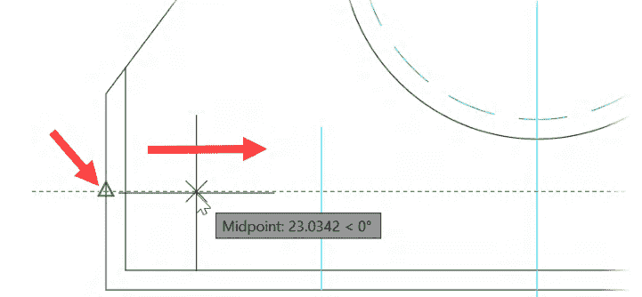

图5.10：中点对象捕捉被用作对象捕捉追踪点（为清晰起见用箭头标出）

当你将鼠标拖动到**中点**对象捕捉右侧的蓝色垂直中心线上时，会出现一个**交点**对象捕捉。这是**对象捕捉追踪**正在以相对于你悬停的**中点**对象捕捉的90度增量拾取交点。*图5.11*显示了**交点**对象捕捉：

图5.11：与中点对象捕捉对齐的交点对象捕捉（为清晰起见用箭头标出）

5. 单击该**交点**对象捕捉——这就是你的圆心将要放置的位置。系统会提示你输入圆的半径。输入半径值10并按Enter键。圆现在将如下放置：

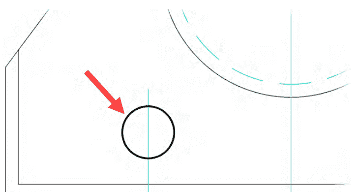

图5.12：使用对象捕捉追踪（AUTOSNAP）后放置的圆

6. 使用轴承箱右侧外边界的**中点**对象捕捉，重复此工作流程，但向左拖动，朝向右侧的蓝色垂直中心线（与上一个示例方向相反）。这将得到与图5.9所示相同的结果，但位于轴承箱的另一侧（右侧）。

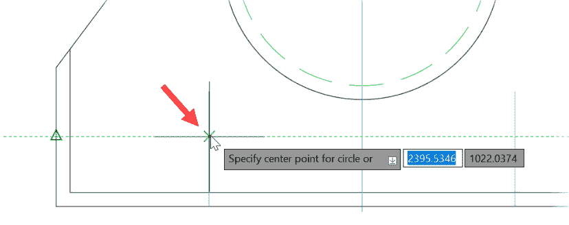

仅通过这个简单的工作流程，你现在就可以看到**对象捕捉追踪**（*AUTOSNAP*）的优势。如果AutoCAD没有此功能，你将需要绘制辅助构造线来定位放置新圆所需的**交点**对象捕捉点。

*AUTOSNAP*是一个非常高效的工具，无需绘制大量构造线来获取所需的数据和捕捉点。它还省去了绘制可能之后需要擦除的不必要几何图形的需要。

> **技巧和提示 #17**
> **对象捕捉追踪**（*AUTOSNAP*）允许你在进行任何一次捕捉追踪时使用最多7个追踪点。这可以是对象捕捉或临时追踪点的任意合理组合。选择追踪点时，无需单击鼠标。只需将鼠标悬停在所需点上，直到出现相应的对象捕捉说明，但*不要单击！*当你悬停时，AutoCAD会将此点识别为追踪点并将其添加到最多七个点中。我们都被教导要移动鼠标并在必要时单击。使用*AUTOSNAP*时，你不需要单击！

请确保将**对象捕捉追踪**（*AUTOSNAP*）与你的运行对象捕捉结合使用。这样，你可以确保充分利用**对象捕捉追踪**（*AUTOSNAP*）提供的功能。

> **适用于Mac的AutoCAD**
> 在Mac版AutoCAD中，你会在状态栏上找到**对象捕捉追踪**（*AUTOSNAP*）。当使用**对象捕捉**（*OSNAP*）和**极轴追踪**（*POLAR*）时，它的用法与Windows版AutoCAD中的完全相同。

**对象捕捉追踪**（*AUTOSNAP*）是利用对象捕捉的一种好方法。在下一节中，我们将学习如何不仅利用我们的**对象捕捉**（*OSNAP*），还要学习如何使用**捕捉覆盖**。

## 使用对象捕捉（OSNAP）和捕捉覆盖进行准确有效的绘图

**对象捕捉**（*OSNAP*）在*第4章*的*在三维建模时利用三维对象捕捉*一节中已提及，它们是AutoCAD的基本功能，确保所有二维绘图和三维建模都以准确和精确的方式执行。

你现在应该已经熟悉常用的对象捕捉，如**端点**、**中点**和**圆心**。其他常用的对象捕捉还包括**交点**和**延伸**。如果你对这些不熟悉，可以使用AutoCAD帮助功能，或者查看*AutoCAD漫游指南*（它也是AutoCAD帮助功能的一部分——可以在AutoCAD的**开始**选项卡中找到）。

在本节中，我们将研究一些较少使用的对象捕捉，它们可以帮助你提高效率和生产力。我们还将继续使用本章前面部分所用的BearingCase.dwg文件。

所有对象捕捉都可以通过AutoCAD状态栏访问，该状态栏位于AutoCAD应用程序窗口的右下角。你也可以输入OSNAP并按Enter键。这将打开“草图设置”对话框中的“对象捕捉”选项卡。

对象捕捉（OSNAP）是AutoCAD的一项绘图设置，默认情况下通常显示在状态栏上。该图标通常处于打开状态（蓝色），并将端点和圆心设置为运行对象捕捉。

运行对象捕捉是已打开并在绘图时始终可用的捕捉。对象捕捉覆盖是指那些尚未打开但可以在覆盖运行对象捕捉时使用的捕捉。在本节稍后，我们将进一步了解捕捉覆盖。

OSNAP绘图设置显示在状态栏上，如图5.13所示：

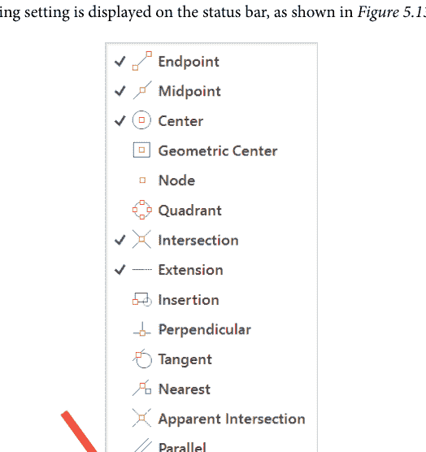

图5.13：状态栏上的对象捕捉（OSNAP）弹出菜单，单击对象捕捉图标后显示（用箭头标出）

上图还显示了当单击状态栏上**OSNAP**图标右侧的弹出箭头时可用的弹出菜单。此菜单显示当前运行的对象捕捉，全部带有复选标记。复选标记表示该对象捕捉已开启。未复选的对象捕捉则关闭。

> **技巧和提示 #18**
>
> 你也可以从弹出菜单中选择**对象捕捉设置…**。这将显示**草图设置**对话框，并已打开**对象捕捉**选项卡。在此选项卡中，你可以清除所有现有的运行对象捕捉，并选择*所有*对象捕捉作为运行对象捕捉。但是，不建议这样做，因为那样你将没有几何捕捉点可供捕捉，从而导致绘图不准确。你也可以在此对话框中打开或关闭**对象捕捉**，以及**对象捕捉追踪**。

**对象捕捉**（*OSNAP*）对于准确和精确的绘图和建模至关重要。在创建设计时，请务必使用它们。

> **适用于Mac的AutoCAD**
>
> 在Mac版AutoCAD中，你会在状态栏上找到**对象捕捉**（*OSNAP*）。它的使用方式与Windows版AutoCAD中相同，包括选择**设置…**以显示带有**对象捕捉**选项卡的**草图设置**对话框。

一组良好的运行对象捕捉包括**端点**、**中点**、**圆心**、**交点**和**延伸**。不建议将它们全部选为运行对象捕捉，因为这会变得难以操作；AutoCAD会尝试捕捉到所有可用的对象捕捉。

*图5.13*中显示已勾选的运行对象捕捉集合应该能在大多数绘图和建模任务中让你处于有利地位。然而，有时可能需要运行其他对象捕捉。例如，圆有多种对象捕捉。最明显的是**圆心**，但在处理圆几何图形时，你可能还会使用**象限点**对象捕捉或**切点**对象捕捉。

## 查找几何中心

其中一个非常实用的备选对象捕捉是较新的捕捉功能，称为**几何中心**。就像**圆心**对象捕捉可捕捉到圆弧或圆的圆心一样，**几何中心**对象捕捉可捕捉到闭合几何形状（如闭合多段线）的几何中心。

在本节中，你将把轴承箱的现有几何图形转换为闭合多段线，并找到**几何中心**对象捕捉。然后，你将使用定位到的**几何中心**来放置一个圆。


要执行此操作，您需要练习文件 `BearingCase.dwg`，其外部轮廓由若干单独的直线和一条圆弧组成。请按照以下步骤查找几何中心对象捕捉：

1. 输入 `PE`。您会在动态输入建议菜单中看到 `PE (EDIT)`。单击它；系统将出现“选择多段线或”提示。
2. 选择轴承座轮廓上的圆弧，如图5.14所示：

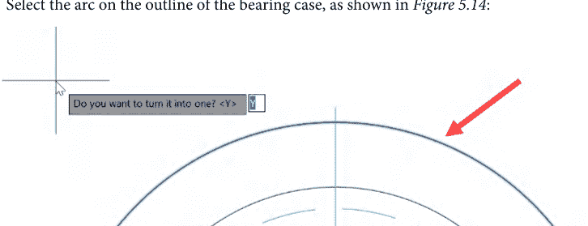

图5.14：选定的圆弧及显示的相应 AutoCAD 提示

您将收到提示“是否要将其转换为一条？<Y>”。

3. 当默认选项 Y 高亮显示时，按 Enter。这将确认您希望将所选圆弧转换为一条多段线段。输入 N 并按 Enter 将会阻止该圆弧转换为多段线段。此时将出现“编辑多段线”（PEDIT）菜单，如图5.15所示：

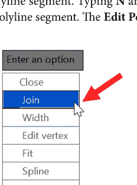

图5.15：“编辑多段线”菜单，其中“合并”已高亮并用箭头标出

4. 从弹出菜单中选择 **合并**，然后选择构成轴承座轮廓的所有其余元素。图5.16显示了所有选定的元素，AutoCAD 会将其以蓝色高亮显示。

请注意，此时您可以重新选择之前最初选定的圆弧。这不会影响 **编辑多段线**（*PEDIT*）命令的工作流程：

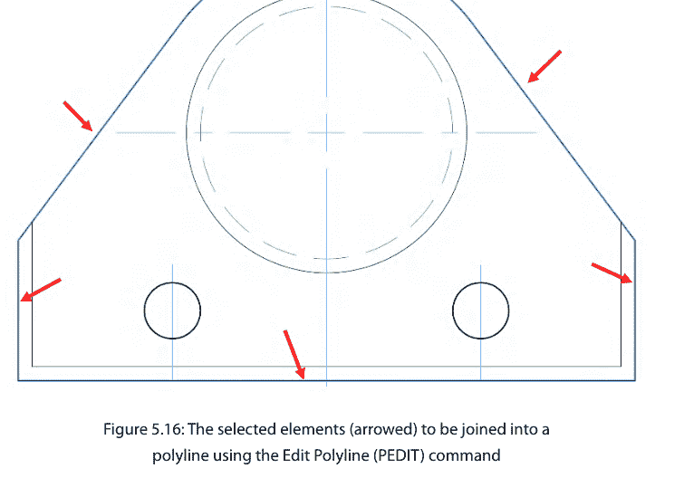

图5.16：使用“编辑多段线”（PEDIT）命令合并为多段线的选定元素（箭头所示）

5. 按 *Enter*。您将返回到菜单。

6. 再次按 *Enter* 以关闭 **编辑多段线**（*PEDIT*）命令。轴承座的外部边界现在是一条闭合多段线。

7. 单击以将其选中。您会看到它现在是一个闭合对象，并带有蓝色的 AutoCAD 夹点，如图5.17所示：

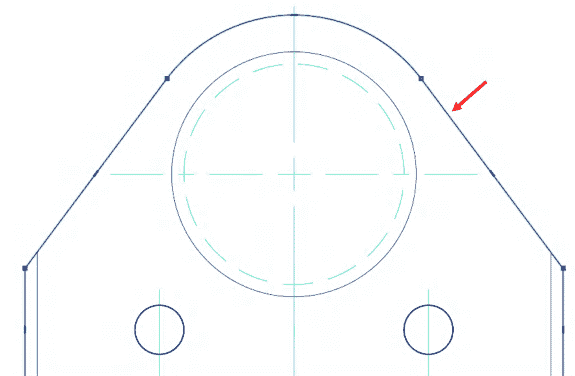

图5.17：选定的多段线及其显示的夹点

8. 单击状态栏上的“对象捕捉”弹出菜单，如图5.13所示。

9. 在菜单中，单击“几何中心”。您会看到其旁边出现复选标记。它现在是一个运行对象捕捉。

10. 在功能区“常用”选项卡的“绘图”面板中，从“圆”弹出菜单中选择“圆心、半径”命令。系统将提示您指定圆心。

11. 将光标/十字准线悬停在新创建的外部多段线的任意部分上。忽略其他对象捕捉，您会看到轴承座中心附近出现一个类似星号的小符号（*），如图5.18中箭头所示。

这就是几何中心对象捕捉：

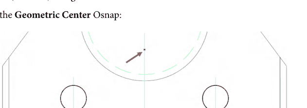

图5.18：轴承座轮廓多段线的几何中心对象捕捉（箭头所示）

12. 将光标/十字准线移动到该对象捕捉上（它会以绿色圆圈高亮显示），然后点击。这将成为您圆的圆心。
13. 输入 15 作为半径值，然后按 Enter。您会看到新的圆出现，如图5.19所示：

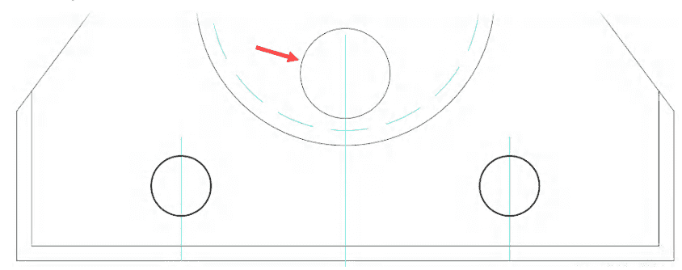

图5.19：使用几何中心对象捕捉放置的新圆（箭头所示）

在闭合多段线（例如矩形或正方形）中，我们可以使用对边的中点对象捕捉来找到几何中心。但在不规则形状（如轴承座轮廓）中，这种方法可能不起作用。这就是为什么使用几何中心是查找可能不符合常规约束的形状的精确中心的极其准确的方法。

## 使用捕捉替代

有时，您不希望将某个对象捕捉设置为运行对象捕捉。这时，对象捕捉替代便派上用场。它被称为对象捕捉替代，您可以使用它来覆盖运行对象捕捉，以便在一次性使用中仅利用一个特定对象捕捉。

对象捕捉替代允许您使用当前未在“对象捕捉”绘图设置中设置的对象捕捉。即使没有正在运行的命令，您也始终可以访问对象捕捉替代。您可以按住 Shift 键并单击鼠标右键来做到这一点。这将随时调出对象捕捉替代菜单。请注意，如果在命令工作流程中执行此操作，则更有用，因为这样您就可以在正在使用的命令中访问捕捉替代。图5.20显示了使用 Shift+右键单击方法访问时的对象捕捉替代菜单：

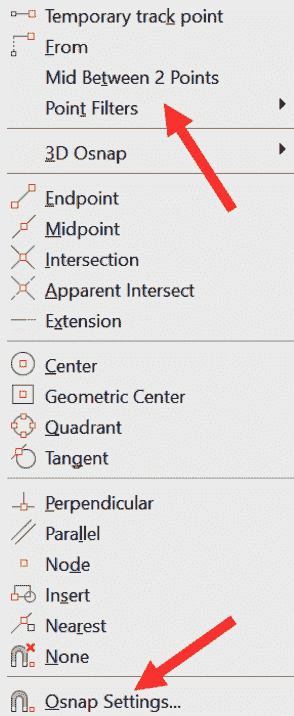

图5.20：使用 Shift+右键单击时显示的对象捕捉替代菜单

请注意，在图5.20中，您仍然可以通过单击“对象捕捉设置...”（箭头所示）来访问“草图设置”对话框。这将以与使用状态栏上的“对象捕捉”弹出菜单相同的方式，打开当前显示“对象捕捉”选项卡的对话框。

有几种替代对象捕捉非常有用，尤其是在命令工作流程中使用时。要进一步探索对象捕捉，请查看 Autodesk 网站：https://help.autodesk.com/view/ACD/2023/ENU/?guid=GUID-8F5E5431-9EFB-414E-BC6D-2C65EFB2DAC3。

我们将介绍一种替代对象捕捉，称为“两点之间的中点”（Mid Between 2 Points，M2P）。此捕捉功能在图5.20中用箭头突出显示。

该捕捉功能允许您在任意几何图形（或坐标）上指定两个点，然后找到它们之间的中点。我们将使用它在 `BearingCase.dwg` 文件中创建一些新的中心线，因此请确保将 **中心线** 图层设置为当前图层。另外，请确保已打开 **极轴追踪**（*POLAR*）和 **对象捕捉追踪**（*AUTOSNAP*）。它们应在状态栏上以蓝色显示。

要创建新的中心线，请按照以下步骤操作：

1. 缩放到轴承座轮廓的左下角。在功能区“常用”选项卡的“绘图”面板中选择 **直线** 命令。系统将提示您指定直线的第一个点。
2. 此时，按住 **Shift** 键并单击鼠标右键。将出现 **对象捕捉替代** 菜单。
3. 单击 **两点之间的中点**。系统将提示您指定 **中点的第一点**。
4. 单击 *图5.21* 中所示的 **端点** 对象捕捉。这将是第一个中点：

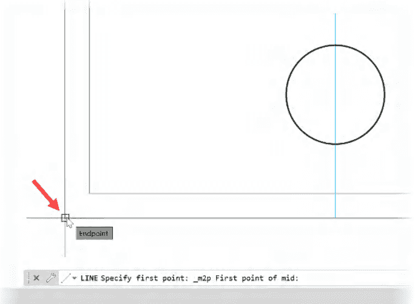

图5.21：第一个中点即为所示的端点对象捕捉（箭头所示）

5. 然后，单击图5.22中所示的端点对象捕捉。这将是第二个中点：

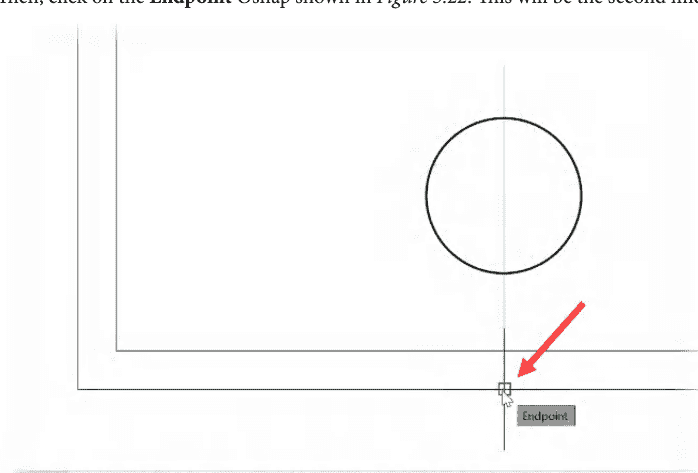

图5.22：第二个中点即为所示的端点对象捕捉（箭头所示）

新中心线的第一个点现在将位于轴承座轮廓的下边缘（图5.23中的点1），位于已选的两个中点之间。

6. 拖动鼠标并悬停在现有中心线的上端点上方，如图5.23中的点2所示。这将为该 **端点** 对象捕捉激活 **对象捕捉追踪**（AUTOSNAP）：

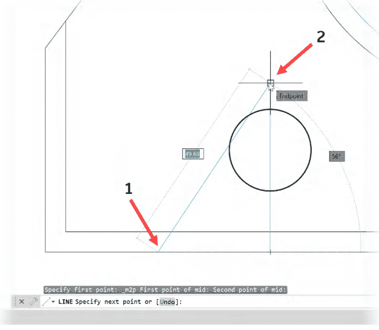

图5.23：M2P 对象捕捉替代已放置直线的第一个点（1）。将鼠标悬停在现有中心线的端点对象捕捉（2）上会创建一个对象捕捉追踪点

7. 切记不要单击它，然后将鼠标向左拖动，如 *图5.24* 所示：

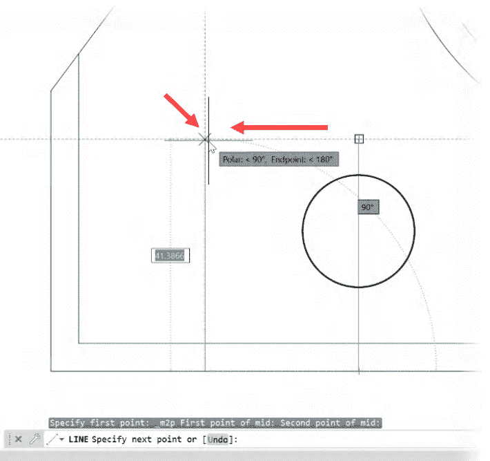

图5.24：向左移动（箭头所示）以创建新中心线第二个点（端点）的对象捕捉追踪点

8. 当垂直和水平追踪线相交时（显示为绿色虚线），单击指示的点。这将是中心线的端点。

9. 按 *Enter* 关闭 **直线** 命令。

在此工作流程结束时，您将得到一条新中心线，其长度与现有中心线相同，位于现有中心线和圆的左侧，如 *图5.25* 所示。

如果您愿意，现在可以在轴承座的右侧重复此工作流程，以创建另一条新的中心线。这将很好地练习巩固如何使用“两点之间的中点”（M2P）对象捕捉功能：

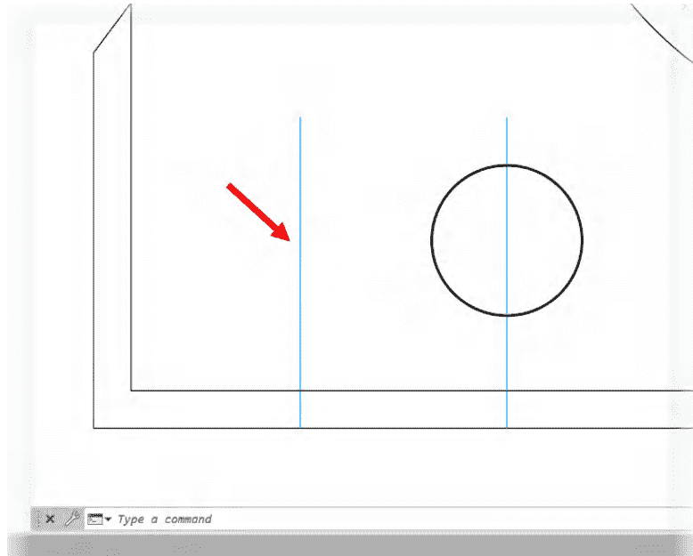

图5.25：使用 M2P 对象捕捉功能放置的新中心线

## 技巧与窍门 #19

您还可以在命令执行中途，从右键单击快捷菜单中选择“对象捕捉替代”。这是 Shift+右键单击方法之外的一种替代方式。只需在命令中途右键单击，并从快捷菜单中选择“对象捕捉替代”即可。这将弹出与使用 Shift+右键单击方法时相同的菜单。但请注意，只有在几何图形的第一个点（或基点）放置后，您才能调出此菜单。对于第一个点（或基点），您始终需要使用 Shift+右键单击。

您现在不仅熟悉了 AutoCAD 中的对象捕捉，还掌握了如何使用捕捉替代。这将使您的绘图和建模更加精确、高效。


## 总结

在本章中，我们学习了如何使用**极轴追踪**（*POLAR*），并在创建几何图形和对象时有效运用它。

你还学习了如何利用正交投影，并通过**正交模式**（**ORTHOMODE**）设置绘制直线和垂直线几何图形。

接着，你了解了**对象捕捉追踪**（*AUTOSNAP*），这是一个直观的绘图工具，无需绘制辅助构造线。当它与**极轴追踪**（*POLAR*）和**对象捕捉**（*OSNAP*）结合使用时，可以实现高度精确的绘图和建模。

之后，你学习了如何使用**几何中心**对象捕捉（较少使用的对象捕捉之一），并利用它高效绘图。

最后，你学习了如何使用**对象捕捉替代**，快速、即时地捕捉到现有几何图形。

本章演示的对象捕捉和设置揭示了它们在 AutoCAD 绘图中重要性。它们对于任何为进一步推进设计而创建的几何图形的准确性和精确度都是基础性的。

对象捕捉让你能够充分发挥 AutoCAD 中绘图工具的优势。有些对象捕捉非常有用。**几何中心**和**两点之间的中点**（*M2P*）只是其中两个鲜为人知的对象捕捉，它们能让你的日常 AutoCAD 工作更轻松地管理。

在下一章中，我们将学习如何通过使用**快速测量**和**距离**等命令，来修改和测量 AutoCAD 图纸中的几何图形和现有对象。

在*第 5 章*中，你了解了如何使用 AutoCAD 的对象捕捉来创建高级几何图形。在本章中，你不仅将利用这些对象捕捉，还将使用一些有趣的 AutoCAD 工具与这些捕捉相结合，在计算距离、面积和角度时实现精确的准确性。

## 练习文件

你必须确保已下载练习文件 Sawblade.dwg、Sawblade2.dwg 和 Sawblade3.dwg，以便跟随本章各节进行操作。

## 使用名词/动词选择快速轻松地选择对象

**名词/动词选择**在 AutoCAD 中通常默认开启。它允许你在执行相应命令以操作所选对象*之前*选择 AutoCAD 对象。

这是一个特别有用的功能，因为它让你免于更长且相对更复杂的工作流程。如果没有**名词/动词选择**，你将被迫先选择一个命令，然后在**选择对象**提示下选择对象，再按*回车键*确认对象选择，之后才能对所选对象使用该命令。

尽管这是默认设置，但最好检查它是否已启用。要找到它，只需在未选择任何对象且未运行任何命令时右键单击，然后在快捷菜单中选择**选项**。或者，你可以单击 AutoCAD 图标（左上角）打开**应用程序菜单**，并在那里找到**选项**按钮。

你将在**选项**对话框的**选择**选项卡中找到**名词/动词选择**。如*图 6.1*所示，**名词/动词选择**复选框出现在左上角。

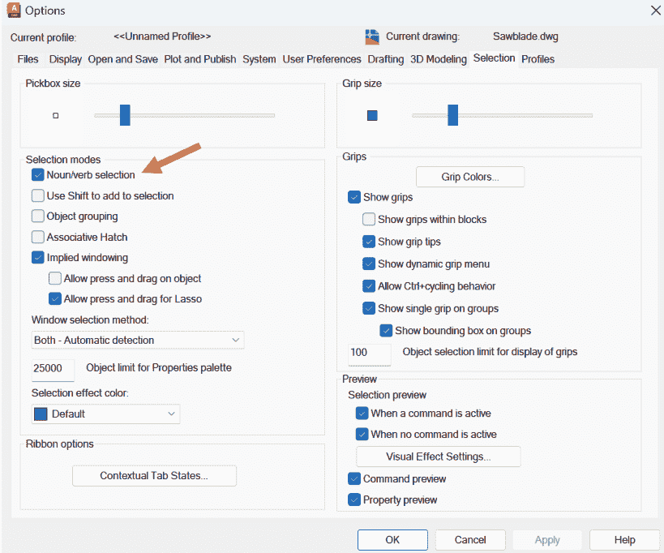

图 6.1：勾选了名词/动词选择的选项对话框

你会注意到**名词/动词选择**复选框已被勾选，这意味着**名词/动词选择已开启**。**名词/动词选择**复选框的工作方式类似于人类大脑拿起物体时的过程。在拿起一个物体（*名词*）之前，它会先选择该物体，然后拿起它（*动词*）。

### 技巧与窍门 #20

**名词/动词选择**在任何 AutoCAD 安装中都应默认开启。然而，用户（有时）确实会将其关闭。一个典型的原因可能是需要选择多个对象。关闭**名词/动词选择**后，可以先选择命令（动词），接着在**选择对象**提示（名词）下轻松选择多个对象，然后在命令工作流程中按回车键确认选择。根据个人偏好，用户可能会采用这种工作流程。为了充分利用本章内容，最好保持其开启。你也可以输入 `PICKFIRST` 并按回车键来更改变量值。要开启它，**PICKFIRST**应设置为 **1**。将其设置为 **0**（零）则关闭它。

**名词/动词选择**非常有用。它能让 AutoCAD 体验更加流畅。尝试在开启和关闭它的情况下使用 AutoCAD，你就会看到它对日常 AutoCAD 工作流程带来的差异。

### Mac 版 AutoCAD

**名词/动词选择**在 Mac 版 AutoCAD 中不受支持。你还会发现**选项**对话框被称为**应用程序首选项**。你可以通过单击 **AutoCAD 2024**（左上角——如果你使用的是 2024 版本；对于 AutoCAD 2023，则会显示 **AutoCAD 2023**，以此类推）找到它。选择**首选项...**，**应用程序首选项**对话框将打开。Mac 用户可以利用此对话框管理其 AutoCAD 设置。这些设置包括**外观与感觉**，用户界面可以调整以适应 Mac 用户；以及**单位与辅助线**，用户可以设置特定的源内容单位和目标图形单位，类似于在 Windows 版 AutoCAD 中的设置方式。该对话框如图 6.2 所示。

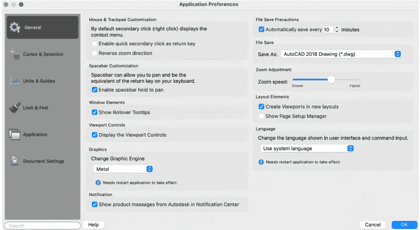

图 6.2：Mac 版 AutoCAD 中的应用程序首选项对话框

现在我们已经学习了如何使用名词/动词选择功能，让我们来看看其他 AutoCAD 工具：快速测量和距离。

## 使用快速测量和距离计算长度和角度

AutoCAD 是一个绘图应用程序，让你能够传达设计意图。伴随着这种意图，就需要准确测量距离。

在 AutoCAD 2021 及以后版本中，你可以通过两种方式做到这一点：

- **快速测量**：当你将光标移到图纸中的几何图形上时，此工具会测量所有距离和角度
- **距离**：此工具使用对象捕捉来精确准确地测量单个距离（长度）

使用 Sawblade.dwg 文件，你现在将使用这两个工具来准确测量距离（对于快速测量，还包括角度）。按照以下步骤了解如何操作：

1. 打开 Sawblade.dwg 文件，并放大到圆锯片顶部的锯齿处。

2. 在功能区上的“常用”选项卡中，单击“实用工具”面板上的“测量”弹出按钮。你将看到“快速”（快速测量），如图 6.3 所示。单击它。

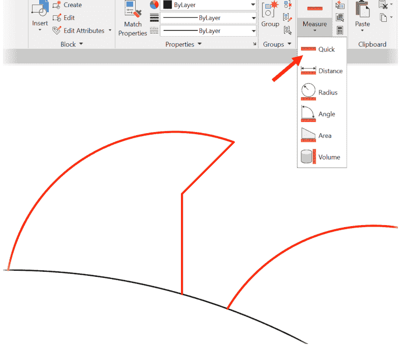

图 6.3：带有快速测量（箭头所指）的测量弹出按钮

3. 在图纸文件中围绕锯片移动光标。你将看到显示大量测量值，包括角度，如图 6.4 所示。

被测量的几何图形以不同于几何图形颜色的另一种颜色（紫色）高亮显示。另外请注意，弧长也会被测量。

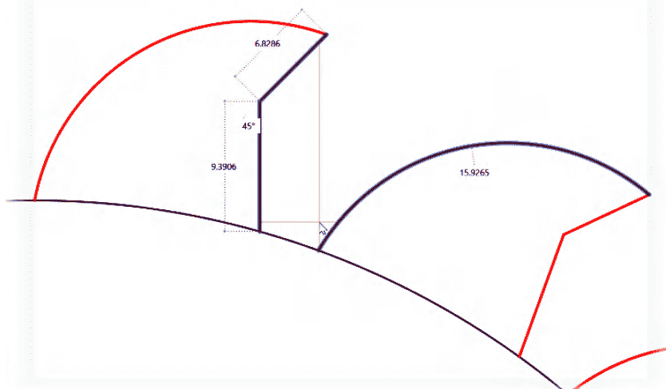

图 6.4：快速测量高亮显示的已测量几何图形

4. 要关闭**快速测量**，请按键盘上的 *Esc* 键。你也可以右键单击并在快捷菜单中选择“回车”。

5. 检查状态栏上的对象捕捉是否*开启*，然后再次单击**测量**弹出按钮。这次选择**距离**。

6. 系统将提示你选择要测量的起点。这就是你需要对象捕捉来准确测量距离的原因。

7. 选择锯齿上的下方点（如*图 6.5*中的 **1** 所示），然后选择其下方的点（如*图 6.5*中的 **2** 所示）。

8. 随后将显示测量距离以及**测量**菜单，以便你可以继续使用任何**测量**工具进行测量，如*图 6.5*所示。

图 6.5：使用距离工具测量点之间的距离

9. 你可以随时在测量菜单中选择“退出”来关闭该工具，或按键盘上的 Esc 键取消“测量”（MEASUREGEOM）命令。

当你只需要查看和确认现有距离和角度时，快速测量是一种很好的可视化检查方式。距离工具则允许利用对象捕捉等精度工具，对现有距离进行更详细的测量。


### AutoCAD for Mac

**测量**（*MEASUREGEOM*）命令在 Mac 版 AutoCAD 中可用，但没有默认图标或弹出菜单。只需输入 MEASUREGEOM 并按 *回车* 即可激活**测量**工具，然后右键单击弹出快捷菜单，该菜单将显示命令中可用的测量工具，例如**快速测量**和**距离**。

现在，你已经知道如何在 AutoCAD 中利用**快速测量**和**距离**有效地测量距离和角度。现在让我们看看如何使用**面积**工具添加和减去面积。

## 使用面积工具添加和减去面积

有时，需要根据 AutoCAD 几何图形计算面积。**测量**（*MEASUREGEOM*）命令中的**面积**工具可以让你快速、轻松，更重要的是准确地完成此操作。

该工具的工作流程与**快速测量**和**距离**类似。但是，你可以使用**面积**工具，通过添加和减去几何图形（如闭合多段线）的面积来执行简单的面积计算。

在以下练习中，你将快速准确地添加和减去面积，以计算最终所需的面积：

- 1. 打开 Sawblade2.dwg 文件。请注意，有一条闭合多段线构成锯齿的轮廓，还有一个中心圆表示锯片中心的孔。

- 2. 与**快速测量**和**距离**一样，从功能区的**常用**选项卡上的**实用工具**面板中选择**测量**弹出菜单。单击**面积**。

- 3. 你将看到**指定第一个角点**提示。这是用于当你可能需要围绕某个区域选择单个点来定义该区域时的情况。你可以使用对象捕捉来完成此操作，但无需这样做，因为你的面积区域已由闭合多段线（锯齿）和圆（锯片上的孔）完全闭合。

- 4. 右键单击并在快捷菜单中选择**添加面积**。你将看到相同的角点提示。直接忽略它并再次右键单击。在快捷菜单中选择**对象**。现在你将看到（**添加模式**）**选择对象：**提示，如图 6.6 所示。

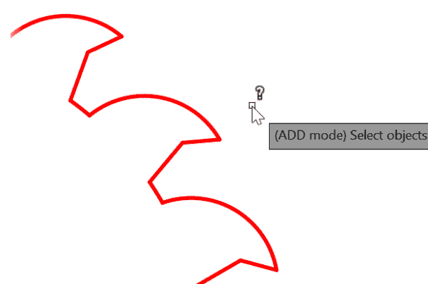

图 6.6：（添加模式）选择对象，准备选择锯齿

- 5. 选择锯齿。它们是闭合多段线，因此将作为一个对象被选中。它们会以绿色突出显示，显示已添加的面积，如 *图 6.7* 所示。按 *回车* 确认选择。

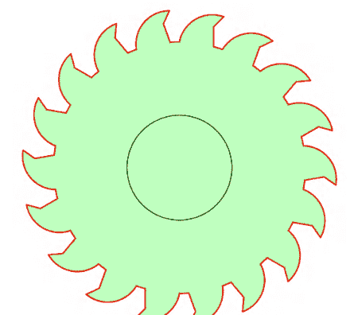

图 6.7：锯齿闭合多段线被选中，作为添加的面积

- 6. 你将看到面积显示在 AutoCAD 绘图区域的一个小灰色框中，列出**面积**、**周长**和**总面积**。同时再次出现角点提示，期待你开始描绘另一个要添加的面积。如 *图 6.8* 所示。

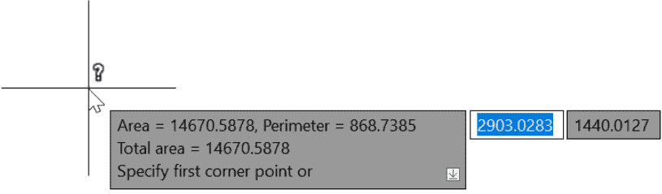

图 6.8：显示计算得到的锯齿面积，以及周长和总面积

- 7. 再次右键单击，在快捷菜单中选择**减去面积**。

- 8. 再次右键单击并选择**对象**。现在你将看到**（减去模式）选择对象**提示，类似于你添加锯齿面积时的情况。如 *图 6.9* 所示。

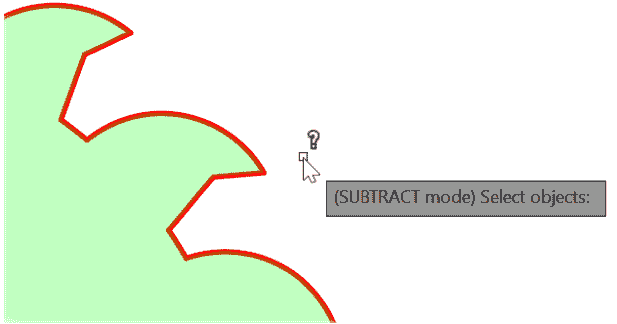

图 6.9：（减去模式）选择对象，准备选择圆

- 9. 选择表示锯片上圆孔的圆。该圆现在以棕色突出显示，表示它将从锯齿面积中减去，如 *图 6.10* 所示。

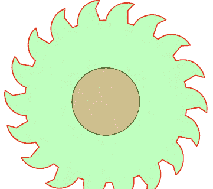

图 6.10：该圆以棕色突出显示，表示将被减去

- 10. 按 *回车*。在你添加锯齿面积时看到的同一个灰色框中，现在将显示圆的面积（1963.4954）以及**总面积**（12707.0923）。总面积是锯齿多段线的面积减去圆面积后得到的结果，即锯片的实际物理面积。如 *图 6.11* 所示。

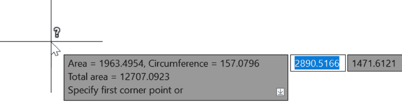

图 6.11：圆的面积，以及减去圆面积后锯片的总面积

- 11. 按 *回车* 完成。现在你可以选择**退出**来关闭**测量**命令。

### 技巧与窍门 #21

如果展开 AutoCAD 命令行，你将看到使用面积工具的“添加”和“减去”功能时使用的所有命令和数据，如图 6.12 所示。这些文本可以根据需要复制并粘贴到其他应用程序中。可能需要复制粘贴的典型示例包括：粘贴到项目文档（如规格说明书）中，或粘贴到用于计算工程量的电子表格中。只需突出显示任意文本并右键单击，然后即可从快捷菜单中选择“复制”。

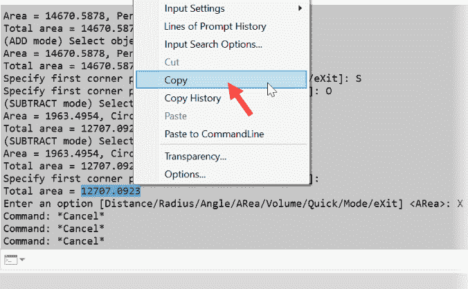

图 6.12：AutoCAD 命令行中已突出显示锯片面积，可随时复制

如果你想要更改命令行的设置，可以使用命令行左端的扳手图标打开这些设置。

### AutoCAD for Mac

测量（MEASUREGEOM）命令在 Mac 版 AutoCAD 中可用，但没有默认图标或弹出菜单。只需输入 MEASUREGEOM 并按回车即可激活测量工具，然后右键单击弹出快捷菜单，该菜单将显示命令中可用的测量工具，你可以在其中找到面积工具。

现在，你已经知道如何使用添加和减去工具快速精确地计算面积，接下来让我们看看如何在 AutoCAD 中精确测量角度。

## 使用角度工具测量精确角度

角度是 AutoCAD 绘图中几何图形的基本组成部分。精确测量角度至关重要，但同样重要的是，必须能够快速有效地完成测量。

在本节中，你将继续使用 Sawblade2.dwg 文件。请按两次键盘上的 *Esc* 键，确保没有选中任何命令或对象。这会取消所有命令，然后清除所有选择集。

在以下练习中，你将学习如何在 AutoCAD 绘图中测量精确角度：

- 1. 放大到锯片的顶部，以便近距离查看锯片的一个锯齿。请注意，锯片上的每个锯齿都是由多个角度构成的。

- 2. 就像你在本章前几节中所做的那样，从功能区的**常用**选项卡上的**实用工具**面板中选择**测量**弹出菜单。这次选择**角度**。

- 3. 在出现的提示下，你可以选择圆弧、圆、直线，或指定顶点。选择锯齿上的大圆弧。你将看到显示的角度（**99°**），如 *图 6.13* 所示。

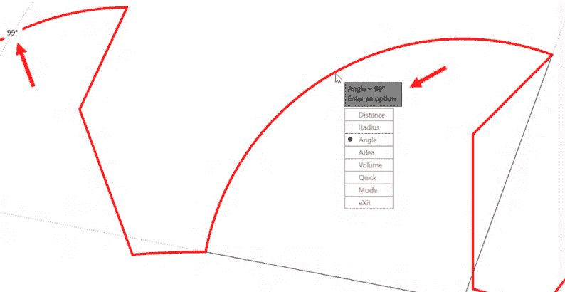

图 6.13：已测量的角度，并显示“测量”菜单

- 4. 在**测量**菜单上再次选择**角度**。

- 5. 也可以使用两条发散的直线来测量角度。选择图 6.14 中用箭头指出的两条直线，你将看到它们之间显示的角度测量值为 135°。

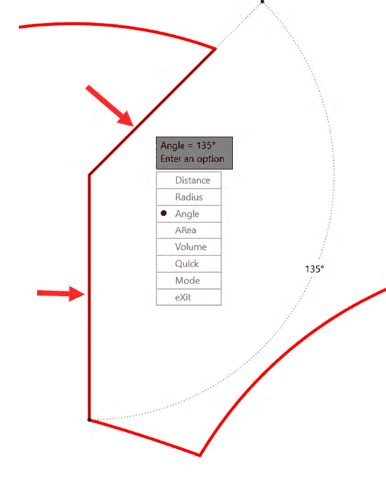

图 6.14：显示的角度使用两条（箭头所指的）直线测量

- 6. 你还可以使用顶点来测量角度。从“测量”菜单中再次选择“角度”，然后按回车确认 <指定顶点> 提示。按照图 6.15 所示顺序选择三个点。你将看到测得的角度为 108 度。确保第一个选择的点是要测量角度的顶点（1），然后是构成该角度的另外两个顶点（2 和 3）。

图 6.15：显示的角度使用三个（编号的）顶点测量

- 7. 要关闭菜单和命令，请在“测量”菜单中选择“退出”。

在 AutoCAD 中，测量角度对于确保精确性至关重要，而角度工具可以快速轻松地完成测量。以锯片为例，锯齿所用的角度必须精确测量，以便制造锯片。精确测量的能力可确保任何计算机辅助制造（CAM）都能以准确的角度从原材料上切割出锯齿。

### AutoCAD for Mac

测量（MEASUREGEOM）命令在 Mac 版 AutoCAD 中可用，但没有默认图标或弹出菜单。只需输入 MEASUREGEOM 并按回车即可激活测量工具，然后右键单击弹出快捷菜单，该菜单将显示命令中可用的测量工具，你可以在其中找到角度工具。

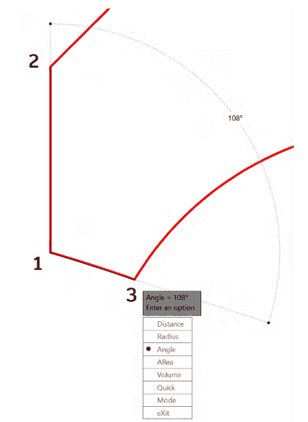


现在，您可以在绘图中精确测量角度了。接下来，我们来看看如何使用“修改”面板优化您的图形。

## 使用“修改”面板优化图形

您的 AutoCAD 图形会不断演变。随着您正在进行的项目逐渐细化并趋于施工或制造，必须进行修订和设计迭代。

AutoCAD 提供了许多工具，让您能够快速、有效地修改现有图形几何体，而最重要的是，能够准确而精确地修改。其中一个特性就是“修改”面板。

在接下来的练习中，您将使用 Sawblade3.dwg，学习如何利用一些 AutoCAD 修改工具来更改锯片上的锯齿配置：

- 1. 打开图形后，您会看到锯片上只有一个锯齿。您将使用一些修改工具来添加所需的锯齿并编辑锯齿轮廓。

- 2. 确保您位于功能区上的“默认”选项卡，并且显示了“修改”面板，如图 6.16 所示。

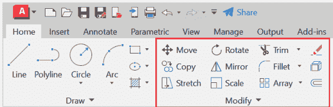

图 6.16：功能区“默认”选项卡上的“修改”面板

- 3. 单击“阵列”弹出菜单，显示可在 AutoCAD 中创建的各种阵列，如图 6.17 所示。

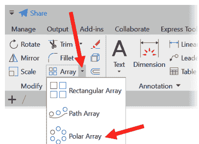

图 6.17：“阵列”弹出菜单

- 4. 选择**环形阵列**（*ARRAYPOLAR*）。系统将提示您在**选择对象**菜单中做出选择。选择构成单个锯齿的红色圆弧和线条，然后按 *Enter* 确认选择。

- 5. 接下来，您会遇到**指定阵列中心点**提示。使用**中心点**对象捕捉选择构成锯片的圆的中心。您现在可以执行此操作，因为您已经在*第 5 章*的*查找几何中心*小节中学习了如何设置对象捕捉。

- 6. 单击**中心点**对象捕捉后，您会看到功能区更新为上下文**阵列创建**选项卡，提示变为**选择夹点以编辑阵列或**。您还会看到 AutoCAD 已自动显示*六个*锯齿（包括原始锯齿），如*图 6.18*所示。


图 6.18：默认环形阵列，包含六个锯齿

- 7. 设计要求是*十八*个锯齿，因此需要更新环形阵列。这可以在上下文**阵列创建**选项卡上的**项目**面板中完成。

- 8. 在“项目”字段中将项目数更改为 18，如图 6.19 所示。然后按 Enter。


图 6.19：上下文“阵列创建”选项卡上“项目”面板中的“项目”字段

- 9. 您将看到图形中的锯齿数更新为 18，如图 6.20 所示。


图 6.20：具有 18 个锯齿的锯片

- 10. 要关闭环形阵列命令，请按 Enter 确认“退出”提示，或单击功能区上的“关闭阵列”图标（绿色对勾）。

- 11. 现在，您在一个关联环形阵列中拥有 18 个锯齿。单击其中一个锯齿会选择该阵列并将其突出显示，如图 6.21 所示。另外，请注意功能区上显示了上下文“阵列”选项卡。


图 6.21：选中后突出显示的关联环形阵列

锯片上的锯齿设计需要修改，以便更容易制造。为此，一些 AutoCAD 用户可能会使用分解（EXPLODE）命令将关联阵列分解回其组成对象，然后重新阵列锯齿。这是一种冗长且容易出错的方法。以下工作流程不仅更快，还有助于避免任何传递的错误：

- 1. 在功能区上下文“阵列”选项卡的“选项”面板上找到“编辑源”图标，如图 6.22 所示。单击“编辑源”图标。您将返回到功能区上的“默认”选项卡。


图 6.22：“选项”面板上的“编辑源”图标

- 6. 当您编辑原始锯齿时，您会看到阵列中的其他锯齿随之更新。编辑完成后，单击功能区**默认**选项卡右端**编辑阵列**面板中的**保存更改**图标。**保存更改**图标如*图 6.25*所示。


图 6.25：“编辑阵列”面板上的“保存更改”图标

保存对阵列的更改后，您将看到所有 18 个锯齿都已设置为新的锯齿配置。

选择该阵列，您将看到它仍然保留在原位，完全关联，无需重新阵列即可进行必要的更改。*图 6.26* 显示了选中并突出显示的修订后阵列。


图 6.26：重新配置的环形阵列，显示为选中并突出显示

最后，按键盘上的 Esc 取消选择该阵列。这样可以避免在您启动另一个命令时，阵列对象成为选择集的一部分。

**修改**面板包含许多有价值的工具，可以让您快速、准确地修订和更新图形。图形在许多学科和环境中使用，**修改**工具可以适应并用于任何工作流程。

### 小结

在本章中，您学习了如何使用**名词/动词选择**来确保快速选择要在图形中修改的对象。您还学习了如何使用**快速测量**和**距离**快速高效地测量几何图形的长度。

学习了如何使用**测量**（*MEASUREGEOM*）命令中的**面积**工具以及**添加**和**减去**功能后，现在计算几何图形的精确面积变得快速而简单。您还学习了如何使用**测量**（*MEASUREGEOM*）命令中的**角度**工具，利用圆、圆弧、直线和顶点，来准确、快速、有效地测量角度。

通过使用**环形阵列**（*ARRAYPOLAR*）命令，您学习了如何使用**编辑源**功能修改现有的锯片设计，以更新现有的锯齿配置。

AutoCAD 在功能区上的**修改**面板中还提供了一套全面的编辑工具。在本章中，您只是通过**环形阵列**工具触及了这些工具的皮毛，但是通过更多的自我练习，您会发现 AutoCAD 中的大多数编辑需求都可以通过**修改**面板来满足。

本章展示了上述工具在 AutoCAD 中修改和编辑图形时的重要性。它们是保证设计中任何几何体编辑的准确性和精确性的基础。在下一章中，我们将研究如何使用注释性注释在您的 AutoCAD 图形中有效地传达设计意图。

## 开发注释性注释样式

AutoCAD 用于绘制和创建您的设计。随之而来的是传达设计意图的需求。例如，建筑者需要知道要建造的建筑物有多大。工厂需要知道需要制造的物品有多大。这时，AutoCAD 高度通用且全面的注释工具就派上了用场。

这些注释工具不仅允许您向图形添加注释文字和尺寸，还可以设置为注释性，并与注释比例配合使用，以便在布局选项卡中使用缩放视口时，以适当的比例显示注释。

有效的注释可以使用户准确传达其设计意图。在 AutoCAD 中，大量时间用于注释设计，因此必须正确设置注释样式。

本章涵盖您在 DWG 文件中使用注释性注释所需学习的以下方法：

- 创建文字样式以管理文字大小和字体
- 使用标注样式管理尺寸注释
- 设置特定的引线样式
- 使用准确的表格样式

在前面的章节中，您了解了如何使用 AutoCAD 的绘图工具开发高级几何图形。在本章中，您将创建注释样式，以帮助您准确、有效地传达设计意图。


## 练习文件

你必须确保已下载 New Office Proposal.dwg 练习文件以跟随本章各节内容。

## 创建文本样式以管理文本大小和字体

文本在 AutoCAD 绘图中是基础。你需要文本来为设计中的对象和区域添加标签进行描述和标注，以及提供数值信息，例如对象的实例数量（例如门的数量），并使用尺寸文本为重要尺寸添加数值。本节将介绍如何使用文本样式来管理文本大小和字体，并在绘图中应用注释性文本缩放。

AutoCAD DWG 文件中可以拥有任意数量的文本样式，但更重要的是这些文本样式的命名理念。命名为 Shaun1、Shaun2 等的文本样式毫无用处。文本样式需要一种对使用该 AutoCAD DWG 文件的每个人都有意义的命名理念。即使你独自工作，也应养成一种可根据其属性识别样式的命名习惯。建立这种系统将有助于你在今后的 AutoCAD 项目中。

注释性文本样式允许你在布局选项卡中指定文本注释的图纸空间高度，而不论其在视口中显示的比例如何。例如，如果你在比例为 1:100 的视口中使用 2.5 mm 的注释性图纸空间高度，则模型选项卡中实际文本的高度将为 250 mm。只要在模型选项卡中放置注释性文本时使用 1:100 的注释比例，注释性文本将在布局选项卡视口中正确显示。

使用随本章附带的文件，你现在将学习如何定义文本样式。打开练习文件 New Office Proposal.dwg。打开时它将处于模型选项卡，显示一个没有标注的简单办公室平面图。你的第一步是定义绘图中所需的文本样式。如果愿意，完成本节练习后可以再开发更多文本样式。现在，让我们进入文件：

1. 要创建新的文本样式，需要访问文本样式对话框。你可以通过两种方式实现。第一种是从主选项卡/标注面板，如图 7.1 所示。

图 7.1：展开主选项卡上的标注面板，然后单击文本样式图标

你也可以使用注释选项卡/文本面板，如图 7.2 所示。每种方法略有不同，但最终会进入同一个对话框。

图 7.2：在注释选项卡功能区的文本面板标题栏上单击箭头图标


2. 文本样式对话框现已打开并可使用，如 *图 7.3* 所示。


图 7.3：文本样式对话框

3. 请注意，此绘图文件中已存在一些默认文本样式。另请注意，有两种注释性文本样式，如列表顶部左侧每个文本样式名称旁边的蓝色注释性符号所示。

4. 要创建新的文本样式，单击 **New...**。系统会提示你输入新的文本样式名称，如 *图 7.4* 所示。


图 7.4：创建新的文本样式

5. 输入名称 Dims_MODEL 并单击 OK。你将返回文本样式对话框，Dims_MODEL 文本样式显示在列表中。单击列表中的样式名称以准备进行属性编辑。它将被高亮显示为蓝色，如图 7.5 所示。


图 7.5：文本样式对话框中 Dims_MODEL 文本样式被高亮显示

6. 使用对话框中的设置，你现在可以按如下方式更改 Dims_MODEL 文本样式的属性：

    - Font Name: **Calibri**
    - Font Style: **Regular**
    - Height: **0**

7. 确保 Annotative 框未选中（此文本样式将用于注释性尺寸，后续章节中尺寸样式中将已设置为注释性）。

8. 此文本样式中不会使用效果，因此保持原样即可。你也可以根据需要创建另一个文本样式，以尝试可用的效果。这些效果可用于操纵文本样式，使其在使用时以不同方式显示，例如使文本倒置或上下颠倒显示。

9. 设置好这些属性后，单击 Apply。你将仍停留在对话框中。

10. 再次单击 New...。将新文本样式命名为 Title_LAYOUT_10mm 并单击 OK。

11. 在对话框中选择新的文本样式，并设置以下属性：

    - Font Name: Calibri
    - Font Style: Bold Italic
    - Height: 10mm

同样，无需效果选项。

此文本样式仅在布局选项卡的标题栏中使用，因此命名理念和样式高度如此。它不会在模型选项卡中使用。

12. 单击 Apply。

13. 使用上述工作流程，再创建一个名为 Labels_MODEL_5mm 的文本样式。设置以下属性：

    - Font Name: Calibri
    - Font Style: Regular
    - Annotative: Yes（选中该框）
    - Paper Text Height: 5mm
    - Effects: None

14. 你的文本样式对话框现在应如图所示 7.6。

> **AutoCAD for Mac**
>
> 在 AutoCAD for Mac 中创建任何类型的注释样式时，你会在左侧工具栏的相应面板中找到每种注释样式的图标。例如，**Text Style** 图标位于 **Text** 面板中。这也适用于尺寸样式、标注样式和表格样式。

## 使用尺寸样式管理尺寸标注

在上一节中，你学习了创建和实现文本样式是向绘图添加标注的基础。创建和实现合适的尺寸样式也是必不可少的。你需要文本样式来为尺寸添加尺寸文本，而这一切都是尺寸样式的一部分。本节将介绍如何使用尺寸样式在不同比例的多个布局视口中管理和维护尺寸标注。

你应已从上一节打开了 `New Office Proposal.dwg` 练习文件。你现在将通过以下步骤向绘图中添加一个注释性尺寸样式：

1. 与文本样式一样，打开 **Dimension Style Manager** 有多种方法。你可以使用功能区 **Home** 选项卡上的 **Annotation** 面板的下拉菜单，或使用功能区 **Annotate** 选项卡上 **Dimensions** 面板标题栏上的箭头。每种方法都会打开 **Dimension Style Manager** 对话框。*图 7.7* 显示了下拉菜单。


图 7.7：展开主选项卡上的标注面板，然后单击尺寸样式图标

图 7.8 显示了标题栏上的箭头。


图 7.8：在注释选项卡功能区的尺寸面板标题栏上单击箭头图标

2. 使用任一方法，你将看到 Dimension Style Manager 对话框出现，如图 7.9 所示。


图 7.9 – Dimension Style Manager 对话框

正如其名称所示，Dimension Style Manager 管理 DWG 文件中的所有尺寸样式。你会注意到两个默认尺寸样式：Annotative 和 Standard。在图 7.9 中，Annotative 样式旁边有一个蓝色符号，表示它确实是一个注释性尺寸样式。

3. 你现在将为绘图文件创建一个注释性尺寸样式。单击 **New...**，你将看到 **Create New Dimension Style** 对话框中出现新尺寸样式名称的提示，如 *图 7.10* 所示。


图 7.10：创建新尺寸样式对话框

4. 创建一个名为 Training-ANNO 的新样式，并将 **Start With** 设置为下拉菜单中的 **Annotative** 样式。

5. 确保 **Annotative** 框已选中，如 *图 7.10* 所示。这将确保你正在创建注释性尺寸样式。

6. 在 **Use for** 下拉菜单中，选择 **All dimensions**。

7. 单击 **Continue**。

8. 你现在将看到特定于你创建的新尺寸样式的 **New Dimension Style** 对话框，其名称显示在对话框标题栏中，如 *图 7.11* 所示。

9. 你可以看到对话框顶部有选项卡，你将从左到右在这些选项卡之间工作以自定义尺寸样式。确保 **Lines** 选项卡当前处于活动状态，并且对话框中该选项卡中的所有设置与 *图 7.11* 中的设置相同。


图 7.11：新建标注样式：Training-ANNO 对话框的“直线”选项卡

- 10. 设置好**直线**选项卡中的所有设置后，选择**符号和箭头**选项卡。
- 11. 确保将**符号和箭头**选项卡中的所有设置设为与图 7.12 所示相同。

图 7.12：“符号和箭头”选项卡

- 12. 接下来，选择“文字”选项卡。使用“文字样式”下拉菜单，现在可以选择之前创建的 Dims_MODEL 文字样式。请注意，此文字样式本身不是注释性文字样式，因为它被用于一个注释性标注样式中。确保图 7.13 所示的其他所有设置也已设置妥当。标注样式中的文字设置有很多，值得在其他时间进行研究，了解在图形中通过标注注释可以显示哪些内容。


图 7.13：“文字”选项卡

- 13. 现在，沿着对话框顶部的选项卡继续操作，选择“调整”选项卡。
- 14. 创建的标注样式具有注释性，因此**注释性**复选框应已处于选中状态。不过，如果没有选中，请确保将其勾选。无需对**调整**选项卡进行其他更改，因为将使用默认设置，因此请确保**调整**选项卡与*图 7.14*所示相同。


图 7.14：选中“注释性”复选框的“调整”选项卡

- 15. 单击“调整”选项卡右侧的**主单位**选项卡。在这里，可以覆盖“单位”设置（使用 *UNITS* 命令设置）中的任何设置，以用于标注显示。例如，在 AutoCAD 中绘图时，为了保证精度，可能会将单位设置为*四位小数*；但在放置标注以传达设计意图时，只需要*一位小数*的精度，因此可以将**精度**设置为 `1.0`，从而覆盖最初使用“单位”（*UNITS*）命令设置的 `1.0000`。

- 16. 确保按照图 7.15 所示设置好所有主单位设置。
- 17. 确保将“小数分隔符”设置为“句点（.）”。也可以使用逗号（,）或空格（ ），但请注意，放置标注时会显示此设置，并且它可能是所使用 CAD 标准定义的显示设置之一。

图 7.15：将“小数分隔符”设为“句点”的“主单位”选项卡

在本章中，我们不会设置**替代单位**选项卡中的任何选项。如果愿意，可以在其他时间进行研究。放置标注时，替代单位允许显示另一组不同的单位。例如，可能使用**公制**单位作为**主要**标注单位，同时希望将**英制**单位显示为**替代**单位。若要在标注中同时显示两种单位，需要将替代单位设置为所需显示的英制单位设置。图 7.16 展示了本章所需的**替代单位**选项卡设置。请注意，**显示替代单位**复选框处于*未选中*状态。


图 7.16：“显示替代单位”未选中的“替代单位”选项卡

- 18. 此标注样式不需要任何**公差**。公差通常用于机械加工和制造过程中，以显示材料在加工制造时的尺寸偏差。这些公差适用于零件的某个要素，例如点、直线、轴或曲面。公差常用于机械制图和生产图纸，因为其中的绘制对象需要经过切割、刨削或铣削。这些生产工艺需要设置公差，因为所使用的工具和机械设备通常会切削金属等材料。这些工艺永远无法做到绝对精确，因此需要适当的公差。在本练习文件中，不需要任何公差值。
- 19. 单击**公差**选项卡。


- 20. 确保将“公差格式”下的“方法”选项设置为“无”，如图 7.17 所示。同时，确保“公差”选项卡中的所有其他设置均按照图 7.17 进行设置。这样即可确保标注样式中不使用公差。
- 21. 单击“确定”。现在，标注样式已设置完成，并显示在“标注样式管理器”中，如图 7.18 所示。


图 7.18：当前标注样式为 Training-ANNO 的“标注样式管理器”

- 22. 在左侧窗格中选择新的 Training-ANNO 注释性标注样式，使其高亮显示为蓝色，如图 7.18 所示。
- 23. 单击“置为当前”，然后单击“关闭”。
- 24. 现在，新的注释性标注样式（Training-ANNO）已成为 New Office Proposal.dwg 文件中的当前标注样式。
- 25. 确保保存图形，以便将标注样式保存到 DWG 文件中。

### 技巧与窍门 #23

使用标注样式时，通常需要从图形文件中删除未使用的标注样式，以维持文件大小并便于日常管理 DWG 文件。为此，可以在**标注样式管理器**中右键单击未使用的标注样式，并在快捷菜单中使用“**删除**”（参见*图 7.19*）。也可以使用“清理”（*PURGE*）命令删除未使用的标注样式。


图 7.19：在“标注样式管理器”中使用快捷菜单删除标注样式

### AutoCAD for Mac

在 AutoCAD for Mac 中创建标注样式时，可以在左侧工具栏的**标注**面板中找到**标注样式**图标。在 Mac 中使用标注样式时，对话框相似，但采用常见的 Mac 界面，如*图 7.20*所示。


图 7.20：在 AutoCAD for Mac 中创建标注样式

标注是图形的基础要素。它传达了设计意图。现在，你已经了解如何设置注释性标注样式，以便在图形中添加标注。这适用于所有图形，无论图形规模大小。为了传达其中包含的设计信息，所有图形都需要添加标注。

在本节中，你学习了如何创建和应用新的注释性标注样式。在此基础上，接下来将在下一节中设置**多重引线**（*MLEADER*）和**快速引线**（*QLEADER*）的样式。

## 设置特定的引线样式

在当前位于 New Office Proposal.dwg 文件中的 **Training-ANNO** 标注样式里，你已在**符号和箭头**选项卡中将**引线**设置为**点**，如*图 7.21*所示。


此标注样式设置将应用于使用旧版**快速引线（QLEADER）**命令创建的任何引线。你可以在此处的 AutoCAD 帮助文件中了解这种引线标注方法：

```
https://help.autodesk.com/view/ACDLT/2019/ENU/?guid=GUID-5FEC133A-5EBD-4EFA-9E44-771E85480DAD
```

正如 AutoCAD 帮助页面所述，在大多数情况下，建议使用**多重引线**（*MLEADER*）命令创建引线对象。原因有以下几点：

- *QLEADER* 命令没有图标，因为它是旧版遗留命令。必须始终输入该命令。
- 使用 *QLEADER* 创建的引线不如使用 *MLEADER* 创建的引线容易在图形中进行操控。
- 可以快速、轻松地设置多重引线样式，并使用与标注样式类似的工作流程将其设为注释性样式。由于多重引线具有注释性，其工作方式也与图形中的标注类似。
- AutoCAD 的未来版本将继续开发**多重引线**（*MLEADER*）命令，因为它现在是向图形中添加引线的首选方法。

现在，让我们回到练习文件 `New Office Proposal.dwg`，该文件应该仍处于打开状态。你将使用此图形创建一种新的注释性多重引线样式，具体步骤如下：

- 1. 要创建新的多重引线样式，需要访问**多重引线样式**对话框。可以通过两种方式执行此操作。第一种方式是在**开始**选项卡的**注释**面板中进行，如*图 7.22*所示。


图 7.22：展开“开始”选项卡中的“注释”面板，然后单击“多重引线样式”图标


你也可以使用 **Annotate** 选项卡/**Leaders** 面板，如 *Figure 7.23* 所示。每种方法略有不同，但最终都会进入同一个对话框。


Figure 7.23: Clicking on the arrow icon on the Leaders panel title bar in the Annotate tab on the ribbon

- 2. 使用任一方法，**Multileader Style Manager** 对话框将会出现，其中有两个默认的多行引线样式：**Annotative** 和 **Standard**，如 *Figure 7.24* 所示。


Figure 7.24: Multileader Style Manager

创建注释性多行引线样式的工作流程与创建注释性标注样式的工作流程 remarkably 相似。对话框中只有几个选项卡需要考虑。

- 3. 在 **Multileader Style Manager** 中点击 **New...**。

4. 在出现的 Create New Multileader Style 对话框中，设置一个名为 Training-ANNO 的新多行引线样式（与标注样式类似），将 Start with 下拉菜单设置为 Annotative，并确保勾选 Annotative 复选框，如 Figure 7.25 所示。


Figure 7.25: The Create New Multileader Style dialog box

5. 点击 Continue。

6. 你现在会看到一个非常熟悉的对话框。它看起来与你用于注释性标注样式的对话框相同，但现在你正在开发一个注释性多行引线样式。确保 **Leader Format** 选项卡处于当前状态并将其设置为 Figure 7.26 所示的设置。


Figure 7.26: The Modify Multileader Style dialog box set to the Leader Format tab

7. 配置好 **Leader Format** 设置后，点击 **Leader Structure** 选项卡使其成为当前选项卡。

8. 此选项卡中无需更改任何设置。只需确保其与 *Figure 7.27* 所示相同，并且 **Annotative** 复选框已勾选，使其成为注释性多行引线样式。


Figure 7.27: The Leader Structure tab as current, ensuring that the Annotative checkbox is checked (arrowed)

9. 现在，点击 **Content** 选项卡使其成为当前选项卡。

10. 你将创建一个具有 **Mtext** 内容的多行引线。多行引线使用多行 (*MTEXT*) 内容，以便你可以使用上下文 **Text Editor** 功能区选项卡。

引线样式在你的绘图中非常有用。引线允许你突出绘图中需要进一步描述的特定感兴趣区域，并允许你将任何描述性文本或符号与构成设计的对象分开，提供清晰度，使绘图易于阅读和理解。

在本节中，你学习了如何创建和实现多行引线样式。标注样式和多行引线样式都允许你对设计进行注释，传达设计意图。在下一节中，你将深入了解 AutoCAD 的另一个重要功能。

## Working with accurate table styles

AutoCAD 还允许你以表格形式汇总绘图中的数据。这些表格可以使用与标注样式和多行引线样式相同的方式使用表格样式定义，并提供表格化注释以实现有效的设计数据通信。

你应该仍有练习文件 `New Office Proposal.dwg` 打开。使用此文件，你将为房间面积创建一个新的、简单的表格样式。步骤如下：

- 1. 要创建新的表格样式，你需要访问 **Table Style** 对话框。你可以通过两种方式实现。第一种是从 **Home** 选项卡/**Annotation** 面板，如 *Figure 7.30* 所示。


Figure 7.30: Expanding the Annotation panel on the Home tab and then clicking on the Table Style icon

你也可以使用 Annotate 选项卡/Tables 面板，如 Figure 7.31 所示。每种方法略有不同，但最终都会进入同一个对话框。


Figure 7.31: Clicking on the arrow icon on the Tables panel title bar in the Annotate tab on the ribbon

- 2. 在创建标注和/或多行引线样式时，你可以将各种样式属性设置为 ByLayer。创建一个名为 Tables 的新图层并将其颜色设置为 Gray（颜色 8）。将其设为当前图层，当你将任何表格样式属性设置为 ByLayer 时，它们将在任何预览中显示在 Tables 图层上。

- 3. 使用任一方法访问表格样式，你将看到 Table Style 对话框显示，如 Figure 7.32 所示。


Figure 7.32: The Table Style dialog box

- 4. 点击 New...。

- 5. 在 Create New Table Style 对话框中，添加一个新的表格样式名称 Training。设置 Start With 为 Standard（默认表格样式），如 Figure 7.33 所示。


Figure 7.33: The Create New table Style dialog box

- 6. 点击 Continue。

New Table Style 对话框显示，如 Figure 7.34 所示。注意你可以选择一个现有的表格样式作为起点（箭头所示）。这允许你选择绘图中的现有表格并使用其表格样式作为模板。

- 7. 确保 Table direction 设置为 Down。这确保标题和标题字段位于表格顶部。如果设置为 Up，它们将出现在表格底部。

- 8. 你将从头开始创建一个新的表格样式，因此确保 Cell styles（右上角）下拉菜单设置为 Title。


Figure 7.34: The New Table Style dialog box

9. 你将为标题字段设置表格属性（参见对话框中的预览）。首先选择 General 选项卡。

10. 在 Properties 中，设置以下内容：

- Fill color: None
- Alignment: Middle Center
- Type: Label
- Margins: 25（水平和垂直）

保持在创建行/列时合并单元格处于选中状态。

你会看到单元格样式预览更新。最初看起来可能有点奇怪（参见 Figure 7.35 中的箭头），但这是因为表格样式中尚未更新所有属性。


Figure 7.35: The Title cell style General tab

11. 现在，选择 **Text** 选项卡，然后为 **Title** 单元格样式设置以下文本属性：

- Text style: Dims_MODEL
- Text height: 100
- Text color: ByLayer
- Text angle: 0（水平）

你的表格样式和单元格样式预览现在应如下所示 *Figure 7.36*（箭头所示）。


Figure 7.36: The Title cell style Text tab

12. 选择 **Borders** 选项卡。

13. 将 Lineweight、Linetype 和 Color 属性设置为 ByLayer，如 Figure 7.37 所示（箭头所示）。


Figure 7.37: The Title cell style Borders tab

正如你所见，表格样式在表格和单元格样式预览中仍然看起来很奇怪。不要担心。接下来的步骤将纠正这个问题。

14. 在 Cell styles 下拉菜单中，选择 Header，如 Figure 7.38 所示。


Figure 7.38: The Header cell style in the Cell styles drop-down menu

- 15. 在 **General** 选项卡中，使用与 **Title** 单元格样式相同的设置。
- 16. 在 **Text** 选项卡中，设置 **Properties** 如 *Figure 7.39* 所示。


Figure 7.39: The Header cell style Text properties

- 17. 在 **Borders** 选项卡中，将 **Properties** 设置为与 **Title** 单元格样式相同，使用 **ByLayer**。
- 18. 你的表格样式现在看起来更正常，因为 **Header** 单元格样式在表格和单元格样式预览中看起来合理，如 *Figure 7.40* 所示。


图 7.40：标题单元格样式 边框 选项卡

19. 现在，在 **单元格样式** 下拉菜单中选择 **数据** 单元格样式，如 *图 7.41* 所示。


图 7.41：单元格样式下拉菜单中的数据单元格样式

20. 为数据单元格样式使用与标题单元格样式相同的全部属性设置，但将对齐设置更改为中间居中。AutoCAD 对数据单元格的默认设置始终为顶部居中，而中间居中对齐在表格中看起来会更整洁一些！

21. 你的表格样式现在应该在新建表格样式对话框中左侧箭头指示的预览中看起来像图 7.42。


图 7.42：新建表格样式对话框中所有属性的预览中的新表格样式

22. 单击确定。

23. 在表格样式对话框中，你会看到新的 Training 表格样式。 在左侧窗格中选择它（见图 7.43）并单击设为当前。 它现在是绘图中的当前表格样式。


图 7.43：表格样式对话框中的新表格样式

24. 单击关闭以关闭表格样式对话框。

25. 务必保存你的绘图，以将表格样式保存到 New Office Proposal.dwg 练习文件中。

在本节中，你学习了如何设置表格样式，以便为绘图添加表格注释做好准备。 这将使你能够以易于阅读的格式在绘图中以表格形式列出相关数据。

## 摘要

你现在有一个带有文字样式、标注样式、引线样式和表格样式的绘图。 在本章中，我们获得了有关如何创建和实现新的注释性及非注释性文字样式的知识。

你还学习了如何设置注释性标注样式以便开始绘图工作，以及如何使用新的注释性多重引线样式以便在新绘图中进行标注。

你还学习了如何配置新的表格样式以便对绘图信息进行制表。

通过本章讨论的练习，你了解到注释样式必须有效地、准确地创建和实现，以确保信息和数据得到正确解释。 例如，在建造或制造时，设计意图和信息必须精确，以确保所建造或制造的物品按正确的尺寸、材料和规格制造。

在下一章中，我们将研究如何利用你的注释性注释样式在 AutoCAD 绘图中进行注释缩放。
