## 使用注释性缩放

AutoCAD 提供了灵活性和多功能性，可以轻松地将你的注释性样式与所选的注释比例混合搭配，在添加必要的注释时提供简便的工作流程。 将注释性样式与注释性缩放相结合可以帮助创建全面且易于阅读和理解的绘图。

有效的注释可确保你的设计得到精确、准确地理解和实施，无论是新建筑、电动车中的接线连接器，还是花园中的新景观。

在 AutoCAD 中花费大量时间对设计进行注释和注释样式。 因此，结合注释比例时，用户必须确保所有绘图信息都以适当的比例准确呈现。

本章涵盖了在 DWG 文件中使用注释样式与注释性缩放的以下方法：

- 设置视口和不同视口比例
- 在模型选项卡中处理注释比例
- 添加和删除对象注释比例

注释必须以适当的方式显示给项目利益相关者和团队成员，以便有效地、准确地传达设计意图。

在上一章中，你学习了如何创建和管理文字和标注注释的注释性样式。 在本章中，你将学习如何在绘图布局和标题块中使用缩放视口时，将这些注释性样式与注释性缩放相结合。

### 练习文件

你必须确保已下载练习文件 `Office Plan_GROUND FLOOR.dwg`，以便跟随本章各节。

### 设置视口和不同视口比例

**视口** 在 AutoCAD 绘图中至关重要。 你需要在布局选项卡中使用它们来显示设计的必要元素。

视口可以设置为你所需的任何比例。 例如，你可能需要一个小比例的视口（例如 1 : 100）来显示设计的整体、总体布置，然后添加大比例的视口（例如 1 : 50、1 : 10 等）来显示设计的更详细视图。 不要被 1 : 100 比例被称为小而感到困惑。 它意味着缩放视口中的一个单位代表 **模型** 选项卡中的一百个单位。 因此，你的视口会更小，而不是更大，即使数字似乎并不反映这一点。 1 : 1000 比例会更小，如果这有意义的话！

本节将通过练习教你如何设置新的视口并相应地缩放它们。 开始时，打开练习文件 `Office Plan_GROUND FLOOR.dwg`。 打开时它将位于 **模型** 选项卡中，显示一个没有注释的简单办公室平面图。

你的第一步是移动到绘图中的布局选项卡。 选择 **ISO A3** 布局选项卡，如 *图 8.1* 所示：

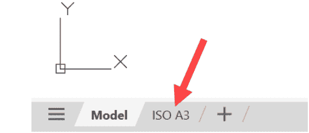

**ISO A3** 布局选项卡设置为 *ISO 公制 A3 纸张尺寸*。 你可以在 AutoCAD 中设置任何纸张尺寸，无论是公制还是英制。 这完全取决于你的 **相关标准** 和页面设置。 为本章的目的，建议使用 **ISO A3** 纸张尺寸。

你可以使用纸张尺寸和纸张方向定义不同的页面设置，以绘制和发布绘图中的各种细节。 例如，你可能有一个页面设置用于平面图，一个用于立面图，一个用于细节图。

以下 URL 将带你到 Autodesk 网页，解释页面设置在 AutoCAD 中工作时如何帮助你：

https://www.autodesk.com/learn/ondemand/tutorial/understanding-page-setups-for-printing?msockid=063e61fa977165a339ee753f9664640d

你会看到练习文件布局选项卡中有一个缩放视口。 如果你将十字光标/光标悬停在视口边缘上，AutoCAD 将显示视口属性，内容如下：

- **颜色：** ByLayer
- **图层：** Viewports
- **标准比例：** 1:40
- **自定义比例：** 0
- **图层属性覆盖：** 否

*图 8.2 显示了 AutoCAD 中此内容的显示方式：*

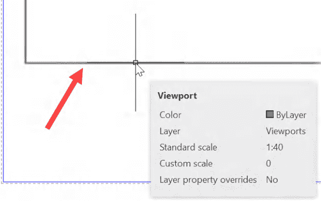

图 8.2：显示的视口属性

你现在将通过以下步骤学习如何创建和操作新的和现有的视口和视口比例：

1. 确保你在练习文件 (`Office Plan_GROUND FLOOR.dwg`) 中处于 **ISO A3 布局** 选项卡。

2. 单击视口轮廓以选择它。 视口对象的夹点将显示，如 *图 8.3* 所示：

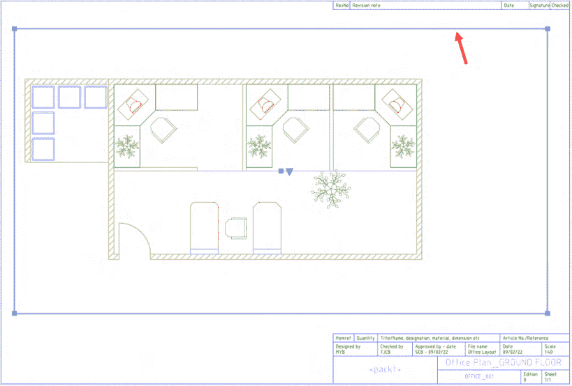

依次单击每个角夹点并水平和垂直移动以调整现有视口大小，直到它看起来像 *图 8.4* 中显示的视口：

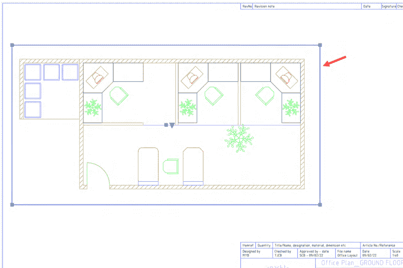

图 8.4：ISO A3 布局选项卡中的调整大小后的视口

你可以使用 *Ctrl + R* 键组合在布局选项卡中的多个视口之间切换。

### 技巧与窍门 #25

当你选择视口时，显示的不仅仅是夹点。 如果你选择所选视口中央的三角形下拉按钮，你将能够看到所有可用的视口比例。 如果你从现有视口比例中选择不同的比例，视口将被调整大小和重新缩放，如图 8.5 所示。 这在 AutoCAD for Mac 中也适用。

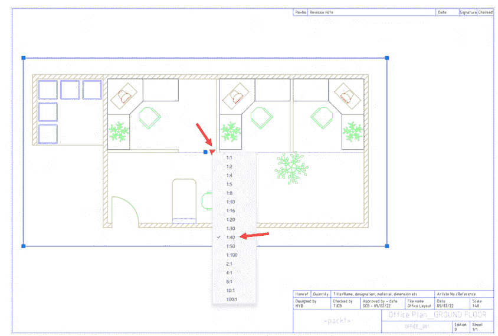

图 8.5：显示的视口比例下拉菜单

1. 你现在将学习另一种修改视口比例的方法。 选择视口后，查看状态栏，你会看到显示的视口比例。 此时它仍应为 1:40。 如果你使用技巧和窍门 #25 更改了它，你将需要使用相同的方法将视口比例恢复到 1:40。

8. 你现在在标题块中有足够的空间添加另一个缩放视口。点击上下文的 **Layout** 功能区选项卡（在 AutoCAD 功能区上显示为蓝色）。这是因为你正在绘图的 **ISO A3 layout** 选项卡中。

9. 在 **Layout Viewports** 面板上，选择顶部右侧下拉菜单中的 **Rectangular** 视口类型。它是默认类型，因此可能已经显示。你也可以输入 `VIEWPORT` 并按 *Enter*。视口对话框将会出现。在对话框中选择 **New Viewports** 选项卡将为你提供各种视口布局的选项，包括单个、两个垂直、水平等。**Figure 8.10** 显示了 **Layout Viewports** 面板以及如何使用功能区选择 **Rectangular** 视口类型。

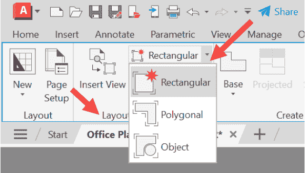

Figure 8.10: The contextual Layout Viewports panel with the viewport type drop-down menu displayed

10. 你现在会看到 **Specify corner of viewport** 提示。使用对象捕捉，在现有视口下方放置一个新的视口。使用现有视口的左下角（**Endpoint** 捕捉）和标题块描述框的左下角（**Endpoint** 捕捉），如 **Figure 8.11** 所示。点击第二个点后，视口将自动放置。

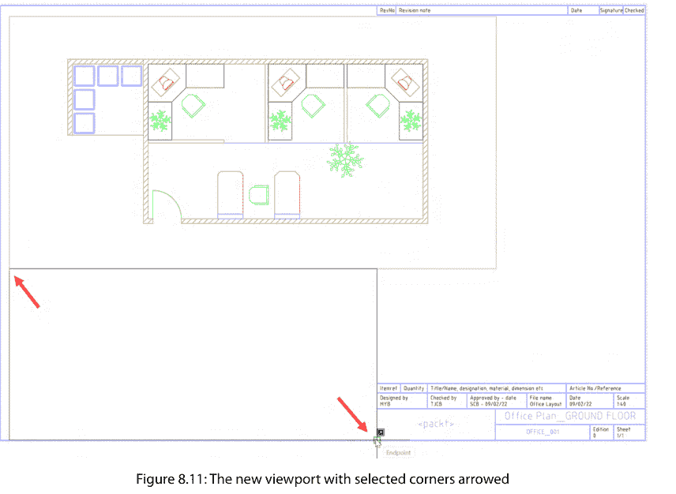

Figure 8.11: The new viewport with selected corners arrowed

11. 视口放置后会立即显示 **Model** 选项卡中内容的缩放范围视图。双击新视口边界内以激活它。你会看到视口边界高亮，并且现在可以像在 **Model** 选项卡中绘图一样在视口内工作。这在口语中被称为 *floating modelspace*。*Figure 8.12* 显示了激活的视口。当视口处于活动状态时，导航工具如 **Navigation Bar**、**ViewCube** 和 **UCS icon** 会显示在活动视口内。

13. 通过点击比例值旁边的飞出箭头，在状态栏上选择视口比例菜单。你刚刚在新视口中手动缩放，因此状态栏比例不会显示为已识别的比例值。从显示的比例列表中选择 **1:30**，如 *Figure 8.14* 所示。新视口中的视图将调整为所选比例，并且状态栏中将显示 **1:30**。

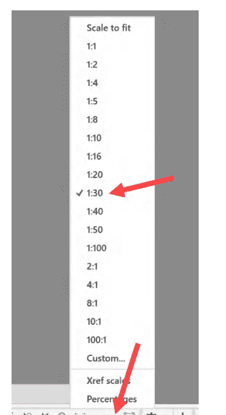

Figure 8.14: The viewport scale list with the flyout arrow and 1:30 scale display arrowed

14. 你现在已使用来自 **Model** 选项卡的所需视图并按标准比例（**1:30**）设置了新视口。将光标移至 *图幅边界之外*（进入灰色区域）并双击。这将取消激活新视口。

> **Tips and tricks #26**
> 
> 一旦视口放置并缩放后，可以将其锁定以防止因错误而造成的任何更改。例如，用户可能会不小心双击视口边界并进行缩放和平移，从而改变视口比例。最简单的方法是在布局选项卡中选择视口时使用状态栏上的挂锁图标。这在 *Figure 8.15* 中显示。当挂锁图标为蓝色时，视口处于锁定状态。

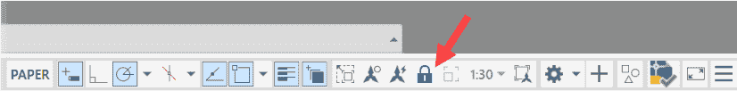

Figure 8.15: The padlock on the status bar, set to blue, indicating that the selected viewport is currently locked.

一旦视口被锁定，其比例将无法更改。这可避免用户因错误激活视口并在视口处于活动状态时缩放而导致视口比例意外更改。

> **AutoCAD for Mac**
> 
> 本节提到的所有视口功能在 AutoCAD for Mac 中以相同方式工作。它仍然位于状态栏上，但挂锁/锁定图标使用 MacOS 图标规范，看起来略有不同，如 *Figure 8.16* 所示：

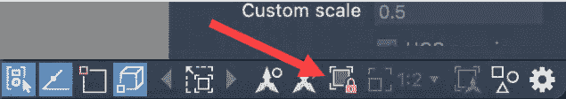

Figure 8.16: The viewport padlock displayed on the AutoCAD for Mac status bar

你现在知道如何使用现有视口以及如何创建和缩放新视口。了解更多关于视口的良好方法是尝试它们，并在绘图的布局选项卡中放置和缩放它们时发现其行为。一个典型的例子可能是设置一个 1 : 100 视口，然后将其重新缩放为 1 : 50。你会看到 1 : 50 视口显示更多细节，因为它是 1 : 100 比例的一半。尝试使用不同的比例值，然后在选中时使用蓝色夹点调整视口大小。

在本章的下一部分，你将学习如何在 Model 选项卡中利用注释，确保其在缩放视口中有效显示。

## Working with annotation scales in the Model tab

你应该已经从上一节打开了 `Office_Plan_GROUND_FLOOR.dwg` 练习文件。你现在将在 **Model** 选项卡中添加一些注释性标注，使用适当的注释比例并确保其与所选缩放视口匹配。步骤如下：

1. 确保你处于绘图的 **Model** 选项卡中，并且已缩放至平面图中 **Executive Office** 区域，如 *Figure 8.17* 所示：

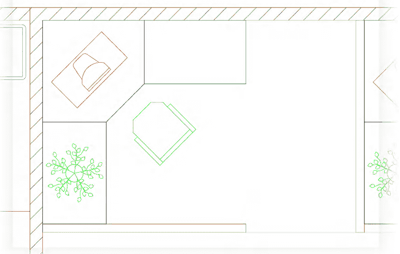

Figure 8.17: Zoomed into the Executive Office on the Model tab

2. 你需要在绘图的 **Executive Office** 区域放置一些标签，因此需要使用适当的文字样式。使用功能区 **Home** 选项卡上的 **Annotation** 面板，使用面板标题栏上的飞出菜单。然后你可以使用文字样式飞出菜单确保使用适当的注释文字样式。你需要使用 `Labels_MODEL_5mm`，如 *Figure 8.18* 所示。如果有帮助，你可以固定 **Annotation** 面板飞出菜单以防止其消失回功能区。它在 *Figure 8.18* 中也显示为固定打开状态：

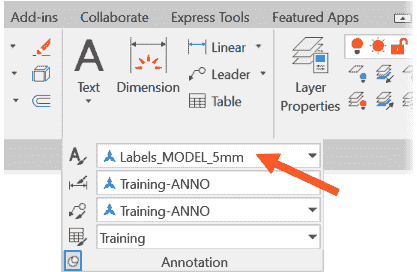

Figure 8.18: The Annotation panel pinned open with the text style arrowed

3. Labels_MODEL_5mm 文字样式是注释性的（在飞出菜单中旁边有蓝色注释符号），因此它将采用 Model 选项卡中状态栏上设置的当前注释比例。为了使注释文字在上一节创建的 1:30 视口中按预期显示，注释比例也必须设置为 1:30。选择状态栏上的注释比例飞出菜单并选择 1:30 比例，如 Figure 8.19 所示：

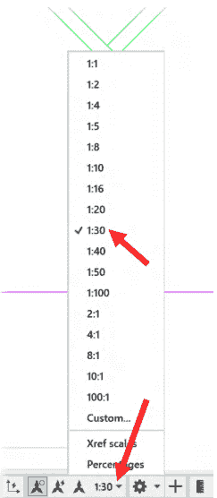

Figure 8.19: The annotation scale set to 1:30 in the status bar

4. 你现在可以在 Executive Office 区域放置注释文字作为房间标签。使用图层面板上的图层下拉菜单确保使用 Text 图层作为当前图层。

5. 从功能区 **Annotation** 面板上的文字飞出菜单中选择多行文字选项，如 Figure 8.20 所示：

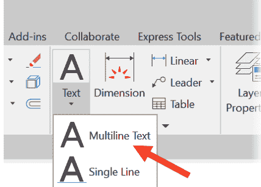

Figure 8.20: The Multiline Text (MTEXT) option on the text flyout in the Annotation panel

6. 你将被提示放置多行文字（MTEXT）的矩形区域。在 Executive Office 的右上角点击 Figure 8.21 指示的两个点。这将创建放置文字的区域。注意此时你的文字样式预览（在放置的多行文字区域中由 abc 表示）。

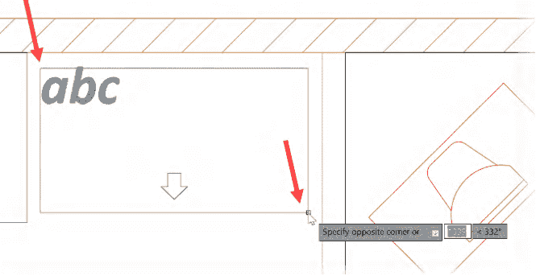

Figure 8.21: The Multiline Text area with the text preview displayed

7. 放置文字区域后，你会看到光标闪烁，并且功能区上会出现一个名为 **Text Editor** 的上下文选项卡。功能区选项卡为蓝色；你会看到所有多行文字编辑工具。**Text Editor** 显示在 *Figure 8.22* 中。它就像 Microsoft Word 等文字处理应用程序一样工作。为了了解其工作原理，在 **Text Editor** 中输入以下内容：

- Executive (press *Enter*)
- Office

显示的文字现在将与 *Figure 8.22* 中显示的相同：

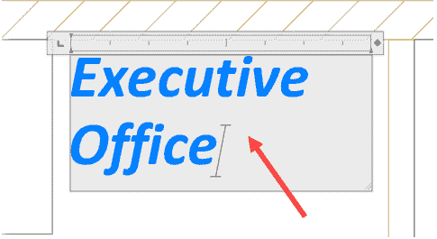

8. 要关闭 **Multiline Text**（*MTEXT*）命令，你可以点击 **Text Editor** 外部，或点击 **Text Editor** 上下文功能区选项卡上显示的 **Close Text Editor** 图标，该图标为绿色勾号。文字现在将按输入方式显示在绘图中，并且功能区上的 **Text Editor** 选项卡将关闭。

9. 双击鼠标滚轮作为按钮，你将在 **Model** 选项卡中缩放至绘图中可见对象的范围。滚动鼠标滚轮向后以缩小并在平面图周围留出一些空间，以便更容易放置标注。你现在将在平面图周围放置一些注释标注。

10. 如前所述，你需要在 **Model** 选项卡中设置注释比例以适应标注将显示的视口中的视口比例。

11. 在状态栏上的注释比例飞出菜单中将注释比例设置为 **1:50**。

12. 使用 **Layers** 面板上的图层下拉菜单，确保将 **Dimensions** 图层设置为当前图层。

13. 你还需要确保使用正确的注释性标注样式。点击 **Annotation** 面板标题栏上的飞出菜单并在需要时将其固定打开（如 *步骤 2*）。确保你使用的是 **Training-ANNO** 标注样式。它旁边有蓝色注释符号，如 *Figure 8.23* 所示。

15. 现在系统会提示您指定两个扩展原点点。使用**端点**对象捕捉，并选取平面图左上角和右上角的点。然后需要第三次单击以放置尺寸线。图 8.25 显示了平面图上要选取的两个点以及尺寸线的大致位置。放置完成后，您放置的尺寸应与图 8.25 中的类似。第三次单击后，**线性**尺寸命令将关闭。

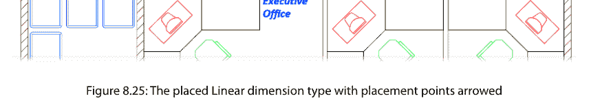

图 8.25：已放置的线性尺寸类型，并用箭头标出了放置点

16. 使用**线性**尺寸类型，再放置一些水平和垂直尺寸，以熟悉尺寸放置工作流程。最终得到的平面图应大致如图 8.26 所示：

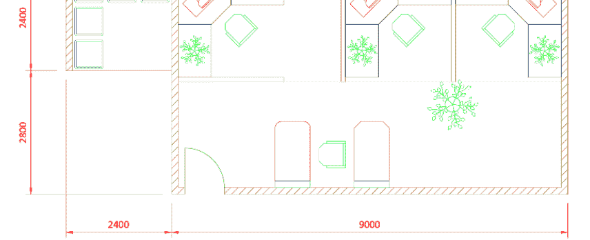

图 8.26：添加了更多尺寸标注的平面图

## 技巧与窍门 #27

放置线性尺寸时，可以使用对象捕捉（OSNAP）将它们准确对齐。放置尺寸线时（即放置线性尺寸时的第三次单击），只需使用要与之对齐的箭头端点的**端点**对象捕捉，您就会发现箭头随后会整齐对齐，使所有尺寸线保持成行。这适用于水平和垂直尺寸放置。

对象捕捉是准确、精确标注尺寸最有效的方法。放置尺寸标注时，请确保 OSNAP 设置始终处于开启状态。

## AutoCAD for Mac

线性尺寸放置在 AutoCAD for Mac 中的工作方式相同。唯一的区别是尺寸工具位于左侧的垂直菜单中。

请注意，文字标注和尺寸标注都显示在“模型”选项卡上，并使用各自相应的注释比例。单击 ISO A3 布局选项卡，可看到图 8.27 中显示的图形：

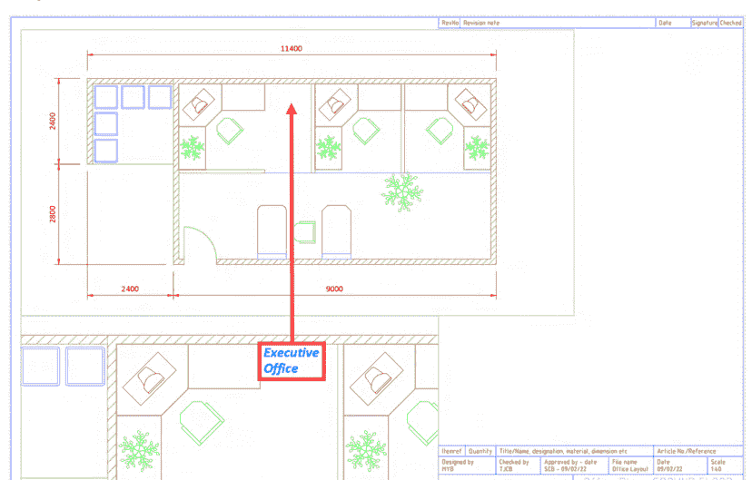

图 8.27：显示图形的 ISO A3 选项卡

在*图 8.27*中，文字标注被高亮显示，因为它只出现在 **1:30**（下方）视口中，而不出现在 **1:50**（上方）视口中。这是因为该文字标注在**模型**选项卡中仅应用了 **1:30** 注释比例。同样，尺寸标注仅设置为在 **1:50**（上方）视口中显示，因为它在**模型**选项卡中仅应用了 **1:50** 注释比例。这就是注释性缩放的工作原理。

在本节中，您学习了如何将注释性文字样式和尺寸样式用于缩放后的视口。所放置的文字和尺寸在**模型**选项卡中都只使用了一个注释比例，以与其在图形中显示时所在的缩放视口相匹配。

注释比例可以轻松缩放注释性对象，在本例中即注释性尺寸。使用注释性尺寸时，可以将注释比例应用于布局选项卡中不同比例的视口，以一致地缩放尺寸标注。

在本章的下一节中，您将学习如何为注释性对象添加和删除注释比例。

## 添加和删除对象注释比例

在本节中，您将了解到注释性对象可以应用多个注释比例，从而能够显示在多个缩放视口中。

您仍应打开 `Office Plan_GROUND FLOOR.dwg` 文件。在打开该文件的情况下，请按以下步骤操作：

- 1. 返回 AutoCAD 中的**模型**选项卡，并缩放到**行政办公室**区域。
- 2. 将鼠标悬停在显示为**行政办公室**的多行文字对象上。您可以看到*图 8.28*中显示的注释性符号：

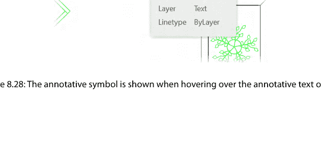

3. 单击选择该注释性多行文字。您将看到蓝色夹点出现。右键单击以显示上下文相关快捷菜单，如图 8.29 所示：

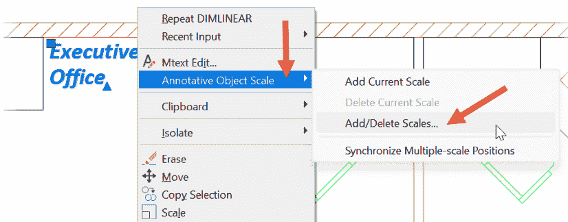

图 8.29：显示有“注释性对象比例 - 添加/删除比例...”的快捷菜单

4. 从快捷菜单中选择“注释性对象比例”，然后从子菜单中单击“添加/删除比例...”。

5. 将显示“注释对象比例”对话框，如图 8.30 所示。您会注意到，应用于该注释性文字的唯一注释比例是 1:30 比例。单击“添加...”按钮：

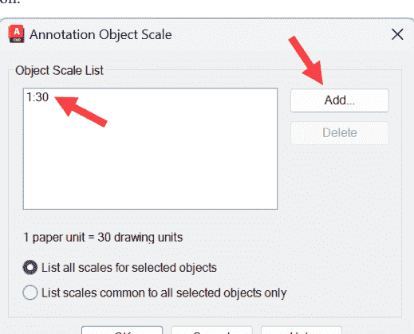

图 8.30：“注释对象比例”对话框

8. 单击“确定”关闭对话框。您会注意到，注释性文字现在在“模型”选项卡中变大了，如图 8.33 所示。这是因为您现在应用了两个注释比例，而当前注释比例为 1:50，它决定了文字在图形中的大小。另请注意，将鼠标悬停在注释性文字对象上时，会显示两个注释性符号，表示已应用多个注释比例。

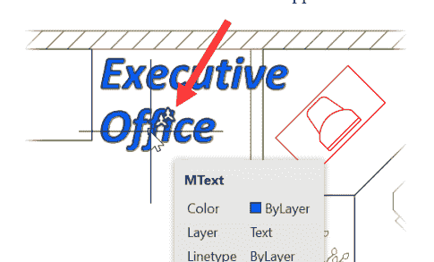

图 8.33：显示有两个注释性符号的注释性文字对象

9. 如果返回 ISO A3 布局选项卡，您还会看到“行政办公室”文字对象显示在 1:50（上方）视口中。这是因为该对象现在在“模型”选项卡中应用了 1:50 注释比例。图 8.34 显示了这一点，您可以看到，在该视口中使用带有 1:50 注释比例的文字样式会导致其穿过几何图形，看起来有些凌乱。

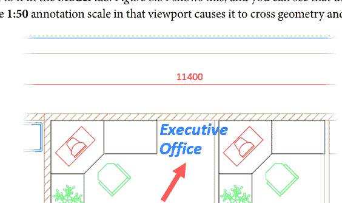

图 8.34：1:50 视口中的注释性文字对象

- 10. 返回**模型**选项卡。选择**行政办公室**文字对象，蓝色夹点将出现。
- 11. 右键单击以显示快捷菜单。选择**注释性对象比例**。将像本节前面那样显示**注释性对象比例**对话框。
- 12. 在子菜单中选择**添加/删除比例...**。
- 13. 在列表中选择 **1:50** 比例。
- 14. 单击**删除**按钮，**1:50** 比例将作为应用于该文字对象的注释比例被删除。
- 15. 像之前一样，单击**确定**关闭对话框。
- 16. 现在，该注释性文字对象只应用了一个注释比例，与之前一样。
- 17. 如果返回 **ISO A3** 布局选项卡，您会看到**行政办公室**文字对象现在仅显示在 **1:30**（下方）视口中，如图 8.35 所示。
- 18. 确保将图形另存为 `Office Plan_GROUND FLOOR-COMPLETE.dwg`。这样，您就保存了所做的所有修订，并且可以日后参考该文件。

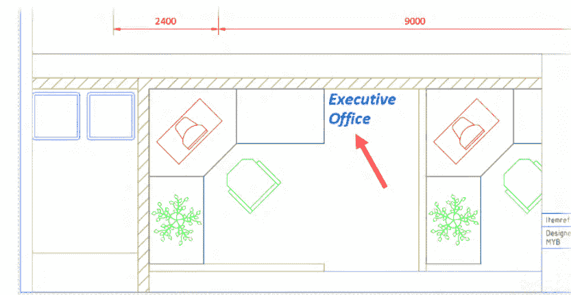

图 8.35：显示有注释性文字对象的 ISO A3 布局选项卡

现在，您可以为注释性对象（包括文字和尺寸）添加和删除注释比例。只要您使用注释性样式（例如文字样式和尺寸样式）在图形中放置对象，任何注释性对象都可以应用多个注释比例，从而能够显示在图形布局选项卡中不同比例的多个视口中。
