# 第 3 部分：
内容重用，包括
动态块

在 AutoCAD 中重用设计内容使您能够灵活地反复使用类似内容。在项目中使用可在另一个类似项目中重用的特定内容，可以节省宝贵的项目时间，减少重复、繁重的内容创建。重用 DWG 文件中的内容还可以使用常规 AutoCAD 块和动态块轻松创建内容库，这些块包含特定参数和动作，从而在图形中使用动态块时能够轻松对其进行操作。

本部分包含以下章节：

- 第 9 章，开发块库
- 第 10 章，使用块属性
- 第 11 章，创建带参数和动作的动态块
- 第 12 章，创建带可见性状态的动态块

## 开发块库

在与 CAD 团队处理多个项目时，内容重用至关重要。块是任何项目的必备部分，本章将解释如何在 CAD 团队内部创建和共享块库。使用块意味着你只需创建一次对象（块），然后通过将其作为实例插入到你的图纸中来重复使用它。

在本章结束时，你将能够在图纸中处理常规块和动态块，并使用多种方法（包括剪贴板）创建自己的块库。你还将学习如何使用块调色板以及利用工具调色板与你的块配合使用。

本章涵盖了你在 DWG 文件中与 AutoCAD 块配合工作所需的方法：

- 将块和动态块带入图纸
- 利用剪贴板创建新的块库图纸
- 将块库添加到块调色板
- 创建新的块库工具调色板

重用绘图内容并管理该内容将节省宝贵的绘图时间，减少重复任务的需求，并允许与项目利益相关者和团队成员共享内容。

在本章中，你将学习如何处理常规块和动态块，并发现管理 CAD 团队图纸中块的众多方法。

## 练习文件

你必须确保已下载练习文件 New Office Design.dwg 以跟随本章各节。

## 将块和动态块带入图纸

**块**是由多个 AutoCAD 对象组成的物体，例如线、圆弧和圆。一个典型的 AutoCAD 块可能是门或椅子，必须在图纸中多次使用，例如平面图。

AutoCAD 中可以使用两种类型的块：**常规块**和**动态块**。常规块是一次性块，具有单一用途。动态块可以应用特定参数以识别增量和迭代，例如长度各异的公制螺栓或形状和尺寸各异的门/窗。

块是重用任何 AutoCAD 绘图内容的最佳方式，它们将构成你设计中的许多基本元素。

首次在图纸中创建时，块仍保存在其创建的绘图文件中，但也可以设置在特定的块库图纸中，然后将其放置在合适的<|message|>位置，供你以及你的 CAD 团队其余成员使用。它们可以存储在本地硬盘或网络服务器上。随着云的使用越来越多，基于云的块库可以轻松设置和维护。

打开练习文件 New Office Design.dwg。绘图是一份简单的办公室布局平面图，你将在其中利用绘图中的块。你将把块和动态块带入绘图以重用设计内容，因此你无需重新绘制和重新处理 AutoCAD 对象。绘图在打开时将位于 **Model** 选项卡上，显示一份没有标注的简单办公室平面图。你的第一步是将常规门块带入绘图。放大门洞并选择构成门的线和圆弧对象，如图 9.1 所示。

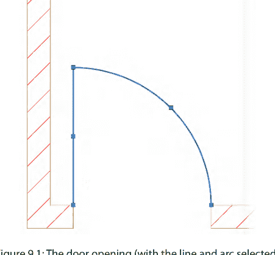

图 9.1：门洞（线和圆弧已选中）

你会看到门由一条线和一个圆弧组成。为了复制此门，你必须复制这两个对象并确保它们位于正确的图层上，这对于如此简单的两个 AutoCAD 对象的组合来说也容易出错。复制需要你确保已选择所有需要复制的对象。AutoCAD 块可以一遍又一遍地重复使用，并且可以确信所有必需的对象都是块的一部分。

绘图已在 DWG 文件中保存了多个块。其中一些是常规块，一些是动态块。在下一个工作流程中，你将确保正确的图层为当前图层，并在线和圆弧对象的位置放置常规门块。

### 添加常规门块

你首先需要转到图层下拉菜单并选择 Doors 图层，如图 9.2 所示。你会在功能区的“开始”选项卡上的“图层”面板上找到下拉菜单。选择 Doors 图层使其成为当前图层。

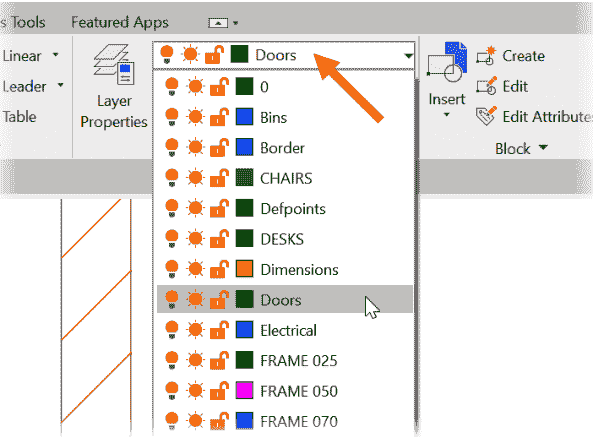

图 9.2：图层下拉菜单，Doors 图层为当前

现在 Doors 图层为当前，以下工作流程将允许你插入代表门的常规块：

- 1. 确保你在练习文件（New Office Design.dwg）中位于 Model 选项卡上并放大到门洞。
- 2. 确保代表现有门的线和圆弧已选中。然后，使用 Erase（ERASE）命令删除线和圆弧，只留下墙上的门洞。在本例中，在选择对象后使用了右键快捷菜单，并在快捷菜单上选择了 Erase，如图 9.3 所示。

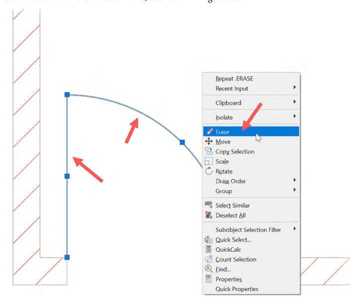

图 9.3：原始线和圆弧已选中，准备使用快捷菜单中的 Erase 命令删除

在绘图中擦除对象时，通常更容易一次选择多个对象然后使用一次 Erase（ERASE）命令，而不是逐个擦除对象。

### 技巧与窍门 #28

当你想从绘图中删除对象时，你使用 Erase（ERASE）命令。这可以通过几种方式加快。你可以在功能区的“开始”选项卡上的“修改”面板上使用 Erase 图标，选择要擦除的对象，然后按 Enter 确认。你也可以在选择要擦除的对象后使用右键快捷菜单并选择 Erase（见图 9.3），或者你可以简单地输入 ERASE 并按 Enter，选择要擦除的对象，然后再次按 Enter 确认。

OOPS 命令是仅针对 Erase（ERASE）命令的撤销功能。如果你擦除了某物并意识到这是个错误，输入 OOPS 并按 Enter。最后一次使用 Erase（ERASE）命令将被撤销。但要小心，因为你可能已用另一个对象替换了被擦除的对象，它将被叠加在被擦除的原始对象之上。

### AutoCAD for Mac

你可以使用诸如技巧与窍门 #28 等方法在 AutoCAD for Mac 中擦除绘图中的 AutoCAD 对象。

- 1. 确保绘图已保存。使用快速访问工具栏上的保存图标。在选择功能区的“插入”选项卡之前执行此操作。这将确保 Door 块保存在 DWG 文件中。然后，单击“插入”下拉箭头，如图 9.4 所示。你将看到绘图文件中可用的块，右侧有一个滑块可查看更多块内容。

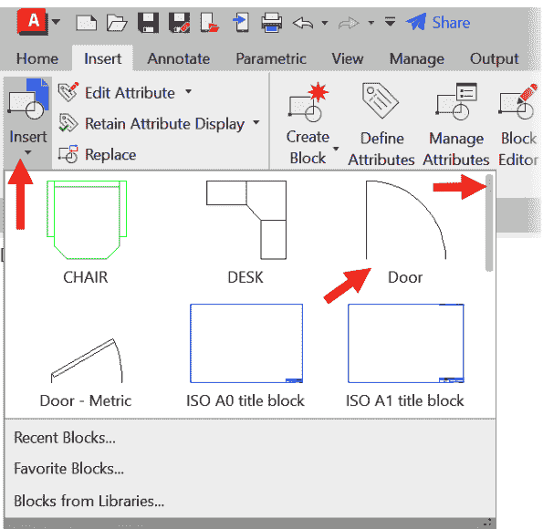

图 9.4：插入下拉菜单显示可用块

- 2. 在“插入”下拉菜单上单击 Door 块，如图 9.4 所示。Door 块将出现在你的光标上，并提示你输入插入点，如图 9.5 所示。使用 Endpoint 对象捕捉选择图 9.5 中箭头指示的墙角。

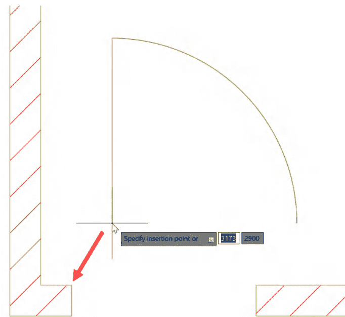

图 9.5：Door 块等待插入点

- 3. Door 块现在将被放置在门洞中，并且请注意它是一个对象，而不是两个。它现在是绘图中块引用的一个实例。此时请务必保存绘图。

你会看到块现在看起来与之前存在的线和圆弧相同，如果你将鼠标悬停在新的门块上，你会看到工具提示出现，告知你它是在 Doors 图层上的块引用，如图 9.6 所示。请注意，块已采用先前设置的当前图层 Doors。

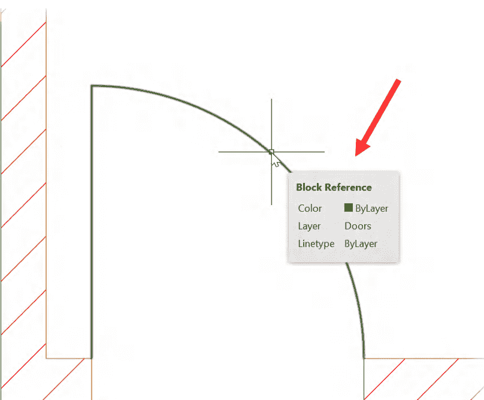

图 9.6：带有工具提示箭头的新门块

现在，你已经在 AutoCAD 图形中放置了一个常规的**门**块。

## 添加动态门块

在 AutoCAD 图形中放置了一个常规的**门**块后，接下来我们将转而使用动态的**门**块。下面来看看如何操作：

- 1. 要添加动态门块，现在选择新的**门**块并将其从图形中删除。这看起来可能有些奇怪，因为你刚刚才放置它，但接下来你将放置一个门的**动态**块，以替换常规块。
- 2. 按照前面第 1 步和第 2 步中的操作，使用**擦除**命令删除常规的**门**块，使墙上的开口恢复原状。
- 3. 在功能区的“插入”选项卡中选择“插入”下拉菜单，然后选择“最近使用的块...”选项，如图 9.7 所示。

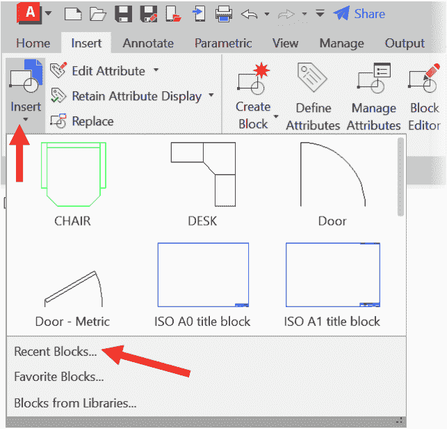

图 9.7：带有“最近使用的块”箭头的“插入”下拉菜单

此时，屏幕上将显示“块”选项板。“块”选项板是较新版本 AutoCAD 中处理块的一种新方法。它也更加灵活，可以帮助你开发块库。图 9.8 显示了“块”选项板，其中选择了“当前图形”选项卡，并显示当前图形中的块。

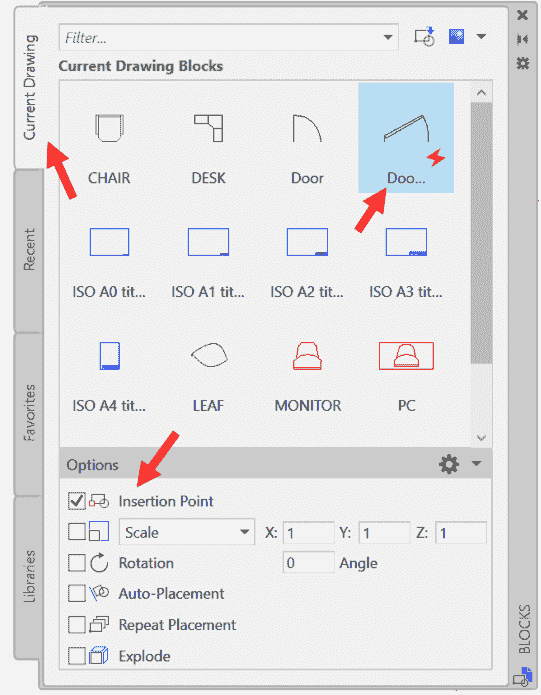

图 9.8：“块”选项板，当前显示“当前图形”选项卡

- 1. 确保在“块”选项板下方区域中只有“**插入点**”复选框处于选中状态，如*图 9.8* 所示。这样可以确保你在插入块时指定插入点。
- 2. 你会注意到选项板中还有另一个门块（图 9.8 中用箭头标出）。该块带有一个黄色闪电符号，表示它是一个*动态*块。完整的块名称为**门 – 公制**。
- 3. 如果在“**块**”选项板中单击**门 – 公制**块，你会看到它像常规块一样出现在光标上，放置方法也相同。按照之前的操作，使用**端点**对象捕捉，将该块放置在墙角处，如*图 9.9* 所示。

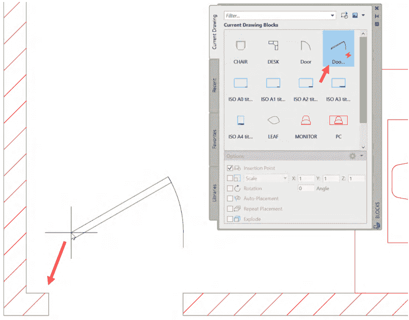

图 9.9：放置门 – 公制动态块

**门 – 公制**动态块的外观与常规的**门**块不同，如*图 9.10* 所示，你可能会发现很难将动态块调整到墙角处。这是因为动态块内置的**对齐**参数正在尝试与门洞处的墙面进行对齐。

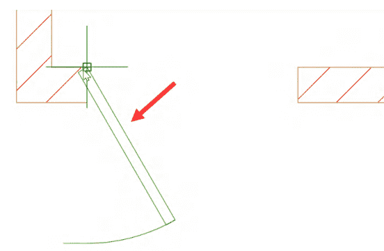

图 9.10：难以放置的门 – 公制动态块

- 4. 一种简单的方法是先将**门 – 公制**块放置在远离门洞的位置，然后使用**移动**（*MOVE*）命令在放置后移动它，同时利用对象捕捉将门块放置在墙洞的墙角处（使用**端点**对象捕捉）。使用*图 9.11* 中所示的**端点**对象捕捉作为基点，将动态块放置到墙角处。

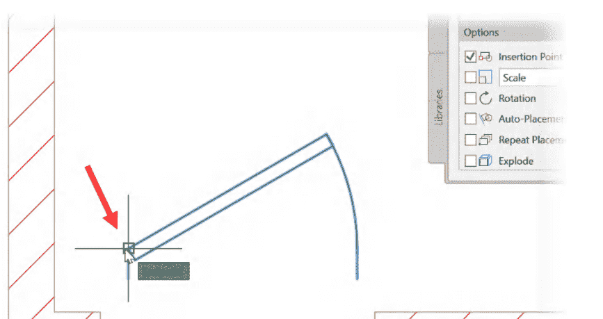

图 9.11：用于移动动态门块的端点对象捕捉

- 8. 在块仍处于选中状态时，单击左侧较大的三角形参数夹点，如图 9.14 所示。此时将显示一个菜单，其中提供了门扇开启角度选项，如图 9.15 所示。

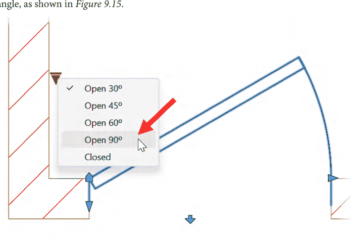

图 9.15：动态块的门扇开启菜单

- 9. 选择“开启 90°”选项后，动态门扇将垂直更新，如图 9.16 所示。按几次 *Escape* 键，确保已取消选择该块。

你应该已经在上一节中打开了练习文件 `New Office Design.dwg`。现在，你将创建一个新的空白库图形，使用不同的文件名保存，然后向其中添加块。

你将按照以下工作流程进行操作：

- 1. 在 `New Office Design.dwg` 文件仍处于打开状态时，检查 AutoCAD 屏幕顶部功能区下方的文件选项卡，如*图 9.17* 所示。你会看到**开始**选项卡和**新办公室设计**选项卡。此处还会显示一个带有 +（加号）符号的选项卡。单击该选项卡，打开一个新的空白图形文件（注意，你可能需要关闭状态栏上的**栅格**设置）。

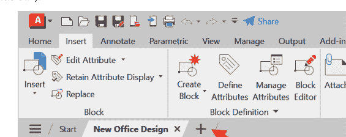

图 9.17：AutoCAD 中带有 + 选项卡箭头的文件选项卡

- 2. 选择本章上一节中放置的动态门块。右键单击以打开快捷菜单，然后选择**剪贴板**。在子菜单中选择**带基点复制**，如图 9.18 所示。

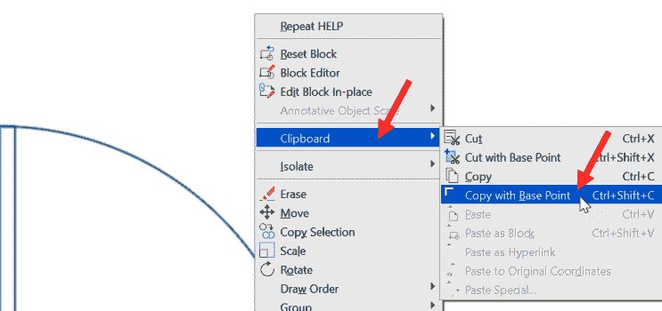

图 9.18：显示“带基点复制”的快捷菜单

- 3. 出现提示后，选择门块左上角的**端点**对象捕捉，如图 9.19 所示。

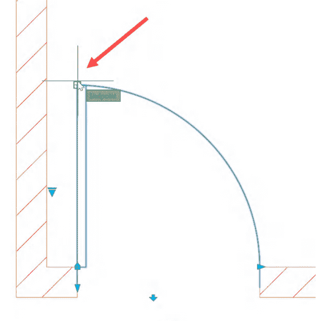

图 9.19：使用端点对象捕捉选择的门块

- 4. 单击**端点**对象捕捉后，门块仍将处于选中状态。按几次 *Escape* 键，确保取消选择。现在，**门 – 公制**动态块已经位于 AutoCAD 剪贴板中。
- 5. 单击之前在文件选项卡中创建的新图形选项卡。在新的空白图形中，右键单击以显示快捷菜单，然后再次选择**剪贴板**。在子菜单中选择**粘贴**，门块就会出现在光标上，如图 9.20 所示。按照提示，在图形区域中的任意位置单击，将其设为插入点。现在，该块已经位于新图形中，并且连同它所在的图层也一并复制过来了（**门**图层——如果需要，可以在**图层**下拉菜单中进行检查）。

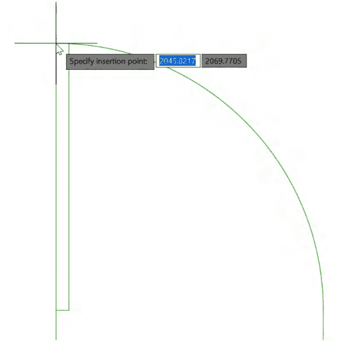

图 9.20：显示插入点提示的门块

- 6. 在新图形处于当前状态时，现在可以使用**另存为...**，并使用合适的文件名保存该图形，例如 `Architecture-LIBRARY.dwg`，以便将来使用。
- 7. 返回 `New Office Design.dwg` 文件，尝试使用图形中的其他块，并将它们复制到新的块库图形中。之后请务必保存库图形，以便将这些块保存到新的 DWG 文件中。

现在，你已经使用 AutoCAD 中的剪贴板功能创建了一个块库图形。接下来，可以将该图形放置在共享位置，例如网络服务器或基于云的文件夹中，供 CAD 团队中的其他成员使用，并从中复制和粘贴块。当所有人都在同一个项目中使用相同的块时，这将大大节省时间，避免数小时的重复工作。

### 技巧与窍门 #29

使用剪贴板中的“粘贴”将块放置到新的块库图形中时，被复制的块还会将其当前所在的图层一并带入新图形，并且仍然保留在该图层上。通常，最好将新块库图形中的所有块都放置到一个独立的中性图层上，以避免图层被转移到其他工作图形中。

AutoCAD 中的剪贴板也支持常规键盘快捷键，例如使用 Ctrl + C 进行复制，使用 Ctrl + V 进行粘贴。Ctrl + X 用于剪切，Ctrl + Z 用于撤消上一次操作。

### AutoCAD for Mac

在 AutoCAD for Mac 中复制和粘贴块的操作几乎完全相同。

本节中，你已经学习了如何将现有块复制并粘贴到新的块库图形中。接下来，让我们看看如何将块库添加到“块”选项板中。

## 将块库添加到“块”选项板

在本节中，我已将块库图形保存为已知位置中的 Architecture-LIBRARY.dwg。

在本节中，你将学习如何将块库添加到“块”选项板，以便在 AutoCAD 中处理任何图形时，都可以随时通过“块”选项板访问它：

- 1. 目前，New Office Design.dwg 文件和 Architecture-LIBRARY.dwg 文件仍在 AutoCAD 中打开。确保 New Office Design.dwg 文件是当前图形。
- 2. 单击功能区中的“插入”选项卡，然后选择“插入”下拉菜单，操作方式与本章前面几节中相同。

3. 在下拉菜单中选择 **Blocks from Libraries...**，**Blocks**调色板将打开，**Libraries**标签页处于当前状态，如*图 9.21*所示。

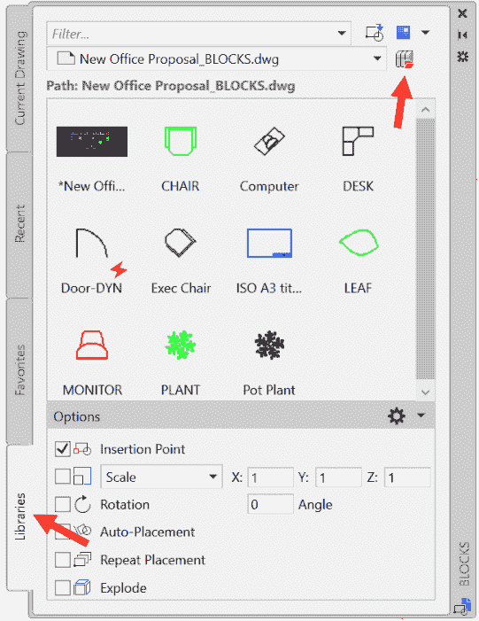

图 9.21：Blocks调色板，Libraries标签页处于当前状态

4. 要将 `Architecture-LIBRARY.dwg` 添加到库列表中，需要点击 **Blocks**调色板右上角的小图标。它看起来像一排小书，在*图 9.21*中用箭头标出。

5. 现在会出现一个新的对话框，提示你选择新块库的文件夹或文件，如*图 9.22*所示。导航到你保存 `Architecture-LIBRARY.dwg` 文件的位置。你可能已使用略有不同的文件名保存它，但仍必须找到该文件。

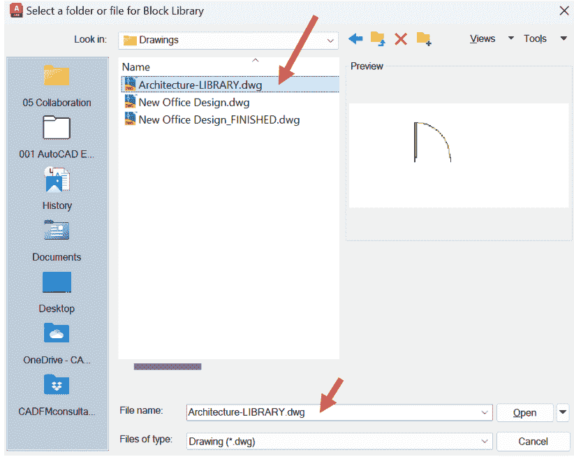

图 9.22：用于定位块库绘图的对话框

6. 选择块库绘图，如图 9.22 所示，然后点击 Open。

8. 当你建立块库时，可以使用 **Blocks**调色板中 **Libraries**标签页的下拉菜单来定位它们，如*图 9.24*所示。

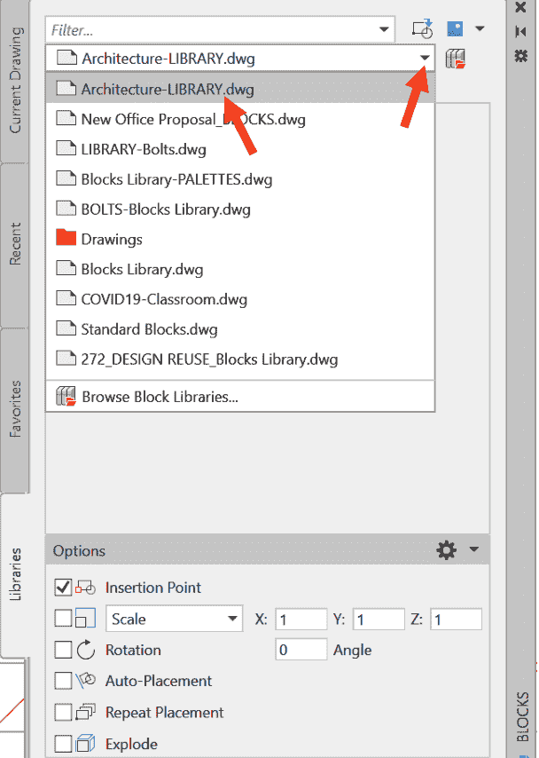

图 9.24：Libraries标签页显示下拉菜单和库绘图

9. 你现在已将块库绘图添加到 **Blocks**调色板中。如果将库绘图定位在中央位置，例如服务器网络或云端（如 OneDrive），团队中的任何人都可以定位该库绘图并使用其中的块。这可以节省返工时间和查找块库绘图文件所花费的时间。

> **AutoCAD for Mac**
> **Blocks**调色板在 AutoCAD for Mac 中以相同方式工作。

在本节中，你学习了如何将块添加到新的块库绘图中，并在 **Blocks**调色板上包含指向该库绘图的路径。在下一节中，你将了解如何使用 AutoCAD 中的 **Tool Palettes** 创建块库工具调色板。

## 创建新的块库工具调色板

AutoCAD 中的 **Tool palettes** 是另一种将块存储起来供 CAD 团队集中使用的方式。如果将块库绘图存储在中央位置，你可以拖放块到工具调色板上，工具调色板将利用该位置。然后你可以将工具调色板导入和导出给 CAD 团队成员。

在以下工作流程中，假设块库绘图 `Architecture-LIBRARY.dwg` 存储在中央位置。使用你在上一节中创建的块库绘图，将 **Door – Metric** 块拖放到新的工具调色板上：

- 1. 确保你的块库绘图是 AutoCAD 中的当前绘图。在本节中，当前块库绘图名为 `Architecture-LIBRARY.dwg`，假定保存在中央位置，例如网络服务器或云端。

- 2. 在功能区的 **View** 选项卡上点击 **Palettes** 面板中的 **Tool Palettes** 图标。**Tool Palettes** 调色板将出现在屏幕上，如图 9.25 所示。你也可以看到 **Door-Metric** 动态块。

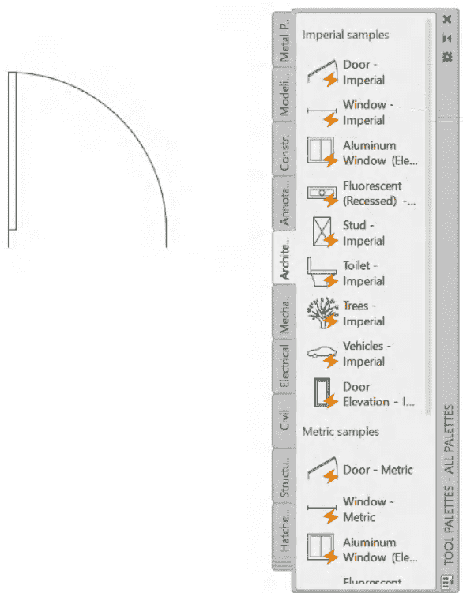

图 9.25：Tool Palettes 调色板显示 Door – Metric 块

3. Tool Palettes 附带许多预安装的标签页和块；图 9.25 中可以看到 Architecture 标签页当前处于活动状态。

4. 如果点击所有标签页堆叠的地方，你将获得所有可用工具调色板的列表，如图 9.26 所示。你可以在自己的时间里调查这些，以了解 AutoCAD 中预安装了什么。

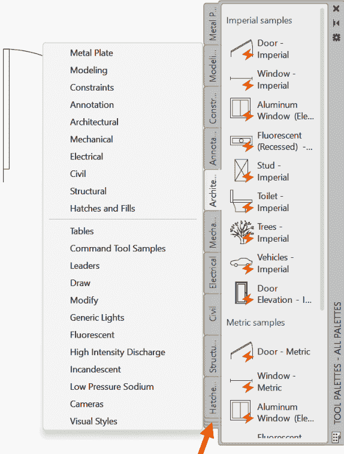

图 9.26：Tool Palettes 显示标签页列表

5. 点击 Tool Palettes 之外的区域以关闭标签页菜单。

## Berlin-Niederschöneweide 的受保护别墅区

受保护的别墅区包括红砖立面、画室、画廊、门房和前身为 1870 年的 Margareten-Aue 称号的五座工厂主别墅，砖厂（整体建筑）。

### 别墅区的建筑

- 红砖立面
- 画室
- 画廊
- 门房
- 五座工厂主别墅

8. 点击 Door – Metric 动态块以选择它。点击并将块拖到调色板上，确保不要使用任何蓝色夹点。如果你选择了一个夹点，AutoCAD 会认为你正在使用所选夹点进行编辑，因此请使用边缘线等进行点击拖动。

9. 当你拖动到新的调色板区域上方时，你会看到光标上出现一个 + 号，并在新调色板上出现一条线，如图 9.29 所示。

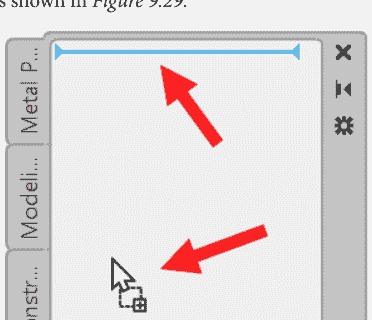

图 9.29：新调色板上的 + 符号和线条

10. 松开鼠标按钮，一个 Door – Metric 块图标将出现在新调色板上，如图 9.30 所示。你还可以看到闪电符号，表示它是一个动态块。

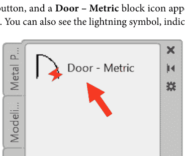

图 9.30：工具调色板上的 Door – Metric 动态块

你的块现在已放置在工具调色板上，可以从其中央位置拖放并放置到任何绘图中。调色板会记住该位置，因此如果更改块库绘图位置，请确保更新调色板上图标的属性。你可以通过右键单击调色板图标并在快捷菜单上选择 **Properties** 来执行此操作。

- 11. 你可以向新的工具调色板添加文本和分隔符。右键单击工具调色板区域并选择 **Add Text** 或 **Add Separator** 来执行此操作，如*图 9.31*所示。

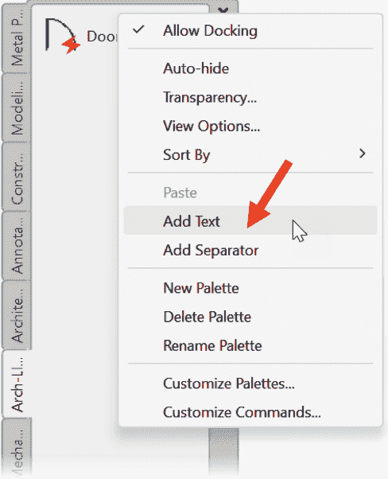

图 9.31：工具调色板菜单显示 Add Text 和 Add Separator

- 12. 使用文本和分隔符工具，你可以在工具调色板上指定块类型的区域，如*图 9.32*所示。

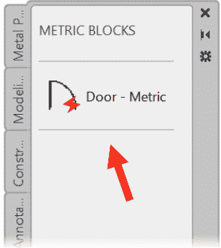

图 9.32：添加了文本和分隔符的新工具调色板

13. 要导入和导出工具调色板，必须再次点击 Tool Palettes 标题栏。从菜单中选择 Customize Palettes...，Customize 对话框将出现，如图 9.33 所示。

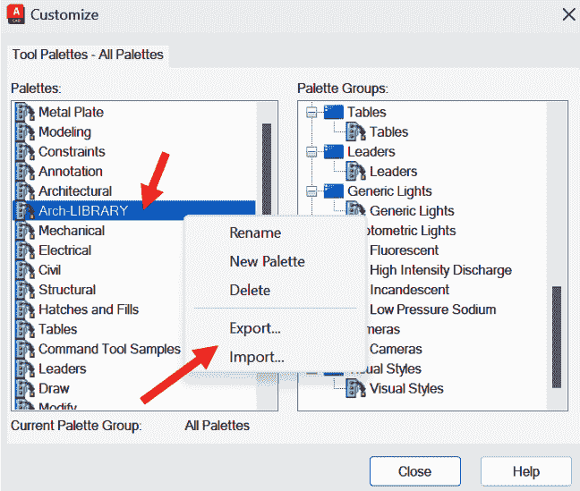

图 9.33：Customize 对话框中选择了 Arch-LIBRARY 调色板

14. 从左侧列表中选择 **Arch-LIBRARY** 调色板并右键单击它。*图 9.33*中显示的快捷菜单会出现，你可以以 **XTP** 文件的形式导入和导出工具调色板。将 XTP 文件导出给团队成员，他们就可以将其导入自己的工具调色板并从同一位置使用相同的块。

你现在可以创建自己的工具调色板，将绘图块添加到这些调色板中，并在团队内部导入和导出调色板以重用现有块内容。要进一步探索工具调色板，请使用此链接访问 Autodesk 网站：https://help.autodesk.com/view/ACD/2021/ENU/?guid=GUID-167A8594-92CB-4FCC-B72C-0F546383E97C。

## 摘要

你现在知道如何开始开发自己的块库，使用常规块和动态块，将它们添加到 Blocks 调色板的库中，并使用自己的块创建自己的工具调色板。在本章中，你学习了如何将常规块和动态块插入绘图并使用动态块参数更改动态块的外观。

你还学习了如何在 AutoCAD 中使用剪贴板功能在绘图之间复制和粘贴 AutoCAD 块以开始开发块库。此外，你还学习了如何通过访问 **Libraries** 标签页将新的块库绘图添加到 Blocks 调色板。

你还获得了在新工具调色板中添加和管理块的宝贵知识。

内容重用在处理大型项目中的 AutoCAD 绘图时至关重要，因为它可以节省宝贵的时间并避免在项目绘图中对 AutoCAD 对象进行繁琐的返工。本章中学到的技能将为你提供良好的基础和理解，以便将来开始实施内容重用和块库。

在下一章中，我们将研究如何在重用设计内容时向 AutoCAD 块添加属性，以便在 AutoCAD 绘图中的 AutoCAD 块中添加和传递更详细的设计信息。

