# 10 使用块属性

在上一章中，你学习了如何使用 AutoCAD 块、在绘图中管理它们，并为内容重用创建块库。在本章中，你将进一步了解块以及如何向块添加属性，从而在绘图中提供详细信息。

正如你所知，块是由多个 AutoCAD 对象组成的用于内容重用的对象，例如椅子或桌子，以避免在绘图中反复重新制作特定的椅子或桌子。属性将内容重用更进一步，通过提供有关块的相关信息。例如，假设一个块代表一把椅子。椅子块的典型属性可能是制造商、型号以及序列号。你甚至可以为所有权应用属性，例如办公室中拥有该椅子的部门以及使用该椅子的员工。属性的应用是无穷无尽的，你可以随时轻松提取和编辑这些属性。

随着时间的推移，绘图中会包含越来越多的块。属性允许你识别块并为使用你绘图的人提供有价值的信息。

本章涵盖了你在 AutoCAD 块中使用属性所需遵循的方法：

- 在块中定义属性
- 使用增强属性编辑器编辑块中的属性
- 使用块属性管理器（BATTMAN）

与上一章一样，重用绘图内容并管理该内容将节省宝贵的绘图时间，减少重复任务的需求，并允许与项目利益相关者和团队成员共享内容。

在本章中，你将学习块中的属性如何使你能够为块提供有效解释绘图所需的相关信息。

### 练习文件

你已经下载了上一章的练习文件 New Office Design.dwg。你也将在本章中使用此练习文件。

### 在块中定义属性

块（常规和动态）可以应用属性。本节将教你如何向常规 AutoCAD 块应用属性。相同的流程也适用于动态块。

练习文件 New Office Design.dwg 中已存在块。你需要在打开时处于 Model 选项卡，显示简单的办公室平面图。

你的第一步将是把块恢复为原始的 AutoCAD 对象。你这样做是为了能够向块的内容添加属性，然后再次保存块。

为此，你需要放大门开口附近的桌子并选择代表计算机的块，如 *Figure 10.1* 所示。

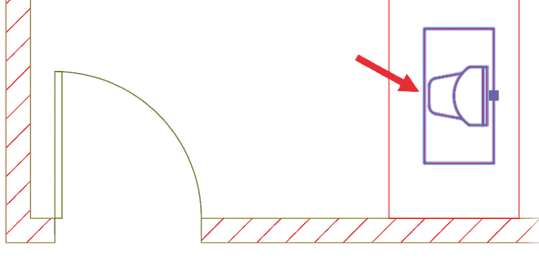

Figure 10.1: The PC block on the desk near the door opening (with the block selected)

你需要为 PC 创建一个包含属性的新块，最快捷的方法是使用 Explode（EXPLODE）命令将块爆炸回其原始 AutoCAD 对象。在块仍被选择的情况下，点击功能区 Home 选项卡上 Modify 面板上的 Explode 图标，如 Figure 10.2 所示。

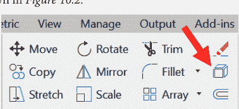

Figure 10.2: The Explode icon on the Modify panel

被爆炸的块内部有一个所谓的嵌套块。你可以创建块的块，这些被称为嵌套块。原始 PC 块由四条线和另一个代表计算机屏幕的块组成。块现在将被恢复为其原始 AutoCAD 对象，你现在需要开始创建包含属性的新 PC 块的工作流程：

- 1. 选择屏幕块并同样将其爆炸。如果现在将光标悬停在屏幕的任何元素上，它都是 AutoCAD 对象，例如线或圆弧。
- 2. 这些对象在 Figure 10.3 中显示为已选择。确保你已选择全部四条线和屏幕块，如图所示（蓝色夹点将显示）。

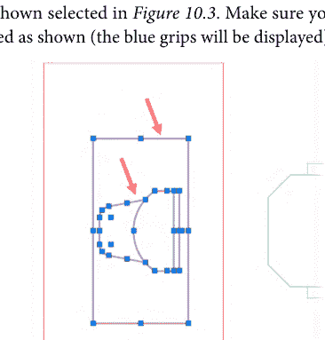

Figure 10.3: The AutoCAD objects selected after exploding the blocks

创建新块时，一个良好的做法是确保构成新块的所有对象都从图层 0（零）开始。然后，一旦块被创建，每次在绘图中插入块的实例时，它将采用当前图层。

- 3. 在所有已爆炸的对象被选择的情况下，进入 Layers 面板上的图层下拉菜单并选择图层 0（零）。它始终位于图层列表顶部，因为它是 AutoCAD 默认图层，如 Figure 10.4 所示。

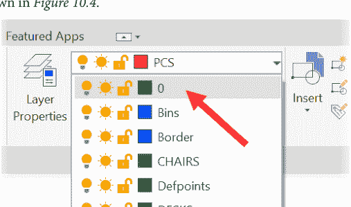

Figure 10.4: The layer drop-down menu with layer 0 (zero) indicated

- 4. 当在爆炸对象被选择时进入图层下拉菜单时，你会注意到它们全部位于 PCS 图层上。这就是为什么对象需要移动到图层 0（零），因为你可能需要将它们放到替代图层上。点击下拉菜单中的图层 0，你会看到所有对象都移动到该图层。按几次 Esc 键以确保对象被取消选择。然后，确保图层 0 是当前图层。

- 5. 点击功能区上的 Insert 选项卡。点击 Block Definition 面板上的 Define Attributes 图标，如 Figure 10.5 所示。

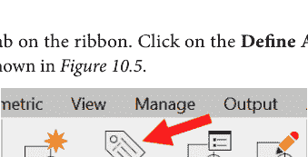

Figure 10.5: The Block Definition panel with Define Attributes indicated

- **Text Settings:** 将 **Justification** 和 **Text style** 设置为 *Figure 10.6* 中所示的内容。由于绘图使用公制毫米，**Text height** 值设为 100，可作为此绘图的合适属性大小。

- 9. 点击 **OK**，对话框关闭，留下属性附着在你的光标上。确保将属性放置在绘图中 PC 对象的左侧，如 *Figure 10.7* 所示。

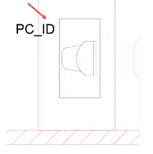

Figure 10.7: The placed block attribute

- 10. 使用之前的步骤创建另外两个属性：
    - **PC_MANU:** 使用 **PC Manufacturer?** 提示，默认值为 **Acme**
    - **EMP_ID:** 使用 **Employee ID?** 提示，默认值为 **E999**

    在放置这两个新属性之前，确保将 **Justification** 设置为 **Right**，然后勾选 **Align below previous attribute definition** 框。放置属性后，它们会自动与 **PC_ID** 属性下方对齐，如 *Figure 10.8* 所示。

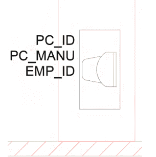

Figure 10.8: The three attributes placed to the left of the objects

- 11. 选择全部三个属性和将构成新 PC 块的所有对象，如 Figure 10.9 所示。你会看到所有夹点都显示出来。

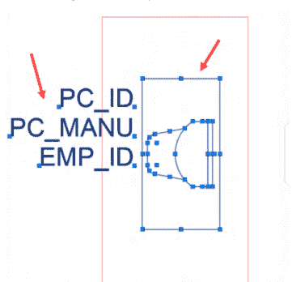

Figure 10.9: All attributes and objects selected

- 12. 点击 Block Definition 面板上的 Create Block 图标，如 Figure 10.10 所示。

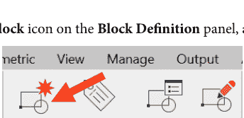

Figure 10.10: The Create Block icon on the Block Definition panel

- 13. Block Definition 对话框将会出现。在 Name 字段中将块命名为 PC_Attributes。

- 14. 在对话框中选择 Pick point 图标，并在绘图中选择对象的右上角 Endpoint 捕捉点，如 Figure 10.11 所示。

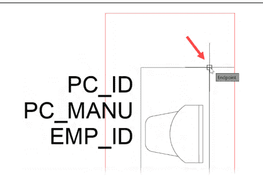

Figure 10.11 – The Endpoint object snap on the selected objects

- 15. 注意 X 和 Y 坐标现在已设置（忽略数字），并确保所有其他设置与 *Figure 10.12* 中的对话框中设置的一样。对象在你开始 **Create Block**（*BLOCK*）命令之前已被选择，因此将有 17 个对象被选择。

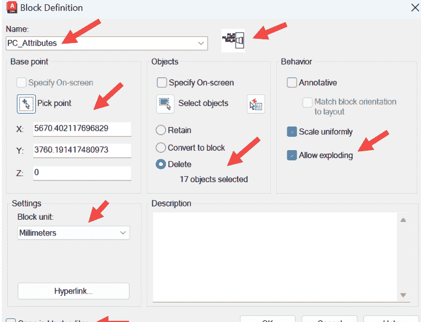

Figure 10.12: The Block Definition dialog box with settings

16. 单击确定，属性和对象就会消失。此时不要惊慌。删除选项是在块定义对话框中的对象窗格中设置的，因此组成新块的对象已被删除，但新块仍在 DWG 文件中。

17. 此时，最好保存你的绘图。然后，块虽然未显示，但已保存在 DWG 文件中。

18. 现在你需要将新创建的属性块插入到绘图中。该块是在图层 0 创建的，因此它将采用当前图层。请先确保在功能区主选项卡上的图层面板上的图层下拉菜单中，将当前图层更改为 PCS。

19. 在功能区的插入选项卡上，单击块面板上的插入下拉菜单。使用下拉菜单右侧的滑块栏，你可以找到你的新属性块 PC_Attributes，如图 10.13 所示。单击菜单上的块，然后即可将块插入到绘图中。

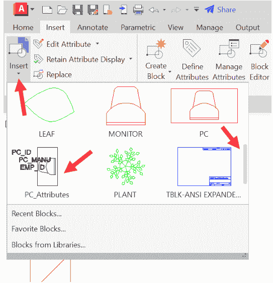

图 10.13：插入下拉菜单，其中使用箭头指出了新的属性块

20. 所选块会出现在你的光标上，你可以使用创建块时选择的插入点对其进行定位。将新块大致放置在桌子中央即可（不必过于精确，后续如需可使用对象捕捉进行调整）。图 10.14 显示了在确认位置之前块的放置情况。请注意，它正在显示属性并且位于当前图层（PCS）上。

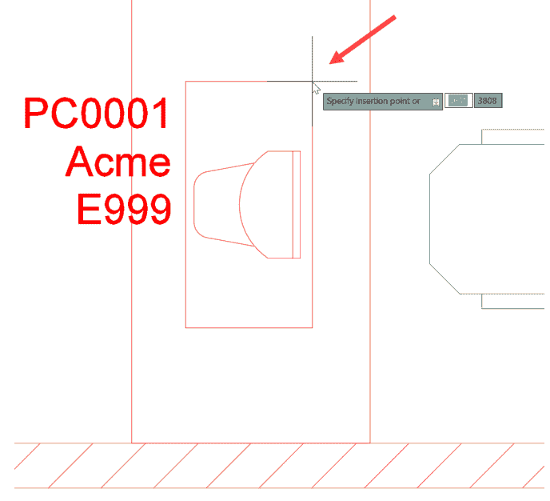

图 10.14：PC_Attributes 块在确认位置之前的样子

21. 单击后，你将确认其位置并被提示在编辑属性对话框中编辑块属性，如图 10.15 所示。请注意，提示与你在原始属性定义中设置的相同，同时显示默认属性值。

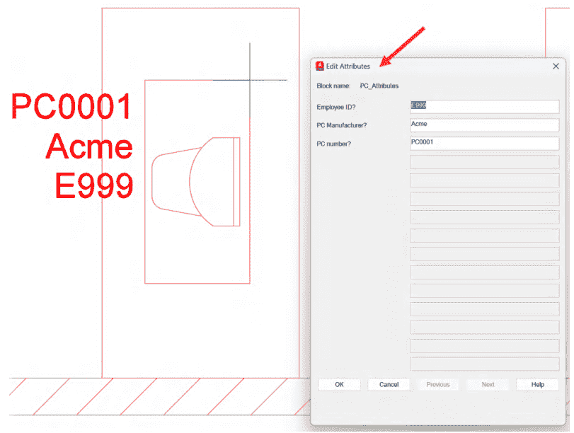

图 10.15：编辑属性对话框，准备进行任何属性编辑

22. 如需可编辑属性值。对于本次练习而言，属性值暂时保持其默认值。单击确定以关闭编辑属性对话框。你必须单击确定，因为如果像其他 AutoCAD 命令那样按 Enter，对话框不会关闭。你现在已在 AutoCAD 绘图中放置了一个属性块。

## 技巧与窍门 #30
当你将块插入到绘图中时，可能希望以各种角度旋转块。不要在确认位置后插入块，然后再使用 **Rotate**（*ROTATE*）命令进行旋转，考虑在提示输入块插入点时右键单击。你可以在快捷菜单上利用 **Rotate**（和 **Scale**）作为块插入工作流程的一部分，在截止日期临近时为你节省宝贵时间！*图 10.16 显示了块插入快捷菜单的使用情况。*

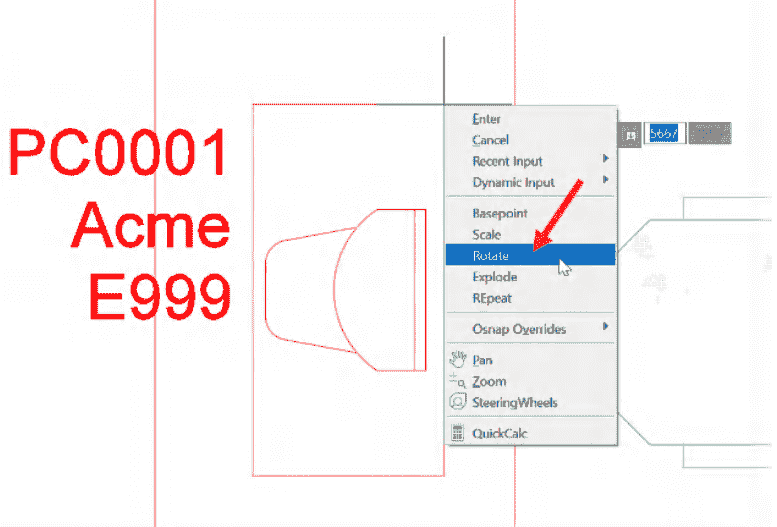

图 10.16：带有 Rotate 指示的块插入快捷菜单

右键快捷菜单包含许多命令和工具，可在处理块时使用。所有这些都能让你更具生产力，使工作流程更高效。

### AutoCAD for Mac
AutoCAD for Mac 使用 **Blocks** 调色板将块插入到绘图中，这通常是 Mac 界面的最佳方法。

在本节中，你学习了如何创建和插入带有属性的新块。块中的属性为块提供更多信息，使绘图的接收者能够看到并理解块代表什么以及携带什么数据。例如，表示门的块可以显示显示门尺寸和制造商的属性。在下一节中，你将学习如何使用增强属性编辑器编辑现有块属性。

## 使用增强属性编辑器编辑块中的属性

你应该已经从上一节打开了 New Office Design.dwg 练习文件。确保你仍已缩放至插入 PC_Attributes 块到桌子上的绘图部分。

你现在将在绘图中使用增强属性编辑器来更改显示的块属性。编辑属性有时对于在绘图中获得更高的可见性很有用，或者需要减小字体大小以提高清晰度。

你将通过以下工作流程来实现：

- 1. 将鼠标悬停在 PC_Attributes 块上，然后双击它。由于块中包含属性，增强属性编辑器将出现，如图 10.17 所示。它默认在编辑器的属性选项卡中。你现在可以编辑块中的属性，而无需炸开块并重新处理属性。

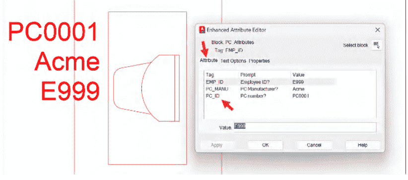

图 10.17：增强属性编辑器，属性选项卡已选中

- 2. 选择 **PC_ID** 属性，属性值将在 **Value** 字段中显示。将 **PC_ID** 属性值更改为 **PC100**。你将在编辑器中看到此更新，并在绘图中预览。

- 3. 在编辑器中选择 **Text Options** 选项卡。请注意，在编辑器顶部，你可以看到正在处理的块和属性（使用箭头指示）。你还可以使用 **Select block** 图标（也使用箭头指示）选择另一个带属性的块进行操作。所有这些都显示在 *图 10.18* 中。

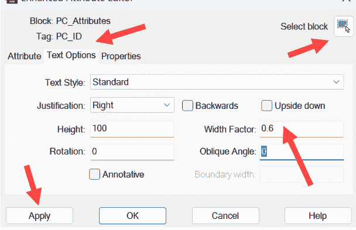

图 10.18：文本选项选项卡设置

- 4. 将 **Width Factor** 值从 `1` 更改为 `0.6`，如 *图 10.18* 所示。单击 **Apply** 以查看 **PC_ID** 属性的文本宽度发生变化。此时 *不要* 单击 **OK**。

- 5. 选择 **Properties** 选项卡。使用 **Color** 下拉菜单，将颜色更改为 **Green**，如 *图 10.19* 所示。如前所述，单击 **Apply** 以查看属性中的更改。

### AutoCAD for Mac
**Enhanced Attribute Editor** 在 AutoCAD for Mac 中以相同方式工作。

下一节将带你进入使用 **Block Attribute Manager**（*BATTMAN*）进行属性编辑的更高级别。

## 使用块属性管理器（BATTMAN）

对于本节，你可以继续使用 New Office Design.dwg 文件。然而，在我们正式开始之前，是时候来点 CAD 幽默了。块属性管理器命令称为 BATTMAN。如果你输入 BATTMAN 并按 *Enter*，你将激活 **Block Attribute Manager**。你可能不需要被告知这与某位超级英雄有关，当你为块属性苦恼时，总有一点幽默在其中；你呼叫 BATTMAN，对吧？

在本节中，你将学习如何使用 **Block Attribute Manager** 进一步编辑 PC_Attributes 块中的属性，学习更多处理块中属性的技能。让我们来看一下涉及的步骤：

- 1. 仍在 New Office Design.dwg 文件中，确保你仍已缩放至上一节中放置 PC_Attributes 块的位置。
- 2. 在没有命令运行或对象被选择的情况下，输入 BATTMAN。动态输入将自动在建议菜单上显示文本。按 *Enter*，**Block Attribute Manager** 对话框将出现在屏幕上，如 *图 10.21* 所示。

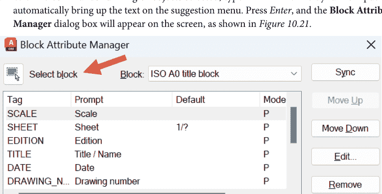

图 10.21：块属性管理器（BATTMAN）

- 3. 使用 **Select block** 图标（显示在 *图 10.21* 中），然后你可以选择你的 PC_Attributes 块。

- 4. 你将被返回到对话框，现在可以看到 PC_Attributes 块的属性显示，如 *图 10.22* 所示。

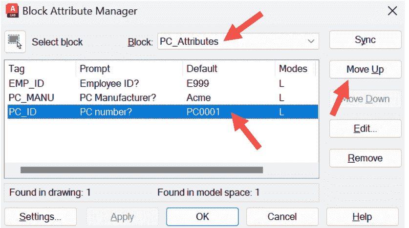

*图 10.22：块属性管理器中显示块属性*

- 5. 你可以在 **Block Attribute Manager** 对话框中执行许多块属性编辑任务，你将学习如何编辑属性在下次插入带属性的块到绘图时出现的 **Edit Attributes** 对话框中的顺序。

请注意 *图 10.22* 中属性的顺序。它们如下：**EMP_ID, PC_MANU,** 和 **PC_ID**。这就是它们在 **Edit Attributes** 对话框中显示的方式。然而，它们在块放置到绘图后显示为 **PC_ID, PC_MANU,** 和 **EMP_ID**。你将使用 **Block Attribute Manager** 重新排列它们。

6. 在属性列表中选择 **PC_ID**。在对话框中使用 **Move Up** 按钮将其移动到属性列表顶部。使用 **Move Up** 和 **Move Down** 在选择属性时，改变列表顺序，使其与 *Figure 10.23* 中显示的顺序一致。

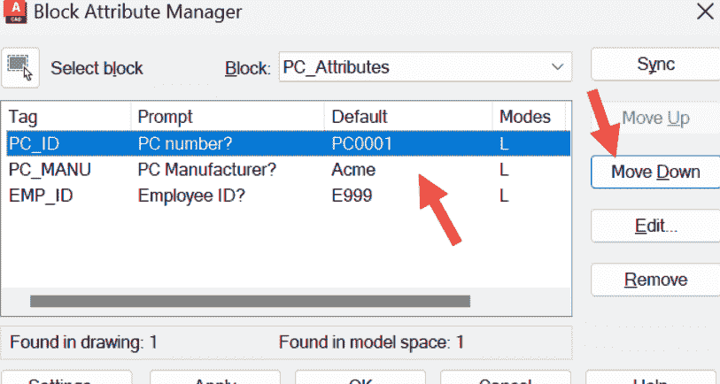

Figure 10.23: The reordered attribute list

7. 点击 **Apply** 然后点击 **OK**，确保更改已应用。**Block Attribute Manager** 现在将关闭。

8. 使用上一节学到的技能，在绘图中插入另一个 `PC_Attributes` 块的实例。你可以放置在任何位置，因为你需要查看的是属性。插入块后，可以使用对象捕捉重新定位。

9. 点击定位块后会出现 **Edit Attributes** 对话框，如 *Figure 10.24* 所示。

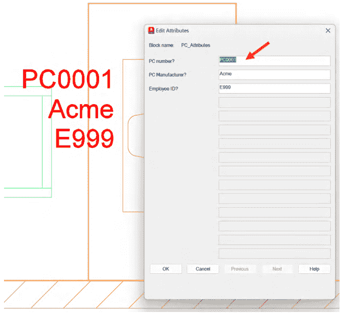

Figure 10.24: The Edit Attributes dialog box

10. Edit Attributes 对话框中的属性顺序已更改，以匹配绘图中属性的显示顺序，这是使用 Block Attribute Manager (BATTMAN) 更改的结果。这是一个很好的视觉节省时间的方法，因为你现在可以按与绘图中显示相同的顺序检查和编辑属性，从而减少错误。

### AutoCAD for Mac

Block Attribute Manager (BATTMAN) 调色板在 AutoCAD for Mac 中以相同的方式工作。

你现在可以创建和管理自己的带属性的块，从头开始开发，并将它们保存在你的 DWG 文件中。你也可以使用 Enhanced Attribute Editor 和 Block Attribute Manager (BATTMAN) 编辑和管理你的块属性。

随着你构建 AutoCAD 知识，你可以尝试使用这两种工具来开发广泛的块库，通过在第 9 章中学到的技能为你的带属性块创建块库，有效地管理你的库。

你可以在 Autodesk 网站上了解更多关于 AutoCAD 块属性的信息：

https://help.autodesk.com/view/ACD/2023/ENU/?guid=GUID-67A2DDAD-2217-412F-8AEF-D4495192F45B

你现在知道如何在 AutoCAD 块中处理、编辑和管理你的属性，并且利用 *Chapter 9* 中获得的知识，这些带属性的块可以添加到在 **Blocks** 调色板中引用的块库绘图中，或者你可以开发自己的工具调色板。

## Summary

在本章中，你学习了如何在 AutoCAD 块中创建和编辑属性，并在 DWG 文件中插入该块。

你还学习了如何使用 **Enhanced Attribute Editor** 编辑单个属性属性。此外，使用 **Block Attribute Manager** (*BATTMAN*)，你学习了如何处理和管理块属性。

当在绘图中使用带属性的块时，有效的块属性管理非常重要。信息必须准确无误，并在绘图中有效显示。

当你在大型项目上使用 AutoCAD 绘图时，本章中学到的技能将为你提供良好的基础和理解，了解如何在你的 AutoCAD 设计中开始实施带属性的块。

本章使用的工具展示了属性对于通过绘图向 CAD 团队和项目利益相关者传达块信息的重要性，从而节省宝贵时间。在下一章中，我们将更深入地研究动态块，以便你学习如何创建和管理动态块，添加参数和操作。
