# 11 Creating a Dynamic Block with Parameters and Actions

在上一章中，你学习了如何在 AutoCAD 块中创建属性。在本章中，你将了解这些块属性如何应用于你将创建的动态块。然而，你将专注于创建具有参数和操作的动态块。

正如你所知，块是由多个 AutoCAD 对象组成的用于内容重用的对象，例如椅子或桌子，以避免在绘图中重复重新制作该椅子或桌子。将椅子或桌子制作成动态块可以使块本身更具多功能性，提供快速轻松地操作块的能力。

动态块需要参数和相关的操作，因此如果你正在处理代表门的块，你可能需要添加参数和操作来控制门在绘图中门洞中的摆动方向。AutoCAD 为动态块提供了许多参数和操作，本章涵盖了一些你在绘图中开始使用它们所需的方法。

在本章中，你将学习将动态参数和操作添加到块中将使它们更具多功能性，并允许在 AutoCAD 绘图中更轻松地操作块。

本章涵盖以下主题：

- Creating the regular door block
- Adding a vertical flip to the door
- Adding a horizontal flip to the door
- Testing the new dynamic block in the drawing

### Exercise file

你需要使用练习文件 `New Office_Dynamic Blocks.dwg` 来完成本章。

### Creating the regular door block

在本节中，我们将使用 AutoCAD 对象创建一个常规门块，然后使其动态化。在 **Model** 选项卡中打开练习文件并放大到门洞。放大到门洞后，你将看到用于制作常规门块的对象。有两个对象：一个矩形多段线和一个圆弧。两者都在图层 0 (**zero**) 上。创建常规门块时，确保包含这两个对象，以便块在使用时在视觉上完整显示。你可以在 *Figure 11.1* 中看到，两个对象都被选中，并显示蓝色夹点。

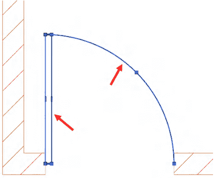

*Figure 11.1: The objects to be used to make the regular door block*

要创建门块，请按照以下步骤操作：

1. 在功能区上选择 **Insert** 选项卡，同时选择两个对象。然后，在 **Block Definition** 面板上点击 **Create Block (BLOCK)**，如 *Figure 11.2* 所示。

   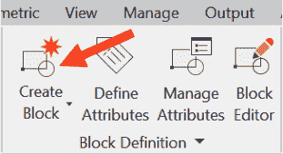

   *Figure 11.2: The Create Block (BLOCK) command on the Block Definition panel*

2. **Block Definition** 对话框将出现。在 **Name** 字段中，输入块名称 Door-DYN（*DYN* 是 dynamic 的缩写）。
3. 点击 *Figure 11.3* 中的 **Pick point** 图标。

   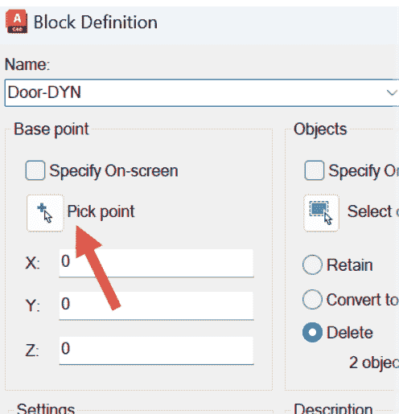

   Figure 11.3: The Pick point icon in the Block Definition dialog box

4. 你将被带入绘图以选择块的插入点。选择 Endpoint 对象捕捉，如 Figure 11.4 所示。

   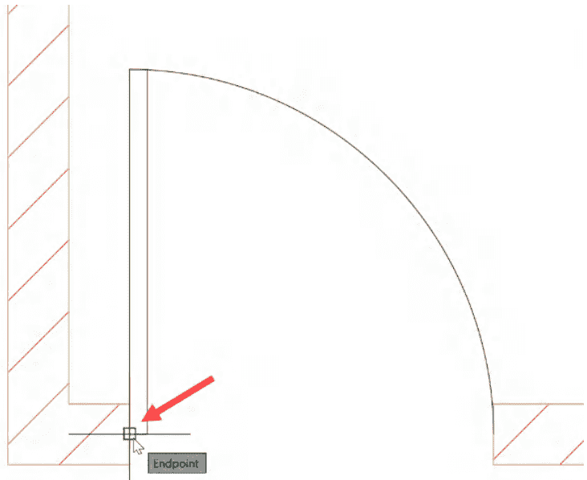

   Figure 11.4: The Endpoint object snap to be used as the insertion point

5. 点击 Endpoint 对象捕捉将使你返回到 Block Definition 对话框。请注意由于使用对象捕捉而在对话框中显示的 X 和 Y 坐标的精确度。你现在需要设置创建动态门块所需的所有设置。

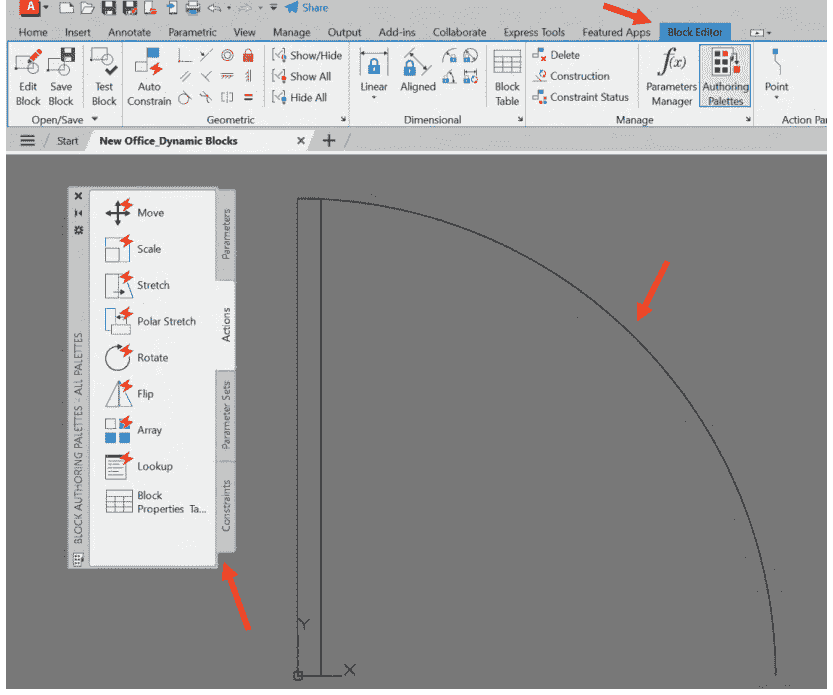

Figure 11.6: Block Editor open, ready to create the dynamic block

你的门块现已创建，准备开始添加动态参数和操作。接下来的两个部分将解释如何在 AutoCAD 中使用 Block Editor 为你的动态门块添加参数和操作。

> Tips and tricks #31
> 当选择对象以创建 AutoCAD 块时，在点击 Create Block (BLOCK) 命令之前先选择构成块的对象通常更有益。为了确保你可以这样做，你需要在 Options 对话框的 Selection 选项卡中勾选 Noun/verb selection，如 Figure 11.7 所示。你可以从应用程序菜单、右键单击快捷菜单打开 Options 对话框，或输入 OPTIONS 并按 Enter。

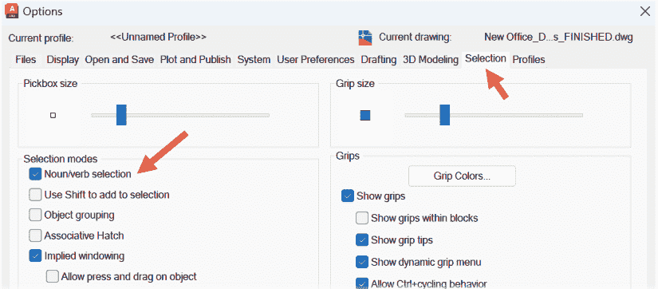

图 11.7：选项对话框中的“选择”选项卡

默认情况下，AutoCAD 选项对话框中的“名词/动词选择”应处于开启状态。在处理常规块和动态块之前，务必检查此功能是否已开启。

> AutoCAD for Mac
> AutoCAD for Mac 创建块的方法与此非常相似。“创建块（BLOCK）”命令位于左侧菜单中。

## 为门添加垂直翻转

在本章上一节的第 8 步中，你在“块定义”对话框中勾选了“在块编辑器中打开”，然后点击“确定”。这将打开 AutoCAD 中的块编辑器，如图 11.6 所示。

在本节中，你将学习如何添加垂直翻转参数并对其应用翻转动作，从而能够在绘图中翻转动态块的竖直门扇摆动。

块编辑器中的主要选项板是“块编写选项板”，在块编辑器中如图 11.8 所示。它包含创建即将添加到动态门块中的垂直翻转参数所需的全部工具。

请注意，在放置任何**翻转**参数和动作之前，需要先放置一个**基点**参数。**基点**没有相关联的动作，但正如其名，它提供一个*基点*，用于将动态块插入到绘图中。保持停留在**块编写选项板**中，按以下步骤操作：

- 1. 选择**参数**选项卡，然后选择**基点**参数，如图 11.8 中箭头所示。

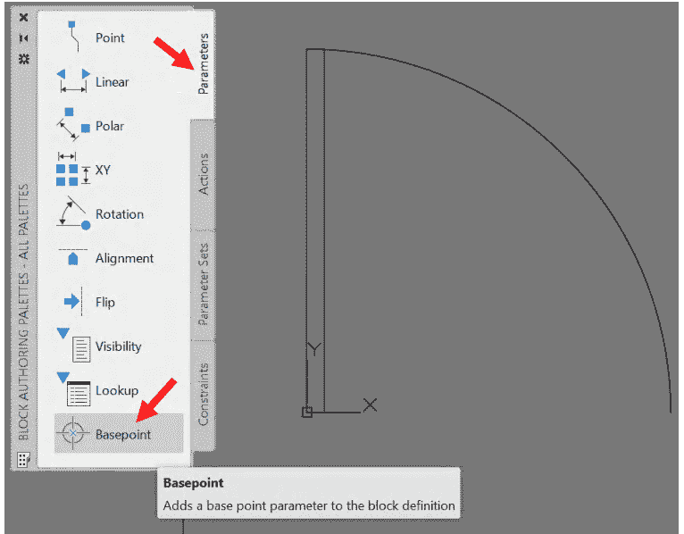

图 11.8：带有基点箭头指示的“参数”选项卡

- 2. 在提示下，选择门左下角的**端点**对象捕捉。这将在门块上显示**基点**符号，如图 11.9 所示。

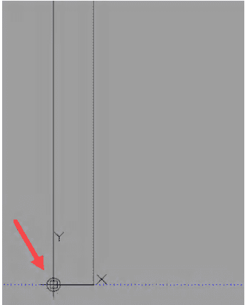

图 11.9：显示在左下角端点处的基点参数

- 3. 返回到“参数”选项卡，然后选择“翻转”参数，如图 11.10 中箭头所示。

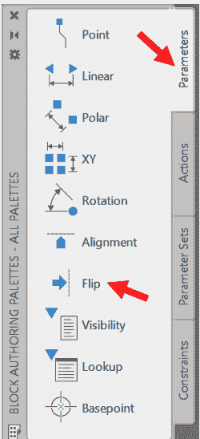

图 11.10：块编写选项板上的“参数”选项卡

- 5. 选择**两点之间的中点（M2P）**。系统会提示你指定**中点的第一点**。选择矩形左下角的**端点**捕捉，如图 11.12 所示。

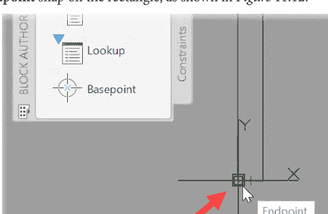

图 11.12：用作两点之间中点的第一点的端点捕捉

- 6. 随后会提示你指定第二点。使用圆弧末端的**端点**捕捉，如图 11.13 所示。

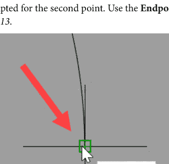

图 11.13：圆弧末端的端点捕捉

- 7. 现在你会看到，你正在使用的点正好是先前所选两点之间的中点，因此命名为**两点之间的中点**。向上移动光标，确保状态栏上的**极轴追踪**（*POLAR*）处于激活状态。将垂直反射线沿极轴追踪线向上移动，穿过并越过圆弧，如*图 11.14*所示。

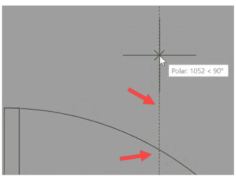

图 11.14：使用极轴追踪将垂直反射线穿过圆弧

- 8. 单击以放置垂直反射线。系统会提示你指定参数标签位置，如*图 11.15*所示。单击将标签放置在反射线附近。

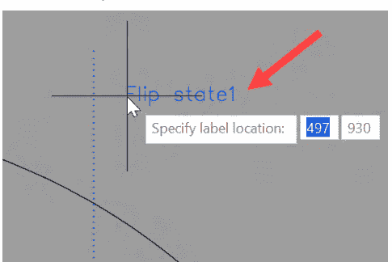

图 11.15：放置垂直反射线标签

- 9. 垂直**翻转**参数现已放置。选择该参数，右键单击，然后在快捷菜单中选择**特性**。在**特性**选项板中，将**翻转名称**属性标签重命名为 `Flip_VERT`，如*图 11.16*所示。

- 10. 按*Enter*确认名称更改，然后点击选项板标题栏上的**X**符号关闭**特性**选项板。按几次*Esc*取消选择该参数。

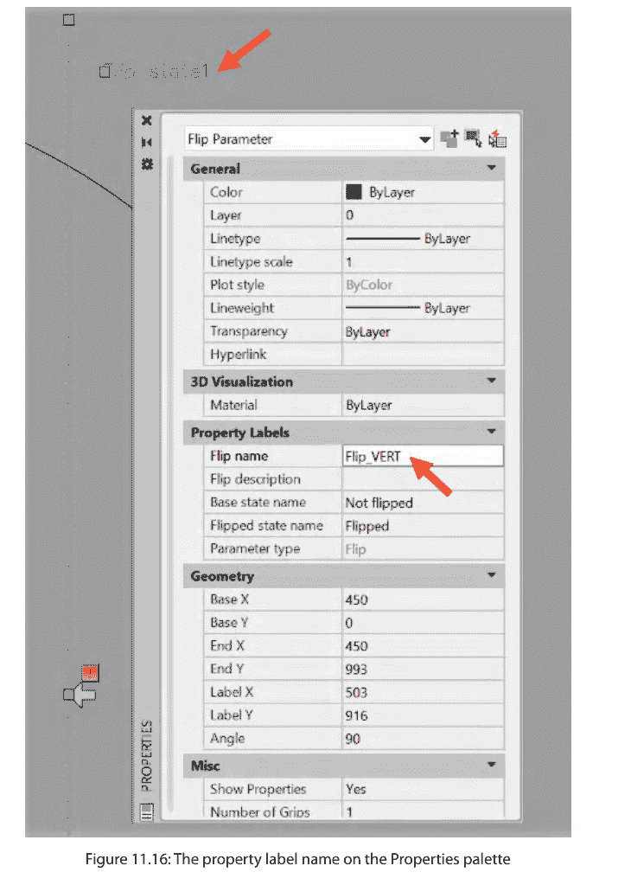

图 11.16：特性选项板上的属性标签名称

现在需要将**翻转**动作应用到该参数，如参数上显示的小黄色感叹号所示。

- 11. 选择**块编写选项板**上的**动作**选项卡，如*图 11.17*所示。其中也会显示**翻转**动作。

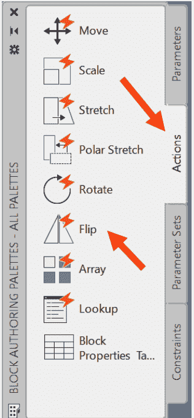

图 11.17：块编写选项板上的“动作”选项卡

- 12. 单击**翻转**动作，系统会提示你选择参数。选择 **Flip_VERT** 参数。随后会提示你选择对象。确保选择构成门块和 **Flip_VERT** 参数的*全部*对象。按*Enter*确认选择。

- 13. 小黄色感叹号消失，一个翻转动作符号出现在代表翻转参数的蓝色箭头（称为翻转夹点）旁边，如图 11.18 所示。

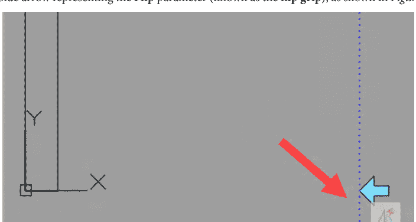

图 11.18：翻转动作已完全应用到翻转参数

现在，你已经在块编辑器中完整应用了垂直翻转参数和翻转动作。

AutoCAD for Mac
Mac 上的 AutoCAD 用户可以使用 macOS 界面应用上一节的工作流程。在 AutoCAD for Mac 中，在块编辑器中添加参数和动作的流程与之前几乎完全相同。

在下一节中，你将学习如何为动态门块应用水平翻转参数和翻转动作，从而可以在竖直和水平两个方向翻转门扇摆动。请继续停留在块编辑器中，准备进入下一节。

## 为门添加水平翻转

请继续停留在块编辑器中，执行以下工作流程，以放置水平翻转参数和动作：

- 1. 单击“块编写选项板”中的“参数”选项卡。
- 2. 按照上一节中的操作方法，选择“翻转”参数。系统会提示你指定反射线的基点。使用对象捕捉，单击门矩形左下角的“端点”，如图 11.19 所示。该点与你在“基点”参数中选择的点相同。

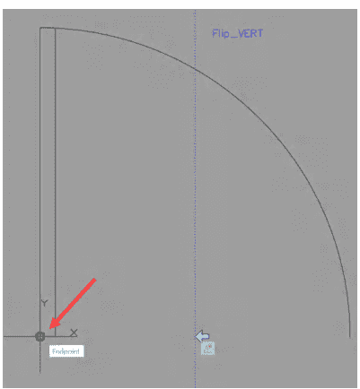

图 11.19：门矩形上的端点对象捕捉

- 3. 在提示指定反射线的第二点时，单击圆弧右下角的“端点”对象捕捉，如图 11.20 所示。

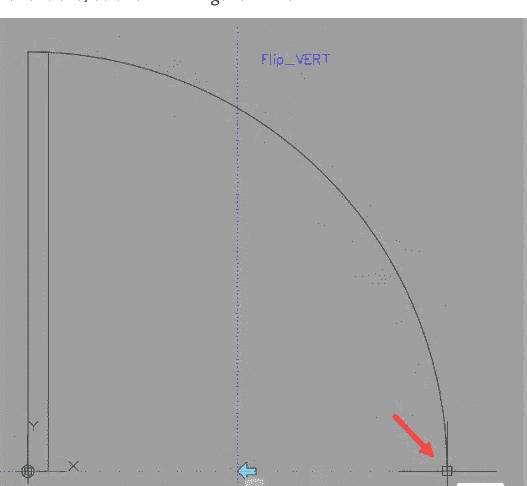

图 11.20：水平反射线的第二点

- 4. 在门圆弧右侧单击一点。系统会提示你放置默认参数标签，如图 11.21 所示。

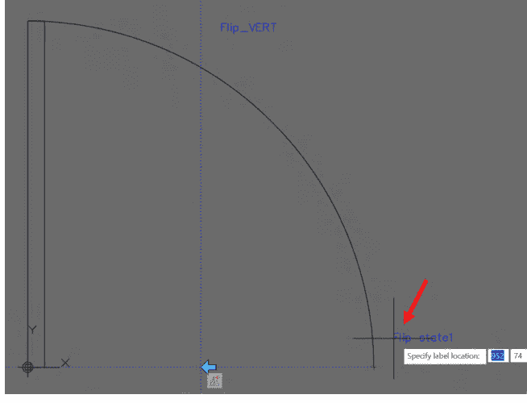

图 11.21：放置参数标签

- 5. 单击以放置参数标签。翻转夹点会出现在反射线第一点的左侧。你可以像使用任何其他 AutoCAD 夹点一样，单击该夹点并使用出现的蓝色夹点将其移动到门扇摆动的中间位置。如图 11.22 所示。

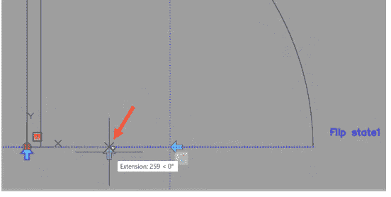

图 11.22：使用夹点重新定位翻转夹点

- 6. 重新放置好*翻转夹点*后，按几次*Esc*取消选择该夹点。

- 7. 单击参数标签并右键单击。在快捷菜单中选择**特性**，以打开**特性**选项板。在**特性**选项板中，将参数标签重命名为 `Flip_HORIZ`，如图 11.23 所示。

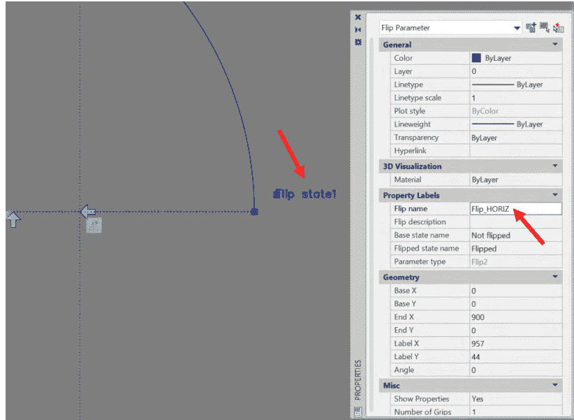

图 11.23：在特性选项板中重命名参数标签

- 8. 按*Enter*确认**特性**选项板中的新参数名称，然后关闭选项板。新参数名称将显示在**块编辑器**中。按几次*Esc*取消选择该参数。

- 9. 参数上的黄色感叹号表示需要应用动作。选择**块编写选项板**上的**动作**选项卡，然后选择**翻转**动作。

10. 在提示下，选择新的**Flip_HORIZ**参数。随后将看到**选择对象**提示，如图 11.24 所示。

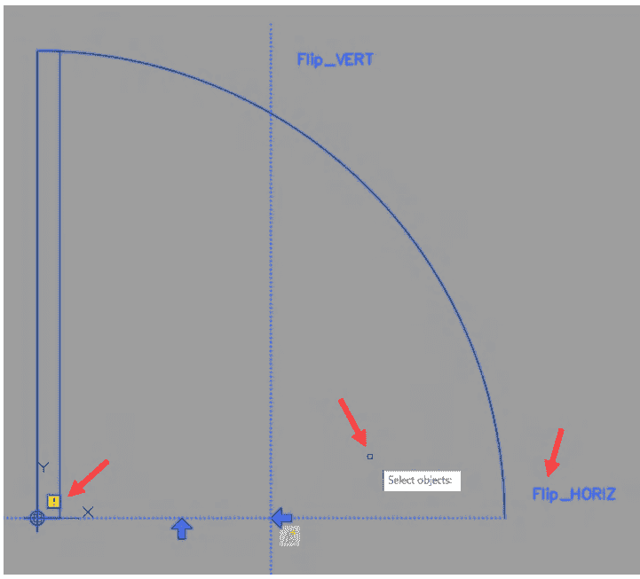

图 11.24：水平翻转动作的“选择对象”提示

11. 选择**块编辑器**中的*所有*对象，包括**基点**参数（图 11.24 中显示了全部选定对象）以及垂直**翻转**参数和动作。按 *Enter* 确认选择，此时动态门块应如图 11.25 所示。

图 11.25：块编辑器中已完成参数和动作的门块

为了确保所有参数都具有关联的动作，界面中不应显示黄色感叹号。另外，请注意已重命名的 Flip 参数：Flip_VERT 和 Flip_HORIZ。

+   12. 现在可以使用“测试块”功能测试新的动态块。在块编辑器的“打开/保存”面板中单击“测试块”，如图 11.26 所示。

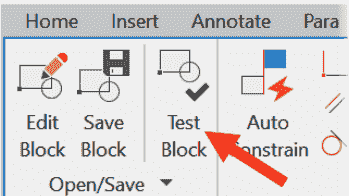

图 11.26：“打开/保存”面板中的“测试块”功能

13. 单击**测试块**后，系统会将你带到测试区域。单击门块将其选中。此时将看到两个*翻转夹点*和左下方的夹点。左下方的夹点是使用**基点**参数创建的。*图 11.27* 显示了测试区域中选定的动态门块。

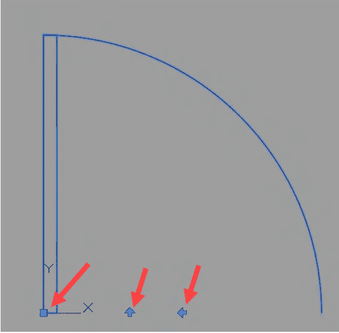

图 11.27：测试区域中选定的动态门块

14. 单击*翻转夹点*，测试它们是否都能分别在垂直和水平方向上翻转门的开启方向。测试完成后，单击功能区上的**关闭测试块**（由绿色复选标记指示）。

15. 系统将返回**块编辑器**。单击功能区上的**关闭块编辑器**（同样由绿色复选标记指示）。

16. 在提示下，选择保存对**Door-DYN**动态块所做的更改。系统将返回 AutoCAD 图形。

17. 图形中的门块现在已成为动态门块**Door-DYN**。选择该块，并使用功能区“**主页**”选项卡上的**图层**下拉列表，确保它位于**Doors**图层上。同时，将**Doors**设置为当前图层，以确保之后插入的任何块都位于适当的图层上。**Door-DYN**块应如*图 11.28* 所示。

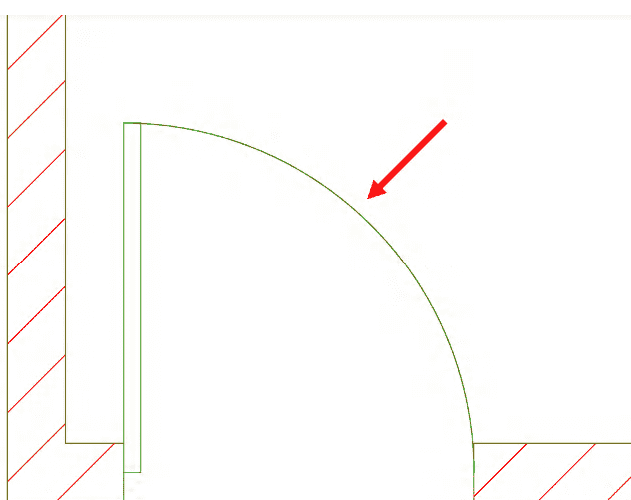

图 11.28：图形中的 Door-DYN 块

18. 按 *Esc* 键几次，确保取消选择**Door-DYN**动态块。

19. 确保保存图形，以便将块定义保存到 DWG 文件中。

现在，你已经成功创建了一个带有垂直和水平**翻转**动作的动态门块，可以在两个方向上改变门的开启方向。

## 在图形中测试新的动态块

在上一节中，你学习了如何使用**块编辑器**将普通门块转换为动态块。在本节中，你将通过在当前图层上插入该块，并使用添加到动态块中的**翻转**动作，对其进行完整测试。

以下工作流程将帮助你完整测试动态门块：

1. 在功能区的“**主页**”选项卡中，检查“图层”面板上的**Doors**图层是否为当前图层。确保已缩放到图形中门块所在的区域。

2. 选择门块并单击鼠标右键。在快捷菜单中，单击**删除**以移除块实例。现在应只剩下门洞，如*图 11.29* 所示。

图 11.29：删除块后的门洞

3. 单击功能区上的“插入”选项卡，然后单击左侧的“插入”下拉列表。你可以在图 11.30 所示的下拉列表中看到 Door-DYN 块。

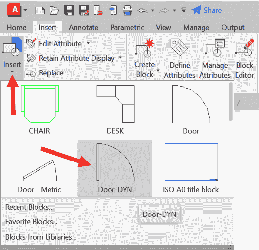

图 11.30：“插入”下拉列表中的 Door-DYN 动态块

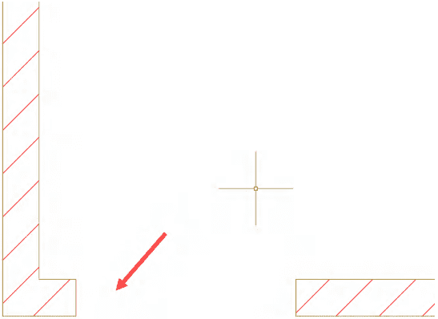

4. 在下拉列表中选择**Door-DYN**块，将其插入图形。你会看到该块跟随光标移动，并使用了设置在块左下角的**基点**参数。如*图 11.31* 所示。

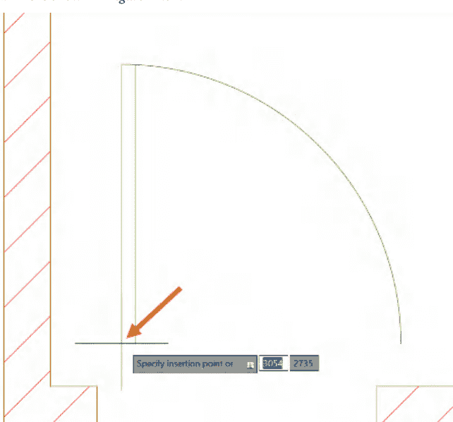

图 11.31：标示出基点参数的 Door-DYN 块

5. 将块定位到门洞左侧的**中点**对象捕捉处，如*图 11.32* 所示。单击**中点**以确认块的位置。

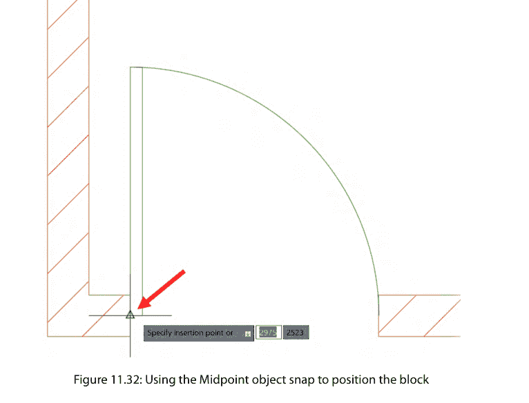

图 11.32：使用中点对象捕捉定位块

6. 现在块已定位，可以测试动态门块中的**翻转**动作。单击块将其选中，此时将显示*翻转夹点*，如*图 11.33* 所示。

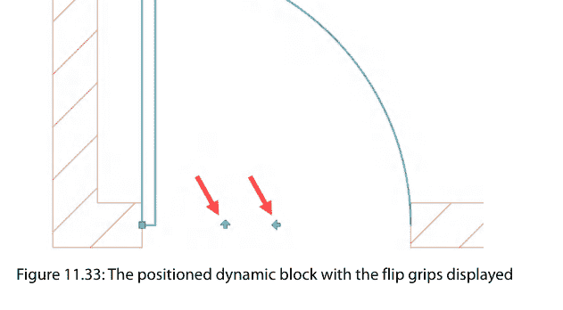

图 11.33：显示翻转夹点的已定位动态块

随着你通过本书逐步积累 AutoCAD 知识，可能会希望抽出一些时间来试验动态块及其在 AutoCAD 图形中的作用。动态块还可以与块属性结合使用，从而创建能够节省宝贵制图时间的块。

你可以在 Autodesk 网站上进一步了解 AutoCAD 中的动态块：https://help.autodesk.com/view/ACD/2024/ENU/?guid=GUID-2A3D92B8-20E2-47B3-92CE-FB3EB03888C3。

## 总结

现在，你已经了解如何使用、编辑和管理动态块。结合前面章节中学到的知识，你可以开始考虑开发块库，其中不仅包含普通 AutoCAD 块，还包含带有块属性的动态块。

在本章中，你学习了如何使用 AutoCAD 对象创建普通门块，并将该门块制作成动态块。

通过使用参数和动作，你学习了如何为普通门块添加动态功能，使其能够表示垂直和水平两种门开启方向。

随后，你在图形中测试了动态门块，以确保动态参数的功能正常。

动态块是减少繁琐编辑任务耗时的有效方式。你可以通过在块中使用动态动作，创建能够旋转、延长和翻转的动态块，而不必先选择块，再从功能区的**修改**面板中执行单一操作。

在大型项目中处理 AutoCAD 图形时，本章所学技能将帮助你充分理解：为日常 AutoCAD 工作流程和处理过程开发动态块，可以节省大量时间。

本章中使用的简单工具展示了动态块在 CAD 团队图形中的重要作用。

在下一章中，我们将更深入地研究动态块，以便你学习如何在动态块中创建和管理*可见性状态*，并添加相关参数和动作。
