# 12 创建带有可见性状态的动态块

在上一章中，你学习了如何创建一个应用了两个**翻转**动作及其关联参数的动态块。本章将教你如何创建另一个带有可见性状态的动态块。**可见性状态**允许你在同一个块中创建多个视图。例如，同一个块可能存在不同变体，如左手型和右手型办公桌。本章将介绍如何创建一个具有三种不同视图的洗手盆块：顶视图、前视图和侧视图。

正如前面章节所知，块是由多个 AutoCAD 对象组成的对象，用于重复使用内容；而动态块则为块本身提供了更大的灵活性，使你能够快速、轻松地操控块。在本章中，你将为一个动态块中的洗手盆提供不同视图，从而无需再插入具有不同洗手盆视图的其他普通块。

本章将介绍以下方法，你将需要使用这些方法在 AutoCAD 图形中处理洗手盆动态块：

- 创建洗手盆块图形
- 添加每种视图所需的块
- 在动态块中添加可见性状态
- 使用带有可见性状态的新动态块

与上一章一样，为 AutoCAD 块添加更多功能并使其动态化，可以轻松重复使用图形内容。在本例中，你将学习可见性状态如何使块能够显示所表示对象的不同视图。

## 练习文件

对于本章，你需要使用标题为 *Washbasin-DYNAMIC.dwg* 的练习文件。

## 创建洗手盆块绘制

在本节中，我们将使用 AutoCAD 对象来创建用于动态块的各个洗手盆块。首先，在 **Model** 选项卡中打开文件并放大以查看洗手盆的三个视图。你会看到用于制作常规洗手盆块的对象。从左到右，它们分别是正面、顶部和侧面。每个视图都由图层 **0**（零）上的 AutoCAD 对象组成，如 *Figure 12.1* 所示。

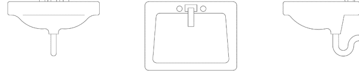

Figure 12.1: The objects to be used to make the washbasin blocks

## 添加正面块

动态块中需要创建三个可见性状态。你将首先从正面块开始。

按照以下步骤创建正面块：

- 1. 首先，你将创建由左侧正面视图构成的对象的一个常规块。选中所有对象（如下图所示，所有夹点均显示在 *Figure 12.2* 中），选择功能区的 **Insert** 选项卡。

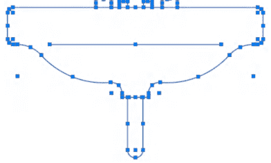

Figure 12.2: The objects for the front view selected, with grips displayed

2. 在 **Block Definition** 面板上点击 **Create Block** (*BLOCK*)，如图 12.3 所示。

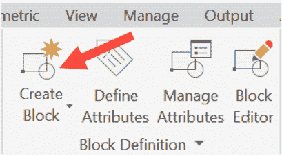

Figure 12.3: The Create Block (BLOCK) command on the Block Definition panel

3. **Block Definition** 对话框将会出现。在 **Name** 字段中，输入块名称 Washbasin_FRONT。

4. 点击如图 12.4 所示的 **Pick point** 图标。

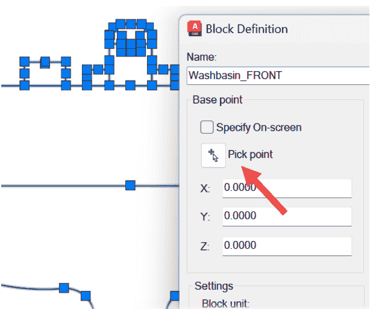

Figure 12.4: The Pick point icon in the Block Definition dialog box

5. 你将被带入绘图以选择块的插入点。选择如图 12.5 所示的 Midpoint 对象捕捉。

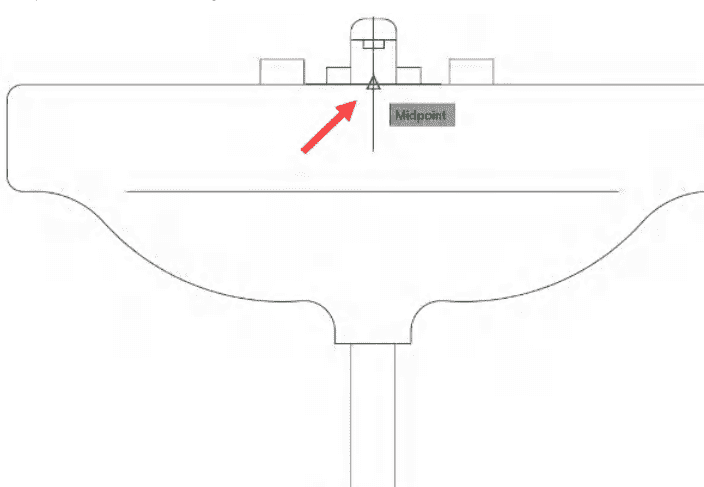

Figure 12.5: The Midpoint object snap to be used as the insertion point

6. 点击 Midpoint 对象捕捉后，你将返回到 Block Definition 对话框。注意由于使用了对象捕捉，对话框中 X 和 Y 坐标的精确度。你现在必须设置创建动态门块所需的所有设置。

7. 参考图 12.6，并在 Block Definition 对话框中按所示设置所有必要的设置。

Figure 12.6: The Block Definition dialog box with all required settings

- 8. 在对话框中设置好所有必要的设置后，点击 OK。

- 9. 对话框将关闭，你的对象现在在绘图中成为一个块引用。为了检查对象是否已转换为块，将鼠标悬停在洗手盆正面视图上，AutoCAD 将提供工具提示，如图 12.7 所示。如果该工具提示显示为 Block Reference，则说明对象已转换为块。

Figure 12.7: The Washbasin_FRONT block indicated by the tooltip

10. 多次按下 *Esc* 以确保你已取消选择块。

你现在必须执行相同的流程（*Steps 1–10*）来创建 `Washbasin_TOP` 和 `Washbasin_SIDE` 块。

## 添加顶部和侧面块

你现在需要重复该流程以添加顶部和侧面块。这些块以及正面块将构成动态块中的一个可见性状态。请按照以下步骤操作：

- 1. 重复前面针对 `Washbasin_TOP` 块的流程 *Step 1*；在点击 **Create Block** (*BLOCK*) 之前，确保你已选择构成洗手盆顶视图的对象。

- 2. 在 **Name** 字段中输入名称 `Washbasin_TOP`。

- 3. 在 **Block Definition** 对话框中使用 **Pick point** 工具时，你必须选择 *Figure 12.8* 中所示的 **Midpoint** 对象捕捉。

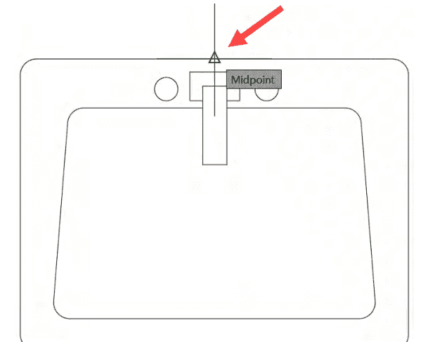

Figure 12.8: The Midpoint object snap for the Washbasin_TOP block

- 4. 检查 **Block Definition** 对话框中的其他所有设置是否与 *Figure 12.6* 中所示相匹配，然后点击 **OK**。

- 5. 将鼠标悬停在新块上以检查工具提示是否显示 **Block Reference**，如 *Figure 12.9* 所示。如果是，则你已创建了 Washbasin_TOP 常规块。

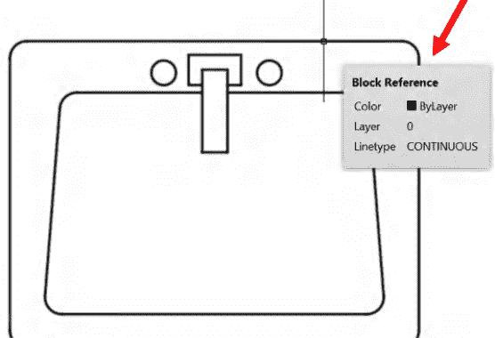

Figure 12.9: The finished Washbasin_TOP block

- 6. 再次重复从 *Step 1* 开始的块创建流程，你现在可以开始创建 Washbasin_SIDE 块。
- 7. 确保在点击 **Create Block** (*BLOCK*) 之前选择构成洗手盆侧视图的对象。
- 8. 在 **Name** 字段中输入名称 `Washbasin_SIDE`。
- 9. 该块的细节更丰富一些，在使用 **Block Definition** 对话框中的 **Pick point** 工具时，你需要考虑洗手盆拐角处的曲线。你需要选择一个 **Object Tracking** 点，因为洗手盆拐角上有曲线。
- 10. 你必须确保状态栏上的 **Polar Tracking** (*POLAR*)、**Object Snap Tracking** (*AUTOSNAP*) 和 **Object Snap** (*OSNAP*) 处于活动状态，如 *Figure 12.10* 所示。如果它们处于活动状态，将以淡蓝色显示。然后你可以使用这些绘图设置来选择所需的 **Object Tracking** 点。

Figure 12.10: The settings required on the status bar

11. 放大洗手盆侧视图对象的右上角，如 *Figure 12.11* 所示。

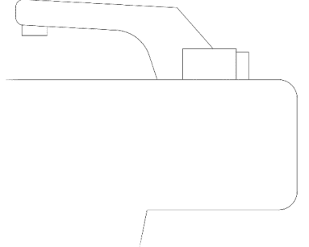

12. 在 **Block Definition** 对话框中点击 **Pick point**。

13. 将鼠标悬停在 *Figure 12.12* 所示的两个 **Endpoint** 对象捕捉上，*不要* 点击它们。将鼠标悬停在对象捕捉上会将其用作跟踪点而不是对象捕捉，从而使你能够找到所需的 **Object Tracking** 点。

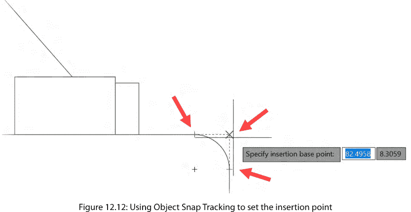

## AutoCAD for Mac

AutoCAD for Mac 使用非常相似的方法来创建具有可见性状态的动态块。Create Block (BLOCK) 命令位于左侧菜单上。

## 添加每个视图所需的块

在本章前一节中，你学习了如何制作构成洗手盆每个视图的常规块。本节将把这些块带入新的洗手盆动态块中，准备形成相关的可见性状态。

仍在 Washbasin-DYNAMIC.dwg 文件中，你现在需要按照以下步骤开始开发洗手盆动态块：

- 1. 要在 Block Editor 中创建新块，可以直接在 Insert 功能区选项卡的 Block Definition 面板上使用 Block Editor 图标，如图 12.15 所示。

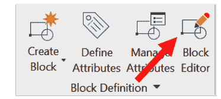

Figure 12.15: The Block Editor icon on the Block Definition panel

- 2. 你将被提示使用 Edit Block Definition 对话框编辑块定义，其中将列出之前创建的所有常规块，如图 12.16 所示。

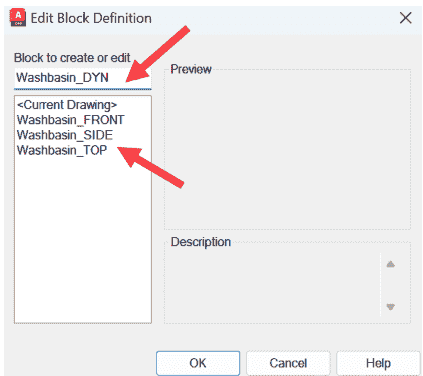

Figure 12.16: The Edit Block Definition dialog box

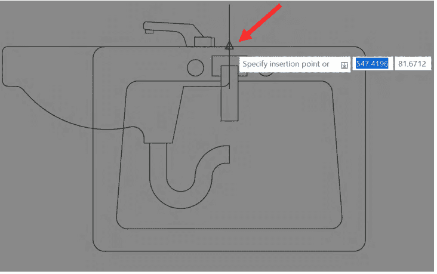

Figure 12.18: The Midpoint object snap on the Washbasin_TOP block

8. 重复从 Insert 下拉菜单开始的流程，但这次插入 Washbasin_FRONT 块。同样，在 Specify insertion point 提示时，使用 Washbasin_TOP 块上的 Midpoint 对象捕捉来放置块，如图 12.19 所示。

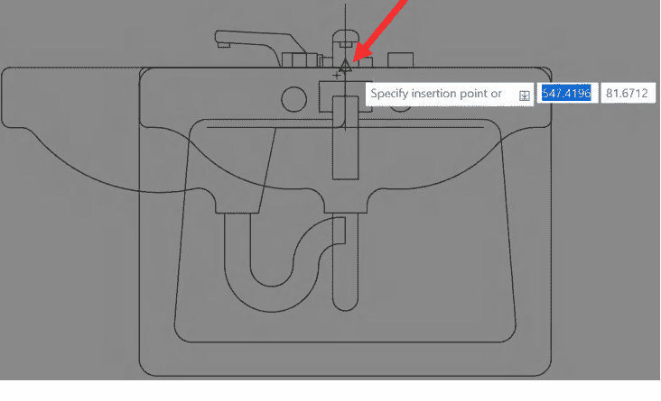

Figure 12.19: Reusing the Midpoint object snap on the Washbasin_TOP block

9. 你现在在 Block Editor 中可以看到三个常规块的 somewhat jumbled 视图，如图 12.20 所示。

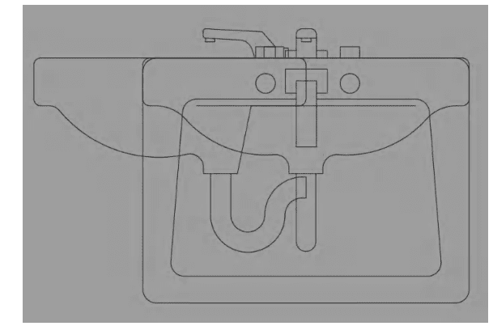

Figure 12.20: The three regular blocks placed in Block Editor

你现在已放置了三个块，并且需要开始添加可见性状态。

> **AutoCAD for Mac**
> 在 AutoCAD for Mac 中，将常规块添加到 Block Editor 的工作流程相同。

此时，仍留在 Block Editor 中并且不要保存任何内容，因为在下一节中，我们开始工作流程的第二部分，你将开始为 Washbasin_DYN 动态块添加可见性状态。

## 在动态块中添加可见性状态

在上一节中，你学习了如何将常规块插入 Block Editor，以创建新的 Washbasin_DYN 动态块。在本节中，你将为每个常规块开发相关的可见性状态，为 Washbasin_DYN 动态块中的每个块提供一个视图。所有可见性状态都存储在一个动态块中，当该动态块插入到绘图中时，你可以选择要显示的可见性状态。这节省了时间，避免了为每个洗手盆视图使用三个常规块的需要。

- 4. 在**块编写选项板**中，单击**可见性**，如图*12.22*所示。

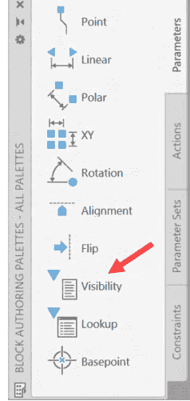

图12.22：块编写选项板，其中标出了可见性参数

- 5. 系统将提示您指定参数的位置。您需要选择一个靠近常规块但不在其正上方的点，如图*12.23*所示。这是因为**可见性**参数在图纸中使用动态块时会显示出来。

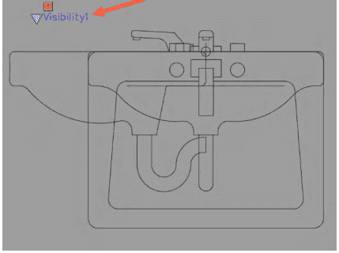

图12.23：放置在块编辑器中的可见性参数

- 6. 您会看到如*第11章*中那样的*黄色感叹号*，这意味着**可见性**参数需要更多信息才能正常工作。在这种情况下，它需要对象（常规块）来表示动态块中的每个可见性状态。您不需要为该参数命名，但可以通过选中它、右键单击并在快捷菜单中选择**特性**，然后在**特性**选项板中重命名来实现。

- 7. 查看功能区的“块编辑器”上下文选项卡（蓝色）。在*图12.24*中，找到**可见性**面板。

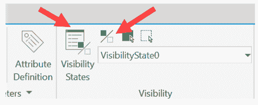

图12.24：功能区的可见性面板

在*图12.24*中，有两个箭头指向的图标。右侧箭头指向设置AutoCAD BVMODE系统变量的图标，称为**可见性模式**。单击此图标可将BVMODE设置为开（**1**）或关（**0**）。您需要将其设置为开，因为这样设置为不可见的任何可见性状态将显示为灰色，而不是完全不可见，这样处理起来更容易。如果BVMODE设置为零（**0**），则只显示当前可见性状态。随着逐步完成此工作流程，这一点会变得更清晰。单击该图标并查看命令行，如果看到BVMODE设置为**1**，如图*12.25*所示，则一切就绪。如果显示为零（**0**），请再次单击该图标将其设置为**1**。

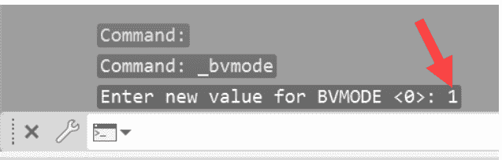

图12.25：将BVMODE系统变量设置为1

- 8. 单击图*12.24*中所示的**可见性状态**图标。

- 9. **可见性状态**对话框将显示默认的可见性状态**VisibilityState0**。单击**新建**，在**新建可见性状态**对话框中，将新状态名称设置为**Washbasin-SIDE**。将可见性选项设置为第三个选项“在新状态中保持现有对象的可见性不变”，如图*12.26*所示。

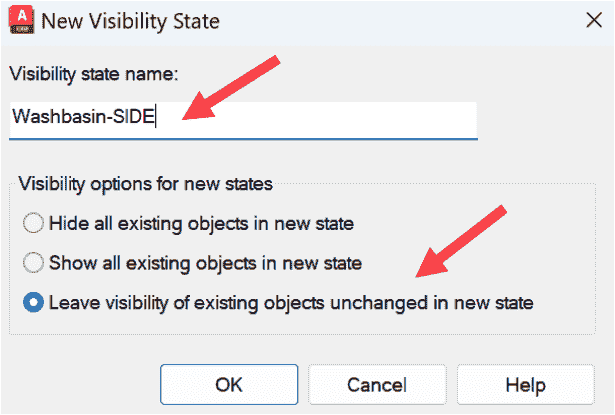

*图12.26*：新建可见性状态对话框，箭头标出设置

- 10. 单击**确定**。随后将显示**可见性状态**对话框，如图*12.27*所示。

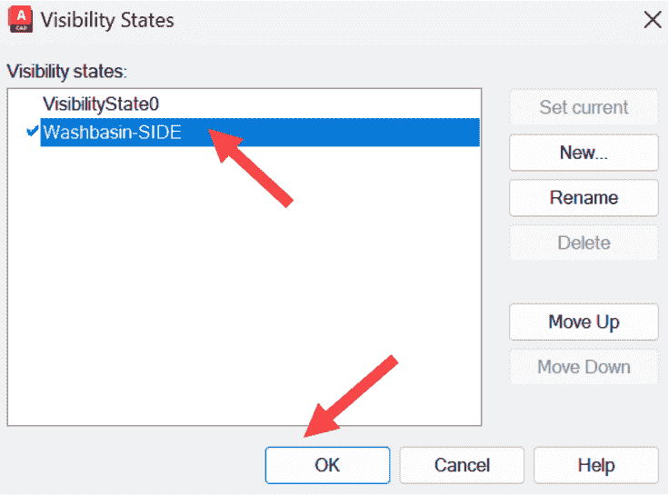

*图12.27*：可见性状态对话框

- 11. **Washbasin-SIDE**可见性状态为当前状态，如复选标记所示。现在可以选中默认状态**VisibilityState0**，并单击**删除**将其移除。

- 12. 单击**确定**关闭**可见性状态**对话框。现在处于**Washbasin-SIDE**可见性状态，需要设置哪些常规块可见或不可见。

- 13. 功能区的**可见性**面板显示当前使用的可见性状态。选中显示洗手盆侧视图的常规块，如图*12.28*所示，并单击图中的绿色方块图标。这将使该块在当前可见性状态中设置为可见。

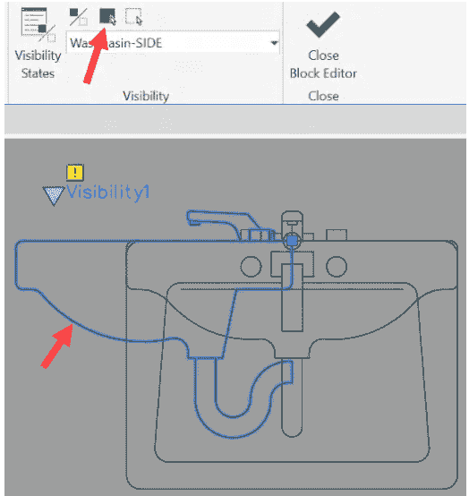

图12.28：选中的侧视图块被设为可见

侧视图将被取消选择，并且现在已在该可见性状态中设置为可见。

- 14. 选中表示顶视图和前视图的另外两个块，如图12.29所示。然后，单击图中的绿色虚线图标。这将使它们都在当前可见性状态中变为不可见。

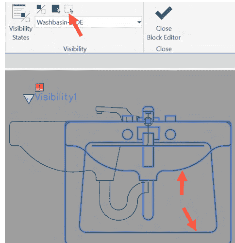

图12.29：选中另外两个块以设为不可见

- 15. 单击该图标后，这两个块将被取消选择，并且由于之前将BVMODE系统变量设置为1，它们将显示为灰色。如图12.30所示。

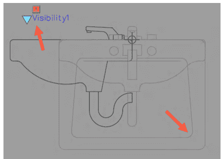

图12.30：侧视图可见的可见性状态

您会注意到仍然有一个黄色感叹号。这是因为目前只设置了一个状态。

## 添加另外两个可见性状态

还需要在动态块中设置其余两个可见性状态。本节将重复创建第一个可见性状态的过程，但您将使用另外两个常规块再创建两个可见性状态：

- 1. 再次单击**可见性状态**图标以显示**可见性状态**对话框。单击**新建**。
- 2. 在**新建可见性状态**对话框中，设置另一个状态名称**Washbasin-TOP**，使用与之前步骤9相同的选项。单击**确定**。
- 3. 在**可见性状态**对话框中，新的**Washbasin-TOP**状态现在为当前状态（带复选标记）。单击**确定**。现在需要重复可见/不可见的过程。
- 4. 确保**可见性**面板中的当前状态为**Washbasin-TOP**。然后，选中显示洗手盆顶视图的常规块，如图12.31所示。单击图12.31中所示的绿色图标，使其在当前状态中可见。

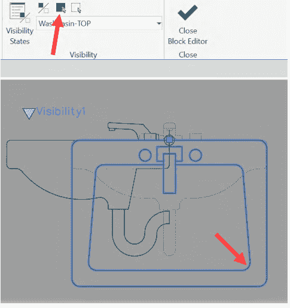

图12.31：将顶视图设置为可见

- 5. 顶视图块将自动取消选择，并已在**Washbasin-TOP**可见性状态中设置为可见。请注意，黄色感叹号已消失，因为现在有不止一个可见性状态了。
- 6. 和之前一样，必须选中表示洗手盆侧视图和前视图的块，然后在**可见性**面板中单击绿色虚线图标将它们标记为不可见。
- 7. 同样，它们将自动取消选择。现在它们已在**Washbasin-TOP**可见性状态中被标记为不可见并显示为灰色，如图*12.32*所示。

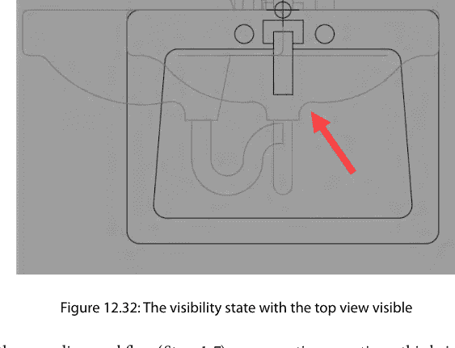

图12.32：顶视图可见的可见性状态

- 8. 再重复上述工作流程（*步骤1-7*）一次，创建第三个可见性状态**Washbasin-FRONT**，其中显示洗手盆前视图的块为可见状态。
- 9. **Washbasin-FRONT**可见性状态应如图*12.33*所示，其中显示前视图的块可见，另外两个侧视图和顶视图块不可见（灰色）。

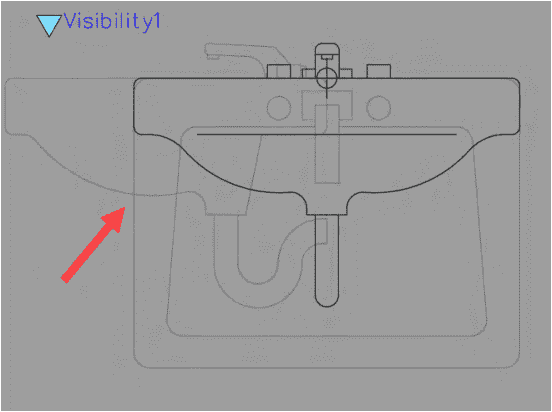

图12.33：前视图可见的可见性状态

要在可见性状态之间切换，可以使用**可见性**面板上的下拉菜单设置当前状态，如图*12.34*所示。

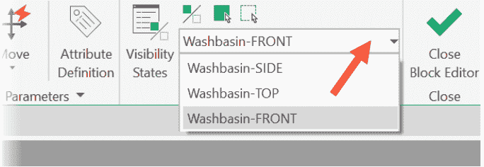

图12.34：可见性状态下拉菜单

现在，您已经在**Washbasin_DYN**动态块中设置了所需的全部三个可见性状态。

- 10. 单击**关闭块编辑器**（功能区上的绿色对勾）以关闭**块编辑器**并返回图纸。

- 11. 离开**块编辑器**并返回图纸后，将出现一个提示。务必选择**保存对Washbasin_DYN的更改**。

现在您回到了Washbasin-DYNAMIC.dwg文件，可以看到之前创建的常规块，它们在新动态块中用作可见性状态。

确保保存图纸，以便将新的动态块保存到DWG文件中。

**AutoCAD for Mac**

在Mac版AutoCAD中，在**块编辑器**中添加可见性状态的工作流程相同。

现在，您已创建了带有可见性状态的新**Washbasin_DYN**动态块。在本章的下一节中，您将把该块插入到图纸中，并使用可见性状态来显示洗手盆的不同视图。

## 使用带有可见性状态的新动态块

在上一节中，您学习了如何使用常规块在新动态块中创建洗手盆不同视图的可见性状态。在本节中，您将学习如何将新动态块插入到图纸中并利用可见性状态。

在本章中，您一直在默认图层（图层0）上工作。这意味着插入图纸时，新动态块将采用当前图层。以下工作流程将让您充分测试动态洗手盆块：

- 1. 在功能区的**常用**选项卡上，确保**图层**面板中的当前图层为**Sanitary**。
- 2. 使用缩放和平移功能，确保在远离现有块的空间中工作。
- 3. 单击功能区的**插入**选项卡，然后点击左端的**插入**下拉按钮。*图12.35显示了下拉列表中的**Washbasin_DYN**块。*

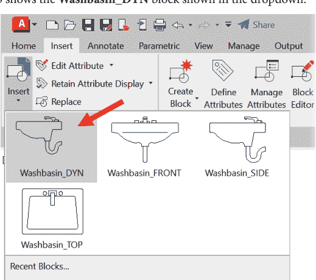

图12.35：插入下拉列表中的Washbasin_DYN动态块

4. 从下拉菜单中选择 **Washbasin_DYN** 块以将其插入到图纸中。该块将出现在光标上。您会看到动态块已采用第一个当前可见性状态，即 Washbasin-SIDE 视图，如图 12.36 所示。稍后可以（如果需要）更改此状态。

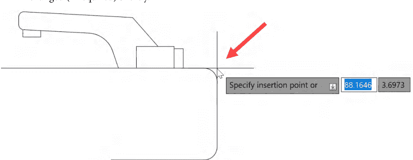

图 12.36：插入的 Washbasin_DYN 块，当前显示 Washbasin-SIDE 视图

5. 选择一个点来插入 **Washbasin_DYN** 块。放置后，单击该块以将其选中，如图 12.37 所示。

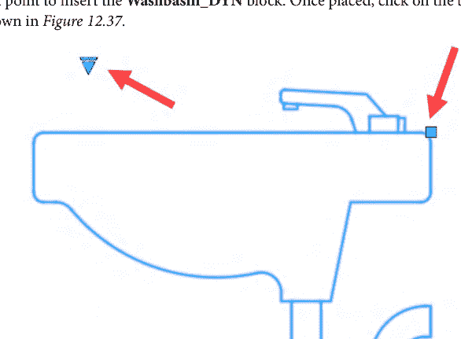

图 12.37：选中的 Washbasin_DYN 动态块

请注意，选中的块有两个蓝色夹点。右侧的*方形*夹点是您在**块编辑器**中添加的**基点**参数。左侧的*箭头*夹点用于动态块内部设置的可见性状态。

6. 单击箭头夹点以显示可用的可见性状态，如*图 12.38*所示。

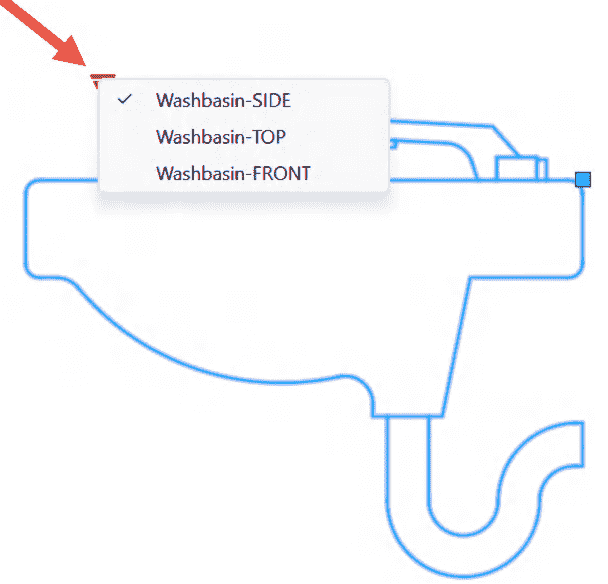

图 12.38：已放置的动态块，并显示可见性状态

7. 在*图 12.38*显示的菜单中，选择 **Washbasin-TOP** 可见性状态。块视图将变为洗手盆的俯视图，如*图 12.39*所示。

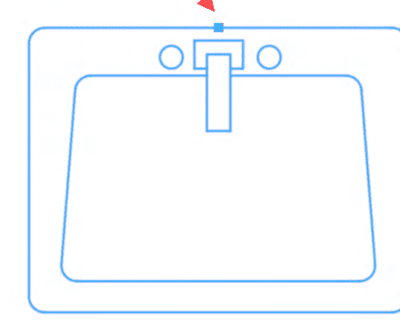

图 12.39：使用 Washbasin-TOP 可见性状态的 Washbasin_DYN 动态块

现在，您可以使用箭头夹点上的菜单切换可见性状态。这可以在绘图时节省宝贵的时间，因为您现在在一个动态块中拥有了三个常规块视图，它们都代表同一个绘图对象——洗手盆。

恭喜！您现在已经创建了一个带有可见性状态的动态块。随着您不断积累 AutoCAD 知识，您可能需要留出一些时间尝试使用可见性状态的动态块。考虑将它们与块属性结合使用，以创建节省宝贵绘图时间的动态块。

您可以在 Autodesk 网站上详细了解带有可见性状态的动态块：https://help.autodesk.com/view/ACD/2024/ENU/?guid=GUID-B30B3B47-F93B-487E-998F-2E8C72D22CBD。

带有可见性状态的动态块是减少冗长编辑任务时间的绝佳方式。您还可以开发带有可见性状态的动态块族。一个很好的例子是某种特定类型的固定螺栓，具有不同的长度或螺纹，并为每种长度或螺纹设置一个可见性状态。在这种情况下，您还可以考虑长度参数。

**AutoCAD for Mac**
在 AutoCAD for Mac 中，使用相同的工作流创建带有可见性状态的动态块。

## 3.1 原子结构模型

早在1803年，英国科学家道尔顿提出了原子论，他认为原子是组成物质的最小微粒，原子在化学反应中不可再分。

1897年，英国科学家汤姆生发现了电子，并提出了“葡萄干面包”模型，他认为原子是一个球体，正电荷均匀分布在整个球体内，电子镶嵌其中。

1911年，英国科学家卢瑟福进行了α粒子散射实验后，提出了“行星模型”，他认为原子中心有一个带正电荷的原子核，电子在原子核外空间绕核运动。

卢瑟福的“行星模型”不能解释原子发光等现象，1913年，丹麦科学家玻尔改进了“行星模型”，提出了“电子分层模型”，认为电子在原子核外一定轨道上分层排布。

现代科学家认为，原子中心有一个带正电荷的原子核，原子核由质子和中子构成，电子在原子核外高速运动。电子在原子核外的运动是不规律的，但在一定的区域内出现，这些区域称为“电子层”。
