# 13 共享您的 AutoCAD 图纸

在前面的章节中，您学习了如何使用块、属性和动态块来重用图纸中的设计内容。本章将教您如何与 AutoCAD 用户以及可能需要对图纸中的设计进行标记和评论的非 AutoCAD 用户共享 AutoCAD 图纸文件。

共享图纸和图纸视图将使您能够利用互联网和云的力量实时共享设计的各个方面。通过提供更加动态的图纸修订路径，这可以节省宝贵的图纸管理和协作时间。

AutoCAD 有几种共享图纸的方法，可轻松进行协作、修订和设计更改。在本章中，您将了解“共享图纸”和“共享视图”如何让您的日常 AutoCAD 工作流和流程更加快捷，从而实现更快、更高效的协作。您可以使用“共享图纸”（SHARE）命令通过 AutoCAD 的基于浏览器的版本（AutoCAD Web）共享图纸。您还可以使用“共享视图”选项板，通过 Autodesk Viewer 提供图纸视图，并允许添加评论和标记。

简而言之，本章将讨论以下主题：

- 使用“共享图纸”工具
- 在 AutoCAD Web 中处理共享图纸
- 使用“共享视图”选项板
- 在 Autodesk Viewer 中处理共享视图

## 练习文件和要求

对于本章，您需要使用 New Office Design_FINISHED.dwg 练习文件。在“模型”选项卡中打开该文件，确保您可以看到完整的平面图。

您还需要确保已使用 Autodesk 帐户登录 AutoCAD。如果您没有 Autodesk 帐户，可能需要在此处设置一个：https://accounts.autodesk.com/。本章假定您拥有 Autodesk 帐户并且已登录。

## 使用“共享图纸”工具

“共享图纸”工具用于快速、轻松地将图纸实时共享到 AutoCAD Web 进行查看或编辑。您可以在两个位置找到“共享图纸”（SHARE）工具：功能区“协作”选项卡的“共享”面板中，以及（很方便）快速访问工具栏（QAT）上，如图 13.1 所示。

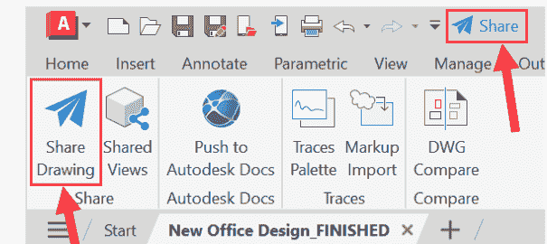

图 13.1：位于功能区“协作”选项卡和 QAT 上的“共享图纸”工具

在以下练习中，您将学习如何利用“共享图纸”工具通过云与 AutoCAD Web 应用程序共享图纸：

- 1. 您可以单击图 13.1 中所示的两个图标中的任意一个来激活“共享图纸”（SHARE）命令。这将创建一个 URL，用于在 AutoCAD Web 中共享 DWG 文件，并为您提供一个对话框，如图 13.2 所示。

## 共享此绘图的链接

共享此绘图当前版本的副本，包括外部参照。接收者可以使用网络版 AutoCAD 或移动版 AutoCAD 打开链接。了解更多

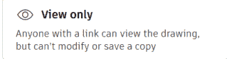

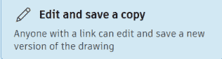

https://web.autocad.com/acad/me/sid/shares/drawings/a385cf71-...
链接在七天后过期

图 13.2：“共享此绘图的链接”对话框

共享图纸可以设置两个不同级别的权限：

- **仅查看**：这表示任何收到此链接的人都可以查看图纸，但不能修改或编辑图纸。他们也无法保存图纸副本。
- **编辑并保存副本**：这表示任何收到链接的人都可以修改和编辑图纸，也可以保存图纸副本。

如果您在对话框中单击这两个选项中的任何一个，您会看到对话框中的 `https://` 链接发生变化。另外，请注意链接在发送后七天内有效。**复制链接**按钮的功能正是如此。它会复制 `https://` 链接，供您插入到电子邮件客户端、文档甚至文本消息中。

- 2. 如果您已登录 Autodesk 帐户，请单击对话框中的**预览**，您将自动被带到新的浏览器页面，其中图纸显示在 AutoCAD Web 中，如*图 13.3*所示。

2. 将出现**“另存为”**对话框，如*图13.6*所示。单击**“新建文件夹”**，为您的共享图形创建一个新文件夹。

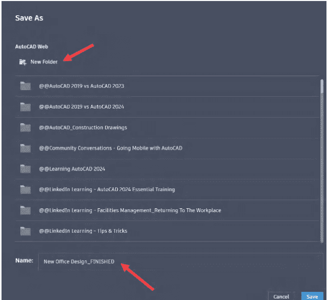

图13.6：用箭头指向“新建文件夹”的“另存为”对话框

3. 将新文件夹命名为`New Office Design`，如*图13.7*所示。

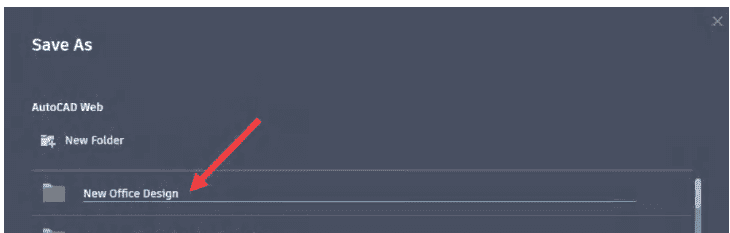

图13.7：将新文件夹命名为 New Office Design

4. 双击列表中的新文件夹，它将打开该文件夹，并显示其中不包含任何文件。

5. 在**“名称”**字段中，将共享图形重命名为`New Office Design_DESIGN1`。AutoCAD Web 知道这是一个 DWG 文件，因此不会显示 DWG 后缀。

6. 单击**“保存”**按钮，共享图形现在将以新文件名保存到新文件夹中。您可以在 AutoCAD Web 屏幕的左上角看到这一点，如*图13.8*所示。

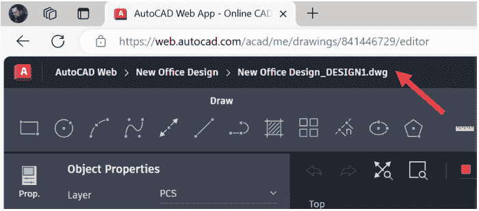

图13.8：AutoCAD Web 中新保存的共享图形的名称和位置

共享图形现在已成为新文件夹中的一个新图形，并根据共享时设置的权限进行保存。您现在可以编辑该图形、进行修改并保存这些更改。

> **提示与技巧 #33**
> 
> 由于您通过 Autodesk 账户登录 AutoCAD Web，因此通过 AutoCAD Web 保存的任何图形都将保存到与您的 Autodesk 账户关联的默认**AutoCAD Web 和移动设备文件夹**中。您还可以使用其他基于云的提供商，例如 Autodesk Drive、Microsoft OneDrive、Google Drive、Dropbox 和 Box。要访问这些提供商，请单击**AutoCAD Web**屏幕左上角的*红色*AutoCAD 图标，以重新定位您想要保存图形的位置。请务必在保存图形*之后*执行此操作。您还可以通过 AutoCAD 桌面应用程序，使用 QAT 上的图标访问**AutoCAD Web 和移动设备文件夹**中已保存的图形。

1. AutoCAD Web 使用与 AutoCAD 桌面应用程序类似的界面，因此请使用鼠标放大左上角的办公室隔间，然后点击椅子将其选中。椅子将高亮显示并显示插入夹点，如*图13.9*所示。

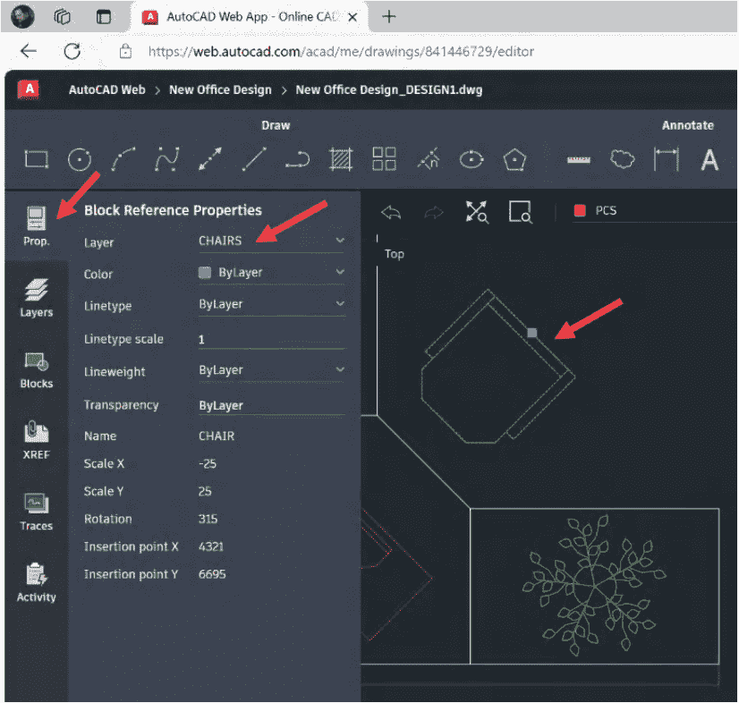

AutoCAD Web 左侧的默认选项卡是**“属性”选项卡（Prop.）**。选中该选项卡并选中椅子块后，您可以看到椅子位于**CHAIRS**图层上，并且由于此时选中了一个块，**“属性”**选项卡显示**“块参照特性”**。

2. 如图13.10所示，单击图层下拉列表并选择 Furniture 图层。请注意，绘图区域上方还有另一个图层下拉列表（也用箭头标出）。该下拉列表可用于设置当前图层，在本例中为 PCS。请务必使用“属性”选项卡中的图层下拉列表。

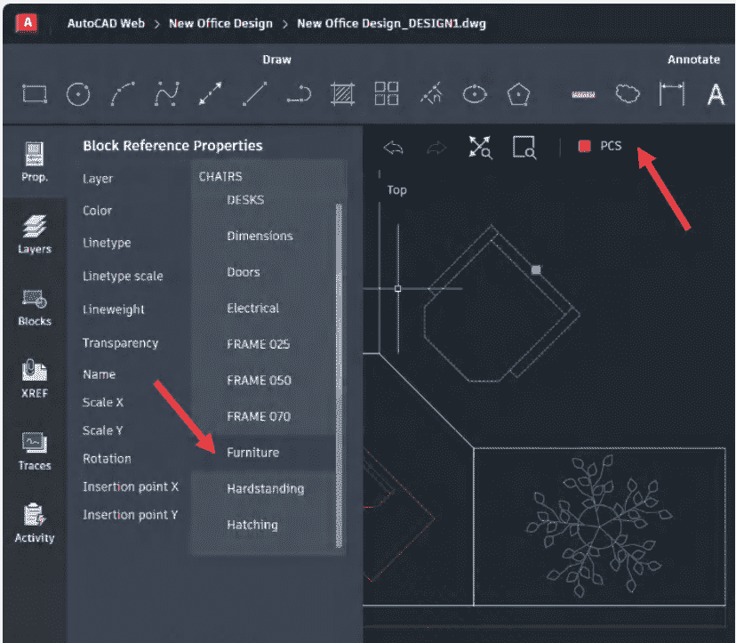

图13.10：“属性”选项卡中的图层下拉列表

当您将椅子的图层更改为 Furniture 时，您会发现椅子块的颜色不会改变。这是因为块设置的原因。您可以按几次 Esc 键取消选择该块，然后再次点击椅子来检查这一点。

3. 点击**“保存”**（右上角）保存图形，如*图13.11*所示。您还可以通过点击**“保存”**按钮旁边的下拉箭头访问**“另存为”**。保存图形时会稍有停顿。

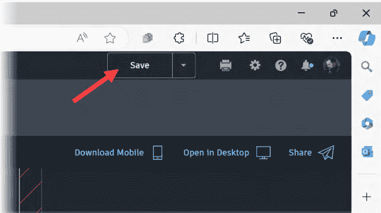

图13.11：AutoCAD Web 中的“保存”按钮

现在，您已按照最初从 AutoCAD 桌面应用程序共享时授予的权限，在 AutoCAD Web 中保存、编辑并重新定位了共享图形。

4. 如果您返回到 AutoCAD 桌面应用程序，并点击 QAT 上的**“从 Web 和移动设备打开”**（*OPENFROMWEBMOBILE*）图标（参见*图13.12*），您可以从新位置打开已保存的共享图形。

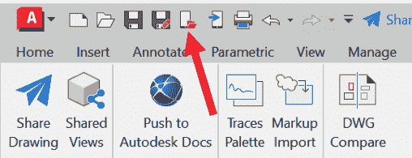

图13.12：QAT 上的“从 Web 和移动设备打开”图标

5. 在“从 AutoCAD Web 和移动设备打开”对话框中，选择最近创建的 New Office Design 文件夹，然后点击“打开”，如图13.13所示。

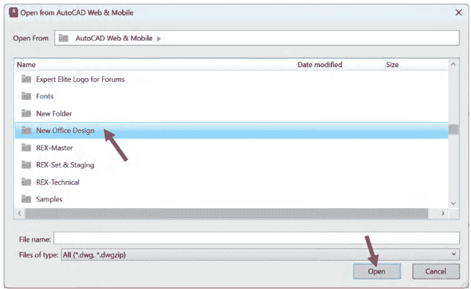

图13.13：“从 AutoCAD Web 和移动设备打开”对话框

6. 进入 New Office Design 文件夹后，您将看到您的新图形文件，如图13.14所示。

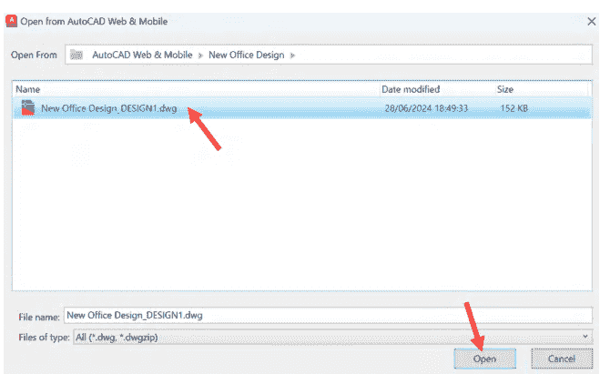

图13.14：New Office Design 文件夹中的新图形

7. 选择图形文件并点击**“打开”**。该图形将在 AutoCAD 桌面应用程序中打开。

8. 像在 AutoCAD Web 中那样，放大左上角办公室中的椅子。

9. 选择椅子，并检查功能区的**“默认”**选项卡上的**“图层”**面板。

10. 您将看到椅子位于**Furniture**图层上，这与在 AutoCAD Web 中编辑时保存的图层一致，如*图13.15*所示。

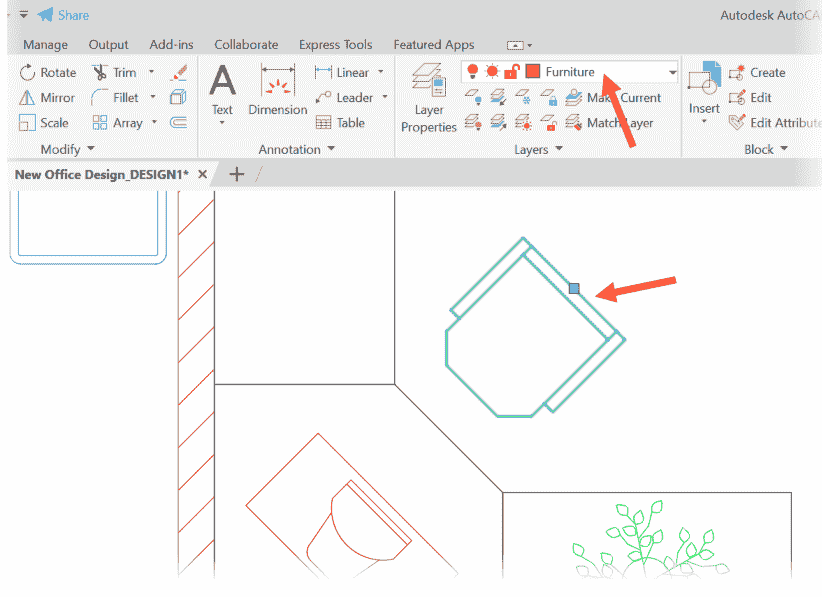

图13.15：在 Autodesk 桌面应用程序中选中的椅子

> **适用于 Mac 的 AutoCAD**
> 
> 您还可以使用共享**“图形（SHARE）”**工具，在 AutoCAD for Mac 中按照相同的工作流程共享图形。

## 使用“共享视图”选项板

在本章的第一节中，您学习了如何使用**“共享图形（SHARE）”**工具共享图形。还有一种使用**“共享视图”**选项板共享图形视图的方法。

共享视图是使用基于浏览器的 Autodesk Viewer 与您的 AutoCAD 图形进行协作的另一种方法。您可以随时在`https://viewer.autodesk.com`找到查看器。Autodesk Viewer 并非 AutoCAD 专用，并且可以查看多种文件格式，包括 AutoCAD DWG 文件格式。在处理使用多平台文件格式的项目时，它非常有用，允许非应用程序用户查看文件、进行标记并就设计发表评论。

让我们回到`New Office Design_FINISHED.dwg`文件。在本章接下来的两节中，您将使用此文件。此外，请确保您已在 AutoCAD 和 Autodesk Viewer 中登录您的 Autodesk 账户（您稍后将登录 Autodesk Viewer）。

现在，您需要按照以下步骤开始使用**“共享视图”**选项板进行协作：

1. 在**“模型”**选项卡中打开图形文件后，转到功能区上的**“协作”**选项卡。您将在**“共享”**功能面板上找到**“共享视图”**图标，如*图13.16*所示。

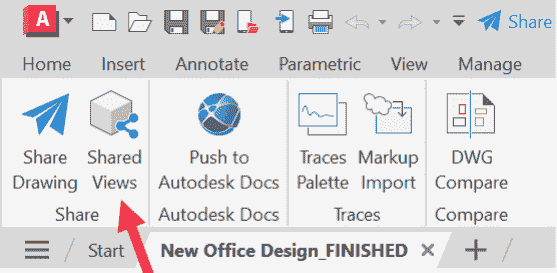

图13.16：“共享”功能面板上的“共享视图”图标

336 共享您的 AutoCAD 图形

2. 点击**“共享视图”**图标后，将出现**“共享视图”**选项板，如*图13.17*所示。

请注意，如果此时您未登录 Autodesk 账户，系统将提示您登录。通常不需要此操作，因为大多数较新版本的 AutoCAD 都是基于订阅的，您应该已经登录。

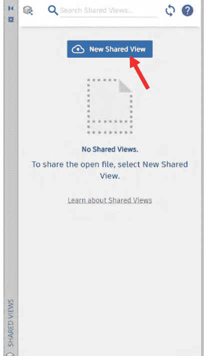

图13.17：“共享视图”选项板

3. 打开后，选项板中不会显示任何共享视图，因此请点击**“新建共享视图”**按钮，如*图13.17*所示。

4. 将出现“共享视图”对话框，如图13.18所示。

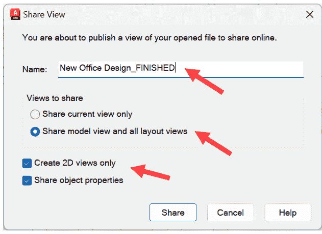

图13.18：“共享视图”对话框

5. 您的图形名称将显示在“名称”字段中。您可能希望更改此文件名，以表明这是一个共享图形文件，因此请将其更改为 New Office Design_SHARED。

6. 在设计开发过程中，您可能只需要共享图形中的当前视图（例如“模型”选项卡），在这种情况下，您可以选择“仅共享当前视图”。在本例中，请务必选择“共享模型视图和所有布局视图”，以查看它如何影响 Autodesk Viewer 中的视图。

7. 要共享的图形是 2D 图形，因此请确保选中“仅创建 2D 视图”。如果处理的是 3D 模型，则不应选中此项。

8. 选择“共享对象特性”非常有用，因为它允许协作者查看正在使用哪些图层，这可能是标准检查所需要的。如果不需要，可以将其关闭。

9. 设置就绪后，点击“共享”按钮。

- 10. 您将收到一条提示，告知共享视图的后台处理即将开始，如*图13.19*所示。点击**继续**。请注意，如果需要，您可以勾选**下次不再显示此消息**复选框，以便下次跳过此提示。

  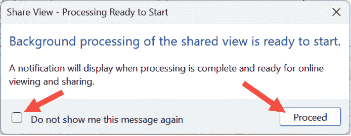

  图13.19：开始共享视图后台处理的提示

- 11. 点击**继续**后，状态栏（右下角）会出现一个新图标，显示处理进度，如*图13.20*所示。这可能需要一些时间，具体取决于互联网/云带宽和速度。

  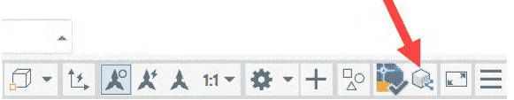

  图13.20：状态栏上的后台处理图标

- 12. 共享视图处理完成后会出现一个提示，如*图13.21*所示。点击**在浏览器中查看**链接，即可在默认浏览器中的 Autodesk Viewer 中打开共享视图。

  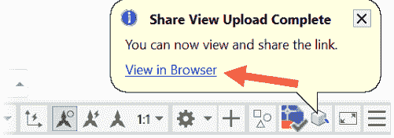

  图13.21：确认后台处理完成的提示

- 13. 现在，您已经在 Autodesk Viewer 中打开了共享视图图纸。请注意查看器中文件的名称，如*图13.22*所示。现在它显示为 `New_Office_Design_SHARED_collaboration`。此外，请确保您已使用 Autodesk 账户登录查看器，以启用 Autodesk Viewer 的全部功能。

  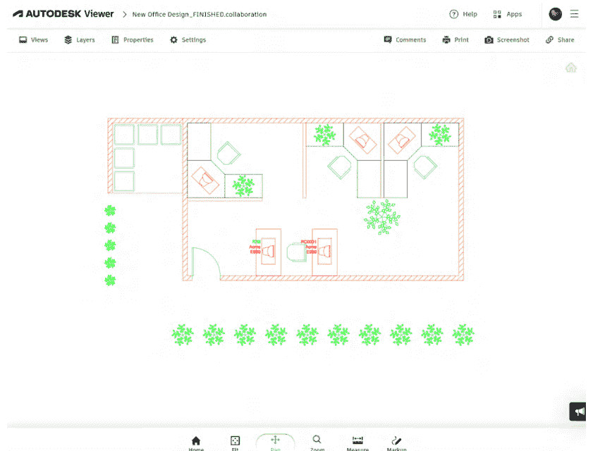

  图13.22：在 Autodesk Viewer 中显示的共享视图图纸

此时，请留在 Autodesk Viewer 中，以便学习如何使用查看器功能与您新共享的图纸文件进行协作。下一节将向您展示具体操作方法。

> AutoCAD for Mac
> 在 AutoCAD for Mac 中，您可以按照相同的工作流程使用**共享视图**共享图纸。

## 在 Autodesk Viewer 中使用共享视图

在上一节中，您学习了如何在 AutoCAD 中使用**共享视图**选项板共享设计。现在，您已进入 Autodesk Viewer，已使用 Autodesk 账户登录，并准备使用查看器中的一些协作工具。

由于您已通过 Autodesk 账户登录，您将在查看器中添加一些标记内容，这些内容随后会反映在 AutoCAD 桌面应用程序的**共享视图**选项板中。这将提供协作反馈，类似于对共享设计进行评论。

以下工作流程将引导您完成添加标记内容：

- 1. 在 Autodesk Viewer 中，确保您已通过账户登录，同时确保选择屏幕左上角的**视图**菜单，并确认您处于**模型 | 2D 视图**模式，如*图13.23*所示。

  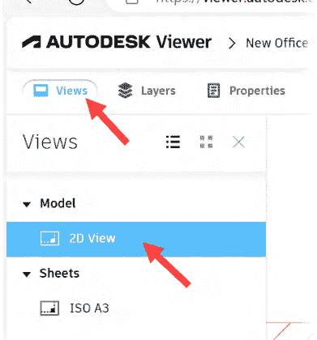

  图13.23：视图菜单和模型/2D视图

- 2. 点击屏幕底部的**标记**图标，如*图13.24*所示。

  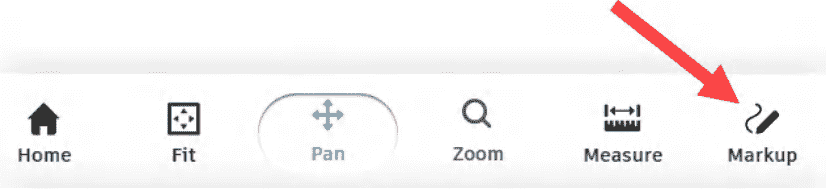

  图13.24：Autodesk Viewer 中的标记图标

- 3. 此时会显示**标记**菜单，如*图13.25*所示。

  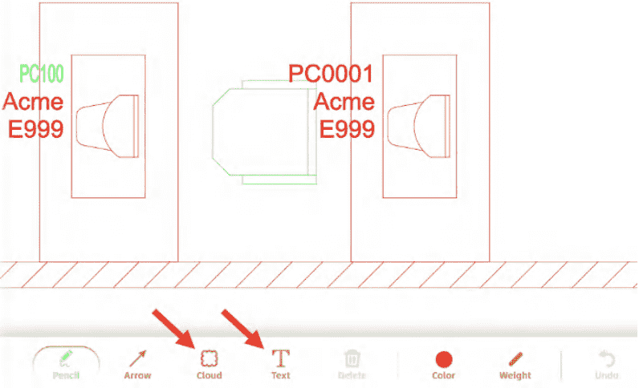

  图13.25：Autodesk Viewer 中的标记菜单

- 4. 您可以使用上图中的箭头标记工具（云线和文本）向共享视图添加标记。使用这些工具添加云线和文本，如图13.26所示。只需在查看器中使用默认设置，拖动并点击以放置云线，点击并输入以放置文本。在 Autodesk Viewer 中工作时，您会发现该工作流程与在 AutoCAD 中工作极为相似。

  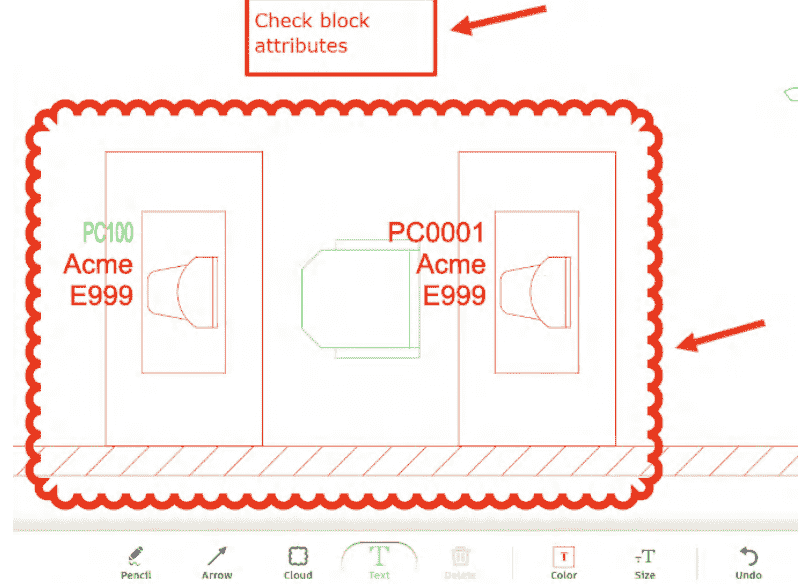

  图13.26：在 Autodesk Viewer 中添加的标记

- 5. 要保存标记，请点击查看器右上角的保存。

- 6. 现在您将看到标记已添加到评论面板中，该面板会自动出现在查看器屏幕右侧，如图13.27所示。请注意，这里有标记的预览缩略图和一个用于共享标记/评论的 URL。还有一个解决复选框，用于在标记已解决时勾选。您还可以使用名为“显示已解决”的过滤器，在评论面板顶部查看已解决的评论。

  > 评论
  > 显示已解决
  > 导出
  > 添加评论...
  > 发布
  > Shaun Bryant
  > 下午6:50
  > 解决
  > 2D 视图
  > https://autode.sk/4bu0d6q
  > 复制
  > 回复

  图13.27：显示标记的评论面板

当您在 Autodesk Viewer 中保存共享视图时，添加的标记和/或评论会保存并连接到图纸文件。

如果您现在返回 AutoCAD 和图纸，并点击共享视图选项板中的刷新图标（右上角，如图13.28所示），您将看到共享视图、创建日期及其有效期。所有共享视图的有效期为30天。您还会看到它有一条评论。

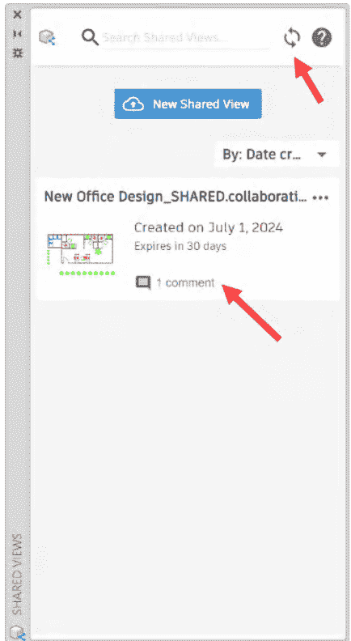

图13.28：显示共享视图的共享视图选项板

- 7. 点击评论，选项板将展开评论，以缩略图形式显示您在 Autodesk Viewer 中创建的标记详情，如图13.29所示。

  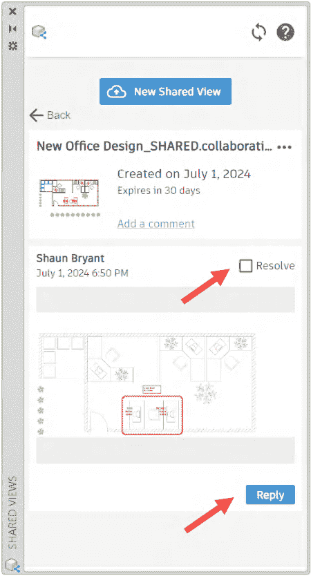

  图13.29：显示评论的共享视图选项板

- 8. 现在，您可以在 AutoCAD 的共享视图选项板中回复标记/评论，这些内容随后将在 Autodesk Viewer 协作文件中可用，从而允许非 AutoCAD 用户对 AutoCAD 中创建的原始设计进行协作并提供意见。

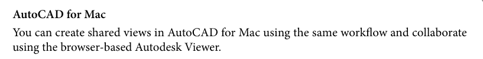

现在，您可以使用**共享图纸**（*SHARE*）工具和**共享视图**选项板轻松共享图纸和视图。使用**共享视图**和 Autodesk Viewer，非 AutoCAD 用户也可以查看和标记共享图纸。Autodesk Viewer 提供了易于使用的界面，并具备实时标记和评论功能。这些标记和评论随后可以在 AutoCAD 桌面应用程序中查看和使用。

## 摘要

在本章中，您学习了如何使用**共享图纸**（*SHARE*）和 AutoCAD Web 与其他 Autodesk 用户快速高效地协作处理 AutoCAD 设计。您还学习了如何使用**共享视图**选项板和基于浏览器的 Autodesk Viewer 进行协作和标记设计，从而为与非 AutoCAD 用户共享设计提供了一种简便方式。

在协作处理 AutoCAD 图纸和设计时，您可以使用任一方法节省宝贵时间。您可以在 Autodesk 网站上了解更多关于**共享视图**的信息：`https://help.autodesk.com/view/ACD/2023/ENU/?guid=GUID-459FD977-18F2-46C4-B238-B91E6DC27536`。

您可以在 `https://web.autocad.com` 上了解更多关于 AutoCAD Web（AutoCAD 订阅套餐的一部分）的信息。

在本章中，您学习了如何在使用**共享图纸**（*SHARE*）命令时快速高效地使用**共享图纸**工具，将 DWG 文件共享到 AutoCAD Web，以便在基于浏览器的 AutoCAD 版本中轻松协作。

您还体验了不同类型的共享图纸，了解了如何使用**编辑并保存副本**选项在 AutoCAD Web 应用程序中查看和修订图纸。您还学习了如何在 AutoCAD Web 中保存和编辑新文件。

您利用**共享视图**选项板创建了用于 Autodesk Viewer 的协作文件，并学习了如何通过在 Autodesk Viewer 中添加标记/评论来处理视图/图纸，以及如何在 AutoCAD 桌面应用程序中处理它们。

使用基于云端和浏览器的工具（如 AutoCAD Web 和 Autodesk Viewer）进行协作，可以在项目利益相关者与您的 CAD 团队之间实现快速、简单、有效的沟通。这些工具能让您更聪明地工作，而不是更辛苦。在下一章中，我们将探讨如何使用**DWG 比较**（*DWGCOMPARE*）和**XREF 比较**（*XREFCOMPARE*）来比较图纸和外部参照文件（*XREF*）。

