# 14 比较图形和外部参考文件

在前几章中，你已经学习了如何使用块、属性和动态块，以及如何共享图形。现在你需要考虑如何比较包含这些块和属性的图形和**外部参考（Xrefs）**。在共享图形时，你可能还需要比较图形和Xrefs。本章将教你如何使用*COMPARE*和*XREFCOMPARE*命令来比较AutoCAD图形文件和Xrefs。

比较图形和Xrefs比以前更加简单且省时。过去需要手动进行视觉比较，但那个时代早已一去不复返。现在你可以使用AutoCAD来比较图形文件和Xref图形文件。这项技术还允许你生成比较图形文件，并将比较后的对象合并到相关图形中。在本章中，你将看到**DWG Compare**和**Xref Compare**如何改进你的AutoCAD图形审批工作流程，使其更加快捷，并实现更高效的文件准备。

本章涵盖以下使用*COMPARE*和*XREFCOMPARE*命令的方法：

- 使用DWG Compare比较图形
- 处理使用DWG Compare生成的图形比较
- 使用Xref Compare比较图形
- 处理使用Xref Compare生成的参考文件比较

### 练习文件

在本章中，你必须使用`New Office Layout_REV1.dwg`和`New Office Layout_REV2.dwg`练习文件。在同一个AutoCAD会话中打开这两个文件，并确保它们都在**模型**选项卡中显示办公室平面图。你将注意到这两个图形之间存在细微差异。

在本章后面的部分，当你处理和比较Xref文件时，你将使用`New Office Layout_WITH XREF.dwg`文件。

### 使用DWG Compare比较图形

**DWG Compare**（*COMPARE*）工具位于两个位置：功能区上的**协作**选项卡中的**比较**面板，如*图14.1*所示。

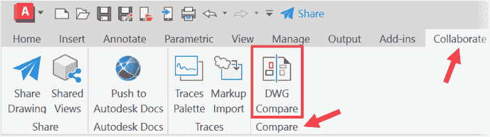

图14.1：协作功能区选项卡上的DWG Compare工具

它也位于应用程序菜单的**图形实用工具**菜单中，如*图14.2*所示。

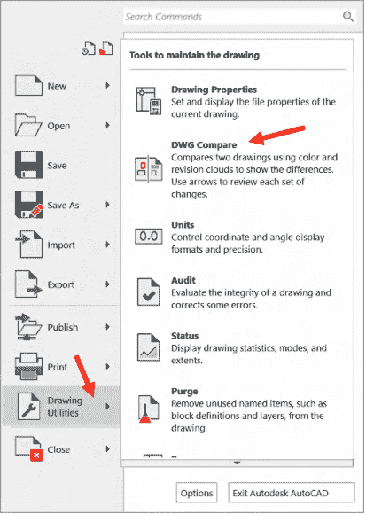

图14.2：应用程序菜单中“图形实用工具”下的DWG Compare工具

你可以点击这两个图标中的任意一个来激活COMPARE命令，但如“练习文件”部分所述，你必须在同一个AutoCAD会话中同时打开两个练习文件。

让我们开始练习：

- 1. 如图14.3所示，确保“New Office Layout_REV1.dwg”在功能区下方的文件选项卡中是当前文件。它应以粗体显示在文件选项卡上。如果不是粗体，请点击它使其成为当前文件。

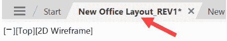

图14.3：文件选项卡中指示的当前图形

- 2. 如本节开头所述，从功能区或应用程序菜单启动DWG Compare（COMPARE）工具。

- 3. 将出现“选择要比较的图形”对话框，如图14.4所示。选择“New Office Layout_REV2.dwg”。选择文件后，单击对话框中的“打开”。

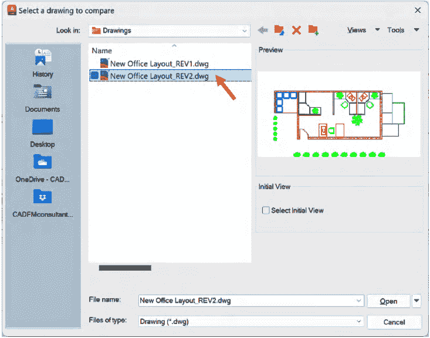

图14.4：“选择要比较的图形”对话框

- 4. AutoCAD屏幕将发生显著变化，因为你会进入DWG Compare模式，绘图区域顶部会显示**DWG Compare**工具栏，如*图14.5*所示。图形看起来呈灰色，但实际上并非如此。任何呈灰色（默认情况下）的对象都是两个被比较图形所共有的。

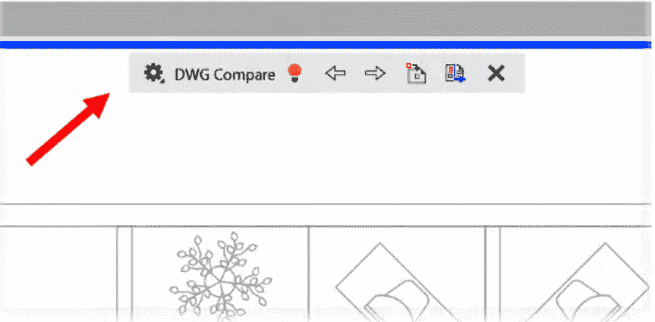

图14.5：带有工具栏箭头的DWG Compare模式

- 5. 点击**DWG Compare**工具栏上的**设置**图标（*齿轮*），如*图14.6*所示。你会注意到可以在那里设置高亮颜色。设置**云线显示**颜色，使修订云线更加突出。在这种情况下，由于背景为白色，选择了深蓝色云线显示颜色。默认云线颜色为橙色，在使用AutoCAD选项中的默认深色主题时效果良好。**DWG Compare**中使用颜色来确保被高亮显示的图形差异井然有序且清晰可见。

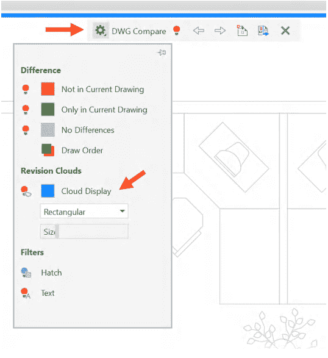

图14.6：带有云线显示箭头的DWG Compare设置菜单

- 6. 现在云线颜色已更改，你可以更清晰地比较两个DWG文件。任何显示修订云线的对象都表示两个图形文件之间存在差异。以红色显示的对象不在当前图形中，以绿色显示的对象是当前图形特有的。*图14.7*显示了不在当前图形中的对象。

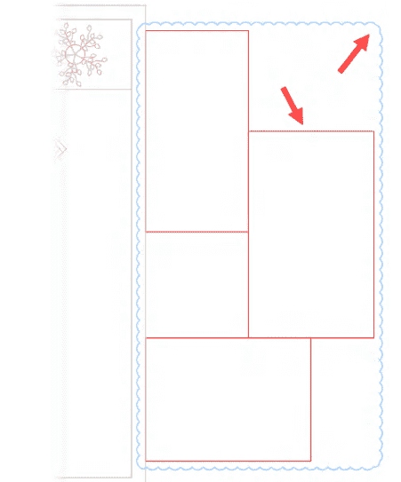

图14.7：不在当前DWG文件中的云线对象

而图14.8显示了当前图形特有的对象。

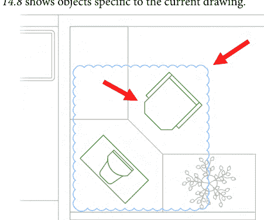

图14.8：当前DWG文件特有的云线对象

- 3. 选择对象，如*图14.10*所示。

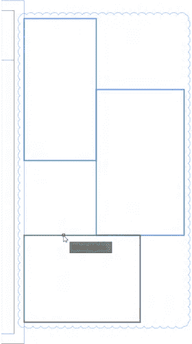

图14.10：选定的比较对象

- 4. 按*Enter*确认选择。选定的对象将从*红色*（不在当前图形中）变为灰色，表示它们是两个被比较图形所共有的。如*图14.11*所示。

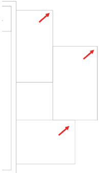

图14.11：选定的比较对象现在位于当前图形中，且为两个图形所共有（灰色）

- 5. 在“New Office Layout_REV1.dwg”文件中保存这些更改。你无需担心修订编号（REV1和REV2）。它们只是为了区分每个被比较的图形而存在。

- 6. 现在你需要保存一个比较DWG文件。为此，请点击DWG Compare工具栏上的“导出快照”图标，如图14.12所示。

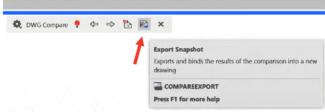

图14.12：DWG Compare工具栏上的“导出快照”图标

- 7. 系统将提示你在“图形另存为”对话框中保存快照图形，如图14.13所示。快照图形将命名为“New Office Layout_COMPARISON.dwg”。将其保存在与两个被比较图形相同的位置。

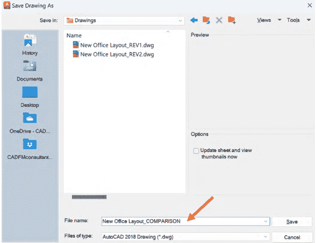

图14.13：“图形另存为”对话框

- 10. 点击**打开图形**链接将在**DWG Compare Snapshot**模式下打开比较图形，如*图14.16*所示。

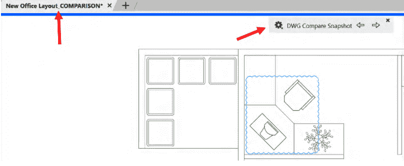

图14.16：在DWG Compare Snapshot模式下保存的比较DWG文件

DWG Compare Snapshot模式与DWG Compare模式类似，但你查看的是比较图形，而不是之前比较过的两个图形。你仍然可以使用DWG Compare Snapshot工具栏上的箭头在各个比较实例之间导航。此外，比较快照图形已保存以供将来参考，这对于创建图形更改、编辑和修订的审计追踪非常有用。

本节到此结束，你现在已经学会了如何在AutoCAD中使用DWG Compare工具比较DWG文件，并保存比较DWG文件以供将来参考。

在下一节中，你将学习如何使用AutoCAD中的**Xref Compare**工具来比较附着到AutoCAD图形中的不同迭代版本的Xrefs。

### 使用Xref Compare比较图形

本节将教你如何使用Xref Compare工具。与DWG Compare工具一样，它提供了一个比较界面，使你能够查看并处理附着在主图形上的Xrefs之间的差异。Xrefs是单独的DWG文件，作为参考文件以*回形针*方式附着到当前主图形上。另一个AutoCAD用户可以在Xref DWG文件上工作，后续更改可以显示在附着到当前主图形的Xref上。

这次你将使用一个不同的练习文件，因此请确保在“模型”选项卡中打开 **New Office Layout_WITH XREF.dwg** 文件。它看起来应如图14.17所示。

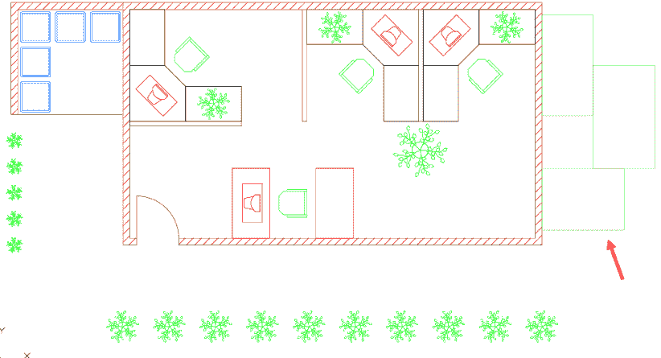

图14.17：New Office Layout_WITH XREF.dwg，其中附着了Landscaping_REV1.dwg作为外部参照（箭头所指）

注意建筑物右侧箭头所指的景观区域。那是一个附着的外部参照，即Landscaping_REV1.dwg。该Xref文件必须与New Office Layout_WITH XREF.dwg文件位于同一文件夹中，才能显示为附着的外部参照。请确保同一文件夹中还有备用Xref文件Landscaping_REV2.dwg。

现在，让我们按照以下步骤开始练习：

1. 转到AutoCAD功能区，单击“插入”选项卡。单击“参照”功能区面板标题栏上的对角箭头按钮，如图14.18所示。

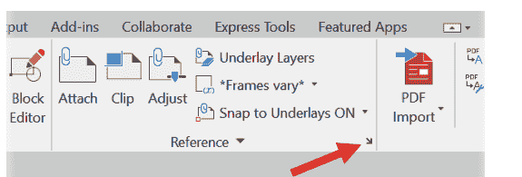

图14.18：插入功能区选项卡“参照”面板上的对角箭头

2. 将打开“外部参照”选项板，你可以在选项板上看到附着的Landscaping_REV1.dwg Xref，如图14.19中箭头所示。为清晰起见，该Xref在图形中也用箭头标出。

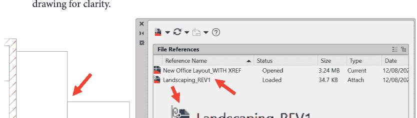

图14.19：“外部参照”选项板，其中当前Xref已用箭头标出，Xref文件名已放大

3. 宿主图形New Office Layout_WITH XREF.dwg也可以在选项板中看到。它作为宿主图形始终位于列表顶部。这是AutoCAD中的默认设置。

提示和技巧#34
仔细查看“外部参照”选项板中附着的Xref文件，如图14.19所示，你会看到文件名左侧的蓝黄DWG图标上有一个回形针符号。这表示这是一个附着的Xref文件。宿主DWG文件（位于选项板列表顶部）没有回形针符号，表明它是宿主图形文件。

4. 在“外部参照”选项板中选择Landscaping_REV1.dwg文件。它将在选项板和宿主图形中以蓝色高亮显示，如图14.20所示。

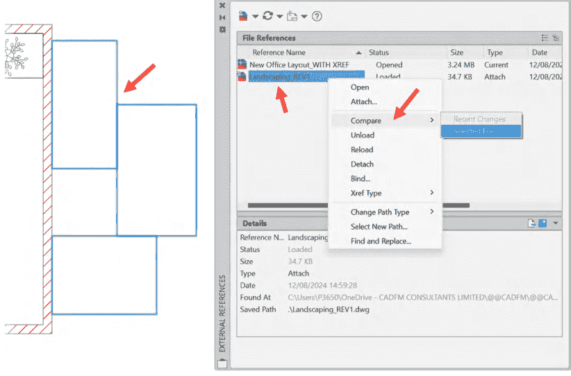

图14.20：在图形和选项板中选中的Xref文件

5. 同样如图14.20所示，右键单击选中的Xref文件。将出现快捷菜单。选择“比较”，然后选择“所选文件...”。

6. 将出现一个对话框，允许你从文件夹中选择另一个外部参照文件Landscaping_REV2.dwg。此练习文件应与宿主图形和当前附着的Xref（Landscaping_REV1.dwg）位于同一文件夹中。你可以在图14.21中看到这些文件都在同一文件夹中。

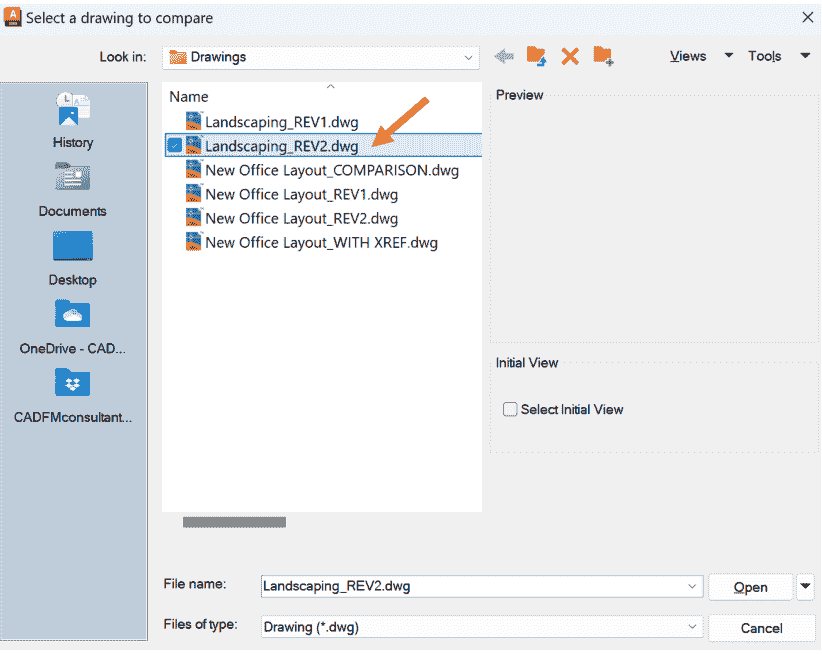

图14.21：对话框，其中显示了要比较的外部参照（Xref）文件（箭头所指）

7. 双击Landscaping_REV2.dwg文件，将其与附着的Landscaping_REV1.dwg Xref文件进行比较。你也可以从列表中选择该文件，然后点击“打开”。

现在你会看到，你处于与前面章节中DWG Compare类似的界面模式。这次你处于Xref Compare模式，将附着的Xref文件（Landscaping_REV1）与另一个可能用作Xref的文件（Landscaping_REV2）进行比较。请注意，这一次工具栏上显示的是Xref Compare，而不是DWG Compare，如图14.22所示。

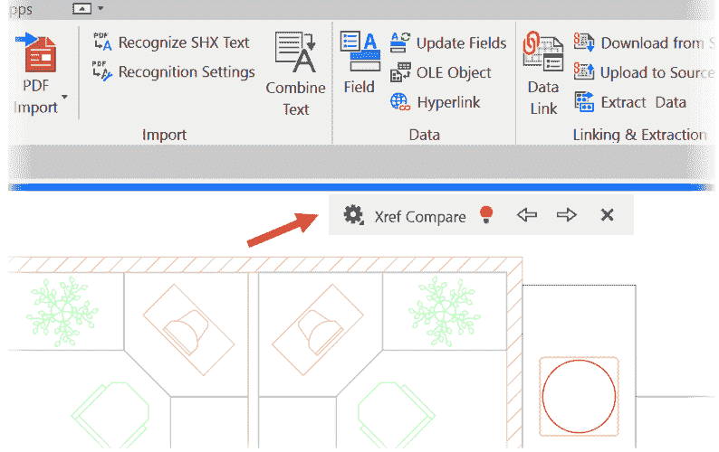

图14.22：Xref Compare模式下的Xref Compare工具栏

8. 与DWG Compare一样，你可以通过单击工具栏上的齿轮图标来调整Xref Compare设置，如图14.22所示。

9. 最后，单击“设置”图标，在“设置”菜单的“修订云线”部分更改“云线显示”颜色，如图14.23所示。这样可以使云线在白色背景上更易于查看。如果你在AutoCAD中使用不同的背景，请为云线使用对比色。我在本练习中使用的是蓝色。

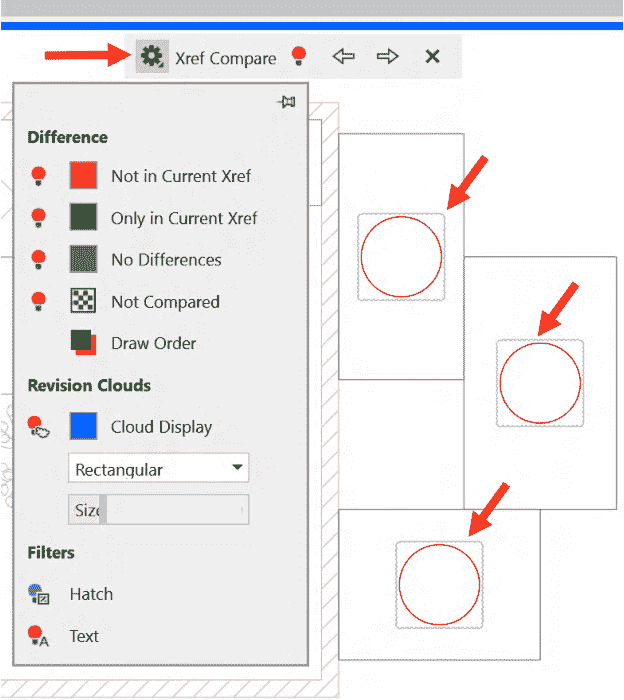

在本节中，你使用了Xref Compare工具来比较Xref文件，你可以看到它与DWG Compare工具非常相似。这些工具为此非常有用，可节省大量宝贵时间。

在本章的下一节中，我们将更深入地探讨Xref Compare工具的功能。

请保持New Office Layout_WITH XREF.dwg文件处于打开状态，并保持Landscaping_REV1.dwg作为Xref附着，同时保持在Xref Compare模式。

## 使用Xref Compare生成的参照文件比较结果

在本节中，你将进一步探索Xref Compare工具并利用其功能。你不能使用Xref Compare保存比较DWG文件，但还有其他有用的功能。让我们进一步了解此功能：

- Xref Compare界面与DWG Compare界面相同。当将附着的Xref文件Landscaping_REV1.dwg与另一个DWG文件Landscaping_REV2.dwg进行比较时，蓝色比较云线（如上一节在“设置”中所设置）突出显示两个文件之间的差异，如图14.24所示。

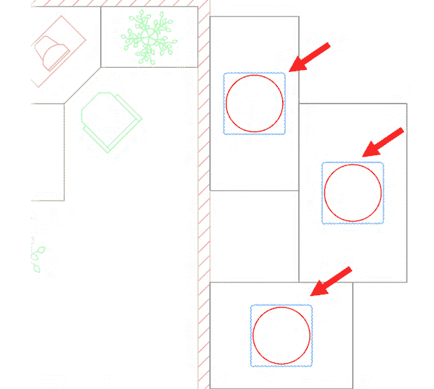

图14.24：由蓝色比较云线高亮显示的差异

- 与DWG Compare一样，你可以使用Xref Compare工具栏上的箭头在各个比较云线之间移动，AutoCAD将缩放到每条云线的范围，以便查看。

- 根据工具栏上的“设置”，红色圆圈被标记为不在当前附着的Xref文件Landscaping_REV1.dwg中；它们位于被比较的文件Landscaping_REV2.dwg中。此设置如图14.25所示。你可以在“设置”菜单中更改其中任何颜色。

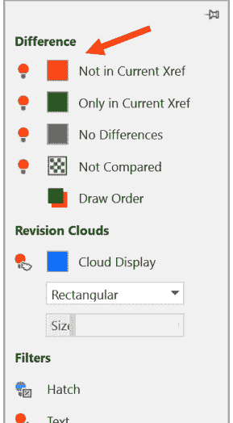

图14.25：Xref Compare设置菜单

- Xref Compare的另一个有用之处是，参与比较的任何外部参照文件（Xref）都会在“外部参照”选项板中标记为“对比中”（In Compare），如图14.26所示。当你有多个附着的Xref文件，并且需要区分哪些文件处于Xref比较中时，这一点尤其有用。

## 总结

现在，你可以使用DWG Compare和Xref Compare工具轻松比较图形和Xref文件。当比较文件并查看AutoCAD图形和设计中的编辑、更改和修订时，请考虑使用任一方法以节省宝贵时间。

你可以在Autodesk网站上了解关于DWG Compare（COMPARE）的更多信息：https://help.autodesk.com/view/ACD/2024/ENU/?guid=GUID-4B96F5FD-C9CF-4E2E-996E-E00914F8D99E。

你可以在Autodesk网站上了解关于Xref Compare（COMPARE）的更多信息：https://help.autodesk.com/view/ACD/2023/ENU/?guid=GUID-84E4CED9-A52E-4F36-8D30-EB660DDC1086。

在本章中，你已经了解了如何使用DWG Compare（DWGCOMPARE）工具来比较同一DWG文件的不同迭代/修订版本，并使用DWG Compare（DWGCOMPARE）保存了一个显示比较结果的DWG文件。

你还学习了使用Xref Compare（XREFCOMPARE）工具在附着和未附着的Xref文件之间进行比较的类似工作流程，以及如何在“外部参照”选项板中发现“对比中”状态。

在下一章中，我们将深入探讨如何有效使用AutoCAD Web，通过浏览器和云中开发图形，以便轻松协作。
