# 使用AutoCAD Web

在前面的章节中，你学习了如何使用属性和动态块，以及如何共享图形。你还学习了如何比较DWG文件和外部参照文件（Xrefs）。现在，你和你的CAD团队可能需要就某个图形文件进行协作，以进一步推进设计。这就是你可以利用AutoCAD Web和云的地方。

AutoCAD是一款基于订阅的应用程序。该订阅附带AutoCAD Web产品，其中包含AutoCAD Web应用程序和AutoCAD移动应用程序。这两个应用程序都允许在云中进行DWG文件协作，AutoCAD移动应用程序利用最新的移动设备（如智能手机和平板电脑）为你的DWG文件增添了完全移动性。本章将教你如何使用AutoCAD Web提供无缝的基于云的协作体验，与基于云的DWG文件协作，并使用“图形历史”工具检查当前版本。你还将学习如何将DWG文件保存到云中并将其用于AutoCAD Web，以及如何使用AutoCAD Web和移动应用程序。

使用云进行协作不仅会节省大量时间，还可以让你实时即时修改和更改图形。此外，它还是一种非常宝贵的DWG存储资源。

本章涵盖以下使用AutoCAD Web和云的方法：

- 将DWG文件保存到云
- 使用“图形历史”工具
- 在AutoCAD Web应用程序中打开和处理图形
- 在AutoCAD移动应用程序中打开和处理图形
- 使用在AutoCAD Web或AutoCAD移动应用程序中更新的图形

## 练习文件

在本节中，你必须使用 `New Office Layout.dwg` 练习文件。打开该文件，并确保在“模型”选项卡中显示办公室平面图。

本章将展示来自基于浏览器的 AutoCAD 版本以及安装在平板电脑（Apple iPad Pro）上的 AutoCAD 移动应用程序的各种图像。请确保你使用自己的 AutoCAD 订阅详细信息访问 AutoCAD Web。

对于本章而言，并非必须具备安装有 AutoCAD 移动应用程序的移动设备，但如果有并安装它会有所帮助。这将使你能够熟悉相关的移动工作流程。你可以在相应的应用商店中搜索 AutoCAD 在线版找到该移动应用程序。

## 从 AutoCAD 桌面版将 DWG 文件保存到云

AutoCAD 桌面应用程序允许你使用 AutoCAD Web 和移动文件夹将 DWG 文件保存到云。只要你已登录到 AutoCAD 订阅，就可以使用“保存到 Web 和移动设备”（SAVETOWEBMOBILE）命令。

SAVETOWEBMOBILE 命令位于快速访问工具栏（QAT）的左上角，如图 15.1 所示。当你第一次点击它时，系统可能会要求你安装一个驱动程序文件。请确保已安装该驱动程序。它安装速度很快，不会花费很长时间。

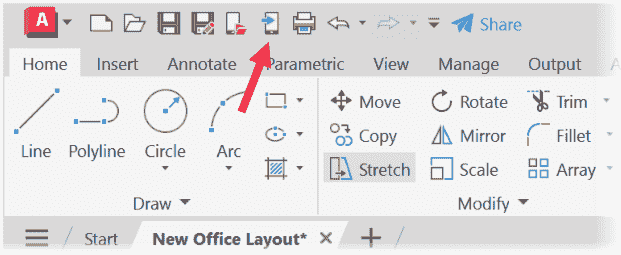

图 15.1：快速访问工具栏（QAT）上的 SAVETOWEBMOBILE 图标

安装完成后，按照以下步骤保存 DWG 文件：

- 1. 点击该图标（并安装驱动程序）后，将显示“保存到 AutoCAD Web 和移动设备”对话框，如图 15.2 所示。文件位置显示在对话框顶部（AutoCAD Web 和移动设备：图中箭头所指），首选文件名显示在底部（图中箭头所指）。

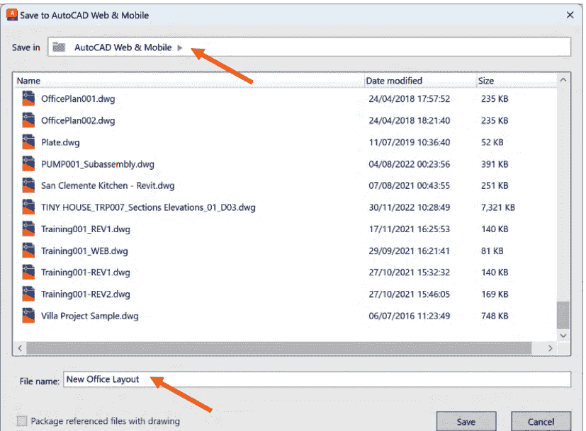

图 15.2：“保存到 AutoCAD Web 和移动设备”对话框

- 2. 输入首选文件名（此时只需使用 `New Office Layout`），然后点击**保存**。这将把 DWG 文件保存到为你的 AutoCAD 订阅保留的 `AutoCAD Web & Mobile` 文件夹中的云空间中。

点击**保存**后，图形看起来与你打开的原文件相同，但你当前的图形现在是同文件名的云版本。

查看 AutoCAD 标题栏。你将看到新保存的 DWG 文件有一个很长的路径，如图 *15.3* 所示。该路径是你的 **AutoCAD Web & Mobile** 云空间的位置，由你的 AutoCAD 订阅和登录 AutoCAD 时使用的 Autodesk 账户定义。请注意，你的文件路径将与图 *15.3* 中显示的不同，因为它特定于*你*的账户详细信息。

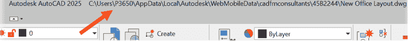

图 15.3：保存在云中的 DWG 文件的新文件路径

你的图形现在已保存在云端，可供协作使用。是的，就是这么简单！

你现在知道了将 DWG 文件保存到云端进行协作是多么快速和容易。Autodesk 通过 AutoCAD Web & Mobile 文件夹提供了一种非常简单的方法。

> **提示与技巧 #35**
> 还有其他专有云位置可以存储你的 DWG 文件以进行协作。AutoCAD 支持 Autodesk Drive、Microsoft OneDrive、Google Drive、Dropbox 和 Box。你还可以使用 Autodesk Desktop Connector 和 Autodesk Docs 连接文件。使用这些其他云存储方法需要订阅/账户，并将提供一个不同于默认的 AutoCAD Web & Mobile 文件夹的单独位置。

如果为大型组织或公司工作，他们可能已经拥有企业级的专有云解决方案。Microsoft OneDrive 和 Dropbox 在大型公司中很常见，因此请检查这些是否可用，因为你的 CAD 团队其他成员可以轻松访问它们。

> **AutoCAD for Mac**
> AutoCAD Web & Mobile 文件夹*不*受 AutoCAD for Mac 支持。你必须将 DWG 文件从 Mac 保存到提示与技巧 #35 中提到的专有云解决方案之一，例如 Microsoft OneDrive。

## 使用图形历史记录工具

在处理基于云的 DWG 文件时，你需要知道哪个版本的文件是最新的。有时，本地可能存在同文件名的文件版本。这通常需要检查应用于图形的日期和时间戳。这就是为什么要求你将文件的云版本保存为相同文件名的原因。现在你有两个版本的 New Office Layout.dwg 文件：一个存储在本地，另一个存储在云中。

以下步骤将引导你完成图形历史记录工作流程，使你能够在 AutoCAD 中使用图形历史记录功能。这允许你分析同一图形的迭代，并确保你使用的是适当的图形文件版本/修订版。

- 1. 首先打开本地保存的图形版本。然后，使用**从 Web 和移动设备打开**（*OPENFROMWEBMOBILE*）命令打开 New Office Layout.dwg 文件的云版本。你可以在**快速访问工具栏（QAT）**上找到 *OPENFROMWEBMOBILE* 命令的图标，如图 15.4 所示。

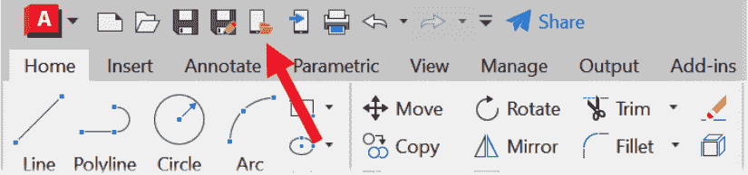

图 15.4：快速访问工具栏（QAT）上的“从 Web 和移动设备打开”（OPENFROMWEBMOBILE）图标

- 2. 现在，AutoCAD 中会有两个读取相同的文件选项卡。此时请注意区分哪个是哪个。首先点击本地保存的 DWG 文件的文件选项卡，如图 *15.5* 所示。在本例中，本地文件是*左侧*的文件选项卡，你需要点击此文件选项卡使其成为当前 DWG 文件。

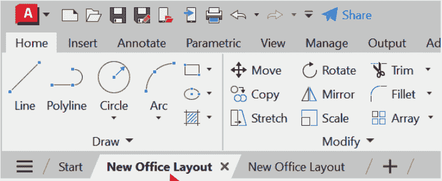

图 15.5：本地 DWG 文件的文件选项卡被设为当前文件

- 3. 点击功能区上的**视图**选项卡。找到**历史记录**功能区面板，然后点击**活动洞察**，如图 *15.6* 所示。

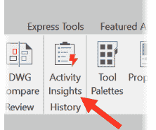

图 15.6：历史记录功能区面板上的“活动洞察”图标

在 AutoCAD 2025 中，**图形历史记录**（*DWG HISTORY*）现在是**活动洞察**面板的一部分。在较旧版本的 AutoCAD 中，**图形历史记录**是由 *DWG HISTORY* 命令激活的单独面板。如果你在 AutoCAD 2025 中键入 DWG HISTORY，**活动洞察**面板将自动打开，如图 *15.7* 所示。

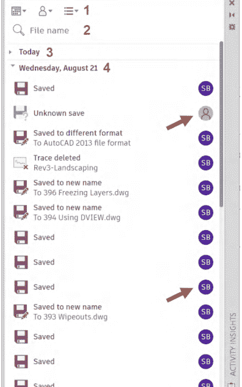

图 15.7：本地保存的 DWG 文件的“活动洞察”面板

AutoCAD 2025 中新的**活动洞察**面板已增强，以纳入你的图形历史记录，如**图 15.7** 所示。在那里你可以看到 DWG 文件的各种迭代，在**图 15.7** 中进行了编号：

- - **1：** 日期、用户或活动
- - **2：** 文件名
- - **3：** 今天的活动
- - **4：** 其他相关日期的活动

此外，每次进行关键文件保存时，该保存都会分配给该用户，如面板右侧的圆圈所示（箭头所指）。

- 4. 对另一个文件选项卡（基于云的 DWG 文件）重复*步骤 2 和 3*，你将看到**活动洞察**面板为基于云的 DWG 文件显示稍有不同的信息，如**图 15.8** 所示。它还为你提供了连接到 **OneDrive** 的选项（箭头所指）。

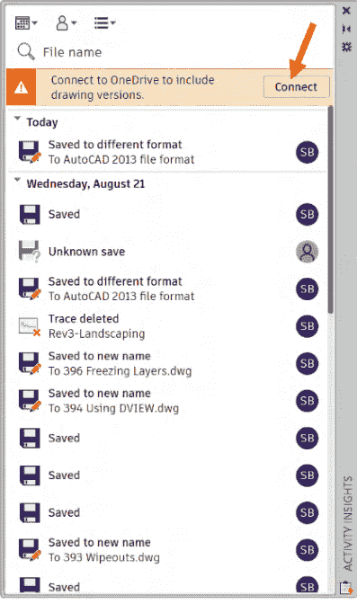

图 15.8：基于云的 DWG 文件的“活动洞察”面板

AutoCAD 2025 允许你在**活动洞察**面板中检查图形文件的历史记录。其他版本的 AutoCAD 在使用 **DWGHistory** 命令时仍具有**图形历史记录**面板。

这两种方法都提供了一种快速简便的方式来检查本地保存文件以及保存在云中的 DWG 文件的 DWG 版本历史记录。

> **AutoCAD for Mac**
> 
> **活动洞察**在 AutoCAD for Mac 中也可用，提供与 AutoCAD for Windows 相同级别的洞察。

在本节中，你学习了如何在**活动洞察**面板中使用**图形历史记录**。这允许你检查图形文件的最新迭代，并确保你使用的是最新版本。

## 在 AutoCAD Web 应用程序中打开和处理图形

**AutoCAD Web** 是浏览器中的 AutoCAD 和移动设备（无论是智能手机还是平板设备）上的 AutoCAD 的统称。两个 AutoCAD Web 应用程序都提供了与 AutoCAD 桌面应用程序类似的用户体验，并允许轻松访问和使用基于云的 DWG 文件。

本节将向你展示如何使用 AutoCAD Web 通过 Web 浏览器打开和处理 DWG 文件。该示例在最新版本的 Microsoft Edge 浏览器中查看和处理，但 AutoCAD Web 也支持其他流行的 Web 浏览器。

让我们通过执行以下步骤开始该过程：

- 1. 打开你的 Web 浏览器并导航到 https://web.autocad.com。AutoCAD 网页登录页面如图 *15.9* 所示。请注意，你可以利用页面上的二维码在 Google 和 Apple 应用商店下载 AutoCAD 移动应用程序。

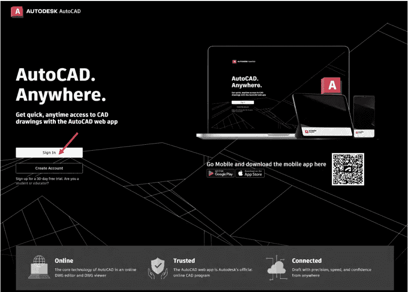

图15.9：AutoCAD Web应用程序的登录页面

- 2. 使用你的Autodesk账户登录AutoCAD Web应用程序。单击图15.9中箭头所示的“登录”按钮。系统将提示你输入Autodesk账户的用户名和密码。

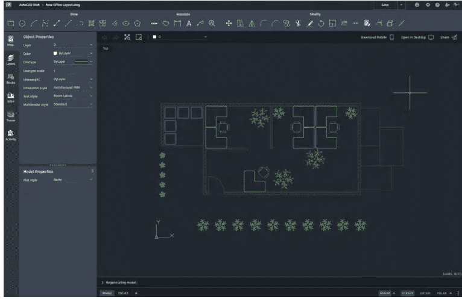

图15.11：在AutoCAD Web应用程序中打开的DWG文件

- 6. 在AutoCAD Web界面的右上角，你会看到一个以齿轮小图标表示的设置图标。单击该齿轮图标以打开“设置”对话框，如图15.12所示。

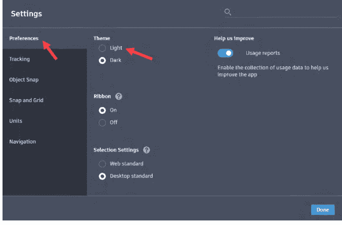

图15.12：AutoCAD Web的“设置”对话框

- 7. 单击对话框左侧的“偏好设置”选项卡后，你会看到可以更新主题。默认主题为深色。选择“浅色”可使浏览器界面更亮，然后点击“完成”。如图15.13所示，你会注意到菜单颜色变浅，但绘图区域仍使用较深主题。浅色主题使得在AutoCAD Web中阅读菜单更容易。

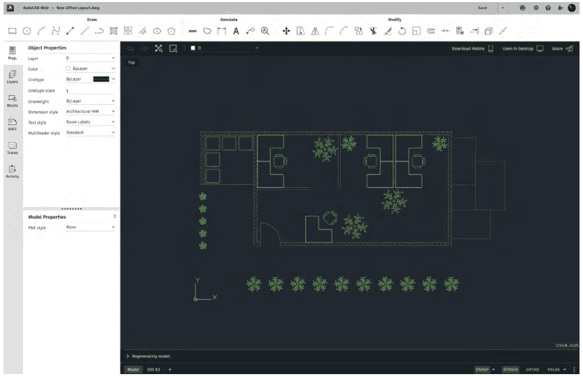

图15.13：AutoCAD Web中使用浅色主题

Autodesk一直努力确保AutoCAD Web中使用的AutoCAD界面尽可能接近AutoCAD桌面界面，使从桌面到Web的过渡尽可能容易。

- 8. 如果单击AutoCAD Web界面左侧图标菜单上的图标，你会看到可以使用“特性”、“图层”、“块”、“外部参照”、“轨迹”和“活动”菜单。

- 9. 单击“图层”图标，出现“图层”面板，如图15.14所示。

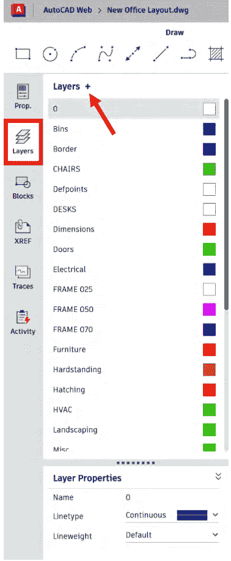

图15.14：AutoCAD Web中的“图层”面板

- 10. 如果单击*图15.14*所示面板中“图层”一词旁边的+符号，可以在绘图中创建新图层，如*图15.15*所示。

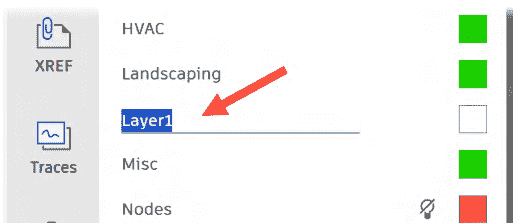

图15.15：可在“图层”面板中命名的新图层

- 11. 默认情况下，新图层命名为Layer1（或类似名称，取决于已创建的新图层数量）。它将以蓝色高亮显示（选中），因此你可以输入任何需要的名称来覆盖默认图层名称。

- 12. 输入图层名称Traces并按*回车*。图层名称将添加到图层名称列表中。请注意，图层会自动按字母顺序移动。

- 13. 新的Traces图层默认为白色。单击图层名称右侧的颜色框以更改颜色，将出现调色板，显示绘图中的颜色和AutoCAD索引颜色，如*图15.16*所示。

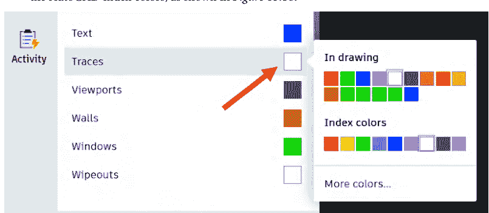

图15.16：AutoCAD Web调色板

- 17. 单击右上角的个人资料图片，然后选择**退出登录**以退出AutoCAD Web应用程序。

在本节中，你已学习如何在AutoCAD Web应用程序中打开和处理DWG文件。你打开了一个基于云的DWG文件，创建了一个新图层，并将绘图保存在云端。

你可以在AutoCAD Web中使用许多命令和工作流程，所有这些都遵循与AutoCAD桌面应用程序类似的工作流程。Autodesk这样做是为了保持AutoCAD用户体验。另外，请注意，AutoCAD Web*不是*浏览器中功能完整的AutoCAD版本。可用的AutoCAD命令和功能数量有限，但足以让你轻松查看、编辑和更新任何2D DWG文件。

## 行动号召

> AutoCAD Web是一款出色的工具，可让你在DWG文件存储在云端时随时访问它们。尝试将更复杂的DWG文件保存到云端，并在AutoCAD Web中处理它。体验AutoCAD Web的工具、功能和工作流程，测试浏览器中DWG文件编辑的速度和便捷性。

AutoCAD Web 使 AutoCAD 大众化，无论你使用的是 AutoCAD Windows 版还是 AutoCAD Mac 版。DWG 文件在 AutoCAD Web 中是相同的，并且在使用 Windows 或 Mac 版本的 Autodesk 桌面应用程序打开 DWG 时，在 AutoCAD Web 中进行的所有编辑都将反映在 DWG 中。

## 在AutoCAD移动应用程序中打开和处理图纸

本节基于在*Apple iPad Pro*上使用AutoCAD移动应用程序。AutoCAD移动应用程序可以在iOS和Android移动操作系统上运行，但界面可能有所不同，请注意这一点。

另外，不要求你拥有iPad等平板电脑。本章包含本节是为了让你了解在移动端处理基于云的DWG文件是多么快速和容易。你（可能）可以在智能手机上按照本节操作，但可能会受到手机屏幕大小的限制。如果你拥有市面上较大屏的智能手机，也许是可行的。

假设AutoCAD移动应用程序已安装在Apple iPad Pro上。你可以在相应的Apple和Google应用商店中（通过订阅方式）获取AutoCAD。以下步骤将引导你了解如何使用AutoCAD移动应用程序打开和处理图纸。

- 1. 与AutoCAD Web一样，你必须使用Autodesk账户凭据登录AutoCAD移动应用程序，如*图15.19*所示。如有需要，你还可以使用**创建账户**按钮创建新的Autodesk账户。

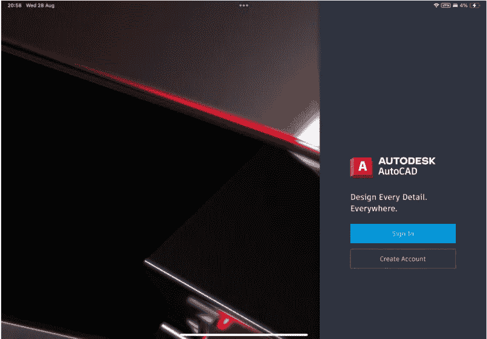

图15.19：AutoCAD移动应用程序登录屏幕

登录后，你会看到一个页面，显示**最近**面板（显示最近访问的文件）和**源**面板（你可以在其中访问其他基于云的文件位置），如*图15.20*所示。你可以在**最近**面板中看到`New Office Layout.dwg`文件，因为它最近在iPad上被访问过。你还可以在**源**面板中使用**AutoCAD Web**，它会带你进入`AutoCAD Web & Mobile`文件夹。

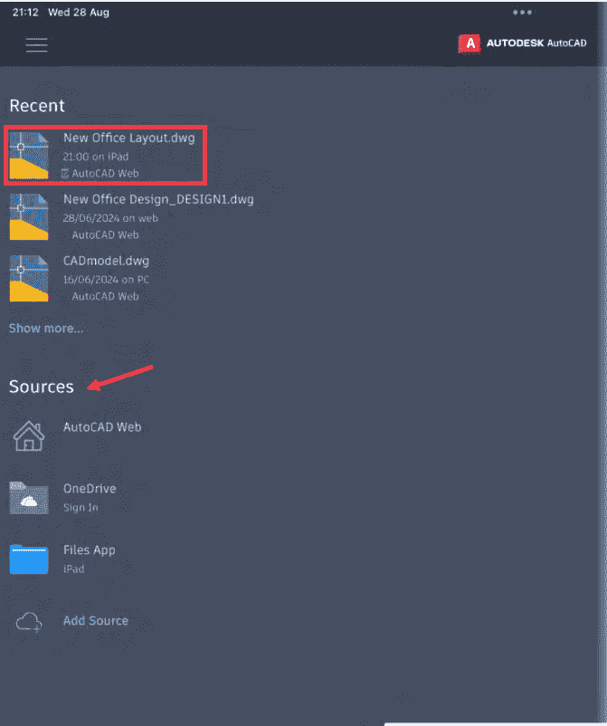

图15.20：AutoCAD移动应用程序主屏幕

- 2. 选择`New Office Layout.dwg`文件。AutoCAD移动应用程序将加载该图纸。这可能需要一点时间，具体取决于你的移动数据覆盖范围和平板电脑的规格。一旦DWG文件加载完成，其外观将如*图15.21*所示。

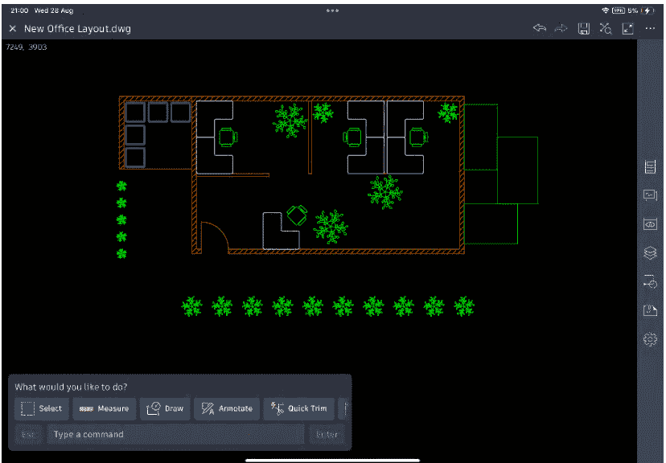

图15.21：AutoCAD移动应用程序中基于云的DWG文件

AutoCAD移动应用程序使用标准iOS界面，包括用于缩放和平移的手指手势。它还支持iPad的Apple Pencil。如果你有Apple技术（或类似技术）可用，值得检查其工作方式。

命令面板位于左下角，图标菜单位于屏幕右侧。请注意，图标菜单使用与AutoCAD Web应用程序相同的图标。这是为了在AutoCAD Web产品和AutoCAD桌面之间保持用户界面的一致性。

- 3. 单击图标菜单上的“图层”图标，如图15.22所示。然后，单击“新建图层”（箭头所示）。

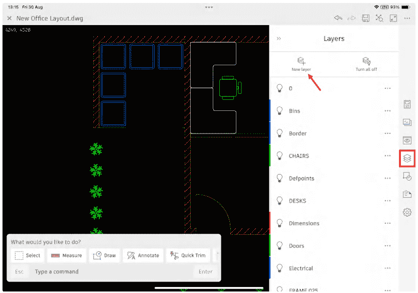

图15.22：AutoCAD移动应用程序中的“图层”面板

- 4. 给新图层命名为Threshold，如图15.23所示。

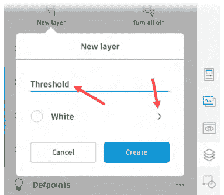

图15.23：在“图层”面板中命名Threshold图层

- 7. 向下滚动图层列表以找到**Threshold**图层。图层颜色在图层列表中显示为图层名称左侧的垂直高亮，如*图15.26*所示。

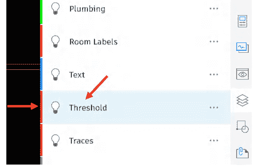

图15.26：图层列表中的Threshold图层

> **技巧提示 #36**
>
> 在AutoCAD Web和AutoCAD移动应用程序中，你可以通过单击*灯泡*符号来打开和关闭绘图中的图层。

- 8. 单击图层列表中的双箭头符号以最小化**图层**面板，如*图15.27*所示。

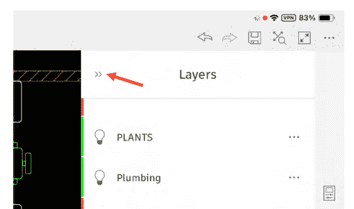

图15.27：使用双箭头最小化“图层”面板

+   9. 现在，您可以单击 AutoCAD 移动应用程序窗口右上角的磁盘图标，将 DWG 文件保存到云端，如*图 15.28*所示。

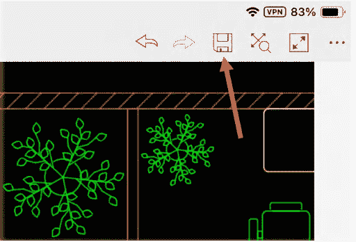

New Office Layout.dwg 文件连同新的 Threshold 图层现已保存回 AutoCAD Web & Mobile 文件夹中的云端。

请确保您退出 AutoCAD 移动应用程序。这可确保更新后的 DWG 文件的其他用户使用的是最新版本。

Autodesk 将 AutoCAD 移动应用程序作为 AutoCAD Web 产品的一部分推出，以便在移动环境中也能使用 DWG 文件。这可能是在建筑工地，也可能是在工厂车间环境中。其界面与 AutoCAD Web 相似，让人联想到 AutoCAD 桌面版，从而保持了 AutoCAD 的用户体验。

另外，请注意，AutoCAD 移动应用程序并*不是*在智能手机或平板电脑上运行的 AutoCAD 完整工作版本。它提供的 AutoCAD 命令和功能数量有限，但足以轻松查看、编辑和更新任何 2D DWG 文件。

> **行动号召**
> 
> AutoCAD 移动应用程序是您在移动中从云端访问 DWG 文件的绝佳工具。不妨尝试使用 AutoCAD 移动应用程序的工具、功能和工作流程，来测试在您自己的设备（无论是智能手机还是平板电脑）上，浏览器中的 DWG 文件能多么快速、轻松地被编辑。

无论您是在 **AutoCAD Web** 还是 **AutoCAD 移动应用程序**中编辑了图形，编辑后的 DWG 文件仍可像往常一样在 AutoCAD 桌面应用程序中使用。下一节将带您了解这一特定工作流程。

## 使用在 AutoCAD Web 或 AutoCAD 移动应用程序中更新的图形

当您身处不熟悉的办公室（AutoCAD Web：使用浏览器）或在外出途中（AutoCAD 移动应用程序：在平板电脑上）时，使用 AutoCAD Web 或 AutoCAD 移动应用程序会非常方便。

但是，一旦您对基于云的 DWG 文件进行了修订和编辑，您始终需要返回 AutoCAD 桌面环境才能使用完整版本的 AutoCAD。

在本节中，我们将从 `AutoCAD Web & Mobile` 文件夹中打开基于云的 `New Office Layout.dwg` DWG 文件，以确认在 AutoCAD Web 和 AutoCAD 移动应用程序中所做的更改均已生效。让我们按照以下步骤开始：

+   1. 在 AutoCAD 桌面端，使用**快速访问工具栏（QAT）**图标选择 `OPENFROMWEBMOBILE` 命令，如*图 15.29*所示。然后，选择 `New Office Layout.dwg` 文件并单击**打开**。

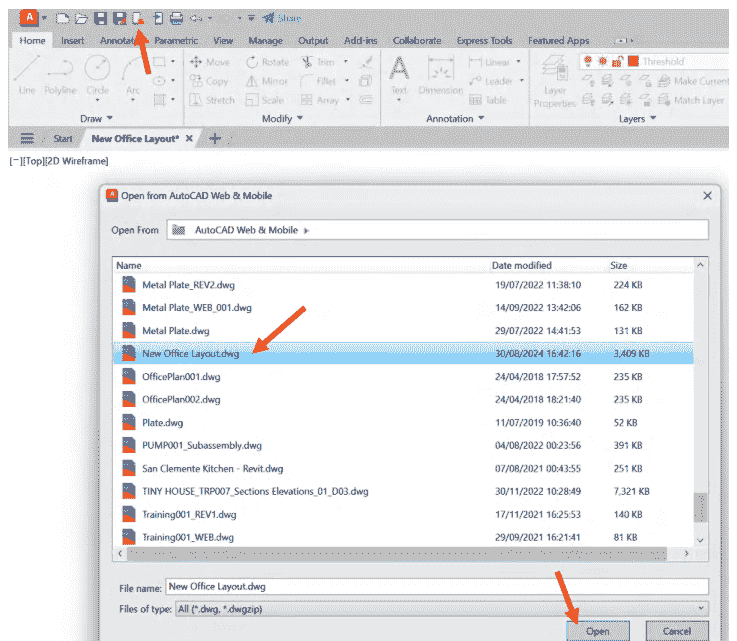

*图 15.29：从 AutoCAD Web & Mobile 文件夹打开 DWG*

+   图形将打开。请确保您位于**模型**选项卡，并已缩放到办公室平面图的完整视图。

+   2. 单击功能区上的**常用**选项卡，并查看**图层**功能区面板。单击**图层特性**图标，如*图 15.30*所示。

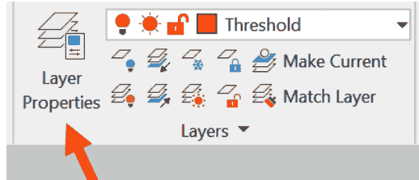

图 15.30：图层特性图标

+   3. 屏幕上将出现**图层特性管理器**选项板，如*图 15.31*所示。请注意，该 DWG 文件中现在已包含**Traces**和**Threshold**图层。

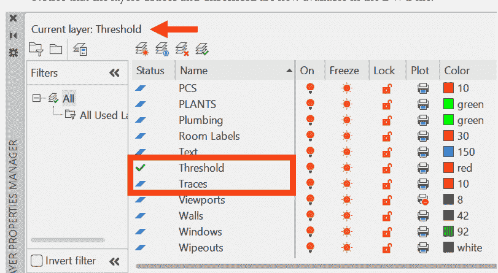

图 15.31：图层特性管理器选项板中的新图层

- 您还可以在 Autodesk 网站上了解有关 AutoCAD Web 的更多信息：https://help.autodesk.com/view/ACD/2022/ENU/?guid=GUID-B4A46563-E5CA-4A34-918C-78ADEA2FEEB4
- 此处还提供了有关 AutoCAD 移动应用程序的更多信息：https://help.autodesk.com/view/ACD/2022/ENU/?guid=GUID-20A8F96D-0ACA-49F6-A6FF-D7DD71A8D03A

## 小结

在本章中，您已经了解了如何使用 SAVETOWEBMOBILE 命令保存 DWG 文件，以及随后如何使用 OPENFROMWEBMOBILE 命令打开已保存的文件。您还学习了如何使用活动洞察选项板查看 DWG 文件的历史记录。

您还获得了宝贵的知识，了解了如何在浏览器中的 AutoCAD Web 应用程序中，以及在平板电脑或智能手机等移动设备上的 AutoCAD 移动应用程序中打开和处理图形。

随后，您还学习了如何在 AutoCAD 桌面端打开已修改的基于云的 DWG 文件，并应用 AutoCAD Web 和 AutoCAD 移动应用程序在 DWG 文件中所做的更改。

基于云的 DWG 文件可实现无缝、实时的协作，无论通过浏览器还是在移动设备上皆是如此。本章所学到的知识将让您思考如何制定基于云的策略，利用基于云的 DWG 存储，并使用 AutoCAD Web 和 AutoCAD 移动应用程序进行高效、富有成效的协作。

在下一章中，我们将探讨如何使用 AutoCAD 中的追踪功能，并将其与基于云的 DWG 文件相结合，从而进一步加强您对图形的协作。
