# 16
## 使用 AutoCAD 中的追踪功能进行协作

在上一章中，您学习了如何处理存储在云端的图形，并使用 AutoCAD Web 和 AutoCAD 移动应用程序进行协作。既然云可以用来存储您的 AutoCAD DWG 文件，协作就成为了关键，而 AutoCAD 中的追踪功能已成为传达设计变更、编辑和修订的绝佳方式。

AutoCAD 中新的追踪功能以前仅适用于 AutoCAD Web 和 AutoCAD 移动应用程序。自 AutoCAD 2023 起，该功能也适用于 AutoCAD 桌面应用程序，并在 AutoCAD 2025 版本中得到了大幅增强。

这种可用性使追踪功能在全部三种 AutoCAD 应用程序（桌面端、Web 端和移动端）中得以完整提供。本章向用户概述了 AutoCAD 中的追踪功能，以及如何利用该功能发挥其优势。

本章涵盖以下方法，让您能够在全部三种 AutoCAD 应用程序中有效地使用追踪功能：

+   *   在 AutoCAD 桌面端使用追踪
+   *   在 AutoCAD 移动应用程序中使用追踪
+   *   在 AutoCAD Web 中使用追踪
+   *   在 AutoCAD 桌面应用程序中审阅追踪

将云与追踪功能相结合用于协作，将节省大量的返工时间，并实时提供对 DWG 文件的更新。

本章将向您展示云如何成为 AutoCAD DWG 工作流程中不可或缺的一部分。它为 DWG 文件提供存储，并利用 AutoCAD 中的追踪功能等工具实现轻松协作。

## 练习文件

在本节中，您必须使用练习文件 New Office Layout_TRACE.dwg。请在 AutoCAD 桌面应用程序中打开该文件，并确保办公室平面图显示在模型选项卡中。

请确保使用 SAVETOWEBMOBILE 命令将 New Office Layout_TRACE.dwg 文件保存到 AutoCAD Web & Mobile 文件夹。使用快速访问工具栏（QAT）上的“保存到 Web 和移动设备”图标。您已在前面章节中学习了如何执行此操作。这样，您就可以在本章后面使用 AutoCAD Web 和 AutoCAD 移动应用程序轻松访问该图形文件。

在本章中，我们将展示来自基于浏览器的 AutoCAD 版本（AutoCAD Web）以及安装在平板电脑（Apple iPad Pro）上的 AutoCAD 移动应用程序的各种图像。请确保您可以使用您的 AutoCAD 订阅信息访问 AutoCAD Web。

本章并不强制要求您拥有安装了 AutoCAD 移动应用程序的移动设备，但拥有一台并安装它会有所帮助。这将让您熟悉相关的移动端工作流程。您可以在相应的应用商店中搜索“AutoCAD”来找到该移动应用程序。

## 在 AutoCAD 桌面端使用追踪

AutoCAD 让您可以访问本地存储的图形文件以及云端存储的图形文件。虽然本地存储文件可能更受青睐，但确保您的 DWG 文件存储在云端（AutoCAD Web & Mobile 文件夹）中，可以让您使用全部三种 AutoCAD 应用程序（桌面端、Web 端和移动端）中的追踪工具进行快速、轻松的协作。

### 提示与技巧 #36

自 AutoCAD 2023 版本起，才可以在 AutoCAD 桌面应用程序中向 DWG 文件添加追踪。在此之前，您只能在 AutoCAD 桌面端查看追踪。如果您运行的是 AutoCAD 2023 之前的版本，则必须使用 AutoCAD Web 或 AutoCAD 移动应用程序添加追踪。另一种解决方案是升级您的 AutoCAD 版本。有时，这并不是最快的途径，因为您可能需要与所在组织的 IT 部门沟通以加快此事。不过，您应该可以通过现有的 AutoCAD 订阅访问 AutoCAD Web 和 AutoCAD 移动应用程序，因此，在此期间也许可以使用这些应用程序向您的云端 DWG 文件添加追踪！

以下步骤将带您了解在 AutoCAD 桌面应用程序中使用追踪的方法：

+   1. SAVETOWEBMOBILE 命令位于 QAT 左上角，十分方便，如图 16.1 所示。第一次单击它时，系统可能会要求您安装一个驱动程序文件。请确保安装该文件。安装过程非常快，不会花费很长时间。


3. 使用文件名 New Office Layout_TRACE.dwg 并点击保存。这将把 DWG 文件保存到为你的 AutoCAD 订阅保留的云空间中的 AutoCAD Web & Mobile 文件夹中。这样，添加到 DWG 文件的任何批注都可供所有 AutoCAD 应用程序使用：桌面版、网页版和移动版。

4. 点击保存后，图纸不会发生变化。它只是以该文件名保存为基于云的版本。

5. 查看 AutoCAD 标题栏。你可能会看到新保存的 DWG 文件的冗长路径，如图 16.3 所示。该路径是你的 AutoCAD Web & Mobile 云空间的位置，由你的 AutoCAD 订阅和登录 AutoCAD 时使用的 Autodesk 账户定义。请注意，你的文件路径将与图 16.3 中显示的不同，因为它特定于你的账户详细信息。

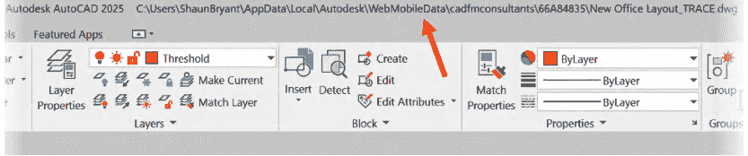

图 16.3：保存在云中的 DWG 文件的新文件路径

6. 你的图纸现在已在云中，可使用 AutoCAD 中的批注功能进行协作。

7. 要向图纸添加一个简单的批注，请在功能区上点击协作选项卡，然后在批注功能区面板上选择批注调色板图标，如图 16.4 所示。

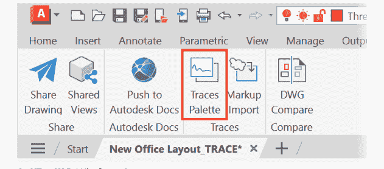

图 16.4：批注功能区面板上的批注调色板图标

当调色板打开时，你会看到 DWG 文件中没有批注。这在图 16.5 中显示。点击新建批注按钮。这将启动工作流程，允许你在 AutoCAD 桌面应用程序中使用时向 DWG 文件添加批注。

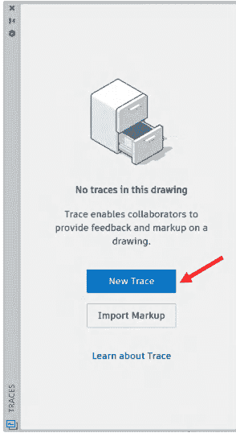

图 16.5：带有新建批注按钮的批注调色板

8. 点击新建批注后，你将进入批注模式，图纸会显示与其关联的任何批注。你没有任何批注，因此 AutoCAD 会在批注调色板中添加一个默认批注，如图 16.6 所示。在这种情况下，它称为 Trace1。

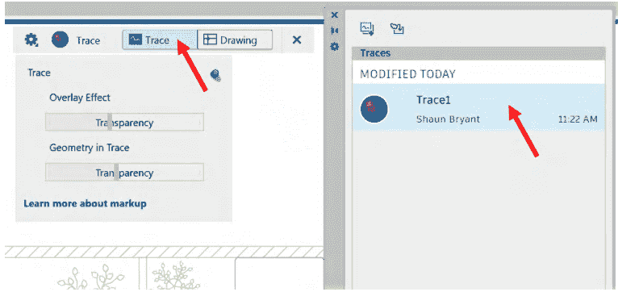

图 16.6：带有默认批注的 AutoCAD 批注模式

9. Trace1 名称是默认的，因此你可以轻松通过右键点击批注名称来重命名批注。右键菜单让你关闭、重命名或删除批注。选择重命名，如图 16.7 所示。

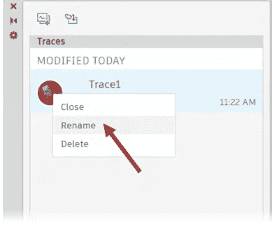

图 16.7：批注调色板上的右键菜单

10. 对于批注，使用名称 Revision1。输入后，按 Enter 确认重命名。

11. 如果现在将鼠标悬停在调色板中的批注上，你会看到 AutoCAD 为你提供批注的所有作者信息和其他信息，例如批注创建日期，如图 16.8 所示。它还显示批注的贡献者，显示还有谁参与了批注的协作。此时，只有你应显示为贡献者。

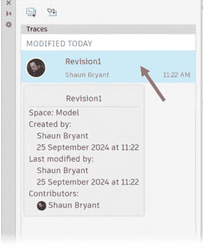

图 16.8：批注信息

12. 现在图纸中已有命名批注，你需要在批注模式下向图纸添加信息。在此情况下，你将添加一个简单的修订云。

13. 使用功能区上的 **Home** 选项卡，进入 **Draw** 面板并点击 **Draw** 面板标题栏上的箭头以展开面板图标。在 **REVCLOUD** 下拉菜单中选择 **Rectangular** 修订云。你可以在 *图 16.9* 中看到这一点。

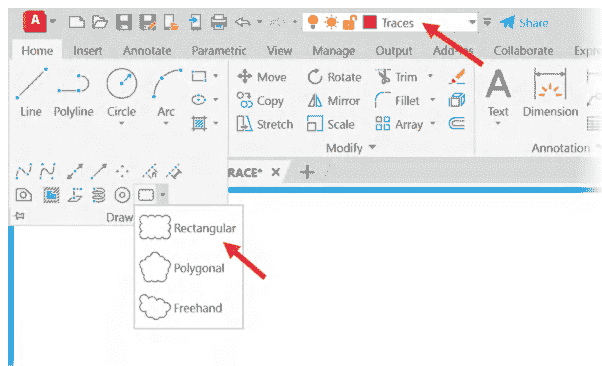

图 16.9：矩形修订云选项

14. 你现在处于 **REVCLOUD** 命令中。AutoCAD 通常会在 **REVCLOUD** 命令中预先计算弧长，但如果你愿意可以调整它。右键点击以调出快捷菜单，如 *图 16.10* 所示。

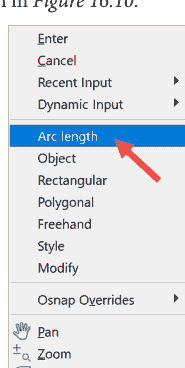

图 16.10：选择弧长的 REVCLOUD 快捷菜单

15. 你会在提示中看到默认的弧长显示。对于此练习，将弧长设置为 900，然后按 Enter。然后你就可以在批注中放置修订云了。

16. 缩放到办公平面图中的左上执行办公室，并将矩形修订云放置在该办公室的双桌配置周围，如图 16.11 所示。点击矩形修订云的两个相对角，就像使用 RECTANGLE 命令放置矩形一样。

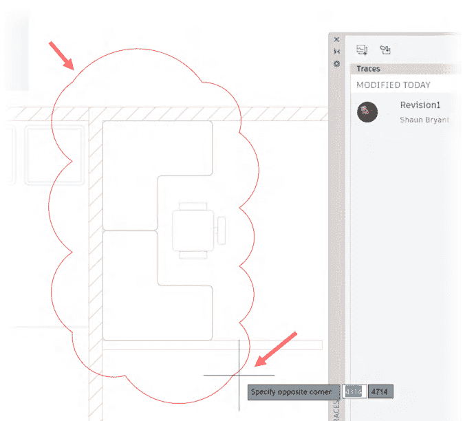

图 16.11：矩形修订云的放置，两个相对角点均已标注

17. 在第二次角点点击后，修订云被放置在 Revision1 批注中的 Traces 图层上。

18. 批注将保持附加到 DWG 文件，因此你可以通过点击批注工具栏上的小 X 来退出批注模式，如图 16.12 所示。

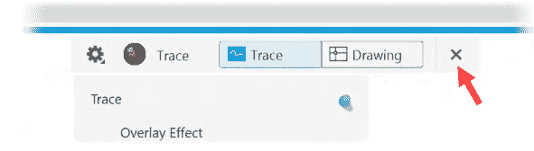

图 16.12：用于关闭批注工具栏的 X

19. 现在你可以在 AutoCAD 屏幕左上角的 QAT 上点击保存，如图 16.13 所示。你可以像这样正常保存，因为你正在处理基于云的图纸，位于 AutoCAD Web & Mobile 文件夹中。这与将图纸文件保存到本地位置（如硬盘或服务器）相同。

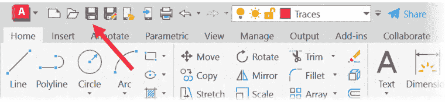

图 16.13：QAT 上的保存图标

20. 关闭批注工具栏后，你将返回到 New Office Layout_TRACE.dwg 文件中的模型选项卡。

21. 你现在已向图纸文件应用了批注并将其保存回云中。

## 技巧与窍门 #37

使用 AutoCAD 桌面应用程序向 DWG 文件添加批注是一个直接的工作流程，正如本章前一节所示。然而，有一点你应该始终记住。你不能在批注操作处于活动状态时保存 DWG，因此你必须通过关闭批注工具栏关闭批注，然后保存图纸文件。

在本节中，你通过在 AutoCAD 桌面应用程序中工作时向 DWG 文件添加批注，启动了协作工作流程。

## AutoCAD for Mac

批注功能在 AutoCAD for Mac 中受支持。如果你使用的是 2024 或 2025 版本，前一节中的工作流程是相同的。但你必须将 DWG 文件从 Mac 保存到其中一种专有的基于云的解决方案，例如 Microsoft OneDrive，因为 AutoCAD Web & Mobile 文件夹在 AutoCAD for Mac 中不受支持。

在下一节中，你将使用 AutoCAD 移动应用程序添加该批注，就像你在现场，实时在真实环境中处理新办公布局一样。

## 在 AutoCAD 移动应用程序中使用批注

本节基于在 Apple iPad Pro 上使用 AutoCAD 移动应用程序。AutoCAD 移动应用程序可在 Apple 和 Android 移动操作系统上运行，界面可能有所不同，请注意这一点。

你不一定需要访问 iPad Pro 等平板电脑。本章包含本节是为了让你了解使用 AutoCAD 移动处理基于云的 DWG 文件中的批注是多么快速和简单：

1. 假定 AutoCAD 移动应用程序已安装在 Apple iPad Pro 上。你可以在 Apple 和 Google 应用商店按订阅方式访问 AutoCAD。

2. 与 AutoCAD 桌面应用程序和 AutoCAD Web 一样，你必须使用你的 Autodesk 账户凭据登录 AutoCAD 移动应用程序。

3. 登录后，你会看到一个页面，显示 **Recent** 面板，其中显示最近访问的文件，以及 **Sources** 面板，你可以在其中访问其他基于云的文件位置，如 *图 16.14* 所示。你可以在 **Recent** 面板中看到 `New Office Layout_TRACE.dwg` 文件，因为它最近在 iPad 上被访问过。你还可以在 **Sources** 面板中使用 AutoCAD Web，这会带你进入 **AutoCAD Web & Mobile** 文件夹。此外，请注意 `New Office Layout_TRACE.dwg` 文件的列表会显示它是在 PC 上访问的还是通过 AutoCAD Web 访问的。


## 最近

- New Office Layout_TRACE.dwg
  15:10 在 PC 上
  AutoCAD Web
- 3-4 Pier Street - General Floor Plan_V2.dwg
  周一在 PC 上
  AutoCAD Web
- New Office Layout.dwg
  周一在 PC 上
  AutoCAD Web
- 显示更多...

## 来源

- AutoCAD Web
  shaun.bryant@cadfmconsult.co.uk
- OneDrive
  登录
- 文件应用
  iPad
- 添加来源

图 16.14：AutoCAD 移动应用的“最近”和“来源”屏幕

4. 单击 New Office Layout_TRACE.dwg 文件，它将在 AutoCAD 移动应用中打开，如*图 16.15*所示。右侧箭头所指即为轨迹图标。

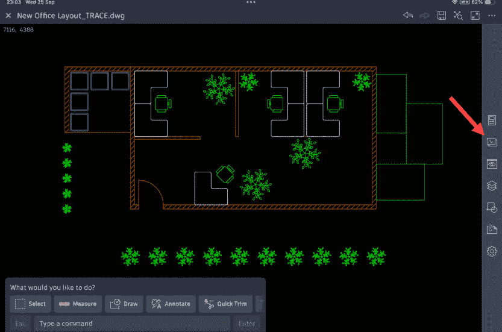

图 16.15：绘图在 AutoCAD 移动应用中打开，轨迹图标用箭头标出

5. 单击轨迹图标后，**轨迹**面板将展开到 iPad 屏幕区域，任何附加到 DWG 文件的轨迹都会以轨迹模式显示，如*图 16.16*所示。

8. 单击修订云线旁边以定位轨迹中的 **MText** 位置。接下来系统会提示您指定文本注释将占据的区域，如*图 16.17*所示。

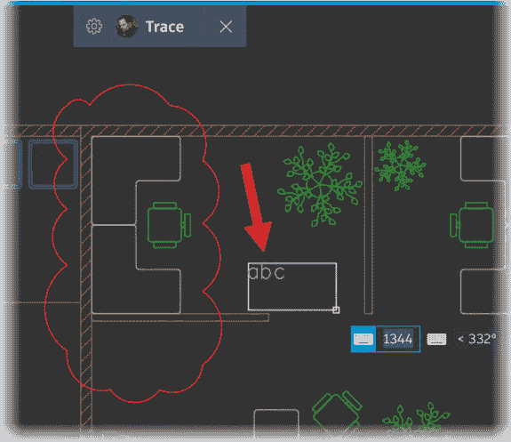

图 16.17：在屏幕上指定 MText 区域

9. 单击 MText 区域的第二个角点后，您会看到文本编辑器出现在 iPad 屏幕底部，如*图 16.18*所示。

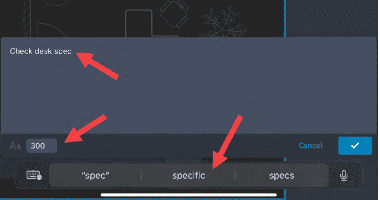

图 16.18：AutoCAD 移动应用中的文本编辑器

10. 系统会提示您使用文本编辑器设置来添加文本。在此示例中，您可以看到文本高度设置为 3 0 0，文本内容为 **Check desk spec**。此外，请注意 iPad 会提供预测文本，如下方文本编辑器区域所示。

11. 单击蓝色对勾以确认文本设置。编辑器将关闭，文本将放置在轨迹中，如*图 16.19*所示。

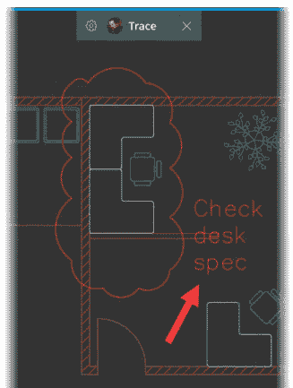

图 16.19：放置在 DWG 文件轨迹中的 MText

12. 使用**轨迹**工具栏上的 **X** 符号，即可关闭**轨迹**工具栏并退出轨迹模式。然后您将返回绘图。如果**轨迹**面板未关闭，请单击轨迹图标，如前面*图 16.15*所示。

13. 确保使用 **保存** 图标（位于 iPad 屏幕右上角）保存绘图文件，如*图 16.20*所示。图标会显示绿色对勾，表示已成功保存到云端。


图 16.20：AutoCAD 移动应用中的保存图标

14. 现在，您已在 AutoCAD 移动应用中保存 New Office Layout_TRACE.dwg，此前您已在附加到绘图文件的轨迹中添加了一些 MText 注释。更改现已保存，可供进一步协作使用。

在本节中，您了解了 AutoCAD 订阅中的轨迹功能如何让您通过 AutoCAD 移动应用在绘图中与新的和现有的轨迹进行协作。在下一节中，我们将在 AutoCAD Web 中使用轨迹。

## 在 AutoCAD Web 中使用轨迹

本节基于使用 AutoCAD Web 对本章一直在使用的轨迹进行协作。

在上一节中，New Office Layout_TRACE.dwg 文件已通过 AutoCAD 移动应用保存到云端，因此您可以确定它是最新的。您可以使用 AutoCAD 订阅凭据登录 AutoCAD Web 后进行检查。登录后，该绘图将显示在“最近”列表中，如图 16.21 所示。

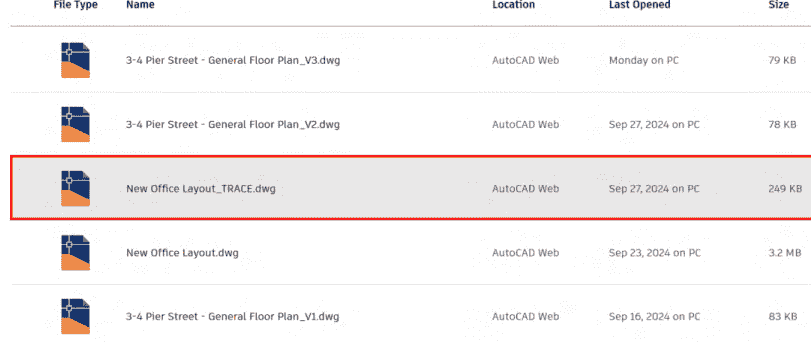

图 16.21：在 AutoCAD Web 的“最近”列表中列出的绘图

绘图文件会显示上次打开的日期，让您可以检查它是否是最新版本。

> **提示和技巧 #38**
> 
> 在使用基于云的 DWG 文件进行协作时，检查您是否正在处理最新绘图的一个非常简单的方法是采用合理的文件命名规范。本章当前使用的绘图名为 New_Office_Layout_TRACE.dwg。要跟踪 DWG 文件中的编辑和更改，请确保文件名的当前修订版本包含在文件名中。例如，您可以将使用的文件命名为 New_Office_Layout_TRACE_REV1.dwg，其中 REV1 表示绘图文件的第一次修订。

现在，您需要在 **AutoCAD Web** 中打开绘图文件，以检查上一节中使用 AutoCAD 移动应用添加的轨迹：

1. 登录 AutoCAD Web 后，在**最近**列表中双击 New_Office_Layout_TRACE.dwg 文件以将其打开。
2. DWG 文件将在 AutoCAD Web 中打开，如*图 16.22*所示。

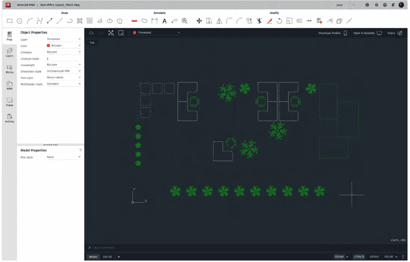

图 16.22：在 AutoCAD Web 中打开的 DWG 文件

3. 打开 AutoCAD Web 时，默认情况下始终会设置**特性**选项板。

6. 轨迹属性也显示在**轨迹**选项板中。它们显示在**轨迹**列表下，如*图 16.24*中的箭头所示。

7. 如*图 16.25*所示，您可以检查这些轨迹属性以确保它们是最新的。您还可以查看是谁在绘图中添加了轨迹，以及谁在其中进行了协作。

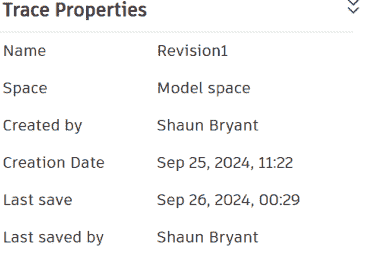

图 16.25：Revision1 轨迹的轨迹属性

8. 双击轨迹中的文本，AutoCAD Web 文本编辑器将显示，如*图 16.26*所示。

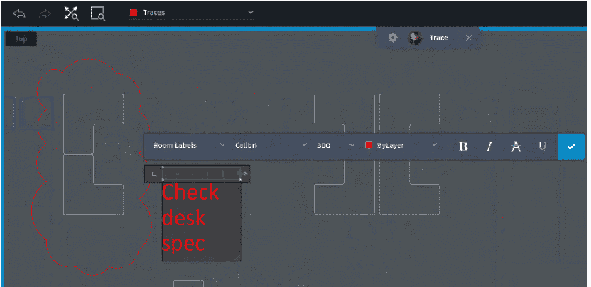

图 16.26：在 AutoCAD Web 的轨迹模式下显示的文本编辑器

9. 将文本编辑为 Check desk spec and cost，然后单击文本编辑器栏末尾的蓝色对勾。这将关闭文本编辑器并更新轨迹中的文本，如图 16.27 所示。

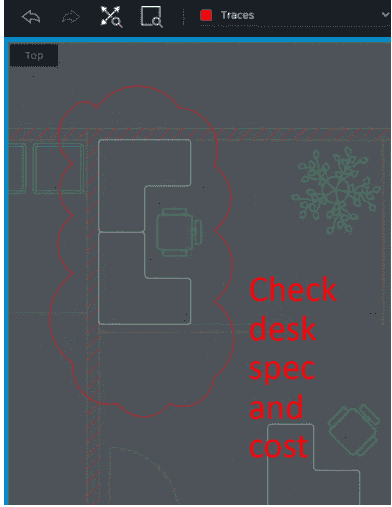

图 16.27：轨迹中更新后的文本

10. 现在，您可以单击轨迹工具栏末尾的 X 退出轨迹模式，如图 16.28 所示。

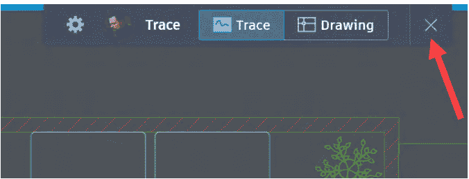

图 16.28：轨迹工具栏，X 用箭头标出

11. 更新后的轨迹现在已设置在 DWG 文件中，您现在需要将绘图保存到云端，以确保更新后的轨迹可供其他协作者使用。使用 AutoCAD Web 应用程序窗口右上角的保存图标，如图 16.29 所示。

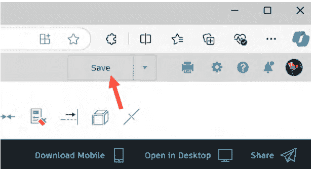

图 16.29：AutoCAD Web 中的保存图标

12. 确保退出并注销 AutoCAD Web。您现在已在 AutoCAD Web 中编辑轨迹，并将更新后的 DWG 文件保存到云端。

在本节中，您学习了如何在 AutoCAD Web 中打开包含现有轨迹的基于云的 DWG 文件。然后，您编辑了轨迹，并将更新后的 DWG 文件保存回云端以供进一步协作。

## 在 AutoCAD 桌面应用程序中查看轨迹

在之前的章节中，您学习了如何在 AutoCAD 移动应用和 AutoCAD Web 中更新轨迹。

在本节中，您将在 AutoCAD 桌面应用程序中打开云端更新后的 DWG 文件，并查看更新后的轨迹。您仍将使用同一个 DWG 文件 New Office Layout_TRACE.dwg，并将使用轨迹选项板：

1. 打开 AutoCAD 桌面应用程序，单击快速访问工具栏（QAT）上的“从 Web 和移动端打开”图标，如图 16.30 所示。

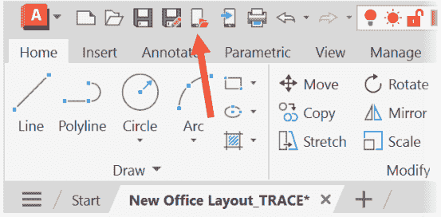

图 16.30：快速访问工具栏（QAT）上的“从 Web 和移动端打开”图标

2. 将显示“从 AutoCAD Web 和移动端打开”对话框。选择 New Office Layout_TRACE.dwg 文件并打开它，如图 16.31 所示。绘图将在 AutoCAD 中打开。

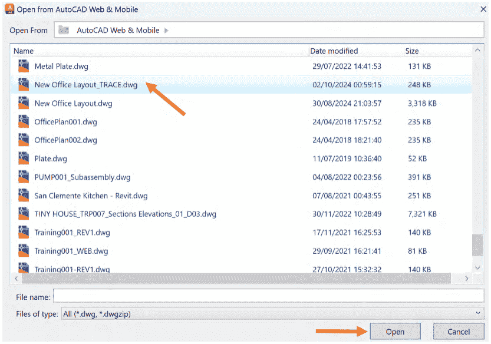

图 16.31：“从 AutoCAD Web 和移动端打开”对话框


+   3. 在AutoCAD功能区上单击**协作**选项卡，然后在**轨迹**面板上单击**轨迹选项板**图标，如*图16.32*所示。

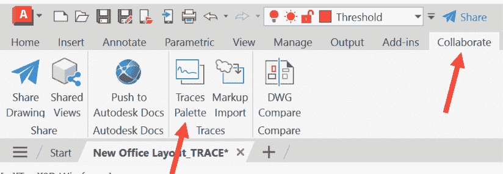

图16.32：轨迹面板上的轨迹选项板图标

+   4. **轨迹选项板**将在AutoCAD中打开。在选项板上选择**Revision1**轨迹，如*图16.33*所示。

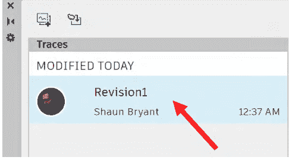

图16.33：显示Revision1轨迹的轨迹选项板

5. 选择轨迹后，您将进入AutoCAD中的轨迹模式，并显示轨迹，如图16.34所示。

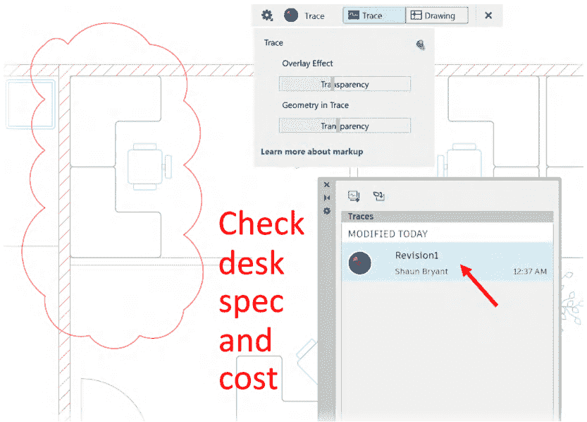

图16.34：绘图中的轨迹以轨迹模式显示

6. 您现在可以看到已在AutoCAD移动应用程序和AutoCAD Web中处理的更新轨迹。请注意，文本已更新，这些更改现在反映在AutoCAD桌面应用程序中显示的轨迹中。

作为协作者，您可以通过编辑文本注释轻松添加到现有轨迹。双击轨迹文本以激活AutoCAD文本编辑器，如图16.35所示。您还会看到上下文相关的“文本编辑器”选项卡出现在功能区上。

9. 确保使用编辑后的轨迹文本将绘图保存回云端。使用QAT上的“保存”图标，如图16.37所示。

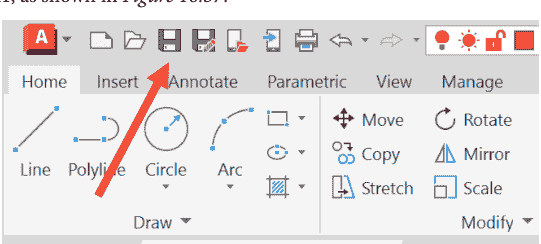

图16.37：使用“保存”图标将DWG保存回云端

10. 您现在已编辑轨迹文本并将绘图保存回云端。如果该绘图在AutoCAD Web或AutoCAD移动应用程序中打开，这些文本更改现在将生效。

## 适用于Mac的AutoCAD

如前面章节所述，在AutoCAD for Mac中使用时，“AutoCAD Web & Mobile”文件夹以及`OPENFROMWEBMOBILE`和`SAVETOWEBMOBILE`命令不可用。但是，您仍然可以使用其他基于云的专有解决方案（如Microsoft OneDrive）进行协作。OneDrive受AutoCAD Web和AutoCAD移动应用程序支持，因此，当在Mac版AutoCAD的AutoCAD桌面中工作时，您可以将文件保存到OneDrive中选择的基于云的位置，然后通过使用所选云位置的相应登录凭据，使用AutoCAD Web或AutoCAD移动应用程序连接到该位置。

在本节中，您学习了在通过AutoCAD Web和AutoCAD移动应用程序保存轨迹更改后，如何在AutoCAD桌面应用程序中查看基于云的DWG文件中的轨迹。您现在可以理解不仅将图纸保存到云端，而且在DWG文件协作方面使用AutoCAD Web和AutoCAD移动应用程序的好处。现在让我们回顾本章所学内容！

## 摘要

您可以在官方AutoCAD博客上了解有关使用AutoCAD Web处理简单项目的更多信息：

```
https://www.autodesk.com/blogs/autocad/tackling-a-new-workshop-build-with-autocad-web/
```

您还可以在Autodesk网站上了解有关AutoCAD Web的更多信息：

```
https://help.autodesk.com/view/ACD/2022/ENU/?guid=GUID-B4A46563-E5CA-4A34-918C-78ADEA2FEEB4
```

关于AutoCAD移动应用程序的更多信息，请访问 https://help.autodesk.com/view/ACD/2022/ENU/?guid=GUID-20A8F96D-0ACA-49F6-A6FF-D7DD71A8D03A。在本章中，您学习了如何在AutoCAD桌面应用程序中添加新轨迹。在此过程中，您学习了如何使用轨迹工具向AutoCAD DWG文件添加轨迹，并使用云端绘图存储为其做好协作准备。

您学习了如何在AutoCAD移动应用程序中使用轨迹工具，使用iPad Pro等智能移动设备添加和编辑轨迹，以及如何学习在AutoCAD Web中使用轨迹工具，在Web浏览器中使用AutoCAD Web添加和编辑轨迹。

您还学习了如何使用AutoCAD桌面应用程序中的轨迹工具查看和编辑现有轨迹信息，编辑之前在AutoCAD移动应用程序和AutoCAD Web中编辑的轨迹文本。

AutoCAD中的轨迹在AutoCAD的所有迭代（无论是桌面应用程序、Web应用程序还是移动应用程序）中提供无缝的实时协作体验。这将用户界面扩展到了桌面之外，还扩展到浏览器或智能移动设备，使您的DWG文件完全移动化，随时可以轻松访问。所有更改都可以使用轨迹功能实时更新和协作。

本章结束了本书的学习，您现在应该已经获得了大量知识，以增强和改善日常AutoCAD流程和工作流。

享受AutoCAD的乐趣！

## 索引

## 符号

3Dconnexion 图标 70, 71

3D 建模
  利用3D对象捕捉 80-83

## A

精确表格样式
  使用 172-181

活动洞察 376

角度工具
  用于测量精确角度 134-137

注释比例
  用于提高绘图清晰度 87-92
  在模型选项卡中使用 197-204

注释性标注样式
  设置 165-172

面积工具
  用于面积相加和相减 129-133

属性 245
  在AutoCAD块中定义 246-256
  使用增强属性编辑器编辑 257-259

AutoCAD
  默认工作空间 4
  界面 4
  界面设置 4-6
  功能区设置 6-12

AutoCAD块
  用于创建常规门块 266-271
  用于定义属性 246-256

AutoCAD块属性
  参考链接 264

AutoCAD CUI
  从……中删除冗余工作空间 37-41

AutoCAD桌面
  将DWG文件保存到云端 370-372
  在其中查看轨迹 417-422
  与轨迹一起使用 398-406

适用于Mac的AutoCAD 152
  使用文件选项卡 47
  自定义状态栏 60
  ViewCube工具 66
  模型和布局的工作流程 53

AutoCAD界面更改
  保存到自定义工作空间 33-37

AutoCAD移动应用程序
  打开图纸 384-391
  处理图纸 384-391
  在其中使用轨迹 406-411
  使用更新的图纸 392-395

AutoCAD导航栏（navbar）66, 67
  3Dconnexion 70, 71
  导航轮 67, 68
  轨道（弹出）图标 70
  实时平移工具 68
  ShowMotion工具 71-73
  缩放图标 69

AutoCAD ViewCube 63-66

AutoCAD Web
  处理共享图纸 327-335
  在其中使用轨迹 412-417

AutoCAD Web应用程序
  打开图纸 376
  处理图纸 376-384
  使用更新的图纸 393-395

Autodesk知识网络（AKN）25

Autodesk查看器
  参考链接 335
  处理共享视图 340-345

## B

块属性管理器（BATTMAN）
  使用 260-263

块库绘图
  使用剪贴板功能创建 227-231

块
  引入到图纸中 214, 215

块选项板 256
  添加到块库 231-236

## C

CadMouse 70

剪贴板功能
  用于创建块库绘图 227-231

光盘（CD）16

计算机辅助设计（CAD）3

计算机辅助制造（CAM）136

自定义用户界面（CUI）命令 3, 21-26, 29, 35

## D

尺寸标注
  使用尺寸样式管理 152-164

距离工具
  用于长度和角度计算 125-129

状态栏的草图设置
  使用 53-62

使用DWG比较生成的图纸比较
  处理 353-356

绘图历史工具
  使用 372-376

图纸
  使用修改面板优化 137-143

DWG比较 347
  比较图纸 348-353

DWG比较快照模式 357

DWG文件
  从AutoCAD桌面保存到云端 370-372

动态块
  引入到图纸中 214, 215
  添加到水平翻转 279-286
  参考链接 291
  测试 286-291
  与可见性状态一起使用 316-319
  添加到垂直翻转 271-279
  添加可见性状态 306

动态门块
  添加 219-227

## E

**增强属性编辑器**
  用于编辑属性 257-259

**外部参考文件（Xref）** 347, 365

## F

**文件选项卡**
  使用 44-47

**翻转操作** 293

**翻转夹点** 279

**浮动模型空间** 193

## G

**几何中心** 108-112

**Google Chrome** 326

## H

**汉堡图标** 44

## I

**ISODRAFT设置**
  用于创建
    等轴测视图 83-85

**等轴测草图** 83

**等轴测视图**
  使用ISODRAFT设置创建 83-85

## L

**布局选项卡**
  使用 47-53

## M

**测量（MEASUREGEOM）**
  **命令** 129, 136

**Microsoft Edge** 326

**Microsoft OneDrive** 394

**两点之间的中点（M2P）** 113

**模型选项卡**
  处理注释比例 197-204
  使用 47-53

**修改面板**
  用于优化图纸 137-143

**多个对象捕捉**
  使用对象捕捉追踪（AUTOSNAP）102-106

## N

**导航轮（方向盘）** 67, 68

**嵌套块** 247

**名词/动词选择**
  用于对象选择 122-125

## O

**对象注释比例**
  添加 204-208
  删除 204-208

**对象捕捉（Osnaps）** 95

**对象捕捉追踪（AUTOSNAP）**
  几何中心 108-112
  用法 106
  用于多个对象捕捉 102-106
  使用捕捉覆盖 106-118

**轨道（弹出）图标** 70

**ORTHOMODE**
  用于正交移动 100, 101


## P

**极轴追踪**
需要 97
用于测量角度 96-99
**精确角度**
使用角度工具测量 134-137

## Q

**快速访问工具栏（QAT）3, 83, 324**
自定义 16-18
设置 18-21
有效使用 15
**快速引线（QLEADER）命令 165**
**快速测量**
用于长度和角度
计算 125-129

## R

**实时平移工具 68**
**冗余工作空间**
从 AutoCAD CUI 中移除 37-41
**通过外部参照比较生成的参照文件比较**
使用 364-366
**常规块 214**
**常规门块**
添加 215-219
使用 AutoCAD 块创建 266-269, 271

## S

**选择循环**
用于对象选择 76-79
**共享图形**
在 AutoCAD Web 中工作 327-335

## 共享图形工具

使用 324-326
**共享视图**
在 Autodesk Viewer 中工作 340-345
**共享视图选项板**
使用 335-339
**ShowMotion 工具 71, 73**
**捕捉替代**
用于对象捕捉追踪
（AUTOSNAP）106-118
**SpaceMouse 70**
**状态栏**
使用草稿设置 53-63
通过状态栏更改单位 85-87
**粘性面板**
使用 12-15

## T

**文字样式**
创建以管理文字大小
和字体 146-151
**工具选项板**
用于在 AutoCAD 中创建块库
工具选项板 236-244
**轨迹**
在 AutoCAD 桌面应用中
查看 417-422
在 AutoCAD 移动应用中
使用 406-411
与 AutoCAD 桌面版一起使用 398-406
与 AutoCAD Web 一起使用 412-417

## V

**视口**
选择 188
设置 184-196

## W

视口比例
  变化 184-196
可见性状态 293
  在动态块中添加 306
  与动态块一起使用 316-319
  设置第一个状态 307-313
  添加多个状态 313-315

洗脸盆块图形
  创建 294
  添加前视块 294-298
  添加顶视块和侧视块 298-302
洗脸盆动态块
  为每个视图添加 303-306
工作空间
  创建 32, 33
  选择 30-32
  使用 30

## X

外部参照比较 347, 357
  比较图形 357-363

## Z

缩放图标 69


www.packtpub.com

订阅我们的在线数字图书馆，即可完全访问超过 7,000 本图书和视频，以及业界领先的工具，帮助你规划个人发展并推进职业生涯。如需了解更多信息，请访问我们的网站。

# 为什么订阅？

+   - 花更少时间学习，花更多时间编码，使用来自 4,000 多位行业专家的实用电子书和视频
+   - 通过专为你打造的技能计划改善学习
+   - 每月获赠一本免费电子书或视频
+   - 完全可搜索，便于获取关键信息
+   - 可复制、粘贴、打印和书签收藏内容

你知道吗，Packt 为每本已出版图书提供电子书版本，包含 PDF 和 ePub 文件？你可以访问 packtpub.com 升级到电子书版本，作为纸质书客户，你还有权享受电子书副本折扣。如需了解更多详情，请联系我们：customerservice@packtpub.com。

在 www.packtpub.com，你还可以阅读一系列免费技术文章，订阅各种免费新闻通讯，并获得 Packt 图书和电子书的独家折扣和优惠。

## 你可能喜欢的其他图书

如果你喜欢这本书，你可能还会对 Packt 的以下其他图书感兴趣：


# 实用 Autodesk AutoCAD 2023 和 AutoCAD LT 2023 – 第二版

Jaiprakash Pandey, Yasser Shoukry

ISBN: 978-1-80181-646-5

+   - 理解 CAD 基础知识，如功能、导航和组件
+   - 使用基本形状和编辑工具创建复杂 3D 对象
+   - 使用块等可重用对象，并通过 xRef 进行协作
+   - 探索外部参照和动态块等高级功能
+   - 发现曲面和网格建模工具，如圆角、修剪和延伸
+   - 使用图纸空间布局为 2D 和 3D 模型创建打印
+   - 将 2D 图形转换为 3D 模型


# AutoCAD 2025 最佳实践、提示与技巧

Jeanne Aarhus

ISBN: 978-1-83763-672-3

+   - 识别常用命令中的隐藏功能
+   - 探索创新方法，让 AutoCAD 为你简化工作流程
+   - 使用动态块和自定义功能，以更少的步骤完成 AutoCAD 任务
+   - 从 AutoCAD 资深用户和专家那里获得内行技巧，为你节省多年的试错
+   - 利用 AutoCAD 未被充分利用的功能，如用于数据导入和导出的表格
+   - 控制 AutoCAD 如何响应你的日常工作流程和真实环境

# Packt 正在寻找像你一样的作者

如果你有兴趣成为 Packt 的作者，请访问 authors.packtpub.com 并立即申请。我们曾与成千上万的开发者和技术专业人士（就像你一样）合作，帮助他们与全球技术社区分享见解。你可以提交一般申请，申请成为我们正在招募作者的具体热门话题的作者，或提交你自己的想法。

# 分享你的想法

现在你已经读完了 *精通 AutoCAD 2025*，我们很想听听你的想法！如果你从亚马逊购买了这本书，请点击此处直接前往本书的亚马逊评论页面分享你的反馈，或者在你购买本书的网站上留下评论。

你的评论对我们和技术社区都很重要，将帮助我们确保提供卓越质量的内容。

