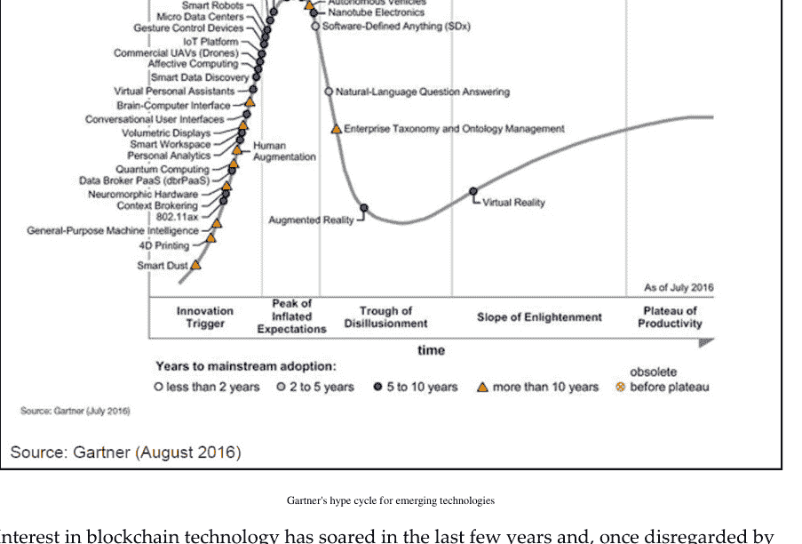
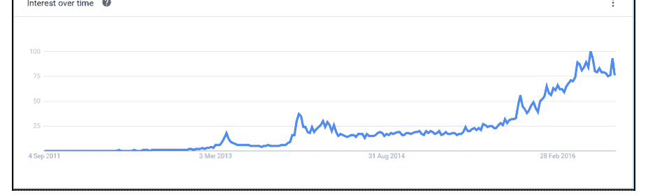
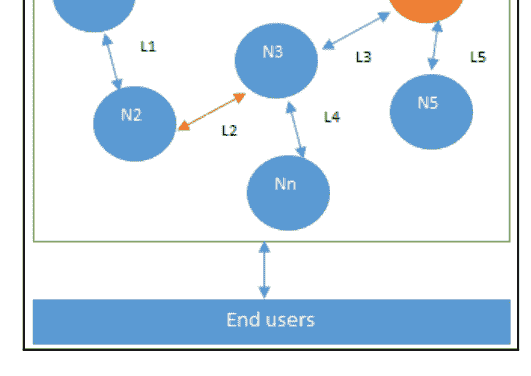
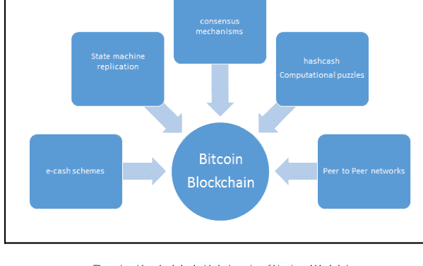
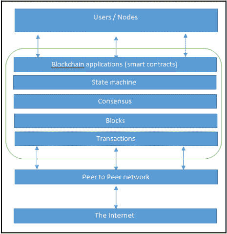
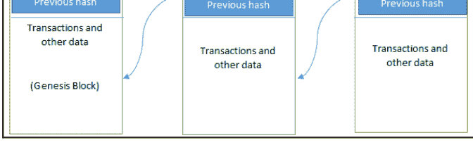

# 1 区块链入门
## 区块链入门

阅读本书的读者很可能已经听说过区块链，并对其巨大的潜力有基本的认识。

随着 2008 年比特币的发明，世界接触到了一个全新概念，该概念如今极有可能彻底改变整个社会。它承诺将影响各行各业，包括但不限于金融、政府和媒体。有些人将其描述为一场革命，而另一种观点则认为这是一场进化，区块链的实际好处需要很多年才能最终显现。这种观点在一定程度上是正确的，但在我看来，革命已经开始了；世界各地许多大型组织已经开始使用区块链技术撰写概念验证，因为其颠覆性潜力已被充分认识到。然而，一些组织仍处于初步探索阶段，但随着技术日益成熟，预计它们将更快地取得进展。这项技术也对现有技术产生影响，并具备从根本上改变它们的能力。

根据下面所示的 Gartner 技术炒作周期图，区块链技术目前处于**期望膨胀期**（截至 2016 年 7 月），预计在未来 5 至 10 年内准备好进入主流采用阶段：

来源：Gartner（2016 年 8 月）

新兴技术的 Gartner 炒作周期

过去几年中，人们对区块链技术的兴趣激增，曾经被一些人从加密货币的角度视为极客货币，或被认为并非真正值得关注的技术，如今全球最大的公司和小组织正在对其进行研究，并投入数百万美元以采用和实验这项技术。在 Google 上进行一次简单的趋势搜索即可揭示过去几年区块链技术的关注度规模：

区块链的 Google 趋势

人们设想了该技术的各种好处，例如去中心化信任、成本节约、透明度和效率。然而，也存在各种挑战，如可扩展性和隐私，这些也是活跃研究的领域。**第 12 章：可扩展性及其他挑战**专门讨论区块链技术的局限性和挑战。

本章是区块链技术及其技术基础、背后的理论以及为构建当今所称的区块链而结合的各种技术的介绍。

2008 年，一篇开创性的论文 [Bitcoin: A Peer-to-Peer Electronic Cash System](https://bitcoin.org/bitcoin.pdf) 在点对点电子现金主题下，以化名中本聪撰写，并引入了**区块链**这一术语。多年来，该术语现在已演变为区块链一词。

在本章中，首先描述分布式系统的理论基础，然后介绍比特币的前身（借此引入了区块链技术），如电子现金和哈希现金，最后介绍区块链技术。这是一种理解区块链技术的逻辑方式，因为区块链的根源在于分布式系统。

## 分布式系统

理解分布式系统对于理解区块链至关重要，因为区块链的核心基本上是一个分布式系统。更准确地说，它是一个去中心化的分布式系统。

分布式系统是一种计算范式，两个或多个节点以协调的方式相互协作，以实现共同的结果，并且以这样的方式建模，使最终用户将其视为单个逻辑平台。

节点可以定义为分布式系统中的单个参与者。所有节点都能够相互发送和接收消息。节点可以是诚实的、有故障的或恶意的，并拥有自己的内存和处理器。能够表现出任意行为的节点也被称为拜占庭节点。这种任意行为可能是故意恶意的，对网络运行有害。通常，网络上节点的任何意外行为都可以归类为拜占庭行为。该术语任意地涵盖了任何意外或恶意的行为：

分布式系统的设计；N4 是拜占庭节点，L2 是损坏或慢速的网络链接

分布式系统设计的主要挑战是节点间的协调和容错。即使一些节点出现故障或网络链接中断，分布式系统也应容忍这种情况，并应继续完美运行以实现期望的结果。多年来，这一直是一个活跃的研究领域，已经提出了几种算法和机制来解决这些问题。

分布式系统设计极具挑战性，因此证明了一个称为 **CAP 定理**的定理，该定理指出分布式系统不能同时拥有所有备受期望的特性。在下一节中，将提供关于 CAP 定理的基本介绍。

## CAP 定理

这也被称为 Brewer 定理，最初由 *Eric Brewer* 于 1998 年作为一个猜想提出；2002 年，*Seth Gilbert* 和 *Nancy Lynch* 将其证明为一个定理。

该定理指出，任何分布式系统不能同时具有**一致性**、**可用性**和**分区容忍性**：

- **一致性** 是一个确保分布式系统中所有节点拥有单个最新数据副本的特性。
- **可用性** 意味着系统是启动的、可访问的，并且在需要时接受传入请求并响应数据，没有任何故障。
- **分区容忍性** 确保如果一组节点故障，分布式系统仍能继续正确运行。

已证明，分布式系统不能同时具有上述三个特性。这很奇怪，因为区块链似乎设法实现了所有这些特性，或者真的如此吗？这将在本章稍后讨论 CAP 定理在区块链上下文中的应用时进行解释。

为了实现容错，使用了**复制**。这是实现容错的常见且广泛使用的方法。**一致性**是使用**共识算法**来实现的，以确保所有节点拥有相同的数据副本。这也称为**状态机复制**。区块链基本上是实现状态机复制的一种方法。

一般来说，节点可能经历两种类型的故障：有故障节点仅仅是崩溃了，或者有故障节点可以任意表现出恶意或不一致的行为。这是难以处理的一种，因为它可能因误导性信息而造成混乱。

## 拜占庭将军问题

在讨论分布式系统中的共识之前，先呈现历史上的一些事件，它们是成功且实用的共识机制发展的先驱。

1962年9月，*保罗·巴兰*在其论文*《论分布式通信网络》*中提出了加密签名的概念。这也是首次引入去中心化网络概念的论文。1982年，*兰波特等人*提出了一个思想实验，其中一群统领拜占庭军队不同部分的陆军将领正计划进攻或撤退一座城市。他们之间唯一的通信方式是信使，并且为了获胜，他们需要在同一时间发起进攻。问题是，一个或多个将军可能是叛徒，并可能传递误导性信息。因此，需要找到一种可行的机制，即使在存在叛徒将军的情况下，也能让将军们达成一致，从而使进攻仍能同时进行。类比于分布式系统，将军可视为节点，叛徒可视为拜占庭（恶意）节点，信使可视为将军之间的通信渠道。

1999年，*卡斯特罗*和*利斯科夫*解决了这个问题，他们提出了**实用拜占庭容错（PBFT）**算法。后来在2009年，随着比特币的发明，首次出现了实际实现，其中开发了**工作量证明（PoW）**算法作为达成共识的机制。

## 共识

共识是互不信任的节点就数据的最终状态达成一致的过程。为了实现共识，可以使用不同的算法。在两个节点（例如客户端-服务器系统）之间达成协议很容易，但当多个节点参与分布式系统并且需要就单一值达成一致时，达成共识就变得非常困难。这种在多个节点之间达成共识的概念被称为分布式共识。

### 共识机制

共识机制是所有或大多数节点为就提议的状态或值达成一致而采取的一组步骤。三十多年来，工业界和学术界的计算机科学家一直在研究这一概念。随着比特币和区块链的出现，共识机制近来备受关注并广受欢迎。

为了在共识机制中获得预期结果，必须满足各种要求。以下是对这些要求的简要描述：

- **一致性：** 所有诚实节点决定相同的值。
- **终止性：** 所有诚实节点终止共识过程的执行，并最终达成决策。
- **有效性：** 所有诚实节点达成的值必须与至少一个诚实节点提出的初始值相同。
- **容错性：** 共识算法应能在存在故障或恶意节点（拜占庭节点）的情况下运行。
- **完整性：** 这一要求是指任何节点不得多次做出决策。在单个共识周期中，节点只做一次决策。

### 共识机制的类型

共识机制有多种类型；下面介绍一些常见类型：

- **基于拜占庭容错：** 该方法不需要诸如部分哈希求逆之类的计算密集型操作，而是依赖于一种简单的节点发布签名消息的方案。最终，当收到一定数量的消息时，就达成一致。
- **基于领导者的共识机制：** 这类机制要求节点参与*领导者选举抽签*，获胜的节点提出最终值。

已经提出了许多实际实现，例如**Paxos**，这是**莱斯利·兰波特**于1989年提出的最著名的协议。在Paxos中，节点被分配了不同的角色，如提议者、接受者和学习者。节点或进程被称为副本，在存在故障节点的情况下，通过多数节点的一致同意来达成共识。

Paxos的另一个替代方案是Raft，它通过为节点分配三种状态之一（即追随者、候选者或领导者）来工作。当候选节点获得足够票数后，就会选举出一个领导者，所有变更现在都必须经过领导者；一旦大多数追随者节点上的复制完成，领导者就提交提议的变更。

从分布式系统角度对共识机制理论进行更详细的探讨超出了本章的范围。在本章后面，将用一整节专门介绍共识协议。本书后续章节将专门讨论比特币和其他区块链的具体算法。

## 区块链的历史

区块链随着比特币在2008年的发明而出现，并于2009年实际实施。对于本章而言，简要介绍比特币就足够了，因为后面有专门一章介绍比特币；但提及比特币也是必要的，因为没有它，区块链的历史就不完整。

电子现金或数字货币的概念并不新鲜。自20世纪80年代以来，就存在基于*大卫·肖姆*提出的模型的电子现金协议。

### 电子现金

正如理解分布式系统的概念对于理解区块链技术是必要的一样，电子现金的概念对于理解区块链第一个且极其成功的应用——比特币，或广义上的加密货币——也是必不可少的。分布式系统中的理论概念（如共识算法）为比特币中工作量证明算法的实际实现提供了基础；此外，不同电子现金方案的思想也为加密货币（特别是比特币）的发明铺平了道路。

在本节中，读者将了解电子现金的概念，然后介绍加密货币之前存在的、促成比特币发展的各种其他概念。

### 电子现金的概念

电子现金系统需要解决的基本问题是可问责性和匿名性。*大卫·肖姆*在他1984年的开创性论文中通过引入两种密码学操作解决了这两个问题，即盲签名和秘密共享。这些术语和相关概念将在`Chapter 3`*密码学与技术基础*中详细讨论。目前，只需说明盲签名允许在实际上不看到文档的情况下对文档进行签名，而秘密共享是一种允许检测同一电子现金代币被使用两次（双重支付）的概念。

此后，出现了其他协议，例如**Chaum、Fiat和Naor (CFN)**，这些电子现金方案引入了匿名性和双重支付检测。Brand的电子现金是另一个系统，它对CFN进行了改进，使其更高效，并引入了安全归约的概念来证明有关电子现金方案的陈述。安全归约是密码学中使用的一种技术，通过使用另一个问题作为比较来证明某个算法是安全的。换句话说，一个密码安全算法与某个其他难题一样难以攻破；因此，通过比较可以推断出该密码安全算法也是安全的。

一个不同但相关的概念是**哈希现金**，由*亚当·贝克*于1997年提出，作为一种控制电子邮件垃圾邮件的PoW系统。这个想法很简单：如果合法用户想要发送电子邮件，他们需要在发送电子邮件之前计算一个哈希值，作为他们花费了合理计算资源的证明。生成哈希现金是一个计算密集型过程，但不会阻止合法用户发送电子邮件，因为合法用户通常需要发送的电子邮件数量可能相当低。另一方面，如果垃圾邮件发送者想要发送电子邮件，通常数量可达数千封，那么为所有电子邮件计算哈希现金就变得不可行，从而使垃圾邮件发送成本高昂；因此，这种机制可以用来阻止电子邮件垃圾邮件。计算哈希现金需要大量的计算资源，但验证起来简单快捷。验证由接收电子邮件的用户执行。哈希现金因其在比特币挖矿过程中的使用而广受欢迎。这种使用计算难题或定价函数来防止电子邮件垃圾邮件的想法最早由*辛西娅·德沃克*和*莫尼·纳奥尔*于1992年提出。定价函数是指在授予资源访问权限之前需要计算的困难函数的名称。后来，*亚当·贝克*于1997年独立发明了哈希现金，引入了使用计算哈希函数作为PoW的方法。

1998年，*戴伟*提出了**b-money**，并提出了通过解决计算难题（如哈希现金）来创造货币的想法。它基于一个点对点网络，其中每个节点维护自己的交易列表。

*尼克·萨博*提出的另一个类似想法称为BitGold，于2005年提出，也提议通过解决计算难题来铸造数字货币。2005年，*哈尔·芬尼*通过结合b-money和哈希现金难题的思想引入了加密数字货币的概念，但它仍然依赖于中心化的可信权威机构。

上述段落中描述的方案存在多个问题。这些问题包括节点之间的分歧没有明确解决方案，以及依赖中心化可信第三方和可信时间戳等。

In 2009 the first practical implementation of a cryptocurrency named bitcoin was introduced; for the very first time it solved the problem of distributed consensus in a trustless network. It uses public key cryptography with hashcash as PoW to provide a secure, controlled, and decentralized method of minting digital currency. The key innovation is the idea of an ordered list of blocks composed of transactions and cryptographically secured by the PoW mechanism. This will be explained in more detail in Chapter 4, Bitcoin.

Looking at all the aforementioned technologies and their history, it is easy to see how ideas and concepts from electronic cash schemes and distributed systems were combined together to invent bitcoin and what now is known as blockchain.

This can also be visualized with the help of the following diagram:

The various ideas that helped with the invention of bitcoin and blockchain

## Introduction to blockchain

There are various definitions of blockchain; it depends on how you look at it. If you look at it from a business perspective it can be defined in that context, if you look at it from a technical perspective one can define it in view of that.

**Blockchain** at its core is a peer-to-peer distributed ledger that is cryptographically secure, append-only, immutable (extremely hard to change), and updateable only via consensus or agreement among peers.

## Blockchain 101

Blockchain can be thought of as a layer of a distributed peer-to-peer network running on top of the Internet, as can be seen below in the diagram. It is analogous to SMTP, HTTP, or FTP running on top of TCP/IP. This is shown in the following diagram:

The network view of a blockchain

From a business point of view a blockchain can be defined as a platform whereby peers can exchange values using transactions without the need for a central trusted arbitrator. This is a powerful concept and once readers understand it they will realize the tsunami potential of blockchain technology. This allows blockchain to be a decentralized consensus mechanism where no single authority is in charge of the database.

A block is simply a selection of transactions bundled together in order to organize them logically. It is made up of transactions and its size is variable depending on the type and design of the blockchain in use. A reference to a previous block is also included in the block unless it's a genesis block. A genesis block is the first block in the blockchain that was hardcoded at the time the blockchain was started. The structure of a block is also dependent on the type and design of a blockchain, but generally there are a few attributes that are essential to the functionality of a block, such as the block header, pointers to previous blocks, the time stamp, nonce, transaction counter, transactions, and other attributes.

The structure of a generic blockchain can be visualized with the help of the following diagram:

## Generic elements of a blockchain

In this section, the generic elements of blockchain are presented. More precise elements will be discussed in the context of their respective blockchains in later chapters, for example, the Ethereum blockchain.

## Addresses

Addresses are unique identifiers that are used in a transaction on the blockchain to denote senders and recipients. An address is usually a public key or derived from a public key. While addresses can be reused by the same user, addresses themselves are unique. In practice, however, a single user may not use the same address again and generate a new one for each transaction. This newly generated address will be unique. Bitcoin is in fact a pseudonymous system. End users are usually not directly identifiable but some research in de-anonymizing bitcoin users have shown that users can be identified successfully. As a good practice it is suggested that users generate a new address for each transaction in order to avoid linking transactions to the common owner, thus avoiding identification.

## Transaction

A transaction is the fundamental unit of a blockchain. A transaction represents a transfer of value from one address to another.

## Block

A block is composed of multiple transactions and some other elements such as the previous block hash (hash pointer), timestamp, and nonce.

## Peer-to-peer network

As the name implies, this is a network topology whereby all peers can communicate with each other and send and receive messages.

## Scripting or programming language

This element performs various operations on a transaction. Transaction scripts are predefined sets of commands for nodes to transfer tokens from one address to another and perform various other functions. Turing complete programming language is a desirable feature of blockchains; however, the security of such languages is a key question and an area of important and ongoing research.

## Virtual machine

This is an extension of a transaction script. A virtual machine allows Turing complete code to be run on a blockchain (as smart contracts) whereas a transaction script can be limited in its operation. Virtual machines are not available on all blockchains; however, various blockchains use virtual machines to run programs, for example Ethereum Virtual Machine (EVM) and Chain Virtual Machine (CVM).

## State machine

A blockchain can be viewed as a state transition mechanism whereby a state is modified from its initial form to the next and eventually to a final form as a result of a transaction execution and validation process by nodes.

## Nodes

A node in a blockchain network performs various functions depending on the role it takes. A node can propose and validate transactions and perform mining to facilitate consensus and secure the blockchain. This is done by following a consensus protocol. (Most commonly this is PoW.) Nodes can also perform other functions such as simple payment verification (lightweight nodes), validators, and many others functions depending on the type of the blockchain used and the role assigned to the node.

## Smart contracts

These programs run on top of the blockchain and encapsulate the business logic to be executed when certain conditions are met. The smart contract feature is not available in all blockchains but is now becoming a very desirable feature due to the flexibility and power it provides to the blockchain applications.

## Features of a blockchain

A blockchain performs various functions. These are described below in detail.

## Distributed consensus

Distributed consensus is the major underpinning of a blockchain. This enables a blockchain to present a single version of truth that is agreed upon by all parties without the requirement of a central authority.

## Transaction verification

Any transactions posted from nodes on the blockchain are verified based on a predetermined set of rules and only valid transactions are selected for inclusion in a block.

## Platforms for smart contracts

A blockchain is a platform where programs can run that execute business logic on behalf of the users. As explained earlier, not all blockchains have a mechanism to execute smart contracts; however, this is now a very desirable feature.

## Transferring value between peers

Blockchain enables the transfer of value between its users via tokens. Tokens can be thought of as a carrier of value.

## Generating cryptocurrency

This is an optional feature depending on the type of blockchain used. A blockchain can generate cryptocurrency as an incentive to its miners who validate the transactions and spend resources in order to secure the blockchain.

## Smart property

For the first time it is possible to link a digital or physical asset to the blockchain in an irrevocable manner, such that it cannot be claimed by anyone else; you are in full control of your asset and it cannot be double spent or double owned. Compare it with a digital music file, for example, which can be copied many times without any control; on a blockchain, however, if you own it no one else can claim it unless you decide to transfer it to someone. This feature has far-reaching implications especially in Digital Rights Management (DRM) and electronic cash systems where double spend detection is a key requirement. The double spend problem was first solved in bitcoin.

## Provider of security

Blockchain is based on proven cryptographic technology that ensures the integrity and availability of data. Generally, confidentiality is not provided due to the requirements of transparency. This has become a main barrier for its adaptability by financial institutions and other industries that need privacy and confidentiality of transactions. As such it is being researched very actively and there is already some good progress made. It could be argued that in many situations confidentiality is not really needed and transparency is preferred instead. For example, in bitcoin confidentiality is not really required; however, it is desirable in some scenarios. Research in this area is very ripe and already major progress has been made towards providing confidentiality and privacy on blockchain. A more recent example is Zcash, which will be discussed in more detail in later chapters. Other security services such as nonrepudiation and authentication are also provided by blockchain as all actions are secured by using private keys and digital signatures.

Immutability

这是区块链的另一个关键特性：一旦记录添加到区块链上就不可变。理论上存在回滚更改的可能性，但这被认为几乎不可能实现，因为它需要难以承受的计算资源。例如，在比特币这种非常理想的情况下，如果恶意用户想要篡改之前的区块，那么就需要对已经添加到区块链上的所有这些区块重新计算 PoW。这种难度使得区块链上的记录实际上不可变。

Uniqueness

区块链的这一特性确保每笔交易都是唯一的，并且尚未被花费。这在加密货币中尤其相关，其中检测和避免双花是关键要求。

Smart contracts

区块链提供了一个运行智能合约的平台。这些是驻留在区块链上的自动化自主程序，将业务逻辑和代码封装起来，以便在满足某些条件时执行所需功能。这确实是区块链的一项革命性特性，因为它允许灵活性、可编程性以及用户根据其特定业务需求需要执行的操作的高度期望的控制。

Applications of blockchain technology

区块链技术在各个领域有多重应用，包括但不限于金融、政府、媒体、法律和艺术。关于这些方面的更多内容将在第 9 章 Hyperledger 中进一步阐述，在那里将详细讨论各个行业的实际用例。现在可以说，几乎所有行业都已经认识到区块链的潜力和前景，并且已经或即将踏上利用区块链技术获益的旅程。

在以下部分中，讨论了创建区块的一般方案。这里呈现此内容是为了让读者对区块是如何生成的以及交易与区块之间的关系有一个大致的了解。

## How blockchains accumulate blocks

- 1. 一个节点通过使用其私钥对交易进行签名来启动交易。
- 2. 交易通过非常理想的 Gossip 协议传播给对等节点进行泛洪传播，对等节点基于预设标准验证交易。通常，需要一个以上的节点来验证交易。
- 3. 一旦交易得到验证，它将被包含在一个区块中，该区块随后在网络上传播。此时，交易被视为已确认。
- 4. 新创建的区块现在成为账本的一部分，并且下一个区块在密码学上链接回此区块。此链接是一个哈希指针。在此阶段，交易获得第二次确认，区块获得第一次确认。
- 5. 每次创建新区块时，交易都会被重新确认。通常，在比特币网络中需要六次确认才能认为交易最终完成。

步骤 4 和 5 可以被视为非强制性的，因为交易本身在步骤 3 中就已最终确定；然而，如果需要，区块确认和进一步的交易重新确认将在步骤 4 和 5 中进行。

## Tiers of blockchain technology

在本节中，讨论了区块链技术的各个层级。预计由于区块链技术的快速发展和进步，许多应用将随着时间的推移而演进。其中一些已经实现，而另一些可以根据区块链技术目前的进步速度为未来设想。

首先，下面讨论的三个层级最初是由 *Melanie Swan* 在她的书 *Blockchain, Blueprint for a New Economy* 中描述的，作为根据每个类别中的应用对区块链进行分类的层级。除此之外，后面还讨论了 Tier X 或 Generation X。这是作者认为当区块链技术变得足够先进时将会成为现实的东西。

## Blockchain 1.0

这是在比特币发明时引入的，基本上用于加密货币。此外，由于比特币是加密货币的第一个实现，将区块链技术的第一代归类为仅包括加密货币是有意义的。所有山寨币和比特币都属于这一类别。这包括核心应用如支付和应用。

## Blockchain 2.0

第 2.0 代区块链被金融服务使用，并且在这一代引入了合约。这包括各种金融资产，例如衍生品、期权、掉期和债券。超出货币、金融和市场的应用也包含在此层级。

## Blockchain 3.0

第 3 代区块链用于在金融服务行业之外实现应用，并用于政府、健康、媒体、艺术和司法等更通用的行业。

## Generation X (Blockchain X)

这是区块链奇点的愿景，有一天我们将拥有一个公共区块链服务，任何人都可以像使用 Google 搜索引擎一样使用它。它将在社会的各个领域提供服务。这是一个公共开放的分布式账本，具有通用目的的理性代理 Machina Economicus 在区块链上运行，代表人类做出决策并与其他智能自主代理交互，并由代码而不是法律或纸质合同来监管。这将在第 13 章 Current Landscape and What’s Next 中详细阐述。

## Types of blockchain

根据区块链在过去几年中的演变方式，可以将其分为多种类型，具有不同但有时部分重叠的属性。

## Public blockchains

顾名思义，这些区块链对公众开放，任何人都可以作为节点参与决策过程。用户参与可能获得奖励也可能不获得奖励。这些账本不属于任何人，并且对任何人公开参与。许可-less 账本的所有用户都在其本地节点上维护账本的副本，并使用分布式共识机制以便就账本的最终状态达成一致。这些区块链也被称为许可-less 账本。

## Private blockchains

私有区块链顾名思义是私有的，仅对决定在它们之间共享账本的联盟或个人或组织群体开放。

## Semi-private blockchains

这里区块链的一部分是私有的，一部分是公共的。私有部分由一组个人控制，而公共部分对任何人开放参与。

## Sidechains

更准确地称为 pegged sidechains，这是一个概念，即硬币可以从一个区块链移动到另一个区块链并移回。常见用途包括创建新的山寨币，其中硬币被 *burnt* 作为充足权益的证明。存在两种类型的侧链。上面提供的 *burning* 硬币的示例适用于单向 pegged 侧链。第二种类型称为双向 pegged 侧链，允许硬币从主链移动到侧链，并在需要时移回主链。

## Permissioned ledger

许可账本是一种区块链，其中网络参与者是已知且已受信任的。许可账本不需要使用分布式共识机制，而是可以使用 *agreement protocol* 来维护关于区块链上记录状态的共享真相。许可区块链也不需要是私有的，因为它可以是公共区块链但具有受监管的访问控制。

## Distributed ledger

顾名思义，此账本在参与者之间分布，并在多个站点或组织中传播。此类型可以是私有或公共。关键思想是，与许多其他区块链不同，记录是连续存储的而不是按区块排序。此概念在 Ripple 中使用。

## Shared ledger

这是用于描述由公众或联盟共享的任何应用程序或数据库的通用术语。

## Fully private and proprietary blockchains

这些区块链也许没有主流应用，因为它们偏离了区块链技术去中心化的核心思想。尽管如此，在组织内部的特定私有环境中，可能需要共享数据并提供数据真实性的某种保证。在这种情况下，这些区块链可能是有用的。例如，用于在各个政府部门之间协作和共享数据。

## Tokenized blockchains

这些区块链是标准区块链，通过挖矿或通过初始分配作为共识过程的结果生成加密货币。

## 无代币区块链

这些可能并不是真正的区块链，因为它们缺乏价值转移的基本单位，但在不需要在节点之间转移价值、仅需要在各种已信任方之间共享某些数据的情况下仍然很有价值。

在下一节中，将从区块链的角度讨论共识的概念。共识是区块链的核心，并通过一种称为挖矿的可选过程实现了控制的去中心化。共识算法的选择也受所使用区块链类型的制约。并非所有共识机制都适用于所有类型的区块链。例如，在公有无许可区块链中，使用 PoW 而不是基于权威证明的某些基本协议是有意义的。因此，对于区块链项目来说，适当选择共识算法至关重要。

## 区块链中的共识

共识基本上是一个分布式计算概念，已被用于区块链中，以便为区块链网络上的所有节点就单一的真实版本达成一致。本章前面分布式系统部分已讨论过这一概念。

大致而言，存在以下两类共识机制：

- 1. 基于证明、基于领导者或中本聪共识，其中选举出领导者并提出最终值
- 2. 基于拜占庭容错，这是一种更传统的基于投票轮次的方法

目前在区块链背景下可用或正在研究的共识算法将在后面介绍。这不是一个详尽的列表，但已尝试呈现所有重要的算法。

### 工作量证明

这种共识机制依赖于在提出值供网络接受之前证明已花费足够计算资源的证明。这用于比特币和其他加密货币。目前，这是唯一一种在抗 Sybil 攻击方面证明出奇成功的算法。

### 权益证明

该算法基于节点或用户在系统中拥有足够的权益这一思想；例如用户已在系统中投入足够多，以至于任何恶意尝试的代价都会超过对系统发动攻击的好处。这一思想最初由 Peercoin 提出，并将在以太坊区块链中使用。权益证明（PoS）中的另一个重要概念是币龄，它源自未花费的币的数量和时间。在此模型中，提出和签名下一个区块的机会随着币龄的增加而增加。

### 委托权益证明

委托权益证明（DPOS）是对标准 PoS 的改进，其中每个在系统中拥有权益的节点可以通过投票将交易验证委托给其他节点。这用于 bitshares 区块链。

### 经过时间证明

由英特尔引入，它使用可信执行环境（TEE）通过保证的等待时间在领导者选举过程中提供随机性和安全性。它需要英特尔 SGX（软件防护扩展）处理器以提供安全保证并使其安全。该概念在第 9 章 Hyperledger 中有更详细的讨论，涉及英特尔 Sawtooth Lake 区块链项目。

### 基于押金的共识

希望参与网络的节点必须在提出区块之前缴纳一笔安全押金。

### 重要性证明

这一思想很重要且与权益证明不同。重要性证明不仅依赖于用户在系统中的权益多少，还会监控用户代币的使用和流动以建立信任和重要性水平。这用于 Nemcoin。

### 联邦共识或联邦拜占庭共识

用于恒星共识协议中，该协议中的节点保留一组公开受信任的对等节点，并仅传播由大多数受信任节点验证的交易。

### 基于声誉的机制

顾名思义，领导者是根据其在网络上长期建立的声誉而选举产生的。这可以基于其他成员的投票。

### 实用拜占庭容错

实用拜占庭容错（PBFT）实现了状态机复制，可提供对拜占庭节点的容错。包括但不限于 PBFT、PAXOS、RAFT 和联邦拜占庭协议（FBA）在内的各种其他协议也在许多不同的分布式系统和区块链实现中被使用或被提议使用。

### CAP 定理与区块链

奇怪的是，似乎 CAP 定理在区块链中被违反了，尤其是在最成功的实现：比特币中，但事实并非如此。在区块链中，一致性被牺牲以换取可用性和分区容错。在此场景中，区块链上的 一致性（C） 并不能同时与 分区容错（P） 和 可用性（A） 一起实现，但会随着时间的推移实现。这称为最终一致性，其中一致性是通过多节点随时间的验证而实现的。为此目的，挖矿概念在比特币中被引入；这是一个使用称为 PoW 的共识算法来促进达成共识的过程。从更高层面来看，挖矿可以定义为用于向区块链添加更多区块的过程。

## 区块链的优势与局限性

业界正在讨论区块链技术的众多优势，区块链领域的思想领袖也在全球范围内提出这些优势。以下是列出并讨论的前 10 大优势。

### 去中心化

这是区块链的核心概念和优势。无需可信第三方或中介来验证交易；相反，使用共识机制来就交易的合法性达成一致。

### 透明度与信任

由于区块链是共享的，每个人都可以看到区块链上的内容，这使得系统透明，从而建立信任。这在资金或福利的发放等场景中更为相关，在这些场景中个人自由裁量应受到限制。

### 不可变性

一旦数据写入区块链，就极难将其改回。它并非真正不可变，但由于更改数据极其困难且几乎不可能，这被视为维护不可变交易账本的优势。

### 高可用性

由于系统基于数千个节点的点对点网络，并且数据在每个节点上复制和更新，因此系统具有高度可用性。即使节点离开网络或变得无法访问，网络整体仍继续工作，从而使其高度可用。

### 高安全性

区块链上的所有交易都经过加密保护并提供完整性。

### 简化当前范式

当前许多行业如金融或医疗的模式相当混乱，其中多个实体维护自己的数据库，并且由于系统性质各异，数据共享变得非常困难。但由于区块链可以作为利益相关方之间的单一共享账本，这可以通过减少每个实体维护的独立系统管理的复杂性来简化该模型。

### 交易更快

在金融行业，尤其是在交易后结算功能中，区块链可以通过允许更快的交易结算发挥至关重要的作用，因为它不需要冗长的验证、核对和清算过程，因为在金融机构之间的共享账本上已经存在一个商定的数据版本。

### 节省成本

由于区块链模型中不需要第三方或清算所，这可以大幅消除支付给清算所或可信第三方的费用形式的开销成本。

### 区块链技术的挑战与局限性

与其他技术一样，需要解决挑战才能使系统更稳健、有用且易于访问。区块链技术也不例外；事实上，学术界和工业界正在付出大量努力来克服区块链技术带来的挑战。以下是一些最敏感挑战的选集：

- 可扩展性
- 适应性
- 监管
- 相对不成熟的技术
- 隐私

所有这些以及更多内容将在第 13 章《当前格局与未来展望》中与可能的解决方案一起详细讨论。

本章是有意保持通用且技术性较低的。一旦在第 3 章《密码学与技术基础》中详细解释了密码学，就会在适当的深度和细节上讨论具体的区块链解决方案。

## 摘要

本章以高层次向读者介绍了区块链技术。首先讨论了一些关于分布式系统的基本思想，然后介绍了区块链的历史。讨论了电子现金和 Hashcash 等概念。此外，还从不同角度提出了区块链的各种定义。区块链技术的一些应用也被简要讨论。接下来在章节中，介绍了不同类型的区块链。最后，这项新技术的优势和局限性也被介绍。

有些主题是有意仅轻微介绍的，因为它们将在后面的章节中深入讨论。例如，挑战和局限性仅在本章中提及，但没有提供细节，因为本书后面有整整一章专门讨论此问题。在下一章中，读者将被介绍去中心化的概念，去中心化是区块链概念及其众多应用的核心。
