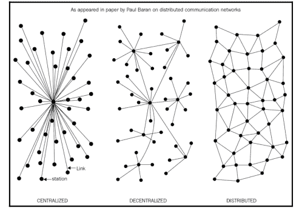
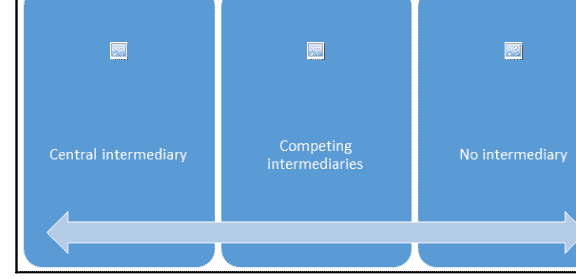
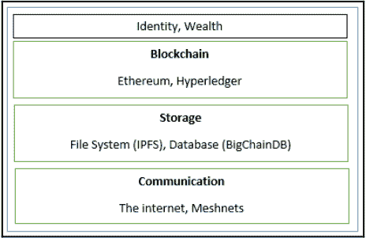

# 2 去中心化

去中心化并不是一个新概念；它长期以来一直用于战略、管理和管理。去中心化的基本思想是将控制和权威分配给边缘，而不是由一个中央权威完全控制组织。这为组织带来了多项好处，例如提高效率、更快决策、更好的激励以及减轻高层管理的负担。

在本章中，去中心化的概念将在区块链的背景下进行讨论；两者的目标相似，即没有单一的中央权威控制。去中心化的方法和去中心化的途径以及一些示例也将被介绍。此外，还将详细讨论区块链生态系统的去中心化、去中心化应用以及去中心化平台。许多令人兴奋的应用和想法源于去中心化的区块链技术，将在本章中介绍。

## 使用区块链实现去中心化

去中心化是区块链技术提供的核心优势和服务。区块链按设计是提供一个无需任何中介并且可以通过共识机制选出许多不同领导者来运行的平台的完美载体。这种模式允许任何人竞争成为决策权威。这种竞争由共识机制管理，最常用的方法称为工作量证明（PoW）。

去中心化根据要求和情况以不同的程度应用，从半去中心化到完全去中心化。从区块链的角度来看，去中心化可以被视为一种机制，它提供了一种重新设计现有应用和范式或构建新应用的方式，以便将完全控制权交给用户。

**信息与通信技术（ICT）** 传统上基于集中式范式，其中数据库或应用服务器受中央权威（如系统管理员）的控制。随着比特币和区块链技术的出现，这一模式发生了变化，现在任何人都可以启动一个去中心化系统（并且在没有单点故障或单一可信权威的情况下运行它）的技术已经可用。它可以根据去中心化应用中使用的治理类型和模型而自主运行或需要一定的人为干预。

即将出现的图表显示了目前存在的不同类型的系统，即集中式、分布式和去中心化。这一概念首次于 1964 年在 *Paul Baran 关于分布式通信网络* 的论文中发表，背景是通信网络。

集中式系统是传统的（客户端-服务器）IT 系统，其中存在一个单一权威控制系统并完全负责系统上的所有操作。中央系统的所有用户都依赖于单一的服务来源。像 eBay、Google、Amazon、Apple 的 App Store 以及大多数其他提供商这样的在线服务提供商都使用这种常见的服务交付模式。另一方面，在分布式系统中，数据和计算分布在网络中的多个节点上。有时，该术语与并行计算混淆。虽然定义上有重叠，但这两个系统的主要区别在于，在并行系统中，所有节点同时执行计算以实现结果，而在分布式系统中，计算可能不会并行进行，数据仅在多个节点上复制，用户将其视为单一的连贯系统。这两种模型都以不同的方式使用，以实现容错和速度。在此模型中，仍然存在一个中央权威控制所有节点并管理处理。这意味着系统本质上仍然是集中的。

*不同类型的网络/系统*

去中心化系统与分布式系统之间的关键区别在于，在分布式系统中仍然存在管理整个系统的中央权威，而在去中心化系统中则不存在此类权威。去中心化系统是一种网络，其中节点不依赖于单一的主节点；相反，控制分布在许多节点之间。例如，这类似于一个模型，其中组织的每个部门都有自己的数据库服务器，由他们负责管理，从而将权力从中央服务器夺走并分配给管理各自数据库的子部门。

去中心化范式中的一项真正创新，开启了这一去中心化应用新时代的是去中心化共识，它与比特币一起引入。这使得用户能够通过共识算法在无需中央可信第三方、中介或服务提供商的情况下就某事达成一致。

## 去中心化的方法

有两种方法可以实现去中心化。这些方法将在以下各节中详细讨论。

### 去中介化

这可以通过一个例子来解释。想象你想把钱寄给另一个国家的朋友。你去银行，银行会按费用将你的钱汇到你选择的国家的银行。在这种情况下，银行保留一个中央数据库进行更新，确认你已汇出资金。有了区块链技术，就有可能直接将这笔钱发送给你的朋友，而无需银行。你只需要区块链上朋友的地址。这样，中介不再需要，去中心化是通过去中介化实现的。然而，由于金融部门有严格的监管和合规要求，去中介化在金融部门实现去中心化的实用性值得商榷。尽管如此，这种模式不仅可用于金融，还可用于许多其他不同行业。

### 通过竞争

在此方法中，一组服务提供商相互竞争，以便被系统选为提供服务的提供商。这种范式并不能实现完全去中心化，但可以在一定程度上确保中介或服务提供商不会垄断服务。在区块链技术的背景下，可以设想一个系统，其中智能合约可以根据声誉、之前的评分、评论和服务质量从大量提供商中选择外部数据提供商。这不会导致完全去中心化，但它允许智能合约基于上述标准做出自由选择。这样，就在服务提供商之间培育了竞争环境，他们相互竞争以成为首选的数据提供商。

在下面的图表中，显示了不同程度的去中心化。左侧是传统的集中式系统控制的方法；右侧实现了完全去中介化；中间显示了竞争性的中介或服务提供商。中间，中介或服务提供商是基于声誉或投票选择的，从而实现了部分去中心化。

去中心化程度

尽管去中心化有许多好处——包括但不限于透明度、效率、成本节约、可信赖生态系统的建立，以及在某些情况下的隐私性和匿名性——但也需要彻底审视其中的一些挑战，例如安全要求、软件漏洞和人为错误。例如，在比特币或以太坊等去中心化系统中，安全性通常由私钥提供，那么如何确保与这些私钥相关联的智能资产不会因为人为失误导致私钥丢失，或者因为智能合约代码中的漏洞导致去中心化应用程序易受攻击而变得毫无用处？在我们踏上利用区块链和去中心化应用程序实现万物去中心化的旅程之前，重要的是要明白，并非所有事物都需要（或能够）被去中心化。

## 去中心化的路径

尽管在比特币或区块链出现之前，就已经存在一些可以被归类为具有一定程度去中心化的系统，例如 BitTorrent 或 Gnutella 文件共享网络，但随着区块链技术的出现，为了实现去中心化，人们正在利用这项新技术采取许多举措。通常，比特币区块链是许多人的首选，因为它已被证明是最具韧性和安全性的区块链，市值接近 120 亿美元。另一种方法则是使用其他区块链，例如以太坊，目前它是许多开发者构建去中心化应用程序的首选工具。

## 如何实现去中心化

*Arvind Narayanan* 等人提出了一个框架，可用于在区块链技术的背景下评估各类事物的去中心化需求。该框架基本提出了四个问题，一旦回答了这些问题，就能清晰地了解如何对系统进行去中心化。这些问题列举如下：

- 1. 去中心化的对象是什么？
- 2. 需要何种程度的去中心化？
- 3. 使用哪种区块链？
- 4. 使用何种安全机制？

第一个问题简单询问的是要对哪个系统进行去中心化。这可以是任何系统，例如身份系统或交易系统。第二个问题可以通过参考前文讨论的去中心化程度标尺，通过指明所需的去中心化级别来回答。它可以是完全的去中介化，也可以是部分去中介化。第三个问题非常直接，开发者可以选择哪种区块链适合特定的应用程序。它可能是比特币区块链、以太坊区块链，或者任何其他被认为适合特定应用程序的区块链。最后，还需要回答一个关于安全机制的关键问题，即如何保证去中心化系统的安全性。例如，可以是原子性（Atomicity），即交易要么完整执行，要么完全不执行。换句话说，就是要么全做，要么不做。这确保了系统的完整性。其他机制还可以包括声誉机制，允许在系统中存在不同级别的信任。

### 示例

在本节中，提供了一个上述框架应用实例。

在第一个示例中，选定了一个货币转账系统，该系统要求实现去中心化。在这种情况下，可以通过回答前面提到的四个问题来评估去中心化需求。答案如下所示：

- 1. **答案 1：** 货币转账系统。
- 2. **答案 2：** 去中介化。
- 3. **答案 3：** 比特币。
- 4. **答案 4：** 原子性。

通过回答这四个问题，可以展示支付系统如何实现去中心化。基于上述答案，可以指出，货币转账系统可以通过移除中介来实现去中心化，并将在比特币区块链上实现，其安全保障通过原子性提供。

同样，该框架可以用于任何需要评估去中心化的其他系统。通过回答这四个简单的问题，采取何种方法来实现系统的去中心化就变得非常清晰。

## 区块链与完全生态系统去中心化

为了实现完全去中心化，区块链周围的环境也必须去中心化。区块链本身是一个运行在传统系统之上的分布式账本。这些要素包括存储、通信和计算。还有其他因素，例如身份和财富，传统上基于中心化范式，为了构建一个完全去中心化的生态系统，也有必要对这些方面进行去中心化。

## 存储

数据可以直接存储在区块链中，这样确实实现了去中心化，但这种方法的一个主要缺点是，区块链在设计上不适合存储大量数据。它可以存储简单的交易和一些任意数据，但显然不适合存储图像或大数据块，就像传统数据库系统中的情况那样。更好的替代方案是使用**分布式哈希表（DHTs）**。DHT 最初用于点对点文件共享软件，如 BitTorrent、Napster、Kazaa 和 Gnutella。CAN、Chord、Pastry 和 Tapestry 项目使 DHT 研究变得流行。BitTorrent 被证明是最具可扩展性和速度的网络，但问题在于没有激励用户永久保留文件。用户通常不会永久保存文件，如果拥有某人所需数据的节点离开了网络，除了让所需节点重新加入网络以使文件再次可用之外，没有办法检索到数据。这里有两个主要要求：高可用性和链路稳定性，这意味着数据在需要时应可用，并且网络链路也应始终可访问。*Juan Benet* 开发的**星际文件系统（IPFS）**具备这两种属性，其愿景是通过替换 HTTP 协议来提供一个去中心化的万维网。IPFS 使用 Kademlia DHT 和默克尔**DAG（有向无环图）**分别提供存储和搜索功能。

## 去中心化

激励机制基于一种名为 Filecoin 的协议，该协议使用 BitSwap 机制向存储数据的节点支付激励。BitSwap 机制允许节点在一对一关系中维护一个发送字节或接收字节的简单账本。此外，IPFS 中还使用了基于 Git 的版本控制机制，以提供数据结构化并对数据的版本进行控制。

还有其他替代方案，如以太坊蜂群（Ethereum swarm）、stori 和 maidsafe。以太坊拥有自己的去中心化和分布式生态系统，使用 Swarm 进行存储，使用 Whisper 协议进行通信。Maidsafe 旨在提供一个去中心化的万维网。书中稍后会更详细地讨论所有这些项目。

BigChainDB 是另一个存储层去中心化项目，旨在提供可扩展、快速且线性可扩展的去中心化数据库，而非传统的文件系统。BigChainDB 补充了以太坊和 IPFS 等去中心化处理平台和文件系统。

## 通信

人们普遍认为互联网（区块链中的通信层）是去中心化的。这在某种程度上是正确的，因为互联网最初的愿景就是开发一个去中心化系统。电子邮件和在线存储等服务现在都基于服务提供者掌控、用户信任其在需要时提供访问服务的范式。这种模式基于对中央权威（服务提供者）的信任，用户无法控制自己的数据；甚至密码也是存储在受信任的第三方系统中。有必要以这样的方式将控制权交给个人用户，即保证对其数据的访问权，且这种访问权不依赖于单一的第三方。互联网（通信层）的访问基于充当互联网用户中央枢纽的互联网服务提供商（ISPs）。如果由于政治或其他原因 ISP 停止服务，那么在该模式下将无法进行任何通信。一个替代方案是使用网格网络。尽管与互联网相比，网格网络在功能上有限，但它们仍然提供去中心化的替代方案，节点可以在没有 ISP 等中央枢纽的情况下直接相互通信。

Meshnet 的一个例子是 Firechat ([http://www.opengarden.com/firechat.html](http://www.opengarden.com/firechat.html))，它允许 iPhone 用户在无需互联网的情况下，以点对点的方式直接相互通信。

## 去中心化

现在想象一个网络，让用户能够掌控自己的通信；没有任何人可以出于政治或审查原因将其关闭。这可能是区块链生态系统中去中心化通信网络的下一步。必须指出，这种模式可能仅在互联网受到政府审查和控制的司法管辖区才需要。

如前所述，互联网最初的设想是构建一个去中心化网络；然而，多年来，随着 Google、Amazon 和 eBay 等大规模服务提供商的出现，控制权正逐渐向大型玩家转移。例如，电子邮件在核心上是一个去中心化系统；任何人只需付出最小的努力即可运行电子邮件服务器并开始收发电子邮件，但已经有更好的替代方案提供给终端用户的托管服务，因此自然倾向于选择中心化服务，因为它更方便且免费。然而，免费服务是以宝贵的个人数据为代价提供的，而许多用户并不了解这一事实。这是一个例子，说明互联网如何走向中心化。区块链再次将去中心化的愿景带给了世界，现在正在 concerted efforts 努力利用这项技术并获得其所能提供的益处。

## 计算

计算或处理的去中心化是通过以太坊等区块链技术实现的，其中嵌入业务逻辑的智能合约可以在网络上运行。其他区块链技术也提供类似的处理层平台，业务逻辑可以在网络上以去中心化的方式运行。

下图显示了去中心化生态系统概览，其中在底层，互联网或 Meshnets 提供去中心化通信层，然后存储层使用 IPFS 和 BigChainDB 等技术来实现去中心化，最后，你可以看到区块链，它充当去中心化处理层。区块链在有限程度上也可以提供存储层，但这会严重阻碍系统的速度和容量；因此，其他解决方案如 IPFS 和 BigChainDB 更适合以去中心化的方式存储大量数据。在顶部，显示了身份和财富层。互联网上的身份是一个非常大的话题，诸如 bitAuth 和 OpenID 等系统已提供不同程度去中心化和安全假设的身份验证和识别服务。

区块链能够为各种问题提供解决方案。一个与身份相关的概念称为 *Zooko’s Triangle*，要求网络协议中的命名系统对人类来说是安全、去中心化且有意义的。据推测，一个系统同时只能具备其中两个属性，但随着区块链的出现，以 Namecoin 的形式，这一问题得到了解决。然而，这并不是万灵药，并带来了自身挑战，例如依赖用户安全存储和维护私钥。这引发了关于去中心化适用性的其他一般性问题。也许去中心化并不适用于每个场景。声誉良好的中心化系统在许多情况下往往工作得更好。

目前正在进行许多项目，正在开发更广泛的分布式区块链系统的解决方案。

随着去中心化范式的出现，不同的术语和流行词现在出现在媒体和学术文献中。随着区块链技术的出现，现在可以构建传统物理组织的软件版本。在去中心化的背景下，值得讨论的 upcoming concepts。

## 智能合约

智能合约可以被视为一个小型去中心化程序。智能合约不一定需要区块链来运行；然而，由于区块链技术提供的[content]

## 去中心化

现在想象一个网络，让用户能够掌控自己的通信；没有任何人可以出于政治或审查原因将其关闭。这可能是区块链生态系统中去中心化通信网络的下一步。必须指出，这种模式可能仅在互联网受到政府审查和控制的司法管辖区才需要。

如前所述，互联网最初的设想是构建一个去中心化网络；然而，多年来，随着 Google、Amazon 和 eBay 等大规模服务提供商的出现，控制权正逐渐向大型玩家转移。例如，电子邮件在核心上是一个去中心化系统；任何人只需付出最小的努力即可运行电子邮件服务器并开始收发电子邮件，但已经有更好的替代方案提供给终端用户的托管服务，因此自然倾向于选择中心化服务，因为它更方便且免费。然而，免费服务是以宝贵的个人数据为代价提供的，而许多用户并不了解这一事实。这是一个例子，说明互联网如何走向中心化。区块链再次将去中心化的愿景带给了世界，现在正在 concerted efforts 努力利用这项技术并获得其所能提供的益处。

## 计算

计算或处理的去中心化是通过以太坊等区块链技术实现的，其中嵌入业务逻辑的智能合约可以在网络上运行。其他区块链技术也提供类似的处理层平台，业务逻辑可以在网络上以去中心化的方式运行。

下图显示了去中心化生态系统概览，其中在底层，互联网或 Meshnets 提供去中心化通信层，然后存储层使用 IPFS 和 BigChainDB 等技术来实现去中心化，最后，你可以看到区块链，它充当去中心化处理层。区块链在有限程度上也可以提供存储层，但这会严重阻碍系统的速度和容量；因此，其他解决方案如 IPFS 和 BigChainDB 更适合以去中心化的方式存储大量数据。在顶部，显示了身份和财富层。互联网上的身份是一个非常大的话题，诸如 bitAuth 和 OpenID 等系统已提供不同程度去中心化和安全假设的身份验证和识别服务。

区块链能够为各种问题提供解决方案。一个与身份相关的概念称为 *Zooko’s Triangle*，要求网络协议中的命名系统对人类来说是安全、去中心化且有意义的。据推测，一个系统同时只能具备其中两个属性，但随着区块链的出现，以 Namecoin 的形式，这一问题得到了解决。然而，这并不是万灵药，并带来了自身挑战，例如依赖用户安全存储和维护私钥。这引发了关于去中心化适用性的其他一般性问题。也许去中心化并不适用于每个场景。声誉良好的中心化系统在许多情况下往往工作得更好。

目前正在进行许多项目，正在开发更广泛的分布式区块链系统的解决方案。

随着去中心化范式的出现，不同的术语和流行词现在出现在媒体和学术文献中。随着区块链技术的出现，现在可以构建传统物理组织的软件版本。在去中心化的背景下，值得讨论的 upcoming concepts。

## 智能合约

智能合约可以被视为一个小型去中心化程序。智能合约不一定需要区块链来运行；然而，由于区块链技术提供的

## Summary

本章介绍了去中心化的概念，这是区块链技术提供的核心服务。虽然去中心化的概念并非新事物，但在区块链世界中它获得了新的重要意义。因此，基于去中心化架构的各种应用最近已被引入。本章首先介绍了去中心化的思想。接下来，从区块链的角度讨论了去中心化。此外，还介绍了区块链生态系统中去中心化的不同层级相关的思想。随着区块链技术和从区块链角度看的去中心化的出现，出现了一些新的概念和术语，例如 DAOs、DAPPs 等。本章也对所有这些术语进行了介绍。最后，讨论了具有一些示例的去中心化应用。在下一章中，将介绍理解区块链生态系统所必需的基本概念。主要将介绍密码学，它为区块链技术提供了至关重要的基础。
