# 4 Bitcoin

### Bitcoin

比特币是区块链技术的第一个应用。在本章中，读者将详细介绍比特币技术。

比特币通过引入第一个完全去中心化的数字货币而引发了一场革命，并且已被证明是极其安全和稳定的。这也激发了学术界和工业界研究的极大兴趣，并引入了许多新的研究领域。自 2008 年推出以来，比特币获得了极大的普及，目前是世界上最成功的数字货币，投入了数十亿美元。它建立在密码学、数字现金和分布式计算领域数十年的研究之上。在以下部分中，简要介绍了历史，以便提供理解比特币发明背后的基础所需的背景。

数字货币一直是几十年来许多人的积极研究领域。创建数字现金的早期提案可以追溯到 20 世纪 80 年代初。1982 年，*David Chaum* 提出了一种使用盲签名构建不可追踪数字货币的方案。在该方案中，银行会通过对用户向其提供的盲且随机的序列号进行签名来发行数字货币。用户随后可以将由银行签名的数字令牌用作货币。该方案的局限性在于银行必须跟踪所有已使用的序列号。这是一个按设计为中心化系统，需要用户信任。后来在 1990 年，*David Chaum* 提出了一个名为 e-cash 的改进版本，它不仅使用了盲签名，还使用了某些私人身份数据来制作消息然后发送给银行。该方案允许检测双重支付但不能阻止它。如果同一令牌在两个不同地点使用，则双重花费者的身份将被揭示。e-cash 只能代表固定金额的货币。*Adam Back* 于 1997 年提出的 hashcash 最初是为了遏制电子邮件垃圾邮件。hashcash 背后的想法是解决一个易于验证但相对难以计算的计算难题。


其初衷是，对于单个用户和单封电子邮件来说，额外的计算开销微不足道，但会抑制发送大量垃圾邮件的行为，因为运行垃圾邮件推广活动所需的时间和资源将大幅增加。

B-money 由戴伟（Wei Dai）于 1998 年提出，其中引入了使用工作量证明来创建货币的概念。该系统的一个主要弱点是，拥有更高计算能力的攻击者可以生成未经请求的货币，而无需让网络调整到适当的难度级别。该系统缺乏关于节点间共识机制的细节，同时也未解决诸如女巫攻击（Sybil attacks）等安全问题。与此同时，Nick Szabo 提出了 BitGold 概念，它同样基于工作量证明机制，除了网络难度级别可调整这一点外，否则与 B-money 面临相同的问题。Tomas Sander 和 Amnon Ta-Shma 在 1999 年引入了一种电子现金方案，该方案首次使用默克尔树（Merkle trees）来表示硬币，并使用零知识证明来证明对硬币的所有权。在该方案中，需要一个中央银行来记录所有已使用的序列号。尽管该方案允许用户完全匿名，但需要付出计算成本。可复用工作量证明（RPOW，Reusable Proof of Work）由 Hal Finney 于 2004 年引入，并使用 Adam Back 的 hashcash 方案作为创建货币所花费计算资源的工作量证明。这同样也是一个集中式系统，它维护一个中心数据库以跟踪所有已使用的工作量证明代币。这是一个在线系统，利用可信计算平台（TPM 硬件）实现的远程证明功能。

上述所有方案都经过精心设计，但在某一方面或另一方面都存在弱点。特别是，所有这些方案都依赖于一个需要用户信任的中心服务器。

## 比特币

2008 年，中本聪（Satoshi Nakamoto）撰写了关于比特币的论文：《比特币：一种点对点的电子现金系统》。该论文引入的第一个关键想法是，一种纯点对点的电子现金系统，不需要中介银行即可在对等节点之间进行付款转账。

比特币建立在数十年的密码学研究基础上，如默克尔树、哈希函数、公钥密码学和数字签名等方面的研究。此外，BitGold、b-money、hashcash 和加密时间戳等想法也为比特币的发明奠定了基础。比特币巧妙地将所有这些技术结合在一起，创造了世界上第一个去中心化货币。比特币解决的关键问题是对拜占庭将军问题（Byzantine Generals problem）的优雅解决方案，以及双花问题（double-spend problem）的实用解决方案。

自 2011 年以来，比特币的价值显著上涨，如下方图表所示：

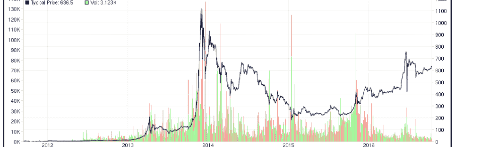

2012 年以来的比特币价格和交易量（对数尺度）

比特币的监管是一个有争议的话题，尽管它是自由主义者的梦想，但执法机构和政府正在提出各种监管措施来控制它，例如纽约州金融服务部颁发的 BitLicense。这是一种颁发给从事虚拟货币相关业务活动的企业的许可证。

比特币的增长也得益于所谓的网络效应。也称为需求侧规模经济，它基本上意味着使用网络的用户越多，其价值就越高。随着时间的推移，比特币网络的增长呈指数级增加。尽管比特币价格波动较大，但在过去几年中已显著上涨。目前（在撰写本文时），比特币价格为 815 英镑。

## 比特币定义

比特币可以通过多种方式定义；它是一种协议、一种数字货币和一个平台。它是点对点网络、协议和软件的组合，促进了名为比特币的数字货币的创建和使用。请注意，大写的 Bitcoin 用于指代比特币协议，而小写的 bitcoin 用于指代比特币这种货币。这个点对点网络中的节点使用比特币协议彼此通信。


来自 bitaddress.org：纸质钱包中的私钥和比特币地址

## 比特币中的公钥

在公钥密码学中，公钥是从私钥生成的。比特币使用基于 SECP256K1 标准的 ECC（椭圆曲线密码学）。私钥是随机选择的，长度为 256 位。公钥可以以非压缩或压缩格式呈现。公钥基本上是在椭圆曲线上的 x 和 y 坐标，在非压缩格式中，以十六进制格式的前缀 04 呈现。X 和 Y 坐标长度均为 32 字节。总共，压缩公钥长度为 33 字节，而非压缩格式为 65 字节。公钥的压缩版本基本上只包含 X 部分，因为 Y 部分可以从中推导出来。压缩版公钥有效的原因是，比特币客户端最初使用的是非压缩密钥，但从比特币核心客户端 0.6 版本开始，压缩密钥被用作标准。

密钥由各种前缀标识，描述如下：

- 非压缩公钥使用 0x04 作为前缀
- 如果公钥的 y 坐标为奇数，则压缩公钥以 0x03 开头
- 如果公钥的 y 坐标为偶数，则压缩公钥以 0x02 开头

更详细的数学描述及其工作原理在此处说明。如果将 ECC 图表可视化，会发现 y 坐标可以在 x 轴下方或上方，并且由于曲线是对称的，因此只需存储素域中的位置即可。

## 比特币中的私钥

私钥基本上是在 SECP256K1 ECDSA 建议指定的范围内选择的 256 位数字。从 0x1 到 0xFFFF FFFF FFFF FFFF FFFF FFFF FFFF FFFE BAAE DCE6 AF48 A03B BFD2 5E8C D036 4140 之间随机选择的任何 256 位数字都是有效的私钥。

私钥通常使用钱包导入格式（WIF）进行编码，以便更轻松地复制和使用。WIF 可以转换为私钥，反之亦然。步骤在此处说明。

此外，有时还使用迷你私钥格式（Mini Private Key Format）将密钥编码为少于 30 个字符，以便在物理空间受限的情况下存储，例如在实体硬币上蚀刻或抗损坏的二维码上。比特币核心客户端还允许对包含私钥的钱包进行加密。

## 比特币货币单位

比特币货币单位描述如下。最小的比特币单位是聪（Satoshi）。

| 面额 | 缩写 | 常见名称 | BTC 值 |
|---|---|---|---|
| Satoshi | SAT | Satoshi | 0.00000001 BTC |
| Microbit | μBTC (uBTC) | Microbitcoin 或 Bit | 0.000001 BTC |
| Millibit | mBTC | Millibitcoin | 0.001 BTC |
| Centibit | cBTC | Centibitcoin | 0.01 BTC |
| Decibit | dBTC | Decibitcoin | 0.1 BTC |
| Bitcoin | BTC | Bitcoin | 1 BTC |
| DecaBit | daBTC | Decabitcoin | 10 BTC |
| Hectobit | hBTC | Hectobitcoin | 100 BTC |
| Kilobit | kBTC | Kilobitcoin | 1000 BTC |
| Megabit | MBTC | Megabitcoin | 1000000 BTC |

## Base58Check 编码

这种编码用于限制不同字符之间的混淆，例如 0、O、I 和 l，因为它们在不同字体中可能看起来相同。该编码基本上将二进制字节数组转换为人可读的字符串。该字符串利用 58 个字母数字符号的集合组成。更多解释和逻辑可以在比特币源代码中的 base58.h 源文件中找到。

```
6 /**
7 * Why base-58 instead of standard base-64 encoding?
8 * - Don't want 0OIl characters that look the same in some fonts and
9 *     could be used to create visually identical looking data.
10 * - A string with non-alphanumeric characters is not as easily accepted as input.
11 * - E-mail usually won't line-break if there's no punctuation to break at.
12 * - Double-clicking selects the whole string as one word if it's all alphanumeric.
13 */
14 #ifndef BITCOIN_BASE58_H
```

来自比特币源代码的解释

比特币地址使用 Base58Check 编码进行编码。

## 花哨地址

由于比特币地址基于 Base58 编码，因此可以生成包含人可读信息的地址。示例如下：

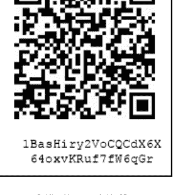

编码在二维码中的公共地址


虚荣地址是使用纯粹的暴力方法生成的。以下截图中显示了一个示例：

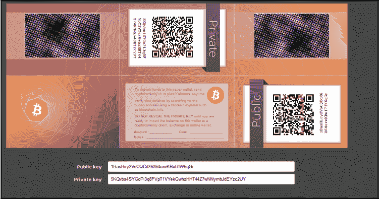

## 交易

交易是比特币生态系统的核心。交易可以简单到只是将一些比特币发送到比特币地址，也可以根据需求变得相当复杂。每笔交易至少由一个输入和一个输出组成。输入可以被视为在之前的交易中创建并正在被花费的币，而输出则是正在被创建的币。如果交易在铸造新币，则没有输入，因此不需要签名。如果交易是要将币发送给其他用户（比特币地址），则需要由发送方使用其私钥签名，并且还需要引用之前的交易以显示币的来源。币实际上是以聪为单位表示的未花费交易输出。

交易未加密，并且在区块链上公开可见。区块由交易组成，这些交易可以使用任何在线区块链浏览器查看。

## 交易生命周期

- 1. 用户/发送方使用钱包软件或其他界面发送交易。
- 2. 钱包软件使用发送方的私钥对交易进行签名。
- 3. 交易通过洪泛算法广播到比特币网络。
- 4. 挖矿节点将此交易包含在下一个待挖区块中。
- 5. 一旦某个矿工解决了工作量证明问题并将新挖出的区块广播到网络，挖矿就开始了。工作量证明将在本章后面详细解释。
- 6. 节点验证区块并进一步传播区块，确认开始生成。
- 7. 最后，确认开始出现在接收方的钱包中，大约经过六次确认后，交易被认为已最终确认并完成。然而，六只是推荐的数字；交易在第一次确认后也可以被认为最终。等待六次确认背后的关键思想是，经过六次确认后双花概率几乎被消除。

## 交易结构

从高层次来看，交易包含元数据、输入和输出。交易组合起来形成区块。交易结构如以下表格所示：

| 字段 | 大小 | 描述 |
|---|---|---|
| 版本号 | 4 bytes | 用于指定矿工和节点在交易处理时使用的规则。 |
| 输入计数器 | 1 bytes – 9 bytes | 交易中包含的输入数量。 |
| 输入列表 | variable | 每个输入由多个字段组成，包括前一笔交易哈希、前一笔Txout索引、Txin脚本长度、Txin脚本和可选的序列号。区块中的第一笔交易也称为 coinbase 交易。它指定一个或多个交易输入。 |
| 输出计数器 | 1 bytes – 9 bytes | 表示输出数量的正整数。 |
| 输出列表 | variable | 交易中包含的输出。 |
| lock_time | 4 bytes | 这定义了交易变得有效的最早时间。它是 Unix 时间戳或区块编号。 |

- **MetaData**：交易此部分包含一些值，例如交易大小、输入和输出数量、交易的哈希以及一个 `lock_time` 字段。每笔交易都有一个指定版本号的前缀。
- **Inputs**：通常，每个输入花费之前的输出。每个输出在被输入消耗之前被视为 **未花费交易输出 (UTXO)**。
- **Outputs**：输出只有两个字段，它们包含发送比特币的指令。第一个字段包含聪的数量，而第二个字段是锁定脚本，其中包含为了花费输出所需满足的条件。有关使用锁定和解锁脚本花费交易和产生输出的更多信息将在本节后面讨论。
- **Verification**：验证使用比特币的脚本语言执行。

示例交易如下所示：

```
{
  "txid": "08af7960ca9255c67686296fb65452ed3f96f18831c9a3d8ea552e4ccee5c4af",
  "hash": "08af7960ca9255c67686296fb65452ed3f96f18831c9a3d8ea552e4ccee5c4af",
  "size": 226,
  "vsize": 226,
  "version": 1,
  "locktime": 969523,
  "vin": [
    {
      "txid": "3e553260a0a94860f7043eb6576e15e6cfeb2990aea961210ae1fde328bb08b0",
      "vout": 1,
      "scriptSig": {
        "asm": "3045022100cfb31edabc62c82b41d12f651d2e3e013ee1a7ee2bb4526f3dda640e6ed8d224502207d8d1d8e41350b9cdf36f389f942ab68c12f113fe99014f5d6dff6610407877d2[ALL] 037bc82d0078993f6943e7ff6e82e82da600f34edc8bca136331a9901c8bb60b0d",
        "hex": "483045022100cfb31edabc62c82b41d12f651d2e3e013ee1a7ee2bb4526f3dda640e6ed8d224502207d8d1d8e41350b9cdf36f389f942ab68c12f113fe99014f5d6dff6610407877d20121037bc82d0078993f6943e7ff6e82e82da600f34edc8bca136331a9901c8bb60b0d"
      },
      "sequence": 4294967294
    }
  ],
  "vout": [
    {
      "value": 2.30000000,
      "n": 0,
      "scriptPubKey": {
        "asm": "OP_DUP OP_HASH160 07e78644a61343068fa8d4940a79976e758ac6ef OP_EQUALVERIFY OP_CHECKSIG",
        "hex": "76a91407e78644a61343068fa8d4940a79976e758ac6ef88ac",
        "reqSigs": 1,
        "type": "pubkeyhash",
        "addresses": [
          "mgEKnxV3qbYtDKEKTvo1VpgJ63Au619q2"
        ]
      }
    }
  ]
}
```

示例解码交易，显示了前面描述的各个字段

## 脚本语言

比特币使用一种简单的基于栈的语言称为 *script* 来描述比特币如何被花费和转移。它不是图灵完备的，并且没有循环，以避免比特币网络上长时间运行/挂起脚本的不良影响。这种脚本语言基于类似 Forth 的语法，使用逆波兰表示法，其中每个操作数都跟随其操作符。它使用 **后进先出 (LIFO)** 栈从左到右进行求值。

脚本使用各种操作码或指令来定义其操作。操作码也称为单词、命令或函数。比特币节点的早期版本有一些由于设计缺陷而不再使用的操作码。

脚本操作码的各种类别为常量、流程控制、栈、按位逻辑、拼接、算术、密码学和锁定时间。

交易脚本通过组合 `ScriptSig` 和 `ScriptPubKey` 进行求值。`ScriptSig` 是解锁脚本，而 `ScriptPubKey` 是锁定脚本。这就是交易如何被花费的评估方式；首先解锁，然后花费。`ScriptSig` 由希望解锁交易的<|message|> 用户提供。`ScriptPubkey` 是交易输出的一部分，并指定为了花费输出需要满足的条件。换句话说，输出由 `ScriptPubKey`（锁定脚本）锁定，其中包含条件，满足后将解锁输出，然后可以赎回币。

## 常用操作码

所有操作码都声明在比特币参考客户端源代码中的 script.h 文件中。可以从以下链接访问 https://github.com/bitcoin/bitcoin/blob/master/src/script/script.h ，在以下注释下：

```
/** Script opcodes */
```

ScriptPubKey 和 ScriptSig 参数被连接在一起并执行。本节稍后将跟随一个示例，其中对此进行了更详细的解释。

- **Pay to Script Hash (P2SH)**：P2SH 用于将交易发送到脚本哈希（即以 3 开头的地址），并在 BIP16 中标准化。除了传递脚本外，赎回脚本也会被评估并且必须有效。模板如下所示：
  
- **MultiSig (Pay to MultiSig)**：M of n 多重签名交易脚本是一种复杂的脚本类型，其中可以构造一个需要多个签名才能有效以便赎回交易的脚本。可以使用此脚本构建各种复杂交易，例如托管和存款。模板如下所示：
  
- **Pay to Pubkey**：此脚本是一种非常简单的脚本，通常用于 coinbase 交易。它现在已过时，并在比特币的旧版本中使用。在这种情况下，公钥存储在脚本中，并且解锁脚本需要使用私钥对交易进行签名。
  
- **Null data/OP_RETURN**：此脚本用于以费用为代价在区块链上存储任意数据。消息限制为 40 字节。此脚本的输出不可赎回，因为 OP_RETURN 在任何情况下都会使验证失败。在这种情况下不需要 ScriptSig。

```
ScriptPubKey: OP_HASH160 <redeemScriptHash> OP_EQUAL
```

```
ScriptSig: [<sig>...<sign>] <redeemScript>
```

```
ScriptPubKey: <m> <pubKey> [<pubKey>...] <n> OP_CHECKMULTISIG
```

```
ScriptSig: 0 [<sig>...<sign>]
```

原始多重签名已过时，多重签名通常是前面提到的 P2SH 赎回脚本的一部分。

模板如下所示：

```
<PubKey> OP_CHECKSIG
```

模板非常简单，如下所示：

```
OP_RETURN <data>
```


P2PKH 脚本执行过程如下所示：

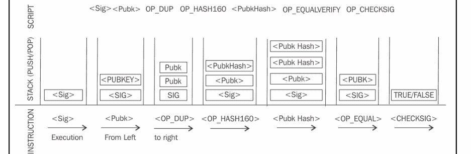

P2PKH 脚本执行

所有交易在通过比特币网络传输之前，最终都会被编码为十六进制格式。下面是一个示例交易，以十六进制显示，该交易是使用 bitcoin-cli 在比特币测试网上通过以下命令检索得到的：

```
drequinox@drequinox-OP7010:~$ bitcoin-cli --testnet getrawtransaction "08af7960ca9255c67686296fb65452ed3f96f18831c9a3d8ea552e4ccee5c4af"
0100000001b008bb28e3fde10a2161a9ae9029ebcfe6156e57b63e04f76048a9a06032553e0
10000006b483045022100cfb31edabc62c82b41d12f651d2e3e013ee1a7ee2bb4526f3dda64
0e6d8d224502207d8d1d8e41350b9cdf36f389f942ab68c12f113fe99014f5d6df661040787
7d2011037b82d0078993f6943e7fff6e82e82da600f34edc8bca136331a9901c8bb60b0dfe
fffffff028085b50d000000001976a91407e764a4a61343068fa8d4940a7997e6e758ac6ef88a
c95bddc1c000000001976a914dad770cccb1026ebf87acacfe35f2d6f2d336faa88ac33cb0e00
```

## Coinbase 交易

Coinbase 交易（或称生成交易）总是由矿工创建，并且是区块中的第一笔交易。它用于创造新的货币。它包含一个特殊字段，也称为 coinbase，该字段作为 Coinbase 交易的输入。这笔交易还允许最多 100 字节的任意数据，这些数据可用于存储任意内容。在创世区块中，该字段包含了取自《泰晤士报》的最著名评论：

> “泰晤士报 2009年1月3日 财政大臣濒临对银行进行第二轮救助”

这一信息证明了创世区块的开采时间不早于 2009 年 1 月 3 日。

## 什么是 UTXO？

未花费交易输出（Unspent Transaction Output，UTXO）是一种未花费的交易输出，可以作为新交易的输入来使用。与比特币交易相关的其他概念如下所述。

## 交易手续费

交易手续费由矿工收取。手续费的多少取决于交易的大小。交易手续费的计算方式是用输入总额减去输出总额。手续费作为对矿工的激励，鼓励他们将用户的交易纳入其正在创建的区块中。所有交易最终都会进入内存池，矿工根据优先级从中挑选交易，并将其包含在拟议的区块中。优先级的计算方法将在本章后面介绍；然而，从交易手续费的角度来看，手续费较高的交易会被矿工更早地处理。根据不同的行为类型（例如发送交易、纳入区块以及节点中继），计算手续费的规则也有所不同。手续费不是由比特币协议固定下来的，也不是强制性的；即使是没有手续费的交易，最终也会被处理，但可能需要非常长的时间。

## 合约

正如比特币核心开发者指南中所定义的那样，合约本质上是使用比特币系统来强制执行金融协议的交易。这是一个简单的定义，但其影响深远，因为它允许用户设计可用于许多真实场景的复杂合约。合约使得开发完全去中心化、独立且风险降低的平台成为可能。使用比特币脚本语言可以构建各种合约，例如托管、仲裁和微支付通道。当前脚本的实现非常有限，但仍然可以开发各种类型的合约。例如，只有在多方签署交易时才释放资金，或者只有在经过一定时间后才释放资金。这两种场景都可以通过多重签名（multiSig）和交易锁定时间选项来实现。

## 交易可延展性

比特币中的交易可延展性是由比特币实现中的一个漏洞引起的。由于这个漏洞，攻击者有可能更改交易的交易 ID，从而导致某个交易看起来似乎尚未执行的场景。这可能会引发双重存款或双重提现的情况。换句话说，这个漏洞允许在比特币交易被确认之前更改其唯一 ID。

如果在确认之前更改了 ID，那么这笔交易看起来就像完全没有发生过一样，这可能会引发双重存款或提现攻击。

## 交易池

这些池也称作*内存池*，基本上是由节点在本地内存中创建的，用于维护尚未在区块中得到确认的交易的临时列表。
交易在通过验证后，会根据其优先级被包含到区块中。

## 交易验证

此验证过程由比特币节点执行。比特币开发者指南中描述了以下内容：

- 1. 检查语法并确保交易语法正确。
- 2. 验证输入和输出不为空。
- 3. 检查字节大小是否小于最大区块大小，目前为 1 MB。
- 4. 输出值必须在允许的货币范围内（0 到 2100 万 BTC）。
- 5. 所有输入都必须有指定的前序输出，但 coinbase 交易除外，该类交易不应被中继。
- 6. 验证 `nLockTime` 不得超过 31 位。交易若要有效，其字节数不应少于 100 字节。此外，标准签名中的签名操作数应小于或等于 2 个。
- 7. 拒绝*非标准*交易；例如，`ScriptSig` 只允许向堆栈推送数字，`ScriptPubkey` 未通过 `isStandard()` 检查。
- 8. 如果池中或主分支的区块中已经存在匹配的交易，则拒绝该交易。
- 9. 如果每个输入所引用的输出已经存在于池中的任何其他交易中，则该交易将被拒绝。
- 10. 对于每个输入，必须存在一个被引用的输出交易。系统会在主分支和交易池中进行搜索，以确定是否有任何输入缺少输出交易；如果缺少，则该交易将被视为孤立交易。如果池中还没有与之匹配的交易，它将添加到孤立交易池中。
- 11. 对于每个输入，如果被引用的输出交易是 coinbase 交易，则它必须至少获得 100 次确认；否则，该交易将被拒绝。
- 12. 对于每个输入，如果被引用的输出不存在或已被花费，则该交易将被拒绝。
- 13. 使用被引用的输出交易来获取输入值，验证每个输入值以及总和是否在允许的 0 到 2100 万 BTC 范围内。
- 14. 如果输入值之和小于输出值之和，则拒绝该交易。
- 15. 如果交易手续费过低，无法进入空区块，则拒绝该交易。

## 区块链

区块链是一个公开的账本，它记录了比特币网络上所有交易的带时间戳、有序且不可变的列表。每个区块在链中通过哈希来标识，并通过引用前一个区块的哈希连接到前一个区块。

在下面的区块结构中，首先描述了区块头，然后是一个详细图示，帮助深入了解区块链结构。

## 区块的结构

| 字节 | 名称 | 描述 |
|---|---|---|
| 80 | 区块头 | 包含下一节所述的区块头中的字段。 |
| 可变 | 交易计数器 | 该字段包含区块中的交易总数，包括 coinbase 交易。 |
| 可变 | 交易 | 区块中的所有交易。 |

## 区块头的结构

| 字节 | 名称 | 描述 |
|---|---|---|
| 4 | 版本 | 区块版本号，决定应遵循的区块验证规则。 |
| 32 | 前一个区块头哈希 | 这是前一个区块头的双重 SHA256 哈希。 |
| 32 | 默克尔根哈希 | 这是区块中所有交易的默克尔树的双重 SHA256 哈希。 |


| 4 | 时间戳 | 该字段包含区块的大致创建时间，采用 Unix 纪元时间格式。更精确地说，这是矿工开始对区块头进行哈希运算的时间（从矿工的角度来看）。 |
| 4 | 难度目标 | 这是区块的难度目标。 |
| 4 | 随机数 | 这是一个任意数字，矿工会反复更改它以产生满足难度目标阈值的哈希值。 |

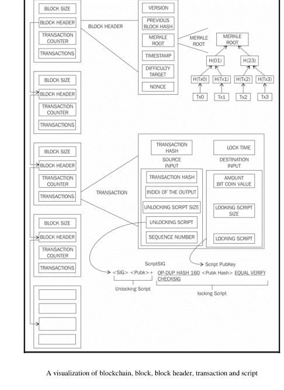

区块链、区块、区块头、交易和脚本的可视化

如前图所示，区块链是由区块组成的链，每个区块通过引用前一个区块头的哈希值链接到其前一个区块。这种链接确保除非修改了记录该交易的区块以及其后的所有区块，否则无法修改任何交易。第一个区块不链接到任何前一个区块，被称为创世区块。

由于比特币的分布式特性，网络分叉可能自然发生。在两个节点同时宣布一个有效区块的情况下，可能出现两个具有不同交易的区块链的情况。这是不希望出现的情况，但比特币网络只能通过接受最长的链来解决。在这种情况下，较小的链将被视为孤块。如果对手能够控制网络算力（计算能力）的 51%，那么他们就可以强加自己的交易历史版本。

引入比特币协议的更改也可能导致区块链分叉。在 *软分叉* 的情况下，只有以前有效的区块不再可接受，从而使软分叉向后兼容。在软分叉的情况下，只有矿工需要升级到新的客户端软件才能使用新的协议规则。计划中的升级不一定会创建分叉，因为所有用户都应该已经更新。另一方面，硬分叉使以前有效的区块无效，并要求所有用户升级。新的交易类型有时会作为软分叉添加，任何诸如区块结构更改或主要协议更改之类的更改都会导致硬分叉。

截至 2017 年 2 月 4 日，比特币区块链的当前大小约为 101 GB。下图显示了区块链大小随时间变化的增加情况：

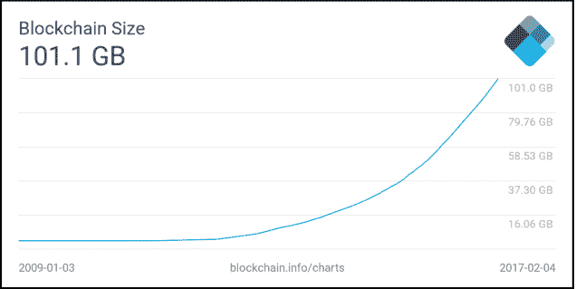

截至 06/02/2017 的区块链当前大小

新区块大约每 10 分钟添加到区块链一次，并且网络难度每 2016 个区块动态调整一次，以保持新区块稳定地添加到网络中。

网络难度使用以下公式计算：

*Target = Previous target * Time/2016 * 10 minutes*

难度和目标可以互换，表示相同的意思。Previous target 代表旧的目标值，time 是生成前 2016 个区块所花费的时间。网络难度基本上是指矿工找到新区块有多难，即哈希难题现在有多难。

在下一节中讨论了挖矿，这将解释哈希难题是如何被解决的。

## Mining

挖矿是一种资源密集型过程，通过该过程将新区块添加到区块链中。区块包含通过挖矿过程由挖矿节点验证并添加到区块链中的交易。该过程是资源密集型的，以确保矿工在区块被接受之前已花费了所需的资源。矿工通过花费所需的计算资源来铸造新币。这也在增加更多虚拟货币到比特币生态系统的同时保护系统免受欺诈和双重支付攻击。

大约每 10 分钟就会创建一个新区块（挖出）。如果矿工创建了新区块，他们将被奖励新币，并因将交易包含在其区块中而获得交易费。新区块以大致固定的速率创建。此外，新比特币的创建速率每 210,000 个区块减少 50%，大约每 4 年一次。当比特币最初推出时，区块奖励为 50 个比特币；然后在 2012 年，这减少到 25 个比特币。2016 年 7 月，这进一步减少到 12.5 个币，下一次减少预计在 2020 年 7 月 4 日。这将使币奖励进一步降至大约六个币。

大约每天产生 144 个区块，即 1,728 个比特币。实际币数每天可能有所不同；然而，区块数量仍保持每天 144 个。比特币供应也是有限的，到 2140 年，几乎 2100 万个比特币将被最终创建，此后无法再创建新的比特币。然而，比特币矿工仍然可以通过收取交易费从生态系统中获利。

## Task of miners

一旦节点连接到比特币网络，比特币矿工就会执行以下几个任务。

### Synching up with the network

一旦新节点加入比特币网络，它就会通过向其他节点请求历史区块来下载区块链。这里在比特币矿工的上下文中提到这一点；然而，这不一定只是矿工的任务。

- **Transaction validation:** 在网络上广播的交易由全节点通过验证和验证签名和输出来验证。
- **Block validation:** 矿工和全节点可以通过根据某些规则对其进行评估来开始验证他们收到的区块。这包括验证区块中的每个交易以及验证随机数值。
- **Create a new block:** 矿工通过在验证后将网络上广播的交易组合起来来提出新区块。
- **Perform Proof of Work:** 这项任务是挖矿过程的核心，在此矿工通过解决计算难题找到有效区块。区块头包含一个 32 位随机数字字段，矿工需要反复更改随机数，直到生成的哈希值小于预定的目标。
- **Fetch reward:** 一旦节点解决了哈希难题，它会立即广播结果，其他节点会验证并接受该区块。有一个很小的几率新铸造的区块由于与几乎同时找到的另一个区块冲突而不会被其他矿工接受，但一旦被接受，矿工就会获得 12.5 个比特币的奖励（截至 2016 年）以及任何相关的交易费。

## Proof of Work

这是证明已花费足够的计算资源来构建有效区块的证明。**Proof of Work (PoW)** 基于这样一个想法，即每次随机选择一个节点来创建新区块。在此模型中，节点相互竞争以按其计算能力比例被选中。以下公式总结了比特币中的工作量证明要求：

$$H(N \parallel P\_hash \parallel Tx \parallel Tx \parallel \ldots Tx) < Target$$

其中 N 是随机数，$P\_hash$ 是前一个区块的哈希值，$Tx$ 表示区块中的交易，$Target$ 是目标网络难度值。这意味着前面提到的连接字段的哈希值应小于目标哈希值。找到该随机数的唯一方法是暴力方法。一旦矿工满足了某种零的模式，区块就会立即广播并被其他矿工接受。

### The mining algorithm

挖矿算法包括以下步骤。

- 从比特币网络检索前一个区块哈希。
- 将网络上广播的潜在交易集组装成一个区块。
- 使用 SHA256 算法计算区块头与随机数和前一个哈希的双重哈希。
- 如果生成的哈希值低于当前难度级别（目标），则停止该过程。
- 如果生成的哈希值高于当前难度级别（目标），则通过递增随机数重复该过程。随着比特币网络的哈希率增加，32 位随机数的总量耗尽得太快。为了解决这个问题，实施了 *extra nonce* 解决方案，其中 coinbase 交易被用作额外随机数的来源，为矿工提供更大的随机数搜索范围。


- 随着时间的推移，挖矿难度不断增加，而过去可以用单台 CPU 笔记本电脑挖出的比特币，现在需要专门的矿场来解决哈希难题。当前难度等级可通过比特币命令行界面使用以下命令查询：

```
$ bitcoin-cli getdifficulty
258522748404.5154
```

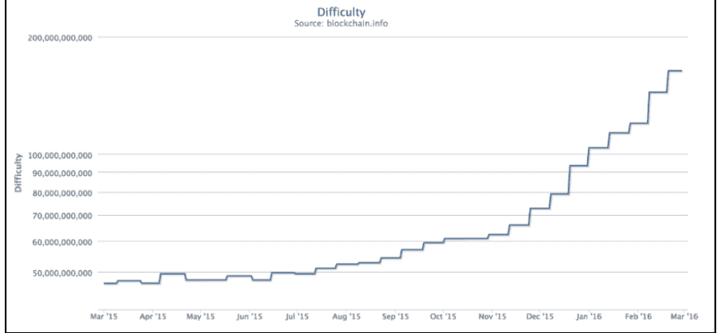

随时间变化的挖矿难度

getdifficulty 命令返回的值。

## 哈希率

哈希率基本上代表每秒计算哈希的速度。在比特币早期，使用 CPU 时哈希率相当小，但随着专用矿池和 ASIC 的出现，近几年哈希率呈指数级增长。这导致了难度的增加。以下哈希率图表显示了哈希率随时间的增长，目前以艾哈希为单位进行衡量。这意味着在 1 秒内，比特币网络矿工计算的哈希数超过 1 000 000 000 000 000 000 个/秒。

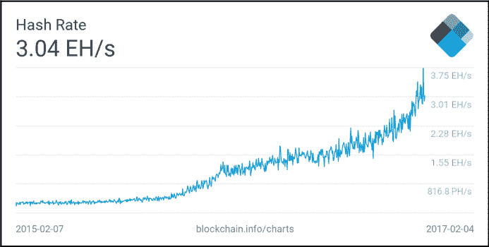

## 挖矿系统

随着时间的推移，比特币矿工使用过各种方法来挖矿。由于挖矿的核心原理基于双重 SHA256 算法，随着时间的推移，矿工开发出越来越快的哈希计算系统。以下是比特币所使用的不同挖矿类型的回顾，以及它们如何随时间演变。

### CPU

CPU 挖矿是原始比特币客户端中可用的第一种挖矿类型。用户甚至可以用笔记本电脑或台式电脑来挖比特币。CPU 挖矿已不再盈利，现在使用更先进的挖矿方法，如基于 ASIC 的挖矿。

### GPU

由于比特币网络难度增加以及人们普遍倾向于寻找更快的挖矿方法，矿工开始使用 PC 中可用的 GPU 或显卡进行挖矿。GPU 支持更快且并行化的计算，通常使用 OpenCL 语言编程。这比 CPU 来说是一种更快的选择。用户还使用超频等技术来最大化 GPU 性能。此外，使用多张显卡的可能性也增加了显卡用于比特币挖矿的普及度。然而，GPU 挖矿存在一些限制，例如过热以及需要专用主板和额外硬件来容纳多张显卡。

### FPGA

即使 GPU 挖矿也没有持续太久，很快矿工就找到了另一种使用 FPGA 进行挖矿的方法。现场可编程门阵列（FPGA）基本上是一种可编程的集成电路，用于执行特定操作。FPGA 通常使用硬件描述语言（HDL）编程，例如 Verilog 和 VHDL。双重 SHA256 迅速成为 FPGA 程序员的热门编程任务，并出现了多个开源项目。FPGA 相比 GPU 提供了更好的性能；然而，可访问性、编程难度以及需要专业知识来编程和配置 FPGA 等问题导致 FPGA 在比特币挖矿中的时代很短暂。此外，ASIC 的到来导致基于 FPGA 的挖矿系统迅速被淘汰。X6500 矿机、Ztex 和 Icarus 等挖矿硬件是在 FPGA 挖矿盈利期间开发的。Xilinx 和 Altera 等各种 FPGA 制造商生产可用于编程挖矿算法的 FPGA 硬件和开发板。

### ASIC

专用集成电路（ASIC）旨在执行 SHA-256 操作。这些专用芯片由各种制造商销售，并提供非常高的哈希率。这在一段时间内有效，但由于挖矿难度水平快速增加，单台 ASIC 已不再盈利。

目前，挖矿已超出个人能力范围，现在使用数千台 ASIC 并行运行的专业矿场向用户提供挖矿合约，代为进行挖矿。没有技术限制，因此单个用户无法并行运行数千台 ASIC，但这需要专用数据中心和硬件，对于个人而言成本可能变得难以承受。


四种挖矿类型（CPU、GPU、FPGA 和 ASIC）

## 挖矿池

当一组矿工共同合作挖出一个区块时，就形成了挖矿池。如果区块成功挖出，矿池管理器会收到 coinbase 交易，然后负责将奖励分配给为挖出该区块投入资源的矿工群体。这与单人挖矿相比更有利可图，在单人挖矿中只有一个矿工试图解决部分哈希反演函数（哈希难题），因为在挖矿池中，无论他们（更具体地说，他们的单个节点）是否解决了难题，奖励都会支付给矿池的每个成员。

矿池管理器可以采用多种模式向矿工付款，例如按份额付费模式和按比例模式。在按份额付费模式中，矿池管理器向参与挖矿的所有矿工支付固定费用，而在按比例模式中，份额是根据为解决哈希难题所花费的计算资源量计算的。

现在存在许多商业矿池，并通过云和易于使用的网页界面提供挖矿服务合约。最常用的有 AntPool、F2Pool 和 BW.COM。以下图片显示了所有主要挖矿池的算力比较：

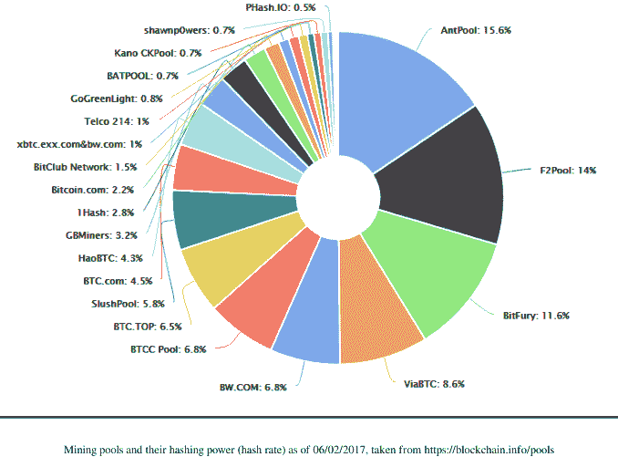

截至 2017 年 06 月 02 日的挖矿池及其算力（哈希率），取自 https://blockchain.info/pools

挖矿中心化是一个主要问题，如果一个矿池控制了超过 51% 的网络，即产生超过比特币网络 51% 的算力，就会发生这种情况。如介绍部分所述讨论的，51% 攻击可能导致双花攻击，并可能影响共识，事实上可在比特币网络上强加另一个版本的交易历史。

这在比特币历史上发生过一次，当时大型矿池 GHash.IO 管理获取了超过 51% 的网络容量。学术界提出了理论解决方案，例如两阶段工作量证明，以遏制大型矿池。该方案引入了第二个密码难题，导致矿池披露其私钥或提供其矿池相当一部分的算力，从而降低矿池的整体算力。

各种类型的硬件可商用于挖矿目的。目前最盈利的是 ASIC 挖矿，多个供应商提供专用硬件。除非花费大量资金和能源建立自己的矿机甚至矿场，否则单人挖矿现在并不太盈利。以当前难度系数（2016 年 10 月）为例，如果用户管理产生 12 TH/s 的算力，他们每天可望赚取 0.01366887 BTC（约 8 美元），这与产生 12 TH 所需的设备投资相比非常低。包括电费等运行成本，这并不太盈利。

## 比特币网络

比特币网络是一个点对点网络，节点在其中交换交易和区块。网络上有不同类型的节点。主要分为两种节点：全节点和 SPV 节点。全节点顾名思义，是比特币核心客户端的实现，执行钱包、矿工、完整区块链存储和网络路由功能。然而，并非必须执行所有这些功能。SPV 节点或轻量级客户端仅执行钱包和网络路由功能。比特币协议的最新版本是 70014，并随比特币核心客户端 0.13.0 引入。

一些节点更喜欢仅作为完整区块链节点存在，包含完整的区块链并执行网络路由功能，但不执行挖矿或存储私钥（钱包功能）。另一种类型是单人矿工节点，可执行挖矿、存储完整区块链并充当比特币网络路由节点。


有一些非标准但使用广泛的节点被称为矿池协议服务器。这些节点使用替代协议，例如 Stratum 协议。一些节点仅执行挖矿功能，被称为矿工节点。仅计算哈希的节点使用 Stratum 协议将解决方案提交给矿池。可以运行一个 SPV 客户端，该客户端运行钱包和网络路由功能而无需区块链。

互联网上大多数协议都是基于行的，这意味着每一行都以回车和换行符 `\r\n` 字符分隔。Stratum 也是一个基于行的协议，它使用纯 TCP 套接字和人类可读的 JSON-RPC 来操作并在节点之间通信。

比特币网络由其不同的魔数标识。列表如下所示：

| Network | Magic value | Hex |
|---|---|---|
| main | 0xD9B4BEF9 | F9 BE B4 D9 |
| testnet3 | 0x0709110B | 0B 11 09 07 |

魔数用于指示消息来源网络。

一个全节点执行四个功能：钱包、矿工、区块链和网络路由节点。

当比特币核心节点启动时，首先，它会启动所有对等节点的发现。这是通过查询硬编码在比特币核心客户端中的 DNS 种子来实现的，并由比特币社区成员维护。此查找返回一些 DNS A 记录。比特币协议默认在主网络上使用 TCP 端口 8333，在 testnet 上使用 TCP 18333。

```
vSeeds.push_back(CDNSSeedData("bitcoin.sipa.be", "seed.bitcoin.sipa.be", true)); // Pieter Wuille
vSeeds.push_back(CDNSSeedData("bluematt.me", "dnsseed.bluematt.me")); // Matt Corallo
vSeeds.push_back(CDNSSeedData("dashjr.org", "dnsseed.bitcoin.dashjr.org")); // Luke Dashjr
vSeeds.push_back(CDNSSeedData("bitcoinstats.com", "seed.bitcoinstats.com")); // Christian Decker
vSeeds.push_back(CDNSSeedData("xf2.org", "bitseed.xf2.org")); // Jeff Garzik
vSeeds.push_back(CDNSSeedData("bitcoin.jonasschnelli.ch", "seed.bitcoin.jonasschnelli.ch", true)); // Jonas Schnelli
```

首先，客户端发送一个协议消息 Version，其中包含各种字段，例如版本、服务、时间戳、网络地址、nonce 和一些其他字段。远程节点用自己的 version 消息进行响应，然后双方节点之间进行 verack 消息交换，表明连接已建立。

之后，Getaddr 和 addr 消息被交换以找到客户端不知道的对等节点。与此同时，任一节点都可以发送 ping 消息来查看连接是否仍然存活。

现在可以开始区块下载。如果节点已经完全同步了所有区块，那么它使用 Inv 协议消息监听新区块；否则，它首先检查是否对 inv 消息有响应并且已有库存。如果是，则使用 Getdata 协议消息请求区块；如果不是，则使用 GetBlocks 消息请求库存。此方法一直使用到 0.9.3 版本。

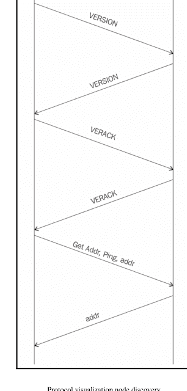

协议可视化节点发现

初始区块下载可以根据比特币核心客户端的版本使用 blocks first 或 headers-first 方法来同步区块。blocks-first 方法非常慢，并且自 0.10.0 版本以来已被停用。

自 0.10.0 版本以来，引入了名为 headers-first 的初始区块下载方法。这带来了重大的性能改进，区块链同步曾经需要几天才能完成，现在只需要几个小时。核心思想是新节点首先向对等节点请求区块头并验证它们。一旦完成，区块将并行从所有可用对等节点请求，因为完整的链蓝图已以区块头链的形式下载。

在此方法中，当客户端启动时，它会检查区块链是否已完全同步；如果标头链已同步；如果不是，即客户端首次启动时，它使用 getHeaders 消息从其他对等节点请求标头。如果区块链已完全同步，它会通过 Inv 消息监听新区块，如果它已经拥有完全同步的标头链，则使用 Getdata 协议消息请求区块。节点还会检查标头链是否比区块拥有更多标头，然后通过发出 Getdata 协议消息请求区块。

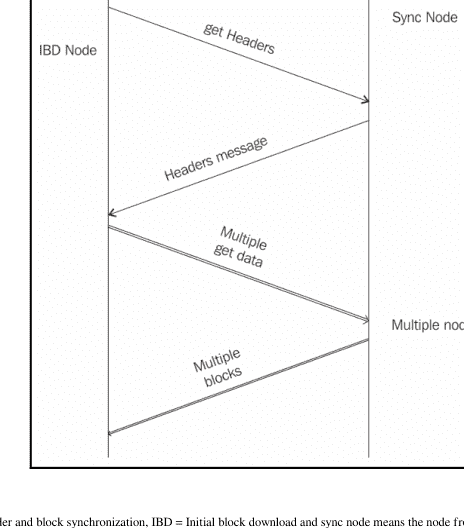

Bitcoin Core Client >= 0.10.0 header and block synchronization. IBD = Initial block download and sync node means the node from where the blocks are being requested from

Getblockchaininfo 和 getpeerinfo RPC 已更新为包含新的功能以适应此更改。RPC getchaintips 用于列出区块链的所有已知分支。这也包括仅标头的区块。Getblockchaininfo 用于提供有关区块链当前状态的信息。Getpeerinfo 用于列出对等节点之间共同拥有的区块数和标头数。

Wireshark 还可以用于可视化对等节点之间的消息交换，并且可以作为学习比特币协议的宝贵工具。这里显示了一个示例。这是一个基本示例，显示了 version、verack、getaddr、ping、addr 和 inv 消息。

在详细信息中，可以看到诸如数据包类型、命令名称和协议消息结果等有价值的信息。

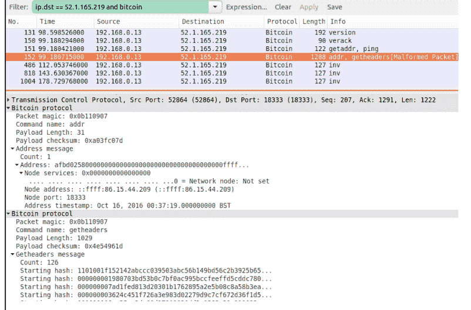

Wireshark 中的一个示例区块消息

这里显示了一个协议图，展示了两个对等节点之间的数据流。这可以帮助你理解节点启动时使用什么类型的消息。

在以下示例中，使用比特币解码器来分析流量并识别比特币协议命令。

可以看出 version、getaddr 和 getdata 等消息的交换，以及描述消息名称的相应注释。此练习对于学习比特币非常有用，建议在比特币测试网上进行实验，在那里可以发送各种消息和交易到网络，然后由 Wireshark 分析。

| Time | 192.168.0.13 136.243.139.96 | Comment |
|---|---|---|
| 97.734135000 | version | Bitcoin: version |
| 98.025045000 | verack | Bitcoin: verack |
| 98.025177000 | getaddr, ping, addr | Bitcoin: getaddr, ping, addr |
| 98.025468000 | getheaders... | Bitcoin: getheaders, [unknown command], [unknown command], [unknown command], headers |
| 98.160419000 | [TCP Retran... | Bitcoin: [TCP Retransmission], getheaders, [unknown command], [unknown command], [unknown command] |
| 98.598399000 | getdata | Bitcoin: getdata |
| 144.343544000 | inv | Bitcoin: inv |
| 176.152240000 | getdata | Bitcoin: getdata |
| 179.493755000 | getdata | Bitcoin: getdata |
| 218.101646000 | ping | Bitcoin: ping |
| 218.192004000 | [unknown co... | Bitcoin: [unknown command] |
| 218.444431000 | [TCP Retran... | Bitcoin: [TCP Retransmission], [unknown command] |
| 336.234936000 | getdata | Bitcoin: getdata |
| 337.843423000 | [unknown co... | Bitcoin: [unknown command] |
| 338.143885000 | ping | Bitcoin: ping |
| 448.764093000 | getdata | Bitcoin: getdata |
| 457.894823000 | [unknown co... | Bitcoin: [unknown command] |
| 458.195265000 | ping | Bitcoin: ping |
| 578.011774000 | [unknown co... | Bitcoin: [unknown command] |
| 578.212044000 | ping | Bitcoin: ping |
| 585.587671000 | inv | Bitcoin: inv |
| 647.169633000 | inv | Bitcoin: inv |
| 671.962545000 | getdata | Bitcoin: getdata |
| 698.037067000 | [unknown co... | Bitcoin: [unknown command] |
| 698.237350000 | ping | Bitcoin: ping |
| 701.563581000 | inv | Bitcoin: inv |
| 701.986269000 | inv | Bitcoin: inv |
| 705.022173000 | inv | Bitcoin: inv |
| 812.115878000 | inv | Bitcoin: inv |
| 818.198570000 | [unknown co... | Bitcoin: [unknown command] |
| 818.298733000 | ping | Bitcoin: ping |

总共有 27 种协议消息，但随着协议的发展，它们可能会随着时间推移而增加。最常用的协议消息及其解释如下所示：

- **Version:** 这是节点发送到网络的第一条消息，广告其版本和区块计数。远程节点然后用相同的信息进行回复，然后建立连接。
- **Verack:** 这是 version 消息的响应，接受连接请求。
- **Inv:** 这用于节点广告其对区块和交易的了解。


这些过滤器主要由简单的支付验证 SPV 客户端使用，以请求它们感兴趣的交易和默克尔块。默克尔块是区块的轻量级版本，其中包括区块头、一些哈希值、一个 1 位标志的列表以及交易计数。这些信息随后可用于构建默克尔树。这是通过创建仅匹配 SPV 客户端已请求的交易和区块的过滤器来实现的。在版本消息交换完毕且节点之间建立连接后，节点可以根据其需求设置过滤器。这些概率过滤器提供的隐私或精度程度各不相同，具体取决于它们设置的准确或宽松程度。严格的布隆过滤器只会过滤节点已请求的交易，但代价是可能向能够根据 IP 地址将交易与之关联的对手方泄露用户地址，从而损害隐私。另一方面，宽松设置的过滤器可能会导致检索到更多无关交易，但会提供更多隐私。此外，对于 SPV 客户端，布隆过滤器使它们能够使用低带宽，而无需下载所有交易以进行验证。

- BIP 37 提出了比特币中布隆过滤器的实现，并向比特币协议引入了三个新消息。
- Filterload：用于在连接上设置布隆过滤器。
- Filteradd：这会向当前过滤器添加新的数据元素。
- FilterClear：这会删除当前加载的过滤器。

更多细节可在 BIP37 规范中找到。

## Wallets

钱包软件用于存储私钥或公钥和比特币地址。它执行各种功能，例如接收和发送比特币。如今，软件通常提供两种功能：比特币客户端和钱包。在磁盘上，比特币核心客户端钱包以 Berkeley DB 文件的形式存储：

```
:~/.bitcoin$ file wallet.dat
wallet.dat: Berkeley DB (Btree, version 9, native byte-order)
```

私钥可以通过不同方式生成，并被不同类型的钱包使用。钱包不存储任何硬币，也没有钱包为用户存储余额或硬币的概念。事实上，在比特币网络中，硬币并不存在；相反，只有交易信息存储在区块链上（更准确地说，UTXO，未花费输出），然后用于计算比特币数量。

### Wallet types

在比特币中，有不同类型的钱包可用于存储私钥。作为软件程序，它们还为用户提供在比特币网络上管理和执行交易的一些功能。

#### Non-deterministic wallets

这些钱包包含随机生成的私钥，也称为 *Just a Bunch of Keys* 钱包。比特币核心客户端在首次启动时会生成一些密钥，并在需要时生成密钥。管理大量密钥非常困难，并且容易出错的过程可能导致硬币被盗和丢失。此外，需要定期备份密钥并适当保护它们以防止被盗或丢失。

#### Deterministic wallets

在此类钱包中，密钥是通过哈希函数从种子值派生的。该种子数字是随机生成的，通常由人类可读的 *助记码* 词表示。助记码词在 BIP39 中定义。此短语可用于恢复所有密钥，并使私钥管理相对容易。

#### Hierarchical deterministic wallets

HD 钱包在 BIP32 和 BIP44 中定义，将密钥存储在从种子派生的树结构中。种子生成父密钥（主密钥），该密钥用于生成子密钥，随后生成孙密钥。HD 钱包中的密钥生成不会直接生成密钥；相反，它会产生一些信息（私钥生成信息），可用于生成一系列私钥。如果已知主私钥，则 HD 钱包中私钥的完整层次结构很容易恢复。正因为此特性，HD 钱包非常易于维护且高度便携。

#### Brain wallets

主私钥也可以从记忆的密码的哈希值派生。关键思想是，此密码短语用于派生私钥，如果在 HD 钱包中使用，则可从单个记忆密码派生出完整的 HD 钱包。这被称为脑钱包。此方法容易受到密码猜测和暴力攻击，但诸如 *密钥拉伸* 之类的技术可用于减缓攻击者的进展。

#### Paper wallets

顾名思义，这是一种纸质钱包，其所需密钥材料打印在上面。它需要物理安全存储。纸钱包可以从各种服务提供商在线生成，例如 https://bitcoinpaperwallet.com/ 或 https://www.bitaddress.org/。

#### Hardware wallets

另一种方法是使用防篡改设备存储密钥。此防篡改设备可以是定制构建的，或者随着 NFC 启用手机的出现，也可以是 NFC 手机中的安全元件（SE）。Trezor 和 Ledger 钱包（各种类型）是最常用的比特币硬件钱包。

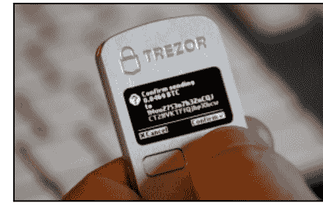

Trezor Wallet

#### Online wallets

在线钱包顾名思义完全在线存储，通常作为云服务提供。它们为用户提供 Web 界面来管理钱包并执行各种功能，例如进行和接收付款。它们易于使用，但意味着用户信任在线钱包服务提供商。

#### Mobile wallets

移动钱包顾名思义安装在移动设备上。它们可以提供各种付款方式，最值得注意的是能够使用智能手机摄像头快速扫描二维码并付款。移动钱包可用于 Android 平台和 iOS，例如 breadwallet、copay 和 Jaxx。

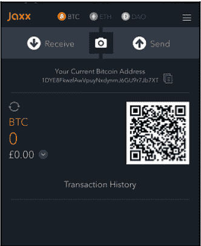

Jaxx Mobile wallet

## Bitcoin payments

比特币可以通过各种技术接受为付款。在许多司法管辖区，比特币不被承认为法定货币，但它正越来越多地被许多在线商家和电子商务网站接受为付款方式。买家可以通过多种方式向接受比特币的商家付款。例如，在在线商店中，可以使用比特币商家解决方案，而在传统实体店中，可以使用销售点终端和其他专用硬件。客户只需扫描包含卖方付款 URI 的二维码，即可使用移动设备付款。比特币 URI 允许用户只需点击链接或扫描二维码即可付款。URI（统一资源标识符）基本上是表示交易信息的字符串。它在 BIP21 中定义。二维码可以显示在销售点终端附近。几乎所有比特币钱包都支持此功能。

商家可以使用以下截图来宣传他们可以接受比特币作为付款。


bitcoin accepted here logo

各种付款解决方案，例如 xbtterminal 和 34 bytes bitcoin POS 终端在商业上均有提供。

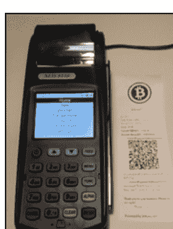

34 bytes POS solution.

比特币支付处理器由许多在线服务提供商提供，允许与电子商务网站集成。简单的互联网搜索可以揭示许多选项。

已提出并最终确定了各种 BIPs，以引入和标准化比特币支付。最值得注意的是，BIP 70（安全支付协议）描述了商家与客户之间安全通信的协议。该协议使用 X.509 证书进行身份验证，并在 HTTP 和 HTTPS 上运行。该协议中有三条消息：PaymentRequest、Payment 和 PaymentACK。该提案的关键特性是对中间人攻击的防御和安全的付款证明。中间人攻击可能导致攻击者坐在商家和买家之间，买家似乎在与商家交谈，但实际上，*中间人* 正在与买家交互而不是商家。这可能导致操纵商家的比特币地址以欺骗买家。

还有其他几个 BIPs，例如 BIP71 和 BIP72，也被提出以标准化支付消息封装和 URI 方案以支持 BIP70。

比特币闪电网络，即可扩展的链下即时支付解决方案，于 2016 年初推出，允许链下支付。该网络使用在区块链之外运行的支付通道。这允许比特币具有更大的速度和可扩展性。本文可在 https://lightning.network/ 获取，有兴趣的读者应阅读本文以了解该发明的理论和原理。

## Bitcoin investment and buying and selling bitcoins

有许多在线交易所，用户可以在其中买卖比特币。这现在是互联网上的大生意，它提供比特币交易、差价合约、差价投注、保证金交易以及各种其他选择。交易者可以买入比特币或通过开设多头或空头头寸来交易，以在比特币价格上涨或下跌时获利。还有其他功能，例如将比特币兑换为其他虚拟货币也是可能的，许多在线比特币交易所提供此功能。还提供高级市场数据、交易策略、图表和支持交易者的相关数据。CEX.IO 的示例在此显示。其他交易所提供类似类型的服务。


以下截图显示了交易所的订单簿，其中列出了所有买单和卖单：

Example of bitcoin exchange cex.io

Example of bitcoin order book at exchange cex.io

## Bitcoin installation

比特币核心客户端可以从 https://bitcoin.org/en/download 安装。此版本适用于不同的架构和平台，从 x86 windows 到 ARM Linux，如以下图像所示：

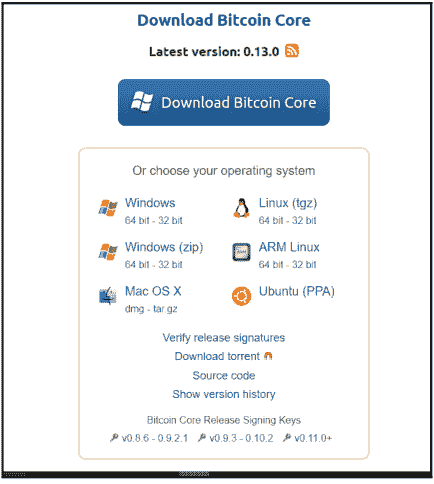

## Setting up a bitcoin node

以下是 Ubuntu 上比特币核心安装的示例运行；对于其他平台，您可以从 www.bitcoin.org 获取详细信息。

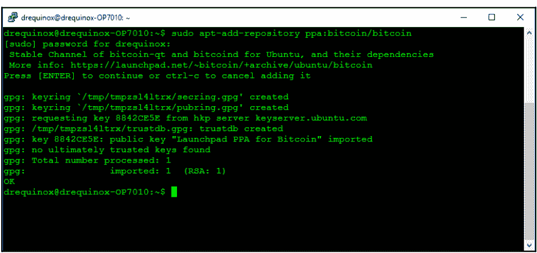

Step 2:

```
drequinox@drequinox-OP7010:~$ sudo apt-get update
```

根据所需客户端，用户可以使用以下任一命令，或同时发出两个命令：

```
sudo apt-get install bitcoind
sudo apt-get install bitcoin-qt
drequinox@drequinox-OP7010:~$ sudo apt-get install bitcoin-qt bitcoind
Reading package lists... Done
Building dependency tree
Reading state information... Done
......
```

## Setting up the source code

如果用户希望参与比特币代码或出于学习目的，可以下载并编译比特币源代码。可以使用 Git 下载比特币源代码：

```
$ sudo apt-get install git
$ mkdir bcsource
$ cd bcsource
drequinox@drequinox-OP7010:~/bcsource $ git clone https://github.com/bitcoin/bitcoin.git
Cloning into 'bitcoin'...
remote: Counting objects: 78960, done.
```

```
remote: Compressing objects: 100% (3/3), done.
remote: Total 78960 (delta 0), reused 0 (delta 0), pack-reused 78957
Receiving objects: 100% (78960/78960), 72.53 MiB | 1.85 MiB/s, done.
Resolving deltas: 100% (57908/57908), done.
Checking connectivity... done.
drequinox@drequinox-OP7010:~/bcsource$
```

更改目录到 bitcoin：

```
drequinox@drequinox-OP7010:~/bcsource$ cd bitcoin
```

完成上述步骤后，可以编译代码：

```
drequinox@drequinox-OP7010:~/bcsource/bitcoin$ ./autogen.sh
drequinox@drequinox-OP7010:~/bcsource/bitcoin$ ./configure.sh
drequinox@drequinox-OP7010:~/bcsource/bitcoin$ make
drequinox@drequinox-OP7010:~/bcsource/bitcoin$ sudo make install
```

## Setting up bitcoin.conf

bitcoin.conf 文件是比特币核心客户端用来保存配置设置的配置文件。bitcoind 客户端的所有命令行选项，除了 -conf 开关之外，都可以在配置文件中设置，并且当 bitcoin-qt 或 bitcoind 启动时，它将从该文件获取配置信息。

在 Linux 系统中，这通常位于 $HOME/.bitcoin/，也可以使用 -conf=<file> 开关在命令行中指定给 bitcoind 核心客户端软件。

## Starting up a node in testnet

如果您想测试比特币网络并运行实验，可以将比特币节点启动在 testnet 模式下。与实时网络相比，这是一个更快的网络，并且对挖矿和交易有更宽松的规则。

比特币测试网络有各种水龙头服务可用。一个例子是 Bitcoin TestNet sandbox，用户可以在其中请求将比特币支付到他们的测试网比特币地址。可以通过 https://testnet.manu.backend.hamburg/ 访问。这对于在测试网上进行交易实验非常有用。

启动测试网的命令行如下：

```
bitcoind --testnet -daemon
bitcoin-cli --testnet <command>
bitcoin-qt --testnet
```

## Starting up a node in regtest

regtest 模式（回归测试模式）可用于为测试目的创建本地区块链。

可以使用以下命令启动 reg test 模式下的节点：

```
bitcoind -regtest -daemon
Bitcoin server starting
```

可以使用以下命令生成区块：

```
bitcoin-cli -regtest generate 200
```

相关日志消息可以在 Linux 系统下 .bitcoin/regtest 目录的 debug.log 中查看。

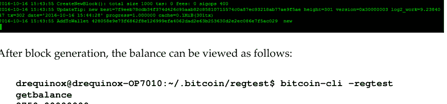

生成区块后，余额可以按如下方式查看：

```
drequinox@drequinox-OP7010:~/.bitcoin/regtest$ bitcoin-cli -regtest
getbalance
8750.00000000
```

可以使用以下命令停止节点：

```
drequinox@drequinox-OP7010:~/.bitcoin$ bitcoin-cli -regtest stop
Bitcoin server stopping
```

## Starting up a node in live mainnet

Bitcoind 是可以作为守护进程运行的核心客户端软件，并提供 JSON RPC 接口。

Bitcoin-cli 是用于与守护进程交互的功能丰富的命令行工具；守护进程然后与区块链交互并执行各种功能。Bitcoin-cli 仅调用 JSON-RPC 函数本身不对区块链执行任何操作。

Bitcoin-qt 是比特币核心客户端 GUI。当钱包软件首次启动时，它会验证磁盘上的区块，然后启动并显示以下 GUI：

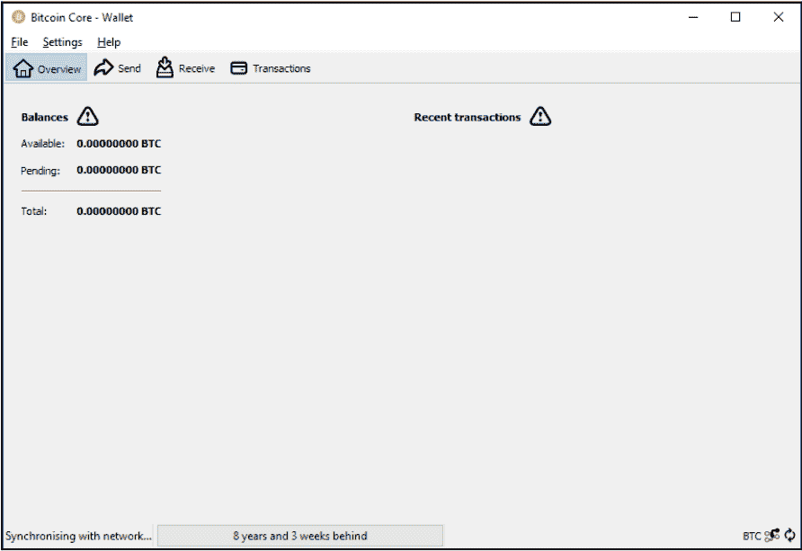

Bitcoin Core QT 客户端，安装后立即显示，区块链未同步

验证过程并非特定于 Bitcoin-qt 客户端；bitcoind 客户端也会执行此操作。

## Experimenting with bitcoin-cli

Bitcoin-cli 是随比特币核心客户端提供的命令行界面，可以使用比特币核心客户端提供的 RPC 接口执行各种功能。

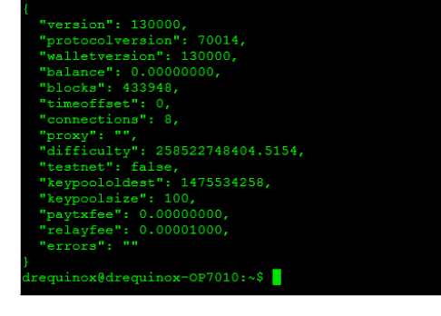

bitcoin-cli getinfo 的示例运行；可以使用相同格式调用其他命令

可以通过以下命令显示所有命令的列表：

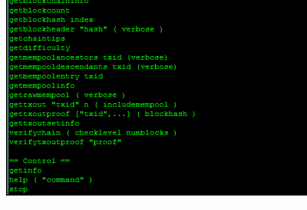

Testnet bitcoin-cli，这只是输出的前几行，实际输出包含许多命令

- **HTTP REST**: 从比特币核心客户端 0.10.0 开始，HTTP REST 接口也可用。默认情况下，它在与 JSON-RPC 相同的 TCP 端口 8332 上运行。

## Bitcoin programming and the command-line interface

比特币编程现在是一个非常丰富的领域。比特币核心客户端公开了各种 JSON RPC 命令，可用于构建原始交易并通过自定义脚本或程序执行其他功能。此外，还有命令行工具 Bitcoin-cli 可用，它使用 JSON-RPC 接口并提供丰富的工具集来处理比特币。

这些 API 也可通过许多在线服务提供商以比特币 API 的形式获得，并提供简单的 HTTP REST 接口。比特币 API，例如 `blockchain.info` 和 bitpay, block.io 以及许多其他，提供多种开发基于比特币解决方案的选项。

有各种比特币编程库可用。以下列出了一个列表，如果您感兴趣可以进一步探索这些库。

**Libbitcoin**: 可在 https://libbitcoin.dyne.org/ 获取，并提供强大的命令行实用程序和客户端。
**Pycoin**: 可在 https://github.com/richardkiss/pycoin 获取，是 Python 的库。
**Bitcoinj**: 该库可在 https://bitcoinj.github.io/ 获取，并用 Java 实现。

有许多在线比特币 API 可用；最常用的 API 如下所示：

```
https://bitcore.io/
```

```
https://bitcoinjs.org/
```

```
https://blockchain.info/api
```

所有 API 或多或少提供相同类型的功能，选择哪个 API 最好变得很困难。

## Bitcoin improvement proposals (BIPs)

这些文档用于向比特币社区提出或告知改进建议、设计问题或有关比特币生态系统某些方面的信息。比特币改进提案有三种类型，缩写为 BIPs：

- **Standard BIP**: 用于描述对比特币系统有重大影响的重大更改，例如区块大小更改、网络协议更改或交易验证更改。
- **Process BIP**: 标准 BIP 和流程 BIP 的主要区别在于标准 BIP 涵盖协议更改，而流程 BIP 通常涉及提出对比特币核心协议之外的流程的更改。这些只有在比特币用户之间达成共识后才会实施。
- **Informational BIP**: 这些通常只是用于建议或记录有关比特币生态系统的某些信息，例如设计问题。

## Summary

本章介绍了比特币及相关概念。它从比特币的一些历史和基本定义开始。介绍了密钥和地址以及公钥和私钥等概念。还讨论了比特币网络中交易的工作方式（以及相关概念，如脚本、操作码和交易类型）。此外，还介绍了支撑比特币网络的区块链。以及相关概念，如挖矿、工作量证明、挖矿系统和钱包。最后，还提供了有关设置比特币客户端、比特币-cli 的使用以及不同比特币网络介绍的一些实用信息。在下一章中，将介绍替代货币及相关概念。


按定义，硬分叉发生时就会产生山寨币。如果比特币发生硬分叉，那么另一条、更旧的链实际上被视为另一种币。然而，并没有明确的规则来确定哪条链会成为山寨币。最近以太坊就发生了这种情况，硬分叉导致除了以太坊（ETH）货币之外，还出现了新的货币 ETC（以太坊经典）。以太坊经典是旧链，分叉后以太是新链。这种有争议的硬分叉因多种原因是不受欢迎的。首先，它违背了去中心化的真正精神，因为以太坊基金会这一中心化实体决定推进硬分叉，即使并非所有人都同意该提案；其次，它也因对硬分叉的分歧而分裂用户社区。虽然硬分叉在理论上会产生山寨币，但它在能提供的内容上是有限的，因为即使变更导致硬分叉，通常也不会对币的根本参数产生剧烈变化。它们通常保持不变。因此，最好是完全从零开始编写新币，或分叉比特币（或其他币的源代码）来创建具有所需参数和功能的新货币。

山寨币必须能够吸引新用户、交易者和矿工，否则该货币将一文不值。货币的价值，尤其是在虚拟货币领域，由于网络效应及其被社区接受程度而获得。如果一种币未能吸引足够的用户，很快就会被遗忘。可以通过提供初始数量的币来吸引用户，这可以通过各种方法实现。提供初始数量山寨币的方法如下所述：

- **创建新的区块链：** 山寨币可以创建新的区块链并向初始矿工分配币，但这种方法现在不受欢迎，因为存在许多诈骗计划或 *pump and dump* 计划，其中初始矿工在新货币推出时获利然后消失。
- **Proof of burn：** 分配新山寨币初始资金的另一种方法是 *Proof of burn*，也称为单向挂钩或价格上限。在此方法中，用户永久销毁一定数量的比特币，其比例与可申领的山寨币数量相对应。例如，如果销毁了 10 个比特币，则山寨币的价值不会大于被销毁的比特币数量。这基本上意味着比特币通过销毁被 *converted* 成山寨币。
- **Proof of Ownership：** 而不是永久销毁比特币，另一种方法是证明用户拥有一定数量的比特币。这种所有权证明可用于申领山寨币，通过将山寨币区块锚定到比特币区块。例如，这可以通过合并挖矿实现，在这种情况下，比特币矿工在挖比特币的同时可以挖山寨币区块而无需额外工作。
- **Pegged sidechains**：顾名思义，侧链是与比特币网络分离的区块链，但比特币可以转移到它们上。山寨币也可以转移回比特币网络。这个概念称为双向挂钩。

投资和交易这些替代币也是一项大生意，尽管没有比特币那么大，但足以吸引新投资者和交易者并为市场提供流动性。综合山寨币市值如下图所示，图表来自 http://coinmarketcap.com。

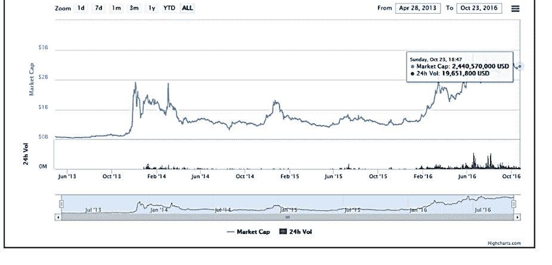

这表明在撰写时，综合山寨币市值超过 20 亿美元

## Alternatives to Proof of Work

**Proof of Work (PoW)** 方案在加密货币的背景下首次在比特币中使用，并作为一种机制来提供保证，即矿工已完成所需的工作量以找到区块。作为回报，这为区块链提供了去中心化、安全性和稳定性。此外，这也是比特币提供去中心化分布式共识的主要手段。PoW 方案需要具有一种非常理想的属性，称为 *progress freeness*，这基本上意味着消耗计算资源的奖励应该是随机的并且与矿工的贡献成比例。在这种情况下，即使是计算能力相对较少的矿工也有赢得区块奖励的机会。术语 *progress freeness* 由 *Arvind Narayanan et.al* 在书籍 *Bitcoin and Cryptocurrency Technologies* 中引入。挖矿计算谜题的其他要求包括可调节难度和快速验证。可调节难度确保区块链的挖矿难度目标会根据算力增加和用户数量而进行调节。快速验证是一种属性，意味着挖矿计算谜题应易于且快速验证。PoW 方案的另一个方面，尤其是比特币中使用的方法（Double SHA-256），是自 ASIC 引入以来，权力正向能够负担大规模 ASIC 矿场的矿工或矿池转移，这挑战了比特币去中心化核心哲学的核心。

已经提出了一些替代方案，例如抗 ASIC 谜题，其设计方式使得为解决此谜题构建 ASIC 不可行，并且相对于通用硬件不会带来显著性能提升。用于此目的的常见技术是应用一类称为 *memory hard* 的计算难题。这一方法的核心思想是，由于谜题求解需要大量内存，因此在基于 ASIC 的系统上实现是不切实际的。这种技术最初在莱特币和 Tenebrix 中使用，其中 Scrypt 哈希函数被用作抗 ASIC 的 PoW 方案。尽管该方案最初被宣传为抗 ASIC，但最近 Scrypt ASIC 现在已可用，推翻了莱特币的原始声明。

另一种抗 ASIC 的方法是需要计算多个哈希函数以提供 PoW。这也称为链式哈希方案。其背后的理由是，在 ASIC 上设计多个哈希函数是不可行的。最常见的例子是 Dash 中实现的 X11 内存困难函数。X11 由 11 个 SHA3 竞赛算法组成，其中一个算法将计算出的哈希输出到下一个算法，直到所有 11 个算法按顺序使用。这些算法包括 blake、bmw、groestl、jh、keccak、skein、luffa、cubehash、shavite、simd 和 echo。

这种方法最初确实提供了对 ASIC 开发的抵抗，但现在 ASIC 矿机已可商业获得并支持 X11 及类似方案的挖矿。最近的例子是 ASIC Baikal Miner，它支持 X11、X13、X14 和 X15 挖矿。其他例子包括 iBeLink DM384M X11 矿机和 Pinidea X11 ASIC 矿机。

也许另一种方法可以是设计 *self-mutating puzzles*，这些谜题会智能或随机地随时间改变 PoW 方案或其要求。这将使其几乎不可能在 ASIC 中实现，因为它需要为每个函数设计多个 ASIC，而且随机变化的方案在 ASIC 中几乎不可能处理。目前尚不清楚这在实践中如何实现。

PoW 有各种缺点，其中最大的就是能源消耗。据估计，到 2020 年，比特币矿工消耗的总电量将相当于丹麦的用电量。这非常巨大，而且所有这些电力在某种程度上都被浪费了；事实上，除了挖矿之外，没有任何有用的目的。环保主义者对这种情况提出了真正的担忧。

有人提出 PoW 谜题可以设计成服务于两个目的。首先，其主要目的是共识机制，其次是执行一些有用的科学计算。这样，这些方案不仅可用于挖矿，还可以帮助潜在地解决其他科学问题。这种有用的工作证明最近已由 Primecoin 付诸实践，其中要求是找到特殊的素数链，称为 Cunningham 链和 bi-twin 链。由于素数分布的研究在物理等科学学科中具有特殊意义，通过挖矿 Primecoin，矿工不仅获得区块奖励，还有助于找到特殊的素数。

### Proof of Storage

也称为不可检索证明，这是一种另一种有用的工作证明类型，需要存储大量数据。由微软研究院引入，该方案提供了分布式存档数据存储的有用好处。矿工需要存储大量数据中伪随机选择的子集以进行挖矿。


## Proof of Stake

这种证明也被称为虚拟挖矿。这是一种另一种类型的挖矿难题，被提出作为传统 PoW 方案的替代方案。它首次在 PeerCoin 中于 2012 年 8 月提出。在该方案中，其理念是用户需要证明自己拥有一定数量的货币（币），从而证明他们对该币拥有权益。权益的最简单形式是让那些 demonstrably 拥有更多数字资产的用户挖矿相对更容易。该方案的好处是双重的；首先，与购买高端 ASIC 设备相比，获取大量数字资产相对困难，其次它可以节省计算资源。已经提出了各种形式的权益，并在下面简要讨论。

## Proof of coinage

币的年龄是指币自上次使用或持有以来的时间。这与通常的权益证明形式不同，在通常形式中，拥有 altcoin 最高权益的用户挖矿更容易。在基于币龄的方法中，币的年龄（coinage）在每次挖出区块时重置。矿工因在一段时间内持有而非花费币而获得奖励。该机制已在 Peercoin 中以创造性的方式与 PoW 结合实现。挖矿难题（PoW）的难度与币龄成反比，这意味着如果矿工使用币权益交易消耗部分币龄，则 PoW 要求会得到缓解。

## Proof of deposit

该方案的核心思想是矿工新铸造的区块在一段时间内不可花费。更准确地说，币在挖矿操作期间会被锁定一定数量的区块。该方案通过允许矿工以冻结一定数量的币一段时间为代价进行挖矿来运作。这是一种权益证明类型。

## Proof of burn

作为计算能力的替代支出，证明销毁实际上销毁一定数量的比特币以获得等值的山寨币。这通常在启动新币项目时使用，作为提供公平初始分配的一种手段。这可以被视为一种替代挖矿方案，其中新币的价值来自于之前销毁了一定数量的币这一事实。

## Proof of activity

该方案是 PoW 和权益证明的混合体。在该方案中，区块最初是通过使用 PoW 产生的，但随后每个区块随机指定三个权益持有者，要求他们对其进行数字签名。后续区块的有效性取决于先前随机选择的区块是否成功签名。

然而，存在一个已知问题，即无利害关系问题，在该问题下创建区块链分叉将变得微不足道。这是因为在 PoW 中需要适当的计算资源进行挖矿，而在权益证明中没有此类要求；因此，攻击者可以使用同一枚币在多个链上尝试挖矿。

## Non-outsourceable puzzles

该难题背后的关键动机是开发出抵御矿池发展的能力。如前所述，矿池根据参与者消耗的计算能力按比例向所有参与者提供奖励。然而，在该模型中，矿池运营商是中央权威，所有奖励都归其所有，并且可以强制执行某些规则。此外，在该模型中，所有矿工之所以相互信任，是因为他们为了共同目标而共同努力，希望矿池经理获得奖励。不可外包难题是一种允许矿工为自己申领奖励的方案；因此，由于匿名矿工之间固有的不信任，矿池的形成变得不太可能。

## Difficulty adjustment and retargeting algorithms

随着比特币和山寨币的出现，另一个引入的概念是难度重定目标算法。在比特币中，难度目标是通过以下等式简单计算的；然而，其他币要么开发了自己的算法，要么实现了比特币难度算法的修改版本：

*T = Time previous * time actual / 2016 * 10 min*

比特币中难度调节的理念是，2016 个区块的生成应大约需要 2 周（区块间隔时间应约为 10 分钟）。如果挖出 2016 个区块花费的时间超过 2 周，则难度会降低；如果花费的时间少于两周，则难度会增加。当 ASIC 被引入时，由于区块生成率很高，难度呈指数级增长，这就是 PoW 算法未具备抗 ASIC 能力的一个缺点。这导致了挖矿能力的集中化。这也带来另一个问题；如果现在启动一个新币，使用与比特币相同的基于 SHA256 的工作量证明，那么恶意用户只需简单使用 ASIC 矿机即可控制整个网络。如果对新山寨币的兴趣较少，而有人决定通过消耗足够高的计算资源来接管网络，则该攻击将更具可行性。如果其他拥有类似计算能力的矿工也加入山寨币网络，则该攻击可能不可行，因为矿工将相互竞争。此外，多矿池构成了更大的威胁，其中一组矿工可以自动切换到正在盈利的货币。这种现象被称为 **pool hopping**，会不利地影响区块链，进而影响山寨币的增长。矿池跳跃会不利地影响网络，因为矿池跳跃者仅在难度较低且可以快速获得奖励时加入网络；一旦难度上升（或被重新调整），他们就会 *hop off*，然后在难度再次调整回落后再次回来。例如，如果一个多矿池消耗其资源快速挖矿新币，难度会迅速增加；当多矿池离开货币网络时；它变得几乎无法使用，因为现在难度已增加到 solo 矿工不再盈利且无法维持的水平。解决此问题的唯一办法是发起硬分叉，这通常对社区是不受欢迎的。

有一些算法已经出现以解决此问题，并在后面讨论。所有这些算法都基于根据算力变化重新调整各种参数的理念；这些参数包括先前区块的数量、先前区块的难度、调整比率，以及难度可以向上或向下重新调整的倍数。在以下部分，读者将被介绍到在各种山寨币中使用的和提出的几种难度算法。

## Kimoto Gravity Well

该算法用于在各种山寨币中调节难度。这最初是在 Megacoin 中引入，用于自适应地每区块调整网络难度。该算法的逻辑如下所示：

```
KGW = 1 + (0.7084 * pow((double(PastBlocksMass)/double(144)), -1.228))
```

## MIDAS

**Multi Interval Difficulty Adjustment System (MIDAS)** 是一种算法，其复杂程度相对高于之前讨论的算法。该方法对算力变化的突然变化做出更快速的响应。该算法还可防止时间扭曲攻击。

许多货币的出现是为了解决比特币中的各种限制而做出的尝试。以下是比特币限制的简要讨论。

## Bitcoin limitations

比特币中的各种限制也激发了人们对山寨币的兴趣，山寨币专门开发用于解决比特币中的限制。最突出且被广泛讨论的限制是比特币缺乏匿名性。该限制将在下面详细讨论。

## Privacy and anonymity

由于区块链是所有交易公开的账本且公开可用，因此分析它变得微不足道。结合流量分析，交易可以追溯到其源 IP 地址，从而可能揭示交易的发起者。这是一个很大的隐私问题。即使在比特币中，生成每个交易的新地址是推荐且常见的实践，从而允许一定程度的不可关联性，这也不够，并且已经开发并成功使用了各种技术来追踪交易在网络中的流动并将其追溯到其发起者。研究人员已使用诸如交易图、地址图和实体图等各种分析区块链的方法来将用户与交易关联起来，从而引发隐私问题。上述分析技术可以通过使用关于交易和将其链接到实际用户的公开可用信息而得到进一步丰富。有开源区块解析器可用于从区块链数据库中提取交易信息、余额和脚本。解析器可在 https://github.com/mikispag/rusty-blockparser 获取，用 Rust 编写，提供高级区块链分析功能。该工作的早期版本称为 BitIodine，但已不再积极开发。

已经提出了各种提案来解决比特币中的隐私问题。这些提案分为三类：混合协议、第三方混合网络和固有匿名性。以下是每个类别的简要讨论。


## 混合协议

这些方案用于为比特币交易提供匿名性。在此模型中，使用了混合服务提供商（中介或共享钱包）。用户将硬币发送到此共享钱包作为存款，共享钱包随后可以将其他用户的存款（价值相同）的其他硬币发送到目的地。用户也可以通过此中介接收他人发送的硬币。这样，输出与输入之间的链接就不再存在，交易图分析将无法揭示发送者和接收者之间的真实关系。

CoinJoin 是混合协议的一个例子，其中两个交易合并形成单个交易，同时保持输入和输出不变。CoinJoin 背后的核心思想是构建一个由所有参与者共同签署的共享交易。此技术提高了参与交易的所有参与者的隐私性：

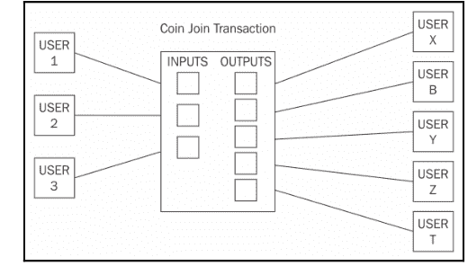

Coinjoin 交易，三位用户将其交易合并为单个更大的 CoinJoin 交易

## 第三方混合协议

有各种第三方混合服务可用，但如果服务是中心化的，则会带来追踪发送者和接收者之间映射的威胁，因为混合服务知道所有输入和输出。除此之外，完全中心化的矿工甚至会带来服务管理员窃取硬币的风险。

有各种服务，其复杂程度各不相同，例如 CoinShuffle、Coinmux 以及 Dash（币）中的 dark send，它们都基于 CoinJoin（混合）交易的理念。CoinShuffle 是传统混合服务的去中心化替代方案，因为它不需要可信的第三方。

然而，基于 CoinJoin 的方案存在一些弱点，最突出的是用户可能发起拒绝服务攻击，这些用户最初承诺签署交易，但现在不提供其签名，从而延迟或完全停止联合交易。

## 内置匿名性

此类别包括支持隐私的硬币，并且内置于货币的设计中。最流行的是 Zcash，后续章节将详细介绍。其他例子包括 Monero，它使用环签名来提供匿名服务。

下一节介绍已实施或提议的各种增强功能，以扩展比特币协议。

## 基于比特币的扩展协议

为了增强和扩展比特币协议并将其用于除虚拟货币之外的各种其他用途，已经提出了并在比特币之上实现了多个协议。

## 有色币

有色币是一组用于在比特币区块链上表示数字资产的方法。给比特币“上色”在口语中指的是用代表数字资产的某些元数据对其进行更新。该币仍然可以作为比特币工作和运行，但额外携带代表某些资产的元数据。此机制允许发行和跟踪特定比特币。元数据可以使用比特币的 `OP_RETURN` 操作码记录，或可选地记录在多重签名地址中。此元数据也可以根据需要进行加密以解决任何隐私问题。有色币可用于表示多种资产，包括但不限于商品、证书、股份、债券和投票。还应注意的是，为了使用有色币，需要一个能够解释有色币的钱包，而普通的比特币钱包将无法工作。有色币钱包可以使用 https://www.coinprism.com/ 提供的服务在线设置。使用此服务，可以通过有色币创建和发行任何类型的数字资产。

从技术上讲，这基本上是一个以太坊合约，能够像比特币简易支付验证轻客户端使用布隆过滤器那样存储和验证比特币区块头。SPV 客户端已在上一章中详细讨论过。该想法可以用以下图表可视化：

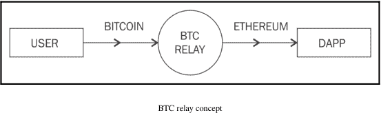

Counterparty 可在 `http://counterparty.io/` 获取。


## 山寨币的开发

从编码角度来看，山寨币项目可以通过简单地分叉比特币或其他币的源代码而非常容易地启动，但这可能还不够。当启动一个新币项目时，需要考虑几件事以确保成功启动和币的持久性。通常，代码库是用 C++ 编写的，就像比特币一样，但几乎任何语言都可用于开发币项目，例如 Golang 或 Rust。

编写代码或分叉现有币的代码是微不足道的部分，挑战性的问题是如何启动一种新货币，以便吸引新投资者和用户。一般来说，启动一个新币项目会采取以下步骤。

从技术角度来看，在分叉另一币的代码的情况下，例如比特币，有各种参数可以更改以有效地创建新币。这些参数需要被 *调整* 或引入以创建新币。这些参数可以包括但不限于以下内容。

## 共识算法

有共识算法可供选择：比特币使用的 **Proof of Work (PoW)** 或 Peercoin 中使用的 **Proof of Stake (PoS)**。

替代币

### 哈希算法

这可以是 SHA256、Scrypt、X11、X13、X15 或任何其他适合用作共识算法的哈希算法。

### 难度调整算法

此类中有各种选项可提供难度重定目标机制。最突出的例子是 KGW、DGW、Nite’s Gravity Wave 和 DigiShield。而且所有这些算法都可以根据需求进行调整以产生不同的结果；因此可能存在许多变体。

### 区块间隔

这是每个区块生成之间经过的时间。对于比特币，区块每 10 分钟生成一次，对于莱特币则是 2.5 分钟。可以使用任何值，但通常适当的值在几分钟之间；如果生成时间太快，可能会破坏区块链的稳定性，如果太慢，可能不会吸引许多用户。

### 区块奖励

区块奖励是为解决挖矿难题的矿工提供的，允许其拥有包含奖励的 Coinbase 交易。这在比特币最初时为 50 个币，现在许多山寨币将此参数设置为非常高的数字；例如在 Dogecoin 中目前为 10,000。

### 奖励减半率

这是另一个重要因素；在比特币中每 4 年减半一次，现在设为 12.5 个比特币。这是一个可变数字，可以根据需求设置为任何时间段或根本不设置。

### 区块大小和交易大小

这是另一个重要因素，决定网络上的交易速率可以有多高或多低。比特币中的区块大小限制为 1 MB，但在山寨币中可以根据需求而变化。

[ 175 ]

### 利率

此属性仅适用于 PoS 系统，其中币的所有者可以按网络定义的利率赚取利息，以换取在网络上作为 PoS 持有以保护网络的币数量。

### 币龄

此参数定义币必须保持未花费多长时间才能成为有资格被视为可质押的。

### 币的总供应量

此数字设定可以永远生成的币的总限制。例如，比特币的限制为 2100 万，而 Dogecoin 则不受限制。此限制由上述讨论的区块奖励和减半计划确定。

创建自己的虚拟货币有两个选项：分叉现有成熟加密货币源代码或从头开始编写新代码。后者不太流行，但前者更容易，并且在过去几年中允许创建许多虚拟货币。从根本上说，想法是首先分叉加密货币源代码，然后在源代码的不同战略位置进行适当的更改，从而有效地创建一种新货币。

在下一节中，读者将介绍一些山寨币项目。本章不可能涵盖所有替代货币，但下面讨论了几个精选币。选择基于寿命、市值和创新。每个币都从理论基础、交易和挖矿等不同角度进行讨论。

## Namecoin

Namecoin 是比特币源代码的第一个分叉。Namecoin 背后的关键思想不是生产一种山寨币，而是提供改进的去中心化、抗审查、隐私、安全和更快的去中心化命名。去中心化命名服务旨在应对传统互联网上使用的传统域名系统（DNS）协议固有的局限性，例如缓慢和中心化控制。Namecoin 也是 Zooko 三角形的第一个解决方案，该三角形已在前几章中简要讨论过。


## 替代币

Namecoin 本质上用于提供注册键/值对的服务。Namecoin 的一个主要用例是提供去中心化的传输层安全（TLS）证书验证机制，该机制由基于区块链的分布式去中心化共识驱动。

它基于与比特币相同的技术，但拥有自己的区块链和钱包软件。Namecoin 核心的源代码可在 https://github.com/namecoin/namecoin-core 获取。

总而言之，Namecoin 提供以下三种服务：

- 安全存储和传输名称（键）
- 通过附加最多 520 字节的数据，为名称附加一些值
- 产出一种数字货币（Namecoin）

Namecoin 还首次引入了合并挖矿，允许矿工同时在多条链上挖矿。其思路简单但非常有效：矿工创建一个 Namecoin 区块，并生成该区块的哈希。然后该哈希被添加到比特币区块中，矿工以等于或大于 Namecoin 区块难度的难度求解该区块，以证明已为求解 Namecoin 区块贡献了足够的工作量。

更准确地说，Coinbase 交易用于包含来自 Namecoin（或任何其他替代币）交易的哈希。挖矿任务是求解比特币区块，这些区块的 Coinbase scriptSig 包含指向 Namecoin（或任何其他替代币）区块的哈希指针。如下图所示。如果矿工成功在比特币区块链难度级别下求解出一个哈希，那么比特币区块就会被构建并成为比特币网络的一部分。在这种情况下，Namecoin 哈希会被比特币区块链忽略。另一方面，如果矿工在 Namecoin 区块链难度级别下求解出一个区块，那么 Namecoin 区块链中就会创建一个新区块。该方案的核心优势在于，矿工花费的所有算力都有助于保障 Namecoin 和比特币两者的安全：

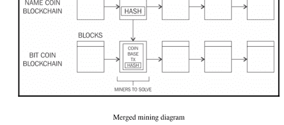

### 交易 Namecoin

根据 `https://coinmarketcap.com/` 的数据，Namecoin 当前的市值为 2,736,537 英镑，并且可以在 `https://cryptonit.net/` 等各个交易所买卖。通过简单的在线搜索即可找到其他各种交易所。

### 获取 Namecoin

尽管 Namecoin 可以独立挖矿，但通常通过上述合并挖矿技术作为比特币挖矿的一部分来挖掘。这样，Namecoin 可以作为比特币挖矿的副产品被挖出。从下面的难度图可以明显看出，单独挖矿不再有利可图；因此建议采用合并挖矿、使用矿池，甚至使用加密货币交易所购买 Namecoin。

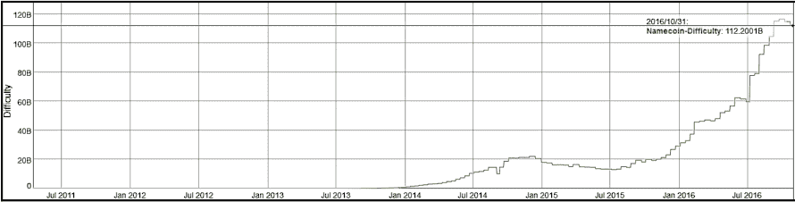

Namecoin 难度见：https://bitinfocharts.com/comparison/difficulty-nmc.html

各种矿池（例如 `https://slushpool.com`）也提供合并挖矿选项。这允许矿工主要挖比特币，但也能因此获得 Namecoin。

另一种可以快速获取 Namecoin 的方法是将你现有的币兑换为 Namecoin，例如，如果你已经拥有一些比特币或其他可以用于兑换 Namecoin 的加密货币。在线服务 `https://shapeshift.io/` 可提供此服务。该服务通过简单易用的界面允许从一种加密货币兑换为另一种加密货币。

例如，支付 BTC 以接收 NMC 的过程如下所示：

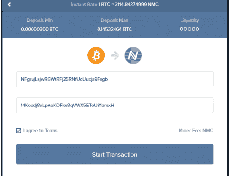

一旦点击 **开始交易**，交易即开始，并指示用户将比特币发送到特定的比特币地址。当用户发送所需金额后，兑换过程开始，如下所示：


当过程完成时，可以在 Namecoin 钱包中查看交易：

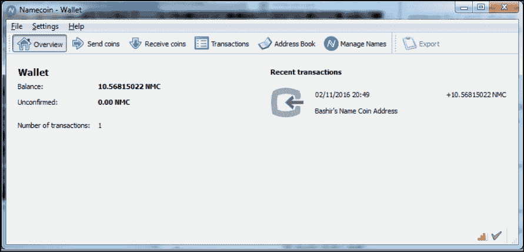

确认交易可能需要一些时间；在此之前，无法使用 Namecoin 来管理名称。一旦钱包中有了 Namecoin，就可以使用 **管理名称** 选项来生成 Namecoin 记录。

### 生成 Namecoin 记录

Namecoin 记录采用键/值对的形式。名称是小写的字符串，形式为 `d/example.name`，而值是区分大小写、UTF-8 编码的 JSON 对象，最大为 520 字节。名称应符合 RFC1035（`https://tools.ietf.org/html/rfc1035`）。一般的 Namecoin 名称可以是长度不超过 255 字节的任意二进制字符串，并带有 1024 比特的相关标识信息。Namecoin 链上的记录仅在约 200 天或 36,000 个区块内有效，之后需要续期。Namecoin 还引入了 .bit 顶级域名，可以使用 Namecoin 注册，并可借助专门支持 Namecoin 的解析器进行浏览。如下截图所示，Namecoin 钱包软件可用于注册 `.bit` 域名。

输入名称后，按下提交按钮，它会要求提供 DNS、IP 或身份等配置信息：

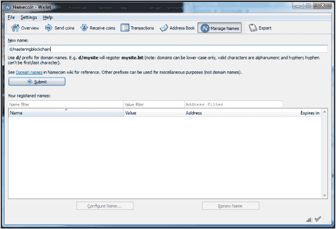

如下截图所示，masteringblockchain 将在 Namecoin 区块链上注册为 masteringblockchain.bit：

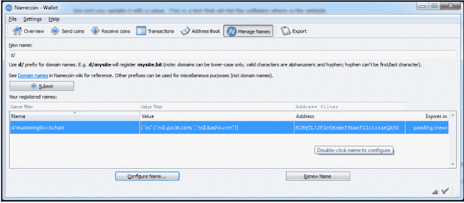

### Litecoin

Litecoin（莱特币）是 2011 年发布的比特币源代码的一个分叉。它使用 Scrypt 作为工作量证明（PoW），该算法最初在 Tenebrix 币中引入。与比特币相比，Litecoin 允许更快的交易，因为它的出块时间更短，为 2.5 分钟。同样，由于更快的出块时间，大约每 3.5 天实现一次难度调整。总币供应量为 8400 万。

Scrypt 是一种顺序内存困难函数，是首个替代基于 SHA-256 的工作量证明（PoW）算法的方案。它最初被提议作为一种基于密码的密钥派生函数（PBKDF）。其关键思想是：如果函数需要大量内存来运行，那么 ASIC 等定制硬件将需要更大的 VLSI 面积，这将是不可行的。Scrypt 算法需要在内存中保存一大组伪随机比特，并从中以伪随机方式派生出一个密钥。该算法基于一种称为 **时间-内存权衡（TMTO）** 的现象。如果放宽内存要求，则会导致计算成本增加。换句话说，如果为程序分配更多内存，TMTO 会缩短其运行时间。这种权衡使得攻击者难以获取更多内存，因为在定制硬件上实现既昂贵又困难；或者，如果攻击者选择不增加内存，那么由于处理要求高，算法运行速度会变慢。

Scrypt 使用以下参数生成派生密钥（Kd）：

- 口令：这是要哈希的字符串
- 盐值：这是提供给 Scrypt 函数（通常所有哈希函数）的随机字符串，用于抵御使用彩虹表的暴力字典攻击
- N：这是一个内存/CPU 成本参数，必须是大于 1 的 2 的幂
- P：并行化参数
- R：块大小参数
- dkLen：派生密钥的预期长度（以字节为单位）

形式上，这个函数可以写成：

```
Kd = scrypt(P, S, N, P, R, dkLen)
```

在应用核心的 Scrypt 函数之前，算法将 P 和 S 作为输入，并应用 PBKDF2 和基于 SHA-256 的 HMAC。然后将输出馈送到一个名为 ROMix 的算法，该算法内部使用 BlockMix 算法，利用 Salsa20/8 核心流密码来填充内存，这需要大量内存才能运行，从而强制实现顺序内存困难特性。

该算法此步骤的输出最终再次馈送到 PBKDF2 函数，以生成派生密钥。这个过程如下图所示：

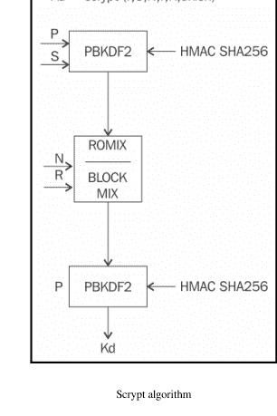

Scrypt 在 Litecoin 挖矿中使用特定参数，其中 N = 1024，R = 1，P = 1，S = 随机 80 字节，产生 256 比特输出。

似乎由于这些参数的选择，用于 Litecoin 挖矿的 Scrypt ASIC 的开发变得并不是很困难。在用于 Litecoin 挖矿的 ASIC 中，可以开发一种顺序逻辑，将数据和一个 nonce 作为输入，应用带有 HMAC-SHA256 的 PBKDF2 算法；然后将生成的比特流馈送到 Salsa20/8 函数，该函数产生一个哈希，该哈希再次馈送到 PBKDF2 和 HMAC-SHA256 函数，以产生 256 比特的哈希输出。与比特币 PoW 的情况一样，在 Scrypt 中，如果输出哈希小于目标哈希（在开始时已作为输入传递，存储在内存中，并在每次迭代时检查），则函数终止；否则，nonce 递增，并重复该过程，直到找到低于难度目标的哈希。


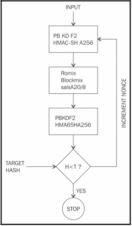

- **交易莱特币：** 与其他币种一样，莱特币的交易可轻松在各种在线交易所进行。莱特币目前的市值约为 £161,239,005。莱特币当前价格为 £3.25/LTC。
- **挖矿：** 莱特币挖矿可以单独进行或加入矿池。目前，可用于挖矿莱特币的 Scrypt ASIC 已上市。

在 CPU 上挖莱特币已不再盈利，就像许多其他数字货币一样。市面上有在线云挖矿服务提供商和 ASIC 矿机可用于挖矿莱特币。莱特币挖矿始于 CPU，随后发展到 GPU 挖矿机，最终发展到现在需要使用专门的 ASIC 矿机，例如可从 EhsMiner 购买的 Asic Scrypt Miner Wolf，才有可能挖到一些币。一般来说，即使使用 ASIC，加入矿池挖矿也比单独挖矿更划算，因为矿池采用按比例奖励机制，单独挖矿的盈利性不如矿池。这些矿机能够为 Scrypt 算法提供 2 Gh/s 的哈希率。

## 替代币种

- **软件源代码和钱包：** 莱特币的源代码可在 https://github.com/litecoin-project/litecoin 获取。莱特币钱包可从 https://litecoin.org/ 下载使用，其使用方式与比特币核心客户端软件类似。

## Primecoin

Primecoin 是市场上首个引入有用 PoW 的数字货币，而非比特币基于 SHA256 的 PoW。Primecoin 使用寻找质数作为 PoW。并非所有类型的质数都符合作为 PoW 被选中的要求。三种类型的质数（即第一类 Cunningham 链、第二类 Cunningham 链和双胞胎链）符合可用于加密货币的 PoW 算法的要求。Primecoin 区块链中难度会通过持续难度评估方案动态调整。基于质数的 PoW 的高效验证也非常重要，因为如果验证缓慢，则 PoW 不适用。因此选择质数链作为 PoW，因为随着链长度增加寻找质数链变得困难，而验证仍足够快速以保证作为高效 PoW 算法使用。同样重要的是，一旦 PoW 在一个区块上得到验证，就不能在另一个区块上重复使用。在 Primecoin 中，这通过 *Proof of Work certificates* 与子区块中父区块头部的哈希结合来实现。PoW 证书是通过将质数链链接到区块头哈希产生的。它还要求区块头的来源可被区块头哈希整除。如果可以，则进行除法，商用作 PoW 证书。可调整难度 PoW 算法的另一个特性是通过每区块调整难度来实现，而非像比特币那样每 2,016 个区块调整一次。这是一种 *smoother* 的方法，与比特币相比更平滑，并在算力突然增加时允许重新调整。此外，产生的币总数由社区驱动，Primecoin 可产生的币数没有具体限制。

## 交易 Primecoin

Primecoin 可在主要虚拟货币交易交易所进行交易。截至撰写时，Primecoin 目前的市值约为 £828,002。市值不大，但由于 Primecoin 基于新颖的理念并且背后有忠实的社区支持，因此仍保持一定的市场份额。

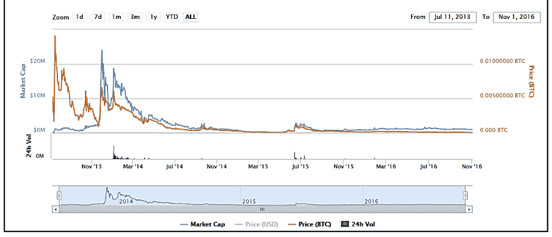

## 挖矿指南

第一步是下载钱包。Primecoin 在钱包内支持原生挖矿，就像原始比特币客户端一样，但也可以通过各种在线挖矿服务提供商在云端进行挖矿。

以下是简要的 Windows 指南：

1. 第一步是从以下地址下载 Primecoin 钱包：
   <http://primecoin.io/index.php.>

2. 钱包安装并与网络同步后，可按照下一步开始挖矿。可通过点击 **Help** 菜单并选择 **Debug** 窗口菜单项在 Primecoin 钱包中打开调试窗口。还可通过在控制台窗口中输入 `help` 调出额外帮助：

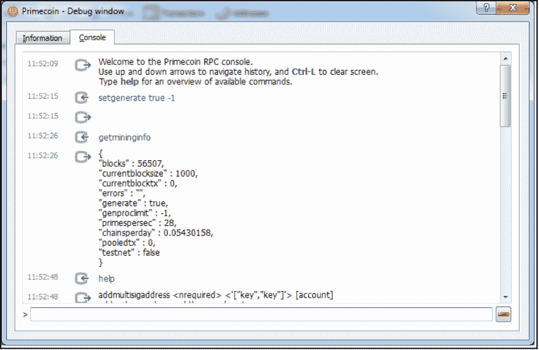

3. 前述命令成功执行后，挖矿将以单人模式启动。这可能盈利性不高，但矿工可使用在线可用的矿池：

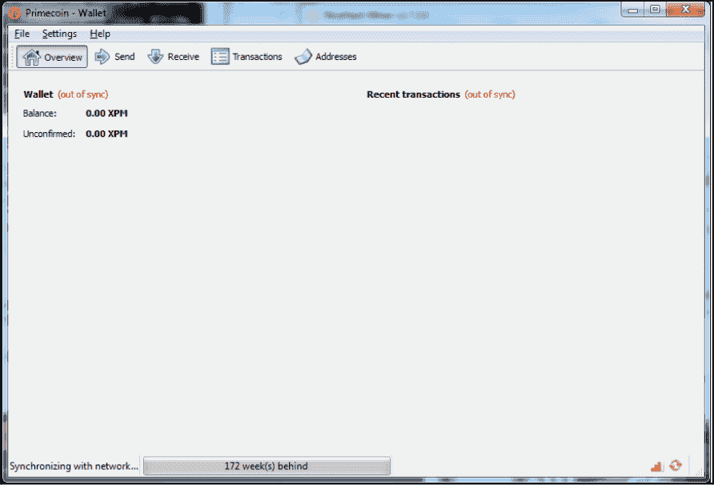

Primecoin 钱包软件，与网络同步

Primecoin 源代码可在 https://github.com/primecoin/primecoin 获取。尽管这是一个新颖的概念，且 Primecoin 引入的 PoW 具有科学意义，但似乎没有活跃的开发在进一步发展 Primecoin。读者可通过阅读 Sunny King（笔名）撰写的 Primecoin 白皮书进一步探索 Primecoin，地址为：http://primecoin.io/bin/primecoin-paper.pdf。

## Zcash

Zcash 于 2016 年 10 月 28 日推出。这是首个使用特定类型的零知识证明，即 **零知识简洁非交互式知识论证 (zk-SNARKs)** 来为用户提供完全隐私的货币。这些证明非常简短且易于验证；然而，设置初始公共参数是一个复杂的过程。后者包括两个密钥：证明密钥和验证密钥。该过程需要采样一些随机数来构建公共参数。问题在于，这些随机数也称为 *toxic waste*，必须在参数生成后销毁，以防止 Zcash 被伪造。为此，Zcash 团队提出了一种多方计算协议，以协作方式从独立位置生成所需的公共参数，以确保不会产生 *toxic waste*。由于这些公共参数需要由 Zcash 团队创建，这意味着仪式参与者是可信的。这就是仪式非常开放并使用多方计算机制进行的原因。该机制具有这样一个特性：只有在所有仪式参与者都被攻破的情况下，最终参数才会被攻破。仪式完成后，所有参与者会物理销毁用于私钥生成的设备。此操作消除了设备上参与者私钥部分的任何痕迹。

zk-SNARKs 必须满足完备性、可靠性、简洁性和非交互性等属性。*Completeness* 意味着证明者有一个明确的策略来说服验证者断言为真。另一方面，*soundness* 意味着没有任何证明者能说服验证者虚假陈述为真。*Succinctness* 意味着证明者和验证者之间传递的消息在大小上非常小。最后，非交互性属性意味着断言的正确性验证可以在没有交互或很少交互的情况下进行。此外，作为零知识证明，还需要满足 *zero-knowledge* 属性（见第 3 章，《密码学与技术基础》）。

Zcash 开发者引入了 **去中心化匿名支付方案 (DAP scheme)** 的概念，该方案在 Zcash 网络中使用以实现直接且私密的支付。交易不会透露支付的来源、目的地和金额等信息。Zcash 中有两种地址类型，z-addr 和 t-addr。Z 地址基于零知识证明并提供隐私保护，而 T 地址与比特币类似。


Zcash 使用一种名为 **Asymmetric PoW (Equihash)** 的高效 PoW 方案，它基于广义生日问题。它允许非常高效的验证。它是一种内存硬且抗 ASIC 的函数。Zcash 中引入了一个新颖的想法（初始慢速挖矿），这意味着区块奖励会在一段时间内逐渐增加，直到达到第 20,000 个区块。这允许网络的初始扩展以及早期矿工的实验，并且如果需要，Zcash 开发者可以进行调整。慢启动由于稀缺性对价格产生了影响，ZEC 在首次发布当天的价格达到约 25,000 美元。Zcash 中已实现了一个略微修改版本的 Digishield 难度调整算法。公式如下所示：

```
(next difficulty) = (last difficulty) x SQRT [ (150 seconds) / (last solve time) ]
```

Zcash 的各种属性快照（初始慢启动后）如下所示：

| Attribute | Value |
|---|---|
| Name | Zcash |
| Launch date | 28/10/16 |
| Main purpose | Currency |
| Currency Code | ZEC |
| Maximum coins | 21 million |
| Block time | 10 minutes |
| Consensus facilitation algorithm | Proof of Work (equihash) |
| Difficulty adjustment algorithm | DigiShield V3 (modified) |
| Mining hardware | CPU, GPU |
| Difficulty adjustment period | 1 block |

2. 接下来，运行命令克隆 Zcash，如以下屏幕截图所示：

```
$ git clone https://github.com/zcash/zcash.git
```

此命令将 Zcash git 仓库克隆到本地。输出显示在以下屏幕截图中：

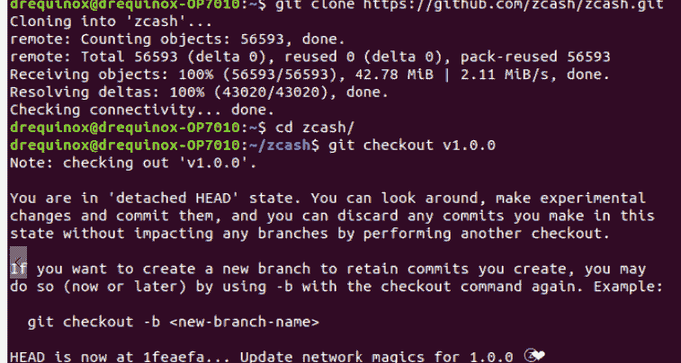

3. 下一步是通过以下屏幕截图中的命令下载证明和验证密钥：

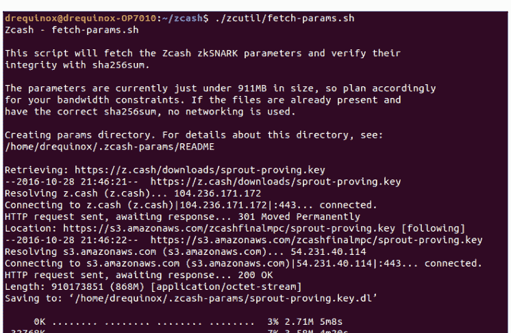

4. 一旦此命令运行，它将下载大约 911 MB 的密钥到 ~/.zcash-params/ 目录。目录包含证明和验证密钥的文件：

```
drequinox@drequinox-OP7010:~/.zcash-params$ pwd
/home/drequinox/.zcash-params
drequinox@drequinox-OP7010:~/.zcash-params$ ls -ltr
-rw-rw-r-- 1 drequinox drequinox      1449 Oct 24 16:46 sprout-verifying.key
-rw-rw-r-- 1 drequinox drequinox 910173851 Oct 24 16:46 sprout-proving.key
```

5. 一旦前面的命令成功完成，源代码可以使用以下命令构建：

```
./zcash/build.sh -j$(nproc)
```

这将产生非常长的输出；如果一切顺利，它将生成一个 zcashd 二进制文件。请注意，此命令以 nproc 作为参数，这基本上是一个查找系统中的核心或处理器数量并显示该数字的命令。如果您没有该命令，则将 nproc 替换为系统中的处理器数量。

构建完成后，下一步是配置 Zcash。这是通过在 ~/.zcash/ 目录中创建名为 zcash.conf 的配置文件实现的。

示例配置文件如下所示：

```
addnode=mainnet.z.cash
rpcuser=drequinox
rpcpassword=xxxxxxoJNo4o5c+F6E+J4P2C1D5iz1zIKPZJhTzdW5A=
gen=1
genproclimit=8
equihashsolver=tromp
```

前面的配置启用了各种功能。第一行添加主网节点并启用主网连接。rpcuser 和 rpcpassword 是 RPC 接口的用户名和密码。gen = 1 用于启用挖矿。genproclimit 是可用于挖矿的处理器数量。最后一行启用更快的挖矿求解器；如果您想使用标准 CPU 挖矿，则不需要此项。

现在可以使用以下命令启动 Zcash：

```
./zcashd --daemon
```

启动后，这将允许通过 Zcash-cli 命令行界面与 RPC 接口进行交互。这几乎与比特币命令行界面相同。一旦 Zcash 守护进程运行起来，可以运行各种命令来查询 Zcash 的不同属性。交易可以通过 CLI 或通过区块链浏览器在本地查看。Zcash 的区块链浏览器可在以下位置获得：https://explorer.zcha.in/。

## Address generation

可以使用以下命令生成新的 Z 地址：

```
$:~/zcash/src$ ./zcash-cli z_getnewaddress
zcPDBKuuwHJ4gqT5Q59zAMXDHhFoi hyTC1aLE5Kz4GwgUXfCBWG6SDr45SFLUsZhpc dvHt7nFmC3iQcn37rKBcVRa93DYrA
```

使用 `getinfo` 参数运行 Zcash-cli 命令会产生以下屏幕截图中显示的输出。它显示了区块、难度和余额等有价值的信息：

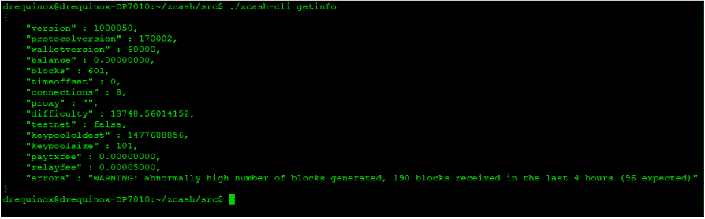

可以使用以下命令生成新的 T 地址：

```
drequinox@drequinox-OP7010:~/zcash/src$ ./zcash-cli getnewaddress
t1XRCGMAw36yPVCcxDUIrxvZcsAAuGdsS8Nny
```

## GPU mining

除了 CPU 挖矿外，还提供 GPU 挖矿选项。目前尚无官方 GPU 矿机；然而开源开发者已制作了各种概念验证和可用的矿机。Zcash 公司举办了一场公开竞赛，以鼓励开发者构建并提交 CPU 和 GPU 矿机。截至撰写本文时，尚未宣布获奖作品。读者可以通过访问网站 `https://zcashminers.org/` 获取更多信息。

还有另一种挖矿方式：使用来自各种在线云挖矿服务提供商的云挖矿合约。云挖矿服务提供商代表客户进行挖矿。除了云挖矿合约外，矿工还可以使用自己的设备通过使用 stratum 或其他协议的矿池进行挖矿。一个关键示例是 nice hash 的 Zcash 矿池。使用此矿池，矿工可以出售其算力。构建和使用 Zcash 矿池上的 CPU 矿机的示例如下所示。

## Downloading and compiling nheqminer

以下步骤可用于在 Ubuntu Linux 发行版上下载和编译 `nheqminer`：

```
sudo apt-get install cmake build-essential libboost-all-dev
git clone https://github.com/nicehash/nheqminer.git
cd nheqminer/nheqminer
mkdir build
cd build
cmake ..
make
```

一旦所有步骤成功完成，nheqminer 可以使用以下命令运行：

```
./nheqminer -l eu -u <btc address> -t <number of threads>
```

Nheqminer 的 Windows 版本可在以下位置获得：

```
https://github.com/nicehash/nheqminer/releases.
```

Nheqminer 接受多个参数，例如位置（`-l`）、用户名（`-u`）和用于挖矿的线程数（`-t`）。

Windows 矿机运行 Zcash 的示例如下所示：

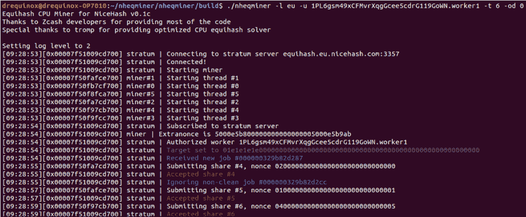

使用 BTC 地址接收出售算力的付款

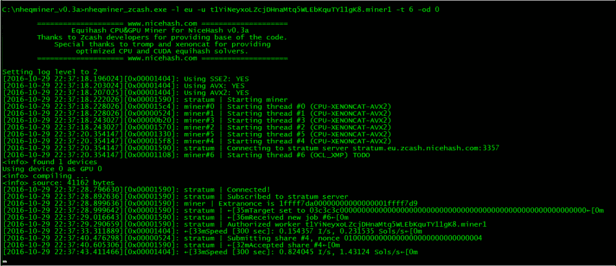

使用 Zcash T 地址接收出售算力的付款

这完成了对 Zcash 的介绍；读者可以在线探索更多关于 Zcash 的信息，因为它目前非常不稳定，情况可能会迅速变化。一件事是肯定的；Zcash 的零知识证明是一项重大创新，它为需要固有隐私的未来应用铺平了道路，例如银行、医学或法律。

## Summary

在本章中，读者已了解整体加密货币格局。详细讨论了一些山寨币，尤其是 Zcash 和 Namecoin。加密货币是研究的非常活跃的领域，尤其是在可扩展性、隐私和安全方面。一些研究也已开展，以发明新的难度重定目标算法，以遏制加密货币中心化的威胁。可以在隐私和尤其是可扩展性方面进行进一步研究。读者现在应该能够理解山寨币的概念及其背后的各种动机。还讨论了一些实践方面，例如挖矿和启动新的货币项目，希望这能为读者提供坚实的基础，并使他们能够进一步探索这些领域。山寨币是一个引人入胜的研究领域，为去中心化的未来开启了许多可能性。


