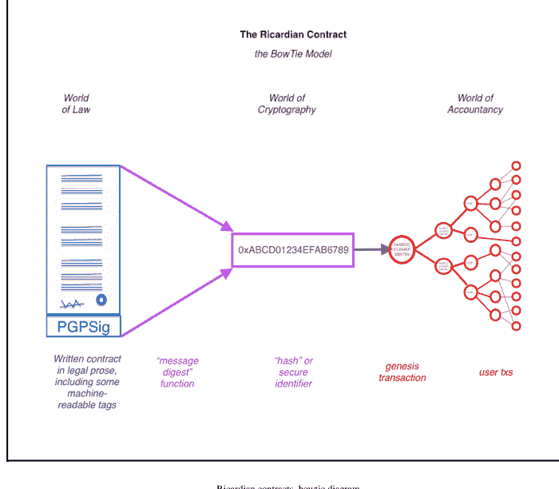
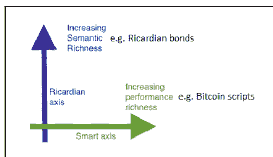
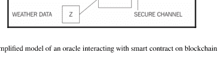

# 6 智能合约

本章对智能合约进行了介绍。这并不是一个新概念，但随着区块链的出现，这一概念的兴趣得以复兴，并且目前已成为区块链领域的一个活跃研究方向。由于智能合约可以通过降低交易成本和简化复杂合同为金融服务行业带来成本节约效益，各大金融机构和学术机构正在进行严格的研究，以便尽快将智能合约的实施形式化并使其易于实用。

### 历史

智能合约最早由 Nick Szabo 在 1990 年代末提出理论化，但在真正认识到其真正潜力和益处之前几乎过去了 20 年。Szabo 对智能合约的描述如下：

> “智能合约是一种计算机化交易协议，用于执行合同条款。其总体目标是满足常见的合同条件（如付款条款、留置权、保密性，甚至执行），最大限度地减少恶意和偶然的例外情况，并最大限度地减少对可信中介的需求。相关的经济目标包括降低欺诈损失、仲裁和执行成本以及其他交易成本。”

这一智能合约的想法在 2009 年的比特币中以有限的方式得以实现，其中比特币交易可用于在点对点网络上在用户之间转移价值，在该网络中用户不一定相互信任，并且不需要可信中介。

### 定义

关于智能合约的标准定义尚无共识。定义智能合约是什么至关重要，以下是作者尝试提供智能合约的概括性定义。

智能合约是一种安全且不可停止的计算机程序，代表一种可自动执行和可强制执行的协议。

进一步剖析这一定义可知，智能合约实际上是一种用计算机或目标机器可理解的语言编写的计算机程序。此外，它以业务逻辑的形式涵盖了各方之间的协议。另一个关键思想是，当满足某些条件时，智能合约会自动执行。它们是可强制执行的，这意味着所有合同条款都将按定义和预期执行，即使在存在对手方的情况下也是如此。强制执行是一个更广泛的术语，它涵盖了以法律形式进行的传统执行，以及实施某些措施和控制以使能够在无需任何调解的情况下执行合同条款。应注意，真正的智能合约不应依赖传统的执行方法。相反，它们应遵循代码即法律的原则，这意味着无需仲裁员或第三方来控制或影响智能合约的执行。智能合约是自我执行的，而非法律可执行。这可能被视为自由主义者的梦想，但这是完全可能的，并且符合智能合约的真正精神。

此外，它们是安全且不可停止的，这意味着这些计算机程序需要以容错且在合理时间内可执行的方式设计。这些程序应能够在外部因素不利的情况下执行并保持健康的内部状态。例如，想象一个普通的计算机程序，其编码了一些逻辑并根据其中编码的指令执行，但如果其运行环境或其依赖的外部因素偏离正常或预期状态，程序可能会任意反应或简单地中止。智能合约必须对这种类型的问题具有免疫力。

智能合约本质上需要具有确定性。这种属性将允许智能合约由网络上的任何节点运行并达到相同的结果。如果结果在节点之间即使略有不同，则无法达成共识，整个区块链上的分布式共识范式可能会失败。此外，还希望合同语言本身是确定性的，从而确保智能合约的完整性和稳定性。我所指的确定性是指语言中没有使用非确定性函数，这些函数可能在不同节点上产生不同的结果。例如，各种编程语言中各种函数计算的各种浮点运算可能在不同的运行时环境中产生不同的结果。另一个例子是 JavaScript 中的某些数学函数，它们可能对不同浏览器的相同输入产生不同的结果，从而导致各种错误。这在智能合约中是极其不希望的，因为如果节点之间结果不一致，则永远无法达成共识。确定性特性可确保智能合约对特定输入始终产生相同的输出。换句话说，程序一旦编译就产生坚实准确的业务逻辑，完全符合高级代码中编程的要求。

总之，智能合约具有以下四个属性：

- 自动可执行
- 可强制执行
- 语义健全
- 安全且不可停止。

前两个属性是最低要求，而后两个属性在某些场景下可能不需要或无法实现，可以放宽。例如，衍生品合约可能不需要语义健全和不可停止，但至少应在基本层面上自动可执行和可强制执行。另一方面，地契需要语义健全和完整，因此要将其作为智能合约实现，语言必须为计算机和人类所理解。Ian Grigg 通过其发明的 Ricardian 合同解决了这一解释问题，我们将在下一节更详细地探讨它。

### Ricardian 合同

Ricardian 合同最初由 Ian Grigg 在 1990 年代末的《Financial Cryptography in 7 Layers》论文中提出。这些合同最初用于名为 Ricardo 的债券交易和支付系统。其关键思想是编写一份文件，该文件可被法院和计算机软件同时理解和接受。Ricardian 合同解决了通过互联网发行价值的挑战。它识别发行人并在文件中记录合同的所有条款和条款，以便使其作为具有法律约束力的合同被接受。

根据 Ian Grigg 在 http://iang.org/papers/ricardian_contract.html 的原始定义，Ricardian 合同是一份具有以下若干属性的文件：

- 由发行人向持有人提供的合同
- 由持有人持有的有价值权利，并由发行人管理
- 易于人类阅读（如纸质合同）
- 可被程序读取（可解析，如数据库）
- 经过数字签名
- 携带密钥和服务器信息
- 与唯一且安全的标识符相关联

在实践中，合同通过生成一份包含合同条款的法律散文和所需机器可读标签的单一文档来实现。该文档由发行人使用其私钥进行数字签名。然后使用消息摘要函数对该文档进行哈希处理，以生成可用于标识该文档的哈希值。然后该哈希值在合同履行过程中进一步被各方使用和签名，以便将每次交易与标识符哈希链接起来，从而作为意图的证据。这在下图中表示，通常称为蝴蝶结模型。

下图显示了左侧的法律世界，文档由此产生。然后对其进行哈希处理，生成的消息摘要在会计世界中用作标识符。会计世界基本上可以代表企业中用于执行各种业务操作的任何或多个会计、交易和信息系统。其背后的思路是，通过对文档进行哈希处理而生成的消息摘要首先用于所谓的创世交易，或第一次交易，然后在合同运营执行的整个过程中作为标识符用于每次交易。

这样，就在原始书面合同与 *会计世界* 中的每笔交易之间建立了一个安全链接。

Ricardian 合同，蝴蝶结图

Ricardian 合同与智能合约的不同之处在于，智能合约不包含任何合同文件，纯粹专注于合同的执行。另一方面，Ricardian 合同更关注语义丰富性和一份包含合同法律散文的文档的生成。合同的语义可以分为两种类型：操作语义和指称语义。第一种类型定义了合同的实际执行、正确性和安全性，而后者关注的是完整合同在现实世界中的含义。一些研究人员区分了智能合约代码和智能法律合同，其中智能合约只关注合同的执行，而第二种类型涵盖了法律协议的指称语义和操作语义。基于语义差异对智能合约进行分类似乎是有意义的，但最好将智能合约视为一个独立实体，它能够在其内部编码法律散文和代码（业务逻辑）。

在比特币中，可以观察到一种非常简单的智能合约实现，它完全以合同的执行为导向，而 Ricardian 合同则更侧重于生成人类可理解的文档，其中某些部分可由计算机程序理解。这可以被视为法律语义与操作性能（语义与性能）之间的区别，如下图所示。这最初是由 *Ian Grigg* 在其论文 *On the intersection of Ricardian and smart contracts* 中提出的。

解释性能与语义是正交问题的图表，由 Ian Grigg 描述；略有修改以在两个轴上显示不同类型合同的示例

智能合约被设计为同时包含这两个要素（性能和语义），从而构成智能合约的理想模型。

Ricardian 合同可以表示为三个对象的元组，即 *Prose, parameters and code*。Prose 代表用常规语言书写的法律合同；code 代表程序，即法律散文的计算机可理解表示；parameters 将法律合同的适当部分与等效代码连接起来。

Ricardian 合同已在许多系统中实现，例如 CommonAccord、OpenBazaar、OpenAssets 和 Askemos。

## 智能合约模板

智能合约可以为任何需要行业的实现，但目前大多数用例都与金融行业相关。针对金融行业的智能合约领域的最新工作提出了智能合约模板的想法。想法是构建标准模板，为金融工具的法律协议提供支持框架。这由 Clack 等人在其论文 Smart Contract Templates: Foundations, design landscape and research directions 中提出。该论文还提出应构建特定领域的语言以支持智能合约模板的设计和实现。一种名为 CLACK 的语言，即增强合同知识的通用语言，已被提出，并且研究已开始开发该语言。该语言旨在非常丰富，并提供从支持法律散文到能够在多个平台上执行和加密功能的各种功能。

金融行业的合同并不是一个新概念，各种特定领域的语言 DSL 已在金融行业中使用，以为特定领域提供特定语言。例如，存在支持保险产品开发的 DSL、表示能源衍生品的 DSL，或用于构建交易策略的 DSL。列表还在继续，金融特定领域语言的综合列表可以在 http://www.dslfin.org/resources.html 找到。

了解特定领域语言的概念很重要。这些语言是为特定应用或感兴趣领域开发的，具有有限的表现力。特定领域语言（DSL）与通用编程语言（GPL）不同：DSL 具有一组小而足以满足其预期使用领域的优化功能，并且与 GPL 不同，通常不用于构建通用大型应用程序程序。基于 DSL 的设计理念，可以设想可以专门开发此类语言来编写智能合约。一些工作已经完成，Solidity 就是这样一种语言，它与以太坊区块链一起引入用于编写智能合约。Serpent 是与以太坊一起引入的另一种语言，尽管它不如 Solidity 使用广泛。

智能合约编程的特定领域语言这一想法可以进一步扩展到图形特定领域语言，即智能合约建模平台，其中领域专家（非程序员）可以使用图形用户界面和画布来定义和绘制金融合同的语义和性能。一旦流程被绘制并完成，它可以先在同一系统内进行仿真以进行测试，然后部署到目标平台，该平台可以是区块链。这也不是一个新概念，类似的方法在 Tibco streambase 产品中使用，该产品是基于 Java 的系统，用于构建事件驱动的高频交易系统。

建议还应开展研究，以开发高级 DSL，这些 DSL 可用于在用户友好的图形用户界面中编程智能合约，从而允许非程序员设计智能合约。

## 预言机

预言机是智能合约生态系统的重要组成部分。智能合约的局限性在于它们无法访问可能需要控制业务逻辑执行的外部数据；例如，合同需要用于释放股息支付的证券股价。预言机可用于向智能合约提供外部数据。Oracle 是一个从外部来源向智能合约传递数据的接口。根据行业和要求，Oracle 可以提供不同类型的数据，从天气报告、现实世界新闻和公司行为到来自物联网（IoT）设备的数据。Oracle 是使用安全通道将数据传输到智能合约的可信实体。

Oracle 还能够对数据进行数字签名，证明数据的来源是真实的。智能合约可以订阅 Oracle，智能合约可以拉取数据，也可以由 Oracle 将数据推送到智能合约。还必须确保 Oracle 无法操纵其提供的数据，并且必须能够提供真实数据。即使 Oracle 是可信的，在某些情况下数据仍可能因操纵而不正确。因此，有必要使 Oracle 无法更改数据。这种验证可以通过使用本章后面讨论的各种公证方案来实现。在这种方法中，已经可以看到一个可能在某些情况下不理想的问题，那就是信任问题。如何信任第三方提供的数据的质量和真实性？这在金融世界尤其如此，市场数据必须准确可靠。对于智能合约设计者来说，接受由大型知名可信第三方提供的预言机数据可能是可以接受的，但中心化问题仍然存在。这类 Oracle 可以称为标准或简单 Oracle。

另一种 Oracle，本质上是由于去中心化要求而出现的，可以称为去中心化 Oracle。这类 Oracle 可以基于某种分布式机制构建。也可以设想 Oracle 本身可以从由分布式共识驱动的另一个区块链获取数据，从而确保数据的真实性。例如，一个机构运行自己的私有区块链，可以通过 Oracle 发布其数据馈送，然后可被其他区块链消费。

研究人员还提出了另一种硬件预言机的概念，它需要来自物理设备的真实世界数据。例如，这可以用于遥测和物联网。然而，这种方法需要一种机制来确保硬件设备无法被篡改。这可以通过使用防篡改设备来实现。

现在已有平台可以支持智能合约通过预言机获取外部数据。预言机向区块链写入数据的方式取决于所使用的区块链类型。例如，在比特币区块链中，预言机可以通过OP_RETURN操作码将数据写入特定交易，智能合约可以监控该交易并读取数据。各种在线服务（例如 http://www.oraclize.it/ 和 https://www.realitykeys.com/ ）均可提供预言机服务。此外，https://smartcontract.com/ 还提供了另一项服务，该服务提供外部数据以及通过智能合约进行支付的能力。所有这些服务的目的是让智能合约能够获取其执行和决策所需的数据。为了证明预言机从外部来源检索到的数据的真实性，可以使用像TLSnotary这样的机制，它会产生数据源与预言机之间通信的证明。这确保了反馈给智能合约的数据确实是从该来源检索到的。关于TLSnotary的更多详情可以在这里找到：https://tlsnotary.org/。

下图展示了预言机与智能合约生态系统的通用模型：

一个预言机与区块链上智能合约交互的简化模型

## 智能预言机

智能预言机的概念也已在Codius中提出并实现。智能预言机本质上与预言机类似，但增加了合约代码执行的能力。Codius提出的智能预言机使用Google Native Client运行，这是一个用于运行不受信任的x86本地代码的沙盒环境。Codius可在 https://www.codius.org/ 获取。

## 在区块链上部署智能合约

智能合约可以部署在区块链上，也可以不部署在区块链上，但由于区块链提供的分布式共识机制，将其部署在区块链上是合理的。以太坊就是一个原生支持智能合约开发和部署的区块链示例。以太坊区块链上的智能合约通常是更大应用的一部分，例如**去中心化自治组织（DAO）**。

相比之下，在比特币区块链中，比特币交易中的`lock_time`字段可以被视为一个基础版本智能合约的使能器。`lock_time`字段使交易可以被锁定，直到指定时间或经过一定数量的区块后才解锁，从而强制执行一个基础合约：只有满足特定条件（经过的时间或区块数量）后，交易才能被解锁。然而，这在本质上非常有限，应仅被视为一个基础智能合约的示例。除了上述示例之外，比特币脚本语言虽然有限，但可以用来构建基础智能合约。一种可能性是向一个比特币地址提供资金，任何展示出哈希碰撞攻击的人都可以花费这笔资金。这个想法最早在Bitcointalk论坛上提出，更多信息可以在 https://bitcointalk.org/index.php?topic=293382.0 找到。这也可以被视为智能合约的一种基础形式。

## The DAO

The DAO是众筹金额最高的项目之一，始于2016年4月。它本质上是一组为提供投资平台而编写的智能合约。由于代码中的一个缺陷，该项目在2016年6月遭到黑客攻击，价值相当于5000万美元的资金被从DAO中转出到另一个账户。这导致以太坊进行了硬分叉以从攻击中恢复。需要注意的是，对*代码即法律*或不可停止的智能合约这一概念应持一定的怀疑态度，因为这些概念的实现还不够成熟，不足以获得完全且毋庸置疑的信任。最近的事件证明了这一点：以太坊基金会通过引入硬分叉，能够停止并改变*The DAO*的执行。尽管这次硬分叉是出于正当原因，但它违背了去中心化的真正精神以及*代码即法律*的理念。另一方面，对这次硬分叉的抵制，以及一些决定在原始链上继续挖矿的矿工，导致了以太坊经典（Ethereum Classic）的诞生。这就是原始的、未分叉的以太坊区块链，在那里*代码仍然是法律*。

## 智能合约

这次攻击凸显了智能合约的危险性，以及开发一种正式智能合约语言的绝对必要性。这次攻击还凸显了彻底测试的重要性。最近，在以太坊的智能合约开发语言中发现了各种漏洞。因此，制定一个标准框架来解决所有这些问题至关重要。如前所述，一些工作已经开始，但为了应对智能合约语言中的局限性，这个领域还有更多研究空间。

## 总结

本章首先介绍了智能合约的历史，然后详细讨论了智能合约的定义。由于对智能合约的标准定义尚未达成一致，我们尝试引入一个涵盖智能合约核心要点的定义。本章还介绍了李嘉图合约，并解释了李嘉图合约与智能合约之间的区别，强调李嘉图合约关注合约的定义，而智能合约则面向合约的实际执行。本章讨论了智能合约模板的概念，学术界和工业界目前正在就该主题进行高质量的积极研究。本章还讨论了一些关于创建高级领域特定语言以创建智能合约或智能合约模板的想法。在本章后续章节中，引入了预言机的概念，随后简要讨论了DAO以及DAO和智能合约中的安全问题。
