# 7 以太坊入门

## 以太坊入门

本章旨在介绍以太坊区块链。你将了解以太坊背后的基础知识和高级理论概念。我们将详细讨论与以太坊区块链相关的各种组件、协议和算法，以便你理解这一区块链范式背后的理论。此外，本章还将对钱包软件、挖矿和设置以太坊节点进行实用而深入的介绍。还会介绍一些关于以太坊面临的各种挑战（如安全性和可扩展性）的内容。此外，还将讨论交易和市场动态。

## 引言

以太坊由*维塔利克·布特林*（Vitalik Buterin）于2013年11月提出构想。其核心提议是开发一种图灵完备的语言，允许为区块链和去中心化应用开发任意程序（智能合约）。这与比特币形成鲜明对比，比特币的脚本语言非常有限，仅允许基本和必要的操作。

## 以太坊客户端与版本

各种以太坊客户端已使用不同的语言开发，目前最流行的是 go-Ethereum 和 parity。go-Ethereum 使用 Golang 开发，而 parity 使用 Rust 构建。还有其他客户端可用，但通常，被称为*geth*的 go-Ethereum 客户端足以满足各种用途。Mist 是一个用户友好的**图形用户界面（GUI）**钱包，它在后台运行 geth 与网络同步。更多细节将在本章后面的安装和挖矿部分提供。


以太坊的首个发布版本被称为 *Frontier*，而以太坊当前的发布版本称为 *homestead release*。下一个版本名为 metropolis，其重点在于协议简化和性能改进。最终的发布版本名为 *serenity*，预计将实现 Proof of Stake 算法（Casper）。serenity 针对的研究领域还包括可扩展性、隐私以及 **Ethereum virtual machine (EVM)** 升级。由于这是一个持续的开发工作，以太坊生态系统将不断改进和发展，因此 serenity 不应被真正视为一个 *final* 版本，而是一个漫长持续改进之旅中的一个重要里程碑。预计还会有进一步的发布，但尚未命名。*web 3.0* 的愿景已经提出，并在社区中进行讨论。Web 3.0 是一个概念，基本上提出了一个语义化和智能化的网络，作为现有 web 2.0 技术的演进。这是一个生态系统的愿景，其中人们、应用程序、数据和网络都相互连接，并且能够以智能的方式相互交互。随着区块链技术的出现，去中心化网络的想法也随之出现，这实际上是互联网最初的愿景。核心思想是，在 web 3.0 中，互联网上的所有主要服务，如 DNS、搜索引擎和身份验证都将被去中心化。这就是以太坊被设想为能够帮助实现这一愿景的平台的地方。

## 以太坊栈

以太坊栈由各种组件组成。在核心，有运行在 P2P 以太坊网络上的以太坊区块链。其次，有以太坊客户端（通常是 geth），它运行在节点上并连接到点对点以太坊网络，从那里下载区块链并在本地存储。它提供各种功能，例如挖矿和账户管理。区块链的本地副本会定期与网络同步。另一个组件是 `web3.js` 库，它允许通过 **Remote Procedure Call (RPC)** 接口与 geth 进行交互。

在前面的示例中，从 **Address 4718bf7a** 向 **Address 741f7a2** 发起了一笔 2 个 Ether 的转账。初始状态代表交易执行前的状态，而最终状态则是形态变化后的状态。这将在本章后面更详细地讨论，但此示例的目的是介绍以太坊中状态转换的核心思想。

## 货币（ETH 和 ETC）

作为对矿工的激励，以太坊还奖励其原生货币称为 Ether，缩写为 ETH。在 DAO 攻击（稍后描述）之后，为缓解问题而提出了硬分叉；因此，现在有两个以太坊区块链：一个称为 Ethereum classic，其货币由 ETC 表示，而硬分叉版本是 ETH，它继续发展并进行积极开发。ETC 也有其自己的追随者，有一个专门的社区在进一步开发 ETC，它是以太坊未分叉的原始版本。本章主要关注 ETH，它是目前最活跃和官方的以太坊区块链。

## 分叉

随着 homestead 的最新发布，由于重大的协议升级，导致了硬分叉。协议在区块号 1,150,000 处升级，导致从第一个以太坊版本 Frontier 迁移到第二个以太坊版本 homestead。

一次最近的非故意分叉发生在 2016 年 11 月 24 日 14:12:07 UTC，由于 geth 客户端的日志记录机制中的一个错误。网络分叉发生在区块号 2,686,351。该错误导致 geth 在空的 out-of-gas 异常情况下无法撤销空账户删除。在 parity（另一个流行的以太坊客户端）中这不是一个问题。这意味着从区块号 2686351 开始，以太坊区块链分裂为两个，一个运行 parity 客户端，另一个运行 geth。该问题在 geth 版本 1.5.3 发布后得到解决。

## Gas

以太坊中的另一个关键概念是 gas。以太坊区块链上的所有交易都需要支付其执行的计算成本。该成本由一种称为 *gas* 或 *crypto fuel* 的东西来支付，这是以太坊引入的一个新概念。这种作为 *execution fee* 的 gas 由交易发起者预先支付。*fuel* 会随着每次操作而消耗。每个操作都有一个预定义的相关 gas 数量。每笔交易指定其愿意为其执行消耗的 gas 数量。如果在执行完成前 *out of gas*，则交易执行到该点为止所做的任何操作都会被回滚。如果交易成功执行，则任何剩余的 gas 会退还给交易发起者。

这个概念不应与矿工费混淆，矿工费是用于向矿工支付 *gas* 作为费用的不同概念。本章后面将提供有关 gas 和操作相关的概念和计算的更多信息。

## 共识机制

以太坊中的共识机制基于 *Zohar* 和 *Sompolinsky* 于 2013 年 12 月首次提出的 GHOST 协议。有兴趣的人可以探索 http://eprint.iacr.org/2013/881.pdf 上的详细原始论文。

以太坊使用该协议的简化版本，其中花费最多计算工作量来构建的链被确定为确定性版本。另一种看待方式是找到最长的链，因为最长的链必须是通过消耗足够的挖矿工作量构建的。**Greedy Heaviest Observed Subtree (GHOST)** 最初被引入作为一种机制，以缓解由于快速的区块生成时间而导致陈旧或孤块的问题。在 GHOST 中，陈旧区块被添加到计算中以确定最长和最重的区块链。在以太坊中，陈旧区块被称为 Uncles 或 Ommers。

## Balance

该值代表地址持有的以太坊货币（Ether）最小单位 Weis 的数量。

## Storageroot

该字段代表编码账户存储内容的 Merkle Patricia 树的根节点。

## Codehash

这是一个不可变字段，包含与账户关联的智能合约代码的哈希。在普通账户的情况下，该字段包含空字符串的 Keccak 256 位哈希。该代码通过消息调用被调用。

世界状态及其与账户 trie、账户和区块头的关联可以在以下图表中可视化。它显示了图表中间的账户数据结构，其中包含从左侧所示的账户存储 trie 的根节点派生的存储根哈希。然后账户数据结构用于世界状态 trie，它是地址与账户状态之间的映射。最后，世界状态 trie 的根节点使用 Keccak 256 位算法进行哈希，并作为区块头数据结构的一部分，图表右侧显示为 state root hash。

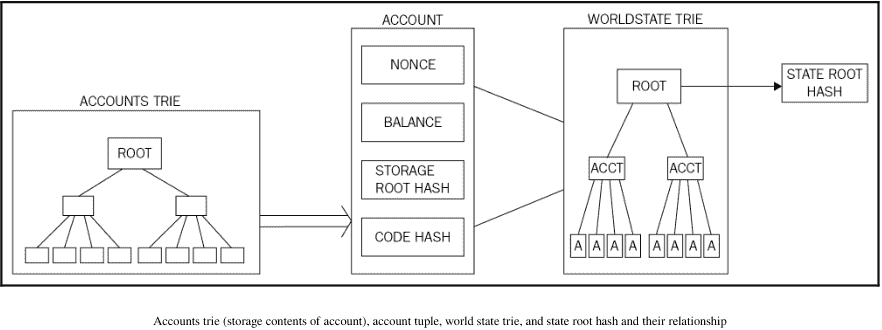

## To

顾名思义，`to` 字段是一个值，表示交易接收者的地址。

## Value

`Value` 表示要转移给接收者的 Wei 的总数；在合约账户的情况下，这表示合约将持有的余额。

## Signature

签名由三个字段组成，即 *v*、*r* 和 *s*。这些值代表数字签名（*R*、*S*）以及可用于恢复公钥的一些信息（*V*）。也是交易的签名，从中也可以确定交易的发送者。签名基于 ECDSA 方案并使用 SECP256k1 曲线。椭圆曲线密码学的理论在 `Chapter 3, Cryptography and technical foundations` 中进行了讨论。在本节中，ECDSA 将在以太坊中使用上下文中呈现。

*V* 是一个单字节值，表示椭圆曲线点的大小和符号，可以是 27 或 28。*V* 在 ECDSA 恢复合约中用作恢复 ID。该值用于从私钥恢复（派生）公钥。在 secp256k1 中，恢复 ID 预计为 0 或 1。在以太坊中，这偏移了 27。本章后面将提供有关 ECDSARECOVER 函数的更多详细信息。

*R* 是从曲线上的一个计算点派生的。首先，选取一个随机数，将其与曲线的生成元相乘以计算曲线上的一个点。该点的 *x* 坐标部分为 *R*。*R* 编码为 32 字节序列。*R* 必须大于 0 且小于 secp256k1n 限制（115792089237316195423570985008687907852837564279074904382605163141518161494337）。

*S* 是通过将 *R* 与私钥相乘并将其加到要签名的消息的哈希中，然后再除以计算 *R* 时选择的随机数而计算得出的。*S* 也是一个 32 字节序列。*R* 和 *S* 一起代表签名。

为了签署交易，使用 `ECDSASIGN` 函数，它接受要签名的消息和私钥作为输入，并生成 *V*、一个单字节值；*R*、一个 32 字节值，以及 *S*、另一个 32 字节值。方程如下：

```
*ECDSASIGN (Message, Private Key) = (V, R, S)*
```


## Init

`Init` 字段仅用于旨在创建合约的交易中。它代表一个长度不受限制的字节数组，指定在账户初始化过程中使用的 EVM 代码。此字段中包含的代码仅在账户首次创建时执行一次，并在之后立即被销毁。

`Init` 还返回另一个称为 *body* 的代码段，该代码段会持久存在，并在合约账户可能收到的消息调用做出响应时运行。这些消息调用可以通过交易或内部代码执行发送。

## Data

如果交易是消息调用，则使用 `data` 字段代替 `init`，它代表消息调用的输入数据。它在大小上也是无限的，并以字节数组组织。

这可以在下面的图表中可视化，其中交易是前面提到的字段的元组，然后被包含在交易 trie（由待包含的交易组成的修改版 Merkle-Patricia 树）中。最后，交易 trie 的根节点使用 Keccak 256 位算法进行哈希，并连同区块中的交易列表一起包含在区块头中。

交易可以存在于交易池或区块中。当挖矿节点开始验证区块的操作时，它从交易池中支付最高的交易开始并逐一执行。当达到 gas 限制或交易池中没有更多交易可处理时，挖矿开始。在此过程中，区块会重复哈希，直到找到一个有效的 nonce，该 nonce 与区块一起哈希后得到的值小于难度目标。一旦区块成功挖出，它会立即广播到网络，声称成功，并将被网络验证和接受。此过程与上一章讨论的比特币挖矿过程类似。唯一的区别是，以太坊的 Proof of Work 算法是抗 ASIC 的，称为 *Ethash*，其中寻找 nonce 需要大量内存。

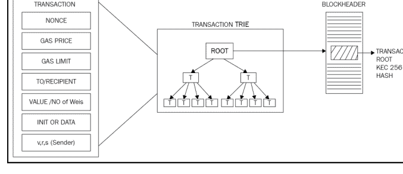

交易、交易 trie 与区块头之间的关系

## Contract creation transaction

创建账户时需要一些基本参数。这些参数列如下：

- Sender
- Original transactor
- Available gas
- Gas price
- Endowment，即初始分配的以太币数量
- 任意长度的字节数组
- 初始化 EVM 代码
- 消息调用/合约创建栈的当前深度（当前深度是指栈中已有的项目数量）

作为合约创建交易结果生成的地址长度为 160 位。准确地说，如黄皮书中定义的那样，它们是仅包含发送者和 nonce 的结构体的 RLP 编码的 Keccak 哈希的最右边的 160 位。最初，账户中的 nonce 设置为零。账户的余额设置为传递给合约的值。存储也设置为空。代码哈希是空字符串的 Keccak 256 位哈希。

当执行 EVM 代码（初始化 EVM 代码）时，账户被初始化。在代码执行期间出现任何异常的情况下，例如 gas 不足，状态不会改变。如果执行成功，则在支付适当的 gas 费用后创建账户。以太坊的当前版本（homestead）规定合约交易的结果要么是具有余额的新合约，要么没有创建新合约且没有价值转移。这与之前的版本形成对比，在之前的版本中，即使由于 gas 用尽异常导致合约代码部署不成功，合约也可能被创建。

## Message call transaction

消息调用需要几个参数才能执行，列如下：

- Sender
- 交易发起者
- Recipient
- 要执行的代码的账户
- Available gas
- Value
- Gas price
- 任意长度字节数组
- 调用的输入数据
- 消息调用/合约创建栈的当前深度

消息调用会导致状态转换。消息调用也会产生输出数据，如果交易被执行，则该输出数据不被使用。在由 VM 代码触发的消息调用的情况下，交易执行产生的输出会被使用。

在下面的图表中，显示了两种类型交易的隔离：

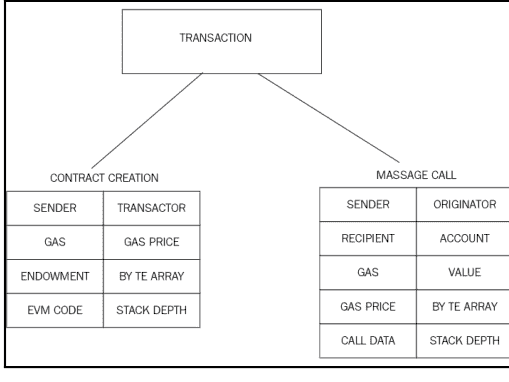

交易类型，执行所需的参数

## Elements of the Ethereum blockchain

在以下部分中，您将了解以太坊网络和区块链的各种组件。首先，下一个部分给出了 EVM 的基本概念。

## Ethereum virtual machine (EVM)

EVM 是一种简单的基于栈的执行机器，运行字节码指令以将系统状态从一个状态转换到另一个状态。虚拟机的字长设置为 256 位。栈大小限制为 1024 个元素，并且基于 LIFO（后进先出）队列。EVM 是一种图灵完备的机器，但受限于运行任何指令所需的 gas 数量。这意味着可能导致拒绝服务攻击的无限循环由于 gas 要求而不可能。EVM 还支持异常处理，以防出现异常，例如 gas 不足或无效指令，在这种情况下，机器会立即停止并将错误返回给执行代理。

EVM 是一个完全隔离的沙箱运行时环境。在 EVM 上运行的代码无法访问任何外部资源，例如网络或文件系统。

如前所述，EVM 是一种基于栈的架构。EVM 按设计是大端模式，并且使用 256 位宽的字。此字长允许进行 Keccak 256 位哈希和椭圆曲线密码学计算。

合约和 EVM 可用的存储有两种类型。第一种称为 memory，它是一个字节数组。当合约完成代码执行时，内存会被清除。它类似于 RAM 的概念。另一种称为 storage，永久存储在区块链上。它是一个键值存储。

内存是无限的，但受 gas 费用要求的约束。与虚拟机关联的存储是一个可寻址的字数组，是非易失性的，并且作为系统状态的一部分维护。键和值大小均为 32 字节且存储。程序代码存储在虚拟只读内存（虚拟 ROM）中，可使用 CODECOPY 指令访问。CODECOPY 指令用于将程序代码复制到主内存中。最初，EVM 中的所有存储和内存都设置为零。

下面的图表显示了 EVM 的设计，其中虚拟 ROM 存储程序代码，使用 CODECOPY 复制到主内存中。然后 EVM 通过引用程序计数器读取主内存并逐步执行指令。程序计数器和 EVM 栈会随着每次指令执行而相应更新。

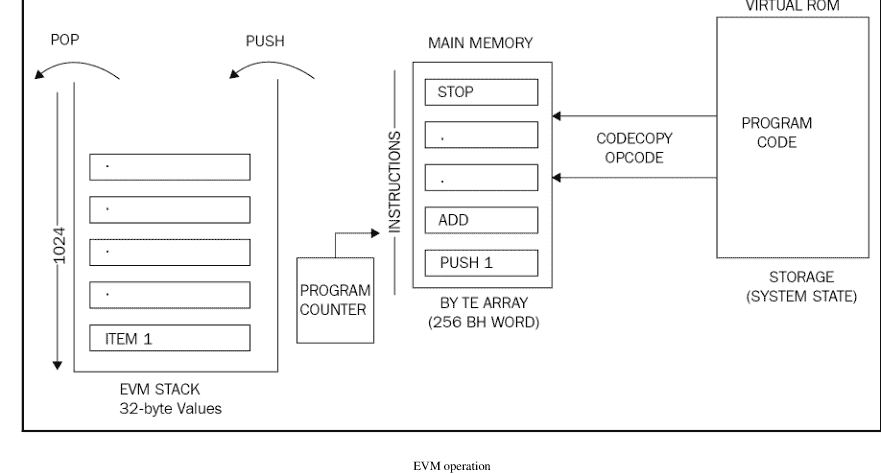

EVM 操作

EVM 优化是一个活跃的研究领域，最近的研究表明 EVM 可以被优化和微调到非常精细的程度以实现高性能。研究使用 **Web assembly (WASM)** 的可能性已经在进行中。WASM 由 Google、Mozilla 和 Microsoft 开发，现在正由 W3C 社区组设计为开放标准。WASM 的目标是能够在浏览器中运行机器代码，从而以原生速度执行。同样，EVM 2.0 的目标是能够在 CPU 中原生运行 EVM 指令集（Opcodes），从而使其更快更高效。

## Execution environment

执行环境执行代码需要一些关键元素。关键参数由执行代理提供，例如交易。这些列如下：

- 1. 执行代码的账户的地址。
- 2. 交易发送者的地址和此次执行的发起地址。
- 3. 启动执行的交易中的 gas 价格。
- 4. 输入数据或交易数据，具体取决于执行代理的类型。这是一个字节数组；在消息调用的情况下，如果执行代理是交易，则交易数据作为输入数据包含在内。
- 5. 启动代码执行或交易发送者的账户的地址。这是发送者的地址，如果代码执行是由交易启动的；否则，是账户的地址。
- 6. 值或交易价值。这是 Wei 中的金额。如果执行代理是交易，则为交易价值。
- 7. 要执行的代码，以字节数组形式呈现，迭代器函数在每次执行周期中获取。
- 8. 当前区块的区块头
- 9. 当前正在执行的消息调用或合约创建交易的数量。换句话说，这是当前正在执行的 CALL 或 CREATE 的数量。


可以将执行环境视作一个由九个元素组成的元组，如下所示：

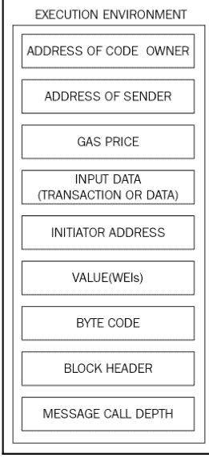

执行环境元组

除了前面提到的九个字段外，系统状态和剩余 Gas 也会提供给执行环境。执行会生成最终状态、执行后剩余的 Gas、自毁集合（后文描述）、日志系列（后文描述）以及任何 Gas 退款。

## 机器状态

机器状态也由 EVM 在内部维护。机器状态在 EVM 的每个执行周期后更新。迭代器函数（在下一节详述）在虚拟机中运行，它输出状态机单个周期的结果。机器状态是一个元组，由以下元素组成：

- 可用 Gas
- 程序计数器，是一个不大于 256 的正整数
- 内存内容
- 内存中活动的字数量
- 栈的内容

EVM 专为处理异常而设计，如果发生以下任何异常，它将停机（停止执行）：

- 没有足够的 Gas 来执行
- 无效指令
- 栈中元素不足
- 跳转操作码的目标无效
- 栈大小无效（大于 1024）

## 迭代器函数

前面提到的迭代器函数执行各种重要功能，用于设置机器的下一个状态，并最终设置世界状态。这些功能包括以下内容：

- 从执行环境中存储机器代码的字节数组中获取下一条指令。
- 相应地通过 PUSH/POP 从栈中添加/移除项目。
- 根据指令/操作码的 Gas 成本减少 Gas。
- 递增程序计数器（PC）。

机器状态可以看作一个元组，如下图所示：

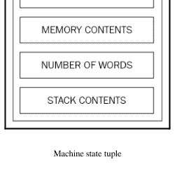

在执行周期中，如果遇到 STOP、SUICIDE 或 RETURN 操作码，虚拟机也可以正常停机。

用高级语言（如 Serpent、LLL 或 Solidity）编写的代码会被转换为 EVM 能理解的字节码，以便由 EVM 执行。Solidity 是为以太坊开发的高级语言，采用类似 JavaScript 的语法来编写智能合约代码。代码编写完成后，使用名为 solc 的 Solidity 编译器将其编译成 EVM 可理解的字节码。

LLL（类似 Lisp 的低级语言）是另一种用于编写智能合约代码的语言。Serpent 是一种类似 Python 的高级语言，可用于为以太坊编写智能合约。

例如，下面是一个用 Solidity 编写的简单程序：

```
pragma solidity ^0.4.0;
contract Test1
{
    uint x=2;
    function addition1(uint x) returns (uint y) {
    y=x+2;
    }
}
```

这个程序被转换为字节码，如下所示。关于如何编译 Solidity 代码的详细说明及示例将在下一章给出。

## 运行时字节码

```
606060405260e060020a6000350463989e17318114601c575b6000565b34600057602960043
5603b565b60408051918252519081900360200190f35b600281015b91905056
Opcodes PUSH1 0x60 PUSH1 0x40 MSTORE PUSH1 0x2 PUSH1 0x0 SSTORE CALLVALUE
PUSH1 0x0 JUMPI JUMPDEST PUSH1 0x45 DUP1 PUSH1 0x1A PUSH1 0x0 CODECOPY
PUSH1 0x0 RETURN PUSH1 0x60 PUSH1 0x40 MSTORE PUSH1 0xE0 PUSH1 0x2 EXP
PUSH1 0x0 CALLDATLOAD DIV PUSH4 0x989E1731 DUP2 EQ PUSH1 0x1C JUMPI
JUMPDEST PUSH1 0x0 JUMP JUMPDEST CALLVALUE PUSH1 0x0 JUMPI PUSH1 0x29 PUSH1
0x4 CALLDATLOAD PUSH1 0x3B JUMP JUMPDEST PUSH1 0x40 DUP1 MLOAD SWAP2 DUP3
MSTORE MLOAD SWAP1 DUP2 SWAP1 SUB PUSH1 0x20 ADD SWAP1 RETURN JUMPDEST
PUSH1 0x2 DUP2 ADD JUMPDEST SWAP2 SWAP1 POP JUMP
```

## 操作码及其含义

EVM 中引入了多种不同的操作码。操作码根据其执行的操作分为多个类别。下面列出了操作码及其含义和用途。

### 算术运算

EVM 中的所有算术均以 2^256 为模。这组操作码用于执行基本的算术运算。这些操作的值从 0x00 到 0x0b。

| 助记符 | 值 | POP | PUSH | Gas | 描述 |
|---|---|---:|---:|---:|---|
| STOP | 0x00 | 0 | 0 | 0 | 停止执行 |
| ADD | 0x01 | 2 | 1 | 3 | 两个值相加 |
| MUL | 0x02 | 2 | 1 | 5 | 两个值相乘 |
| SUB | 0x03 | 2 | 1 | 3 | 减法运算 |
| DIV | 0x04 | 2 | 1 | 5 | 整数除法运算 |
| SDIV | 0x05 | 2 | 1 | 5 | 有符号整数除法运算 |
| MOD | 0x06 | 2 | 1 | 5 | 取模余数运算 |
| SMOD | 0x07 | 2 | 1 | 5 | 有符号取模余数运算 |
| ADDMOD | 0x08 | 3 | 1 | 8 | 取模加法运算 |
| MULMOD | 0x09 | 3 | 1 | 8 | 取模乘法运算 |
| EXP | 0x0a | 2 | 1 | 10 | 指数运算（底数重复相乘） |
| SIGNEXTEND | 0x0b | 2 | 1 | 5 | 扩展 2 的补码有符号整数的长度 |

请注意，STOP 并不是算术运算，但由于其操作码值位于 0x00-0x0b 的范围内，因此被归类在此算术运算列表中。

### 逻辑运算

逻辑运算包括用于执行比较和布尔逻辑的操作。这些操作的值在 0x10 到 0x1a 之间。

| 助记符 | 值 | POP | PUSH | Gas | 描述 |
|---|---|---|---|---|---|
| LT | 0x10 | 2 | 1 | 3 | 小于 |
| GT | 0x11 | 2 | 1 | 3 | 大于 |
| SLT | 0x12 | 2 | 1 | 3 | 有符号小于比较 |
| SGT | 0x13 | 2 | 1 | 3 | 有符号大于比较 |
| EQ | 0x14 | 2 | 1 | 3 | 相等比较 |
| ISZERO | 0x15 | 1 | 1 | 3 | 非运算 |
| AND | 0x16 | 2 | 1 | 3 | 按位与运算 |
| OR | 0x17 | 2 | 1 | 3 | 按位或运算 |
| XOR | 0x18 | 2 | 1 | 3 | 按位异或运算 |
| NOT | 0x19 | 1 | 1 | 3 | 按位非运算 |
| BYTE | 0x1a | 2 | 1 | 3 | 从字中提取单个字节 |

### 加密运算

此类别中只有一个名为 SHA3 的操作。值得注意的是，这不是 NIST 标准化的标准 SHA3，而是原始的 Keccak 实现。

| 助记符 | 值 | POP | PUSH | Gas | 描述 |
|---|---|---|---|---|---|
| SHA3 | 0x20 | 2 | 1 | 30 | 用于计算 Keccak 256 位哈希。 |

### 环境信息

此类中共有 13 条指令。这些操作码用于提供与地址、运行环境和数据复制操作相关的信息。

| 助记符 | 值 | POP | PUSH | Gas | 描述 |
|---|---|---|---|---|---|
| ADDRESS | 0x30 | 0 | 1 | 2 | 用于获取当前执行账户的地址 |
| BALANCE | 0x31 | 1 | 1 | 20 | 用于获取给定账户的余额 |
| ORIGIN | 0x32 | 0 | 1 | 2 | 用于获取原始交易的发送方地址 |
| CALLER | 0x33 | 0 | 1 | 2 | 用于获取发起执行的账户地址 |
| CALLVALUE | 0x34 | 0 | 1 | 2 | 获取指令或交易存入的值 |
| CALLDATALOAD | 0x35 | 1 | 1 | 3 | 获取消息调用中作为参数传递的输入数据 |
| CALLDATASIZE | 0x36 | 0 | 1 | 2 | 用于获取消息调用中传递的输入数据的大小 |
| CALLDATACOPY | 0x37 | 3 | 0 | 3 | 用于将消息调用中传递的输入数据从当前环境复制到内存。 |
| CODESIZE | 0x38 | 0 | 1 | 2 | 获取当前环境中正在运行的代码的大小 |
| CODECOPY | 0x39 | 3 | 0 | 3 | 将当前环境中正在运行的代码复制到内存 |
| GASPRICE | 0x3a | 0 | 1 | 2 | 获取初始交易指定的 Gas 价格。 |
| EXTCODESIZE | 0x3b | 1 | 1 | 20 | 获取指定账户代码的大小 |
| EXTCODECOPY | 0x3c | 4 | 0 | 20 | 用于将账户代码复制到内存。 |


## 区块信息

这组指令与检索与区块关联的各种属性有关：

|助记符|值|POP|PUSH|Gas|描述|
|---|---|---|---|---|---|
|BLOCKHASH|0x40|1|1|20|获取最近完成的256个区块中的一个的哈希|
|COINBASE|0x41|0|1|2|检索区块中设置的受益人地址|
|TIMESTAMP|0x42|0|1|2|检索区块中设置的时间戳|
|NUMBER|0x43|0|1|2|获取区块的编号|
|DIFFICULTY|0x44|0|1|2|检索区块难度|
|GASLIMIT|0x45|0|1|2|获取区块的 gas 限制值|

## 栈、内存、存储和流程操作

|助记符|值|POP|PUSH|Gas|描述|
|---|---|---|---|---|---|
|POP|0x50|1|0|2|从栈中移除项目|
|MLOAD|0x51|1|1|3|用于从内存加载一个字。|
|MSTORE|0x52|2|0|3|用于将一个字存储到内存。|
|MSTORE8|0x53|2|0|3|用于将一个字节保存到内存|
|SLOAD|0x54|1|1|50|用于从存储加载一个字|
|SSTORE|0x55|2|0|0|将一个字保存到存储|
|JUMP|0x56|1|0|8|更改程序计数器|
|JUMPI|0x57|2|0|10|基于条件更改程序计数器|
|PC|0x58|0|1|2|用于检索递增前的程序计数器中的值。|
|MSIZE|0x59|0|1|2|检索活动内存的字节大小。|
|GAS|0x5a|0|1|2|检索可用 gas 数量|
|JUMPDEST|0x5b|0|0|1|用于标记跳转的有效目标，在执行期间对机器状态没有影响。|

## 推入操作

这些操作包括用于将项目放置在栈上的 PUSH 操作。这些指令的范围从 0x60 到 0x7f。EVM 中总共有 32 个 PUSH 操作。PUSH 操作从程序代码的字节数组中读取。

|助记符|值|POP|PUSH|Gas|描述|
|---|---|---|---|---|---|
|PUSH1 ... PUSH32|0x60 ... 0x7f|0|1|3|用于将 N 个右对齐的大端字节项目放置在栈上。N 的值根据所使用的助记符从 1 字节到 32 字节（完整字）不等。|

## 复制操作

顾名思义，复制操作用于复制栈项目。值的范围从 0x80 到 0x8f。EVM 中共有 16 条 DUP 指令。放置在栈上或从栈中移除的项目也会随着所使用助记符的增量而变化；例如，DUP1 从栈中移除一个项目并将两个项目放置在栈上，而 DUP16 从栈中移除 16 个项目并放置 17 个项目。

|助记符|值|POP|PUSH|Gas|描述|
|---|---|---|---|---|---|
|DUP1 ... DUP16|0x80 ... 0x8f|X|Y|3|用于复制第 n 个栈项目，其中 N 是对应于所使用 DUP 指令的数字。X 和 Y 分别是移除和放置在栈上的项目。|

## 交换操作

SWAP 操作提供交换栈项目的能力。共有 16 条 SWAP 指令可供使用，每条指令根据所使用的操作码类型，栈项目被移除和放置的增量最高可达 17 个项目。

|助记符|值|POP|PUSH|Gas|描述|
|---|---|---|---|---|---|
|SWAP1 ... SWAP16|0x90 ... 0x9f|X|Y|3|用于交换第 n 个栈项目，其中 N 是对应于所使用 SWAP 指令的数字。X 和 Y 分别是移除和放置在栈上的项目。|

## 日志操作

日志操作提供将日志条目附加到子状态元组日志系列字段的操作码。总共有四个日志操作可用，其范围从值 0x0a 到 0xa4。

|助记符|值|POP|PUSH|Gas|描述|
|---|---|---|---|---|---|
|LOG0 ... LOG4|0x0a ... 0xa4|X|Y (0)|375, 750, 1125, 1500, 1875|用于附加带有 N 个主题的日志记录，其中 N 是对应于所使用 LOG 操作码的数字。例如，LOG0 表示没有主题的日志记录，LOG4 表示带有四个主题的日志记录。X 和 Y 分别表示移除和放置在栈上的项目。X 和 Y 增量变化，从 2, 0 开始到 6, 0 结束，根据所使用的 LOG 操作而定。|

## 系统操作

系统操作用于执行各种系统相关操作，例如账户创建、消息调用和执行控制。此类别中总共有六个操作码可用。

|助记符|值|POP|PUSH|Gas|描述|
|---|---|---|---|---|---|
|CREATE|0xf0|3|1|32000|用于创建具有关联代码的新账户。|
|CALL|0xf1|7|1|40|用于向账户发起消息调用。|
|CALLCODE|0xf2|7|1|40|用于使用替代账户的代码向此账户发起消息调用。|
|RETURN|0xf3|2|0|0|停止执行并返回输出数据。|
|DELEGATECALL|0xf4|6|1|40|与 CALLCODE 相同，但不更改发送方和值的当前值。|
|SUICIDE|0xff|1|0|0|停止（暂停）执行并且账户稍后将被注册为删除|

在本节中，所有 EVM 操作码都已讨论过。共计在以太坊的 homestead 版本的 EVM 中共有 129 个操作码可用。

## 身份函数

身份函数位于地址 4，可用 ID 表示。它简单地将输出定义为输入；换句话说，无论向 ID 函数提供什么输入，它都会输出相同的值。Gas 需求由一个简单的公式计算：15 + 3 ⌈I_d/32⌉，其中 I_d 是输入数据。这意味着在高层，gas 需求取决于输入数据的大小，尽管进行了一些计算，如前述等式所示。

所有之前提到的预编译合约将来都可以成为原生扩展，并可包含在 EVM 操作码中。

## 账户

账户是 Ethereum 区块链的主要构建块之一。状态是在账户之间交互的结果而创建或更新的。账户之间和账户上的操作代表状态转换。状态转换是通过所谓的 Ethereum 状态转换函数实现的，其工作方式如下：

- 1. 通过检查语法、签名有效性和 nonce 来确认交易有效性。
- 2. 交易费用被计算，并且发送地址通过签名解析。此外，发送方账户余额被检查并相应扣除，nonce 被递增。如果账户余额不足，则返回错误。
- 3. 提供足够的以太币（gas 价格）以支付交易成本。这会根据交易的大小按字节递增收取。
- 4. 在此步骤中，实际的值转移发生。流程从发送方账户流向接收方账户。如果交易中指定的目标账户尚不存在，则会自动创建账户。此外，如果目标账户是合约，则会执行合约代码。这也取决于可用 gas 的数量。如果有足够的 gas，则合约代码将完全执行；否则，它将运行到 gas 用尽为止。
- 5. 在因账户余额或 gas 不足导致交易失败的情况下，所有状态更改都会回滚，手续费支付除外，手续费支付给矿工。
- 6. 最后，剩余的费用（如有）将作为找零退回给发送方，并且费用相应支付给矿工。此时，函数返回 resulting 状态。

## 账户类型

以太坊中有两种类型的账户：

- 外部拥有账户
- 合约账户

第一个是**外部拥有账户（EOAs）**，另一个是合约账户。EOAs 类似于比特币中由私钥控制的账户。合约账户是具有与其关联的代码以及私钥的账户。EOA 具有以太币余额，能够发送交易，并且没有关联的代码，而**合约账户（CA）**具有以太币余额、关联代码，并且能够在响应交易或消息时被触发并执行代码。值得注意的是，由于 Ethereum 区块链的图灵完备性属性，合约账户中的代码可以具有任何复杂程度。代码由以太坊网络上的每个矿工节点通过 EVM 执行。此外，合约账户能够维护自己的永久状态并可以调用其他合约。预计在 serenity 版本中，外部拥有账户和合约账户之间的区别可能会被消除。

## 区块

如前所述，区块是区块链的主要构建块。以太坊区块由各种组件组成，描述如下：

- 区块头
- 交易列表
- Ommers 或 Uncles 的头列表

交易列表只是区块中包含的所有交易的列表。此外，Uncles 的头列表也包含在区块中。最重要和最复杂的部分是区块头，在此进行讨论。

## 区块头

区块头是以太坊区块中最关键和最详细的组件。头包含有价值的信息，详细描述如下。


## Parent hash

这是父块（前一个块）头的 Keccak 256 位哈希。

## Ommers hash

这是包含在块中的 Ommers（Uncles）块列表的 Keccak 256 位哈希。

## Beneficiary

Beneficiary 字段包含将在块成功挖出后接收挖矿奖励的收款人的 160 位地址。

## State root

State root 字段包含状态 trie 根节点的 Keccak 256 位哈希。它是在所有交易处理并最终确定后计算的。

## Transactions root

交易根是交易 trie 根节点的 Keccak 256 位哈希。交易 trie 表示包含在块中的交易列表。

## Receipts root

收据根是交易收据 trie 根节点的 Keccak 256 位哈希。此 trie 由包含在块中的所有交易的收据组成。交易收据是在每笔交易处理后生成的，其中包含有用的交易后信息。有关交易收据的更多细节将在下一节中提供。

## Logs bloom

Logs bloom 是一个布隆过滤器，它由块中包含的交易列表的每个交易收据的日志条目的记录器地址和日志主题组成。日志将在下一节中详细解释。

## Difficulty

当前块的难度等级。

## Number

所有先前块的总数；创世块为零号块。

## Gas limit

该字段包含表示每个块的 gas 消耗限制的值。

## Gas used

该字段包含包含在块中的交易消耗的总 gas。

## Timestamp

Timestamp 是块初始化时间的 epoch Unix 时间。

## Extra data

Extra data 字段可用于存储与块相关的任意数据。

## Mixhash

Mixhash 字段包含一个 256 位哈希值，该哈希值与 nonce 结合使用，以证明已花费足够的计算工作来创建此块。

## Nonce

Nonce 是一个 64 位哈希值（数字），它与 mixhash 字段结合使用，以证明已花费足够的计算工作来创建此块。

下图显示了块和块头的详细结构：

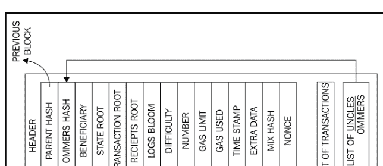

## The genesis block

创世块在包含的数据和从普通块创建的方式方面略有不同。它包含 15 个项目，这里进行了描述。

来自 Etherscan.io，实际版本显示如下：

| Element | Description / Value |
|---|---|
| Timestamp | (Jul-30-2015 03:26:13 PM +UTC) |
| Transactions | 8893 transactions and 0 contract internal transactions in this block |
| Hash | 0xd4e56740f876aef8c010b86a40d5f56745a118d0906a34e69aec8c0db1cb8fa3 |
| Parent hash | 0x0000000000000000000000000000000000000000000000000000000000000000 |
| Sha3Uncles | 0x1dcc4de8dec75d7aab85b567b6ccd41ad312451b948a7413f0a142fd40d49347 |
| Mined by | 0x0000000000000000000000000000000000000000 in 15 secs |
| Difficulty | 17,179,869,184 |
| Total Difficulty | 17,179,869,184 |
| Size | 540 bytes |
| Gas Limit | 5,000 |
| Gas Used | 0 |
| Nonce | 0x0000000000000042 |
| Block Reward | 5 Ether |
| Uncles Reward | 0 |
| Extra Data | »èÛN4{NCE"\|ƒpáüí³ÛïÊÜz8áá ,ú (Hex: 0x11bbe8db4e347b4e8c937c1c8370e4b5ed33adb3db69cbdb7a38e1e50b1b82fa) |

## Transaction receipts

交易收据用作在交易执行后存储状态的机制。换句话说，这些结构用于记录交易执行的結果。它是在每笔交易执行后产生的。所有收据都存储在索引键 trie 中。此 trie 根的哈希值（Keccak 256 位）放置在块头中作为 receipts root。它由四个元素组成，这里进行了描述。

### The post-transaction state

此项目是一个 trie 结构，保存交易执行后的状态。它被编码为字节数组。

### Gas used

此项目表示包含交易收据的块中使用的总 gas 量。该值是在交易执行完成后立即获取的。使用的总 gas 预计为非负整数。

### Set of logs

此字段显示交易执行结果创建的日志条目集合。日志条目包含记录器的地址、一系列日志主题和日志数据。

### The bloom filter

布隆过滤器是从前面讨论的日志集合中包含的信息创建的。日志条目被简化为 256 字节的哈希值，然后嵌入到块头中作为 logs bloom。日志条目由记录器的地址和日志主题以及日志数据组成。日志主题被编码为一系列 32 字节的数据结构。日志数据由几个字节的数据组成。

此过程可以在以下图表中可视化：

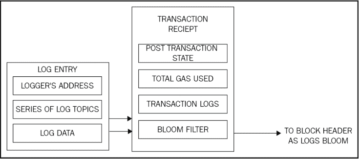

### Transaction validation and execution

交易在验证有效性后执行。初始测试列出如下：

- 交易必须格式良好，并且以 RLP 编码且没有额外的尾随字节
- 用于签署交易的数字签名有效
- 交易 nonce 必须等于发送方账户的当前 nonce
- Gas limit 必须不小于交易使用的 gas
- 发送方账户包含足够的余额来覆盖执行成本

## The transaction sub state

交易子状态是在交易执行期间创建的，该交易在执行完成后立即处理。此交易子状态是一个由三项组成的元组。

### Suicide set

此元素包含在交易执行后被处置的账户列表。

### Log series

这是一个带索引的检查点系列，允许监控和通知对以太坊环境外部的实体（如应用程序前端）的合约调用。它像一个触发机制，每当特定函数被调用或特定事件发生时就会执行。日志是在智能合约中事件发生时创建的。它也可以用作更便宜的存储形式。事件将在第 8 章《以太坊开发》中通过实际示例进行介绍。

### Refund balance

这是启动执行的交易中 gas 的总价格。退款不会立即执行；相反，它们用于部分抵消总执行成本。

下图描述了交易子状态元组：

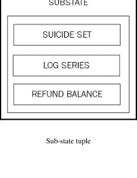

## The block validation mechanism

如果以太坊块通过以下检查，则被认为有效：

- 与 Uncles 和交易一致。这意味着所有 Ommers（Uncles）确实满足它们确实是 Uncles 的属性，并且如果 Uncles 的工作量证明有效。
- 如果前一个块（父块）存在并且有效。
- 如果块的时间戳有效。这基本上意味着当前块的时间戳必须高于父块的时间戳。此外，它应小于未来 15 分钟。所有块时间均以 epoch 时间（Unix 时间）计算。

如果任何检查失败，块将被拒绝。

## Block finalization

块最终确定是矿工运行以验证块内容并应用奖励的过程。它导致执行四个步骤。这些步骤在这里详细描述。

### Ommers validation

验证 Ommers（也称为 Uncles 的陈旧块）。在挖矿的情况下，确定 Ommers。陈旧块头的验证过程检查头是否有效，并且 Uncle 与当前块的关系满足最大深度为六个块。块最多可包含两个 Uncles。

### Transaction validation

验证交易。在挖矿的情况下，确定交易。该过程涉及检查块中使用的总 gas 是否等于最后一次交易后的最终 gas 消耗。

### Reward application

应用奖励，这意味着用奖励余额更新受益人账户。在以太坊中，矿工也会因陈旧块而获得奖励，即块奖励的 1/32。包含在块中的 Uncles 也会获得总块奖励的 7/8。当前块奖励为 5 Ether。块最多可有 2 个 Uncles。


## 状态和 nonce 验证

验证 state 和 nonce。在挖矿的情况下，计算一个有效的 state 和 nonce。

## 区块难度

如果两个区块之间的时间减少，则区块难度会增加，而如果两个区块之间的时间增加，则难度会降低。这是为了保持大致一致的区块生成时间。Ethereum Homestead 版本中的难度调整算法如下所示：

```
block_diff = parent_diff + parent_diff // 2048 * max(1 - (block_timestamp - parent_timestamp) // 10, -99) + int(2**((block.number // 100000) - 2))
```

前述算法意味着，如果父区块和当前区块生成之间的时间差小于 10 秒，则难度会上升。如果时间差在 10 到 19 秒之间，难度水平保持不变。最后，如果时间差为 20 秒或更多，则难度水平会下降。这种下降与时间差成比例。

除了基于时间戳差的难度调整外，还有另一部分（显示在前述算法的最后一行），它会在每 100,000 个区块后以指数方式增加难度。这是所谓的难度炸弹或冰河时代，在 Ethereum 网络中引入，这将在未来的某个时间点使在 Ethereum 区块链上挖矿变得非常困难。这将鼓励用户转向权益证明，因为在 PoW 链上挖矿最终将变得 prohibitively 困难。根据最新更新和基于该算法的估计，区块生成时间将在 2017 年下半年变得显著变高，并在 2021 年变得如此之高，以至于在 PoW 链上挖矿几乎不可能。这样，矿工别无选择，只能转向 Ethereum 提出的权益证明方案，称为 Casper。

## 以太币

以太币是由矿工作为货币奖励铸造的，以换取他们为确保网络安全而花费的计算努力，通过验证和验证交易和区块。以太币用于在 Ethereum 区块链内支付 EVM 上合约的执行。以太币用于购买 gas 作为加密燃料，这是执行 Ethereum 区块链上计算所必需的。

面额表如下所示：

| 单位 | Wei 值 | Wei |
|---|---|---|
| Wei | 1 Wei | 1 |
| Babbage | 1e3 Wei | 1,000 |
| Lovelace | 1e6 Wei | 1,000,000 |
| Shannon | 1e9 Wei | 1,000,000,000 |
| Szabo | 1e12 Wei | 1,000,000,000,000 |
| Finney | 1e15 Wei | 1,000,000,000,000,000 |
| Ether | 1e18 Wei | 1,000,000,000,000,000,000 |

对 EVM 在区块链上执行的每项计算都会收取费用。详细的费用表在下一节中显示。

## Gas

对在 Ethereum 区块链上执行的每个操作都需要支付 gas。这是确保无限循环不会导致整个区块链因 EVM 的图灵完备性而停滞的机制。作为交易费用收取一定数量的以太币，并从交易发起人的账户余额中扣除。为交易被矿工纳入挖矿而支付费用。如果此费用过低，交易可能永远不会被选中；费用越高，交易被矿工选中并纳入区块的机会就越高。相反，如果交易已支付适当的费用并被矿工纳入区块，但要执行的复杂操作太多，则如果 gas 成本不足，可能会导致超出 gas 异常。在这种情况下，交易将失败，但仍会被纳入区块，并且交易发起人不会获得任何退款。

交易成本可使用以下公式估算：

Total cost = gasUsed * gasPrice

这里，*gasUsed* 是交易在执行期间 supposed 使用的总 gas，而 *gasPrice* 是由交易发起人指定的，作为激励矿工将交易纳入下一个区块的激励。这以以太币为单位指定。每个 EVM 操作码都有一个分配的费用。这是一个估计，因为使用的 gas 可能比交易发起人最初指定的值多或少。例如，如果计算花费的时间太长或智能合约的行为因其他因素而改变，则交易执行可能会执行比原计划更多或更少的操作，从而导致消耗更多或更少的 gas。如果执行耗尽 gas，一切都会立即回滚；否则，如果执行成功并且有剩余 gas，则会退还给交易发起人。

每个操作都会消耗一些 gas；这里以几个操作的费用表为例：

| 操作名称 | Gas 成本 |
|---|---|
| step | 1 |
| stop | 0 |
| suicide | 0 |
| sha3 | 30 |
| sload | 20 |
| txdata | 5 |
| transaction | 500 |
| contract creation | 53000 |

基于前述费用表和前面讨论的公式，SHA3 操作的示例计算如下：

- SHA3 消耗 30 gas
- 当前 gas 价格为 25 GWei，即 0.000000025 以太币
- 相乘：0.000000025 * 30 = 0.00000075 以太币

总共，0.00000075 以太币是将被收取的总 gas。

### 费用表

作为执行操作的前提，gas 在三种情况下收取：

- 操作的计算
- 合约创建或消息调用
- 内存使用量的增加

指令和各种操作的 gas 值列表已在前一章中提供。

### 消息

消息，如 Yellow Paper 中所定义，是在两个账户之间传递的数据和价值。消息是在两个账户之间传递的数据包。此数据包包含数据和价值（以太币数量）。它可以由智能合约（自主对象）发送，也可以通过交易的形式由外部参与者（外部拥有账户）发送，该交易已由发送方进行数字签名。

合约可以向其他合约发送消息。消息仅存在于执行环境中，从不存储。消息类似于交易；然而，主要区别在于它们是由合约产生的，而交易是由 Ethereum 环境外部的实体（外部拥有账户）产生的。

一条消息由以下组件组成：

1. 消息的发送者
2. 消息的接收者
3. 转移的 Wei 数量和发送到合约地址的消息
4. 可选数据字段（合约的输入数据）
5. 可以消耗的最大 gas 数量

当合约执行 CALL 或 DELEGATECALL 操作码时，会生成消息。

## 调用

调用不会向区块链广播任何内容；相反，它是对合约函数的本地调用，并在节点上本地运行。它几乎就像一个本地函数调用。它不消耗任何 gas，因为它是一个只读操作。它类似于一次试运行。调用在节点上本地执行，通常不会导致任何状态更改。如 Yellow Paper 中所定义，这是从一个账户向另一个账户传递消息的行为。如果目标账户有相关的 EVM 代码，则虚拟机将在收到消息后启动以执行所需的操作。如果消息发送者是自主对象，则调用会传递虚拟机操作返回的任何数据。

状态由交易更改。这些是由外部因素创建的，并经过签名然后广播到 Ethereum 网络。

## 挖矿

挖矿是通过向区块链添加新货币的过程。这是矿工验证和验证由交易组成的区块的激励。挖矿过程通过验证计算来帮助保护网络。

在理论层面上，矿工执行以下功能：

1. 监听在 Ethereum 网络上广播的交易并确定要处理的交易。
2. 确定称为 Uncles 或 Ommers 的陈旧区块并将它们包含在区块中。
3. 使用成功挖矿区块获得的奖励更新账户余额。
4. 最后，计算出一个有效的状态并完成区块，这定义了所有状态转换的结果。

当前的挖矿方法基于工作量证明，与比特币类似。当区块被认为有效时，它不仅必须满足一般一致性要求，还必须包含针对给定难度的 PoW。

PoW 算法预计将在 Serenity 发布时被 PoS 算法取代。大量研究工作已开展，以构建适用于 Ethereum 网络的 PoS 算法。


一个名为 Casper 的算法已被开发出来，它将取代以太坊中现有的工作量证明算法。这是一种基于经济协议的质押安全机制，其中节点在产生区块之前需要存入一笔安全押金。在 Casper 中，这些节点被称为 bonded validators，而存入安全押金的行为被称为 bonding。

## Ethash

**Ethash** 是以太坊中使用的工作量证明算法的名称。最初，该算法被提出为 Dagger-Hashimoto 算法，但自首次实现以来已经发生了很多变化，而 PoW 算法现已演变为现在所知的 Ethash。类似于比特币，挖矿的核心思想是找到一个 nonce，一旦哈希后结果达到预定的难度级别。最初，以太坊刚推出时难度很低，甚至 CPU 和单 GPU 挖矿在一定程度上也是有利可图的，但现在已不再如此。现在要么是矿池挖矿有利可图，要么是使用大型 GPU 挖矿农场进行挖矿。

Ethash 是一种内存密集型算法，这使得它难以在专用硬件上实现。如同比特币一样，ASIC 已被开发出来，这导致多年来挖矿集中化，但内存密集型工作量证明算法是遏制这一威胁的一种方式，以太坊实施 Ethash 就是为了阻止为挖矿开发 ASIC。该算法要求根据 nonce 和区块头选择一个名为 **DAG (有向无环图)** 的固定资源的子集。DAG 大约为 2 GB，并在每 30000 个区块后发生变化。挖矿只能在 DAG 完全生成后才开始，第一次启动挖矿节点时即会生成。每个 30000 个区块之间的时间约为 5.2 天，被称为 epoch。此 DAG 被用作名为 Ethash 的工作量证明算法的种子。根据当前规范，epoch 时间定义为 30,000 个区块。

当前奖励方案为成功找到有效 nonce 可获得 5 个以太币。除获得 5 个以太币外，成功矿工还可获得区块内消耗的 gas 费用，以及包含陈旧区块（Uncles）在区块中而获得的额外奖励。每个区块最多允许两个 Uncles，并奖励正常区块奖励的 7/8。为了实现 12 秒的区块时间，区块难度会在每个区块时进行调整。奖励与矿工的哈希率直接成正比，这基本上意味着矿工哈希的速度有多快。

挖矿可以通过简单地加入以太坊网络并运行适当的客户端来执行。关键要求是节点在开始挖矿前必须与主网络完全同步。

一旦 geth 启动并运行且区块链完全下载完毕，即可运行 Ethminer 开始挖矿。Ethminer 是一个独立的矿工，也可用于农场模式以贡献给矿池。它可以从 `https://github.com/Genoil/cpp-ethereum/tree/master/releases` 下载：

```bash
ethminer -G
```

使用 G 开关运行假定已正确安装和配置了适当的显卡。如果找不到适当的显卡，ethminer 将返回错误，如以下屏幕截图所示：

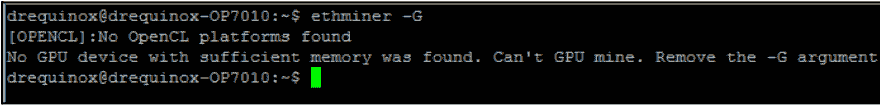

*找不到适当 GPU 时的错误*

GPU 挖矿需要 AMD 或 Nvidia 显卡以及适用的 OpenCL SDK。对于 NVidia 芯片组，可从 `https://developer.nvidia.com/cuda-downloads` 下载。对于 AMD 芯片组，可在 `http://developer.amd.com/tools-and-sdks/opencl-zone/amd-accelerated-parallel-processing-app-sdk` 获取。

一旦显卡正确安装并配置好，即可通过发出 `ethminer -G` 命令启动进程。

Ethminer 也可用于运行基准测试，如以下屏幕截图所示。可以调用两种基准测试模式。一种是 CPU，另一种是 GPU。命令如下所示。

### CPU 基准测试

```bash
$ ethminer -M -C
```

### GPU 基准测试

```bash
$ ethminer -M -G
```

以下是 CPU 挖矿基准测试的屏幕截图示例：

```
drequinox@drequinox-OP7010:~$ ethminer -M -C
◇ 22:43:30.560 ethminer #00004000...
Benchmarking on platform: 8-thread CPU
Preparing DAG...
□ 22:43:30.561 miner0 Loading full DAG of seedhash: #00000000...
Warming up...
Trial 1... 0
Trial 2... DAG 22:43:38.310 miner0 Generating DAG file. Progress: 0 %
0
Trial 3... 0
Trial 4... DAG 22:43:45.336 miner0 Generating DAG file. Progress: 1 %
0
```

CPU 基准测试

要使用的 GPU 设备也可以在命令行中指定：

```
$ ethminer -M -G --opencl-device 1
```

由于 GPU 挖矿使用 OpenCL 实现，基于 AMD 芯片组的 GPU 相对于 NVidia GPU 往往运行更快。由于高内存需求（DAG 创建），FPGA 和 ASIC 相对于 GPU 不会提供任何重大优势。这是有意为之，以阻止为挖矿开发专用硬件。

## 挖矿机

随着挖矿以太币的难度随时间增加，矿工开始建造多 GPU 的挖矿机。挖矿机通常包含大约五张 GPU 卡，它们并行工作以提高找到有效 nonce 进行挖矿的机会。

挖矿机可以通过一些努力自行搭建，也可从各种供应商处商业购买。典型的挖矿机配置包括即将在后续章节中讨论的组件。

## 主板

需要一个具有多个 PCI-E x1 或 x16 插槽的专用主板，例如 BIOSTAR Hi-Fi 或 ASRock H81。

## 挖矿池

有许多在线挖矿池提供以太坊挖矿服务。Ethminer 可使用以下命令连接到挖矿池。每个矿池都会发布自己的说明，但通常连接矿池的过程是相似的。下面以 ethereumpool.co 为例：

```
ethminer -C -F http://ethereumpool.co/?miner=0.1@0x024a20cc5feba7f3dc3776075b3e60c20eb1459c@DrEquinox
```


## 客户端和钱包

由于以太坊正处于重度开发和演进中，过去几年中开发并引入了许多组件、客户端和工具。以下是所有主要组件、客户端软件和以太坊可用工具的列表。此列表旨在减少围绕以太坊众多工具和客户端的歧义。此处提供的列表还解释了各种组件的使用和意义。

## Geth

这是以太坊客户端的 Go 实现。

## Eth

这是以太坊客户端的 C++ 实现。

## Pyethapp

这是以太坊客户端的 Python 实现。

## Party

该实现使用 Rust 构建，由 EthCore 开发。EthCore 是一家致力于 parity 客户端开发的公司。Parity 可从 `https://ethcore.io/parity.html` 下载。

### 轻客户端

SPV 客户端仅下载区块链的一小部分。这使得低资源设备，例如手机、嵌入式设备或平板电脑，能够验证交易。在这种情况下不需要完整的以太坊区块链和节点，SPV 客户端仍可验证交易的执行。SPV 客户端也称为轻客户端。这个想法类似于比特币 SPV 客户端。Jaxx (`https://jaxx.io/`) 提供了一个钱包，可安装在 iOS 和 Android 上，提供 **SPV (简单支付验证)** 功能。

## 安装

以下安装程序描述了在 Ubuntu 系统上安装各种以太坊客户端。其他操作系统的说明可在以太坊 Wiki 上找到。由于后续示例将使用 Ubuntu 系统，这里仅描述了在 Ubuntu 上的安装。

**Geth 客户端** 可通过在 Ubuntu 系统上使用以下命令安装：

```bash
sudo apt-get install -y software-properties-common
sudo add-apt-repository -y ppa:ethereum/ethereum
sudo apt-get update
sudo apt-get install -y ethereum
```

安装完成后。只需在命令行发出 `geth` 命令即可启动 Geth，因为它预先配置了所有必需的参数以连接到实时的以太坊网络（主网）：

```bash
geth
```


其他钱包包括但不限于 MyEtherWallet，这是一个用 JavaScript 开发的开源以太坊钱包。MyEtherWallet 在客户端浏览器中运行。可通过 https://www.myetherwallet.com 访问。

Icebox 由 Consensys 开发。这是一个冷存储浏览器，提供以太币的安全存储。它取决于运行 Icebox 的计算机是否连接到互联网。

以太坊有多种适用于桌面、移动和 Web 平台的钱包。下图展示了一款名为 Jaxx 的流行以太坊 iOS 钱包：

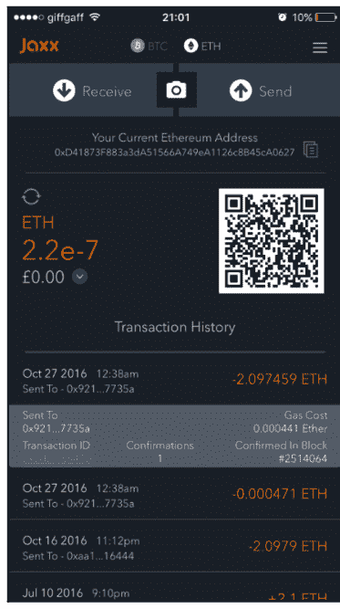

用于 iOS 的 Jaxx 以太坊钱包，显示交易和当前余额

区块链同步完成后，Mist 将启动并显示以下界面。在此示例中，显示了四个余额为零的账户：


可以通过多种方式创建新账户。在 Mist 浏览器中，可以点击“账户”菜单并选择“新账户”来创建，也可以在 Mist 账户概览屏幕上点击“添加账户”选项来创建。

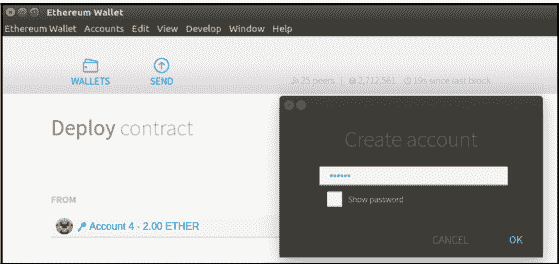

如上图所示，账户需要设置密码；账户设置完成后，它将显示在 Mist 浏览器的账户概览部分。

还可以通过命令行使用 geth 或 parity 命令行界面添加账户。此过程将在下一节中展示。

## Geth

```
$ geth account new
Your new account is locked with a password. Please give a password. Do not forget this password.
Passphrase:
Repeat passphrase:
Address: {21c2b52e18353a2cc8223322b33559c1d900c85d}
drequinox@drequinox-OP7010:~$
```

可以使用 geth 通过以下命令显示账户列表：

```
$ geth account list
```

```
Account #0: {11bcc1d0b56c57aefc3b52d37e7d6c2c90b8ec35}
/home/drequinox/.ethereum/keystore/UTC--2016-05-07T13-04-15.175558799Z--11bcc1d0b56c57aefc3b52d37e7d6c2c90b8ec35

Account #1: {e49668b7ffbf031bbbdab7a222bdb38e7e3e1b63}
/home/drequinox/.ethereum/keystore/UTC--2016-05-10T19-16-11.952722205Z--e49668b7ffbf031bbbdab7a222bdb38e7e3e1b63

Account #2: {21c2b52e18353a2cc8223322b33559c1d900c85d}
/home/drequinox/.ethereum/keystore/UTC--2016-11-29T22-48-09.825971090Z--21c2b52e18353a2cc8223322b33559c1d900c85d
```

### geth 控制台

geth JavaScript 控制台可用于执行各种功能。例如，可以通过附加 geth 来创建账户。

可以附加到正在运行的守护进程上，如下图所示：

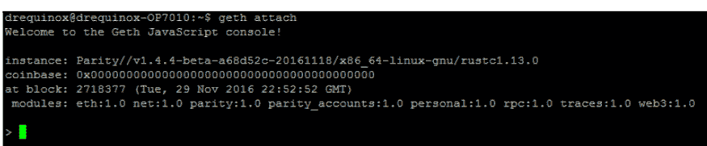

一旦 geth 成功附加到以太坊客户端的运行实例（此处为 parity），它将显示命令提示符“>”，该提示符提供了一个交互式命令行界面，可使用 JavaScript 语法与以太坊客户端进行交互。

例如，可以在 geth 控制台中使用以下命令添加新账户：

```
> personal.newAccount()
Passphrase:
Repeat passphrase:
"0xc64a728a67ba67048b9c160ec39bacc5626761ce"
>
```

账户列表也可以类似地显示：

```
> eth.accounts
["0x024a20cc5feba7f3dc3776075b3e60c20eb1459c",
"0x11bcc1d0b56c57aefc3b52d37e7d6c2c90b8ec35",
"0xdf482f11e3fbb7716e2868786b3afede1c1fb37f",
"0xe49668b7ffbf031bbbdab7a222bdb38e7e3e1b63",
"0xf9834defb35d24c5a61a5fe745149e9470282495"]
```

### 使用比特币为账户注资

此选项可在 Mist 浏览器中通过点击账户，然后选择为该账户注资的选项来使用。此操作的后端引擎是 shapeshift.io，可用于从比特币或其他货币（包括法定货币选项）为账户注资。

一旦兑换完成，转入的以太币将可在账户中使用。

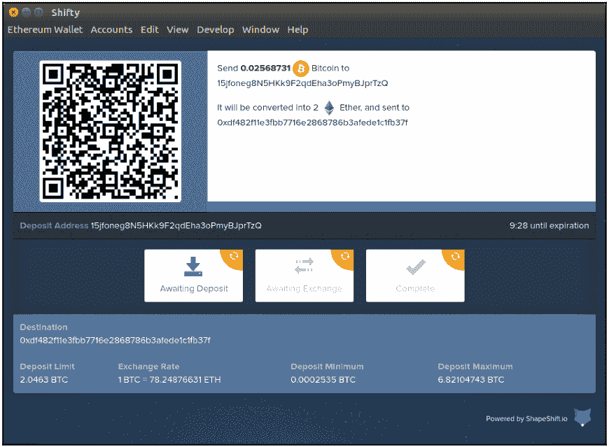

## Parity 安装

Parity 是以太坊客户端的另一种实现。它是用 Rust 编程语言编写的。开发 Parity 的主要目标是高性能、占用空间小和高可靠性。在 Ubuntu 或 Mac 系统上，可以使用以下命令安装 Parity：

```
bash <(curl https://get.parity.io -Lk)
```

这将启动 parity 客户端的下载和安装。Parity 安装完成后，安装程序还将提供 netstats 客户端的安装选项。Netstats 客户端是一个在后台运行的守护进程，负责收集重要的统计数据并将其显示在 stats.ethdev.com 上。

以下截图展示了 Parity 的安装示例：

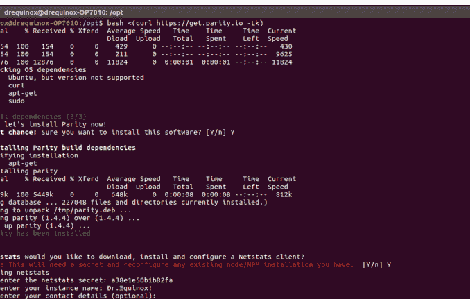

安装成功完成后，将显示以下消息。然后可以使用 `parity -j` 启动以太坊 parity 节点。如果需要与 geth 兼容以便将以太坊钱包（Mist 浏览器）与 parity 一起使用，则应使用 `parity --geth` 命令来运行 parity。这将使 parity 以与 geth 客户端的兼容模式运行，从而允许 Mist 在 parity 之上运行。

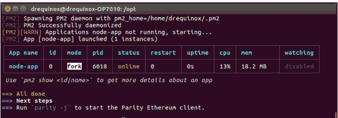

客户端还可以选择性地列在 `https://ethstats.net/` 上。示例如下：

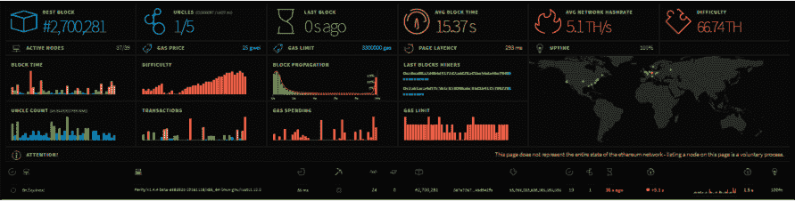

所有连接的客户端都列在 ethstats.net 上，如下截图所示。这些客户端会附带相关属性，例如节点名称、节点类型、延迟、挖矿状态、对等节点数量、待处理交易数量、最后一个区块、难度、区块交易数和叔块数量。

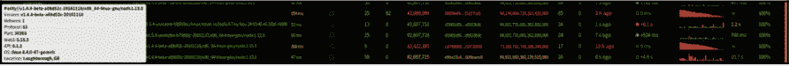

Parity 还提供了一个用户友好的 Web 界面，可以从中管理账户管理、地址簿管理、DAPP 管理、合约管理以及状态和签名者操作等各种任务。

可以通过发出以下命令访问该界面：

```
$ parity ui
```

这将打开如下所示的界面：

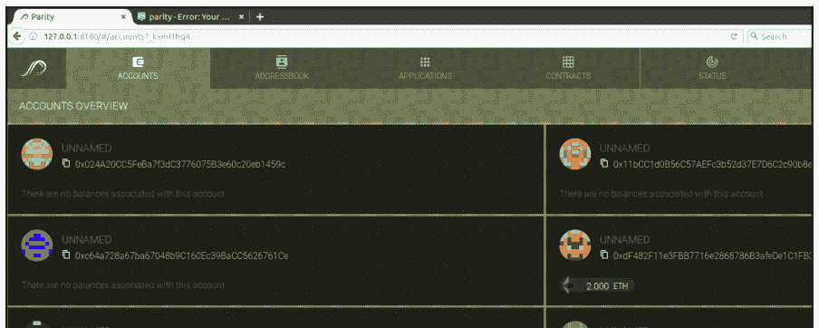

Parity 用户界面。

如果 parity 以 geth 兼容模式运行，则 parity UI 将被禁用。为了在启用 geth 兼容性的同时启用 UI，可以使用以下命令：

```
$ parity --geth --force-ui
```

上述命令将以 geth 兼容模式启动 parity，并同时启用 Web 用户界面。

### 使用 parity 命令行创建账户

可以使用以下命令通过 parity 创建新账户：

```
$ parity account new
Please note that password is NOT RECOVERABLE.
Type password:
Repeat password:
2016-11-30 02:18:55 UTC c8c92a910cfbce2e655c88d37a89b6657d1498fb
```

## 交易与投资

以太币可在各种交易所进行买卖。在撰写本书时，以太坊的当前市值为 680,277,967 英镑，1 个以太币价值 7.89 英镑。近期，由于以太坊网络遭受攻击以及随之而来的分叉，价格波动剧烈并大幅下跌。

下图显示了历史市值详情：

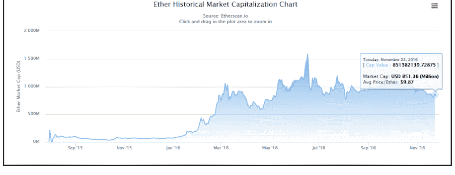

以太币历史市值（来源 Etherscan.io）

以太币既可以在各种交易所购买，也可以通过挖矿获得。有一些在线服务（例如 `shapeshift.io`）支持一种货币兑换为另一种货币。

Kraken、Coinbase 等众多在线交易所支持使用信用卡或其他虚拟货币（如比特币）以法定货币购买以太币。

## 黄皮书

以太坊黄皮书由 Gavin Wood 博士撰写，是以太坊协议的正式定义。任何人都可以按照论文中定义的协议规范来实现以太坊客户端。这篇论文可能有些难以阅读，特别是对于没有代数和数学背景、不熟悉数学符号的读者来说。


本文提供了论文中使用的所有符号及其含义的列表，以期使论文阅读更加轻松。一旦符号含义明确，理解黄皮书中所描述的概念和规范就变得相当容易。

## 常用符号

| 符号 | 含义 | 符号 | 含义 |
|---|---|---|---|
| ≡ | 定义为 | ≤ | 小于或等于 |
| = | 等于 | σ | Sigma，世界状态 |
| ≠ | 不等于 | μ | Mu，机器状态 |
| \|\|...\|\| | 长度 | Υ | Upsilon，以太坊状态转换函数 |
| ∈ | 是……的元素 | Π | 区块级状态转换函数 |
| ∉ | 不是……的元素 | . | 序列拼接 |
| ∀ | 对于所有 | ∃ | 存在 |
| ∪ | 并集 | ^ | 合约创建函数 |
| ∧ | 逻辑与 | Δ | 增量 |
| : | 使得 |  |  |
| {} | 集合 |  |  |
| () | 元组或函数 |  |  |
| [] | 数组索引 |  |  |
| ∨ | 逻辑或 |  |  |
| > | 大于 |  |  |
| + | 加法 |  |  |
| - | 减法 |  |  |
| Σ | 求和 |  |  |
| { | 描述各种情况的 if，否则 |  |  |
| [...] | 向下取整，最底层元素 |  |  |

## 支持协议

为了支持完整的去中心化生态系统，有多种正在开发中的支持协议。其中包括 Whisper 和 Swarm 协议。除了作为核心区块链层的合约层之外，还需要对其他层进行去中心化，以实现完整的去中心化生态系统。这包括去中心化存储和去中心化消息传递。Whisper 是为以太坊开发的去中心化消息传递协议，而 Swarm 是去中心化存储协议。这两项技术目前都在开发中，并已被设想为完全去中心化网络的基础。下一节将详细讨论这两项技术。

### Whisper

Whisper 为以太坊网络提供去中心化的点对点消息传递能力。本质上，Whisper 是一种通信协议，节点使用它来相互通信。在 Whisper 通信中，数据的传输和消息路由都是加密的。此外，它被设计用于较小数据量的传输以及不需要实时通信的场景。Whisper 还被设计为提供不可追踪的通信层，并在各方之间提供“暗通信”。区块链可以用于通信，但成本高昂，而且节点之间交换消息实际上并不需要共识。因此，Whisper 可以被用作一种允许……

Whisper 已在 geth 中可用，可以通过在运行 geth 以太坊客户端时使用 `--shh` 选项来启用。

### Swarm

Swarm 正在被开发为分布式文件存储平台。它是一个去中心化、分布式、点对点的存储网络。该网络中的文件通过其内容哈希来寻址。这与传统的中心化服务形成对比，传统服务中存储仅在中心位置可用。它被开发为以太坊 Web 3.0 栈的原生基础层服务。Swarm 已与 DevP2P（以太坊的多协议网络层）集成。Swarm 被设想为以太坊 Web 3.0 提供抗 DDoS（分布式拒绝服务）且容错的分布式存储层。Whisper 和 Swarm 都处于开发之中，尽管 Swarm 的概念验证和 alpha 代码已经发布，但尚未有稳定的生产版本。

下图从高层概述了 Swarm 和 Whisper 如何相互配合并与区块链协同工作：

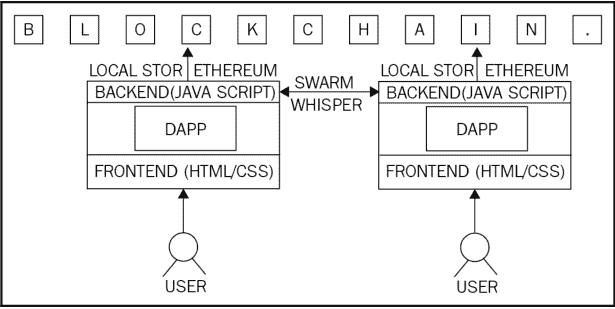

图表展示了区块链、Whisper 和 Swarm

## 基于以太坊开发的应用

以太坊中有各种 DAO 和智能合约的实现，最著名的是 DAO，它最近遭到攻击，需要进行硬分叉才能恢复资金。DAO 的创建是为了充当一个去中心化平台，用于收集和分配投资。

Augur 是另一个在以太坊上实现的 DAPP，它是一个去中心化的预测市场。其他各种去中心化应用列在 `http://dapps.etherecasts.com/` 上。

## 可扩展性和安全问题

任何区块链的可扩展性都是一个根本性问题。安全性也至关重要。隐私性和保密性等问题导致了一些适应性难题，尤其是在金融领域。然而，在这些领域正在进行大量研究。有关所有区块链相关问题的更详细讨论将在第 12 章《可扩展性及其他挑战》中进行。

## 总结

本章首先讨论了以太坊的历史、以太坊开发背后的动机以及以太坊客户端。然后，向你介绍了以太坊区块链的核心概念，例如状态机模型、世界状态和机器状态、账户以及账户类型。此外，还详细介绍了**以太坊虚拟机（EVM）**的核心组件。其他概念，如区块、区块结构、燃料和消息，也进行了介绍和详细讨论。本章后半部分介绍了以太坊客户端的实际安装和管理。讨论了最受欢迎的两个客户端 geth 和 parity。关于这些客户端的进一步开发相关讨论将在下一章进行，下一章将讨论使用以太坊进行开发。最后，介绍了支持协议以及与以太坊面临的挑战相关的主题。以太坊处于持续开发之中，一个专注的开发者社区定期进行新的改进。以太坊改进提案可在 `https://github.com/ethereum/EIPs` 获取，这也表明了社区对该技术的研究力度和浓厚兴趣。此外，最近发起的一项倡议——**企业以太坊联盟（EAA）**旨在开发企业级以太坊平台，该平台将能够满足企业级业务需求。随着在可扩展性、优化、吞吐量、容量和安全性等主题上的研究不断推进，可以预见，随着时间的推移，以太坊将发展成为一个更健壮、更易用、更稳定的区块链生态系统。
