# 8 以太坊开发

## 以太坊开发

本章介绍与以太坊开发相关的概念、技术和工具。本章将引入几个示例，以补充前几章提供的理论概念。本章主要涵盖开发环境的搭建以及如何使用以太坊区块链创建智能合约。将提供详细的分步示例，帮助您理解如何使用以太坊及其他支持工具在区块链上开发和部署智能合约。

## 搭建开发环境

第一项任务是搭建开发环境。接下来的部分介绍以太坊测试网和私有网的设置。测试网称为 Ropsten，供开发者或用户用作测试平台，以测试智能合约和其他与区块链相关的提案。以太坊中的私有网选项允许创建独立的私有网络，该网络可在参与实体之间用作分布式账本，并用于智能合约的开发与测试。虽然以太坊还有其他客户端可用，例如上一章讨论过的 Parity，但 geth 是以太坊的主要客户端，也是常用的选择工具，因此本章将在示例中使用 `geth`。

### 测试网（Ropsten）

以太坊 Go 客户端 geth 可以使用以下命令连接到测试网络：

```
geth --TestNet
```

示例输出如下面的截图所示。该截图显示了所选择的网络类型以及与区块链下载相关的其他各种信息。

测试网的区块链浏览器位于 `https://testnet.etherscan.io/`，可用于追踪以太坊测试网络上的交易和区块。

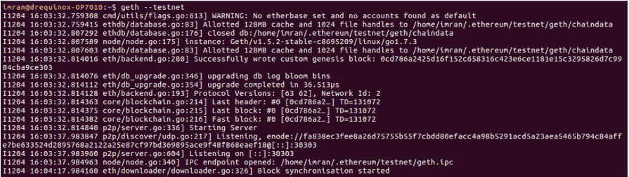

### 搭建私有网

私有网允许创建一条全新的区块链。这与测试网或主网不同，因为它使用自己的创世区块和网络 ID。要创建私有网，需要三个组件：

- 1. 网络 ID。
- 2. 创世文件。
- 3. 用于存储区块链数据的数据目录。虽然数据目录并非必须指定，但如果系统上已经有多条区块链在运行，则应指定数据目录，以便为新区块链使用单独的目录。


私有网络允许创建一条全新的区块链。这与测试网络或主网络不同，因为它使用自己独特的创世区块和网络 ID。在主网络上，geth 默认会识别对等节点并自动连接，但在私有网络上，geth 需要通过指定适当的标志和配置来使其能够被其他对等节点发现，或者去发现其他对等节点。

除了前面提到的三个组件之外，你还需要禁用**节点发现**，这样互联网上的其他节点无法发现你的私有网络，从而真正做到隐私保护。如果其他网络恰好拥有相同的创世文件和网络 ID，它们可能会连接到你的私有网络。虽然出现相同网络 ID 和创世区块的可能性非常低，但禁用节点发现仍是良好的实践，并且也是推荐的。

在接下来的部分，将通过一个实际示例详细讨论所有这些参数。

## 网络 ID

网络 ID 可以是除 1 和 3 之外的任何正数，其中 1 和 3 分别已被以太坊主网络和测试网络（Ropsten）使用。本节后文讨论的示例私有网络选用了网络 ID 786。

## 创世文件

创世文件包含自定义创世区块所需的必要字段。它是网络中的第一个区块，不指向任何前一个区块。以太坊协议会执行严格的检查，以确保互联网上的其他节点除非拥有相同的创世区块，否则无法参与共识机制。

示例中稍后将使用的自定义创世文件如下所示：

```
{
    "nonce": "0x0000000000000042",
    "timestamp": "0x0",
    "parentHash":"0x0000000000000000000000000000000000000000000000000000000000000000",
    "extraData": "0x0",
    "gasLimit": "0x4c4b40",
    "difficulty": "0x400",
    "mixhash":"0x0000000000000000000000000000000000000000000000000000000000000000",
    "coinbase": "0x0000000000000000000000000000000000000000",
    "alloc": { }
}
```

## 静态节点

如果需要连接到一组特定的对等节点，则可以将这些节点添加到一个与 `chaindata` 和 `keystore` 文件保存在一起的文件中，例如保存在 `~/.ethereum/privatenet` 目录中。文件名应为 `static-nodes.json`。这在私有网络中非常有用。该 json 文件的示例如下所示：

```
[
"enode://44352ede5b9e792e437c1c0431c1578ce3676a87e1f588434aff1299d30325c233c8d426fc57a25380481c8a36fb3be2787375e932fb4885885f6452f6efa77f@xxx.xxx.xxx.xxx:TCP_PORT"
]
```

其中，xxx 是公网 IP 地址，TCP_PORT 可以是系统上任何有效且可用的 TCP 端口。长十六进制字符串是节点 ID。

## 启动私有网络

启动私有网络的初始命令如下所示：

```
$ geth --datadir ~/.ethereum/privatenet init
./privether/privategenesis.json
```

这将产生类似于以下截图所示的输出：

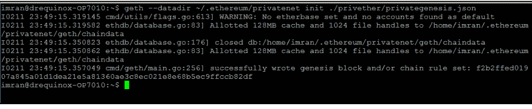

此输出表明创世区块已成功创建。为了启动 geth，可以执行以下命令：

```
$ geth --datadir .ethereum/privatenet/ --networkid 786
```

## 以太坊开发

这将产生以下输出：

```
imran@drequinox-OP7010:~$ geth --datadir .ethereum/privatenet/ --networkid 786
I0211 23:52:02.322730 cmd/utils/flags.go:613] WARNING: No etherbase set and no accounts found as default
I0211 23:52:02.322814 ethdb/database.go:83] Allotted 128MB cache and 1024 file handles to /home/imran/.ethereum/privatenet/geth/chaindata
I0211 23:52:02.378525 ethdb/database.go:176] closed db: /home/imran/.ethereum/privatenet/geth/chaindata
I0211 23:52:02.378525 node/node.go:175] instance: Geth/v1.5.2-stable-c8695209/linux/go1.7.3
I0211 23:52:02.378838 ethdb/database.go:83] Allotted 128MB cache and 1024 file handles to /home/imran/.ethereum/privatenet/geth/chaindata
I0211 23:52:02.388823 eth/db_upgrade.go:346] upgrading db log bloom bins
I0211 23:52:02.388906 eth/db_upgrade.go:354] upgrade completed in 85.497µs
I0211 23:52:02.388930 eth/backend.go:193] Protocol Versions: [63 62], Network Id: 786
I0211 23:52:02.389234 core/blockchain.go:214] Last header: #0 [f2b2ffed...] TD=512
I0211 23:52:02.389251 core/blockchain.go:215] Last block: #0 [f2b2ffed...] TD=512
I0211 23:52:02.389264 core/blockchain.go:216] Fast block: #0 [f2b2ffed...] TD=512
I0211 23:52:02.389750 p2p/server.go:336] Starting Server
I0211 23:52:07.553857 p2p/server/upd.go:217] Listening, enode://9efe4a58bc3f3d7c8d2ab0e18244c9f72bccdee9300
I0211 23:52:07.554074 p2p/server.go:604] Listening on [::]:30303
I0211 23:52:07.555359 node/node.go:340] IPC endpoint opened: /home/imran/.ethereum/privatenet/geth.ipc
```

启动一个私有网络的 geth

现在，可以使用以下命令通过 IPC 连接到私有网络上正在运行的 geth 客户端。这将允许你与私有网络上正在运行的 geth 会话进行交互：

```
$ geth attach ipc:.ethereum/privatenet/geth.ipc
```

如下所示，这将为正在运行的私有网络会话打开交互式 JavaScript 控制台：

```
imran@drequinox-OP7010:~$ geth attach ipc:.ethereum/privatenet/geth.ipc
Welcome to the Geth JavaScript console!

instance: Geth/v1.5.2-stable-c8695209/linux/go1.7.3
modules: admin:1.0 debug:1.0 eth:1.0 miner:1.0 net:1.0 personal:1.0 rpc:1.0 txpool:1.0 web3:1.0
> 
```

启动 geth 以连接到私有网络 786

你可能已经注意到，geth 启动时会出现一条警告消息。


> 警告：未设置 etherbase，且未找到默认账户。

出现此消息是因为当前在新的测试网络中没有可用账户，也没有账户被设置为 etherbase 来接收挖矿奖励。可以通过创建一个新账户并将该账户设置为 etherbase 来解决此问题。在测试网络上进行挖矿时也需要这样做。以下命令展示了具体操作。请注意，这些命令都是在 geth JavaScript 控制台中输入的，如上图所示。

以下命令创建一个新账户。在此上下文中，该账户将创建在私有网络 ID 786 上：

```
> personal.newAccount("Password123")
"0x76f11b383dbc3becf8c5d9309219878caae265c3"
```

创建账户后，下一步是将其设置为 Etherbase/coinbase 账户，以便挖矿奖励进入该账户。可以通过以下命令实现：

```
> miner.setEtherbase(personal.listAccounts[0])
true
```

当前，etherbase 账户没有余额，可以使用以下命令查看：

```
> eth.getBalance(eth.coinbase).toNumber();
0
```

最后，只需执行以下命令即可开始挖矿。该命令接受一个参数，即线程数。在以下示例中，通过向 start 函数传递参数 2，将为挖矿进程分配两个线程：

```
> miner.start(2)
true
```

挖矿开始后，会进行首次 DAG 生成，并产生类似于以下内容的输出：

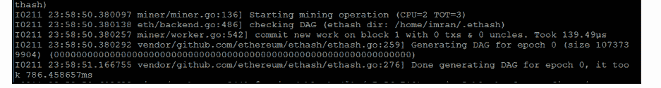

DAG 生成

DAG 生成完成后，挖矿开始，geth 将产生类似于以下截图所示的输出。可以清楚地看到，区块正在成功挖出，并显示 “Mined 5 blocks...” 消息。

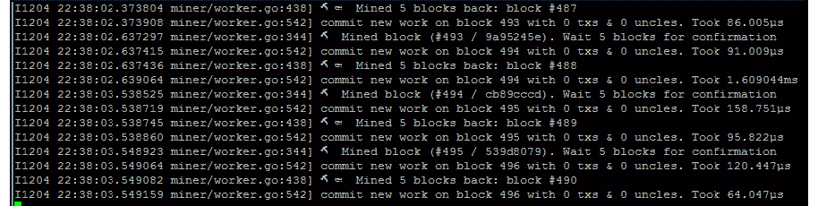

可以使用以下命令停止挖矿：

```
> miner.stop
true
```

在 JavaScript 控制台中，可以查询以太币的总余额，如下所示。挖矿之后，在以下示例中可以看到一笔可观的余额。由于这是一个私有网络，并且创世文件中的网络难度也设置得相当低，因此挖矿速度非常快：

```
> eth.getBalance(eth.coinbase).toNumber();
2.72484375e+21
```

如果依次按下两个空格和两个 Tab 键，将会显示可用对象的完整列表，如下面的截图所示：

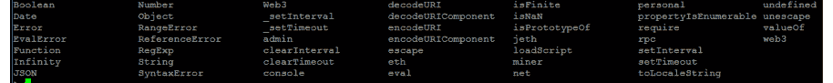


而且，当键入命令时，可以通过按两次 tab 键自动补全。如果按两次 tab，还会显示可用方法的列表。如下面的截图所示：

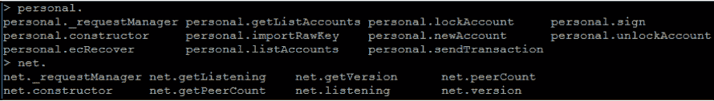

除了前面提到的命令外，为了获取可用方法的列表，在键入任何命令后，输入 ';'（分号）。下一个截图显示了 net 可用的所有方法列表：

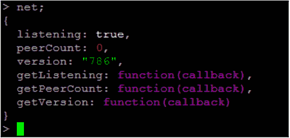

还有一些其他命令可用于查询私有网络。以下是一些示例：

- 获取当前 gas 价格：
  
  ```text
  > eth.gasPrice
  20000000000
  ```

- 获取最新区块号：
  
  ```text
  > eth.blockNumber
  587
  ```

- 获取编译器列表。注意，如果没有输出，则意味着没有安装 solidity 编译器；solidity 编译器的安装细节将在本章后面提供：

```
> web3.eth.getCompilers()
["Solidity"]
```

## 在私有网络上运行 Mist

可以通过发出以下命令在私有网络上运行 Mist。在安装 /opt/Ethereum 后，该二进制文件通常位于主文件夹中：

```
$ ./Ethereum\ Wallet --rpc ~/.ethereum/privatenet/geth.ipc
```

这将允许连接到正在运行的私有网络 geth 会话，并提供所有功能，例如钱包、账户管理以及通过 Mist 在私有网络上部署合约。

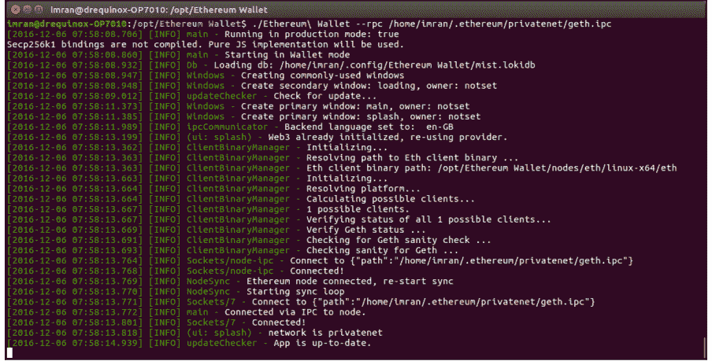

以太坊启动后，将显示此处所示的界面，明确指出它正在以**私有网络**模式运行。

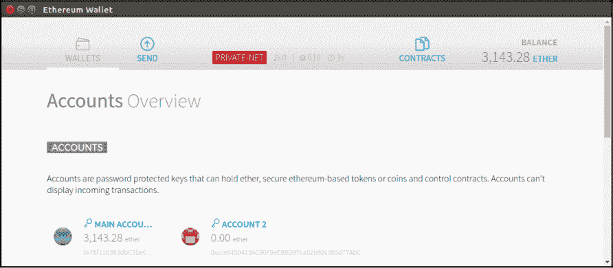

私有网络上的 Mist

Mist 也可以通过 RPC 通过网络运行。如果 `geth` 运行在一个节点上，而 Mist 运行在另一个节点上，这很有用。可以通过使用此处所示的标志运行 Mist 来实现：

```text
--rpc http://127.0.0.1:8545
```

## 使用 Mist 部署合约

使用 Mist 部署新合约非常容易。Mist 提供了一个界面，可以在其中用 solidity 编写合约，然后部署到网络上。

在练习中，将使用一个简单的合约，该合约可以对输入参数执行各种简单的算术计算。下面显示了如何使用 Mist 部署此合约的步骤。由于尚未介绍 solidity，这里的目标是让用户体验合约部署和交互过程。有关编码和 solidity 的更多信息将在本章后面提供，之后将更容易理解所显示的代码。已经熟悉 JavaScript 或任何其他类似语言的人会发现这些代码几乎不言自明。

示例合约源代码如下所示：

```
pragma solidity ^0.4.0;
contract SimpleContract2
{
    uint x;
    uint z;
    function addition(uint x) returns (uint y)
    {
        z=x+5;
        y=z;
    }
    function difference(uint x) returns (uint y)
    {
        z=x-5;
        y=z;
    }
    function division(uint x) returns (uint y)
    {
        z=x/5;
        y=z;
    }

    function currValue() constant returns (uint)
    {
        return z;
    }
}
```

这段代码可以简单地复制到 Mist 的合约部分，如下所示。在左侧，可以复制源代码；一旦验证且未检测到语法错误，部署合约的选项将出现在右侧的下拉菜单中，其中显示“选择要部署的合约”。只需选择合约，然后按屏幕底部的“部署”按钮。

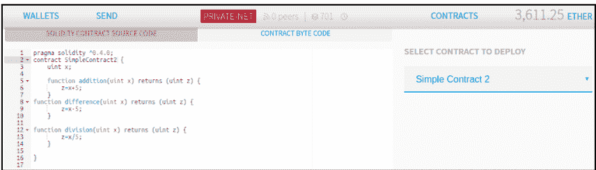

Mist 会要求输入账户密码，并显示一个类似于以下截图的窗口：

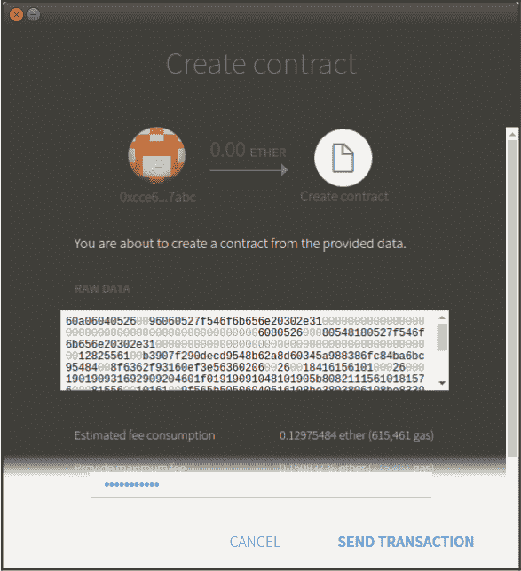

输入密码，然后点击**发送交易**以部署合约。

一旦部署并成功挖矿，它将出现在 Mist 的交易列表中，如下所示：

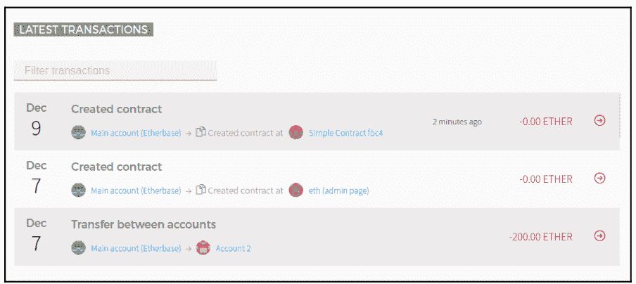

在 Mist 中创建后的交易列表

合约可用后，可以通过执行交易并调用 Mist 中的可用函数与之交互。

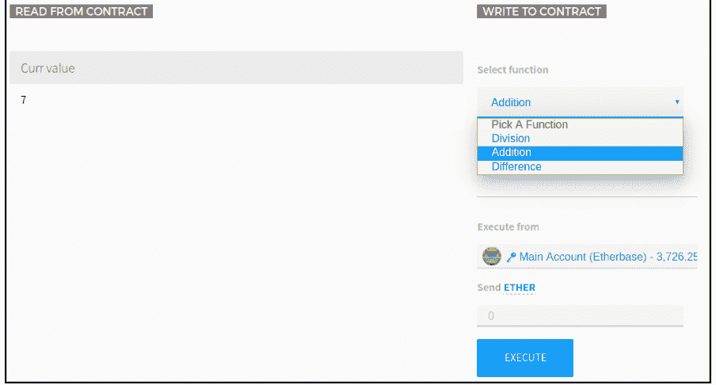

使用 Mist 中的读取和写入选项与合约交互

在上面的截图中，有**从合约读取**和**向合约写入**选项。此外，合约公开的函数可以在右侧看到。选择所需函数后，为函数输入适当的值并选择账户（执行来源）；按执行以执行交易，这将导致调用合约的所选函数。

此过程如下面的截图所示：

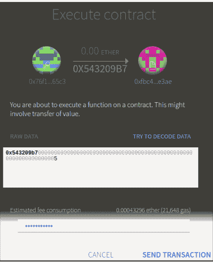

如截图所示，为账户输入适当的密码，然后按**发送交易**将交易发送到合约。

## 开发工具和客户端

有许多可用于以太坊开发的工具。下图显示了以太坊的各种开发工具、客户端、IDE 和开发框架的分类：

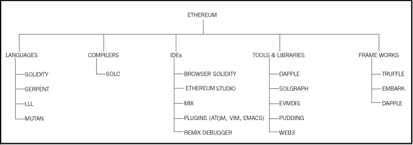

在本章中，主要重点将放在 geth、浏览器 Solidity、Solidity、solc 和 truffle 上。其余元素将简要讨论。

## 语言

合约可以使用多种语言进行编程。有四种语言可用于编写合约：

- **Mutan**：这是一种 Go 风格的语言，在 2015 年初被弃用，不再使用。
- **LLL**：这是一种类似 Lisp 的语言，因此得名 LLL。它也不再使用了。
- **Serpent**：这是一种简单而干净的类似 Python 的语言。它被积极用于合约开发。
- **Solidity**：这种语言现在几乎已成为以太坊合约编写的标准。这种语言是本章的重点，将在后面的章节中详细讨论。

## 编译器

编译器用于将高级合约源代码转换为以太坊执行环境可以理解的格式。Solidity 编译器是最常用的编译器，此处将进行讨论。

## Solc

Solidity 编译器将高级 Solidity 语言转换为**以太坊虚拟机（EVM）**字节码，以便 EVM 可以在区块链上执行。

在 Linux Ubuntu 操作系统上，可以使用以下命令安装 Solidity 编译器：

```
$ sudo apt-get install solc
```

如果尚未安装 PPA，可以通过运行以下命令安装：

```
sudo add-apt-repository ppa:ethereum/ethereum
sudo apt-get update
```

为了验证 Solidity 编译器的现有版本并确认其已安装，可以使用以下命令：

```
$ solc --version
solc, the solidity compiler commandline interface
Version: 0.4.6+commit.2dabdf0.Linux.g++
```

Solc 支持多种功能。下面显示了一些示例：

- 以二进制格式显示合约。

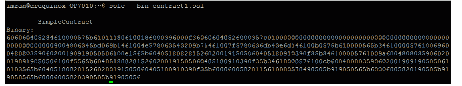

Solidity 编译器二进制输出

- 估算 gas：

```
imran@drequinox-OP7010:~$ solc --gas contract1.sol
====== SimpleContract ======
Gas estimation:
construction:
  97 + 54600 = 54697
external:
  division(uint256):  230
  addition(uint256):  231
  difference(uint256): 253
```

# 内部：

请注意，contract1.sol 仅作为示例显示；该文件可以包含任何智能合约 Solidity 代码。此处未显示文件的代码。

Solc 在 geth 控制台中由 web3 内部使用，以便编译合约。语法如下所示，contractsourcecode 是 Solidity 源代码：

```
web3.eth.compile.solidity(contractsourcecode)
```

这将在本章后面的合约开发介绍中详细讨论。

## 集成开发环境（IDE）

有多种可用于 Solidity 开发的 IDE。大多数 IDE 可在线获得，并通过 Web 界面呈现。浏览器 Solidity 最常用于较小的合约，这里将进行讨论。

## 浏览器 Solidity

浏览器 Solidity 是使用 Solidity 开发和测试合约的基于 Web 的环境。它不运行在实时区块链上；实际上，它是一个模拟环境，可以在其中部署、测试和调试合约。可访问 https://ethereum.github.io/browser-solidity。示例界面如下所示：

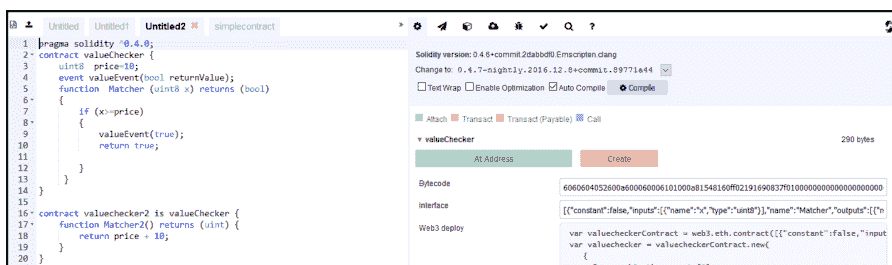

浏览器 Solidity


在左侧，有一个带有语法高亮和代码格式化的代码编辑器；在右侧，有许多可用的工具，可用于部署、调试、测试以及与合约进行交互。各种功能，如事务交互、连接到 JavaScript 虚拟机（VM）的选项、执行环境配置、调试器、形式化验证和静态分析，均可使用。它们可以被配置为连接到诸如 JavaScript VM、注入的 Web3（——其中 Mist 或类似环境提供了执行环境——）或 Web3 提供程序等执行环境，后者允许通过 IPC 或基于 HTTP 的 RPC（Web3 提供程序端点）连接到本地运行的以太坊客户端（例如，geth）。

## Remix

在 2016 年 8 月 Mix IDE 停止开发后，Remix 项目启动。Remix 是一个基于浏览器的 IDE，目前正处于积极开发阶段，目前只有其调试器部分可用。这个调试器非常强大，可用于对 EVM 字节码进行详细的跟踪和分析。以下部分将介绍 Remix 的安装和使用示例。

## 安装

Remix 位于 `https://github.com/ethereum/remix`。第一步是克隆 GitHub 仓库：

```text
$ git clone https://github.com/ethereum/remix
Cloning into 'remix'...
remote: Counting objects: 2185, done.
remote: Compressing objects: 100% (213/213), done.
remote: Total 2185 (delta 124), reused 0 (delta 0), pack-reused 1971
Receiving objects: 100% (2185/2185), 1.12 MiB | 443.00 KiB/s, done.
Resolving deltas: 100% (1438/1438), done.
Checking connectivity... done.
```

完成上述步骤后，执行以下命令：

```text
cd remix
npm install
npm run build
```

此时，可以运行 `npm run start_node`，或者使用适当的标志启动 `geth`。一旦 `geth` 启动并运行，可以运行一个简单的 Web 服务器来提供 Remix 网页。

现在可以使用以下命令启动 `geth`：

```bash
$ geth --datadir .ethereum/privatenet/ --networkid 786 --rpc --rpcapi 'web3,eth,debug' --rpcport 8001 --rpccorsdomain 'http://localhost:7777'
```

请注意 `--rpcapi` 标志；它允许通过 RPC 使用 `web3`、`eth`、`debug`，因此是必需的。

如果运行 `npm run start_node`，可能会出现以下消息：

```bash
$ npm run start_node
> ethereum-remix@0.0.2-alpha.0.0.9 start_node /home/imran/remix
> ./runNode.sh
both eth and geth has been found in your system
restart the command with the desired client:
npm run start_eth
or
npm run start_geth
```

假设需要 `geth`，请使用以下命令：

```bash
$ npm run start_geth
```

如果选择运行 `geth`，则需要一个简单的 Web 服务器来浏览 Remix 网页。这可以通过发布 Python 命令简单实现，如下所示。这应该从 Remix 目录中运行。

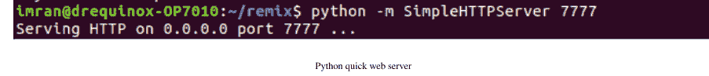

一旦命令成功且 Web 服务器正在运行，Remix 可以使用 `http://localhost:7777` URL 进行浏览，如以下截图所示：

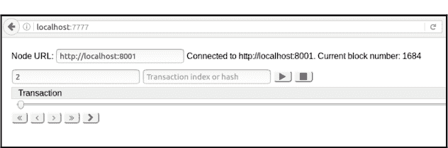

显示通过 TCP 7777 提供和运行的 Remix 的 Web 浏览器

Remix 也作为浏览器 Solidity 的一部分提供（浏览器 Solidity 之前已单独讨论过）。可以通过提供 Web3 提供程序端点连接到本地专用网络。显示如下：

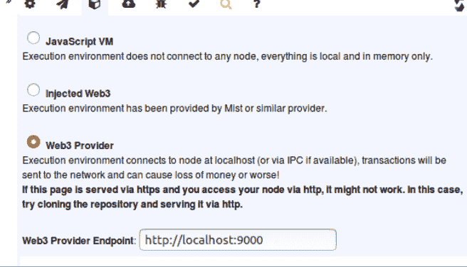

浏览器 Solidity 中用于连接到本地 `geth` 节点的 **Web3 提供程序** 选项如下：

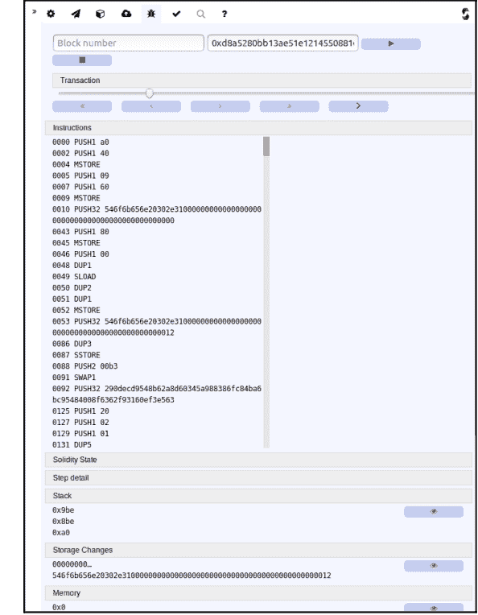

浏览器 Solidity 中的 Remix 调试器

## 工具和库

以太坊有各种可用的工具和库。这里讨论的是最常见的几种。

## 以太坊开发

一旦 Web 服务器启动，应该使用以下命令启动 `geth`：

```bash
geth --datadir .ethereum/privatenet/ --networkid 786 --rpc --rpccorsdomain 'http://localhost:8000'
```

`geth` 成功启动后，导航到 TCP 端口 8000 上的本地主机，如这里所示，以访问本地以太坊区块浏览器。

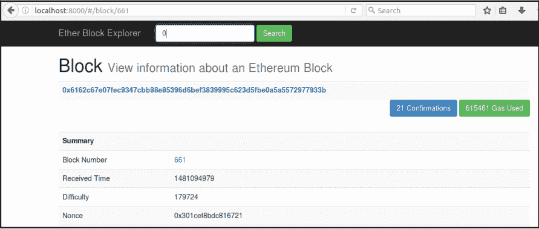

或者，可以使用 Python 或其他适当的提供程序启动 Web 服务器。在 Python 中，可以按以下代码所示启动一个简单的 Web 服务器：

```bash
imran@dreguinox-OP7010:~/explorer/apps$ python -m SimpleHTTPServer 9900
Serving HTTP on 0.0.0.0 port 9900 ...
```

需要以适当的参数启动 `geth` 客户端。否则，可能会出现如以下截图所示的错误：

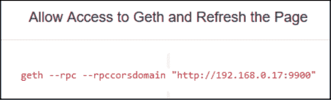

重启 `geth` 以允许 `rpccorsdomain`：

```bash
geth --datadir .ethereum/PrivateNet/ --networkid 786 --rpc --rpccorsdomain 'http://192.168.0.17:9900'
```

### EthereumJS

有时，不可能在测试网上进行测试，而主网显然不是测试合约的地方。专用网的设置有时会耗时。当需要快速测试且没有合适的测试网时，EthereumJS testrpc 就派上用场了。它使用 EthereumJS 模拟以太坊 geth 客户端的行为，并允许更快的开发测试。Testrpc 作为 node 包通过 npm 提供。

在安装 testrpc 之前，应该已经安装了 Node.js，并且 npm 包管理器也应该可用。

可以使用此命令安装 Testrpc：

```bash
npm install -g ethereumjs-testrpc
```

为了启动 testrpc，只需发出此命令并在后台保持其运行，并打开另一个终端来处理合约。

```bash
$ testrpc
```

### 合约开发和部署

为了开发和部署合约，需要采取各种步骤。大致上，这些可以分为四个步骤：编写、测试、验证和部署。部署后，下一步是创建用户界面，并通过 Web 服务器将其呈现给最终用户。

编写步骤涉及使用 Solidity 编写合约源代码。这可以在任何文本编辑器中完成。Linux 中的 Vim、Atom 和其他编辑器有各种提供 Solidity 源代码语法高亮和格式化的插件和附加组件可用。

测试通常通过自动化手段进行。在本章后面，你将了解 Truffle，它使用 Mocha 框架来测试合约。然而，也可以进行手动测试。一旦合约在模拟环境（例如，EthereumJS testrpc）或专用网上得到验证、正常工作并通过测试，就可以部署到 Ropsten 测试网，并最终部署到实时区块链（Homestead）。

在下一节中，将向你介绍语言 Solidity。这是对 Solidity 的简要介绍，它应该提供编写合约所需的基础知识。其语法非常类似于 C 和 JavaScript，且编程相当容易。

## 介绍 Solidity

Solidity 是以太坊合约编程的首选领域特定语言。然而，还有其他语言，如 Serpent、Mutan 和 LLL，但在撰写本文时，Solidity 是最受欢迎的。其语法更接近 JavaScript 和 C。在过去几年中，Solidity 已演变为一种成熟的语言，使用起来相当容易，但在它变得像其他成熟的语言那样先进和功能丰富之前，还有很长的路要走。尽管如此，这是目前用于合约编程最广泛使用的语言。

它是一种静态类型语言，这意味着 Solidity 中的变量类型检查在编译时进行。每个变量，无论是状态变量还是局部变量，都必须在编译时指定类型。这是有益的，因为任何验证和检查都在编译时完成，某些类型的 bug，如数据类型解释，可以在开发周期的早期被捕获，而不是在运行时，运行时可能代价高昂，尤其是在区块链/智能合约范式下。该语言的其他特性包括继承、库以及定义复合数据类型的能力。

Solidity 也是一种面向合约的语言。在 Solidity 中，合约相当于其他面向对象编程语言中类的概念。

## 类型

Solidity 有两个类别的数据类型：值类型和引用类型。

### 值类型

这里详细解释它们。

### 布尔值

此数据类型有两个可能的值，true 或 false，例如：

```solidity
bool v = true;
```

此语句将值 true 分配给 v。


## 调用函数

提供了 `call`、`callcode` 和 `delegatecall`，以便与没有**应用程序二进制接口（ABI）**的函数进行交互。应谨慎使用这些函数，因为受类型安全和合约安全性的影响，它们并不安全。

## 数组值类型（固定大小和动态大小的字节数组）

Solidity 具有固定大小和动态大小的字节数组。固定大小的关键字范围从 `bytes1` 到 `bytes32`，而动态大小的关键字包括 bytes 和 string。`bytes` 用于原始字节数据，string 用于以 UTF-8 编码的字符串。由于这些数组按值返回，调用它们将产生 gas 成本。`length` 是数组值类型的成员，返回字节数组的长度。

以下是一个静态（固定大小）数组的示例：

```
bytes32[10] bankAccounts;
```

以下是一个动态大小数组的示例：

```
bytes32[] trades;
```

获取 trades 的 `length`：

```
trades.length;
```

## 字面量

字面量用于表示固定值。

## 整数字面量

整数字面量是 0-9 范围内十进制数字的序列。示例如下：

```
uint8 x = 2;
```

## 字符串字面量

字符串字面量指定一组用双引号或单引号编写的字符。示例如下：

```text
'packt'
"packt"
```

## 十六进制字面量

十六进制字面量以关键字 hex 为前缀，并使用双引号或单引号括起来。示例如下：

```text
(hex'AABBCC');
```

## 枚举

这允许创建用户定义的类型。示例如下：

```text
enum Order{Filled, Placed, Expired};
Order private ord;
ord=Order.Filled;
```

枚举允许与所有整数类型进行显式的双向转换。

## 函数类型

有两种函数类型：内部函数和外部函数。

## 内部函数

这些函数只能在当前合约的上下文中使用。

## 外部函数

外部函数可以通过外部函数调用进行调用。

Solidity 中的函数可以标记为 constant。常量函数不能更改合约中的任何内容；它们在被调用时仅返回值，并且不消耗任何 gas。这是上一章讨论的 *call* 概念的实际实现。

声明函数的语法如下所示：

```
function <nameofthefunction> (<parameter types> <name of the variable>)
{internal|external} [constant] [payable] [returns (<return types> <name of the variable>)]
```

## 引用类型

顾名思义，这些类型是按引用传递的，将在以下部分讨论。

## 数组

数组表示在某个内存位置中连续排列的一组大小和类型相同的元素。其概念与任何其他编程语言相同。数组有两个成员：length 和 push：

```
uint[] OrderIds;
```

## 结构体

这些构造可用于将一组不同的数据类型组合到一个逻辑组下。它们可用于定义新类型，如下例所示：

```
Struct Trade
{
uint tradeid;
uint quantity;
uint price;
string trader;
}
```

## 数据位置

数据位置指定特定复杂数据类型将存储在哪里。根据指定的默认值或注解，位置可以是 storage 或 memory。这适用于数组和结构体，并可以使用 storage 或 memory 关键字来指定。由于 memory 和 storage 之间的复制可能非常昂贵，有时指定位置有助于控制 gas 支出。Calldata 是另一种内存位置，用于存储函数参数。外部函数的参数使用 calldata 内存。默认情况下，函数参数存储在 memory 中，而所有其他局部变量使用 storage。另一方面，状态变量必须使用 storage。

## 映射

映射用于建立键到值的映射关系。这是一种将值与键关联的方式。此映射中的所有值都已初始化为全零，例如以下内容：

```
mapping (address => uint) offers;
```

此示例表明 offers 被声明为一个映射。另一个示例能更清楚地说明这一点：

```
mapping (string => uint) bids;
bids["packt"] = 10;
```

这基本上是一个字典或哈希表，其中字符串值映射到整数值。名为 bids 的映射将 packt 字符串值映射到值 10。

## 全局变量

Solidity 提供了许多始终在全局命名空间中可用的全局变量。这些变量提供有关区块和交易的信息。此外，还可以使用加密函数和与地址相关的变量。

可用函数和变量的子集如下所示：

```
keccak256(...) returns (bytes32)
```

此函数用于计算提供给该函数的参数的 keccak256 哈希：

```
ecrecover(bytes32 hash, uint8 v, bytes32 r, bytes32 s) returns (address)
```

此函数从椭圆曲线签名返回公钥的关联地址：

```
block.number
```

该变量返回当前区块号。

## 控制结构

Solidity 中可用的控制结构有 if - else、do、while、for、break、continue、return。它们的工作方式与 C 语言或 JavaScript 中的工作方式类似。

## 事件

Solidity 中的事件可用于在 EVM 日志中记录某些事件。当外部接口需要获知合约中的任何更改或事件时，这些事件非常有用。这些日志存储在区块链的交易日志中。合约无法访问日志，但它们被用作一种机制，用于通知合约中的状态更改或事件（满足条件）的发生。

这里有一个简单示例：如果传递给函数 Matcher 的 x 参数等于或大于 10，则 valueEvent 事件将返回 true：

```
contract valueChecker {
    uint8 price=10;
    event valueEvent(bool returnValue);
    function Matcher(uint8 x) returns (bool)
    {
        if (x>=price)
        {
            valueEvent(true);
            return true;
        }
    }
}
```

## 继承

Solidity 支持继承。is 关键字用于从一个合约派生另一个合约。在以下示例中，valueChecker2 派生自 valueChecker 合约。派生合约可以访问父合约的所有非私有成员：

```
contract valueChecker
{
    uint8 price=10;
    event valueEvent(bool returnValue);
    function Matcher(uint8 x) returns (bool)
    {
        if (x>=price)
        {
            valueEvent(true);
            return true;
        }
    }
}
contract valueChecker2 is valueChecker
{
```

在前面的示例中，`function` 是用于声明函数的关键字。`OrderMatcher` 是函数名，`uint x` 是可选参数，`private` 是 **访问修饰符/说明符**，用于控制外部合约对函数的访问，`constant` 是可选关键字，用于指定此函数不会更改合约中的任何内容，而仅用于从合约中检索值，`returns (bool returnvalue)` 是函数的可选返回类型。

- **如何定义函数：** 定义函数的语法如下所示：

```
function <name of the function>(<parameters>) <visibility
specifier> returns (<return data type> <name of the variable>)
{
  <function body>
}
```

- **函数签名：** Solidity 中的函数通过其签名来标识，签名是其完整签名字符串的 keccak-256 哈希的前四个字节。这在浏览器 Solidity 中也可以看到，如下面的截图所示。**D99c89cb** 是名为 **Matcher** 的函数的 32 字节 keccak-256 哈希的前四个字节。


在此示例函数中，**Matcher** 的签名哈希为 **d99c89cb**。这些信息对于构建接口很有用。

- **函数的输入参数：** 函数的输入参数以 `<data type> <parameter name>` 的形式声明。此示例说明了 `uint x` 和 `uint y` 是 `checkValues` 函数的输入参数的概念：

```
contract myContract
{
  function checkValues(uint x, uint y)
  {
  }
}
```


## 函数的输出参数
函数的输出参数以 `<数据类型> <参数名称>` 的形式声明。下面的示例展示了一个返回 `uint` 值的简单函数：

```solidity
contract myContract
{
    function getValue() returns (uint z)
    {
        z=x+y;
    }
}
```

函数可以返回多个值。在前面的示例中，函数 `getValue` 只返回一个值，但一个函数最多可以返回 14 个不同数据类型的值。未使用的返回参数名称可以被省略。

## 内部函数调用
当前合约上下文中的函数可以直接以内部方式调用。这些调用用于调用同一合约中存在的函数。在 EVM 字节码级别，这些调用会导致简单的 JUMP 调用。

## 外部函数调用
外部函数调用是通过从一个合约向另一个合约发送消息调用来实现的。在这种情况下，所有函数参数都会被复制到内存中。如果使用 `this` 关键字调用内部函数，这也被认为是外部调用。`this` 变量是指向当前合约的指针。它可以显式转换为地址，并且合约的所有成员都从地址继承。

## 回退函数
这是合约中一个没有名称、没有参数和返回数据的函数。每当收到以太币时，此函数都会执行。如果合约打算接收以太币，则需要在合约中实现该函数；否则，将抛出异常并退还以太币。如果合约中没有其他函数签名匹配，也会执行此函数。如果合约期望接收以太币，则应使用 `payable` 修饰符声明回退函数。`payable` 是必需的；否则，此函数将无法接收任何以太币。可以使用 `address.call()` 方法调用此函数，例如：

```solidity
function ()
{
    throw;
}
```

在这种情况下，如果根据前述条件调用回退函数，它将调用 `throw`，这将把状态回滚到调用之前的状态。它也可以采用 `throw` 以外的其他结构；例如，它可以记录一个事件，该事件可用作警报，将调用的结果反馈给调用应用程序。

## 修饰符函数
这些函数用于改变函数的行为，并且可以在其他函数之前被调用。通常，它们用于在执行函数之前检查某些条件或进行验证。`_;`（下划线）用于修饰符函数中，当调用修饰符时，它会被替换为函数的实际主体。基本上，它象征着需要被守护的函数。这个概念类似于其他语言中的守卫函数。

## 构造函数
这是一个可选函数，其名称与合约相同，并且在合约创建时执行一次。构造函数之后不能由用户调用，并且一个合约中只允许有一个构造函数。这意味着没有可用的重载功能。

## 函数可见性说明符（访问修饰符）
函数可以使用以下四种访问说明符来定义：

- **外部：** 这些函数可从其他合约和交易访问。除非使用 `this` 关键字，否则它们不能从内部调用。
- **公共：** 默认情况下，函数是公共的。它们可以通过内部调用或消息调用。
- **内部：** 内部函数对父合约派生的其他合约可见。
- **私有：** 私有函数仅对其所声明的同一合约可见。

## 其他重要关键字/函数
`throw` 用于停止执行。结果，所有状态更改都会被回滚。在这种情况下，不会有 gas 退还给交易发起者，因为所有剩余的 gas 都会被消耗。

# Solidity 源代码文件的布局

# 版本 pragma
为了解决未来 Solidity 编译器版本可能带来的兼容性问题，可以使用 pragma 来指定兼容编译器的版本，例如：

```solidity
pragma solidity ^0.5.0
```

这将确保源文件不会使用小于 0.5.0 的版本以及从 0.6.0 开始的版本进行编译。

# 导入
Solidity 中的 import 允许将现有 Solidity 文件中的符号导入当前全局作用域。这与 JavaScript 中的 import 语句类似，例如：

```solidity
import "module-name";
```

# 注释
注释可以以类似于 C 语言的方式添加到 Solidity 源代码文件中。多行注释用 `/*` 和 `*/` 括起来，而单行注释以 `//` 开头。

下面是一个 Solidity 程序示例，展示了 pragma、import 和注释的用法：

```solidity
pragma solidity ^0.4.0; //specify compiler version
/*
This is a simple value checker contract
that checks the value provided and returns boolean value
based on the condition expression evaluation
*/
import "dev.oraClize.it/api.sol";
contract valueChecker {
    uint price=10;
    // This is price variable decared and initialized with value 10.
    event valueEvent(bool returnValue);
    function Matcher (uint8 x) returns (bool)
    {
        if (x>=price)
        {
            valueEvent(true);
            return true;
        }
    }
}
```

在浏览器 Solidity 中显示的 Solidity 程序示例

以上是对 Solidity 语言的简要介绍。该语言非常丰富且处于不断改进之中。详细的文档和编码指南可在网上获取。

# Web3 简介
Web3 是一个 JavaScript 库，可以通过 RPC 通信与以太坊节点进行通信。Web3 通过暴露已在 RPC 上启用的方法来实现这一点。这使得开发用户界面成为可能，这些界面利用 web3 库与部署在区块链上的合约进行交互。

为了通过 `geth` 暴露这些方法，可以使用以下命令：

```bash
$ geth --datadir .ethereum/privatenet/ --networkid 786 --rpc --rpcapi 'web3,eth,debug' --rpcport 8001 --rpcportdomain 'http://localhost:7777'
```

注意 `--rpcapi` 标志允许使用 web3、eth 和 debug 方法。

这是一个功能强大的库，可以通过连接 `geth` 实例进一步探索。在后面的章节中，你将了解通过 JavaScript/HTML 前端使用 web3 的概念和技术。

可以使用以下命令连接 geth 实例：

```bash
$ geth attach ipc:.ethereum/privatenet/geth.ipc
```

一旦 geth JavaScript 控制台运行，就可以查询 web3，例如：

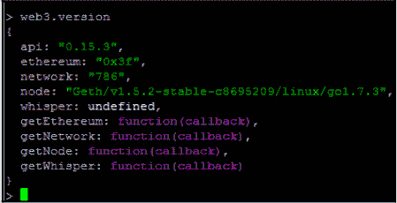

可以使用 geth 部署一个简单合约，并通过 geth 提供的命令行界面（console 或 attach）使用 web3 与之交互。以下是实现该目标的步骤。作为示例，将使用以下源代码：

```solidity
pragma solidity ^0.4.0;
contract valueChecker {
    uint price=10;
    event valueEvent(bool returnValue);
    function Matcher (uint8 x) returns (bool)
    {
        if (x>=price)
        {
            valueEvent(true);
            return true;
        }
    }
}
```

现在打开之前已经打开的 geth 控制台，并按照以下步骤操作：

1. 声明一个名为 `simplecontractsource` 的变量，并将程序代码赋值给它：

```javascript
> var simplecontractsource = "pragma solidity ^0.4.0; contract valueChecker { uint price=10;event valueEvent(bool returnValue); function Matcher (uint8 x) returns (bool) { if (x>=price) {valueEvent(true); return true; } } }"
```

这将显示以下输出：

```javascript
undefined
```

请注意，源代码必须放在一行中，这意味着不应有换行符。在 Linux 中可以使用以下命令实现：

```bash
$ tr --delete '\n' < valuechecker.sol > valuecheckersingleline.sol
```

在前面的示例中，`valuechecker.sol` 是包含换行符 `\n` 的文件，`valuecheckersingleline.sol` 是在从文件中移除换行符后生成的输出文件。然后可以将代码从文件中复制并粘贴到 geth JavaScript 控制台中。


+   2. 现在验证 solidity 编译器是否可用；如果不可用，请参考本章中讲解 solidity 安装的章节：

```
> eth.getCompilers()
["Solidity"]
```

+   3. 创建一个变量，使用 solidity 赋值并编译代码：

```
> var
  simplecontractcompiled=eth.compile.solidity(simplecontractsource)
undefined
```

+   4. 输入 `simplecontractcompiled`；它会显示类似下面的输出，因为 `simplecontractcompiled` 已被赋予上一步骤 3 中的数据。

```
> simplecontractcompiled
{
  valueChecker: {
    code: "0x6060604052600d...",
    info: {
      abiDefinition: [...],
      compilerOptions: "--combined-json bin,abi,userdoc,devdoc --add-std --optimize",
      compilerVersion: "0.4.6",
      developerDoc: { methods: {} },
      language: "Solidity",
      languageVersion: "0.4.6",
      source: "pragma solidity ^0.4.0; contract valueChecker { uint price=10; event valueEvent (bool returnValue); function Matcher (uint x) returns (bool) { if (x>price) { valueEvent (true); return true; } } }",
      userDoc: { methods: {} }
    }
  }
}
```

`simplecontractcompiled` 输出

+   5. 创建一个变量来与合约交互：

```
>var simplecontractinteractor=eth.contract
(simplecontractcompiled.valueChecker.info.abiDefinition);
undefined
```

## 6. 检查 **ABI（应用程序二进制接口）**：

```
> simplecontractinteractor.abi
[{
    constant: false,
    inputs: [{
        name: "x",
        type: "uint8"
    }],
    name: "Matcher",
    outputs: [{
        name: "",
        type: "bool"
    }],
    payable: false,
    type: "function"
}, {
    anonymous: false,
    inputs: [{
        indexed: false,
        name: "returnValue",
        type: "bool"
    }],
    name: "valueEvent",
    type: "event"
}]
```

## 7. 以十六进制格式检查 `valueChecker` 的代码：

```
> simplecontractcompiled.valueChecker.code
```

这将返回以下输出。你的输出可能会略有不同：

```
"0x6060604052600a60005534610000575b60878061001c6000396000f36060660405260e060020a6000350463f9d55e21114601c575b600056b34600057602960045603d35b560456b60408051911518252519081900360200190f35b6000805460ff831
0608157604080516001815290517f3eb1a229ff7995457774a4bd31ef7b13b6f449
1ad1ebb8961af120b8b4b6239c9181900360200190a15060015b5b91905056"
```

## 8. 现在输入以下代码；请注意，data 字段包含 `simplecontractcompiled` 的代码：

```javascript
>var simplecontractTransaction = simplecontractinteractor.new({
    from: eth.coinbase,
    data: simplecontractcompiled.valueChecker.code,
    gas: 2000000
},
function(err, contract) {
```

9. 账户成功解锁后，启动矿工，以便合约可以被挖出（解锁账户并不是启动挖矿的必要条件。解锁账户是为了将合约挖出并创建到区块链上）：

```
> miner.start()
true
```

当合约被正确创建时，它会显示类似这样的输出：

```
[object Object]
undefined
undefined
> [object Object]
0x94a1107f2585f0ab931c71f2f8f02e9f5ab888c0
```

这显示了合约被挖出后新建合约的地址。

10. 为了更容易地与合约交互，可以将该账户地址赋给一个变量：

```
> var simplecontractaddress=
"0x94a1107f2585f0ab931c71f2f8f02e9f5ab888c0"
Undefined
```

11. 现在有许多方法被暴露出来，可以进一步查询合约，例如：

```
> var deployedaddress=eth.getCode(simplecontractaddress);
undefined
> deployedaddress
"0x606060405260e060020a6000350463f9d55e218114601c575b6000565b346000576029600435603d565b604080519115158252519081900360200190f35b6000805460ff831610608157604080516001815290517f3eb1a229ff7995457774a4bd31ef7b13b6f4491ad1ebb8961af120b8b4b6239c9181900360200190a15060015b5b91905056"
> eth.getBalance(simplecontractaddress)
0
```

12. 之后，可以创建一个名为 simplecontractinstance 的对象，用于调用方法：

```
simplecontractinstance = web3.eth.contract(simplecontractcompiled.valueChecker.info.abiDefinition).at(simplecontractaddress);
```

13. 现在已经暴露了各种方法，可以看到如下列表：

```
> simplecontractinstance.Matcher.
simplecontractinstance.Matcher.apply
simplecontractinstance.Matcher.constructor
simplecontractinstance.Matcher.request

simplecontractinstance.Matcher.arguments
simplecontractinstance.Matcher.estimateGas
simplecontractinstance.Matcher.sendTransaction

simplecontractinstance.Matcher.bind
simplecontractinstance.Matcher.getData
simplecontractinstance.Matcher.toString

simplecontractinstance.Matcher.call
simplecontractinstance.Matcher.length
simplecontractinstance.Matcher.uint8

simplecontractinstance.Matcher.caller
simplecontractinstance.Matcher.prototype
```

14. 可以像这样进一步查询合约。在下面的示例中，使用参数调用了 Matcher 函数。请记住，在代码中有一个条件检查：如果值大于或等于 10，则函数返回 true；否则返回 false。具体如下：

```
> simplecontractinstance.Matcher.call(12)
true
> simplecontractinstance.Matcher.call(9)
false
> simplecontractinstance.Matcher.call(0)
false
> simplecontractinstance.Matcher.call(12)
true
```

## POST 请求

可以通过 HTTP 上的 jsonrpc 与 geth 交互。为此，可以使用 curl。这里给出一些示例，以帮助你熟悉 POST 请求，并展示如何使用 curl 发起 POST 请求。curl 可以从 https://curl.haxx.se/ 获取。

在使用基于 HTTP 的 JsonRPC 接口之前，应以适当的开关启动 geth，如下所示：

```
--rpcapi web3
```

这个开关将启用基于 HTTP 的 web3 接口。

Linux 命令 curl 可用于通过 HTTP 进行通信，如下面的几个示例所示。

+   - **检索账户列表**：例如，要使用 `personal_listAccounts` 方法检索账户列表，可以使用以下命令：

```
$ curl --request POST --data
'{"jsonrpc":"2.0","method":"personal_listAccounts","params":[],"id":4}' localhost:8001
```

这将返回输出，一个包含账户列表的 JSON 对象：

```json
{"jsonrpc":"2.0","id":4,"result":["0x76f11b383dbc3becf8c5d9309219878caa e265c3","0xcce6450413ac80f9ee8bd97ca02b92c065d77abc"]}
```

在前面的 `curl` 命令中，`--request` 用于指定请求命令，POST 是请求类型，`--data` 用于指定参数和值，最后，`localhost:8001` 是 geth 打开的 HTTP 端点。

## HTML 和 JavaScript 前端

通过网页以用户友好的方式与合约交互是理想的做法。可以使用基于 HTML/JS/CSS 的网页中的 web3.js 库与合约交互。HTML 内容可以由任何 HTTP Web 服务器提供，而 web3.js 可以通过本地 RPC 连接到正在运行的以太坊客户端（geth），并为区块链上的合约提供接口。该架构可以在下图中展示：

```
Web3.providers.HttpProvider("http://localhost:8001");
}
```

## 示例

在以下部分中，将展示一个示例，该示例使用 web3.js 通过简单 HTTP Web 服务器提供的网页与合约进行交互。可以通过以下步骤实现：

+   1. 首先，在主目录中创建一个名为 /simplecontract/app 的目录。
+   2. 然后，创建一个名为 simplecontractcompiled.js 的文件，如下所示：

```
simplecontractcompiled={
valueChecker: {
code:
"0x6060604052600a60005534610000575b60878061001c6000396000f3606060405260e060020a6000350463f9d55e218114601c575b6000565b346000576029600435603d565b604080519115158252519081900360200190f35b6000805460ff83160608157604080516001815290517f3eb1a229ff7995457774a4bd31ef7b13b6f4491ad1ebb8961af120b8b4b6239c9181900360200190a15060015b5b91905056",
info:
{
abiDefinition:
[{
constant: false,
inputs:
[{
name: "x",
type: "uint8"
}],
name: "Matcher",
outputs:
[{
name: "",
type: "bool"
}],
payable: false,
type: "function"
},
{
anonymous: false,
inputs:
[{
indexed: false,
name: "returnValue",
type: "bool"
}],
```


```
name: "valueEvent",
type: "event"
}],
compilerOptions: "--combined-json bin,abi,userdoc,devdoc --add-std --optimize", compilerVersion: "0.4.6",
developerDoc:
{
methods: {}
},
language: "Solidity",
languageVersion: "0.4.6",
source: "pragma solidity ^0.4.0; contract valueChecker { uint price=10; event valueEvent(bool returnValue); function Matcher (uint8 x) returns (bool) { if (x>=price) { valueEvent(true); return true; } } }",
userDoc: {
methods: {}
}
}
}
}
```

This file contains various elements. The most important is **ABI (Application Binary Interface)**, which can be queried using `geth`, as shown earlier in step 6 during the contract deployment process.

+   3. Create a file named `simplecontract.js`, as shown here:

```
```javascript
if (typeof web3 !== "undefined")
{
  web3 = new Web3(web3.currentProvider);
}
else
{
  web3 = new Web3(new
  Web3.providers.HttpProvider("http://localhost:8001"));
}
console.log("Coinbase: " + web3.eth.coinbase);
var simplecontractaddress = "0x94a1107f2585f0ab931c71f2f8f02e9
f5ab888c0";
simplecontractinstance =
web3.eth.contract(simplecontractcompiled.valueChecker
.info.abiDefinition).at(simplecontractaddress);
var code = web3.eth.getCode(simplecontractaddress);
console.log("Contract balance: " +
web3.eth.getBalance(simplecontractaddress));
console.log("Simple contract code" + code);
function callMatchertrue()
```

```
{
    var txn = simplecontractinstance.Matcher.call(12);{
};
console.log("return value: " + txn);
}
function callMatcherfalse()
{
var txn = simplecontractinstance.Matcher.call(1);{
};
console.log("return value: " + txn);
}
```

This file is the main JavaScript file that contains the code to create a web3 object. It also provides methods that are used to interact with the contract on the blockchain. An explanation of the code is given here.

## Creating a web3 object

```
if (typeof web3 !== 'undefined')
{
    web3 = new Web3(web3.currentProvider);
}
else
{
web3 = new Web3(new Web3.providers.HttpProvider("http://localhost:
    8001"));
}
```

This code first checks whether there is already an available provider; if yes, then it will set the provider to the current provider. Otherwise, it sets the web3 provider to localhost: 8001; this is where the local instance of geth is running.

## Checking availability by calling any web3 method

```
console.log("Coinbase: " + web3.eth.coinbase);
```

This line of code simply uses console.log to print the coinbase by calling the web3.eth.coinbase method. Once this call is successful, it means that the web3 object has been created correctly and HttpProvider is available. Any other call can be used to verify the availability, but as a simple example, web3.eth.coinbase has been used in the preceding example.

## Assigning contract address to a variable

```
var simplecontractaddress = "0x94a1107f2585f0ab931c71f2f8f02e9f5ab888c0";
```

```
```javascript
console.log("return value: " + txn);
}

function callMatcherfalse()
{
var txn = simplecontractinstance.Matcher.call(1);{
};
console.log("return value: " + txn);
}
```
```

Calls can be made using `simplecontractinstance.Matcher.call` and then by passing the value for the argument. Recall the function matcher in solidity code:

```
```solidity
function Matcher (uint8 x) returns (bool)
```
```

It takes one argument x of type `uint8` and returns a Boolean value, either true or false.

Accordingly, the call is made to the contract, as shown here:

```
```javascript
var txn = simplecontractinstance.Matcher.call(12);
```
```

In the preceding example, `console.log` is used to print the value returned by the function call. Once the result of the call is available in the `txn` variable, it can be used anywhere throughout the program, for example, as a parameter for another JavaScript function.

Finally, the HTML file named `index.html` is created with the following code:

```
```html
<html>
<head>
    <title>SimpleContract Interactor</title>
    <script src="./web3.min.js"></script>
    <script src="./simplecontractcompiled.js"></script>
    <script src="./simplecontract.js"></script>
</head>
<body>
    <button onclick="callMatchertrue()">callTrue</button>
    <button onclick="callMatcherfalse()">callFalse</button>
</body>
</html>
```
```

It is recommended that an appropriate web server be running in order to serve the HTML content (`index.html` as an example). Alternatively, the file can browsed from the filesystem but that can cause some issues with larger projects; as good practice, always use a web server. A quick web server in Python can be started using the following command. This server will serve the HTML content from the same directory that it has been run from. Python is not necessary; it can even be an Apache server or any other web container.

```
imran@drequinnox-OP7010:~/simplecontract/app$ python -m SimpleHTTPServer 7777
Serving HTTP on 0.0.0.0 port 7777 ...
```

Simple web server in Python

Now any browser can be used to view the web page served over TCP port 7777. This is shown in the following example. It should be noted that the output shown here is in the browser's console window. The browser's console must be enabled in order to see the output.

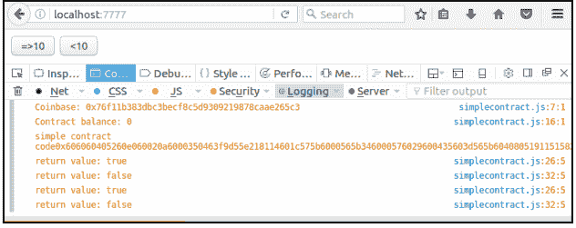

Interaction with the contract

As the values are hardcoded in the code for simplicity, two buttons have been created in index.html. Both of these buttons call functions with hardcoded values. This is just to demonstrate that parameters are being passed to the contract via web3 and values are being returned accordingly.

There are two functions being called behind the preceding buttons. The callMatchertrue() method has a hardcoded value of 12, which is sent to the contract using this:

```
simplecontractinstance.Matcher.call(12)
```

The return value is printed in the console using the following code, which first invokes the Matcher function and then assigns the value to the txn variable to be printed later in the console:

```
simplecontractinstance.Matcher.call(1)
function callMatchertrue()
{
  var txn = simplecontractinstance.Matcher.call(12);{
};
console.log("return value: " + txn);
}
```

Similarly, the callMatcherfalse() function works by passing a hardcoded value of 1 to the contract using this:

```
simplecontractinstance.Matcher.call(1)
```

The return value is printed accordingly:

```
console.log("return value: " + txn);
function callMatcherfalse()
{
  var txn = simplecontractinstance.Matcher.call(1);{
};
console.log("return value: " + txn);
}
```

This example demonstrates how the web3 library can be used to interact with the contracts on the blockchain.

## Development frameworks

There are various development frameworks now available for Ethereum. As seen in the examples discussed earlier, it can be quite time consuming to deploy the contract via the usual manual means. This is where truffle and similar frameworks such as embark can be used to make the process simpler and quicker. The most widely used framework is called truffle. In the next section, you will be introduced to the truffle framework.

## Truffle

Truffle is a development environment that makes it easier and simpler to test and deploy Ethereum contracts. Truffle provides contract compilation and linking along with an automated testing framework using Mocha and Chai. It also makes it easier to deploy the contracts to any PrivateNet, public, or Test Net Ethereum blockchain. Also, asset pipeline is provided, which makes it easier for all JavaScript files to be processed, making them ready for use by a browser.

## Installation

Before installation, it is assumed that the node is available, which can be queried as shown here. If the node is not available, then the installation of the node is required first in order to install truffle:

```
drequinox@drequinox-OP7010:~/testdapp$ nodejs --version
```

```
v7.2.1
drequinox@drequinox-OP7010:~/testdapp$ node --version
v7.2.1
```

The installation of truffle is very simple and can be done using the following command via npm:

```
$ sudo npm install -g truffle
```

This will take a while; once it is installed, truffle can be used to display help and make sure that it is installed correctly.

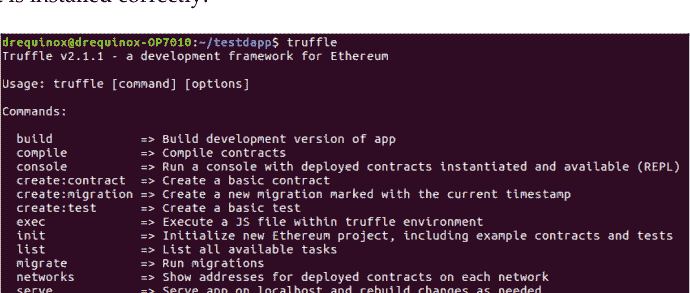

Alternatively, the repository is available at https://github.com/ConsenSys/truffle, which can be cloned locally to install truffle. Git can be used to clone the repository using the following command:

```
https://github.com/ConsenSys/truffle.git
```

## Initializing truffle

Truffle can be initialized by running the following command. First, create a directory for the project, for example:

```
mkdir testdapp
```

Then, change to testdapp and run the following command:

```
~/testdapp$ truffle init
```


一旦命令成功执行，它将创建此处所示的目录结构。可以使用 Linux 中的 `tree` 命令查看：

```text
drequinox@drequinox-OP7010:~/testdapp$ tree
.
├── app
│   ├── images
│   ├── index.html
│   ├── javascripts
│   │   └── app.js
│   └── stylesheets
│       └── app.css
├── contracts
│   ├── ConvertLib.sol
│   ├── MetaCoin.sol
│   └── Migrations.sol
├── migrations
│   ├── 1_initial_migration.js
│   └── 2_deploy_contracts.js
├── test
│   └── metacoin.js
└── truffle.js
7 directories, 10 files
```

此命令会创建四个主要目录，名称分别为 `app`、`contracts`、`migrations` 和 `test`。如前面的示例所示，总共创建了 7 个目录和 10 个文件。在接下来的部分中，将对所有这些文件和目录进行解释。

- **App：** 此目录包含所有应用程序文件，包括 HTML 文件、图片、样式表和 JavaScript 文件。此文件夹还包含进一步的子目录：images、javascripts 和 stylesheets，它们分别存放相关的应用程序文件。
- **Contracts：** 此目录包含 Solidity 合约源代码文件。truffle 在迁移时会在此处查找 Solidity 合约文件。
- **Migration：** 此目录包含所有部署脚本。
- **Test：** 顾名思义，此目录包含应用程序和合约的相关测试文件。

最后，truffle 配置存储在 `truffle.js` 文件中，该文件创建在运行 `truffle init` 的项目根文件夹中。当运行 `truffle init` 时，它会创建一个名为 MetaCoin 的示例项目。作为示例，你首先会学习如何使用 truffle 中的各种命令来测试和部署 MetaCoin。之后，还会展示更多关于如何将 truffle 用于自定义项目的示例。

## 使用 truffle 进行编译

库和合约都可以使用 truffle 编译。合约文件的名称应与文件中的合约名称保持一致。例如，在之前创建的示例 MetaCoin 项目中，`contracts` 目录下名为 `MetaCoin.sol` 的文件与文件中的 MetaCoin 合约同名。这也适用于库文件，并且是区分大小写的。

- 文件名：

  `MetaCoin.sol`

- 文件中的合约名称：

  ```
  contract MetaCoin {
      mapping (address => uint) balances;
  }
  ```

可以按如下方式运行编译：

```
~/testdapp$ truffle compile
Compiling ConvertLib.sol...
Compiling MetaCoin.sol...
Compiling Migrations.sol...
Writing artifacts to ./build/contracts
~/testdapp$
```

编译成功完成后，所有对象都将被写入 `build` 目录。输出目录的结构如下所示：

```
~/testdapp$ tree build/
build/
└── contracts
    ├── ConvertLib.sol.js
    ├── MetaCoin.sol.js
    └── Migrations.sol.js
1 directory, 3 files
```

如前面的示例所示，`build` 目录会自动创建，其中包含 `contracts` 子目录，该子目录下有三个 JavaScript 文件。

## 迁移

这是 truffle 将合约部署到区块链的过程。此过程依赖于 `migrations` 目录下的文件。其工作流程如下所示：

```text
~/testdapp$ cd migrations/
~/testdapp/migrations$ ls -ltr
-rw-rw-r-- 1 drequinox drequinox 124 Dec 12 12:57 2_deploy_contracts.js
-rw-rw-r-- 1 drequinox drequinox  72 Dec 12 12:57 1_initial_migration.js
~/testdapp/migrations$ cat 2_deploy_contracts.js
module.exports = function(deployer)
{
  deployer.deploy(ConvertLib);
  deployer.autolink();
  deployer.deploy(MetaCoin);
};
drequinox@drequinox-OP7010:~/testdapp/migrations$ cat 1_initial_migration.js
module.exports = function(deployer)
{
  deployer.deploy(Migrations);
};
```

如前面的输出所示，有两个文件包含指定需要部署哪些合约的代码。

文件名遵循一个约定：必须以数字作为前缀。这个前缀是必需的，以便记录所有迁移。文件名中的后缀可以是任何描述性名称。首先，重要的是修改 `truffle.js` 文件，以便指向正确的网络。`truffle.js` 文件包含有关应用程序构建和 RPC 的重要信息。在此例中，`geth` 已经在运行，只需让它指向可用的客户端即可：

```javascript
module.exports = {
  build: {
    "index.html": "index.html",
    "app.js": [
      "javascripts/app.js"
    ],
    "app.css": [
      "stylesheets/app.css"
    ],
    "images/": "images/"
  },
  rpc: {
    host: "localhost",
    port: 8001
  }
};
```

首先，列出所有账户以查看全部账户，然后选择需要解锁的账户。Truffle 默认使用 coinbase 账户。按如下方式选择合适的账户：

```
> personal.listAccounts
["0x76f11b383dbc3becf8c5d9309219878caae265c3",
"0xcce6450413ac80f9ee8bd97ca02b92c065d77abc"]
```

可以使用以下命令解锁账户：

```
> personal.unlockAccount("0x76f11b383dbc3becf8c5d9309219878caae265c3")
Unlock account  0x76f11b383dbc3becf8c5d9309219878caae265c3
Passphrase:
true
```

账户解锁后，可以使用以下命令再次运行迁移：

```
~/testdapp$ truffle migrate
```

它将显示出类似下面的输出。需要注意的是，必须启动挖矿才能完成迁移。迁移会通过查找 migrations 目录中的可用文件来执行各种步骤。如示例所示，`1_initial_migration.js` 和 `2_deploy_contracts.js` 已用于向 truffle 提供迁移步骤和要求：

```
Running migration: 1_initial_migration.js
  Deploying Migrations...
  Migrations: 0xf444cce0cee00cab4d04bcfc0005626b8b02add8
  Saving successful migration to network...
  Saving artifacts...
Running migration: 2_deploy_contracts.js
  Deploying ConvertLib...
  ConvertLib: 0x2ba8a4a75a6b845bf482923cff29ecc98cd68d90
  Linking ConvertLib to MetaCoin
  Deploying MetaCoin...
  MetaCoin: 0x0be9c5de978fa927b93a5c4faab31312cea5704a
  Saving successful migration to network...
  Saving artifacts...
~/testdapp$
```

命令成功完成后，它将返回命令提示符，并显示“saving artifacts”的消息。

可以使用 geth JavaScript 控制台中的几个命令来验证部署：

```
> eth.getBalance("0x0be9c5de978fa927b93a5c4faab31312cea5704a")
0
> eth.getCode("0x0be9c5de978fa927b93a5c4faab31312cea5704a")
"0x606060405260e060020a60003504637bd703e8811461003457806390b98a1114610056578063f8b2cb4f1461007d575b610000565b346100005761004460043561009f565b60408051918252519081900360200190f35b34610000576100696004356024356101195b565b604080519115158252519081900360200190f35b346100005761006100446004356101b1565b60408051918252519081900360200190f35b6000732ba8a4a75a6b845bf482923cff29ecc98cd68d906396e4ee3d6100c4846101b1565b60026000604051602001526040518360e060020a028152600401808381526020018281526020019250505060206040518083038186803b156100005760325a03f415610000575050604051519150505b919050565b600160a060020a033316600090815260208190526090205482901015616101425750560000610a1b565b600160a060020a0600020a03381260008181526020818152604080832080548890039055938716808352918490208054870190558351868152935191937fddf252ad1be2c89b69c2b068fc378daa952ba7f163c4a11628f55a4df523b3ef929081900390910190a35060015b92915050565b600160a060020a0381166000908152602081905260409020545b91905056"
```

请注意，新部署合约的地址取自之前显示的 `truffle migrate` 命令输出。（MetaCoin: 0x0be9c5de978fa927b93a5c4faab31312cea5704a）

- **与合约交互：** Truffle 还提供了一个控制台（命令行界面），允许与合约进行交互。所有已部署的合约在控制台中都已经实例化并可以直接使用。这是一个基于 REPL 的界面，REPL 代表读取（Read）、求值（Evaluate）和打印循环（Print Loop）。类似地，在 geth 客户端中（通过 attach 或 console），通过暴露 **JSRE（JavaScript 运行时环境）** 来使用 REPL。可以通过发出以下命令访问控制台：

  ```
  ~/testdapp$ truffle console
  ```

这将打开一个命令行界面，如下所示：


Truffle 控制台


一旦控制台可用，就可以在其中运行各种方法来查询合约。可以通过输入以下命令并使用 Tab 补全来显示方法列表：

```
dreguinox@dreguinox-OP7010:~/testdapp$ truffle console
truffle(default)> MetaCoin.
MetaCoin.__defineGetter__      MetaCoin.__defineSetter__      MetaCoin.__lookupGetter__      MetaCoin.__lookupSetter__
MetaCoin.__proto__             MetaCoin.constructor           MetaCoin.hasOwnProperty        MetaCoin.isPrototypeOf
MetaCoin.propertyIsEnumerable  MetaCoin.toLocaleString        MetaCoin.toString             MetaCoin.valueOf

MetaCoin.apply                 MetaCoin.arguments             MetaCoin.bind                 MetaCoin.call
MetaCoin.caller                MetaCoin.length                MetaCoin.name

MetaCoin.abi                   MetaCoin.address               MetaCoin.all_networks         MetaCoin.at
MetaCoin.binary                MetaCoin.checkNetwork          MetaCoin.class_defaults       MetaCoin.contract_name
MetaCoin.currentProvider       MetaCoin.defaults              MetaCoin.deployed             MetaCoin.events
MetaCoin.extend                MetaCoin.generated_with        MetaCoin.link                 MetaCoin.links
MetaCoin.network_id            MetaCoin.networks              MetaCoin.new                  MetaCoin.next_gen
MetaCoin.prototype             MetaCoin.setNetwork            MetaCoin.setProvider          MetaCoin.unlinked_binary
MetaCoin.updated_at            MetaCoin.web3
```

## 暴露的方法

还可以通过其他方法与合约进行交互；例如，为了检索合约地址，可以在 truffle 控制台中调用以下方法：

```
truffle(default)> MetaCoin.deployed().address
'0x0be9c5de978fa927b93a5c4faab31312cea5704a'
truffle(default)>
```

- 查询合约余额：

```
truffle(default)>
MetaCoin.deployed().getBalance.call(web3.eth.accounts[0])
{ [String: '8750'] s: 1, e: 3, c: [ 8750 ] }
```

输出返回一个字符串，值为 8750。

- 转账余额：

```
truffle(default)>
MetaCoin.deployed().sendCoin("0xcce6450413ac80f9ee8bd97ca02b92c065d77abc",50, {from:"0x76f11b383dbc3becf8c5d9309219878caae265c3"})
'0xb8969149fcfb54ec9beac31af1fc86c386f9aa42cb13d2eb9bf9469931986e0f'
```

这将返回交易的哈希值，并且在成功时，会导致目标余额增加 50。目标账户是传递给 sendCoin 函数的参数。

- **目标账户余额：** 可以使用以下命令检索：

```
truffle(default)> 
MetaCoin.deployed().getBalance.call(web3.eth.accounts[1])
{ [String: '1250'] s: 1, e: 3, c: [ 1250 ] }
truffle(default)>
```

要退出 truffle 控制台，使用 .exit 命令。

# 使用 truffle 进行测试

测试是 truffle 的一项强大功能，可以通过运行以下命令调用：

```
~/testdapp$ truffle test
```

这将从 test 目录读取测试并相应地执行测试。truffle 使用的测试框架称为 Mocha，并且使用名为 Chai 的断言框架。

下面显示了一个示例测试运行。此测试仅运行两个测试。在原始文件中，有三个测试，但为简单起见，这里仅使用两个。此外，测试可能在大多数系统上失败；因此，为简单起见，它已从文件中删除。失败的测试用例将在后面讨论。另外，应注意，测试运行需要进行挖矿。

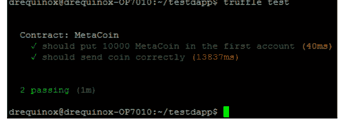

显示两个成功测试的 Truffle 测试输出

这两个测试基于 truffle init 生成的文件。在以下文件中，仅出于简化目的显示了一个测试，当 truffle 为默认的 MetaCoin 项目创建三个测试时。可以通过在文本编辑器中编辑 metacoin.js 文件从文件中删除测试：

```
contract('MetaCoin', function(accounts)
{
  it("should put 10000 MetaCoin in the first account",
  function()
  {
    var meta = MetaCoin.deployed();
    return meta.getBalance.call(accounts[0]).then(function(balance)
    {
      assert.equal(balance.valueOf(), 10000, "10000 wasn't in the first account");
    });
  });
});
```

所有测试文件都必须位于项目目录下的 tests 目录中。测试在 it 块内指定。

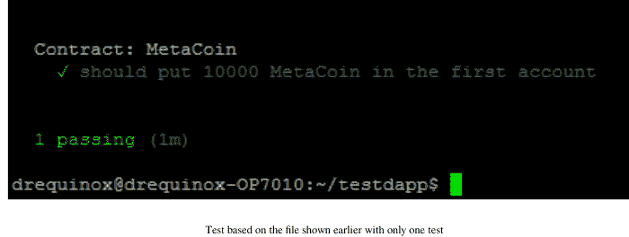

基于前面显示的文件的测试，仅包含一个测试

在前面的测试用例中，当合约时，它应该在其中有 10000 的余额。此测试基本上测试部署合约后是否可用 10000 的余额。为了说明概念，可以模拟错误，例如，如果 metacoin.js 文件通过更改断言：

```
assert.equal(balance.valueOf(), 10000, "10000 wasn't in the first account");
```

改为

```
assert.equal(balance.valueOf(), 1000, "10000 wasn't in the first account");
```

可以通过发出以下命令启动构建：

```
~/testdapp$ truffle build
```

一旦构建完成，如果尚未存在，将创建 build 目录，并将创建与此处所示类似的树结构。这是基于 truffle.js 文件创建的：

```
build/
├── app.css
├── app.js
├── contracts
│   ├── ConvertLib.sol.js
│   ├── MetaCoin.sol.js
│   └── Migrations.sol.js
├── images
└── index.html
```

一旦构建成功完成，所有前端文件都将准备就绪。然后可以使用 truffle 的 serve 命令在浏览器中查看。serve 命令创建 Web 服务器以呈现 HTML 内容。命令可以按如下所示运行。

请注意，命令使用 -p 标志指定端口 TCP 7777。这是因为在前面提供的示例中，geth 使用 --rpccorsdomain 'http://localhost:7777' 选项运行。这意味着只有通过 TCP 7777 提供的内容才被允许。默认情况下，serve 在端口 8080 上运行，该端口可能已被系统上的其他进程使用，因为 TCP 8080 是 Web 应用程序常用的端口。

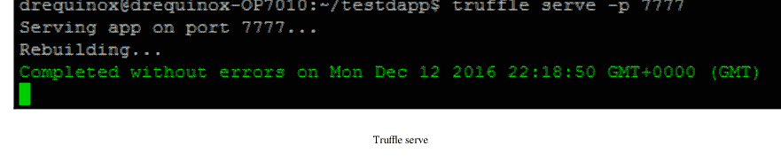

一旦 truffle 服务器在适当的端口上启动并运行，就可以使用浏览器浏览内容并指向 URL http://localhost:7777。

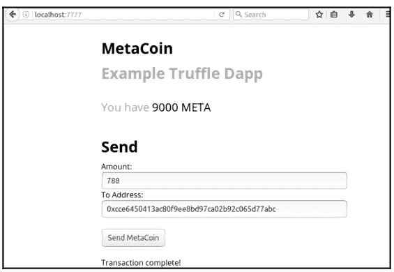

# 另一个示例

这里展示了一个示例，其中使用 migrations 和 tests 创建了一个简单的 solidity 合约。合约非常简单，仅执行加法：

- 1. 创建一个名为 `simpleTest` 的目录：
- $ mkdir simpleTest
- 2. 初始化 truffle：
- $ truffle init
- 3. 从目录中删除文件。这是为了删除 truffle 创建的默认 MetaCoin 项目文件。
- rm -r test/* contracts/* migrations/*
- 4. 将两个文件 `Addition.sol` 和 `Migrations.sol` 放在 contracts 目录中：

Addition.sol:

```
pragma solidity ^0.4.2; 
contract Addition 
{ 
uint8 x;
```

```
function addx(uint8 y, uint8 z )
{
    x = y + z;
}
function retrievex() constant returns (uint8)
{
    return x;
}
Migrations.sol:
pragma solidity ^0.4.2;
contract Migrations
{
    address public owner;
    uint public last_completed_migration;
    modifier restricted()
    {
        if (msg.sender == owner) _;
    }
    function Migrations()
    {
        owner = msg.sender;
    }
    function setCompleted(uint completed) restricted
    {
        last_completed_migration = completed;
    }
    function upgrade(address new_address) restricted
    {
        Migrations upgraded = Migrations(new_address);
        upgraded.setCompleted(last_completed_migration);
    }
}
```

5. 将 Addition.js 文件放在 test 目录中：

```
contract('Addition', function(accounts)
{
    it(" 100 + 100 = 200 ", function()
    {
    var AddContract = Addition.deployed();
    AddContract.addx(100, 100,{from:accounts[0],gas:1000000})
    .then(function(a)
    {
    return AddContract.retrievex.call().then(function(Result)
    {
    assert.equal(Result, 200, "100 + 100 = 200 is expected");
    });
    });
```


6. 在 migrations 文件夹中，放置两个文件：

```
1_initial_migration.js:
module.exports = function(deployer)
{
  deployer.deploy(Migrations);
};
```

```
2_deploy_contracts.js:
module.exports = function(deployer)
{
  deployer.deploy(Addition);
  deployer.autolink();
};
```

7. 一旦所有文件就位，使用 truffle compile 编译所有合约。可选地，使用 --compile-all 标志以便即使合约已经编译过也重新编译合约。这仅在合约需要重新编译时才需要：

```
~/simpleTest$ truffle compile
Compiling Addition.sol...
Compiling Migrations.sol...
Writing artifacts to ./build/contracts
```

8. 使用 truffle migrate 迁移到以太坊测试网络。这将把合约部署到网络上。请注意，此时 truffle.js 需要再次更新为端口 8001 以指向私有网络：

```
~/simpleTest$ truffle migrate
Running migration: 2_deploy_contracts.js
Deploying Addition...
  Addition: 0x73934227alce7fc44152b7451626759a00b0275c
Saving successful migration to network...
Saving artifacts...
```

最后，可以使用以下命令执行测试。这些测试基于前面所示的 Addition.js 文件：

```
~/simpleTest$ truffle test
```

## 示例项目：概念验证

该程序背后的想法是提供一项服务来对文档进行公证。这随后可以用作证明，在过去的某个时间，索赔人已访问过某条特定信息。这对于专利文件非常有用。例如，如果有人想出了一个想法，他或她可以创建该文档的哈希并将其保存在区块链上。由于区块链的不可变性，它可以作为永久证明，证明某个想法（文档）在某个时间点存在。实现这一目标的方法有很多，但核心思想相同，其工作原理是哈希函数为文本或文档提供摘要，并且是唯一的。

这可以通过多种方式实现；关键思想是创建文档或文本字符串的哈希并将其保存在区块链上。一旦文本被哈希并保存，后续保存相同文本的请求可以通过将文档的哈希与已存储的哈希进行比较来禁止。

对于此示例，将使用浏览器 solidity、truffle 和 TestNet（已运行 Network ID 786，之前创建）。首先，将编写合约的代码。这可以使用任何合适的文本编辑器或集成开发环境来完成。也可以使用浏览器 solidity，因为它也提供了测试的模拟环境。此示例将为您提供机会学习如何将合约项目从一个想法开发成 solidity 合约源代码并最终部署。

让我们逐行查看代码：

```
pragma solidity ^0.4.0;
```

此语句确保最低编译器版本为 0.4.0，最大版本不能大于 0.4.9。这确保了程序之间的兼容性：

```
contract PatentIdea {
```

此语句以名为 PatentIdea 的合约开始：

```
mapping (bytes32 => bool) private hashes;
```

接下来，定义了一个映射，将 byte32 映射到布尔值，这基本上是一个哈希映射（字典），将 bytes32 映射到布尔值：

```
bool alreadyStored;
```

这是一个名为 alreadyStored 的变量声明，其类型为布尔，可以具有 true 或 false 值。此变量用于保存来自 SaveIdeaHash 函数的返回值：

```
event ideahashed(bool);
```

还声明了一个事件，将用于捕获哈希函数（SaveIdeaHash）的失败或成功。当事件被触发时，它将返回 true 或 false 布尔值。

声明了一个名为 saveHash 的函数，它以 bytes32 类型的 hash 变量作为参数并将其保存在哈希映射中。这将导致合约状态发生变化。请注意，函数的访问权限已更改为 private，因为它仅在合约内部需要，不需要公开暴露：

```
function saveHash(bytes32 hash) private
{
    hashes[hash] = true;
}
```

声明了另一个函数 saveIdeaHash，它接受 idea 变量，类型为 string，并根据函数执行结果返回布尔值（true 或 false）：

```
function SaveIdeaHash(string idea) returns (bool)
{
    var hashedIdea = HashtheIdea(idea);
    if (alreadyHashed(HashtheIdea(idea)))
    {
        alreadyStored=true;
        ideahashed(false);
        return alreadyStored;
    }
    saveHash(hashedIdea);
    ideahashed(true);
}
```

此函数声明了一个变量 hashedIdea，其值在调用稍后描述的 HashtheIdea 函数后分配。请注意，如果保存成功，此函数也可以返回值，但这里为了简单起见未显示。

下一个函数是 alreadyHashed 函数，它被声明为接受名为 hash 的 bytes32 类型变量，并在哈希映射中检查哈希后返回布尔值（true 或 false）。它再次被声明为 constant，访问权限设置为 private：

```
function alreadyHashed(bytes32 hash) constant private returns(bool)
{
    return hashes[hash];
}
```

下一个函数是 isAlreadyHashed，它检查想法是否已被哈希。它接受输入参数 idea，类型为 string，也被声明为 constant，这意味着它不能更改合约状态，并根据已命名为 alreadyHashed 的函数执行结果返回 true 或 false。此函数随后调用前面描述的 alreadyHashed 函数，以从 hashes 映射中检查哈希是否已存储在其中。这意味着相同的字符串（想法）已被哈希并存储（专利）：

```
function isAlreadyHashed(string idea) constant returns (bool)
{
    var hashedIdea = HashtheIdea(idea);
    return alreadyHashed(hashedIdea);
}
```

最后，显示了 HashtheIdea 函数，它接受 idea 变量，类型为 string，且为 constant 类型，这意味着它不能更改合约状态。它也被声明为 private，因为没有必要公开此函数，因为它仅在合约内部使用。此函数返回 bytes32 类型值：

```
function HashtheIdea(string idea) constant private returns (bytes32) {
    return sha3(idea);
}
```

此函数调用 solidity 的内置函数 sha3 并将字符串传递给它，存储在 idea 变量中。此函数返回字符串的 sha3 哈希。sha3 函数是 solidity 中 keccak256() 函数的别名，它计算传递给它的字符串的 Keccak-256 哈希。请注意，这不是 NIST 标准 SHA-3；相反，它是 Keccak-256，即提交给 NIST 参加 SHA-3 标准竞赛的原始提案。后来它被略微修改并由 NIST 标准化为 SHA-3 标准。实际的 SHA-3 标准哈希函数返回的哈希与 Keccak-256（以太坊的 sha3 函数）不同。

完整的合约源代码如下所示：

```
pragma solidity ^0.4.0;
contract PatentIdea
{
    mapping (bytes32 => bool) private hashes;
    bool alreadyStored;
    event ideahashed(bool);
    function saveHash(bytes32 hash) private
    {
        hashes[hash] = true;
    }
    function SaveIdeaHash(string idea) returns (bool)
```

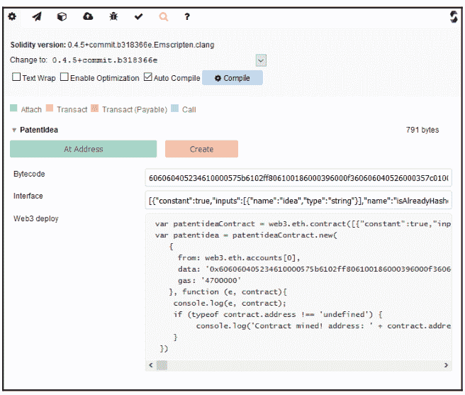

Create contract using browser solidity

点击 Create 后，合约中的两个函数将被公开，如以下屏幕截图所示：

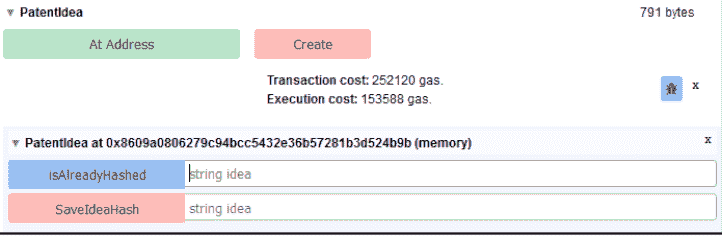

Relevant costs and exposes two methods

现在可以按以下示例调用函数：

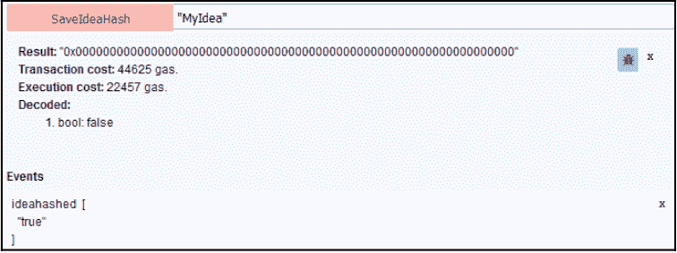

Invoking the SaveIdeaHash function

同样，可以调用 isAlreadyHashed。

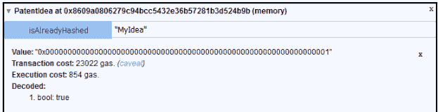

Execute function isAlreadyHashed

如果再次将相同的字符串传递给函数，它将不会被保存，如以下屏幕截图所示：

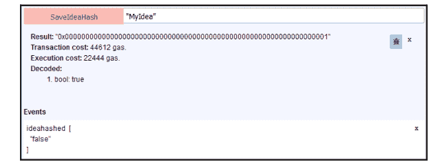

Execute function SaveIdeaHash

另外，请注意事件已返回 false，表明哈希无法保存，并且函数返回了 true，进一步表明相同的哈希已被保存。


一旦合约在浏览器 Solidity 中编写并模拟完成，下一步就是使用 Truffle 初始化一个新项目，并在 PrivateNet（ID 786）上部署和测试它，该网络已在前面的章节中创建。

第一步是为项目创建一个单独的目录：

```
~$ mkdir ideapatent
~$ cd ideapatent/
```

下一步是初始化 Truffle 并创建一个新项目：

```
~/ideapatent$ truffle init
```

创建示例项目后，删除示例合约：

```
~/ideapatent/contracts$ rm MetaCoin.sol ConvertLib.sol
```

在 contracts 文件夹下，创建一个名为 PatentIdea.sol 的文件，并将前面所示的源代码放入该文件中。

编辑 truffle.js 以指向 localhost HTTP 端点：

```
rpc:
  {
    host: "localhost",
    port: 8001
  }
```

在 ~/ideapatent/migrations 文件夹下，编辑 2_deploy_contracts.js 文件，使其如下所示：

```
module.exports = function(deployer)
{
  deployer.deploy(PatentIdea);
  deployer.autolink();
};
```

此文件被更改是为了指定要部署的合约的名称。请注意 `deployer.deploy(PatentIdea);`。

接下来，使用 Truffle 运行编译，如下所示：

```
~/ideapatent$ truffle compile
Compiling Migrations.sol...
Compiling PatentIdea.sol...
Writing artifacts to ./build/contracts
```

## Oracles

如第 6 章《智能合约》所述，Oracle 是智能合约的现实世界数据源。有各种服务可用于为智能合约提供 Oracle。其中一个相当突出的服务是 Oraclize，可在 http://www.oraclize.it/ 获取。如果智能合约需要例如来自第三方来源的实时价格或任何其他现实生活数据，例如特定城市的天气状况，这就特别有用。在许多用例中，Oracle 可以为智能合约提供可信的数据源，以便它们能够根据现实生活事件做出决策。Oraclize 使智能合约更容易访问互联网以获取所需数据。

为了在以太坊上使用 Oraclize，需要向 Oraclize 合约发送一笔交易，并附带适当的付款和查询。作为结果，Oraclize 将根据请求交易中提供的查询检索结果并将其发送回合约地址。一旦交易发送回合约，回调方法或后备函数将被调用。

在 Solidity 的实际层面上，首先需要导入 Oraclize 库，然后就可以使用从中继承的所有方法。目前，Oraclize 仅可用于 PrivateNet（Ropsten）和以太坊区块链的实时主网。

Oraclize 处理过程可视化如下图所示：

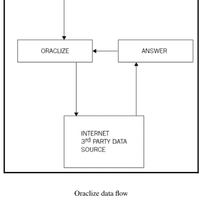

使用 Oraclize 的 Solidity 合约的骨架结构如下所示。请注意，导入仅在 Oraclize 在 Web 上提供的开发环境中有效；通常，此文件需要手动导入：

```
import "dev.oraclize.it/api.sol";
contract MyOracleContract is usingOraclize
{
function MyOracleContract() {
}
```

一个示例请求如下所示：

```
oraclize_query("URL", "api.somewebsite.net/price?stock=XYZ");
```

Oraclize 还可以利用 TLS 公证以确保馈送是安全且可证明诚实的。

## 使用 IPFS 进行去中心化存储部署

如第 1 章《区块链 101》所述，为了充分受益于去中心化平台，希望您能够去中心化存储和通信层。传统上，网络内容通过集中式服务器提供，但该部分也可以使用分布式文件系统进行去中心化。

前面示例中显示的 HTML 内容可以存储在分布式和去中心化的 IPFS 网络上，以实现增强的去中心化。

IPFS 可在 https://ipfs.io/ 获取。

### 安装 IPFS

可以通过以下流程安装 IPFS：

1. 使用以下命令下载 IPFS 包：

   ```
   $ curl https://dist.ipfs.io/go-ipfs/v0.4.4/go-ipfs_v0.4.4_linux-amd64.tar.gz -O
   ```

2. 解压缩 gz 文件：

   ```
   $ tar xvfz go-ipfs_v0.4.4_linux-amd64.tar.gz
   ```

3. 将 ipfs 文件移动到适当的路径中以使其在路径中可用：

   ```
   $ mv go-ipfs/ipfs /usr/local/bin/ipfs
   ```

4. 初始化 IPFS 节点：

   ```
   imran@drequinox-OP7010:~$ ipfs init
   initializing ipfs node at /home/imran/.ipfs
   generating 2048-bit RSA keypair...done
   peer identity: Qmbc726pLS9nUQjUbeJUXcFXAGaXPD41jAszXniChJz62
   to get started, enter:
       ipfs cat /ipfs/QmYwAPJzv5CzsnA625s3Xf2nemtYgPpHdWEz79ojWnPbdG/readme
   ```

5. 输入以下命令以确保 IPFS 已成功安装：

   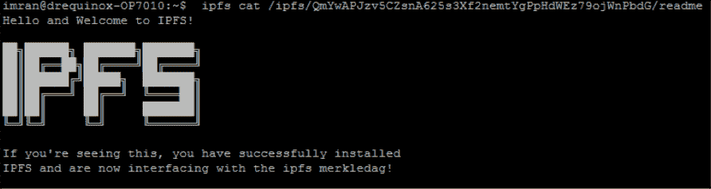

   成功安装 IPFS

6. 启动 IPFS 守护进程：

   ```
   imran@drequinox-OP7010:~$ ipfs daemon
   Initializing daemon...
   Swarm listening on /ip4/127.0.0.1/tcp/4001
   Swarm listening on /ip4/192.168.0.17/tcp/4001
   Swarm listening on /ip4/86.15.44.209/tcp/4001
   Swarm listening on /ip4/86.15.44.209/tcp/41608
   Swarm listening on /ip6/::1/tcp/4001
   API server listening on /ip4/127.0.0.1/tcp/5001
   Gateway (readonly) server listening on /ip4/127.0.0.1/tcp/8080
   Daemon is ready
   ```

7. 使用以下命令将文件复制到 IPFS：

   ```
   ~/sampleproject/build$ ipfs add --recursive --progress .
   added QmVdyD1yuqcf32e8NhMVEWSuMfyvcj17w3DkUt6BgeAtx7 build/app.css
   added QmSypiNEiUx6Sq7moAVCsgQhSY3Bh9ziwXJaxqSG5Pcp build/app.js
   added QmaJWMjD767GvuwuaIpt5tck9dTVCZPJa9sDcr8vdcJ8pY build/contracts/ConvertLib.sol.js
   added QmQdz9eG2Qd5kwaU86kWebDGPqXBWj1Dmv9MN4BRzt2srf build/contracts/MetaCoin.sol.js
   added QmWpvBjXTP4HutEsYUh3JLD18VYp73SKNJi4aX1T6jwcmG build/contracts/Migrations.sol.js
   added QmQs7j6NpA1NMueTXKyswLaHKq3XDUCRay3VrC392Q4JDK build/index.html
   added QmPvWzyTEfLQnozDTfgdAAF4W9BUB2cDq5KUUrpHrukseA build/contracts
   added QmUNLLsPACCZ1vLxQVkXqqLX5R1X345qqfHbsf67hva3Nn build/images
   added QmSxpucr6J9rX3XQ3MBG8cVzLCrQFFKmMkTmpcNpjbtf3j build
   ```

8. 现在可以在浏览器中按如下方式访问它：

   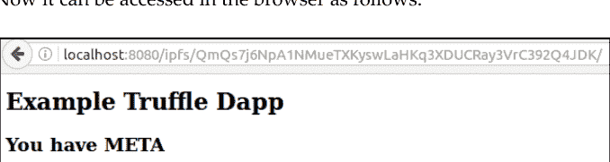

   通过 IPFS 访问网页的浏览器

   请注意，URL 指向 IPFS 文件系统。

9. 最后，为了使更改永久化，可以使用以下命令：

   ```
   /build$ ipfs pin add QmSxpucr6J9rX3XQ3MBG8cVzLCrQFFKmMkTmpcNpjbtf3j
   pinned QmSxpucr6J9rX3XQ3MBG8cVzLCrQFFKmMkTmpcNpjbtf3j recursively
   ```

前面的示例演示了如何使用 IPFS 为智能合约的网络部分（用户界面）提供去中心化存储。

IPFS 还可以以另一种方式与区块链一起使用。由于存储是区块链的一个大问题，希望能够将大量数据保存在其他地方并将指向该数据的链接放在区块链交易中。这样，就无需在区块链上存储大量数据，从而导致其膨胀。IPFS 可以通过将数据放在 IPFS 上，然后在区块链交易中存储 IPFS 链接以引用存储的数据来实现这一点。

以太坊自己的 Swarm 协议也在大力开发中，其工作原理类似。然而，Swarm 目前仍在开发中，而 IPFS 相比之下更为成熟，目前似乎是更好的选择。IPFS 工作得非常好，很可能成为部署去中心化存储的首选平台。Swarm 允许用户通过在其上存储所有区块链数据来运行轻客户端。这可以使用当前版本的 `geth` 实现，详细的指南可在 https://swarm-guide.readthedocs.io/en/latest/introduction.html 获取。由于该技术仍在大力开发中，这里仅对该技术进行了轻微介绍，因为它可能会非常迅速地演变。

对于以太坊中的去中心化通信，Whisper 协议提供了去中心化通信层。它将作为以太坊的基于身份的消息传递层。Swarm 和 Whisper 都被设想为 Web 3.0 的使能技术。

## 许可式分布式账本

许可式分布式账本的概念与公共区块链根本不同。分布式账本背后的关键思想是它们是有许可的，而非开放的公共区块链。DLT 不执行任何挖矿，因为所有参与者都已被审核并为网络所知，且无需挖矿来保护网络。私有许可式分布式账本上也没有数字货币的概念，因为许可式区块链的目标与公共区块链不同。在公共区块链中，访问对所有人开放，需要某种形式的激励和网络效应才能增长；相反，在许可式 DLT 中，没有此类要求。可以在以太坊的私有联盟设置中使用许可式 DLT，尤其是在现有金融系统内工作。分布式账本系统的关键优势是它们速度更快、可管理，并且可能与现有金融系统互操作。


# 摘要

本章提供了关于如何设置以太坊开发环境并创建智能合约的详细且深入的实践示例。本章首先介绍了创建私有以太坊网络以供测试和开发使用的各种方法。随后，引入了 Solidity 语言，以便你能够理解该语言的基础和语法。还详细讨论了使用 geth 和 web3 等技术和工具的实用部署技术。此外，还提供了智能合约开发和部署的详细逐步示例。此外，还通过实践示例讨论了开发框架，使你能够体验以太坊区块链的智能开发生命周期。这是一章篇幅较长的内容，通过紧跟练习，你将对以太坊上的合约开发、测试和部署获得深入的理解。最后，讨论了与去中心化存储、去中心化通信和预言机相关的各种概念和工具。鉴于以太坊及相关技术和框架正在持续且快速地发展，预计随着时间的推移，更先进的工具和技术将会演进；然而，本章讨论的基础知识可能保持不变。此外，本章无法讨论可用于以太坊的每一种工具和框架，但讨论的所有工具和技术都在主流使用中，并应为你过渡到更高级别提供坚实的基础。本章有意未讨论一些主题，例如智能合约安全、智能合约的形式化验证、云上的区块链即服务（BaaS），以及针对各种行业的智能合约特定用例。所有这些概念都将在后续章节中讨论。我希望你阅读本章的乐趣与我编写本章的乐趣一样多。
