# 9 Hyperledger（超级账本）
## Hyperledger（超级账本）

Hyperledger 不是一种区块链，但它是一个由 Linux 基金会于 2015 年 12 月发起的项目，旨在推动区块链技术。该项目是其成员的一项合作努力，旨在构建一个开源分布式账本框架，可用于开发和实施跨行业的区块链应用和系统。关键重点在于构建和运行支持全球商业交易的平台。该项目还致力于提高区块链系统的可靠性和性能。

Hyperledger 下的项目经历各个开发阶段，从**提议**到**孵化**，并晋升为**活跃**状态。项目也可以被**弃用**或处于**生命周期结束（End of Life）**状态，即不再积极开发。为了使项目能够进入孵化阶段，它必须拥有完全可用的代码库以及活跃的开发者社区。

### 项目

目前，Hyperledger 伞下有六个项目：Fabric、Iroha、Sawtooth Lake、区块链浏览器、Fabric chaintool 和 Fabric SDK Py。Corda 是最新的增加项目，预计将被添加到 Hyperledger 项目中。Hyperledger 项目目前有 100 名成员，非常活跃，拥有超过 120 名贡献者，并在全球范围内定期组织会议和演讲。

以下是所有这些项目的简要介绍，之后我们将围绕 Fabric 和 Sawtooth Lake 的设计、架构和实现提供更多细节。

# Fabric

Fabric 是由 IBM 和 **DAH (Digital Asset Holdings)** 提议的一个区块链项目。它旨在为区块链解决方案的开发提供基础，基于可插拔架构，其中各种组件（如共识算法）可以按需插入系统。它可在 https://github.com/hyperledger/fabric 获取。

# Sawtooth Lake

Sawtooth Lake 是 Intel 于 2016 年 4 月提议的一个区块链项目，其关键创新专注于通过*交易族（transaction families）*实现账本与交易的**解耦**、在多个业务领域灵活使用以及**可插拔共识**。解耦可以更精确地解释为：利用称为*交易族*的新概念，将*交易*与*共识层*解耦。交易族的使用取代了交易与账本的单独耦合，从而允许更大的灵活性、丰富的语义以及业务逻辑的无限制设计。交易遵循交易族中定义的模式和结构。Intel 还引入了一种新颖的共识算法，简称为 PoET（Proof of Elapsed Time，流逝时间证明），该算法利用**Intel 软件保护扩展（Intel's SGX）**架构的**可信执行环境（TEE）**，以提供安全且随机的领导者选举过程。它还支持许可型和无许可型设置。该项目可在 https://github.com/hyperledger/sawtooth-core 获取。

# Iroha

Iroha 是由 Soramitsu、Hitachi、NTT Data 和 Colu 于 2016 年 9 月提议的。Iroha 旨在构建一个可复用组件库，用户可以选择在基于 Hyperledger 的分布式账本上运行。Iroha 的主要目标是通过提供用 C++ 编写的可复用组件来补充其他 Hyperledger 项目，并侧重于移动开发。该项目还提出了一种名为 Sumeragi 的新型共识算法，这是一种基于链路的拜占庭容错共识算法。Iroha 可在 https://github.com/hyperledger/iroha 获取。Iroha 已提出并正在开发各种库，包括但不限于数字签名库（ed25519）、SHA-3 哈希库、交易序列化库、P2P 库、API 服务器库、iOS 库、Android 库和 JavaScript 库。

# 区块链浏览器（Blockchain explorer）

该项目旨在为 Hyperledger 构建一个区块链浏览器，可用于查看和查询区块链上的交易、块及相关数据。它还提供网络信息以及与其链码进行交互的能力。

目前还有其他两个项目处于孵化阶段：Fabric chaintool 和 Fabric SDK Py。这些项目旨在支持 Hyperledger Fabric。

# Fabric chaintool

Hyperledger 链码编译器正在开发中，以支持 Fabric 链码开发。其目标是构建一个工具，该工具读取高级 Google 协议缓冲区（Protocol Buffer）结构并生成链码。此外，它还对链码进行打包，以便可以直接部署。预计该工具将帮助开发者在开发的各个阶段，如编译、测试、打包和部署。它可在 https://github.com/hyperledger/fabric-chaintool 获取。

# Fabric SDK Py

该项目的目标是构建一个基于 Python 的 SDK 库，可用于与区块链（Fabric）进行交互。它可在 https://github.com/hyperledger/fabric-sdk-py 获取。

# Corda

Corda 是 R3 贡献给 Hyperledger 项目的最新项目。它于 2016 年 11 月 30 日开源。Corda 高度面向金融服务行业，是与金融界主要银行和机构合作开发的。在撰写本文时，它尚未在 Hyperledger 项目下进入孵化阶段。从技术上讲，Corda 不是一种区块链，但具有与区块链类似的关键特性，如共识、有效性、唯一性、不可变性和身份验证。

在本章的以下部分中，将更详细地讨论 Fabric（IBM）、Sawtooth Lake（Intel）和 Corda（R3）。

# Hyperledger 作为一种协议

Hyperledger 旨在构建一个由行业用例驱动的新区块链平台。由于社区已向 Hyperledger 项目做出了大量贡献，Hyperledger 区块链平台正在演变为一种商业交易协议。与仅针对特定类型行业或需求的早期区块链解决方案相比，Hyperledger 正在演变为一种规范，可作为构建区块链平台的参考。在下一节中，将介绍由 Hyperledger 项目发布的参考架构。由于这项工作正在持续且严格的开发中，预计会发生变化，但核心服务预计保持不变。

# 参考架构

Hyperledger 已发布一份包含参考架构的白皮书，可作为构建许可型分布式账本的指南。参考架构由两个主要组件组成：Hyperledger 服务和 Hyperledger API、SDK 和 CLI。Hyperledger 服务提供各种服务，如身份服务、策略服务、区块链服务和智能合约服务。另一方面，Hyperledger API、SDK 和 CLI 通过适当的应用程序编程接口、软件开发套件或命令行接口提供进入区块链服务的界面。此外，一个事件流，基本上是一个 gRPC 通道，贯穿所有服务。它可以接收和发送事件。事件是预定义的或自定义的。验证节点或链码可以发出事件，外部应用程序可以响应或监听这些事件。

在撰写本文时，Hyperledger 白皮书中发布的参考架构显示在下图中。Hyperledger 是一个快速变化和演变的项目，此处显示的架构预计会有一些变化。


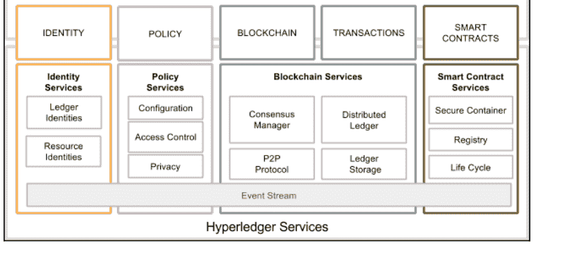

超级账本架构，如超级账本白皮书最新草案V2.0.0中所提出的。（来源：超级账本白皮书）

## 需求

区块链服务有一些特定需求。参考架构是由超级账本项目参与者提出的需求，并经过对行业用例的研究所驱动的。以下几节将讨论从行业用例研究中归纳出的几类需求。

## 模块化方法

超级账本的主要需求是模块化结构。作为一种跨行业的Fabric（区块链），预计它将被用于许多业务场景。因此，与存储、策略、链码、访问控制、共识以及许多其他区块链服务相关的功能都应该是可插拔的。这些模块应该即插即用，用户应能够轻松移除或添加满足业务需求的不同模块。

例如，如果一个业务区块链仅在已经相互信任的各方之间运行，并且执行非常基本的业务操作，那么可能不需要高级加密支持来实现机密性和隐私性，因此用户应能够移除该功能（模块），或者用更适合其需求的模块替换它。类似地，如果用户需要运行跨行业区块链，那么机密性和隐私性可能至关重要。在这种情况下，用户应能够将高级加密和访问控制机制（模块）插入区块链（Fabric）中。

## 隐私和机密性

交易和合同的隐私和机密性在业务区块链中至关重要。因此，超级账本的愿景是提供广泛的加密协议和算法，并期望用户能够根据自己的业务需求选择合适的模块。Fabric应能够处理复杂的加密算法，同时不降低性能。

## 身份

为了提供隐私和机密性服务，还需要一个灵活的PKI模型来处理访问控制功能。加密机制的强度和类型也应随用户的需求和要求而变化。在某些场景中，用户可能需要隐藏其身份，因此超级账本预计将提供此功能。

## 可审计性

可审计性是超级账本Fabric的另一项需求。预计将保留所有身份、相关操作和任何更改的不可篡改审计轨迹。

## 互操作性

目前有许多可用的区块链解决方案，但它们之间无法通信，这可能成为基于区块链的全球商业生态系统发展的限制因素。可以设想，许多区块链网络将针对特定需求在商业世界中运行，但重要的是它们能够相互通信。应该有一套所有区块链都可以遵循的共同标准，以允许不同账本之间的通信。预计将开发一种协议，允许许多Fabric之间交换信息。

## 可移植性

可移植性需求涉及无需更改任何代码即可跨多个平台和环境运行的能力。超级账本预计是可移植的，不仅在基础设施层面，而且在代码、库和API层面，以便支持在超级账本的各种实现上进行统一开发。

## Fabric

为了理解超级账本项目正在孵化的各种项目，首先理解超级账本的基础是很重要的。在读者接触更深入的材料之前，需要对一些超级账本特有的术语进行澄清。首先是Fabric的概念。

Fabric可以定义为一组组件的集合，这些组件提供一个可用于交付区块链网络的基础层。Fabric网络有各种类型和能力，但所有Fabric都具有共同属性，例如不可篡改性和共识驱动。一些Fabric可以提供构建区块链网络的模块化方法。在这种情况下，区块链网络可以有多个可插拔模块来在网络上执行各种功能。例如，共识算法可以是区块链网络中的可插拔模块，根据网络需求，可以选择合适的共识算法并插入网络。模块可以基于Fabric的某些特定规范，可以包括API、访问控制和各种其他组件。Fabric也可以设计为私有或公有，并允许创建多个业务网络。例如，比特币是一个在其Fabric（区块链网络）之上运行的应用程序。如前所述，区块链可以是许可型或非许可型，这在超级账本术语中对于Fabric也是如此。

Fabric也是IBM向超级账本基金会做出的代码贡献的名称，正式称为超级账本Fabric。IBM还通过其Bluemix云服务提供区块链即服务（IBM Blockchain）。

## 超级账本Fabric

Fabric是IBM最初向超级账本项目做出的贡献。该贡献旨在实现一种模块化、开放且灵活的区块链网络构建方法。Fabric中的各种功能是可插拔的，并且允许使用任何语言开发智能合约。这是可能的，因为它基于可以承载任何语言的容器技术。链码（智能合约）被沙箱化到一个安全容器中，该容器包括安全操作系统、链码语言、运行时环境以及Go、Java和Node.js的SDK。如果需要，还可以支持其他语言。智能合约在Fabric中被称为链码。与以太坊中的领域特定语言或比特币中非常有限的脚本语言相比，这是一个非常强大的特性。它是一个许可型网络，旨在解决可扩展性、隐私和机密性等问题。其背后的关键思想是模块化技术，允许设计和实现上的灵活性。这样可以实现可扩展性、隐私和其他期望的属性。Fabric中的交易对于一般用户来说是私有、机密和匿名的，但授权审计员仍然可以追踪并关联到用户。作为一个许可型网络，所有参与者都需要在成员服务处注册才能访问区块链网络。该账本还提供了可审计功能，以满足监管和合规需求。

## Fabric架构

Fabric在逻辑上根据所提供的服务类型分为三个主要类别。这些包括成员服务、区块链服务和链码服务。在以下部分中，将详细讨论所有这些类别和相关组件。超级账本Fabric的当前稳定版本是v0.6，但最新版本v1.0可用但尚未稳定。在1.0版本中，进行了许多架构更改，本章后面的部分也将讨论1.0版本中做出的一些更改。

## 成员服务

这些服务用于为Fabric网络的用户提供访问控制能力。以下列表显示了成员服务执行的功能：

- 1. 用户身份验证。
- 2. 用户注册。
- 3. 根据用户的角色为其分配适当的权限。

成员服务使用**公钥基础设施（PKI）**来支持身份管理和授权操作。成员服务由各种组件组成：

- **注册机构（RA）：** 一种服务，用于验证用户并评估Fabric参与者的身份，以颁发证书。
- **注册证书颁发机构：** 注册证书（Ecerts）是ECA向注册参与者颁发的长期证书，用于为参与网络的实体提供身份标识。
- **交易证书颁发机构：** 为了在网络上发送交易，参与者需要持有交易证书。TCA负责向注册证书持有者颁发交易证书，并且派生自Ecerts。
- **TLS证书颁发机构：** 为了保护Fabric上节点之间的网络级通信，使用TLS证书。TLS证书颁发机构颁发TLS证书，以确保区块链网络上各系统之间传递消息的安全。

## 区块链服务

区块链服务是超级账本Fabric的核心。此类别中的组件如下。

### 共识管理器

共识管理器负责提供共识算法的接口。它充当适配器，从其他超级账本实体接收交易，并根据所选算法类型的条件执行它们。共识是可插拔的，目前Fabric中有三种共识算法可用，即批量PBFT协议、SIEVE算法和NOOPS。


## 分布式账本

区块链和世界状态是分布式账本的两个主要元素。区块链只是一个由区块组成的链表（已在前几章介绍），而世界账本是一个键值数据库。该数据库由智能合约在交易执行期间用于存储相关状态。区块链由包含交易的区块组成。这些交易包含链码，链码运行的交易可能会导致世界状态的更新。每个节点都在 RocksDB 中将世界状态保存在磁盘上。以下图表显示了 Hyperledger Fabric 中典型的区块及其相关字段：

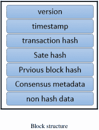

前述图表中显示的字段如下：

-   **Version：** 用于跟踪协议中的更改。
-   **Timestamp：** UTC 纪元时间的时间戳，由区块提议者更新。
-   **Transaction hash：** 该字段包含区块中交易的 Merkle 根哈希。
-   **State hash：** 这是世界状态的 Merkle 根哈希。
-   **Previous hash：** 这是前一个区块的哈希值，其是在序列化区块消息后计算得出，然后通过应用 SHA3 SHAKE256 算法创建消息摘要。
-   **Consensus metadata：** 这是一个可选字段，可由共识协议使用，以提供有关共识的一些相关信息。
-   **Non-Hash data：** 这是与区块一起存储但不参与哈希的某些元数据。此功能使得不同节点上可以拥有不同的数据。它还提供了在不影响区块链的情况下丢弃数据的能力。

## 点对点协议

Hyperledger Fabric 中的 P2P 协议是使用 **google RPC (gRPC)** 构建的。它使用协议缓冲区来定义消息的结构。

消息在节点之间传递以执行各种功能。Hyperledger Fabric 中有四种主要类型的消息：Discovery、transaction、synchronization 和 consensus。Discovery 消息在启动时在节点之间交换，以便发现网络上的其他对等节点。

交易消息可以分为两种类型：部署交易和调用交易。前者用于将新的链码部署到账本，后者用于调用智能合约中的函数。交易可以是公开的、保密的和保密链码交易。公开交易对所有参与者开放且可用。保密交易仅允许交易所有者和参与者查询。保密链码交易具有加密的链码，只能由验证节点解密。验证节点运行共识、验证交易并维护区块链。另一方面，非验证节点提供交易验证、流服务器和 REST 服务。它们还充当交易方与验证节点之间的代理。同步消息用于使对等节点保持区块链更新并与其他节点同步。共识消息用于共识管理和向验证对等节点广播负载。这些消息由共识框架内部生成。

## 账本存储

为了保存账本的状态，使用 RocksDB，并在每个对等节点上存储。RocksDB 是一种高性能数据库，可在 http://rocksdb.org/ 获取。

## 链码服务

这些服务允许创建用于执行链码的安全容器。此类别中的组件如下：

-   **Secure container：** 链码部署在 Docker 容器中，这些容器为智能合约执行提供受限制的沙箱环境。目前 Golang 是作为主要智能合约语言受支持的，但如果需要，可以添加并启用任何其他主流语言。
-   **Secure registry：** 这提供了包含智能合约的所有镜像的记录。

区块链上的事件可以由验证节点和智能合约触发。外部应用程序可以通过事件适配器监听这些事件并在需要时做出反应。它们类似于上一章中介绍的 solidity 中引入的事件概念。

## APIs 和 CLIs

应用程序编程接口通过公开各种 REST API 为 Fabric 提供接口。此外，还提供了提供 REST API 子集的命令行接口，允许快速测试和与区块链进行有限交互。

## Fabric 的组件

区块链可以包含各种组件。这些组件包括但不限于账本、链码、共识机制、访问控制、事件、系统监控和管理、钱包和系统集成组件。

## 对等节点或节点

可以在 Fabric 网络上运行的对等节点主要有两种类型：验证和非验证。简单来说，验证节点运行共识、创建和验证交易，并有助于更新账本和维护链码。

非验证对等节点不执行交易，只构建随后转发给验证节点的交易。

两个节点都管理和维护由成员服务颁发的用户证书。

## 区块链上的应用程序

Fabric 上的典型应用程序通常由一个用户界面组成，通常用 JavaScript/HTML 编写，通过 API 层与存储在账本上的后端链码（智能合约）交互。

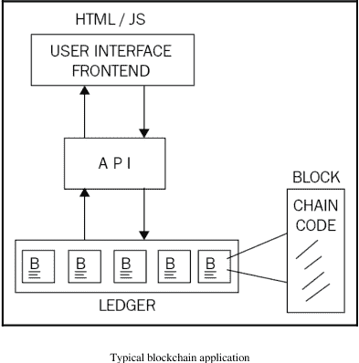

Hyperledger 提供了各种 API 和命令行接口以实现与账本的交互。这些 API 包括身份、交易、链码、账本、网络、存储和事件的接口。

### 链码实现

链码通常用 Golang 或 Java 编写。链码可以是公开的、保密的或受访问控制的。这些代码充当智能合约，用户可以通过 API 与之交互。用户可以调用链码中的函数，从而导致状态更改，进而更新账本。还有一些函数仅用于查询账本，不会导致任何状态更改。

链码实现首先在代码中创建链码 shim 接口。它可以是 Java 或 Golang 代码。实现链码所需的四个函数如下：

-   `Init()`：该函数在链码部署到账本时被调用。这会初始化链码并导致状态更改，从而相应地更新账本。
-   `Invoke()`：该函数在合约执行时使用。它将函数名作为参数以及参数数组。此函数会导致状态更改并写入账本。
-   `Query()`：该函数用于查询已部署链码的当前状态。此函数不会对账本进行任何更改。
-   `Main()`：该函数在对等节点部署其自己的链码副本时执行。链码使用此函数在对等节点上注册。

下图说明了 Hyperledger Fabric 的总体概述：

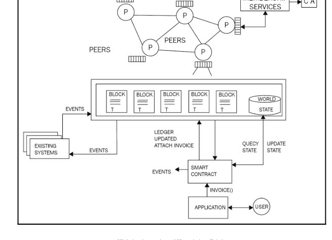

Hyperledger Fabric 的高层概述

## 应用程序模型

Hyperledger Fabric 的任何区块链应用程序都遵循 MVC-B 架构。这基于流行的 MVC 设计模式。该模型中的组件为 Model、View、Control 和 Blockchain：

-   **View logic**：这涉及用户界面。它可以是桌面、Web 应用程序或移动前端。
-   **Control logic**：这是用户界面、数据模型和 API 之间的协调器。
-   **Data model**：此模型用于管理链下数据。
-   **Blockchain logic**：这用于通过控制器和数据模型经由交易管理区块链。

由于 Hyperledger 当前版本 v0.6 正在进行大量重构以构建 V1.0，本节中未引入任何实践练习。

预计到本书出版时，有关 Hyperledger Fabric 实际设置的<|message|>信息将已过时。因此，建议读者关注 https://hyperledgerfabric.readthedocs.io/en/latest/ 的更新。

此外，IBM Bluemix 服务在其区块链即服务产品中提供区块链的示例应用程序。它可在 https://console.ng.bluemix.net/docs/services/blockchain/ibmblockchain_tutorials.html 获取。此服务允许用户在易于使用的环境中创建自己的区块链网络。

## Sawtooth lake

Sawtooth lake 可以在许可和非许可模式下运行。它是一种分布式账本，提出了两个新颖的概念：第一个是引入一种名为 **Proof of Elapsed Time (PoET)** 的新共识算法；第二个是交易家族的概念。这些新颖提案的简要描述在以下部分给出。


## PoET

PoET 是一种新颖的共识算法，它允许节点基于节点在提出区块之前等待的时间随机被选中。这与其它基于领导者选举和彩票的权益证明工作算法不同，后者在被选为区块提议者时使用大量电力和计算机资源，例如比特币的情况。PoET 是一种权益证明工作算法，但它不是消耗计算机资源，而是使用可信计算模型来提供满足权益证明工作要求的机制。PoET 利用英特尔的 SGX 架构提供可信执行环境，以确保过程的随机性和密码学安全性。需要注意的是，Sawtooth Lake 当前的实现并不需要基于真实硬件 SGX 的 TEE，因为它仅用于实验目的进行模拟，因此不应在生产环境中使用。

## 交易家族

传统的智能合约范式提供了一种基于通用指令集的解决方案，适用于所有领域。例如，在以太坊的情况下，已为以太坊虚拟机（EVM）开发了一组操作码，可用于构建智能合约以满足任何行业任何类型的需求。虽然该模型有其优点，但很明显这种方法并不安全，因为它提供了一个单一的接口进入账本，并使用一种功能强大且表达力强的语言，这可能为恶意代码提供更大的攻击面。这种复杂性和通用虚拟机范式导致最近被黑客发现并利用的多个漏洞。最近的一个例子是 DAO 攻击以及进一步的拒绝服务（DoS）攻击，这些攻击利用了某些 EVM 操作码的限制。以下模型描述了传统的智能合约模型，其中通用虚拟机被用于为所有领域提供进入区块链的接口：

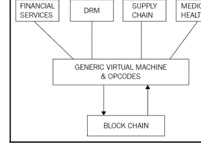

为了解决这个问题，Sawtooth Lake 提出了交易家族的概念。交易家族是通过将逻辑层分解为特定领域的 *规则集* 和 *组合层* 而创建的。关键思想是业务逻辑是在 *交易家族* 中组合的，这提供了一种更安全、更强大的构建智能合约的方式。交易家族包含特定领域的规则和另一层，允许为该领域创建交易。另一种看待方式是，交易家族是数据模型和实现特定领域逻辑层的交易语言的组合。数据模型代表区块链（账本）的当前状态，而交易语言则修改账本的状态。预计用户将根据其业务需求构建自己的交易家族。

以下图表表示该模型，其中每个特定领域，如金融服务、**数字版权管理（DRM）**、供应链和医疗行业，都有自己的逻辑层，由特定于该领域的操作和服务组成。这使得逻辑层同时具有限制性和强大性。交易家族确保控制逻辑中仅存在与所需领域相关的操作，从而消除了执行不必要、任意且可能有害操作的可能性。

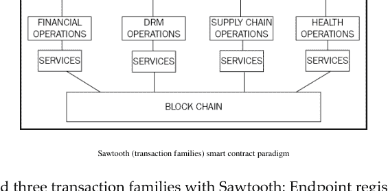

Sawtooth（交易家族）智能合约范式

英特尔随 Sawtooth 提供了三个交易家族：Endpoint registry、IntegerKey 和 MarketPlace。

- 1. **Endpoint registry** 用于注册账本服务。
- 2. **IntegerKey** 用于测试已部署的账本。
- 3. **MarketPlace** 用于销售、购买和交易操作和服务。

`Sawtooth_bond` 已被开发为概念验证，以展示债券交易平台。它可在 https://github.com/hyperledger/sawtooth-core/tree/master/extensions/bond 获取。

## Sawtooth 中的共识

Sawtooth 根据网络选择具有两种类型的共识机制。PoET，如前所述，是一种基于可信执行环境的彩票函数，基于节点等待区块提议的时间随机选举领导者。另一种共识类型称为法定投票，它是 Ripple 和 Stellar 构建的共识协议的改编。该共识算法允许即时交易终局性，这在许可网络中通常是理想的。

## 开发环境

本节简要介绍如何为 Sawtooth Lake 设置开发环境。设置开发环境需要一些先决条件。本节中的示例假设运行 Ubuntu 系统，并且需要以下条件：

- 1. Vagrant，至少版本 1.9.0，可在 https://www.vagrantup.com/downloads.html 获取。
- 2. VirtualBox，至少 5.0.10 r104061，可在 https://www.virtualbox.org/wiki/Downloads 获取。

一旦上述两个先决条件成功下载并安装，下一步是克隆仓库。

```bash
$ git clone https://github.com/IntelLedger/sawtooth-core.git
```

这将产生与以下截图类似的输出：

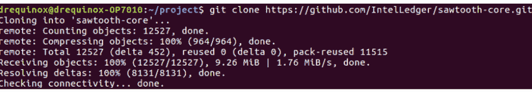

GitHub Sawtooth 克隆

一旦 Sawtooth 正确克隆，下一步是启动环境。首先，运行以下命令将目录更改为正确位置，然后启动 Vagrant 盒：

```bash
$ cd sawtooth-core/tools
$ vagrant up
```

这将产生与以下截图类似的输出：

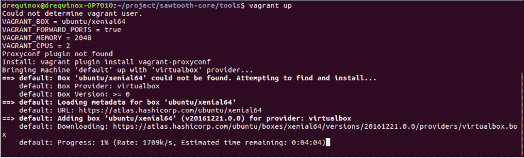

如果在任何时候需要停止 Vagrant，可以使用以下命令：

```bash
$ vagrant halt
```

或

```bash
$ vagrant destroy
```

Halt 将停止 `vagrant` 机器，而 `destroy` 将停止并删除 `vagrant` 机器。

最后，可以使用以下命令启动交易验证器。首先 ssh 进入 Vagrant Sawtooth 盒。

```bash
$ vagrant ssh
```

当 `vagrant` 提示符可用时，运行以下命令。

首先使用以下命令构建 Sawtooth Lake 核心：

```bash
$ /project/sawtooth-core/bin/build_all
```

构建成功完成后，为运行交易验证器发出以下命令：

```bash
$ /project/sawtooth-core/docs/source/tutorial/genesis.sh
```

这将创建创世区块并清除任何现有数据文件和密钥。这应显示与以下截图类似的输出：

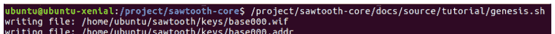

创世区块和密钥生成

下一步是运行交易验证器并按如下方式更改目录：

```bash
$ cd /project/sawtooth-core
```

运行交易验证器：

```bash
$ ./bin/txnvalidator -v -F ledger.transaction.integer_key --config /home/ubuntu/sawtooth/v0.json
```

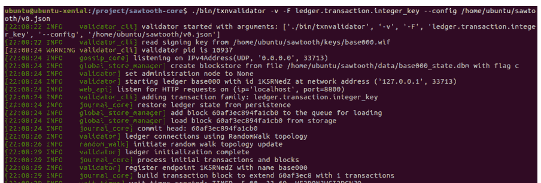

运行交易验证器

验证器节点可以通过按 Ctrl + C 停止。一旦验证器启动并运行，可以在另一个终端窗口中启动各种客户端以与交易验证器通信并提交交易。

例如，在以下截图中，market 客户端启动以与交易验证器通信。请注意，`/keys/mkt.wif` 下的密钥是通过使用以下命令创建的：

```bash
./bin/sawtooth keygen --key-dir validator/keys mkt
```

此演示只是从 Sawtooth Lake 文档派生的基本示例。然而，使用 Sawtooth Lake 进行开发是一个相当复杂的过程，可以专门用一章来介绍。

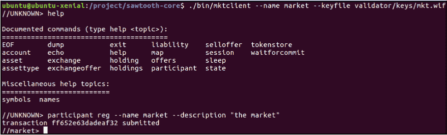

Sawtooth Lake 也在持续开发中，因此建议读者关注 `http://intelledger.github.io/` 上的文档，以便跟上最新发展。

## Corda

Corda 不是区块链。传统的区块链解决方案，如前所述，具有将交易捆绑在区块中并且每个区块通过密码学链接回其父区块的概念，从而提供交易的不可变记录。Corda 的情况并非如此：Corda 是从头开始完全设计的新模型，用于提供所有区块链优势，但没有传统的区块链。它纯粹为金融行业开发，以解决每个组织管理自己的账本并因此拥有自己的 *真相* 视图的问题，这导致矛盾和运营风险。此外，数据也在每个组织中重复，这导致管理单独基础设施的成本增加和复杂性。这些是金融行业内的问题，Corda 旨在通过构建去中心化数据库平台来解决。


Corda 的源代码可在 https://github.com/corda/corda 获取。它使用一种名为 Kotlin 的语言编写，Kotlin 是一种面向 Java 虚拟机（JVM）的静态类型语言。

## 架构

Corda 平台的主要组件包括状态对象、合约代码、法律文本、交易、共识和流。

### 状态对象

状态对象表示构成金融协议的最小数据单元。它们因交易执行而被创建或删除。它们引用合约代码和法律文本。法律文本是可选的，为合约提供法律约束力。然而，合约代码是管理对象状态所必需的。根据合约代码中定义的业务逻辑，合约代码需要为节点提供状态转换机制。状态对象包含表示对象当前状态的数据结构。例如，在下图中，一个状态对象表示该对象的当前状态。在这种情况下，它是当事人 A 和当事人 B 之间的一个简单模拟协议，其中当事人 ABC 已向当事人 XYZ 支付了 1,000 英镑。这表示对象的当前状态；然而，所引用的合约代码可以通过交易来改变状态。状态对象可以被看作是状态机，交易消耗它们以创建更新后的状态对象。

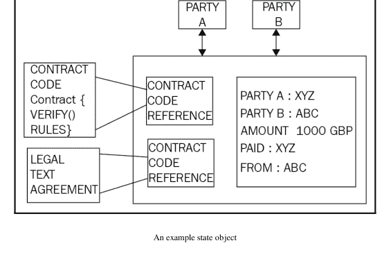

### 交易

交易用于在不同状态之间执行转换。例如，前图所示的状态对象是交易的结果而创建的。Corda 使用基于比特币风格的 UTXO 模型来处理交易。通过交易进行状态转换的概念与比特币相同。与比特币类似，交易可以有零个、单个或多个输入，以及单个或多个输出。所有交易都有数字签名。此外，Corda 没有挖矿概念，因为它不使用区块将交易排列在区块链中。相反，使用公证服务来提供交易的时间排序。在 Corda 中，可以使用 JVM 字节码开发新的交易类型，这使其非常灵活和强大。

### 共识

Corda 中的共识模型非常简单，基于在后面章节中讨论的公证服务。总体思路是，由公证服务评估交易的唯一性，如果交易是唯一的，则将其签名为有效。Corda 网络上可以运行单个或多个集群公证服务。公证人可以使用各种共识算法（如 PBFT 或 Raft）来达成共识。

关于 Corda 中的共识，有两个主要概念：状态有效性共识和状态唯一性共识。第一个概念涉及交易的验证，确保所有必需的签名都可用且状态适当。第二个概念是检测双重支付攻击的手段，并确保交易尚未被花费且是唯一的。

### 流（Flows）

Corda 中的流是一个新颖的概念，允许开发去中心化的工作流。Corda 网络上的所有通信都由这些流处理。它们是构建交易的协议，可以用代码定义任何复杂度的金融流。流作为异步状态机运行，并与其他节点和用户交互。在执行过程中，它们可以根据需要暂停或恢复。

### 组件

Corda 网络有多个组件。所有这些组件将在下一节中描述。

### 节点

Corda 网络中的节点在无信任模型下运行，并由不同的组织运营。节点作为经过认证的对等网络的一部分运行。节点之间使用**高级消息队列协议（AMQP）**直接通信，该协议是经批准的国际标准（ISO/IEC 19464），确保不同节点之间的消息安全可靠地传输。在 Corda 中，AMQP 基于**传输层安全（TLS）**工作，从而确保节点之间通信数据的隐私和完整性。

节点还使用本地关系数据库进行存储。网络上的消息以紧凑的二进制格式编码。它们通过使用 **Apache Artemis 消息代理（Active MQ）**来传递和管理。一个节点可以充当网络地图服务、公证人、预言机或常规节点。下图显示了两个节点相互通信的高级视图：

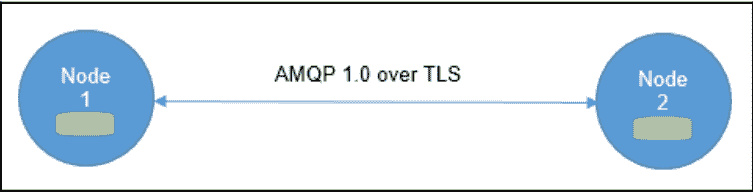

在上图中，**节点1** 正在通过 AMQP 协议的 TLS 通信信道与**节点2** 通信，并且节点有一个本地关系数据库用于存储。

### 权限服务

权限服务用于提供 TLS 证书以确保安全。为了参与网络，参与者需要拥有由根证书颁发机构颁发的签名身份。身份在网络上是唯一的，权限服务用于签署这些身份。用于识别参与者的命名约定基于 X.500 标准。这确保了名称的唯一性。

### 网络地图服务

该服务用于以文档形式提供网络上所有节点的网络地图。该服务发布 IP 地址、身份证书以及节点提供的服务列表。所有节点在首次启动时通过向该服务注册来宣告自己的存在，当节点收到连接请求时，首先在网络地图上检查请求节点的存在。换句话说，该服务将参与者的身份解析到物理节点。

### 公证服务

在传统区块链中，挖矿用于确定包含交易的区块的顺序。在 Corda 中，公证服务用于提供交易排序和时间戳服务。网络中可以有多个公证人，他们通过复合公钥进行识别。公证人可以根据应用程序的需求使用不同的共识算法，如 BFT 或 Raft。公证服务对交易进行签名，以表示交易的有效性和最终性，然后将其持久化到数据库中。

公证人可以以负载均衡配置运行，以便出于性能原因将负载分散到各个节点上；并且为了减少延迟，建议节点在物理上更靠近交易参与者运行。

### 预言机服务

预言机服务要么对包含事实的交易进行签名（如果该事实为真），要么自己提供事实数据。它们允许现实世界的数据馈送到分布式账本中。

### 交易

Corda 网络中的交易从不全局传输，而是在半私密网络中传输。它们只在与交易相关的一小部分参与者之间共享。这与以太坊和比特币等传统区块链解决方案形成对比，在那些解决方案中，所有交易都全局广播到整个网络。交易经过数字签名，要么消耗状态，要么创建新状态。

Corda 网络上的交易由以下元素组成：

-   **输入引用**：这是对交易将要消耗并用作输入的状态的引用。
-   **输出状态**：这些是交易创建的新状态。
-   **附件**：这是所附 zip 文件的哈希列表。Zip 文件可以包含代码以及与交易相关的其他相关文档。文件本身不构成交易的一部分，而是单独传输和存储。
-   **命令**：命令表示交易预期操作的信息，作为合约的参数。每个命令都有一个公钥列表，代表需要签署交易的所有方。
-   **签名**：这表示交易所需的签名。所需签名总数与命令的公钥数量成正比。
-   **类型**：有两种类型的交易，即普通交易或公证人变更交易。公证人变更交易用于为状态重新分配公证人。
-   **时间戳**：此字段表示交易发生的时间范围。这些时间戳由公证服务验证并强制执行。此外，如果严格要求时间（这在许多金融服务场景中是可取的），公证人应与原子钟同步。
-   **摘要**：这是描述交易操作的文本描述。

### 保险库（Vaults）

保险库在节点上运行，类似于比特币中的钱包概念。由于交易不是全局广播的，每个节点的保险库中只会保存与其相关的数据部分。保险库将其数据存储在标准关系数据库中，因此可以使用标准 SQL 进行查询。保险库可以包含账本内和账本外的数据，这意味着它也可以包含不在账本上的部分数据。


## CorDapp

Corda 的核心模型由状态对象、交易和交易协议组成，这些组件与合约代码、API、钱包插件以及用户界面组件相结合，即可构建出 Corda 分布式应用程序（CorDapp）。

Corda 中的智能合约使用 Kotlin 或 Java 编写。代码面向 JVM 运行。为了实现 JVM 字节码执行的确定性结果，JVM 经过了略微修改。Corda 智能合约的三个主要组成部分如下：

-   1.  定义验证逻辑的可执行代码，用于验证对状态对象的更改。
-   2.  状态对象代表合约的当前状态，既可以被交易消耗，也可以由交易产生（创建）。
-   3.  命令用于描述操作数据和验证数据，从而定义如何验证交易。

## 开发环境

可以按照以下步骤轻松搭建 Corda 的开发环境。

所需软件包括：

-   1.  JDK 8，可从 http://www.oracle.com/technetwork/java/javase/downloads/index.html 获取。
-   2.  IntelliJ IDEA 社区版，免费且可从 https://www.jetbrains.com/idea/download 获取。
-   3.  H2 数据库平台无关的 zip 包，可从 http://www.h2database.com/html/download.html 获取。
-   4.  Git，可从 https://git-scm.com/downloads 获取。
-   5.  Kotlin 语言，IntelliJ 中提供该语言支持，更多信息可参见 https://kotlinlang.org/。
-   6.  Gradle 是用于构建 Corda 的另一个组件。

安装完所有这些工具后，即可开始开发智能合约。利用 https://github.com/corda/cordapp-template 上可用的示例模板可以开发 CorDapps。关于如何开发合约代码的详细文档可在 https://docs.corda.net/ 找到。

## 替代区块链

本章旨在介绍替代区块链解决方案。
随着比特币的成功以及人们对区块链技术潜力的认识，一场“寒武纪大爆发”开始了，催生了各种区块链协议、应用程序和平台的开发。一些项目未能引起太多关注，但许多项目已成功在该领域占据了一席之地。

在本章中，读者将了解到替代区块链和平台，这些平台要么是独立的新型区块链，要么是对现有其他区块链的补充。这些新平台基于提供 SDK 和工具的理念，以简化区块链解决方案的开发和部署。以太坊和比特币的成功衍生出各种项目，这些项目利用了它们引入的底层技术和概念。这些新项目通过解决当前区块链的局限性或在现有解决方案之上提供额外一层用户友好的工具来增强功能，从而增加价值。

在本章的第一部分，将介绍新的区块链解决方案，后续部分将涵盖各种平台和发展工具包，这些平台补充了现有的区块链。例如，BlockApps STRATO 是一个符合以太坊标准的区块链应用开发平台，而 Kadena 是一个具有可扩展 BFT 等新颖理念的新型私有区块链。随着区块链技术的这种增长，还首次引入了各种概念，如侧链、驱动链和锚定。本章将详细涵盖所有这些技术和相关概念。当然，不可能涵盖所有的替代链（altchains）和平台，但本章包含了所有与区块链相关、在前几章中提及或预计近期会获得关注的平台。

## 区块链

本节将介绍新的区块链解决方案。首先，在下面的小节中讨论了一种名为 Kadena 的新型区块链。

### Kadena

Kadena 是最近引入的一个私有区块链，它成功解决了区块链系统中的可扩展性和隐私问题。Kadena 还引入了一种名为 Pact 的新型图灵不完备语言，允许开发智能合约。Kadena 的一项关键创新是其可扩展 BFT 共识算法，该算法有望在数千个节点之间扩展而不降低性能。可扩展 BFT 基于原始的 Raft 算法，是 Tangaroa 和 Juno 的后继者。Tangaroa 是对带容错性的 Raft 实现（即 BFT Raft）的命名，旨在解决 Raft 算法中拜占庭节点行为引发的可用性和安全性问题，而 Juno 是由 JPMorgan 开发的 Tangaroa 分支。共识算法在第 1 章“区块链 101”中有更详细的讨论。这两种提案都存在一个根本限制——它们无法在保持高性能的同时进行扩展。因此，Juno 未能引起太多关注。私有区块链具有更理想的特性，即随着节点数量的增加仍能保持高性能，但上述提案缺乏这一特性。Kadena 通过其专有的可扩展 BFT 算法解决了这个问题，该算法预计可扩展至数千个节点而不降低性能。

此外，保密性是 Kadena 的另一个重要方面，它实现了区块链上交易的隐私性。这是通过使用密钥轮换、对称链上加密、增量哈希和 Double Ratchet 协议相结合来实现的。

密钥轮换是确保私有区块链安全性的标准机制。它是一种最佳实践，通过定期更改加密密钥来阻止任何攻击（如果密钥已泄露）。Pact 智能合约语言原生支持密钥轮换。

对称链上加密允许对区块链上的交易数据进行加密。这些交易可以被特定私有交易的参与者自动解密。Double Ratchet 协议用于提供密钥管理和加密功能。

可扩展 BFT 共识协议确保在智能合约执行之前已实现足够的复制和共识。共识通过遵循以下流程实现：

-   1.  首先，新交易由用户签名并通过区块链网络广播，由领导者节点接收并将其添加到其不可变日志中。在此过程中，还为日志计算增量哈希。增量哈希是一种哈希函数，基本上允许在先前已哈希的原始消息发生轻微变化时，从现有哈希计算新的哈希消息。与传统的哈希函数相比，这种方案速度更快且资源消耗更少，传统哈希函数即使原始消息仅发生极小变化也需要生成全新的哈希消息。
-   2.  一旦领导者节点将交易写入日志，它会签署复制数据和增量哈希，并将其广播给其他节点。
-   3.  其他节点在收到交易后，验证领导者节点的签名，将交易添加到自己的日志中，并广播它们自己计算的增量哈希（法定证明）给其他节点。最终，在收到来自其他节点的足够数量的证明后，交易将被永久提交到账本中。

该过程的简化版本显示在下图中的示意图中，其中领导者节点记录新交易，然后将其复制给跟随者节点：

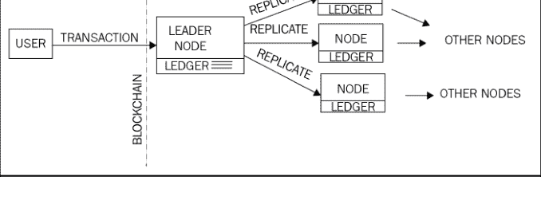

Kadena 中的共识机制


一旦达成共识，智能合约执行就可以开始，并按以下步骤进行：

1. 首先，验证消息的签名。
2. Pact 智能合约层接管。
3. Pact 代码被编译。
4. 交易被发起并执行智能合约中嵌入的任何业务逻辑。如果出现任何失败，会立即启动回滚，将状态恢复到执行开始之前的状态。
5. 最后，交易完成，相关日志得到更新。

Pact 已由 Kadena 开源，可在 `http://kadena.io/pact/downloads.html` 下载。这可以作为独立二进制文件下载，提供 Pact 语言的 REPL。下面给出了一个示例，其中通过在 Linux 控制台中发出命令 `./pact` 运行 Pact：

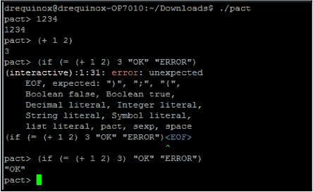

Pact REPL，显示示例命令和错误输出

Pact 中的智能合约通常由三个部分组成：keysets、modules 和 tables。首先，**keyset** 定义了表和模块的相关授权方案。其次，**module** 定义了智能合约代码，其中包含以 **functions** 和 **Pacts** 形式表示的业务逻辑。模块中的 Pacts 由多个步骤组成，并按顺序执行。

Pact 可在多种执行模式下使用。这些模式包括 **contract definition**、**transaction execution** 和 **querying**。合约定义模式允许通过单笔交易消息在区块链上创建合约。交易执行模式涉及执行代表业务逻辑的智能合约代码模块。查询仅用于探测合约数据，并出于性能原因在节点上本地执行。

Pact 使用类似 LISP 的语法，并在代码中精确表示将在区块链上执行的内容，因为它以人类可读的格式存储在区块链上。这与以太坊的 EVM 形成对比，后者编译为字节码执行，这使得难以验证区块链上正在执行的是什么代码。此外，它是不完备的图灵机，支持不可变变量，并且不允许空值，这提高了交易代码执行的整体安全性。

本章不可能涵盖 Pact 的完整语法和函数，然而，下面展示了一个小示例，说明了用 Pact 编写的智能合约的总体结构。该示例展示了一个简单的 addition 模块，定义了一个名为 `addition` 的函数，该函数接受三个参数。执行代码时，它将三个值相加并显示结果。

以下示例使用在线 Pact 编译器开发，可在 `http://kadena.io/try-pact/` 获取：

```lisp
(begin-tx) ;testTransaction ;Begin transaction with optional NAME
;Set transaction data in JSON format or pact types
(env-data { "keyset": { "keys": ["admin"], "pred": "keys-any" } })
;Define keyset as NAME with KEYSET
(define-keyset admin-keyset (read-keyset "keyset"))
;Set transaction signature KEYS.
(env-keys "admin")
;define module using syntax (module NAME KEYSET [DOCSTRING] DEFS...)
(module additionModule admin-keyset
  ;define function that takes three arguments x y z
  (defun addition (x y z) (+ x (+ y z)))
)
(commit-tx) ;Commit transaction.
;use the function addition
(use additionModule)
;run the function addition
(format "Result : {}" (addition 100 200 300))
```

Sample Pact code

当运行代码时，它会产生如下所示的输出：

```
Begin Tx 1
testTransaction
Setting transaction data
Keyset defined
Setting transaction keys
Loaded module "additionModule"
Commit Tx 1
Using "additionModule"
Result : 600
```

Output of the code

如前例所示，执行输出与代码布局和结构完全匹配，这允许更大的透明度并限制恶意代码执行的可能性。

Kadena 是一种新型的私有区块链，引入了 **pervasive determinism** 的新概念，其中除了标准的基于公钥/私钥的数据来源安全之外，还提供了一个完全确定性的共识的额外层。它在区块链的所有层提供加密安全，包括交易和共识层。


Pact 的相关文档和源代码可在以下位置找到：
https://github.com/kadena-io/pact.

## Ripple

Ripple 于 2012 年推出，是一种货币兑换和实时全额结算系统。在 Ripple 中，支付无需等待即可结算，而与传统结算网络不同，后者在结算时可能需要数天时间。它有一种原生货币称为 **Ripples (XRP)**。它还支持非 XRP 支付。该系统被认为类似于一种古老的传统汇款机制，称为 *Hawala*。该系统通过使用代理来运作，代理从发送方收取资金和密码，然后联系收款方的代理并指示他们向能提供密码的人发放资金。收款人随后联系当地代理，告知密码并提取资金。代理在 Ripple 中的类比是网关。这只是一个非常简单的类比，实际协议相当复杂，但在原则上是相同的。

Ripple 网络由可根据其类型执行不同功能的各种节点组成。首先，**user nodes**：这些用于支付交易中，可以付款或收款。其次，**validator nodes**：这些参与共识机制。每个服务器维护一组唯一节点，在达成共识时需要查询这些节点。**unique node List (UNL)** 中的节点被参与共识机制的服务器所信任，并且只会接受来自此唯一节点列表的投票。Ripple 有时不被认为真正去中心化，因为网络运营商和监管机构参与其中。然而，由于任何人都可以通过运行验证节点成为网络的一部分，因此可以认为它是去中心化的。此外，共识过程也是去中心化的，因为对账本提出的任何更改都必须通过超级多数投票方案来决定。然而，这在研究人员和爱好者中是一个热门话题，对每种观点都有支持和反对的论据。

- **Open ledger**：这是一个尚未验证的账本，尚未就其状态达成共识。每个节点都有自己的开放账本，其中包含建议的交易。
- **Unique node list**：这是一组唯一受信任节点的列表，验证服务器用它来寻求投票和随后的共识。
- **Proposer**：顾名思义，该组件提出新的交易以纳入共识过程。它通常是节点的一个子集（上面定义的 UNL），可以向验证服务器提出交易。

### Transactions

交易由网络用户创建以更新账本。交易预期是经过数字签名且有效的，以便被视为共识过程的候选者。每笔交易花费少量 XRP，这作为防止因垃圾邮件导致的拒绝服务攻击的保护机制。Ripple 网络中有不同类型的交易。Ripple 交易数据结构中的一个字段 `TransactionType` 用于表示交易的类型。交易通过四步流程执行。首先，交易被准备，其中根据标准创建未签名的交易。第二步是签名，其中交易被数字签名以授权它。之后，实际提交到网络通过连接的服务器进行。最后，进行验证以确保交易成功验证。

大致上，交易可以分为三类，即与支付相关、与订单相关以及与账户和安全相关。所有这些类型在以下部分中描述。

#### Payments related

此类中有几个字段会导致某些操作。所有这些字段描述如下：

1. **Payment**：此交易使用最广泛，允许一个用户向另一个用户发送资金。
2. **PaymentChannelClaim**：这用于从支付渠道申领 **Ripples (XRP)**。支付渠道是一种允许各方之间进行重复且单向支付的机制。这也可以用于设置支付渠道的到期时间。
3. **PaymentChannelCreate**：此交易创建新的支付渠道并以 *drops* 形式向其中添加 XRP。一个 drop 等于 0.000001 个 XRP。


+   4. `PaymentChannelFund`: 此交易用于向现有通道添加更多资金。与 `PaymentChannelClaim` 交易类似，此交易也可用于修改支付通道的过期时间。

## Order related

此类型的交易包含以下两个字段：

-   1. `OfferCreate`: 此交易代表限价订单，表示货币交换的意图。如果无法完全履行，则会在共识账本中创建 Offer 节点。
-   2. `OfferCancel`: 用于从共识账本中移除先前创建的 offer 节点，表示撤回订单。

## Account and security related

此类型的交易包含以下列出的字段。每个字段负责执行特定功能。

-   1. `AccountSet`: 此交易用于修改 Ripple 共识账本中账户的属性。
-   2. `SetRegularKey`: 用于更改或设置账户的交易签名密钥。账户使用从账户主公钥派生的 base-58 Ripple 地址进行标识。
-   3. `SignerListSet`: 可用于为多签名交易创建一组签名者。
-   4. `TrustSet`: 用于在账户之间创建或修改信任线。

Ripple 中的交易由适用于所有交易类型的各种通用字段组成。这些字段如下列出并附带说明：

-   1. `Account`, 交易发起人的地址。
-   2. `AccountTxnID`, 这是一个可选字段，包含另一笔交易的哈希。
-   3. `Fee`, XRP 数量。
-   4. `Flags`, 交易的可选标志。
-   5. `LastLedgerSequence`, 交易可以出现的账本的最高序列号。
-   6. `Memos`, 可选的任意信息。

## Interledger layer

该层提供互操作性和路由服务。该层包含诸如 **Interledger protocol (ILP)**、**Interledger quoting protocol (ILQP)** 和 **Interledger control protocol (ILCP)** 等协议。ILP 数据包提供转账中交易的最终目标。ILQP 用于发送者在实际转账前进行报价请求。ILCP 用于在支付网络上的连接器之间交换与路由信息和支付错误相关的数据。

## Ledger layer

该层包含使连接器之间能够进行支付交易通信和执行的协议。*Connectors* 基本上是实现在不同账本之间转发支付的协议的对象。它可以支持各种协议，如 Simple Ledger 协议、各种区块链协议、传统协议和不同的专有协议。

Ripple connect 由各种即插即用模块组成，这些模块允许通过 ILP 在账本之间建立连接。它使交易前各方之间所需数据的交换、可视性、费用管理、交付确认以及使用传输层安全进行的安全通信成为可能。第三方应用程序可通过各种连接器连接到 Ripple 网络。

总体而言，Ripple 是面向金融行业而设计的解决方案，使实时支付成为可能且没有任何结算风险。由于这是一个功能非常丰富的平台，本章不可能涵盖其所有方面。Ripple 以及平台的非常丰富的文档可在 https://ripple.com/ 获取。

## Stellar

Stellar 是一个基于区块链技术并采用名为 **Federated Byzantine Agreement (FBA)** 的新型共识模型的支付网络。FBA 通过创建受信任方的法定人数来工作。**Stellar Consensus Protocol (SCP)** 是 FBA 的一种实现。

Stellar 白皮书中确定的关键问题是当前金融基础设施的成本和复杂性。这一限制要求建立一个全球金融网络，在不损害金融交易完整性和安全性的前提下解决这些问题。这一需求导致了 **Stellar Consensus Protocol (SCP)** 的发明，它是一种可证明安全的共识机制。

它具有四个主要特性：*decentralized control*，允许任何人在没有中央方的情况下参与；*low latency*，满足快速交易处理这一迫切需求；*flexible trust*，允许用户为特定目的选择他们信任的各方；最后是 *asymptotic security*，利用数字签名和哈希函数为网络提供所需的安全级别。

Stellar 网络允许通过其原生数字货币即 Lumens，缩写为 XLM 来转移和表示资产的价值。当交易在网络上广播时，Lumens 会被消耗，这也起到遏制 **Denial of Service (DOS)** 攻击的作用。

在其核心，Stellar 网络维护一个分布式账本，记录每笔交易并在每个 Stellar 服务器上复制。共识是通过在服务器之间验证交易并用更新更新账本来实现的。Stellar 账本也可以充当分布式交易所订单簿，允许用户存储其买卖货币的报价。

构成 Stellar 网络的各种工具、SDK 和软件。核心软件可在 https://github.com/stellar/stellar-core 获取。

## Rootstock

在详细讨论 Rootstock 之前，重要的是定义并介绍一些对 Rootstock 设计至关重要的概念。这些概念包括侧链、驱动链和双向锚定。侧链的概念最初由 Blockstream 开发。

双向锚定是一种机制，通过该机制，价值（币）可以在一条区块链与另一条区块链之间以及反向转移。链之间并没有真正的币转移。这一想法围绕着将相同数量和价值的币锁定在比特币区块链（主链）中，并在次级链中解锁等量代币的概念展开。

牢记这一定义，侧链可以定义如下所述。

### Sidechain

这是一个与主区块链并行运行的区块链，允许在它们之间转移价值。这意味着一个区块链的代币可以在侧链中使用，反之亦然。这也称为锚定侧链，因为它支持双向锚定资产。

## Drivechain

这是一个相对较新的概念，其中解锁锁定在主链中的比特币的控制权交给矿工，矿工可以投票决定何时解锁。这与侧链形成对比，在侧链中，共识是通过简单的支付验证机制来验证，以便将币转移回主链。

Rootstock 是一个具有与比特币区块链双向锚定的智能合约平台。核心思想是提高比特币系统的可扩展性和性能，并使其能够使用智能合约。Rootstock 运行一个名为 Rootstock Virtual Machine (RVM) 的图灵完备确定性虚拟机。它也与以太坊虚拟机兼容，允许用 solidity 编译的合约在 Rootstock 上运行。智能合约也可以在比特币区块链经过时间考验的安全性下运行。Rootstock 区块链通过与比特币合并挖矿来工作。这使得 RSK 区块链能够达到与比特币相同的<|message|> 安全级别。这对于防止双花和实现结算最终性尤其正确。它允许可扩展性，每秒多达 100 笔交易。

RSK 最近发布了一个名为 Turmeric 的测试网络。它可在 http://www.rsk.co/ 获取。

## Quorum

这是一个通过增强现有以太坊区块链而构建的区块链解决方案。Quorum 中引入了几个增强功能，例如交易隐私和新的共识机制。Quorum 引入了一种名为 QuorumChain 的新共识模型，该模型基于多数投票和基于时间[content]

+   4. `PaymentChannelFund`: 此交易用于向现有通道添加更多资金。与 `PaymentChannelClaim` 交易类似，此交易也可用于修改支付通道的过期时间。

## Order related

此类型的交易包含以下两个字段：

-   1. `OfferCreate`: 此交易代表限价订单，表示货币交换的意图。如果无法完全履行，则会在共识账本中创建 Offer 节点。
-   2. `OfferCancel`: 用于从共识账本中移除先前创建的 offer 节点，表示撤回订单。

## Account and security related

此类型的交易包含以下列出的字段。每个字段负责执行特定功能。

-   1. `AccountSet`: 此交易用于修改 Ripple 共识账本中账户的属性。
-   2. `SetRegularKey`: 用于更改或设置账户的交易签名密钥。账户使用从账户主公钥派生的 base-58 Ripple 地址进行标识。
-   3. `SignerListSet`: 可用于为多签名交易创建一组签名者。
-   4. `TrustSet`: 用于在账户之间创建或修改信任线。

Ripple 中的交易由适用于所有交易类型的各种通用字段组成。这些字段如下列出并附带说明：

-   1. `Account`, 交易发起人的地址。
-   2. `AccountTxnID`, 这是一个可选字段，包含另一笔交易的哈希。
-   3. `Fee`, XRP 数量。
-   4. `Flags`, 交易的可选标志。
-   5. `LastLedgerSequence`, 交易可以出现的账本的最高序列号。
-   6. `Memos`, 可选的任意信息。

## Interledger layer

该层提供互操作性和路由服务。该层包含诸如 **Interledger protocol (ILP)**、**Interledger quoting protocol (ILQP)** 和 **Interledger control protocol (ILCP)** 等协议。ILP 数据包提供转账中交易的最终目标。ILQP 用于发送者在实际转账前进行报价请求。ILCP 用于在支付网络上的连接器之间交换与路由信息和支付错误相关的数据。

## Ledger layer

该层包含使连接器之间能够进行支付交易通信和执行的协议。*Connectors* 基本上是实现在不同账本之间转发支付的协议的对象。它可以支持各种协议，如 Simple Ledger 协议、各种区块链协议、传统协议和不同的专有协议。

Ripple connect 由各种即插即用模块组成，这些模块允许通过 ILP 在账本之间建立连接。它使交易前各方之间所需数据的交换、可视性、费用管理、交付确认以及使用传输层安全进行的安全通信成为可能。第三方应用程序可通过各种连接器连接到 Ripple 网络。

总体而言，Ripple 是面向金融行业而设计的解决方案，使实时支付成为可能且没有任何结算风险。由于这是一个功能非常丰富的平台，本章不可能涵盖其所有方面。Ripple 以及平台的非常丰富的文档可在 https://ripple.com/ 获取。

## Stellar

Stellar 是一个基于区块链技术并采用名为 **Federated Byzantine Agreement (FBA)** 的新型共识模型的支付网络。FBA 通过创建受信任方的法定人数来工作。**Stellar Consensus Protocol (SCP)** 是 FBA 的一种实现。

Stellar 白皮书中确定的关键问题是当前金融基础设施的成本和复杂性。这一限制要求建立一个全球金融网络，在不损害金融交易完整性和安全性的前提下解决这些问题。这一需求导致了 **Stellar Consensus Protocol (SCP)** 的发明，它是一种可证明安全的共识机制。

它具有四个主要特性：*decentralized control*，允许任何人在没有中央方的情况下参与；*low latency*，满足快速交易处理这一迫切需求；*flexible trust*，允许用户为特定目的选择他们信任的各方；最后是 *asymptotic security*，利用数字签名和哈希函数为网络提供所需的安全级别。

Stellar 网络允许通过其原生数字货币即 Lumens，缩写为 XLM 来转移和表示资产的价值。当交易在网络上广播时，Lumens 会被消耗，这也起到遏制 **Denial of Service (DOS)** 攻击的作用。

在其核心，Stellar 网络维护一个分布式账本，记录每笔交易并在每个 Stellar 服务器上复制。共识是通过在服务器之间验证交易并用更新更新账本来实现的。Stellar 账本也可以充当分布式交易所订单簿，允许用户存储其买卖货币的报价。

构成 Stellar 网络的各种工具、SDK 和软件。核心软件可在 https://github.com/stellar/stellar-core 获取。

## Rootstock

在详细讨论 Rootstock 之前，重要的是定义并介绍一些对 Rootstock 设计至关重要的概念。这些概念包括侧链、驱动链和双向锚定。侧链的概念最初由 Blockstream 开发。

双向锚定是一种机制，通过该机制，价值（币）可以在一条区块链与另一条区块链之间以及反向转移。链之间并没有真正的币转移。这一想法围绕着将相同数量和价值的币锁定在比特币区块链（主链）中，并在次级链中解锁等量代币的概念展开。

牢记这一定义，侧链可以定义如下所述。

### Sidechain

这是一个与主区块链并行运行的区块链，允许在它们之间转移价值。这意味着一个区块链的代币可以在侧链中使用，反之亦然。这也称为锚定侧链，因为它支持双向锚定资产。

## Drivechain

这是一个相对较新的概念，其中解锁锁定在主链中的比特币的控制权交给矿工，矿工可以投票决定何时解锁。这与侧链形成对比，在侧链中，共识是通过简单的支付验证机制来验证，以便将币转移回主链。

Rootstock 是一个智能合约平台，具有与比特币区块链的双向锚定。核心思想是提高比特币系统的可扩展性和性能，并使其能够使用智能合约。Rootstock 运行一个名为 Rootstock Virtual Machine (RVM) 的图灵完备确定性虚拟机。它也与以太坊虚拟机兼容，允许用 solidity 编译的合约在 Rootstock 上运行。智能合约也可以在比特币区块链经过时间考验的安全性下运行。Rootstock 区块链通过与比特币合并挖矿来工作。这使得 RSK 区块链能够达到与比特币相同的 fiy 安全级别。这对于防止双花和实现结算最终性尤其正确。它允许可扩展性，每秒多达 100 笔交易。

RSK 最近发布了一个名为 Turmeric 的测试网络。它可在 http://www.rsk.co/ 获取。

## Quorum

这是一个通过增强现有以太坊区块链而构建的区块链解决方案。Quorum 中引入了几个增强功能，例如交易隐私和新的共识机制。Quorum 引入了一种名为 QuorumChain 的新共识模型，该模型基于多数投票和基于时间机制。另一个名为 Constellation 的功能也被引入，这是一个通用机制，用于提交信息并允许对等方之间进行加密通信。此外，节点级别的许可由智能合约管理。它还提供比公共以太坊区块链更高的性能水平。

多个组件构成了 Quorum 区块链生态系统。这些在以下部分列出。

## Transaction manager

此组件使能够访问加密的交易数据。它还管理本地存储并与网络上的其他 Transaction managers 进行通信。


## Crypto Enclave

顾名思义，该组件负责提供加密服务以确保交易隐私。它还负责执行密钥管理功能。

## QuorumChain

这是 Quorum 中的关键创新。它是一种拜占庭容错共识机制，允许通过区块链网络上的交易进行投票的验证和流通。在此方案中，使用智能合约来管理共识过程，并且可以授予节点投票权以投票决定应接受哪个新区块。一旦选民收到适当数量的投票，该区块即被视为有效。节点可以有两种角色，即 Voter 或 Maker。Voter 节点允许投票，而 Maker 节点则是创建新区块的节点。节点可以拥有任一权限、无权限或仅一种权限。

## Network manager

该组件为许可网络提供访问控制层。

Quorum 网络中的节点可以承担多种角色，例如允许创建新区块的 Maker 节点。交易隐私通过密码学以及某些交易仅供相关参与者查看的概念来实现。这一想法类似于上一章中讨论的 Corda 的私有交易概念。由于它允许区块链上同时存在公共和私有交易，因此状态数据库已被划分为两个数据库，分别代表私有和公共交易。因此，有两棵独立的 Patricia-Merkle 树代表网络的私有和公共状态。私有合约状态哈希用于在交易各方之间的私有交易中提供共识证据。

Quorum 网络中的交易由各种元素组成，例如接收方、用于识别交易发起者的发送方数字签名、可选的以太币金额、允许查看交易的参与者可选列表，以及在私有交易情况下包含哈希的字段。

交易在到达目的地之前会经过多个步骤。这些步骤详细描述如下：

- 1. 用户应用程序（DAPPs）通过区块链网络公开的 API 将交易发送到 Quorum 节点。这也包含接收方地址和交易数据。
- 2. API 然后加密负载并应用任何其他必要的加密算法以确保交易的隐私，并将其发送到 Transaction manager。此步骤同时计算加密负载的哈希值。
- 3. 收到交易后，Transaction manager 验证交易发送方的签名并存储消息。
- 4. 先前加密负载的哈希值被发送到 Quorum 节点。
- 5. 一旦 Quorum 节点开始验证包含私有交易的区块，它就会从 Transaction manager 请求更多相关数据。
- 6. 一旦 Transaction manager 收到此请求，它就会将加密负载和相关的对称密钥发送给请求方 Quorum 节点。
- 7. 一旦 Quorum 节点拥有所有数据，它就会解密负载并将其发送到 EVM 执行。这就是 Quorum 如何在区块链上使用对称加密实现隐私，同时能够使用原生以太坊协议和 EVM 分别进行消息传输和执行。
- 8. 类似的概念，但有几个方面差异很大，已在 Hydrachain 的形式下提出，该方案基于以太坊区块链并允许创建许可的分布式账本。

Quorum 可在 https://github.com/jpmorganchase/quorum 下载。

## Tezos

Tezos 是一种通用自修改加密账本，这意味着它不仅允许对区块链状态进行去中心化共识，还允许对协议和节点随时间如何演进达成共识。Tezos 的开发旨在解决比特币协议中的局限性，例如硬分叉引起的问题、成本、由于工作量证明导致的算力集中化、有限的脚本能力以及安全问题。它是用一种纯函数式语言 OCaml 开发的。

Tezos 分布式账本的架构分为三个层：网络层、共识层和交易层。这种分解允许协议以去中心化的方式演进。为此，Tezos 中实现了一个通用网络外壳，负责维护区块链，该区块链由共识层和交易层的组合表示。该外壳在网络和协议之间提供接口层。还引入了种子协议的概念，该概念用作允许网络上的利益相关者批准对协议的任何更改的机制。与传统区块链从创世区块开始不同，Tezos 区块链从种子协议开始。

该种子协议负责定义区块链中修正的程序，甚至是修正协议本身。Tezos 中的奖励机制基于 **Proof of Stake (PoS)** 算法，因此不需要挖矿。

Tezos 中已开发出合约脚本语言用于编写智能合约，这是一种基于栈的图灵完备语言。Tezos 中的智能合约是形式可验证的，这允许代码在数学上被证明其正确性。

Tezos 代码可在 https://github.com/tezos/tezos 获取。

## Storj

现有的基于云的存储模型都是集中式解决方案，其安全性可能并不如用户所期望的那样。需要一种安全、高可用性、更重要的是去中心化的云存储系统。Storj 旨在提供基于区块链的、去中心化和分布式的存储。它是由社区共享的云，而不是由中央组织共享。它允许节点作为自主代理之间执行存储合约。这些代理（节点）执行各种功能，例如数据传输、验证和执行数据完整性检查。核心概念基于 **Distributed Hash Tables (DHT)** - Kademlia，然而该协议在 Storj 中通过添加新的消息类型和功能得到了增强。它还实现了一种点对点 **publish/subscribe (pub/sub)** 机制，称为 Quasar，可确保消息成功到达对存储合约感兴趣的节点。这是通过一种基于布隆过滤器的存储合约参数选择机制实现的，称为 **topics**。

Storj 以加密格式将文件存储在网络各处。在文件存储到网络之前，它会使用 AES-256-CTR 对称加密进行加密，然后以分片的方式分布式存储在网络上。将文件拆分为片段的过程称为 **sharding**，从而提高了网络的可用性、安全性和性能以及隐私性。此外，如果节点失败，分片仍然可用，因为默认情况下单个分片存储在网络上的三个不同位置。

它维护一条区块链，作为共享账本并实现标准安全功能，例如公共/私有密钥密码学和哈希函数，类似于任何其他区块链。由于系统基于节点之间的硬盘共享，任何人都可以贡献其驱动器上的额外空间并用 Storj 自有的加密货币 **Storjcoinx (SJCX)** 获得报酬。SJCX 被开发为 *counterparty* 资产并利用比特币区块链进行交易。

Storj 代码可在 https://github.com/Storj/ 获取。

## Maidsafe

这也是一个类似于 Storj 的分布式存储系统。用户因其对网络的存储空间贡献而获得 Safecoin 奖励。这种支付机制由 *proof of resource* 治理，确保用户承诺给网络的磁盘空间可用，如果不可用，则 Safecoin 的支付会相应减少。文件在传输到网络进行存储之前会被加密并分割成小部分。Maidsafe 中还引入了 **opportunistic caching** 的概念，这是一种在物理上更接近访问请求来源处创建频繁访问数据的副本的机制，从而提高了网络性能。SAFE 网络的另一个新颖特性是它会自动删除网络上的任何重复数据，从而减少存储需求。此外，还引入了 **churning** 的概念，这基本上意味着数据在网络中不断移动，以便数据无法被恶意对手针对。它还在网络中保留数据的多个副本，以提供冗余，以防节点离线或失败。

## BigChainDB

这是一个可扩展的区块链数据库。它本身并不是严格意义上的区块链，而是通过提供去中心化数据库来补充区块链技术。其核心是一个分布式数据库，但增加了区块链的属性，例如去中心化、不可变性和数字资产处理。它还允许使用 NoSQL 查询数据库。其目的是在去中心化生态系统中提供数据库，其中不仅处理是去中心化的（区块链）或文件系统是去中心化的（例如 IPFS），数据库也是去中心化的。这使得整个去中心化应用程序生态系统都实现了去中心化。这可在 https://www.bigchaindb.com/ 获取。

## Multichain

Multichain 已被开发为私有区块链的开发和部署平台。它基于比特币代码并解决了安全、可扩展性和隐私问题。它是一个高度可配置的区块链平台，允许用户设置不同的区块链参数。它通过细粒度的 Permissioning 层支持控制和隐私。Multichain 的安装非常快速，安装文件的链接可在 http://www.multichain.com/download-install/ 获取。


## Tendermint

Tendermint 是一种软件，可为应用程序提供拜占庭容错共识机制和状态机复制功能。其主要目标是构建一个通用、安全且高性能的复制状态机。

Tendermint 包含两个组件，下文将分别介绍。

### Tendermint 核心

这是一个共识引擎，能够确保网络中每个节点上交易的安全复制。

### Tendermint 套接字协议（TMSP）

这是一个应用程序接口协议，允许与任何编程语言进行交互以处理交易。

Tendermint 允许将应用程序进程与共识进程解耦，从而让任何应用程序都能受益于该共识机制。

Tendermint 共识算法是一种基于轮次的机制，验证节点在每一轮中提议新区块。为防止在区块链同一高度上选择两个不同区块进行提交的情况，使用了锁定机制。每个验证节点都维护着一个完整的本地复制账本，其中包含含有交易的区块。每个区块包含一个区块头，区块头由前一个区块的哈希、区块提议的时间戳、当前区块高度以及区块内所有交易的 Merkle 根哈希组成。

Tendermint 最近被用于 **Cosmos**。Cosmos 是一个区块链网络，允许运行在 BFT 共识算法上的不同链之间实现互操作。该网络上的区块链被称为区域（zone）。Cosmos 中的第一个区域称为 Cosmos hub，它实际上是一个公有区块链，负责为其他区块链提供连接服务。为此，hub 使用了 **跨区块链通信协议（IBC）**。IBC 协议支持两种交易类型，分别称为 *IBCBlockCommitTx* 和 *IBCPacketTx*。前者用于向任何一方提供区块链中最新区块哈希的证明，后者用于提供数据源认证。从一条区块链向另一条区块链发布数据包时，需要先在目标链上发布一个证明。接收方（目标）链检查该证明，以验证发送方链确实发布了该数据包。此外，它还有一种自己的原生货币，称为 Atom。这种方案允许多个区块链连接到 hub，从而解决了可扩展性和互操作性问题。

## 使用 BlockApps 进行应用开发与部署

第一步是使用以下命令初始化 BlockApps 应用：

```bash
$ bloc init
```

它会询问几个参数：应用名称、您的姓名、电子邮件、API URL（apiUrl）和区块链配置文件。如下面的截图所示。

命令运行并成功完成后，它会创建一个包含模板和示例的应用目录。在本例中，将创建一个名为 `testApp` 的目录，其中包含相关子目录和示例合约。

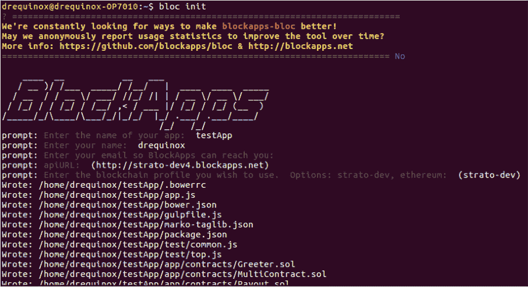

下一步是安装 `testApp`，可通过运行以下命令来完成：

```bash
$ sudo npm install
```

## 其他区块链

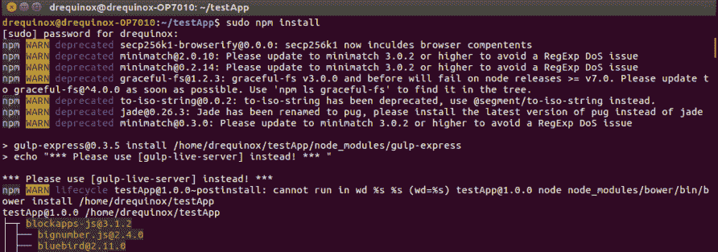

为了对交易进行签名，需要生成一个新密钥。可以使用以下命令生成密钥：

```
$ bloc genkey
```

生成后，需输入密码以保护该密钥。输入密码后，将创建密钥并生成一个 JSON 文件。请注意，JSON 文件名就是该账户在区块链上的实际地址。此外，它还会显示一条“transaction mined”消息，分别表示密钥和交易（账户创建）已成功部署。

整个过程如下面的截图所示：

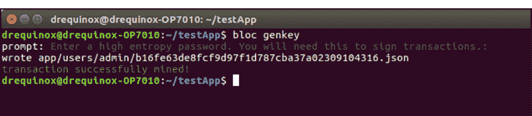

现在，可以使用 curl 查询新账户。只需在 URL 中将地址作为参数传递，结果就会以 JSON 格式返回。

```
drequinox@drequinox-OP7010:~/testApp$ curl http://strato-dev4.blockapps.net/eth/v1.2/account?address=b16fe63de8fcf9d7f1d787cba37a02309104316
[{"contractRoot":"56e81f171bcc55a6ff8345e692c0f86e5b48e01b996cadc001622fb5e363b421","kind":"AddressStateRef","balance":"1000000000000000000","address":"b16fe63de8fcf9d7f1d787cba37a02309104316","latestBlockNum":79860,"code":"","nonce":0}]drequinox@drequinox-OP7010:~/testApp$
```

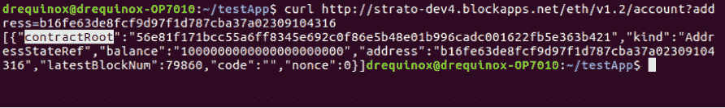

或者，也可以通过任意 Web 浏览器执行查询，如下面的截图所示：

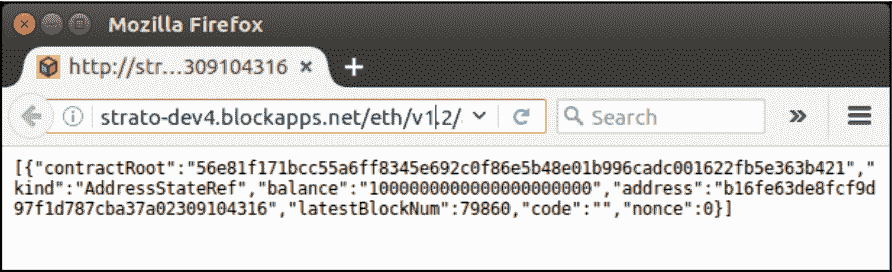

下一步将描述把新合约上传到测试链的过程。请注意，所有合约都放在 `testApp` 目录下的 `./app/contracts` 目录中。作为示例，我们选择 `Greeter.sol` 合约部署到网络。BlockApps 提供了一种简单的方法来实现此部署。

所有合约都需要放在 contracts 目录下，编译命令才能找到它们并进行编译。

```
drequinox@drequinox-OP7010:~/testApp/app/contracts$ pwd
/home/drequinox/testApp/app/contracts
drequinox@drequinox-OP7010:~/testApp/app/contracts$ ll
total 40
drwxrwxr-x 2 drequinox drequinox 4096 Dec 27 10:24 ./
drwxrwxr-x 8 drequinox drequinox 4096 Dec 27 10:45 ../
-rw-rw-r-- 1 drequinox drequinox 695 Dec 27 10:24 Greeter.sol
-rw-rw-r-- 1 drequinox drequinox 237 Dec 27 10:24 MultiContract.sol
-rw-rw-r-- 1 drequinox drequinox 618 Dec 27 10:24 Payout.sol
-rw-rw-r-- 1 drequinox drequinox 178 Dec 27 10:24 SimpleDataFeed.sol
-rw-rw-r-- 1 drequinox drequinox 1421 Dec 27 10:24 SimpleMultiSig.sol
-rw-rw-r-- 1 drequinox drequinox 181 Dec 27 10:24 SimpleStorage.sol
-rw-rw-r-- 1 drequinox drequinox 998 Dec 27 10:24 Stake.sol
-rw-rw-r-- 1 drequinox drequinox 663 Dec 27 10:24 template.marko
drequinox@drequinox-OP7010:~/testApp/app/contracts$ cat Greeter.sol
contract mortal {
  /* Define variable owner of the type address*/
  address owner;

  /* this function is executed at initialization and sets the owner of the contract */
  function mortal() { owner = msg.sender; }

  /* Function to recover the funds on the contract */
  function kill() { if (msg.sender == owner) suicide(owner); }
}

contract Greeter is mortal {
  /* define variable greeting of the type string */
  string greeting;

  /* this runs when the contract is executed */
  function Greeter(string _greeting) public {
    greeting = _greeting;
  }

  /* main function */
  function greet() constant returns (string) {
    return greeting;
  }
}
drequinox@drequinox-OP7010:~/testApp/app/contracts$
```

contracts 目录下的 Greeter 合约

可以使用下面的截图所示的命令编译合约。请注意，该命令以合约文件名作为参数。编译成功后，所有相关的 JSON 文件将被写入 ./meta 目录下。

```
drequinox@drequinox-OP7010:~/testApp$ bloc compile Greeter
Compiling single contract: Greeter.sol
Compile successful: contract mortal {
  /* Define variable owner of the type address*/
  address owner;

  /* this function is executed at initialization and sets the owner of the contract */
  function mortal() { owner = msg.sender; }

  /* Function to recover the funds on the contract */
  function kill() { if (msg.sender == owner) suicide(owner); }
}

contract Greeter is mortal {
  /* define variable greeting of the type string */
  string greeting;

  /* this runs when the contract is executed */
  function Greeter(string _greeting) public {
    greeting = _greeting;
  }

  /* main function */
  function greet() constant returns (string) {
    return greeting;
  }
}

writing Greeter to app/meta/Greeter/Greeter.json
wrote: app/meta/Greeter/Greeter.json
writing mortal to app/meta/Greeter/mortal.json
wrote: app/meta/Greeter/mortal.json
writing Greeter to app/meta/mortal/Greeter.json
wrote: app/meta/mortal/Greeter.json
writing mortal to app/meta/mortal/mortal.json
wrote: app/meta/mortal/mortal.json
drequinox@drequinox-OP7010:~/testApp$
```

Greeter 合约的编译


## 其他区块链

最后，可以使用以下命令上传合约。该命令期望按照合约代码中定义的参数来传递。在示例中，它期望一个文本字符串，如下面的示例截图所示：

```
```bash
$ bloc upload Greeter "Hello bloc"
```
```

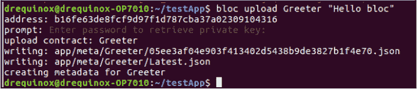

上传 Greeter 合约

请注意，如果传递的参数不正确或缺失，将会出现类似于以下截图的错误：

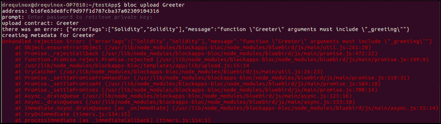

参数错误或缺失时的错误

部署成功后，可以验证以太币已经从现有合约转移到新合约。请注意，余额已经下降。如下图所示：

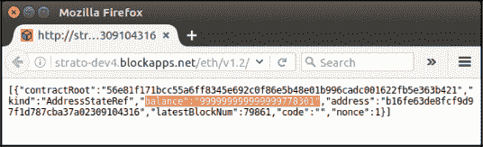

通过 Web 浏览器安装后的已部署合约

部署合约后，可以使用 Web 浏览器或任何 CLI 工具（如 cURL）查询它。需要将 URL http://strato-dev4.blockapps.net/eth/v1.2/account?address=05ee3af04e903f413402d5438b9de3827b1f4e70 传递给 Web 浏览器。如下面的截图所示。请注意，二进制格式的代码也可在输出中获得。

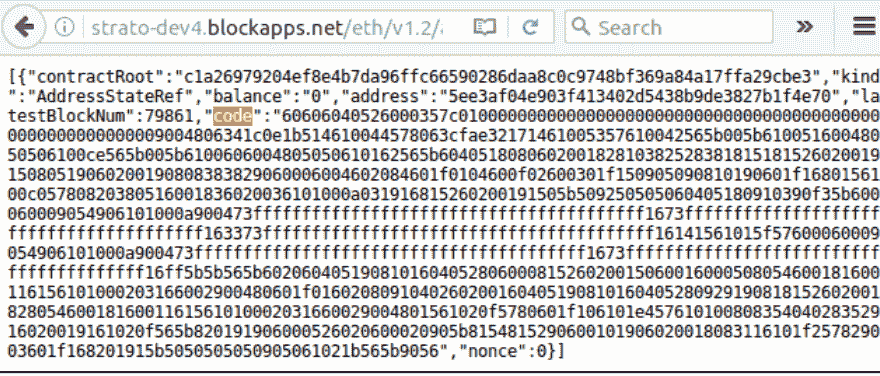

此外，BlockApps 提供了一个运行本地 HTTP 服务器的功能，可以使用以下命令启动：

```
$ bloc start
```

这将启动 Web 浏览器，并监听 TCP 端口 8000。

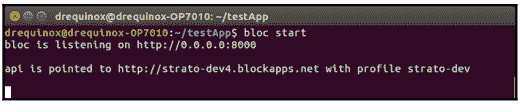

Web 服务器启动后，可以通过本地网页查看和查询已编译的合约，如下面的截图所示：

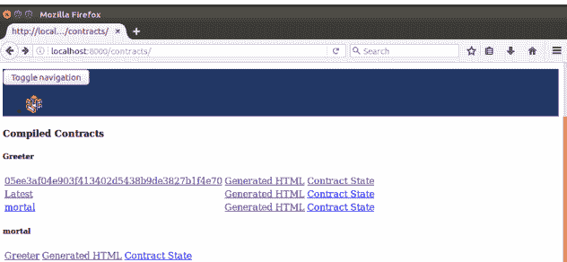

通过浏览器可用的已编译合约

如前面的示例所示，使用 BlockApps 可以更轻松地构建、部署和管理合约。BlockApps 旨在为区块链应用程序提供工具和核心基础设施，而不仅仅是区块链本身。

## Eris

Eris 不是一个单一的区块链，而是一个由 Monax 开发的开源模块化平台，用于开发基于区块链的生态系统应用程序。它提供了各种框架、SDK 和工具，可加速区块链应用程序的开发和部署。Eris 应用平台背后的核心思想是支持区块链后端生态系统应用程序的开发和管理。它允许与多个区块链集成，并使各种第三方系统能够与其他系统交互。该平台使用 Solidity 语言编写的智能合约。它可以与以太坊或比特币等区块链交互。交互可以包括连接命令、启动、停止、断开连接以及创建新的区块链。与区块链的设置和交互相关的复杂性已在 Eris 中被抽象化。所有命令都针对不同的区块链进行了标准化，无论目标区块链类型如何，都可在整个平台上使用相同的命令。

生态系统应用程序可以包含 Eris 平台，使 API 网关能够允许遗留应用程序连接到密钥管理系统、共识引擎和应用引擎。Eris 平台提供了各种工具包，用于向开发人员提供各种服务。这些模块描述如下：

- **链（Chains）**：这允许创建区块链并与之交互。
- **包（Packages）**：这允许开发智能合约。
- **密钥（Keys）**：这用于密钥管理和签名操作。
- **文件（Files）**：这允许处理分布式数据管理系统。它可用于与 IPFS 和数据湖等文件系统交互。
- **服务（Services）**：这提供了一组服务，允许管理和集成生态系统应用程序。

Eris 还开发了多个 SDK，用于开发和管理生态系统应用程序。这些 SDK 包含经过全面测试的智能合约，可满足业务的特定需求和要求。例如，金融 SDK、保险 SDK 和物流 SDK。还有一个基础 SDK，作为管理生态系统应用程序生命周期的基础开发套件。

Monax 开发了自己的许可制区块链客户端，称为 Eris:db。它是一个**基于权益证明（PoS）**的区块链系统，允许与多种不同的区块链网络集成。`Eris:db` 包含三个组件：

- **共识**：这基于前面讨论过的 Tendermint 共识机制。
- **虚拟机**：Eris 使用**以太坊虚拟机（EVM）**，因此它支持用 Solidity 编译的合约。
- **权限层**：作为许可制账本，Eris 提供了一种访问控制机制，可用于为网络上的不同实体分配特定角色。
- **接口**：这提供了各种命令行工具和 RPC 接口，以实现与后端区块链网络的交互。

以太坊区块链与 Eris:db 之间的关键区别在于，Eris:db 使用实用拜占庭容错算法，该算法以基于存款的权益证明（DPOS 系统）实施，而以太坊使用**工作量证明（PoW）**。此外，`Eris:db` 使用 ECDSA ed22519 曲线方案，而以太坊使用 secp256k1 算法。最后，Eris:db 是带访问控制层的许可链，而以太坊是一个公有区块链。

Eris 是一个功能丰富的应用平台，提供大量工具包和服务来开发基于区块链的应用程序。可在 https://monax.io/ 获取。

## 总结

本章首先介绍了其他区块链，并分为两个主要部分，分别讨论区块链和平台。区块链技术是一个非常活跃的领域，因此现有解决方案的变化相当迅速，几乎每天都会出现新的相关技术或工具。本章讨论了一系列经过精心挑选的平台和区块链。还讨论了几种补充前几章内容的解决方案，例如支持以太坊开发的 BlockApps。还讨论了新的区块链，如 Kadena，各种新协议，如 Ripple，以及侧链和驱动链等概念。本章涵盖的材料旨在为读者感兴趣的领域进行更深入的研究奠定坚实基础。如前所述，区块链是一个发展非常迅速的领域，还有许多其他区块链提案项目，例如 Tauchain、Hydrachain、Elements、Credits 等，本章并未讨论。鼓励读者关注该领域的发展，以便跟上这一快速增长的领域的最新进展。
