# 11 区块链——货币之外

## 区块链——货币之外

数字货币是区块链技术的首个应用，可以说当时并未意识到其真正的潜力。随着比特币的发明，区块链的概念首次被引入，但直到 2013 年，随着区块链 2.0 的出现，人们才意识到区块链在众多不同行业中的真正价值和可能应用。此后，区块链技术在不同行业中的许多用例被提出，包括但不限于金融、物联网、数字版权管理、政府和法律。本章选取了四个主要行业进行讨论，即物联网（IoT）、政府、健康、金融。读者将了解所有这些领域，并看到各种相关的用例。

## 物联网

物联网（简称 IoT）近年来因其改变业务应用和日常生活的潜力而受到广泛关注。物联网可以定义为由计算智能物理对象组成的网络，这些对象能够连接到互联网，感知现实世界的事件或环境，对这些事件做出反应，收集相关数据，并通过互联网进行通信。这个简单的定义具有深远的影响，并催生了令人兴奋的概念，如可穿戴设备、智能家居、智能电网、智能互联汽车和智慧城市，这些都基于物联网设备的基本概念。在剖析了上述物联网的定义后，物联网设备执行的四个功能凸显出来：感知、反应、收集和通信。所有这些功能都是通过使用物联网设备上的各种组件来执行的。


Sensing is performed by sensors. Reacting or controlling is performed by actuators, collection is a function of various sensors, and communication is performed by chips that provide network connectivity. One thing to note is that all these components are accessible and controllable via the Internet in the IoT. An IoT device on its own is perhaps useful to some extent but if it is part of a larger IoT ecosystem it is more valuable.

A typical IoT can consist of many physical objects connecting with each other and to a centralized cloud server. This is shown in the diagram below:

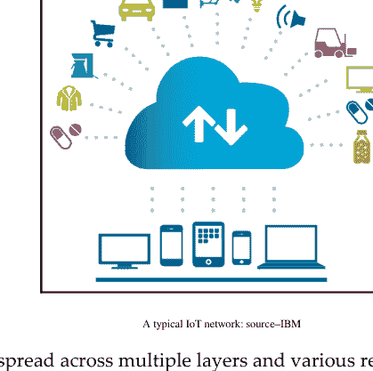

A typical IoT network: source-IBM

Elements of IoT are spread across multiple layers and various reference architectures exist that can be used to develop IoT systems. Generally, a five layer model can be used to describe IoT, which contains a physical object layer, device layer, network layer, services layer, and application layer. Each layer or level is responsible for various functions and includes various components. These are described in detail below.

## Physical object layer

These include any physical real-world objects includes people, animals, cars, trees, fridges, trains, factories, homes, and in fact anything that is required to be monitored and controlled can be connected to the IoT.

## Device layer

This layer contains things that make up the IoT such as sensors, transducers, actuators, smart phones, smart devices, and Radio Frequency Identification tags (RFIDs). There can be many categories of sensors such as body sensors, home sensors, and environmental sensors based on the type of work they perform. This is the core of an IoT ecosystem where various sensors are used to sense real-world environments. This includes sensors that can monitor temperature, humidity, liquid flow, chemicals, air, pressure, and much more. Usually, an Analog to Digital Converter (ADC) is required on a device in order to turn the real-world analog signal into a digital signal that a microprocessor can understand.

Actuators in this layer provide the means to enable control of external environments, for example, starting a motor or opening a door. These components also require digital to analog converters in order to convert a digital signal into analogue. This is especially relevant when control of a mechanical component is required by the IoT device.

## Network layer

This layer is composed of various network devices that are used to provide Internet connectivity between devices and to the cloud or servers that are part of the IoT ecosystem. These devices can include gateways, routers, hubs, and switches. This layer can include two types of communication. First is the horizontal means of communication, which includes radio, Bluetooth, WiFi, Ethernet, LAN, ZigBee, and PAN and can be used to provide a communication between IoT devices. Second, we have communicating to the next layer, which is usually through the Internet and provides communication between machines and people or other upper layers. The first layer can optionally be included in the device layer as it physically is residing on the device layer where devices can communicate with each other at the same layer.

## Management layer

This layer provides the management layer for the IoT ecosystem. This includes platforms that enable processing of data gathered from the IoT devices and turn that into meaningful insights. Also, device management, security management, and data flow management are included in this layer. It also manages communication between the device and application layers.

## Application layer

This layer includes applications running on top of the IoT network. This can include a number of applications depending on the requirements such as transportation, healthcare, financial, insurance, or supply chain management. This of course is not an exhaustive list by any stretch of the imagination; there is a myriad of IoT applications that can fall into this layer:

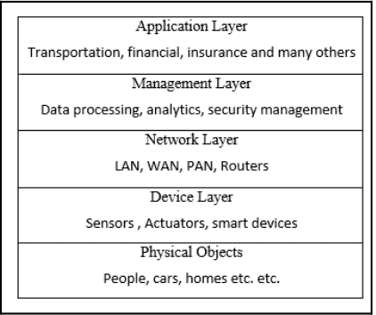

With the availability of cheap sensors, hardware, and bandwidth, IoT has gained popularity in recent years and currently has applications in many different areas including healthcare, insurance, supply chain management, home automation, industrial automation, and infrastructure management. Moreover, advancements in technology such as the availability of IPv6, smaller and powerful processors, and better Internet access have also played a vital role in the popularity of IoT. The benefits of IoT range from cost saving to enabling businesses to make vital decisions and thus improve performance based on the data provided by the IoT devices. Raw data from millions of things (IoT devices) is analyzed and provides meaningful insights that help in making timely and effective business decisions.

The above mentioned five-layer IoT model can be adapted to a blockchain-based model by adding a blockchain layer on top of the network layer. This layer will run smart contracts, and provide security, privacy, integrity, autonomy, scalability, and decentralization services to the IoT ecosystem. The management layer in this case can consist of only software related to analytics and processing, and security and control can be moved to the blockchain layer. This can be visualized in the following diagram:

| Application Layer |
| Transportation, financial, insurance and many others |
| Management Layer |
| Data processing, analytics |
| Blockchain Layer |
| Security, P2P (M2M) autonomous transactions, decentralization, smart contracts |
| Network Layer |
| LAN, WAN, PAN, Routers |
| Device Layer |
| Sensors , Actuators, smart devices |
| Physical Objects |
| People, cars, homes etc. etc. |

Blockchain-based IoT model

In this model, other layers would perhaps remain the same but an additional blockchain layer will be introduced as a middleware between all participants of the IoT network.

It can also be visualized as a peer-to-peer IoT network after abstracting away all the layers mentioned above. This is shown in the following diagram where all devices are communicating and negotiating with each other without a central command and control entity:

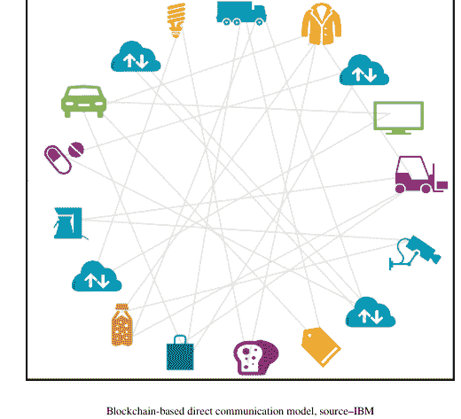

Blockchain-based direct communication model, source-IBM

It can also result in cost saving which is due to easier device management by using a blockchain based decentralised approach. The IoT network can be optimized for performance by using blockchain. In this case there will be no need to store IoT data centrally for millions of devices because storage and processing requirements can be distributed to all IoT devices on the blockchain. This can result in completely removing the need for large data centres for processing and storing the IoT data.

Blockchain-based IoT can also thwart denial of service attacks where hackers can target a centralized server or data centre more easily but with blockchain's distributed and decentralized nature, such attacks are no longer possible. Additionally, if as estimated there will be billions of devices connected to the Internet in the near future, it will become almost impossible to manage security and updates of all those devices from traditional centrally-owned servers. Blockchain can provide a solution to this problem by allowing devices to communicate with each other directly in a secure manner and even request firmware and security updates from each other. On a blockchain network these communications can be recorded immutably and securely which will provide auditability, integrity, and transparency to the system. This is not possible with traditional P2P systems.

In summary, there are clear benefits that can be reaped with the convergence of IoT and blockchain and a lot of research and work in academia and industry are already in progress. There are various projects already proposed providing blockchain-based IoT solutions. For example, IBM Blue Horizon and IBM Bluemix are IoT platforms supporting blockchain IoT platforms. Various start-ups such as Filament have already proposed novel ideas on how to build a decentralised network that enables devices on IoT to transact with each other directly and autonomously driven by smart contracts.

In the following section, a practical example is provided on how to build a simple IoT device and connect it to the Ethereum blockchain. This IoT device is connected to the Ethereum blockchain and is used to open a door (in this case the door lock is represented by an LED) when the appropriate amount of funds are sent by a user on the blockchain. This is a simple example and requires a more rigorously-tested version in order to implement it in production but it demonstrates how an IoT device can be connected, controlled, and responded to in response to certain events on an Ethereum blockchain.

## IoT blockchain experiment

This example makes use of a Raspberry device which is a Single Board Computer (SBC). Raspberry Pi is a single-board computer developed as a low cost computer to promote computer education but has also gained much more popularity as a tool of choice for building IoT platforms. A Raspberry Pi 3 model B is shown in the following figure:

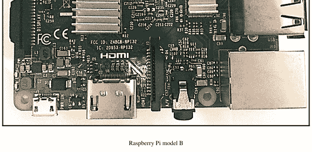


在以下章节中，将讨论一个示例，其中 Raspberry Pi 将作为物联网设备连接到以太坊区块链，并在收到智能合约调用时执行相应操作。

首先，需要对 Raspberry Pi 进行设置。这可以通过使用 NOOBS 完成，它提供了一种安装 Raspbian 或其他操作系统的简便方法。可以从链接 https://www.raspberrypi.org/downloads/noobs/ 下载并安装。或者，也可以仅从链接 https://www.raspberrypi.org/downloads/raspbian/ 安装 Raspbian。另一种选择是使用 https://github.com/debian-pi/raspbian-ua-netinst 上提供的工具，它也可以用来安装一个最小的无图形界面的 Raspbian 操作系统。出于本示例的目的，我们使用 NOOBS 安装 Raspbian，因此后续练习均假设 Raspbian 已安装在 Raspberry Pi 的 SD 存储卡上。

Raspbian 操作系统安装完成后，下一步是为 Raspberry Pi 的 ARM 平台下载合适的 geth 二进制文件。可以在 Raspberry Pi 的 Raspbian 操作系统中的终端窗口运行以下命令来确认平台。命令输出会显示操作系统正在运行的架构。在本例中是 armv7l，因此将下载与 ARM 兼容的 geth 二进制文件。

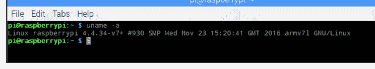

Raspberry Pi 的架构

以下步骤将进行详细说明：

- 1. 下载 geth：请注意，下面的示例中下载的是一个特定版本，但也可以从 https://geth.ethereum.org/downloads/ 下载其他可用版本。
  
      wget https://gethstore.blob.core.windows.net/builds/geth-linux-arm7-1.5.6-2a609af5.tar.gz
  
- 2. 解压并提取到指定目录，执行下面的 tar 命令后，会自动创建一个名为 geth-linux-arm7-1.5.6-2a609af5 的目录：
  
      tar -zxvf geth-linux-arm7-1.5.6-2a609af5.tar

这将创建一个名为 geth-linux-arm7-1.5.6-2a609af5 的目录，并将 geth 二进制文件及相关文件解压到该目录中。可以将 geth 二进制文件复制到 /usr/bin 或 Raspbian 上的适当路径，以便在操作系统的任何位置都能访问它。下载完成后，下一步是创建创世区块。

需要使用之前在第8章“以太坊开发”中创建的同一个创世区块。可以从网络中的其他节点复制创世文件。如下面的截图所示。或者，也可以生成一个全新的创世区块。这一点已在第8章“以太坊开发”中详细讨论过。

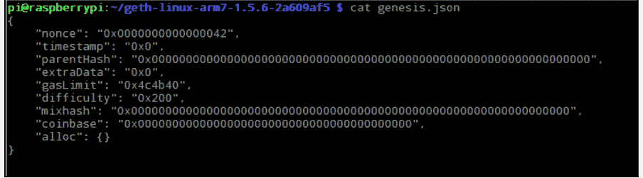

创世文件

将 genesis.json 文件复制到 Raspberry Pi 后，可以运行以下命令来生成创世区块。必须使用之前生成的完全相同的创世区块，这一点非常重要，否则节点实际上将在不同的网络上运行：

```
$ ./geth init genesis.json
```

这将显示与下面截图类似的输出：

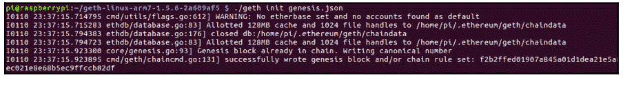

初始化创世文件

创建创世区块后，需要向网络中添加对等节点。这可以通过创建一个名为 static-nodes.json 的文件来实现，该文件包含 Raspberry Pi 上的 geth 将要连接以进行同步的对等节点的 enode ID。

```
pi@raspberrypi:~/.ethereum $ cat static-nodes.json
[
"enode://44352ede5b9e792e437c1c0431c1578ce3676a87e1f588434aff1299d30325c233c8d426fc57a25380481c8a36fb3be2787375e932fb4885885f6452f6efa77f@192.168.0.19:30301"
]
```

静态节点配置

此信息可以从 geth JavaScript 控制台中通过运行以下所示命令获取，此命令应在 Raspberry Pi 将要连接的对等节点上运行：

```
> Admin.nodeInfo
```

这将显示与下面截图类似的输出：

```
> admin.nodeInfo
{
enode: "enode://44352ede5b9e792e437c1c0431c1578ce3676a87e1f588434aff1299d30325c233c8d426fc57a25380481c8a36fb3b87375e932fb4885885f6452f6efa77f@[]:30301",
id: "44352ede5b9e792e437c1c0431c1578ce3676a87e1f588434aff1299d30325c233c8d426fc57a25380481c8a36fb3be2787375e9 4885885f6452f6efa77f",
```

geth 节点信息

完成此步骤后，可以按照下面给出的进一步说明，将 Raspberry Pi 连接到私有网络上的其他节点。在示例中，Raspberry Pi 将连接到在第8章“以太坊开发”中创建的网络 ID 786。关键是使用之前创建的相同创世文件以及不同的端口号。不过，不同端口并非严格必需。如果两个节点在私有网络中运行，并且需要从网络外部环境进行访问，那么将使用 DMZ/路由器和端口转发的组合。因此，建议使用不同的 TCP 端口，以便端口转发能够正常工作。下面的命令中的身份切换参数（之前尚未介绍过）可以为节点指定一个标识名称。

## 第一个节点设置

首先，需要使用以下命令在第一个节点上启动 `geth`：

```bash
$ geth --datadir .ethereum/privatenet/ --networkid 786 --maxpeers 5 --rpc --rpcapi web3,eth,debug,personal,net --rpcport 9001 --rpccorsdomain "*" --port 30301 --identity "drequinox"
```

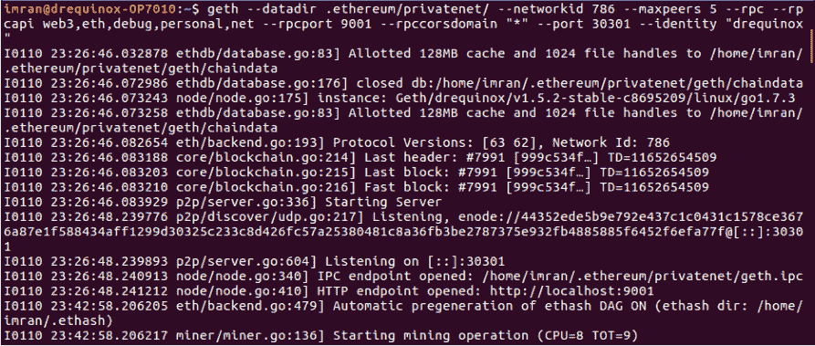

`geth` 启动后，应保持其运行，并从 Raspberry Pi 节点启动另一个 `geth` 实例。

## Raspberry Pi 节点设置

在 Raspberry Pi 上，需要运行以下命令来启动 `geth` 并使其与其他节点（本例中仅一个节点）同步。命令如下：

```bash
$ ./geth --networkid 786 --maxpeers 5 --rpc --rpcapi web3,eth,debug,personal,net --rpccorsdomain "*" --port 30302 --identity "raspberry"
```

这应该会产生与下面截图类似的输出。当输出中包含显示 **区块同步已启动** 的行时，表示该节点已成功连接到其对等节点。

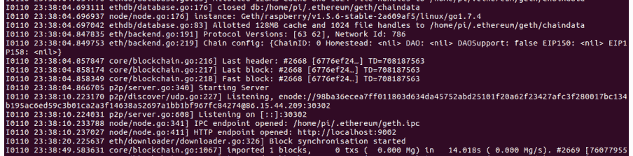

Raspberry Pi 上的 geth。

可以通过在两个节点的 geth 控制台中运行命令来进一步验证这一点，如下面的截图所示。在 Raspberry Pi 上只需运行以下命令即可附加到 geth：

```
$ geth attach
```

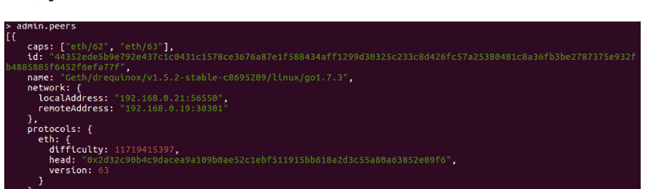

在 Raspberry Pi 上运行 geth 控制台 admin peers 命令

类似地，可以在第一个节点上运行以下命令来附加到 geth：

```
$ geth attach ipc:.ethereum/privatenet/geth.ipc
```

一旦控制台可用，就可以运行 admin.peers 来显示其他已连接节点的详细信息，如下面的截图所示：

```
> admin.peers
[
  {
    caps: ["eth/62", "eth/63"],
    id: "98a36ecaff011803d634da45752abd2510f20a62f23427afc3f2b0017bc134833dd5ba400bb195ac6ed59c3b01ca2a3f1460a8a52097a1bbb f967fc84274",
    name: "Geth/raspberry/v1.5.6-stable-2a609af5/linux/go1.7.4",
    network: {
      localAddress: "192.168.0.19:30301",
      remoteAddress: "192.168.0.21:56512"
    },
    protocols: {
      eth: {
        difficulty: 11700366137,
        head: "0x1188f5b8a4900a1d771d333141ea9480d78400bb8e561494ab436519ae64e1e34",
        version: 63
      }
    }
  }
]
```

在另一个对等节点上运行 geth 控制台 admin peers 命令

两个节点都启动并运行后，可以安装进一步的前提条件来准备实验。需要安装 Node.js 和相关 JavaScript 库。下面列出了所需的库和依赖项。首先需要在 Raspberry Pi 的 Raspbian 操作系统上更新 Node.js 和 npm。为此，可以按照以下步骤操作：

- 1. 使用以下命令在 Raspberry Pi 上安装最新版 Node.js：

```
$ curl -sL https://deb.nodesource.com/setup_7.x | sudo -E bash -
```

这应该会显示类似下面的输出。输出内容很大，因此下面的截图仅显示输出的顶部部分：

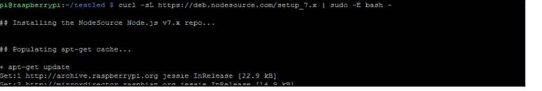

Node.js 安装

- 2. 通过 apt-get 运行更新：

```
$ sudo apt-get install nodejs
```


Verification can be performed by running the following command to ensure that the correct version of Node.js and npm are installed, as shown in the following screenshot below:

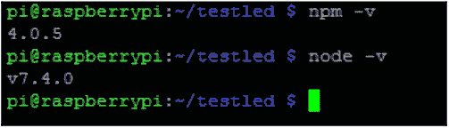

npm and node installation verification

It should be noted that these version are not a necessity; any latest version of npm and node will work. The examples in this chapter makes use of npm 4.0.5 and node v7.4.0.

- 3. Install Ethereum web3 npm, which is required to enable JavaScript code to access the blockchain:

```
```text
pi@raspberrypi:~/testled $ npm install web3
testled@1.0.0 /home/pi/testled
└── web3@0.18.0
    └── bignumber.js@2.0.7 (git+https://github.com/debris/bignumber.js.git#94d7146671b9719e00a09c29b01a691bc85048c2)

npm WARN testled@1.0.0 No repository field.
pi@raspberrypi:~/testled $
```
```

npm install web3

- 4. Similarly, `npm install onoff` can be installed, which is required in order to communicate with the Raspberry Pi and control GPIO:

```
```text
pi@raspberrypi:~/testled $ npm install onoff --save
testled@1.0.0 /home/pi/testled
└── onoff@1.1.1

npm WARN testled@1.0.0 No repository field.
pi@raspberrypi:~/testled $
```
```

onoff installation

When all prerequisites are installed, hardware setup can be performed. For this purpose a simple circuit is built using a breadboard and a few electronic components.

These components are listed as follows:

- 1. **LED**: The abbreviation of **Light Emitting Diode**, this can be used as visual indication for an event.
- 2. **Resistor**: A 330 ohm component is required which provides resistance to passing current based on its rating. It is not necessary to understand the theory behind it for this experiment; any standard electronics engineering text covers all these topics in detail.
- 3. **Breadboard**: This provides a means of building an electronic circuit without requiring soldering.
- 4. **T-Shaped cobbler**: This is inserted on the breadboard as shown in the figure below and provides a labeled view of all **GPIO (General Purpose I/O)** pins for the Raspberry Pi.
- 5. **Ribbon cable connector**: This is simply used to provide connectivity between the Raspberry Pi and the breadboard via GPIO. All these components are shown in the following image:

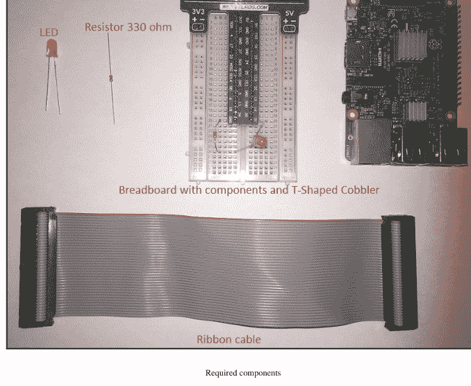

## Circuit

As shown in the following image, the positive leg (long leg) of the LED is connected to pin number 21 of the GPIO and the negative (short leg) is connected to the resistor, which is then connected to the **ground (GND)** pin of the GPIO. Once the connections are set up the ribbon cable can be used to simply connect to the GPIO connector on the Raspberry Pi.

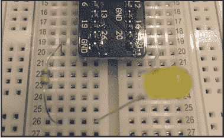

Once the connections are set up correctly and the Raspberry Pi has been updated with the appropriate libraries and geth, the next step is to develop a simple smart contract that expects a value. If the value provided to it is not what it expects it does not trigger an event; otherwise, if the value passed matches the correct value, the event triggers which can be read by the client JavaScript programme running via Node.js. Of course, the solidity contract can be very complex and can also deal with the ether sent to it and if the amount of ether is equal to the required amount then the event can trigger; but in this example the aim is to demonstrate the usage of smart contracts to trigger events that can then be read by JavaScript programmes running on Node.js, which then in turn can trigger actions on IoT devices using various libraries.

The smart contract source code is shown as follows:

```
```solidity
pragma solidity ^0.4.0;
contract simpleIOT {
    uint roomRent=10;
    event roomRented(bool returnValue);
    function getRent (uint8 x) returns (bool)
    {
        if (x==roomrent)
        {
            roomRented(true);
            return true;
        }
    }
}
```
```

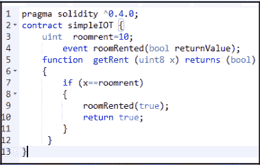

The solidity online compiler can be used to run and test this contract. The Application Binary Interface (ABI) required for interacting with the contract is also available in the Interface field as shown in the following screenshot:

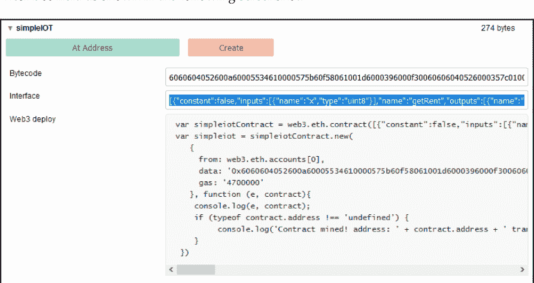

Solidity online compiler

There are two methods by which Raspberry node can connect to the private blockchain via the web3 interface. The first is where the raspberry device is running its own geth and maintains its own ledger but with resource-constrained devices it is not possible to run a full geth node, or even a light node in a few circumstances. In that case, the web3 provider can be initialized to connect to the appropriate RPC channel. This will be shown later in the client JavaScript Node.js programme. A comparison of both of these approaches is shown in the following diagram:

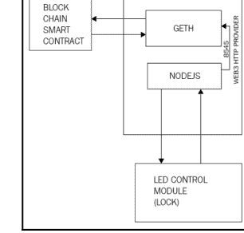

Application architecture of room rent IoT application (IoT device with local ledger)

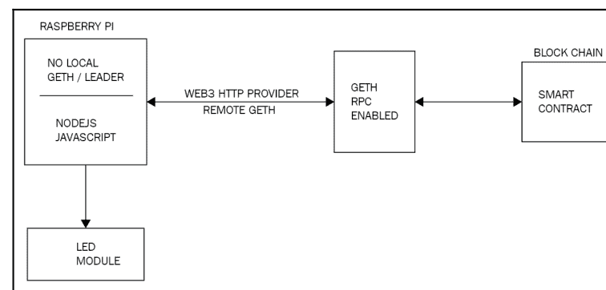

Application architecture of room rent IoT application (IoT device without local ledger)

There are obvious security concerns which arise from exposing RPC interfaces publicly, therefore it is recommended that this option is used only on private networks and if required to be used on public networks appropriate security measures are put in place, such as allowing only the known IP addresses to connect to the geth RPC interface. This can be achieved by a combination of disabling peer discovery mechanisms and HTTP-RPC server listening interfaces. More information about this can be found in geth help. The traditional network security measures such as firewalls, Transport Layer Security (TLS) and certificates can also be used, but have not been discussed in this example.

After the contract is mined, `roomRented` will be triggered, which will turn the LED on. In this example it is a simple LED but it can be any physical device such as a room lock that can be controlled via an actuator. If all works well, the LED will be turned on as a result of the smart contract function invocation as shown in the following image:

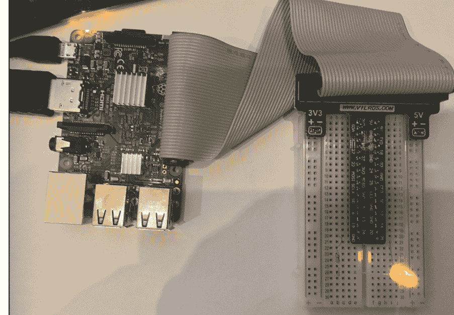

Raspberry Pi with LED control

As demonstrated in the preceding example, a private network of IoT devices can be built that runs a geth client on each of the nodes and can listen for events from smart contracts and trigger an action accordingly. The example shown is simple on purpose but demonstrates the underlying principles of an Ethereum network that can be built using IoT devices along with smart contract-driven control of the physical devices.

In the next section, other applications of the blockchain technology in government, finance, and health will be discussed.

## Government

There are various applications of blockchain being researched currently that can support government functions and take the current model of e-government to the next level. First, in this section some background for e-government will be provided and then a few use cases such as e-voting, homeland security (border control), and electronic IDs (citizen ID cards) will be discussed.

E-government or electronic government is a paradigm where information and communication technology is used to deliver public services to citizens. The concept is not new and has been implemented in various countries around the world but with blockchain a new avenue of exploration has opened up. Many governments are researching the possibility of using blockchain technology for managing and delivering public services. Transparency, auditability, and integrity are attributes of blockchain that can go a long way in effectively managing various government functions.

### Border control

Automated border control systems have been in use for decades now in order to thwart illegal entry into countries and prevent terrorism and human trafficking.

Machine-readable travel documents and specifically biometric passports have paved the way for automated border control; however current systems are limited to a certain extent and blockchain technology can provide solutions. A **Machine-readable Travel Document (MRTD)** standard is defined in document ICAO 9303 by the **International Civil Aviation Organization (ICAO)** and has been implemented by many countries around the world.

Each passport contains various security and identity attributes that can be used to identify the owner of the passport and also circumvent attempts at tampering with the passports. These include biometric features such as retina scan, finger prints, facial recognition, and standard ICAO specified features including **Machine Readable Zone (MRZ)** and other text attributes that are visible on the first page of the passport.

One key issue with current border control systems is centralization whereby the systems are controlled by a single entity and the fact that data is not readily shared between law enforcement agencies. This makes it difficult to track suspected individuals. Another issue is related to the immediate implementation of blacklisting of a travel document, for example, when there is an immediate need to track and control suspected travel documents. Currently, there is no mechanism available to immediately blacklist or revoke a suspected passport.


## 区块链——货币之外的应用

区块链可以通过在智能合约中维护一个黑名单来解决这一问题，该黑名单可根据需要更新，任何变更都会立即对所有机构和边境检查点可见，从而能够对可疑旅行证件的流动实施即时管控。或许有人会争辩说，传统的机制（如PKI和P2P网络）也可以用于此目的，但它们无法提供区块链所能带来的好处。借助区块链，整个系统可以简化，无需复杂的网络和PKI设置，这也会降低成本。此外，基于区块链的系统将提供密码学上保证的不可篡改性，这有助于审计并抑制任何欺诈行为。

由于可扩展性问题，目前所有旅行证件的完整数据库或许无法存储在区块链上，但可以使用诸如BigChainDB、IPFS或Swarm之类的后端分布式数据库来存储。在这种情况下，可以将旅行文档的哈希与个人的生物识别ID一起存储在简单的智能合约中，然后使用文档的哈希来引用分布式文件系统（如IPFS）上可用的详细数据。这样，当某个旅行证件在网络中的任何位置被列入黑名单时，该信息将立即可用，并在整个分布式账本上获得其真实性和完整性的密码学保证。这一功能还可以为反恐活动提供有效支持，从而在政府的国土安全职能中发挥至关重要的作用。

一个用Solidity编写的简单合约可以定义一个数组，用于存储身份和相关的生物识别记录。该数组可用于存储护照的识别信息。身份可以是护照或旅行证件的**机器可读区（MRZ）**的哈希与RFID芯片中的生物识别记录拼接后的哈希。一个简单的布尔字段可用于标识被列入黑名单的护照。一旦初步检查通过，进一步详细的生物识别验证可由传统系统执行，最终当就护照持有者的入境做出决定时，该决定可以被回传至区块链，从而使网络上的所有参与者能够立即共享该决定的结果。

构建基于区块链的边境控制系统的高级方法可如下图所示。在该场景中，护照被呈递给RFID和页面扫描仪进行扫描，扫描仪读取数据页并提取机器可读信息以及存储在RFID芯片中的生物识别数据的哈希。在此阶段，还会拍摄护照持有者的实时照片和视网膜扫描。然后该信息被传递到区块链，在区块链上，智能合约负责验证旅行证件的合法性，首先检查其自身的黑名单护照列表，然后向后端IPFS数据库请求更多数据以进行比较。请注意，照片或视网膜扫描等生物识别数据不会存储在区块链上，只有后端（IPFS或BigChainDB）中这些数据的引用会存储在区块链中。

如果所呈递护照的数据与IPFS中以文件形式存有或在BigChainDB中的数据匹配，并且也通过了智能合约的逻辑检查，那么边境闸门就可以打开。


使用区块链的自动边境管控

验证完成后，该信息会在整个区块链中传播，并立即为边境管控区块链上的所有参与者所用。这些参与者可以是由各国国土安全部门组成的全球联盟。

## 投票

任何政府的投票都是一项关键职能，它使公民能够参与民主选举过程。尽管投票随着时间的推移已经演变得更加成熟和安全，但为了实现理想的成熟度，仍有一些限制需要解决。通常，当前投票系统的限制围绕欺诈、操作流程中的弱点，尤其是透明度问题。多年来，人们构建了安全的投票机制，使用专门的投票机来保证安全性和隐私性，但这些机器仍然存在可被利用的漏洞，从而破坏其安全机制。这可能对整个投票过程产生严重影响，并导致公众对政府的不信任。

基于区块链的投票系统可以通过在该过程中引入端到端的安全性和透明度来解决这些问题。安全性通过使用公钥密码学以投票的完整性和真实性的形式提供，这在区块链中属于标准配置。此外，区块链保证的不可篡改性确保了一旦投票就不能再次投票。这可以通过生物识别特征与维护已投票名单的智能合约相结合来实现。例如，智能合约可以维护一个已投票列表，其中包含生物识别ID（例如指纹），并利用该列表检测和防止重复投票。其次，零知识证明也可以用于区块链，以保护投票者在区块链上的隐私。

## 公民身份识别（身份证）

目前，世界各地的许多国家都会签发电子身份证或国民身份证。这些证件是安全的，并具有许多安全特性，可阻止复制或篡改的企图。然而，随着区块链技术的出现，这一过程可以做出多项改进。

数字身份不仅限于政府签发的身份证，它也是一个适用于在线社交网络和论坛的概念。可以针对不同目的使用多种身份。基于区块链的在线数字身份允许对个人信息共享进行控制。用户可以查看谁使用了他们的数据、用于什么目的，并可以控制对其的访问。这在当前集中控制的基础设施中是不可能的。关键好处在于，由政府签发的单一身份可以通过政府区块链轻松透明地用于多种服务。在这种情况下，区块链充当一个平台，政府在其中提供养老金、税收或福利等各种服务，而单一ID被用于访问所有这些服务。在此场景下，区块链为数字ID发起的每一项变更和交易提供了不可篡改的记录，从而确保了系统的完整性和透明度。同时，公民可以在区块链上对出生证明、婚姻、契约和许多其他文件进行公证，并将其与数字ID绑定，作为存在性证明。

目前，各国已有一些运行良好的身份方案成功实施，也有人认为也许身份管理系统中并不真正需要区块链。尽管区块链具有隐私以及对身份信息使用的控制等若干好处，但由于当前区块链技术尚不成熟，也许它还没有准备好用于现实世界的身份系统。然而，各国政府正在进行研究，以探索将区块链用于身份管理。

此外，诸如“被遗忘权”之类的法律可能很难纳入区块链，因为区块链具有不可篡改的特性。

## 其他应用

区块链技术可应用于其他政府职能以改善成本和效率，这些职能包括税收征收、福利管理和发放、土地所有权记录管理、人生事件登记（婚姻、出生）、机动车登记和许可证。这并非详尽列表，随着时间推移，政府的许多职能和流程都可以适应基于区块链的模式。区块链的主要优势，如不可篡改性、透明性和去中心化，有助于改进大多数传统政府系统。

## 医疗健康

医疗健康行业已被确定为另一个可以通过采用区块链技术而受益的主要行业。区块链提供了一个传统P2P网络无法提供的不可篡改、可审计、透明的系统。此外，与传统复杂的PKI网络相比，区块链提供了一种成本效益更高、更简单的基础设施。在医疗保健领域，互操作性缺乏、流程过于复杂、透明度不够、可审计性不足以及控制不力等问题，可能会引发隐私泄露、数据泄露、高成本和欺诈等重大问题。另一个棘手的问题是假药问题，尤其是在发展中国家，这是一个主要的关切点。

随着区块链在医疗领域的可适应性，可以实现诸多好处，包括节省成本、增强信任、更快处理理赔、高可用性、因操作流程复杂性导致的运营错误得以消除，以及阻止假药的流通。

从另一个角度来看，提供数字货币作为挖矿激励的区块链可以用来提供计算能力，以解决有助于找到某些疾病疗法的科学问题。例如FoldingCoin，它通过共享计算机处理能力来解决需要特别大量计算的科学问题，从而用FLDC代币奖励其矿工。FoldingCoin的网址是http://foldingcoin.net/。另一个类似项目叫做CureCoin，可在https://www.curecoin.net/获取。这些项目在实现其目标方面能取得多大成功还有待观察，但这个想法非常令人期待。


## 金融

区块链在金融行业有许多应用。当前区块链在金融领域是最热门的话题，主要银行和金融机构都在研究如何适应区块链技术，尤其由于其具有高度期望的成本节约潜力。

## 保险

在保险行业，区块链技术可以帮助阻止欺诈性索赔，加快索赔处理速度，并实现透明度。想象一下所有保险公司之间共享的一本账本，可以为处理公司间索赔提供快速高效的机制。此外，随着物联网与区块链的融合，可以想象一个智能设备生态系统，其中所有这些设备都能够通过区块链上的智能合约协商和管理自己的保险单。

区块链可以降低处理索赔所需的总体成本和工作量。索赔可以通过智能合约以及保险单持有人的相关身份自动验证并支付。例如，一个智能合约在预言机和可能的物联网的帮助下可以确保当事故发生时，它可以记录相关的遥测数据，并基于此信息释放付款。它也可以在智能合约评估付款条件后得出不应释放付款时扣留付款。例如，在车辆未由授权维修店维修或在指定区域外使用等场景下。智能合约可以评估许多条件来处理索赔，而这些规则的选择取决于保险公司，但总体思路是智能合约结合物联网和预言机可以自动化整个车辆保险行业。

Several start-ups such as Dynamis have proposed smart contract-based peer-to-peer insurance platforms that run on Ethereum blockchain. This is initially proposed to be used for unemployment insurance and does not require underwriters in the model. It is available at http://dynamisapp.com/.

## 交易后结算

这是区块链技术最受追捧的应用。目前，许多金融机构正在探索使用区块链技术简化、自动化并加快昂贵且耗时的交易后结算流程的可能性。

在反洗钱方面，由于区块链不可变、共享和透明的特性，监管机构可以轻松获得对私有区块链的访问权限，在那里他们可以获取相关监管报告的数据。这也将减少与当前监管报告范式相关的复杂性和成本，在该范式中，数据从各种遗留和分散的系统中获取并汇总和格式化以用于报告目的。

区块链可以提供对系统中所有金融交易的单一共享视图，这些交易在密码学上是安全、真实且可审计的，从而降低与当前采用的监管报告方法相关的成本和复杂性。

## 媒体

媒体行业的关键问题围绕内容分发、权利管理和向艺术家支付版税。例如，数字音乐可以被多次复制而没有任何限制，任何试图应用复制保护的尝试都以某种方式被破解。对音乐家或词曲作者制作的内容的分发没有任何控制；它可以被复制任意多次而没有任何限制，从而影响版税支付。此外，付款并不总是得到保证，并且基于传统的播出时间数据。所有这些围绕复制保护和版税支付的问题都可以通过连接消费者、艺术家和行业中的所有参与者来实现解决，从而实现过程的透明度和控制。

区块链可以提供一个网络，其中数字音乐在密码学上保证仅由付费的消费者拥有。这种付款机制由智能合约控制，而不是中央媒体机构或权威机构。付款将根据嵌入在智能合约中的逻辑和'下载'次数自动进行。此外，数字音乐文件的非法复制可以完全停止，因为一切都以不可变和透明的方式记录在区块链上。例如，音乐文件可以存储所有者信息和时间戳，可以在整个区块链网络中追踪。此外，拥有某项内容合法副本的消费者在密码学上与他们拥有的内容绑定，除非得到所有者许可，否则不能转移给另一所有者。一旦所有数字内容不可变地记录在区块链上，版权和转让就可以通过区块链轻松管理。智能合约随后可以控制向所有相关方的分发和付款。

## 总结

区块链技术有许多应用，如本章所述，它们可以在各个行业中实施，为现有解决方案带来多重益处。在本章中，讨论了五个可以从区块链中受益的主要行业。首先讨论了物联网，这本身就是一项革命性技术；通过将其与区块链结合，可以解决几个根本性限制，这为物联网行业带来了巨大的好处。物联网获得了更多关注，因为它是适应区块链技术最大且最成熟的候选者。已经出现了实用的用例和平台，例如用于区块链物联网的**平台即服务**（PaaS），如 IBM Watson IoT 区块链。IBM Blue Horizon 也现已可用于实验，这是一个去中心化的基于区块链的物联网网络。其次，讨论了政府部门的应用，其中各种政府流程，如国土安全、身份证件和福利发放可以变得透明、安全且更稳健。此外，还讨论了金融部门的问题以及区块链技术可以提供的可能解决方案。尽管金融部门以高度的热情和精力探索使用区块链的可能性，但距离生产就绪的基于区块链的系统仍相去甚远。最后，还讨论了一些医疗保健部门和音乐行业的方面。所有这些用例以及行业中更多用例都建立在区块链技术的核心属性所提供的支柱之上，例如去中心化、透明度、可靠性和安全性。然而，在区块链技术能够完全被采用之前，需要解决某些挑战；这些将在下一章中讨论。
