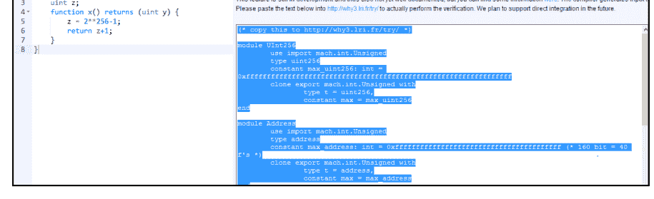
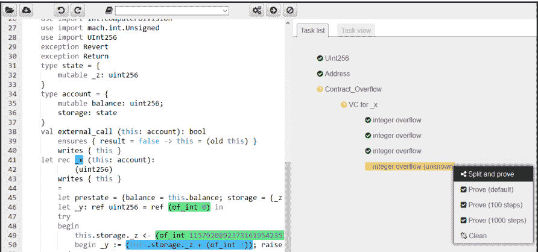
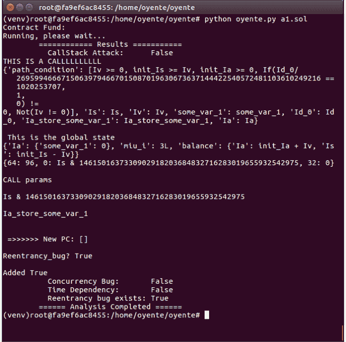

# 12 可扩展性和其他挑战
### 可扩展性和其他挑战

本章旨在介绍在区块链成为主流技术之前需要解决的各种挑战。即使已经开发了各种用例和概念验证系统，并且该技术在许多场景中运行良好，仍然需要解决区块链中存在的一些根本性限制，以使该技术更具适应性。

在这些问题中名列前茅的是可扩展性和隐私。两者都是需要解决的重要限制，尤其是当区块链被设想用于对隐私要求很高的行业时。金融、法律和医疗保健领域对交易保密性有特定要求，而可扩展性通常是区块链无法达到用户期望的足够性能水平时所关心的问题。这两个问题正成为阻碍区块链技术更广泛接受的因素。本章将介绍目前在这两个特定领域提出的和正在进行的研究综述。除了隐私和安全之外，其他挑战还包括监管、集成、适应性和安全性。一般而言。虽然比特币区块链的安全性已被证明是坚不可摧的，并且经受住了时间的考验，但在某些微妙场景中仍可能存在一些漏洞，从而在一定程度上损害安全性。此外，其他区块链，如以太坊，关于智能合约、拒绝服务攻击和大攻击面也存在一些合理的安全问题。所有这些将在以下各节中详细讨论。


## 可扩展性

这个问题在过去几年里一直是激烈辩论、严格研究和媒体关注的焦点。这是可能决定区块链更广泛适应性还是仅限于联盟链的私有使用的最重要问题。由于该领域的大量研究，已经提出了许多解决方案，这些将在下一节中讨论。

从理论角度来看，解决可扩展性问题的总体方法通常围绕协议层面的增强。例如，针对比特币可扩展性常被提及的解决方案是增加其区块大小。其他提案包括链下解决方案，将某些处理卸载到链下网络，例如链下状态网络。基于上述解决方案，一般来说，提案可以分为两类：基于改变区块链运行的基本协议的链上解决方案，以及利用链下网络和处理资源来增强区块链的链下解决方案。

最近，Miller 等人在其立场论文《On Scaling Decentralized Blockchains》中提出了另一种解决区块链限制的方法。在该论文中表明，区块链可以被划分为称为平面的各种抽象层。每个平面负责执行特定功能。这些包括网络平面、共识平面、存储平面、视图平面和侧平面。这种抽象允许以结构化的方式在每个平面单独解决瓶颈和限制。下面结合对比特币系统的一些参考，给出了每个层的简要概述。

首先讨论网络平面。网络平面的关键功能是交易传播。在上述论文中已确定，在比特币中，由于节点在传播之前执行交易验证的方式以及交易传播的重复，第一次在交易广播阶段，然后在挖矿后在区块中，该平面低估了网络带宽。应注意，该问题已由 BIP 152（Compact Block Relay）解决。

第二层称为共识平面。该层负责挖矿和达成共识。该层中的瓶颈围绕工作量证明算法的限制，即增加共识速度和带宽会导致网络安全性受损，因为分叉数量增加。

存储平面是第三层，用于存储账本。该层中的问题围绕每个节点都需要保留整个账本的完整副本，这导致某些效率低下，例如带宽和存储需求增加。比特币提供了一种称为修剪的方法，允许节点在无需下载完整区块链的情况下运行。从存储角度来看，该功能带来了重大改进。

接下来是视图平面，其提出了一种基于比特币矿工不需要完整区块链来运行的优化，并且可以从完整账本中构建视图，作为系统整体状态的表示，这足以使矿工发挥功能。视图的实现将消除挖矿节点存储完整区块链的需求。

最后，侧平面由上述研究论文的作者提出。该平面代表了链下交易的想法，其中使用支付或交易通道的概念来卸载参与者之间的交易处理，但仍由主比特币区块链支持。

上述模型可以用结构化的方式描述当前区块链设计中的限制和改进。此外，在过去几年中提出了几种通用策略，可以解决当前区块链设计（如以太坊和比特币）中的限制。这些方法也在以下部分中分别表征和讨论。

### 区块大小增加

这是提高区块链性能（交易处理吞吐量）最受争议的提案。目前，比特币每秒只能处理大约三到七笔交易，这是在将比特币区块链用于处理微交易时的主要制约因素。比特币中的区块大小被硬编码为 1 MB，但如果区块大小增加，它可以容纳更多交易并可导致更快的确认时间。有多个比特币改进提案（BIPs）支持增加区块大小。这些包括 BIP 100、BIP 101、BIP 102、BIP 103 和 BIP 109。在以太坊中，区块大小不受硬编码限制；相反，它由 gas 限制控制。从理论上讲，以太坊中区块的大小没有限制，因为它取决于 gas 数量，而 gas 数量可以随着时间的推移而增加。这是因为矿工被允许在前一个区块达到限制时为后续区块增加 gas 限制。

### 区块间隔减少

另一个提案是减少每个区块生成之间的时间。区块之间的时间可以减少以实现更快的区块最终化，但可能由于分叉数量增加而导致安全性降低。以太坊已实现大约 14 秒的区块时间，有时还会增加。这与比特币区块链相比是一个显著的改进，后者生成新区块需要 10 分钟。在以太坊中，由区块间隔变小导致的高孤块问题通过使用 **Greedy Heaviest Observed Subtree (GHOST)** 协议得以缓解，其中孤块（叔块）也被纳入确定有效链的考虑。一旦以太坊转向权益证明，这将变得无关紧要，因为无需挖矿即可实现交易的几乎即时最终性。

### 可逆布隆查找表

这是另一种旨在减少比特币节点之间传输数据量的提议方法。**Invertible Bloom lookup tables (IBLTs)** 最初由 *Gavin Andresen* 提出，该方法的主要吸引力在于如果实施不会导致比特币硬分叉。关键思想基于这样一个事实：无需在节点之间传输所有交易；相反，只传输同步节点交易池中尚未可用的交易。这允许节点之间更快地同步交易池，从而提高比特币网络的整体可扩展性和速度。

### 分片

分片并不是一种新技术，已在 MongoDB 和 MySQL 等分布式数据库中用于可扩展性。分片背后的关键思想是将任务拆分为多个块，然后由多个节点处理。这导致吞吐量提高和存储需求减少。在区块链中，采用了类似的方案，其中网络状态被划分为多个分片。状态通常包括余额、代码、nonce 和存储。分片是运行在同一网络上的区块链的松耦合分区。跨分片通信和对每个分片历史的共识存在一些挑战。这是研究的开放领域。

### 状态通道

这是为加速区块链网络上的交易而提出的另一种方法。基本思想是使用侧通道进行状态更新和在主链之外处理交易；一旦状态最终确定，就将其写回主链，从而将耗时的操作从主区块链中卸载。状态通道通过执行以下三个步骤来工作：

- 1. 首先，区块链状态的一部分在智能合约下被锁定，确保参与者之间的协议和业务逻辑。
- 2. 现在在参与者之间开始链下交易处理和交互，目前仅在他们之间更新状态。在此步骤中，可以执行几乎任意数量的交易而无需区块链，这使得该过程快速且成为解决区块链可扩展性问题的最佳候选。然而，可以认为这不是真正的链上解决方案，例如分片，但最终结果是一个更快、更轻且更强大的网络，这在微支付网络、物联网网络和许多其他应用中可能非常有用。
- 3. 一旦达到最终状态，状态通道将被关闭并将最终状态写回主区块链。在此阶段，被锁定的区块链部分也将被解锁。

该技术已在比特币闪电网络和以太坊的 Raiden 中使用。

### 私有区块链

私有区块链本质上是快速的，因为不需要真正的去中心化，网络上的参与者无需挖矿；相反，他们只能验证交易。这可以被视为对公有区块链可扩展性问题的变通方法；然而，这并不是解决可扩展性问题的方案。此外，还应注意私有区块链仅适用于特定领域和设置。

### 权益证明

与其使用工作量证明，基于权益证明算法的区块链从根本上来说更快。


另一方面，最近，由 *Vitalik Buterin* 撰写的以太坊紫色论文已在上海的 Ethereum Devcon 2 上发表；它描述了可扩展以太坊的愿景。紫色提案基于分片和权益证明算法实现的结合。论文中已确定了一些目标，例如通过权益证明实现效率提升、最大化快速出块时间、经济最终性、可扩展性、跨分片通信以及抗审查性。

## Privacy

交易的隐私是区块链非常期望的属性。然而，由于其本质，特别是在公共区块链中，一切都是透明的，从而阻碍了其在隐私至关重要的各个行业中的使用，例如金融、健康等。针对隐私问题提出了不同的方案，并且已经取得了一些进展。几种技术，例如不可区分混淆、同态加密的使用、零知识证明和环签名。所有这些技术都有其优缺点，并在以下章节中进行讨论。

## Indistinguishability obfuscation

这种密码技术可能成为区块链所有隐私和保密问题的银弹，但该技术尚未准备好用于生产部署。**不可区分混淆 (IO)** 允许代码混淆，这在密码学中是一个非常成熟的研究课题，如果应用于区块链，可以作为一种不可破解的混淆机制，将智能合约变成黑盒。IO 背后的关键思想是研究人员所称的 *多线性拼图*，它基本上通过将程序代码与随机元素混合来混淆程序代码，如果程序按预期运行，它将产生预期输出，但任何其他执行方式都会使程序看起来随机且无意义。这个想法最初由 *Sahai* 等人在他们的研究论文 *Candidate Indistinguishability Obfuscation and Functional Encryption for All Circuits* 中提出。

## Homomorphic encryption

这种加密允许对加密数据执行操作。想象一个场景，其中数据被发送到云服务器进行处理。服务器对其进行处理并返回输出，而完全不知道其处理过的数据。这也是一个 ripe 的研究领域，允许对加密数据执行所有操作的完全同态加密仍未完全可在生产中部署；然而，该领域已取得重大进展。一旦在区块链上实现，它可以允许对密文进行处理，从而从根本上实现交易的隐私和保密。例如，存储在区块链上的数据可以使用同态加密进行加密，并且可以在无需解密的情况下对该数据执行计算，从而为区块链提供隐私服务。该概念也已在麻省理工学院媒体实验室的一个名为 Enigma 的项目中实现。Enigma 是一个点对点网络，允许多个参与方对加密数据执行计算，而无需透露有关数据的任何信息。

## Zero knowledge proofs

零知识证明最近已在 Zcash 中成功实现，如前几章所述。更具体地说，已实现了 SNARKs 以确保区块链上的隐私。相同的想法也可以在以太坊和其他区块链中实现。将 Zcash 集成到以太坊上已经是 Ethereum R&D 团队和 Zcash 公司正在进行的非常活跃的研究项目。

## State channels

使用状态通道也可以实现隐私，原因很简单，因为所有交易都在链下运行，主要区块链根本看不到交易，除了最终状态输出，从而确保隐私和保密。

## Secure multiparty computation

安全多方计算的概念并不新鲜，其基于这样一种概念：数据在参与方之间根据秘密共享机制分割成多个分区，然后在数据上进行实际处理，而无需在单台机器上重构数据。处理后产生的输出也将在各方之间共享。

## Usage of hardware to provide confidentiality

可信计算平台可用于提供一种机制，通过该机制可在区块链上实现交易的保密性，例如使用 Intel Software Guard Extension (SGX)，它允许代码在称为飞地的硬件保护环境中运行。一旦代码在隔离的飞地中成功运行，它可以生成一个称为引用的证明，该证明可由 Intel 的云服务器进行证明。然而，人们担心信任 Intel 会导致一定程度的中心化，这与区块链技术的真正精神不一致。尽管如此，该解决方案也有其优点，实际上，许多平台已经使用 Intel 芯片，因此在某些场景下信任 Intel 可能是可以接受的。

如果将该技术应用于智能合约，那么一旦节点执行了智能合约，它就可以生成引用作为正确且成功执行的证明，其他节点只需验证它即可。这一想法可以通过使用任何可信执行环境 (TEE) 进一步扩展，该环境可以提供与飞地相同的功能，并且即使在具有近场通信 (NFC) 和安全元件的移动设备上也可用。

## Coinjoin

Coinjoin 是一种用于通过交互式混合来匿名化比特币交易的技术。其思想是基于从多个实体形成单个交易，而不会导致输入和输出发生变化。它消除了发送方和接收方之间的直接联系，这意味着单个地址不再能与交易相关联，这可能导致用户被识别。Coinjoin 需要多个愿意通过混合支付创建单个交易的参与方之间的合作。因此，应该注意的是，如果 Coinjoin 方案中的任何单个参与方未能履行合作创建单个交易的承诺，例如未按要求签署交易，则可能导致拒绝服务攻击。在此协议中，无需单一可信第三方。此概念不同于充当比特币用户之间可信第三方或中介的混合服务，允许交易洗牌。这种交易洗牌可防止追踪和将付款与特定用户关联。

## Confidential transactions

机密交易使用 Pedersen 承诺来提供保密性。承诺方案允许用户对某个值进行承诺，同时保持其秘密，并能够在以后揭示它。为了设计承诺方案，需要满足的两个属性是绑定性和隐藏性。绑定性确保提交者在承诺后无法更改所选值，而隐藏性确保任何对手都无法找到提交者所承诺的原始值。Pedersen 承诺还允许加法运算并在承诺上保持交换性，这使其特别适用于为比特币交易提供保密性。换句话说，它支持值的同态加密。使用承诺方案允许隐藏比特币交易中的付款价值。该概念已在 Elements Project (https://elementsproject.org/) 中实现。

## MimbleWimble

MimbleWimble 方案在某种程度上神秘地在比特币 IRC 频道上提出，此后获得了很大的人气。MimbleWimble 扩展了机密交易和 Coinjoin 的思想，允许在无需交互的情况下聚合交易。然而，它不支持使用比特币脚本语言以及标准比特币协议的各种其他功能。这使其与现有比特币协议不兼容。因此，它可以作为比特币的侧链实现，也可以作为替代加密货币独立实现。

该方案可以同时解决隐私和可扩展性问题。使用 MimbleWimble 技术创建的区块不包含传统比特币区块链中的交易；相反，这些区块由三个列表组成：输入列表、输出列表和称为超额的列表，这些是签名和输出与输入之间的差异的列表。输入列表基本上是对旧输出的引用，输出列表包含机密交易输出。节点可以通过使用签名、输入和输出来验证这些区块以确保区块的合法性。与比特币不同，MimbleWimble 交易输出仅包含公钥，并且旧输出与新输出之间的差异由参与交易的所有参与方签名。


智能合约安全现在至关重要，许多其他举措也被采取以设计能够分析 Solidity 程序并查找漏洞的方法。一个最近的、开创性的例子是 Oyente，它是由研究人员构建的工具，并在其论文 *Making Smart Contracts Smarter* 中介绍。该论文中发现并分析了智能合约中的若干安全漏洞。这些包括交易排序依赖、时间戳依赖、异常处理不当例如调用栈深度限制利用，以及重入漏洞。交易排序依赖漏洞基本上利用了合约感知状态可能并非执行后合约状态所改变到的状态的场景。这种弱点是一种竞态条件。它也被称为抢先交易，并且由于区块内交易的顺序可以被操纵而成为可能。因为所有交易首先出现在内存池中，内存池中的交易可以在被包含进区块前被监控。这允许在另一笔交易之前提交一笔交易，从而导致控制智能合约的行为。

时间戳依赖漏洞在区块时间戳被用作合约内某种决策制定的来源时是可能的，但时间戳可以被矿工操纵。调用栈深度限制是另一个可以被利用的漏洞，这是由于 EVM 的最大调用栈深度为 1,024 帧。如果在合约执行期间达到栈深度，则在某些场景下，send 或 call 指令可能会失败，导致资金未支付。调用栈深度漏洞已在 EIP-150 硬分叉中得到解决。重入漏洞在 DAO 攻击中被利用，将数百万美元转移到子 DAO 中。重入漏洞基本上意味着一个函数可以在前一次调用尚未完成之前被重复调用。这在 Solidity 智能合约中的以太币提款函数中尤其不安全。

除了上述提到的漏洞外，在编写合约时还应牢记若干其他问题。这些漏洞包括如果向另一个合约发送资金，请谨慎处理，因为 send 可能失败，即使使用 throw 作为 *catch-all* 机制，也不会起作用。

其他标准软件漏洞，如整数溢出和下溢，也相当重要，任何对整数变量的使用都应在 Solidity 中谨慎实现。例如，一个简单的程序使用 uint8 来遍历包含超过 255 个元素的数组的元素可能会导致无限循环。这是因为 uint8 仅限于 256 个数字。

在以下章节中，将分别使用 Why3 和 Oyente 展示两个合约验证的示例。

## Why3 形式化验证

Solidity 代码的形式化验证现在已作为 Solidity 浏览器的功能提供。首先，代码被转换为验证器可理解的 Why3 语言。下面示例中展示了一个简单的 Solidity 代码，定义变量 z 为 uint 的最大限制。当此代码运行时，它将返回 0，因为 uint z 会溢出并重新从 0 开始。这也可以使用 Why3 进行验证，如下所示：



带形式化验证的 Solidity 在线编译器

一旦 Solidity 代码被编译并在形式化验证标签中可用，它可以被复制到 Why3 在线 IDE，地址为 http://why3.lri.fr/try/。下面的示例显示它成功检查并报告了整数溢出错误。



Why3

该工具正在积极开发中，但仍然相当有用。此外，该工具或任何其他类似工具都不是灵丹妙药。即使形式化验证通常也不应被视为万灵药，因为首先规范本身应被适当定义。

## Oyente 工具

目前，Oyente 可作为 Docker 镜像提供，便于测试和安装。它可在 https://github.com/ethereum/oyente 获取，可快速下载并测试。下面示例中，从 Solidity 文档中取的一个包含重入漏洞的简单合约已被测试，并且显示 Oyente 成功分析代码并找到漏洞：

```solidity
pragma solidity ^0.4.0;
contract Fund {
    mapping(address => uint) shares;
    function withdraw() {
        if (msg.sender.send(shares[msg.sender]))
            shares[msg.sender] = 0;
    }
}
```

带重入漏洞的合约 – 来源：Solidity 文档

此示例代码包含一个重入漏洞，这基本上意味着如果一个合约与另一个合约交互或转移以太币，它实际上是将控制权交给了另一个合约。这允许被调用的合约在未等待完成的情况下回调调用它的合约的函数。例如，此漏洞可允许再次又再次地回调前面示例中显示的 withdraw 函数，导致多次获得以太币。这是因为 share 值要到函数结束时才设为 0，这意味着任何后续调用都将成功，导致反复提款。

下面展示了 Oyente 运行以分析所示合约的示例，如以下输出所示，分析已成功找到重入漏洞。建议通过 Solidity 文档中描述的 Checks-Effects-Interactions 模式的组合来处理该漏洞：



Oyente 工具检测 Solidity 漏洞

## 总结

在本章中，读者已了解区块链技术的<|message|> 安全、保密性和隐私方面。隐私也被讨论，这是将公共区块链应用于各个行业的另一个主要制约因素。接下来讨论了智能合约安全，这是当前非常热门的话题。这是一个深奥且广泛的主题，但已给出各个方面的简要介绍，这应为在此领域进一步研究提供坚实基础。例如，形式化验证本身就是一个庞大的研究领域。此外，还提供了形式化验证的示例，以让读者了解有哪些工具可用。应注意，上述工具仍在积极开发中，缺乏各种期望的功能。此外，文档相当稀少；因此，建议读者关注发展，特别是围绕形式化验证以及与 Ethereum Mauve 论文相关的开发，因为它很快将迅速发展。区块链安全领域，尤其是智能合约安全，现在如此成熟，以至于可以就此主题撰写一整本书。学术界和商业部门有许多专家和研究人员正在探索这一领域，很快将会有许多用于验证智能合约的自动化工具可用。
