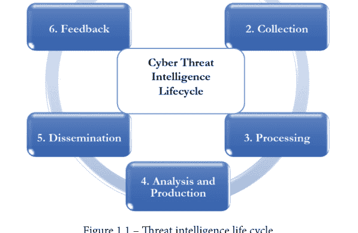
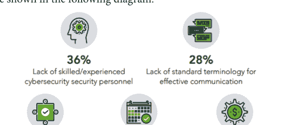
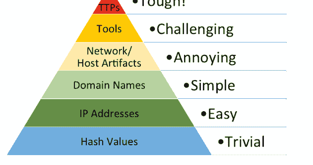
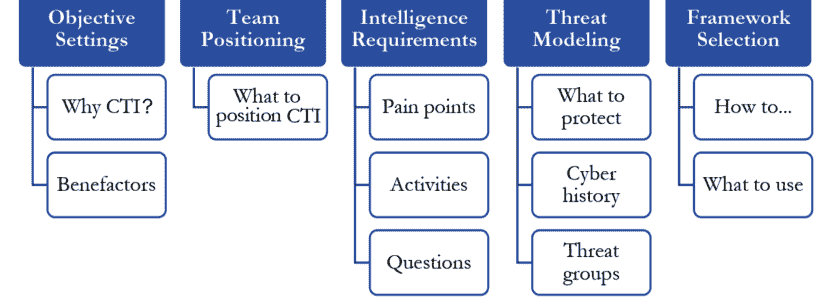

## 1 网络威胁情报生命周期

本章将解释威胁情报生命周期的步骤。我们将对每个步骤提供高层次的描述，同时结合一些实际示例，帮助您理解每个步骤所包含的内容。阅读完本章后，您将能够解释情报生命周期的每个阶段，并将实践与理论结合起来。本章构成本书的基础，各种情报策略和流程都将在此知识之上构建。

阅读完本章后，您应该能够做到以下几点：

- 清楚地解释网络威胁情报是什么，为什么组织必须将其整合到业务和安全团队中，谁从中受益，并能够定义其范围。
- 理解与威胁情报以及总体网络安全相关的挑战。
- 知道并理解有效规划威胁情报项目并设定方向所需的组件。
- 知道并理解构建情报项目所需的数据以及如何全球获取。
- 理解情报数据处理，为什么它在整合 CTI 项目中至关重要，并论证自动化处理步骤的必要性。
- 理解分析步骤、其应用以及对整个 CTI 项目的影响。在此步骤中，您还将了解情报分析偏差以及可用于避免有偏情报分析的不同技术。
- 解释周期的传播步骤以及如何与相关利益相关者共享情报产品。您还应了解在消费产品时受众的重要性。
- 理解并解释周期的反馈阶段，并说明其在项目中的关键原因。

本章将涵盖以下主要主题：

- 网络威胁情报 – 全球概览
- 规划、目标和方向
- 情报数据收集
- 情报数据处理
- 情报分析与生产
- 威胁情报传播
- 威胁情报反馈

### 技术要求

本章未突出任何特殊技术要求。大多数用例如有必要将使用 Web 应用程序。

### 网络威胁情报 – 全球概览

许多企业和组织力求实现最大化的数字存在，以增强和优化可见性（有效触达目标客户），并在当前数字化时代最大化其影响。为此，它们会定期暴露于基于底层攻击面的网络威胁和攻击——组织的规模、架构、应用程序、操作系统等。

威胁情报使企业能够以减轻网络攻击的方式收集和处理信息。因此，企业和组织必须保护自己免受威胁，尤其是人类威胁。**网络威胁情报 (CTI)**，如本书记载，是指通过智能信息收集和处理帮助组织构建主动安全基础设施以实现有效决策。当开展 CTI 项目时，需要考虑的主要威胁是人类，被称为 *对手* 或 *威胁行为者*。因此，理解并掌握对手进行网络攻击和发现入侵的方法至关重要。**战术、技术和流程 (TTPs)** 由威胁行为者使用。通过这样做，组织旨在从源头而非表面应对网络威胁。CTI 基于证据，而这些证据是为任何组织构建有效网络威胁响应单元所需知识的基础。

许多组织将威胁情报视为一种产品，使其能够实施防护性网络屏障。虽然这是事实，但请注意，威胁情报在幕后隐藏了一个有效的流程以获得最终成品。随着情报团队实施机制来防范现有和潜在威胁，对手会改变战术和技术。对情报团队来说，实施措施以允许分析和收集新威胁变得至关重要。因此，该流程成为一个循环，不断审视以确保组织不仅具有反应性，而且具有主动性。术语 *威胁情报生命周期* 用于定义在组织中实施高效网络威胁情报项目所需的流程。以下图表显示了该流程：

图 1.1 – 威胁情报生命周期

威胁情报是一个持续的过程，因为对手会更新其方法，组织也应如此。CTI 产品的反馈用于丰富并为下一轮情报周期生成新需求。

### 威胁的特征

理解 *威胁* 有助于组织避免关注可能不是系统问题的安全警报和网络事件。例如，一家运行 Linux 服务器的公司通过事件管理工具在系统中发现了一个 .exe 木马。虽然其本质危险，但该木马 *不能* 损害公司的结构。因此，它不是威胁。作为安全情报分析师，通知系统管理员该文件的低优先级及其无法感染网络的能力至关重要。其次，政府机构是网络项目的最高采用者和拥有者之一。政府拥有相互攻击所需的工具和知识。然而，为了避免网络战争并破坏友谊，加拿大和美国政府没有 *意图* 相互攻击。因此，它们彼此不是威胁。如果一方宣布间谍工具的设计，这并不意味着它想将其用于攻击另一方。虽然存在间谍能力，但可能没有实施的意图。因此，一个并不总是对另一个构成威胁。最后，你可以拥有能力和意图，但需要 *机会* 来入侵系统。

因此，我们可以将 *威胁* 总结为拥有攻击和入侵系统的 *能力*、*意图* 和 *机会* 的一切或每个人，与资源水平无关。当情报团队执行威胁分析时，任何不符合这三个条件的警报都不会被视为威胁。如果这三个要素中缺少任何一个，对手不太可能被视为威胁。

### 威胁情报与数据安全挑战

组织在数据保护和总体网络安全方面面临诸多挑战。这些挑战存在于组织的各个职能层面。存在多个挑战，但最常见的是以下几点：

- **威胁态势：** 在大多数情况下，网络攻击由拥有必要资源和培训的专业人员和团队策划。这包括国家支持的攻击。然而，通过获取特定工具和培训，私人团体已开发出进行破坏性网络攻击的复杂方法。随着对手依赖新的漏洞利用和先进的社会工程技术，威胁态势正在增长和变化。McAfee Labs 报告称，2020 年第三季度平均每分钟 588 次威胁（增长 40%），而 2020 年第三季度至第四季度漏洞增加了 100% 以上，恶意软件增加了 43% 以上。

针对性攻击如勒索软件是组织在2020年的主要关注点，到年底增长超过40%（https://www.mcafee.com/enterprise/en-us/assets/reports/rp-quarterly-threats-apr-2021.pdf）。2020年记录了约17,447个漏洞（CVE），其中超过4,000个为高严重性（https://www.darkreading.com/threat-intelligence/us-cert-reports-17447-vulnerabilities-recorded-in-2020/d/d-id/1339741）。因此，对于将大部分资源、资产、服务和产品置于互联网上的组织而言，威胁态势构成了危险的参数。了解威胁态势有助于风险缓解流程。个人信息是互联网上最受攻击的组件之一——**个人身份信息（PII）**、支付卡数据以及HIPAA数据，仅举几例。

- **安全警报与数据增长：** 组织正在获取不同的安全平台和技术来应对安全问题和挑战——沙箱、防火墙、事件响应、威胁狩猎、欺诈检测、入侵检测、网络扫描仪等。根据IBM的一项研究，平均一家IT公司拥有来自至少25家厂商的85种通用安全工具。在大多数情况下，这些工具在各团队之间并未集成。它们具有不同的安全需求。每个工具都会产生不同级别的安全警报，在大多数情况下，安全专业人员依赖手动流程或外部自动化工具（功能有限）来汇总、清理、关联、分析和解释数据。组织拥有的工具越多，收集的数据就越多，安全分析师在挖掘海量数据时就越疲惫和不堪重负。因此，很可能无法有效利用数据，从而错过关键警报。警报和数据量大使得人类难以正确处理，甚至不可能处理。这被称为可见性丧失。

- **运营复杂性：** 核心业务组件可能涉及多个组织部门，这些部门通过不同的应用程序交互以实现目标。大数据和云技术的采用促进了IT基础设施的管理。然而，它也为更多攻击点打开了大门，因为云安全正成为热门话题。这是因为许多第三方工具、资源和供应商（它们本身也存在漏洞）被用来解决安全问题。第三方工具对安装它们的组织来说在某种程度上并不透明，因为后端发生的绝大多数流程并未向使用者公开。因此，它们增加了运营复杂性，尤其是在每个安全方面的所有权方面（如事件管理、入侵检测、流量过滤和检查）。如果组织希望拥有有用的数据安全解决方案，则必须制定政策和程序。组织必须找到方法在内部规范第三方和其他外部工具的权限。

- **新的隐私法规：** 为应对全球数据安全和隐私问题，经常会出台新的要求。法规用于执行法律。然而，随着医疗、金融、交通、零售等不同行业法规数量的增加，其重叠成为挑战，因为组织必须遵守所有政策。如果组织未能遵守法规，即使没有发生违规，也可能被处以罚款。这就是为什么拥有符合法规的安全解决方案很重要。

尽管如此，不同地区和机构有不同的安全政策需要遵守。一个典型例子是欧盟的**《通用数据保护条例》**（**GDPR**），用于保护欧盟公民的隐私和个人信息。GDPR适用于欧盟地区，这意味着任何在欧盟地区运营或提供服务的组织（无论其来源是否在欧盟）都需要遵守GDPR。交易技巧和标准将在*第4章，网络威胁情报交易技巧和标准*中进行解释。另一个例子是南非的**《个人信息保护》**（**POPI**）法案，保护南非公民的隐私以及其个人信息如何被处理。遵守此类政策可能具有挑战性，组织需要确保遵守法规。

- **网络安全技能差距：** 随着组织的发展，手动流程变得具有挑战性，劳动力短缺也显现出来。根据ISC2 2019年报告（https://bit.ly/2Lvw7tr），约65%的组织存在网络安全专业人员短缺。尽管多年来差距有所缩小，但对网络安全专业人员的需求仍然很高。这是一个很大的问题。ISC2报告中与网络安全专业人员相关的职位担忧如下图所示：

图1.2 – ISC2网络安全专业人员中的职位担忧

组织花费更多时间处理安全威胁，而不是培训或为团队配备必要的知识。对手每天都在攻击并突破传统安全系统。这就是为什么全球对符合行业标准和方法、可靠、适应性强、最重要的韧性强的网络安全专业人员需求很大。组织需要在网络安全和威胁情报领域投资赋能和培训人员。

## 威胁情报的重要性与益处

网络威胁情报（CTI）通过从多个数据源收集和处理数据，并提供可操作的、基于证据的结果来支持业务决策，从而解决上述挑战。使用单一平台（用于关联、聚合、规范化、分析和分发）或集中化环境，CTI分析数据并揭示威胁的本质模式——任何具有破坏系统能力、意图和机会的数据。

CTI整合组织现有的工具和平台，集成不同的数据源，并使用机器学习和自动化技术来定义有关入侵指标（IoCs）和对手TTP的上下文。情报分析师和安全专业人员依赖IoCs来检测威胁行为者的活动。因此，在情报执行过程中所选指标的类型至关重要。这是因为它们决定了当IoCs访问被拒绝时可能给对手或威胁行为者造成的痛苦。这被称为痛苦金字塔，并提供了指标类型与痛苦程度之间的相关性。该金字塔如下图所示：

图1.3 – 痛苦金字塔

哈希算法提供了混淆信息的独特方式。哈希指标可用于检测独特威胁（如恶意软件）及其变种，因为信息的变化会导致哈希完全改变。因此，对手很容易更改恶意软件哈希值，例如。IP地址是用于检测威胁的流行指标之一。分析师可以使用IP地址发现恶意活动。然而，它们很容易被更改。

对手可以使用代理和TOR服务不断修改IP地址。域名也是常见的指标，因为它们可用于发现恶意域名。然而，更改域名需要一定的努力（注册、付款和托管）。由于存在许多免费托管域名，对手可以简单地更改域名。

更改域名需要一段时间。因此，它不如更改IP地址那么容易。网络和主机工件也是重要的指标类型。一旦专业安全人员更改网络和主机信息，对手就被迫审查和重建其攻击（大多数攻击网络和主机）。因此，更改主机和网络工件会让对手感到恼火。

下一个指标类型是工具，它们检测对手用来策划攻击的工具类型。当情报分析师能够检测威胁行为者的工具及其工件时，这意味着相关对手别无选择，只能更改工具或完全创建新工具（这需要对手花费时间和金钱）。因此，更改工具会极大地挑战对手。

金字塔的顶端是TTP。在这一层，分析师的任何检测都会导致对手完全重新发明，因为在这一层，情报分析师操作的是行为，而不仅仅是工具——情报的运行层级越高，对手破坏系统就越困难。有关IoCs的更多详细信息将在第13章《威胁情报指标、入侵指标和痛苦金字塔》中提供。

CTI帮助组织保护收入并衡量整个安全基础设施的效率。通过将CTI集成到业务流程中，组织可以在短期内创造积极的投资回报。数据泄露在财务影响、品牌声誉和业务状况方面可能代价高昂。因此，CTI是收入保护和产生的必不可少方面。

威胁情报被视为专属分析师的复杂领域。然而，威胁情报分析师为他人开展 CTI 项目——以保障他人的基础设施安全。因此，它为任何组织的职能增添价值。从小型企业到大型公司、政府和威胁行为者，每个人都是威胁情报的受益者。CTI 不应被视为安全组件的独立实体，而应成为每个现有安全职能的核心要素，正如我们在后续章节中将看到的那样。其主要原因在于 CTI 项目的产出应在组织的所有安全职能之间共享且可访问。

到目前为止，每个组织或个人都应该能够做到以下几点：

-   定义威胁情报并通过关注其特征来识别真实威胁。
-   列举并识别与数据安全和威胁情报相关的挑战。
-   理解将 CTI 作为基本业务组件集成的理由。

现在我们已经理解并掌握了 CTI 的本质，至关重要的是理解并掌握 CTI 的循环过程以及业务职能如何融入每个步骤。

## 规划、目标与方向

规划步骤是 CTI 项目整合中最关键的步骤。它是 CTI 项目成败的主要因素。如果规划未妥善进行且目标未合理设定，威胁情报项目很可能失败。规划与方向步骤可分为两个主要目标和三个基本阶段。

## CTI 主要目标

任何想要实施威胁情报的组织或个人都必须首先提出正确的问题：我为什么需要一个 CTI 团队？规划 CTI 项目归结为 CTI 项目的目标和宗旨。对此问题的回答将定义威胁情报团队的目的。根据 SANS FOR578，CTI 团队在组织中的主要职能包括提供威胁预防措施、事件响应和战略支持：

-   **预防措施**：团队中的威胁情报分析师可以为**安全运营中心 (SOCs)**提供巨大支持。SOC 团队处理频繁的威胁监控系统，并持续收到警报和问题标记。由于传统安全系统中许多流程是手动完成的，SOC 团队在优先处理警报或管理关键对手时可能会感到繁琐。

由于威胁情报基于集中化方法，CTI 团队通过过滤和优先处理警报、扩展和丰富**入侵指标 (IoC)**，并提取用于评估系统有效性的正确信息，为组织的 SOC 增加更多价值。

-   **事件响应单元：** 在许多组织中，SOC 团队与事件响应团队是分离的。威胁情报可以帮助 IR 团队应对威胁、整合信息，并将威胁与发生在其他组织中的情况进行共享和基准比较。CTI 也关乎信息共享——安全博客、报纸等的存在。通过了解其他组织过去发生的情况，威胁分析师可以在处理已知或未知对手时提高 IR 团队的效率。
-   **战略支持单元：** 在战略层面，威胁情报基于证据和可操作的事实或事件支持利益相关者的业务决策。战略情报是让组织了解当前和潜在威胁态势及其对业务潜在影响的最佳方式。CTI 还向利益相关者展示组织当前的资源状况。例如，它可以就威胁情报团队需要招聘的人员类型或减轻特定威胁所需的最佳培训或技能提供建议。

第一个流程的另一个目标是将威胁情报团队定位在组织内部，这将在下一章详细介绍。然而，了解 CTI 团队将如何与其他安全职能（如 SOC、事件响应、恶意软件分析和风险评估）协作至关重要。威胁情报必须与所有安全职能协作，以促进单位的分析流程和信息共享。

CTI 团队的目标必须设定为与组织的核心业务或价值观相匹配。并且必须设定为减少响应或减轻威胁的时间、将对业务运营的负面影响降至最低，同时最大化利润。

## CTI 规划与方向——关键阶段

在规划和设定 CTI 团队方向时，审视其运营计划也至关重要。威胁情报实施中存在三个主要运营规划阶段：情报需求收集、威胁建模和情报框架选择。在第一步中纳入这三个阶段可提高威胁情报实施成功的几率。

本书中将分别以独立章节讨论这些阶段：

-   **情报需求收集：** 在此阶段，CTI 团队从每个业务职能收集需求，以创建需要解决的请求和痛点数据库。该阶段可通过一系列单一事实或活动实现。有必要避免开放式问题，因为 CTI 结果需要具体且基于证据。需求需要在每个业务层面收集：战略、运营和战术。
-   **威胁建模：** 在规划 CTI 项目或实施情报团队时，评估对手将针对的所有资产至关重要。威胁建模涉及识别组织的主要资产并对对手进行侦察。利用过往信息可以帮助使用财务数据、个人信息和知识产权数据等功能性活动来建模威胁。
-   **情报框架选择：** 为了有效生成情报，威胁分析师需要收集数据、处理数据并透明地交付输出。必须预测数据将如何使用以提供所需答案。情报框架选择是生成情报时的关键参数。它提供了对不同数据源（内部和外部）的洞察，以及数据如何被利用来生成情报。情报框架应满足一定数量的标准，这些标准将在*第3章，网络威胁情报框架*中详细介绍。然而，主要建议是选择一个能够提供可用数据（外部和内部）端到端视图的框架。

现在让我们来看看结果的消费者。

## 确定结果的消费者

在规划阶段，威胁分析师还应确定最终产品的消费者。尽管 CTI 对所有人都有益，识别主要参与者将有助于确定重点关注的领域。例如，情报产品将发送给网络安全分析师（更技术性和实操性专业人员），还是发送给关注组织安全状况全局概览以证明项目或团队投资合理性的高管？

威胁情报的规划与方向总结如下图所示：

Figure 1.4 – 威胁情报规划与方向总结

CTI 团队和组织安全团队必须使用前述图表所示的布局来开展规划与方向阶段。其输出将驱动数据收集阶段。如果我们了解组织的安全弱点、需要保护的资产以及可能威胁安全系统的威胁，我们将能够获取正确的情报数据。

## 情报数据收集

没有数据就没有情报。在仔细规划和指导情报团队后，下一步是获取数据。数据的收集是为了满足在规划阶段汇总的需求。建议从不同来源收集数据，以拥有丰富的信息库和有效的情报产品。情报数据源可分为内部和外部来源（详见第7章，威胁情报数据源）：

-   **内部来源**：内部来源构成了，或应构成，数据的基石。在查看外部来源之前，首先了解内部信息至关重要。该数据源包括网络元素日志和过去事件响应的记录。最常见的内部数据源收集可能包括使用洛克希德·马丁杀伤链的入侵分析数据，例如内部恶意软件分析数据（威胁情报最有价值的数据源之一）、域名信息和 TLS/SSL 证书。

-   **外部来源：** 外部来源是强制性数据收集点，因为它们为威胁提供了新的可见性。这些来源包括外部恶意软件分析和在线沙箱工具、技术博客和杂志、暗网，以及其他资源丰富的来源，如开源和反情报数据。恶意软件动物园也是外部来源的重要组成部分。通过使用和访问在线沙箱系统或使用恶意软件分析工具，情报分析师可以收集有关对手特征的有用信息，以丰富情报数据库。

正如我们在*第7章，威胁情报数据源*中将看到的那样，收集的数据会被放入**入侵指标 (IOC)**列表中。这些指标包括但不限于域名信息、IP地址、SSL/TLS证书信息、文件哈希、网络扫描信息、漏洞评估信息、恶意软件分析结果、数据包检查信息、社交媒体新闻（原始格式）、电子邮件地址、电子邮件发送者、电子邮件链接和附件。收集的数据越多，情报库就越丰富，情报产品的效果就越好。

假设攻击者向组织中的某人发送电子邮件，该人员下载并打开了附件。木马被安装在系统上并与对手建立通信链路。相关数据必须可用，以便检测和应对此类事件。例如，威胁情报分析师可以利用网络、域名和某些协议信息来检测并防止木马感染系统。

因此，收集正确的数据至关重要。我们可以直接将其与第一步联系起来。如果情报框架的选择不当，响应此类威胁（对手）将花费时间和大量精力。因此，在选择框架时，CTI分析师应预估计划集成到系统中的数据源数量。他们还必须选择能够容纳大数据量的平台。

## 情报数据处理

原始数据在转化为组织可用的有用信息之前没有任何意义。数据被视为新的石油，这意味着每个组织都会以各种形式收集相当数量的数据。安全公司以日志、扫描、评估和统计的形式收集大数据。本步骤旨在处理和格式化收集的大量数据，使其易于阅读或理解。然而，对于分析师来说，手动或单枪匹马地挖掘已收集的数据以有效构建情报是困难的，甚至几乎不可能。因此，处理收集的数据需要通过使用情报平台实现自动化。这将在*第5章，目标设定、CTI战略程序和实用案例*中详细讨论。

有几种情报框架和结构化模型可用于动态处理情报数据。在处理任务期间，分析师使用一个或多个框架或结构将数据组织到不同的存储桶或存储单元中。想象一家银行同时受到多个对手的攻击；威胁分析师不太可能手动检测和阻止所有这些威胁。结构化模型和框架有助于识别数据中的模式并识别不同来源之间的交集点，以了解对手如何有效运作。

**安全信息和事件管理** (SIEM) 工具主要用于促进情报数据处理和探索。SIEM将在*第12章，SIEM解决方案和情报驱动的SOC*中详细研究。这些工具通过关联来自不同来源的数据，为整个安全系统提供整体视图。它们是数据处理和转换的良好起点。然而，情报平台和框架也允许我们执行情报数据处理和探索，尤其是在处理来自不同来源或不同供应商的非结构化数据时。目前，一些平台支持机器学习来识别数据中的威胁。MITRE ATT&CK、Diamond模型和Kill Chain等框架都可用于智能处理情报数据。

使用Diamond模型和上一节提供的示例，网络威胁情报SIEM可以将所述威胁建模为四个组成部分：对手（威胁创建者）、木马的受害者（植入木马的员工和系统）、对手用于入侵系统的战术和技术，以及威胁访问系统的方式（通过电子邮件附件）。该模型关联这四个要素并提取共同点，以对对手进行画像并启动适当的操作。

MITRE ATT&CK框架将更侧重于对手的战术和技术，并识别威胁对系统的影响。该框架提取的最典型组件包括恶意软件用于访问系统的方法（在我们的案例中为电子邮件，也称为网络钓鱼）、执行方法（通过双击）、威胁的能力（权限提升、持久性、凭据窃取等）、其对系统的直接影响等。

在这两种情况下，我们可以注意到两个框架都会关联不同的数据以获得结构化、有意义的信息。例如，要理解初始访问是通过网络钓鱼进行的，拥有与电子邮件相关的数据（链接、发送者、附件、接收者、附加IP地址、域名等）至关重要，这可以帮助组织在不同数据源之间进行横向分析威胁。数据收集（有哪些数据可用或正在收集）与处理之间已经可以建立联系。

处理阶段也解决了存储问题。由于在第2步（情报数据收集）中创建了原始情报数据湖，因此需要在第3步（情报数据处理）中建立处理数据的仓库。CTI团队应能够有效地存储数据，以便根据需要轻松访问和检索信息。正如我们在第3章，网络威胁情报框架中将看到的那样，特定的CTI平台提供快速存储功能。根据目标和设定的要求，组织可以选择将处理后的情报信息存储在云端或本地。在早期阶段（第1步，规划和方向）评估和选择正确的方法至关重要。

选择CTI框架时需要考虑的另一个重要特性是处理不同语言数据的能力。这在设置和集成情报项目时可能是一个决定性因素。它使CTI团队或分析师能够超越语言障碍。

在此步骤中，CTI团队或分析师必须设置能够高效处理原始情报数据并将信息存储在易于访问和检索的存储库中的工具、框架和平台（考虑底层工具的功能）。

## 分析与生产

分析和生产可以被视为解释步骤，在此步骤中，处理后的数据被转换为入侵指标、警报和报警，并具有通知所有相关方任何潜在威胁的能力。结果应与第一阶段（规划和方向）收集的目标和要求完美一致地呈现。呈现情报项目分析没有特定的输出格式。在提供结果之前，了解消费者至关重要。这一步是情报项目的生命线；即其存在的首要原因。因此，分析师或CTI团队需要关注它。

尽管收集和处理情报数据是自动化的，但解释结果需要人类专业知识。而这正是人为错误导致中断的地方。这被称为偏见，在分析处理后的数据时需要避免。偏见与个人观点、意见和对情报结果的解释存在因果关系。CTI是一个基于证据的产品和流程。因此，每项分析都应得到明确证据的支持——例如，分析师基于经验或直觉支持特定理论而没有证据。然后分析师寻找支持该想法的证据并拒绝不支持该理论的任何其他证据。这种分析会导致对支持性事实的偏见更大。

其中最常用的方法之一是 **结构化分析技术（SAT）**，由美国政府创建。它用于实现无偏解决方案并改进情报分析。SAT 将作为一种技艺形式在 *第3章，网络威胁情报框架* 中详细介绍。SAT 被多个私营部门和情报分析师使用，包括 CIA。其主要目标是最大程度地减少判断并控制分析过程中可能出现的不确定性。该方法使用三种不同的技术，按其目的分组：

- **诊断技术**：这些技术侧重于透明度。按照 SAT 的做法，诊断技术使用论据和假设来支持决策或威胁分析输出。该方法背后的理念是确保情报分析师不会丢弃任何相关假设。此类别中的一些技术如下：
  a. **信息质量检查**：在此，对分析所进行或需要进行的数据的全面性进行基准评估。此类别为分析评估提供了信心依据，并对情报平台提供的內容进行精确评估。
  b. **变化指标**：在探索和分析情报输出时，观察与突发数据变化相关的指标至关重要。当 CTI 团队或分析师希望追踪针对特定目标或对手的活动时，此方法很有用。此方法通过增加分析结果的可信度来避免偏见。
  c. **竞争性假设分析**：假设 CTI 团队收集并处理了大量数据。在此方法中，每位 CTI 分析师都提供对分析的解读。然后以挑战的形式进行交叉评估，其中假设根据其有效性和支持它们的证据进行比较。使用竞争性假设的最佳方法是创建分析矩阵。
- **反论技术**：这些技术挑战特定假设。其理念是通过矛盾消除偏见。分析师甚至会反驳最有根据的情报分析解读，以收集更多支持证据。此类技术中使用的一些流行方法如下：
  a. **魔鬼代言人**：顾名思义，此方法通过发展和支持替代解读来挑战对结果的强有力解读。假设在进行情报分析后，出现了来自中国 IP 地址的威胁指标。整个团队得出结论，中国 IP 地址正试图与某个系统应用程序通信。

使用魔鬼代言人，一位勇敢的分析师通过说这些 IP 地址属于另一个国家，并且使用了 proxychains 和 VPN 来掩盖对手的真实来源，从而挑战这一结论。现在，团队利用矛盾的假设来证明威胁源自中国。此方法通过展示团队对其解读的信心来消除偏见。
  b. **AB 团队**：这是最突出的方法之一。经理或 CTI 团队负责人将团队分为 A 队和 B 队。两队在解读情报结果时通过竞争相互挑战。此外，必须在 AB 团队和魔鬼代言人方法之间划清界限。前者在对同一分析存在多种解读时使用。目标应保持不变：通过让他们为自己不同意的解读辩护，讨论如何根除每个人的偏见思维。
  c. **假设分析**：在为魔鬼代言人提供的示例中，分析师不应确认团队的反对意见，而应问，*如果 IP 地址不是来自中国怎么办？* 重点是 *中国 IP 地址如何成为威胁？* 团队随后可以关注可能导致中国 IP 地址出现在系统中的参数。
- **创造性思维技术**：这些技术产生关于分析的新解读或见解。这使分析师能够创建进一步的分析角度并对主要完成的研究产生替代结果。想象性思维包括以下几种流行方法：
  a. **头脑风暴**：头脑风暴涉及围绕分析结果生成新概念、想法、理论和假设。CTI 团队必须使用头脑风暴来促进创造力并推动分析师跳出思维定式。它用于减少偏见，因为分析师更可能摆脱自己模糊的观点以发展全新的想法——每个概念都很重要。CTI 团队负责人应考虑所有分析师的观点并了解这些想法的触发点。
  b. **红队分析**：情报分析最技术化的方法是分析师穿上对手的“衣服”。在红队分析中，CTI 分析师尝试复制对手的威胁方法（对手如何攻击、如何思考等等）。在进行威胁情报分析时，采用红队方法至关重要，因为它假设最坏情况，并且还有助于团队准备能够抵御最强威胁的防御机制。分析师成为白方对手。请注意，这种分析复杂、耗时且资源密集。这是因为需要组建一支出色的分析师团队来模拟对手。
  c. **由外而内的思考**：CTI 团队必须始终关注可能轻松影响分析的外部因素。情报分析师应能够识别影响分析的因素。例如，哪些关键因素可能推动中国成为网络威胁？在对分析过的威胁进行批判性思考时，应考虑政治、社会经济和技术等因素。

在大多数情况下，CTI 团队使用这里描述的三种技术来执行大致完整且无偏的分析。每种技术都有几个需要检查的关键组件以验证其应用（更多细节将在 *第3章，网络威胁情报框架* 中介绍）。

分析师还应在分析步骤中建立或识别不同威胁和对手之间的关系。这有助于在不同威胁行为者之间找到相关性、模式或独特特征（例如，当前威胁可能具有与过去威胁相同的属性）。钻石模型是用于聚类和关联威胁和对手的通用模型之一。

至此，我们已解释了在分析和探索步骤中需要做什么，以及 CTI 团队可以使用哪些方法论来获得有用的分析和解读。有关如何做到这一点以及示例的更多细节将在本书后面提供。我们还将包括可能误导威胁情报行动的偏见的简要概述。

## 威胁情报传播

成功的情报项目不应自私自利——应与他人分享。威胁情报是为了保护他人而进行的。因此，CTI 团队或分析师需要将情报产品分发给消费者。只有当结果传达到相关人员时，组织才会采取行动。

传播步骤必须被跟踪以确保项目中情报周期之间的连续性。这种共享必须以透明的方式进行，例如使用票务系统。假设情报请求已记录在系统中。应创建工单、审查、更新、回答并与相关方共享。然而，CTI 团队必须知道如何根据不同受众的背景来共享输出。因此，了解产品的消费者至关重要。消费者是定义传播过程的人。区分消费者的参数包括情报背景、情报需求、相关团队以及结果的呈现方式。

在运营层面，情报输出可以以技术方式呈现（我们将在下一章详细说明*为什么*）。该组的目标受众包括网络安全分析师、恶意软件分析师、SOC 分析师等。在战略层面，情报输出应少一些技术性，重点关注业务层面的指标。在战术层面，成果必须清楚地展示对手的战术和技术。在此层面，格式的技术性必须深入，因为它包括事件响应工程师、网络防御工程师等专业人员。了解消费者或目标受众并据此定制输出至关重要。情报传播必须与规划和指导阶段设定的需求和目标相匹配。

传播阶段与报告阶段重叠，因为情报结果以报告、博客、新闻等形式分发和共享。CTI 团队或分析师必须撰写有价值的报告，以诚实的讯息传达适当的指标和指标来支持输出（或所做出的结论）。报告和情报文档将在*第14章，威胁情报报告与传播*中介绍。然而，清晰简洁地概述发现至关重要。有趣的话题必须始终先介绍，以让受众产生继续阅读的欲望。如果有需要采取的行动，应在报告开头突出显示。CTI 分析师还必须能够评估整个流程和所呈现的结果。他们必须始终有足够的信心，使用证据并引用所使用的不同来源来为情报报告中包含的所有内容辩护。我们将在*第14章，威胁情报报告与传播*中提供文档和报告的模板。

## 威胁情报反馈

最后一步是传播与初始阶段之间的桥梁。情报产品的受益者、消费者或目标受众评估并审查项目，并将其标记为成功或不成功。他们的观点决定了项目的整体满意度指数。只有在反馈步骤之后或期间才会做出可执行或业务决策。

情报作者的反馈和审查可以以验收标准的形式出现，标记为 OK 或 NOK，与输入需求相关。此反馈随后被用作下一次 CTI 周期规划和指导阶段的初始目标。这将补充新需求（可能为新的数据源），然后项目将继续其循环运行。*第14章，威胁情报报告与传播*提供了对反馈示例的深入分析，以及如何将这些示例转化为新需求。

## 总结

从本章可以得出结论，威胁情报不仅仅是一个成品，而是一个需要理解和掌握的七步流程，以确保 CTI 项目的成功。情报工作必须以支持消费者的愿景为目标。因此，任何有意将 CTI 作为业务一部分的组织都必须仔细完成情报生命周期，并在每个运营阶段与 CTI 团队合作。证据必须伴随每个阶段的决策。由于 CTI 是一个持续过程，下一次情报周期必须主要使用当前周期的反馈。在规划和指导威胁情报项目时，第一步涉及生成需求并实施有效的 CTI 团队。下一章将讨论如何创建情报需求并定位团队。
