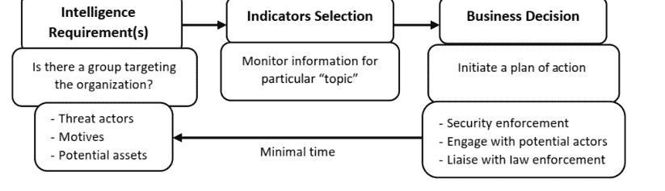
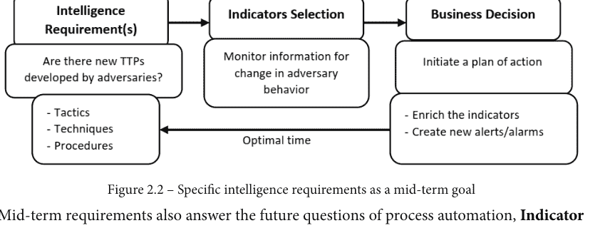
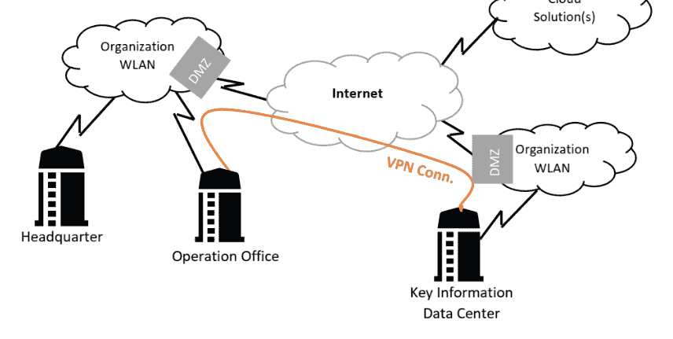
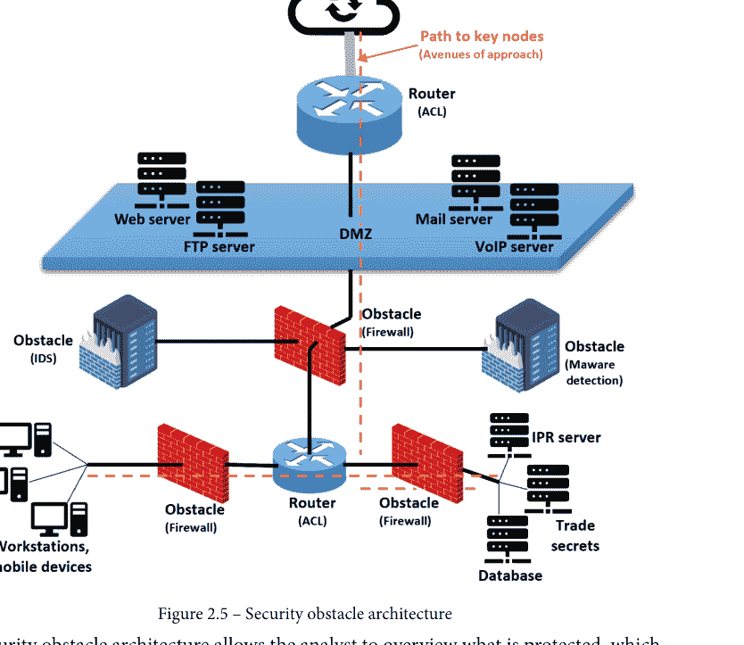
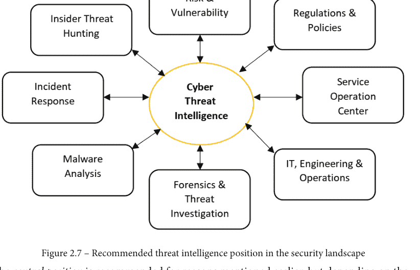

## 2 需求与情报团队实施

情报集成第一步（规划和指导）中最关键的部分是需求以及定位一个胜任、多元且多技能的团队来执行不同的项目职能。为了最大限度降低安全风险，CTI 项目团队必须关注组织的需求并据此进行优先级排序。组织的根本安全需求涉及保护敏感信息（个人信息）、知识产权、资产以及任何一旦泄露就会导致财务损失和品牌声誉受损的其他信息。收集和生成信息必须在所有层面进行：战略（战略安全需求）、运营（运营安全需求）和战术（战术安全需求）。

本章重点关注前面提到的任务——生成需求并组建 CTI 团队。我们将详细介绍用于推动项目的情报需求生成方法。本章还通过定位胜任的团队和构建其运营，强调了威胁情报计划创建的前提条件。

在本章结束时，您应该能够做到以下几点：

- 生成情报需求并对任务进行优先级排序。
- 使用改编自军事情报方法的先进方法，为特定网络项目开发情报需求。
- 了解 CTI 团队的架构以及构建可靠情报团队所需的能力。
- 将情报团队定位在安全堆栈中，以最大化情报计划的价值。

在本章中，我们将介绍以下主要主题：

- 威胁情报需求与优先级排序
- 需求开发
- 情报团队架构与前提条件
- 情报团队实施

## 技术要求

本章未强调任何特殊技术要求。大多数用例在必要时将使用 Web 应用程序。

## 威胁情报需求与优先级排序

在规划 CTI 项目时，定义指标、识别因素并收集项目期间需要回答的问题至关重要。CTI 分析师或威胁情报团队负责人需要从每个业务职能收集正确的情报需求，以创建实质性项目。

在 CTI 范围内，需求涉及任何需要网络安全监控或应应用情报的业务领域。需求必须与组织面临的各种痛点或需要保护的信息相关。因此，它们可能来自多个来源，例如之前的攻击、过去的数据泄露，或同类同行组织（与您处于同一业务线或包含相同数据的组织）。因此，组织需要加入网络安全 **信息共享和分析中心 (ISACs)** 以受益于同行的经验。例如，在为银行的 CTI 项目收集情报需求时，CTI 团队可能希望查看其他银行的网络历史、泄露事件以及暴露或泄露的信息，以整合需求文档（了解安全态势）。让我们看看一些可以推动需求阶段的要点：

- **过去的威胁和攻击**：如果组织过去曾遭受攻击或经历某种威胁，将其作为情报需求至关重要。安全团队应详细说明发生的威胁或攻击类型。CTI 团队利用这些信息构建需求表。可能需要考虑的典型问题包括以下内容：
  - 是否曾对组织发动攻击？
  - 攻击是如何发生的？攻击者是否利用了系统漏洞？还是使用了钓鱼等其他方法？
  - 组织是如何检测或阻止攻击的？
  - 组织从该威胁或攻击中提取了哪些有用的信息？

### 实际系统入侵
这里的主要行动是了解组织是否发生过真正的入侵或信息泄露。CTI 项目的合理性更强，且当组织曾遭受实际入侵或间谍活动时获得批准的比例更高。然而，这并不意味着如果没有实际入侵发生 CTI 就不合理，因为行业风险概况也可用于证明该计划的合理性。CTI 团队（或分析师）与组织的安保团队合作，回答以下主要问题：
- 组织是否曾被入侵过？
- 如何发生的？
- 针对了哪些信息？
- CTI 范围内的主要行为者或对手是谁？攻击是自动执行的还是手动执行的？

内部安全团队必须向 CTI 团队提供此类信息，以便定制情报项目。

### 已有泄露事件
预防胜于治疗，俗话如此，且确为事实。CTI 分析师（或团队）需要了解并理解行业中发生的（或正在发生的）泄露事件。安全经理可能也希望了解可能影响组织的潜在漏洞——这包括组织没有防御机制的漏洞和威胁。这种需求方法倾向于主动威胁情报。CTI 团队必须通过回答以下问题来推进项目：
- 全球和行业特定（行业威胁态势）目前正在被利用的漏洞有哪些？
- 是否发生过全球性和行业特定的泄露？这些泄露有多近，程度如何？
- 在当前安全状况下，组织能够防御或检测哪些漏洞和泄露？
- 目前正在研究的潜在威胁和漏洞有哪些？了解网络安全研究人员正在研究的漏洞也很重要，以便领先于对手。这包括学术和专业安全研究实验室的报告。

### 可能的指标
在生成需求时，CTI 团队需要了解组织当前的安全状况。例如，对于过去发生的泄露事件，评估是否存在（或不存在）任何本可预防或检测到该事件的指标（或机制）至关重要。同时，汇总组织可用的安全指标。CTI 分析师和内部安全团队可使用以下问题来推动需求：
- 组织的安全系统中有哪些指标可用？
- 这些指标能否防止现有常见威胁或过去的泄露？
- 是否需要更多指标来加强当前系统的安全性？

### 安全措施
这是一个独立但持续的需求参数，用于评估当前的安全状况。CTI 分析师必须与组织的安全团队合作，识别、理解和评估现有安全协议（事件响应、风险评估、系统审计、恶意软件分析等）。在考虑安全协议和措施后，CTI 团队必须将步骤与过去（或现有行业）泄露事件相关联。然后 CTI 分析师（或小组）和组织的安全团队必须回答以下问题：
- 组织的安全协议在检测或防止过去的攻击方面是否有效？
- 该协议是否被准确执行以减轻攻击或应对过去的事件？
- 事件期间是否有未执行的安全措施？

这里提到的全局问题是情报项目生命周期第一步的主要驱动因素。它们还定义了下一章中所需的数据收集类型。下表提供了情报需求全局范围的示例，有助于定义情报项目。它还展示了情报需求如何被回答并用于塑造周期的[content]
### 实际系统入侵
这里的主要行动是了解组织是否发生过真正的入侵或信息泄露。CTI 项目的合理性更强，且当组织曾遭受实际入侵或间谍活动时获得批准的比例更高。然而，这并不意味着如果没有实际入侵发生 CTI 就不合理，因为行业风险概况也可用于证明该计划的合理性。CTI 团队（或分析师）与组织的安保团队合作，回答以下主要问题：
- 组织是否曾被入侵过？
- 如何发生的？
- 针对了哪些信息？
- CTI 范围内的主要行为者或对手是谁？攻击是自动执行的还是手动执行的？

内部安全团队必须向 CTI 团队提供此类信息，以便定制情报项目。

### 已有泄露事件
预防胜于治疗，俗话如此，且确为事实。CTI 分析师（或团队）需要了解并理解行业中发生的（或正在发生的）泄露事件。安全经理可能也希望了解可能影响组织的潜在漏洞——这包括组织没有防御机制的漏洞和威胁。这种需求方法倾向于主动威胁情报。CTI 团队必须通过回答以下问题来推进项目：
- 全球和行业特定（行业威胁态势）目前正在被利用的漏洞有哪些？
- 是否发生过全球性和行业特定的泄露？这些泄露有多近，程度如何？
- 在当前安全状况下，组织能够防御或检测哪些漏洞和泄露？
- 目前正在研究的潜在威胁和漏洞有哪些？了解网络安全研究人员正在研究的漏洞也很重要，以便领先于对手。这包括学术和专业安全研究实验室的报告。

### 可能的指标
在生成需求时，CTI 团队需要了解组织当前的安全状况。例如，对于过去发生的泄露事件，评估是否存在（或不存在）任何本可预防或检测到该事件的指标（或机制）至关重要。同时，汇总组织可用的安全指标。CTI 分析师和内部安全团队可使用以下问题来推动需求：
- 组织的安全系统中有哪些指标可用？
- 这些指标能否防止现有常见威胁或过去的泄露？
- 是否需要更多指标来加强当前系统的安全性？

### 安全措施
这是一个独立但持续的需求参数，用于评估当前的安全状况。CTI 分析师必须与组织的安全团队合作，识别、理解和评估现有安全协议（事件响应、风险评估、系统审计、恶意软件分析等）。在考虑安全协议和措施后，CTI 团队必须将步骤与过去（或现有行业）泄露事件相关联。然后 CTI 分析师（或小组）和组织的安全团队必须回答以下问题：
- 组织的安全协议在检测或防止过去的攻击方面是否有效？
- 该协议是否被准确执行以减轻攻击或应对过去的事件？
- 事件期间是否有未执行的安全措施？

这里提到的全局问题是情报项目生命周期第一步的主要驱动因素。它们还定义了下一章中所需的数据收集类型。下表提供了情报需求全局范围的示例，有助于定义情报项目。它还展示了情报需求如何被回答并用于塑造周期的[content]
### 实际系统入侵
这里的主要行动是了解组织是否发生过真正的入侵或信息泄露。CTI 项目的合理性更强，且当组织曾遭受实际入侵或间谍活动时获得批准的比例更高。然而，这并不意味着如果没有实际入侵发生 CTI 就不合理，因为行业风险概况也可用于证明该计划的合理性。CTI 团队（或分析师）与组织的安保团队合作，回答以下主要问题：
- 组织是否曾被入侵过？
- 如何发生的？
- 针对了哪些信息？
- CTI 范围内的主要行为者或对手是谁？攻击是自动执行的还是手动执行的？

内部安全团队必须向 CTI 团队提供此类信息，以便定制情报项目。

### 已有泄露事件
预防胜于治疗，俗话如此，且确为事实。CTI 分析师（或团队）需要了解并理解行业中发生的（或正在发生的）泄露事件。安全经理可能也希望了解可能影响组织的潜在漏洞——这包括组织没有防御机制的漏洞和威胁。这种需求方法倾向于主动威胁情报。CTI 团队必须通过回答以下问题来推进项目：
- 全球和行业特定（行业威胁态势）目前正在被利用的漏洞有哪些？
- 是否发生过全球性和行业特定的泄露？这些泄露有多近，程度如何？
- 在当前安全状况下，组织能够防御或检测哪些漏洞和泄露？
- 目前正在研究的潜在威胁和漏洞有哪些？了解网络安全研究人员正在研究的漏洞也很重要，以便领先于对手。这包括学术和专业安全研究实验室的报告。

### 可能的指标
在生成需求时，CTI 团队需要了解组织当前的安全状况。例如，对于过去发生的泄露事件，评估是否存在（或不存在）任何本可预防或检测到该事件的指标（或机制）至关重要。同时，汇总组织可用的安全指标。CTI 分析师和内部安全团队可使用以下问题来推动需求：
- 组织的安全系统中有哪些指标可用？
- 这些指标能否防止现有常见威胁或过去的泄露？
- 是否需要更多指标来加强当前系统的安全性？

### 安全措施
这是一个独立但持续的需求参数，用于评估当前的安全状况。CTI 分析师必须与组织的安全团队合作，识别、理解和评估现有安全协议（事件响应、风险评估、系统审计、恶意软件分析等）。在考虑安全协议和措施后，CTI 团队必须将步骤与过去（或现有行业）泄露事件相关联。然后 CTI 分析师（或小组）和组织的安全团队必须回答以下问题：
- 组织的安全协议在检测或防止过去的攻击方面是否有效？
- 该协议是否被准确执行以减轻攻击或应对过去的事件？
- 事件期间是否有未执行的安全措施？

这里提到的全局问题是情报项目生命周期第一步的主要驱动因素。它们还定义了下一章中所需的数据收集类型。下表提供了情报需求全局范围的示例，有助于定义情报项目。它还展示了情报需求如何被回答并用于塑造周期的[content]
### 实际系统入侵
这里的主要行动是了解组织是否发生过真正的入侵或信息泄露。CTI 项目的合理性更强，且当组织曾遭受实际入侵或间谍活动时获得批准的比例更高。然而，这并不意味着如果没有实际入侵发生 CTI 就不合理，因为行业风险概况也可用于证明该计划的合理性。CTI 团队（或分析师）与组织的安保团队合作，回答以下主要问题：
- 组织是否曾被入侵过？
- 如何发生的？
- 针对了哪些信息？
- CTI 范围内的主要行为者或对手是谁？攻击是自动执行的还是手动执行的？

内部安全团队必须向 CTI 团队提供此类信息，以便定制情报项目。

### 已有泄露事件
预防胜于治疗，俗话如此，且确为事实。CTI 分析师（或团队）需要了解并理解行业中发生的（或正在发生的）泄露事件。安全经理可能也希望了解可能影响组织的潜在漏洞——这包括组织没有防御机制的漏洞和威胁。这种需求方法倾向于主动威胁情报。CTI 团队必须通过回答以下问题来推进项目：
- 全球和行业特定（行业威胁态势）目前正在被利用的漏洞有哪些？
- 是否发生过全球性和行业特定的泄露？这些泄露有多近，程度如何？
- 在当前安全状况下，组织能够防御或检测哪些漏洞和泄露？
- 目前正在研究的潜在威胁和漏洞有哪些？了解网络安全研究人员正在研究的漏洞也很重要，以便领先于对手。这包括学术和专业安全研究实验室的报告。

### 可能的指标
在生成需求时，CTI 团队需要了解组织当前的安全状况。例如，对于过去发生的泄露事件，评估是否存在（或不存在）任何本可预防或检测到该事件的指标（或机制）至关重要。同时，汇总组织可用的安全指标。CTI 分析师和内部安全团队可使用以下问题来推动需求：
- 组织的安全系统中有哪些指标可用？
- 这些指标能否防止现有常见威胁或过去的泄露？
- 是否需要更多指标来加强当前系统的安全性？

### 安全措施
这是一个独立但持续的需求参数，用于评估当前的安全状况。CTI 分析师必须与组织的安全团队合作，识别、理解和评估现有安全协议（事件响应、风险评估、系统审计、恶意软件分析等）。在考虑安全协议和措施后，CTI 团队必须将步骤与过去（或现有行业）泄露事件相关联。然后 CTI 分析师（或小组）和组织的安全团队必须回答以下问题：
- 组织的安全协议在检测或防止过去的攻击方面是否有效？
- 该协议是否被准确执行以减轻攻击或应对过去的事件？
- 事件期间是否有未执行的安全措施？

这里提到的全局问题是情报项目生命周期第一步的主要驱动因素。它们还定义了下一章中所需的数据收集类型。下表提供了情报需求全局范围的示例，有助于定义情报项目。它还展示了情报需求如何被回答并用于塑造周期的[content]
### 实际系统入侵
这里的主要行动是了解组织是否发生过真正的入侵或信息泄露。CTI 项目的合理性更强，且当组织曾遭受实际入侵或间谍活动时获得批准的比例更高。然而，这并不意味着如果没有实际入侵发生 CTI 就不合理，因为行业风险概况也可用于证明该计划的合理性。CTI 团队（或分析师）与组织的安保团队合作，回答以下主要问题：
- 组织是否曾被入侵过？
- 如何发生的？
- 针对了哪些信息？
- CTI 范围内的主要行为者或对手是谁？攻击是自动执行的还是手动执行的？

内部安全团队必须向 CTI 团队提供此类信息，以便定制情报项目。

### 已有泄露事件
预防胜于治疗，俗话如此，且确为事实。CTI 分析师（或团队）需要了解并理解行业中发生的（或正在发生的）泄露事件。安全经理可能也希望了解可能影响组织的潜在漏洞——这包括组织没有防御机制的漏洞和威胁。这种需求方法倾向于主动威胁情报。CTI 团队必须通过回答以下问题来推进项目：
- 全球和行业特定（行业威胁态势）目前正在被利用的漏洞有哪些？
- 是否发生过全球性和行业特定的泄露？这些泄露有多近，程度如何？
- 在当前安全状况下，组织能够防御或检测哪些漏洞和泄露？
- 目前正在研究的潜在威胁和漏洞有哪些？了解网络安全研究人员正在研究的漏洞也很重要，以便领先于对手。这包括学术和专业安全研究实验室的报告。

### 可能的指标
在生成需求时，CTI 团队需要了解组织当前的安全状况。例如，对于过去发生的泄露事件，评估是否存在（或不存在）任何本可预防或检测到该事件的指标（或机制）至关重要。同时，汇总组织可用的安全指标。CTI 分析师和内部安全团队可使用以下问题来推动需求：
- 组织的安全系统中有哪些指标可用？
- 这些指标能否防止现有常见威胁或过去的泄露？
- 是否需要更多指标来加强当前系统的安全性？

### 安全措施
这是一个独立但持续的需求参数，用于评估当前的安全状况。CTI 分析师必须与组织的安全团队合作，识别、理解和评估现有安全协议（事件响应、风险评估、系统审计、恶意软件分析等）。在考虑安全协议和措施后，CTI 团队必须将步骤与过去（或现有行业）泄露事件相关联。然后 CTI 分析师（或小组）和组织的安全团队必须回答以下问题：
- 组织的安全协议在检测或防止过去的攻击方面是否有效？
- 该协议是否被准确执行以减轻攻击或应对过去的事件？
- 事件期间是否有未执行的安全措施？

这里提到的全局问题是情报项目生命周期第一步的主要驱动因素。它们还定义了下一章中所需的数据收集类型。下表提供了情报需求全局范围的示例，有助于定义情报项目。它还展示了情报需求如何被回答并用于塑造周期的[content]
### 实际系统入侵
这里的主要行动是了解组织是否发生过真正的入侵或信息泄露。CTI 项目的合理性更强，且当组织曾遭受实际入侵或间谍活动时获得批准的比例更高。然而，这并不意味着如果没有实际入侵发生 CTI 就不合理，因为行业风险概况也可用于证明该计划的合理性。CTI 团队（或分析师）与组织的安保团队合作，回答以下主要问题：
- 组织是否曾被入侵过？
- 如何发生的？
- 针对了哪些信息？
- CTI 范围内的主要行为者或对手是谁？攻击是自动执行的还是手动执行的？

内部安全团队必须向 CTI 团队提供此类信息，以便定制情报项目。

### 已有泄露事件
预防胜于治疗，俗话如此，且确为事实。CTI 分析师（或团队）需要了解并理解行业中发生的（或正在发生的）泄露事件。安全经理可能也希望了解可能影响组织的潜在漏洞——这包括组织没有防御机制的漏洞和威胁。这种需求方法倾向于主动威胁情报。CTI 团队必须通过回答以下问题来推进项目：
- 全球和行业特定（行业威胁态势）目前正在被利用的漏洞有哪些？
- 是否发生过全球性和行业特定的泄露？这些泄露有多近，程度如何？
- 在当前安全状况下，组织能够防御或检测哪些漏洞和泄露？
- 目前正在研究的潜在威胁和漏洞有哪些？了解网络安全研究人员正在研究的漏洞也很重要，以便领先于对手。这包括学术和专业安全研究实验室的报告。

### 可能的指标
在生成需求时，CTI 团队需要了解组织当前的安全状况。例如，对于过去发生的泄露事件，评估是否存在（或不存在）任何本可预防或检测到该事件的指标（或机制）至关重要。同时，汇总组织可用的安全指标。CTI 分析师和内部安全团队可使用以下问题来推动需求：
- 组织的安全系统中有哪些指标可用？
- 这些指标能否防止现有常见威胁或过去的泄露？
- 是否需要更多指标来加强当前系统的安全性？

### 安全措施
这是一个独立但持续的需求参数，用于评估当前的安全状况。CTI 分析师必须与组织的安全团队合作，识别、理解和评估现有安全协议（事件响应、风险评估、系统审计、恶意软件分析等）。在考虑安全协议和措施后，CTI 团队必须将步骤与过去（或现有行业）泄露事件相关联。然后 CTI 分析师（或小组）和组织的安全团队必须回答以下问题：
- 组织的安全协议在检测或防止过去的攻击方面是否有效？
- 该协议是否被准确执行以减轻攻击或应对过去的事件？
- 事件期间是否有未执行的安全措施？

这里提到的全局问题是情报项目生命周期第一步的主要驱动因素。它们还定义了下一章中所需的数据收集类型。下表提供了情报需求全局范围的示例，有助于定义情报项目。它还展示了情报需求如何被回答并用于塑造周期的[content]
### 实际系统入侵
这里的主要行动是了解组织是否发生过真正的入侵或信息泄露。CTI 项目的合理性更强，且当组织曾遭受实际入侵或间谍活动时获得批准的比例更高。然而，这并不意味着如果没有实际入侵发生 CTI 就不合理，因为行业风险概况也可用于证明该计划的合理性。CTI 团队（或分析师）与组织的安保团队合作，回答以下主要问题：
- 组织是否曾被入侵过？
- 如何发生的？
- 针对了哪些信息？
- CTI 范围内的主要行为者或对手是谁？攻击是自动执行的还是手动执行的？

内部安全团队必须向 CTI 团队提供此类信息，以便定制情报项目。

### 已有泄露事件
预防胜于治疗，俗话如此，且确为事实。CTI 分析师（或团队）需要了解并理解行业中发生的（或正在发生的）泄露事件。安全经理可能也希望了解可能影响组织的潜在漏洞——这包括组织没有防御机制的漏洞和威胁。这种需求方法倾向于主动威胁情报。CTI 团队必须通过回答以下问题来推进项目：
- 全球和行业特定（行业威胁态势）目前正在被利用的漏洞有哪些？
- 是否发生过全球性和行业特定的泄露？这些泄露有多近，程度如何？
- 在当前安全状况下，组织能够防御或检测哪些漏洞和泄露？
- 目前正在研究的潜在威胁和漏洞有哪些？了解网络安全研究人员正在研究的漏洞也很重要，以便领先于对手。这包括学术和专业安全研究实验室的报告。

### 可能的指标
在生成需求时，CTI 团队需要了解组织当前的安全状况。例如，对于过去发生的泄露事件，评估是否存在（或不存在）任何本可预防或检测到该事件的指标（或机制）至关重要。同时，汇总组织可用的安全指标。CTI 分析师和内部安全团队可使用以下问题来推动需求：
- 组织的安全系统中有哪些指标可用？
- 这些指标能否防止现有常见威胁或过去的泄露？
- 是否需要更多指标来加强当前系统的安全性？

### 安全措施
这是一个独立但持续的需求参数，用于评估当前的安全状况。CTI 分析师必须与组织的安全团队合作，识别、理解和评估现有安全协议（事件响应、风险评估、系统审计、恶意软件分析等）。在考虑安全协议和措施后，CTI 团队必须将步骤与过去（或现有行业）泄露事件相关联。然后 CTI 分析师（或小组）和组织的安全团队必须回答以下问题：
- 组织的安全协议在检测或防止过去的攻击方面是否有效？
- 该协议是否被准确执行以减轻攻击或应对过去的事件？
- 事件期间是否有未执行的安全措施？

这里提到的全局问题是情报项目生命周期第一步的主要驱动因素。它们还定义了下一章中所需的数据收集类型。下表提供了情报需求全局范围的示例，有助于定义情报项目。它还展示了情报需求如何被回答并用于塑造周期的[content]
### 实际系统入侵
这里的主要行动是了解组织是否发生过真正的入侵或信息泄露。CTI 项目的合理性更强，且当组织曾遭受实际入侵或间谍活动时获得批准的比例更高。然而，这并不意味着如果没有实际入侵发生 CTI 就不合理，因为行业风险概况也可用于证明该计划的合理性。CTI 团队（或分析师）与组织的安保团队合作，回答以下主要问题：
- 组织是否曾被入侵过？
- 如何发生的？
- 针对了哪些信息？
- CTI 范围内的主要行为者或对手是谁？攻击是自动执行的还是手动执行的？

内部安全团队必须向 CTI 团队提供此类信息，以便定制情报项目。

### 已有泄露事件
预防胜于治疗，俗话如此，且确为事实。CTI 分析师（或团队）需要了解并理解行业中发生的（或正在发生的）泄露事件。安全经理可能也希望了解可能影响组织的潜在漏洞——这包括组织没有防御机制的漏洞和威胁。这种需求方法倾向于主动威胁情报。CTI 团队必须通过回答以下问题来推进项目：
- 全球和行业特定（行业威胁态势）目前正在被利用的漏洞有哪些？
- 是否发生过全球性和行业特定的泄露？这些泄露有多近，程度如何？
- 在当前安全状况下，组织能够防御或检测哪些漏洞和泄露？
- 目前正在研究的潜在威胁和漏洞有哪些？了解网络安全研究人员正在研究的漏洞也很重要，以便领先于对手。这包括学术和专业安全研究实验室的报告。

### 可能的指标
在生成需求时，CTI 团队需要了解组织当前的安全状况。例如，对于过去发生的泄露事件，评估是否存在（或不存在）任何本可预防或检测到该事件的指标（或机制）至关重要。同时，汇总组织可用的安全指标。CTI 分析师和内部安全团队可使用以下问题来推动需求：
- 组织的安全系统中有哪些指标可用？
- 这些指标能否防止现有常见威胁或过去的泄露？
- 是否需要更多指标来加强当前系统的安全性？

### 安全措施
这是一个独立但持续的需求参数，用于评估当前的安全状况。CTI 分析师必须与组织的安全团队合作，识别、理解和评估现有安全协议（事件响应、风险评估、系统审计、恶意软件分析等）。在考虑安全协议和措施后，CTI 团队必须将步骤与过去（或现有行业）泄露事件相关联。然后 CTI 分析师（或小组）和组织的安全团队必须回答以下问题：
- 组织的安全协议在检测或防止过去的攻击方面是否有效？
- 该协议是否被准确执行以减轻攻击或应对过去的事件？
- 事件期间是否有未执行的安全措施？

这里提到的全局问题是情报项目生命周期第一步的主要驱动因素。它们还定义了下一章中所需的数据收集类型。下表提供了情报需求全局范围的示例，有助于定义情报项目。它还展示了情报需求如何被回答并用于塑造周期的[content]
数据收集步骤。CTI 团队和内部团队应使用此模板收集全局和具体的情报需求。该方法有助于为团队分配任务：

| CTI 需求（以问题的形式） | 预期答案 | 收集需求（未来步骤示例） |
|---|---|---|
| 组织是否发生过未遂攻击？ | 是或否。 | 检查过去的安全、网络、入侵检测日志等。 |
| 组织是如何检测或阻止攻击的？ | 防火墙策略、深度包检测、入侵检测与防御等。 | 收集相关日志以了解策略、规则等。 |
| 从攻击中提取了哪些有用信息？ | 对手详情：来源（地区）、IP地址、域名、攻击模型等。 | 收集相关日志。 |
| 全球正在被利用的漏洞有哪些？ | 密码暴力破解、网络钓鱼（社会工程）、勒索软件等。 | 与其他组织或其他 CTI 分析师合作。参考在线平台获取有关这些漏洞的信息等。 |
| 组织以前是如何被入侵的？如何发生的？ | 是或否。通过网络钓鱼。一名 HR 高管打开了一封伪装成员工的恶意邮件中的附件。 | 参考恶意软件分析、恶意网页链接、邮件的开源情报等。 |
| 哪些潜在漏洞和威胁正在被研究？ | 加密安全、身份盗窃、高级间谍活动等。 | 参考在线论坛、暗网等。 |

表 2.1 – CTI 需求 – 主要问题

提取正确的需求具有挑战性，因为许多组织仍不愿接受威胁情报技术。然而，与组织的管理团队或决策者合作是情报项目成功的关键，因为他们了解业务。因此，他们应帮助确定需求的优先级。必须遵循之前讨论的协议（让组织的相关方参与）。如果前提条件仅由 CTI 团队定义，失败的几率会增加。情报需求的主要目标应确保项目最终产品与组织的安全需求之间不存在差异。

> **重要提示**
> 说服性的情报需求初稿必须始终从封闭式问题开始。开放式问题可用于证明或维持封闭式问题。例如，必须从这样一个问题开始：公司是否曾被攻击过？而不是过去攻击了哪些系统资源？第二个问题应作为第一个问题的支持论据：封闭式问题越多越好。

在本小节中，我们学习了如何以问题的形式制定情报需求以及为何必须具备它们。这些需求问题的答案构成了任何威胁情报项目中需要采取的初始步骤。

## 优先排序情报需求

优先排序情报需求与收集它们一样重要。了解 CTI 项目需要回答的最关键问题有助于构建运营。我们可以使用多种方法来优先排序需求，但它们都应基于共同基础——关键资产和敏感数据的保护。在制定基础问题后，CTI 团队必须创建一份需要相应处理的短期、中期和长期需求清单。

### 短期需求

短期需求需要立即关注，应在尽可能最短的时间内处理。一个典型的例子是识别直接针对组织主要资产的威胁行为者。此类需求应为高优先级并立即查看。短期需求包括提出诸如以下问题：ABC 保险公司在最近针对新政策的抗议后，是否有团体计划攻击？或者在针对特定政策的示威后，是否有团体攻击过 ABC 保险公司？如果组织在该事项上感到危险，这类问题应为高优先级。

一群不满的人是否可能对组织构成威胁？让我们分析一下这在多大程度上可以被归类为威胁：

- **意图**：他们是否有意图？答案是*是*。在公司有争议的政策之后，该团体具有*目的*。将此类行为归类为意图的置信度为*高*。
- **能力**：他们是否有能力破坏组织？这种能力是可以获得的。因此，答案是*是*。然而，我们必须考虑外包能力所需的预算。因此，分类的置信水平范围从*中等*到*高*，取决于其资源。
- **机会**：他们有机会吗？答案是*是*。由于公司存在投诉，这足以成为策划网络攻击的动机。置信度为*高*，因为这些行为可以得到正当化。

在前述分析之后，该团体可以被视为对 ABC 保险公司的威胁。CTI 团队必须直接识别并选择指标以促进对此类威胁（或威胁行为者或对手）的监控。我们将在第 4 章《网络威胁情报的情报收集技巧和标准》以及第 5 章《目标设定、CTI 策略的程序和实际用例》中看到如何使用威胁情报框架（如 MITRE ATT&CK 或 Cyber Kill Chain）用于此类目的。最后，利用需求和指标实施行动计划，从而改善安全保护，或如果缺乏足够的资源单独应对威胁，则请求执法部门的帮助。该概念被称为 **Prioritized Intelligence Requirements (PIRs)**。此示例可按如下图所示建模：

图 2.1 – 优先情报需求

PIRs 以最高优先级标签为特征，因为它有助于管理团队和其他战略部门以简单的方式了解威胁的严重性。现在，让我们来看中期情报需求。

## 中期需求

中期需求是指目前并非关键但在不久的将来可能成为安全问题的情报需求。并非关键并不意味着中期需求不那么必要。然而，CTI 分析师需要对这些需求进行分类。例如，ABC 保险公司已有效遏制了关键威胁，并且一段时间以来没有遭受此类对手骚扰。过了一段时间，据报道对手已更改其 **战术、技术和程序** (**TTPs**)。为了避免任何安全意外，ABC 保险的 CTI 团队应持续识别此类需求，设定适当的指标以监控 TTPs 的潜在变化，然后启动行动计划。该概念被称为 **specific intelligence requirements (SIRs)**，并在下图中说明。这些需求在优先级[content]
一群不满的人是否可能对组织构成威胁？让我们分析一下这在多大程度上可以被归类为威胁：

- **意图**：他们是否有意图？答案是*是*。在公司有争议的政策之后，该团体具有*目的*。将此类行为归类为意图的置信度为*高*。
- **能力**：他们是否有能力破坏组织？这种能力是可以获得的。因此，答案是*是*。然而，我们必须考虑外包能力所需的预算。因此，分类的置信水平范围从*中等*到*高*，取决于其资源。
- **机会**：他们有机会吗？答案是*是*。由于公司存在投诉，这足以成为策划网络攻击的动机。置信度为*高*，因为这些行为可以得到正当化。

在前述分析之后，该团体可以被视为对 ABC 保险公司的威胁。CTI 团队必须直接识别并选择指标以促进对此类威胁（或威胁行为者或对手）的监控。我们将在第 4 章《网络威胁情报的情报收集技巧和标准》以及第 5 章《目标设定、CTI 策略的程序和实际用例》中看到如何使用威胁情报框架（如 MITRE ATT&CK 或 Cyber Kill Chain）用于此类目的。最后，利用需求和指标实施行动计划，从而改善安全保护，或如果缺乏足够的资源单独应对威胁，则请求执法部门的帮助。该概念被称为 **Prioritized Intelligence Requirements (PIRs)**。此示例可按如下图所示建模：

图 2.1 – 优先情报需求

PIRs 以最高优先级标签为特征，因为它有助于管理团队和其他战略部门以简单的方式了解威胁的严重性。现在，让我们来看中期情报需求。

## 中期需求

中期需求是指目前并非关键但在不久的将来可能成为安全问题的情报需求。并非关键并不意味着中期需求不那么必要。然而，CTI 分析师需要对这些需求进行分类。例如，ABC 保险公司已有效遏制了关键威胁，并且一段时间以来没有遭受此类对手骚扰。过了一段时间，据报道对手已更改其 **战术、技术和程序** (**TTPs**)。为了避免任何安全意外，ABC 保险的 CTI 团队应持续识别此类需求，设定适当的指标以监控 TTPs 的潜在变化，然后启动行动计划。该概念被称为 **specific intelligence requirements (SIRs)**，并在下图中说明。这些需求可以在优先级[content]
一群不满的人是否可能对组织构成威胁？让我们分析一下这在多大程度上可以被归类为威胁：

- **意图**：他们是否有意图？答案是*是*。在公司有争议的政策之后，该团体具有*目的*。将此类行为归类为意图的置信度为*高*。
- **能力**：他们是否有能力破坏组织？这种能力是可以获得的。因此，答案是*是*。然而，我们必须考虑外包能力所需的预算。因此，分类的置信水平范围从*中等*到*高*，取决于其资源。
- **机会**：他们有机会吗？答案是*是*。由于公司存在投诉，这足以成为策划网络攻击的动机。置信度为*高*，因为这些行为可以得到正当化。

在前述分析之后，该团体可以被视为对 ABC 保险公司的威胁。CTI 团队必须直接识别并选择指标以促进对此类威胁（或威胁行为者或对手）的监控。我们将在第 4 章《网络威胁情报的情报收集技巧和标准》以及第 5 章《目标设定、CTI 策略的程序和实际用例》中看到如何使用威胁情报框架（如 MITRE ATT&CK 或 Cyber Kill Chain）用于此类目的。最后，利用需求和指标实施行动计划，从而改善安全保护，或如果缺乏足够的资源单独应对威胁，则请求执法部门的帮助。该概念被称为 **Prioritized Intelligence Requirements (PIRs)**。此示例可按如下图所示建模：

图 2.1 – 优先情报需求

PIRs 以最高优先级标签为特征，因为它有助于管理团队和其他战略部门以简单的方式了解威胁的严重性。现在，让我们来看中期情报需求。

## 中期需求

中期需求是指目前并非关键但在不久的将来可能成为安全问题的情报需求。并非关键并不意味着中期需求不那么必要。然而，CTI 分析师需要对这些需求进行分类。例如，ABC 保险公司已有效遏制了关键威胁，并且一段时间以来没有遭受此类对手骚扰。过了一段时间，据报道对手已更改其 **战术、技术和程序** (**TTPs**)。为了避免任何安全意外，ABC 保险的 CTI 团队应持续识别此类需求，设定适当的指标以监控 TTPs 的潜在变化，然后启动行动计划。该概念被称为 **specific intelligence requirements (SIRs)**，并在下图中说明。这些需求可以在优先级[content]
一群不满的人是否可能对组织构成威胁？让我们分析一下这在多大程度上可以被归类为威胁：

- **意图**：他们是否有意图？答案是*是*。在公司有争议的政策之后，该团体具有*目的*。将此类行为归类为意图的置信度为*高*。
- **能力**：他们是否有能力破坏组织？这种能力是可以获得的。因此，答案是*是*。然而，我们必须考虑外包能力所需的预算。因此，分类的置信水平范围从*中等*到*高*，取决于其资源。
- **机会**：他们有机会吗？答案是*是*。由于公司存在投诉，这足以成为策划网络攻击的动机。置信度为*高*，因为这些行为可以得到正当化。

在前述分析之后，该团体可以被视为对 ABC 保险公司的威胁。CTI 团队必须直接识别并选择指标以促进对此类威胁（或威胁行为者或对手）的监控。我们将在第 4 章《网络威胁情报的情报收集技巧和标准》以及第 5 章《目标设定、CTI 策略的程序和实际用例》中看到如何使用威胁情报框架（如 MITRE ATT&CK 或 Cyber Kill Chain）用于此类目的。最后，利用需求和指标实施行动计划，从而改善安全保护，或如果缺乏足够的资源单独应对威胁，则请求执法部门的帮助。该概念被称为 **Prioritized Intelligence Requirements (PIRs)**。此示例可按如下图所示建模：

图 2.1 – 优先情报需求

PIRs 以最高优先级标签为特征，因为它有助于管理团队和其他战略部门以简单的方式了解威胁的严重性。现在，让我们来看中期情报需求。

## 中期需求

中期需求是指目前并非关键但在不久的将来可能成为安全问题的情报需求。并非关键并不意味着中期需求不那么必要。然而，CTI 分析师需要对这些需求进行分类。例如，ABC 保险公司已有效遏制了关键威胁，并且一段时间以来没有遭受此类对手骚扰。过了一段时间，据报道对手已更改其 **战术、技术和程序** (**TTPs**)。为了避免任何安全意外，ABC 保险的 CTI 团队应持续识别此类需求，设定适当的指标以监控 TTPs 的潜在变化，然后启动行动计划。该概念被称为 **specific intelligence requirements (SIRs)**，并在下图中说明。这些需求可以在优先级[content]
一群不满的人是否可能对组织构成威胁？让我们分析一下这在多大程度上可以被归类为威胁：

- **意图**：他们是否有意图？答案是*是*。在公司有争议的政策之后，该团体具有*目的*。将此类行为归类为意图的置信度为*高*。
- **能力**：他们是否有能力破坏组织？这种能力是可以获得的。因此，答案是*是*。然而，我们必须考虑外包能力所需的预算。因此，分类的置信水平范围从*中等*到*高*，取决于其资源。
- **机会**：他们有机会吗？答案是*是*。由于公司存在投诉，这足以成为策划网络攻击的动机。置信度为*高*，因为这些行为可以得到正当化。

在前述分析之后，该团体可以被视为对 ABC 保险公司的威胁。CTI 团队必须直接识别并选择指标以促进对此类威胁（或威胁行为者或对手）的监控。我们将在第 4 章《网络威胁情报的情报收集技巧和标准》以及第 5 章《目标设定、CTI 策略的程序和实际用例》中看到如何使用威胁情报框架（如 MITRE ATT&CK 或 Cyber Kill Chain）用于此类目的。最后，利用需求和指标实施行动计划，从而改善安全保护，或如果缺乏足够的资源单独应对威胁，则请求执法部门的帮助。该概念被称为 **Prioritized Intelligence Requirements (PIRs)**。此示例可按如下图所示建模：

图 2.1 – 优先情报需求

PIRs 以最高优先级标签为特征，因为它有助于管理团队和其他战略部门以简单的方式了解威胁的严重性。现在，让我们来看中期情报需求。

## 中期需求

中期需求是指目前并非关键但在不久的将来可能成为安全问题的情报需求。并非关键并不意味着中期需求不那么必要。然而，CTI 分析师需要对这些需求进行分类。例如，ABC 保险公司已有效遏制了关键威胁，并且一段时间以来没有遭受此类对手骚扰。过了一段时间，据报道对手已更改其 **战术、技术和程序** (**TTPs**)。为了避免任何安全意外，ABC 保险的 CTI 团队应持续识别此类需求，设定适当的指标以监控 TTPs 的潜在变化，然后启动行动计划。该概念被称为 **特定情报需求 (SIRs)**，并在下图中说明。这些需求可以在优先级[content]
一群不满的人是否可能对组织构成威胁？让我们分析一下这在多大程度上可以被归类为威胁：

- **意图**：他们是否有意图？答案是*是*。在公司有争议的政策之后，该团体具有*目的*。将此类行为归类为意图的置信度为*高*。
- **能力**：他们是否有能力破坏组织？这种能力是可以获得的。因此，答案是*是*。然而，我们必须考虑外包能力所需的预算。因此，分类的置信水平范围从*中等*到*高*，取决于其资源。
- **机会**：他们有机会吗？答案是*是*。由于公司存在投诉，这足以成为策划网络攻击的动机。置信度为*高*，因为这些行为可以得到正当化。

在前述分析之后，该团体可以被视为对 ABC 保险公司的威胁。CTI 团队必须直接识别并选择指标以促进对此类威胁（或威胁行为者或对手）的监控。我们将在第 4 章《网络威胁情报的情报收集技巧和标准》以及第 5 章《目标设定、CTI 策略的程序和实际用例》中看到如何使用威胁情报框架（如 MITRE ATT&CK 或 Cyber Kill Chain）用于此类目的。最后，利用需求和指标实施行动计划，从而改善安全保护，或如果缺乏足够的资源单独应对威胁，则请求执法部门的帮助。该概念被称为 **Prioritized Intelligence Requirements (PIRs)**。此示例可按如下图所示建模：

图 2.1 – 优先情报需求

PIRs 以最高优先级标签为特征，因为它有助于管理团队和其他战略部门以简单的方式了解威胁的严重性。现在，让我们来看中期情报需求。

## 中期需求

中期需求是指目前并非关键但在不久的将来可能成为安全问题的情报需求。并非关键并不意味着中期需求不那么必要。然而，CTI 分析师需要对这些需求进行分类。例如，ABC 保险公司已有效遏制了关键威胁，并且一段时间以来没有遭受此类对手骚扰。过了一段时间，据报道对手已更改其 **战术、技术和程序** (**TTPs**)。为了避免任何安全意外，ABC 保险的 CTI 团队应持续识别此类需求，设定适当的指标以监控 TTPs 的潜在变化，然后启动行动计划。该概念被称为 **特定情报需求 (SIRs)**，并在下图中说明。这些需求可以在优先级[content]
一群不满的人是否可能对组织构成威胁？让我们分析一下这在多大程度上可以被归类为威胁：

- **意图**：他们是否有意图？答案是*是*。在公司有争议的政策之后，该团体具有*目的*。将此类行为归类为意图的置信度为*高*。
- **能力**：他们是否有能力破坏组织？这种能力是可以获得的。因此，答案是*是*。然而，我们必须考虑外包能力所需的预算。因此，分类的置信水平范围从*中等*到*高*，取决于其资源。
- **机会**：他们有机会吗？答案是*是*。由于公司存在投诉，这足以成为策划网络攻击的动机。置信度为*高*，因为这些行为可以得到正当化。

在前述分析之后，该团体可以被视为对 ABC 保险公司的威胁。CTI 团队必须直接识别并选择指标以促进对此类威胁（或威胁行为者或对手）的监控。我们将在第 4 章《网络威胁情报的情报收集技巧和标准》以及第 5 章《目标设定、CTI 策略的程序和实际用例》中看到如何使用威胁情报框架（如 MITRE ATT&CK 或 Cyber Kill Chain）用于此类目的。最后，利用需求和指标实施行动计划，从而改善安全保护，或如果缺乏足够的资源单独应对威胁，则请求执法部门的帮助。该概念被称为 **Prioritized Intelligence Requirements (PIRs)**。此示例可按如下图所示建模：

图 2.1 – 优先情报需求

PIRs 以最高优先级标签为特征，因为它有助于管理团队和其他战略部门以简单的方式了解威胁的严重性。现在，让我们来看中期情报需求。

## 中期需求

中期需求是指目前并非关键但在不久的将来可能成为安全问题的情报需求。并非关键并不意味着中期需求不那么必要。然而，CTI 分析师需要对这些需求进行分类。例如，ABC 保险公司已有效遏制了关键威胁，并且一段时间以来没有遭受此类对手骚扰。过了一段时间，据报道对手已更改其 **战术、技术和程序** (**TTPs**)。为了避免任何安全意外，ABC 保险的 CTI 团队应持续识别此类需求，设定适当的指标以监控 TTPs 的潜在变化，然后启动行动计划。该概念被称为 **特定情报需求 (SIRs)**，并在下图中说明。这些需求可以在优先级[content]
一群不满的人是否可能对组织构成威胁？让我们分析一下这在多大程度上可以被归类为威胁：

- **意图**：他们是否有意图？答案是*是*。在公司有争议的政策之后，该团体具有*目的*。将此类行为归类为意图的置信度为*高*。
- **能力**：他们是否有能力破坏组织？这种能力是可以获得的。因此，答案是*是*。然而，我们必须考虑外包能力所需的预算。因此，分类的置信水平范围从*中等*到*高*，取决于其资源。
- **机会**：他们有机会吗？答案是*是*。由于公司存在投诉，这足以成为策划网络攻击的动机。置信度为*高*，因为这些行为可以得到正当化。

在前述分析之后，该团体可以被视为对 ABC 保险公司的威胁。CTI 团队必须直接识别并选择指标以促进对此类威胁（或威胁行为者或对手）的监控。我们将在第 4 章《网络威胁情报的情报收集技巧和标准》以及第 5 章《目标设定、CTI 策略的程序和实际用例》中看到如何使用威胁情报框架（如 MITRE ATT&CK 或 Cyber Kill Chain）用于此类目的。最后，利用需求和指标实施行动计划，从而改善安全保护，或如果缺乏足够的资源单独应对威胁，则请求执法部门的帮助。该概念被称为 **Prioritized Intelligence Requirements (PIRs)**。此示例可按如下图所示建模：

图 2.1 – 优先情报需求

PIRs 以最高优先级标签为特征，因为它有助于管理团队和其他战略部门以简单的方式了解威胁的严重性。现在，让我们来看中期情报需求。

## 中期需求

中期需求是指目前并非关键但在不久的将来可能成为安全问题的情报需求。并非关键并不意味着中期需求不那么必要。然而，CTI 分析师需要对这些需求进行分类。例如，ABC 保险公司已有效遏制了关键威胁，并且一段时间以来没有遭受此类对手骚扰。过了一段时间，据报道对手已更改其 **战术、技术和程序** (**TTPs**)。为了避免任何安全意外，ABC 保险的 CTI 团队应持续识别此类需求，设定适当的指标以监控 TTPs 的潜在变化，然后启动行动计划。该概念被称为 **特定情报需求 (SIRs)**，并在下图中说明。这些需求可以在优先级[content]
一群不满的人是否可能对组织构成威胁？让我们分析一下这在多大程度上可以被归类为威胁：

- **意图**：他们是否有意图？答案是*是*。在公司有争议的政策之后，该团体具有*目的*。将此类行为归类为意图的置信度为*高*。
- **能力**：他们是否有能力破坏组织？这种能力是可以获得的。因此，答案是*是*。然而，我们必须考虑外包能力所需的预算。因此，分类的置信水平范围从*中等*到*高*，取决于其资源。
- **机会**：他们有机会吗？答案是*是*。由于公司存在投诉，这足以成为策划网络攻击的动机。置信度为*高*，因为这些行为可以得到正当化。

在前述分析之后，该团体可以被视为对 ABC 保险公司的威胁。CTI 团队必须直接识别并选择指标以促进对此类威胁（或威胁行为者或对手）的监控。我们将在第 4 章《网络威胁情报的情报收集技巧和标准》以及第 5 章《目标设定、CTI 策略的程序和实际用例》中看到如何使用威胁情报框架（如 MITRE ATT&CK 或 Cyber Kill Chain）用于此类目的。最后，利用需求和指标实施行动计划，从而改善安全保护，或如果缺乏足够的资源单独应对威胁，则请求执法部门的帮助。该概念被称为 **Prioritized Intelligence Requirements (PIRs)**。此示例可按如下图所示建模：

图 2.1 – 优先情报需求

PIRs 以最高优先级标签为特征，因为它有助于管理团队和其他战略部门以简单的方式了解威胁的严重性。现在，让我们来看中期情报需求。

## 中期需求

中期需求是指目前并非关键但在不久的将来可能成为安全问题的情报需求。并非关键并不意味着中期需求不那么必要。然而，CTI 分析师需要对这些需求进行分类。例如，ABC 保险公司已有效遏制了关键威胁，并且一段时间以来没有遭受此类对手骚扰。过了一段时间，据报道对手已更改其 **战术、技术和程序** (**TTPs**)。为了避免任何安全意外，ABC 保险的 CTI 团队应持续识别此类需求，设定适当的指标以监控 TTPs 的潜在变化，然后启动行动计划。该概念被称为 **特定情报需求 (SIRs)**，并在下图中说明。这些需求在优先等级上可被赋予 *major* 或 *medium* 标签：

图 2.2 – 作为中期目标的特定情报需求

中期需求还回答了流程自动化、**入侵指标 (IOC)** 处理、丰富化以及整合新的数据源以确保威胁情报计划保持最新等未来问题。中期需求对于保持和发展一个坚实的情报团队至关重要。

> **重要说明**
> 在使用 SIPs 分解 PIR 的情况下，它会自动更改为关键优先级。我们将在下一节中了解 SIP 如何支持 PIR。在对需求进行分类之前，了解需求的影响至关重要。

因此，SIPs 以主要或中等标签为特征，并且它们必须始终与 PIRs 对齐。现在，让我们来看长期情报需求。

## 长期需求

长期需求用于确保远期保护。CTI 是为组织进行的，而不是为分析师或 CTI 团队本身进行的。因此，必须超越当前视野，将威胁和安全风险预测到更远的未来。长期需求的优先级取决于 CTI 团队和内部安全团队。这些需求对组织的整体环境更为概括。虽然它们被归入较低的优先级类别，但它们是 PIRs 和 SIRs 的基础。这些需求回答以下一般问题：

- 未来业务扩张后，组织是否会面临我们应该了解的威胁？
- 是否存在针对组织的内部威胁？
- 是否存在针对相关行业的已知威胁？

此类威胁普遍针对保险公司。我们可以直接看出，关于短期需求或 PIRs 所提出的问题与一般需求的第一个问题直接相关。

在本小节中，我们了解了情报项目中优先级的重要性。我们提到，优先级使我们能够根据其对组织的直接影响来应对安全问题。另一种流行的情报需求优先级排序方法是使用高、中、低优先级[content]
一群不满的人是否可能对组织构成威胁？让我们分析其可被归类为威胁的程度：

- **意图**：他们有意图吗？答案是*是*。在公司有争议的政策后，该团体有了*目的*。将此行为归类为意图的置信度为*高*。
- **能力**：他们有能力破坏组织吗？这种能力可以获得。因此答案是*是*。但需考虑外包能力所需的预算。因此分类置信度从*中等*到*高*，取决于资源。
- **机会**：他们有机会吗？答案是*是*。由于对公司的投诉，已足以成为策划网络攻击的动机。置信度为*高*，因为行为可被正当化。

经上述分析，该团体可被视为对 ABC 保险公司的威胁。CTI 团队必须直接识别并选取指标以监控此类威胁（或威胁行为者/对手）。第 4 章《网络威胁情报的情报收集技巧和标准》及第 5 章《目标设定、CTI 策略的程序和实际用例》将说明如何使用威胁情报框架如 MITRE ATT&CK 或 Cyber Kill Chain。最后，利用需求和指标实施行动计划以改善安全保护，或在资源不足时请求执法部门协助。该概念称为 **Prioritized Intelligence Requirements (PIRs)**。示例如下图所示：

图 2.1 – 优先情报需求

PIRs 以最高优先级标签为特征，有助于管理层和战略部门简单理解威胁严重性。现在看中期情报需求。

## 中期需求

中期需求当前非关键但近期可能成为安全问题。非关键不代表不必要，CTI 分析师需对其分类。例如 ABC 保险已有效遏制关键威胁，长期未受对手骚扰。之后对手据报更改了其 **战术、技术和程序** (**TTPs**)。为避免安全意外，ABC 的 CTI 团队应持续识别此类需求，设定指标监控 TTPs 变化并启动行动计划。该概念称为 **特定情报需求 (SIRs)**，如下图所示。这些需求在优先级[content]
一群不满的人是否可能对组织构成威胁？让我们分析其可被归类为威胁的程度：

- **意图**：他们有意图吗？答案是*是*。在公司有争议的政策后，该团体有了*目的*。将此行为归类为意图的置信度为*高*。
- **能力**：他们有能力破坏组织吗？这种能力可以获得。因此答案是*是*。但需考虑外包能力所需的预算。因此分类置信度从*中等*到*高*，取决于资源。
- **机会**：他们有机会吗？答案是*是*。由于对公司的投诉，已足以成为策划网络攻击的动机。置信度为*高*，因为行为可被正当化。

经上述分析，该团体可被视为对 ABC 保险公司的威胁。CTI 团队必须直接识别并选取指标以监控此类威胁（或威胁行为者/对手）。第 4 章《网络威胁情报的情报收集技巧和标准》及第 5 章《目标设定、CTI 策略的程序和实际用例》将说明如何使用威胁情报框架如 MITRE ATT&CK 或 Cyber Kill Chain。最后，利用需求和指标实施行动计划以改善安全保护，或在资源不足时请求执法部门协助。该概念称为 **Prioritized Intelligence Requirements (PIRs)**。示例如下图所示：

图 2.1 – 优先情报需求

PIRs 以最高优先度标签为特征，有助于管理层和战略部门简单理解威胁严重性。现在看中期情报需求。

## 中期需求

中期需求当前非关键但近期可能成为安全问题。非关键不代表不必要，CTI 分析师需对其分类。例如 ABC 保险已有效遏制关键威胁，长期未受对手骚扰。之后对手据报更改了其 **战术、技术和程序** (**TTPs**)。为避免安全意外，ABC 的 CTI 团队应持续识别此类需求，设定指标监控 TTPs 变化并启动行动计划。该概念称为 **特定情报需求 (SIRs)**，如下图所示。这些需求在优先度[content]
一群不满的人是否可能对组织构成威胁？让我们分析其可被归类为威胁的程度：

- **意图**：他们有意图吗？答案是*是*。在公司有争议的政策后，该团体有了*目的*。将此行为归类为意图的置信度为*高*。
- **能力**：他们有能力破坏组织吗？这种能力可以获得。因此答案是*是*。但需考虑外包能力所需的预算。因此分类置信度从*中等*到*高*，取决于资源。
- **机会**：他们有机会吗？答案是*是*。由于对公司的投诉，已足以成为策划网络攻击的动机。置信度为*高*，因为行为可被正当化。

经上述分析，该团体可被视为对 ABC 保险公司的威胁。CTI 团队必须直接识别并选取指标以监控此类威胁（或威胁行为者/对手）。第 4 章《网络威胁情报的情报收集技巧和标准》及第 5 章《目标设定、CTI 策略的程序和实际用例》将说明如何使用威胁情报框架如 MITRE ATT&CK 或 Cyber Kill Chain。最后，利用需求和指标实施行动计划以改善安全保护，或在资源不足时请求执法部门协助。该概念称为 **Prioritized Intelligence Requirements (PIRs)**。示例如下图所示：

图 2.1 – 优先情报需求

PIRs 以最高优先度标签为特征，有助于管理层和战略部门简单理解威胁严重性。现在看中期情报需求。

## 中期需求

中期需求当前非关键但近期可能成为安全问题。非关键不代表不必要，CTI 分析师需对其分类。例如 ABC 保险已有效遏制关键威胁，长期未受对手骚扰。之后对手据报更改了其 **战术、技术和程序** (**TTPs**)。为避免安全意外，ABC 的 CTI 团队应持续识别此类需求，设定指标监控 TTPs 变化并启动行动计划。该概念称为 **特定情报需求 (SIRs)**，如下图所示。优先级[content]
一群不满的人是否可能对组织构成威胁？让我们分析其可归类为威胁的程度：

- **意图**：他们有意图吗？答案是*是*。公司有争议政策后，该团体有*目的*。归类为意图的置信度为*高*。
- **能力**：他们有能力破坏组织吗？此能力可获得。答案是*是*。但需考虑外包预算。因此置信度从*中等*到*高*，视资源而定。
- **机会**：他们有机会吗？答案是*是*。对公司的投诉足以成为策划网络攻击的动机。置信度为*高*，因行为可被正当化。

经分析，该团体可视为对 ABC 保险公司的威胁。CTI 团队须直接识别并选取指标以监控此类威胁/行为者。第 4 章《网络威胁情报的情报收集技巧和标准》及第 5 章《目标设定、CTI 策略的程序和实际用例》将说明如何使用 MITRE ATT&CK 或 Cyber Kill Chain 等框架。最后利用需求和指标实施行动计划以改善安全，或在资源不足时请求执法协助。该概念为 **Prioritized Intelligence Requirements (PIRs)**。示例如下图：

图 2.1 – 优先情报需求

PIRs 以最高优先标签为特征，有助于管理层和战略部门简单理解威胁严重性。现看中期情报需求。

## 中期需求

中期需求当前非关键但近期可能成安全问题。非关键不代表不必要，CTI 分析师需分类。例如 ABC 保险已遏制关键威胁，长期未受骚扰。后据报对手更改了 **战术、技术和程序** (**TTPs**)。为避免意外，ABC CTI 团队应持续识别此类需求，设定指标监控 TTPs 变化并启动行动。该概念为 **特定情报需求 (SIRs)**，如下图。优先级[content]
一群不满的人是否可能对组织构成威胁？让我们分析其可归类为威胁的程度：

- **意图**：他们有意图吗？答案是*是*。公司有争议政策后，该团体有*目的*。归类为意图的置信度为*高*。
- **能力**：他们有能力破坏组织吗？此能力可获得。答案是*是*。但需考虑外包预算。因此置信度从*中等*到*高*，视资源而定。
- **机会**：他们有机会吗？答案是*是*。对公司的投诉足以成为策划网络攻击的动机。置信度为*高*，因行为可被正当化。

经分析，该团体可视为对 ABC 保险公司的威胁。CTI 团队须直接识别并选取指标以监控此类威胁/行为者。第 4 章《网络威胁情报的情报收集技巧和标准》及第 5 章《目标设定、CTI 策略的程序和实际用例》将说明如何使用 MITRE ATT&CK 或 Cyber Kill Chain 等框架。最后利用需求和指标实施行动计划以改善安全，或在资源不足时请求执法协助。该概念为 **Prioritized Intelligence Requirements (PIRs)**。示例如下图：

图 2.1 – 优先情报需求
[/content]
[content]
PIRs 以最高优先标签为特征，有助于管理层和战略部门简单理解威胁严重性。现看中期情报需求。

## 中期需求

中期需求当前非关键但近期可能成安全问题。非关键不代表不必要，CTI 分析师需分类。例如 ABC 保险已遏制关键威胁，长期未受骚扰。后据报对手更改了 **战术、技术和程序** (**TTPs**)。为避免意外，ABC CTI 团队应持续识别此类需求，设定指标监控 TTPs 变化并启动行动。该概念为 **特定情报需求 (SIRs)**，如下图。优先级[content]
一群不满的人是否可能对组织构成威胁？让我们分析其可归类为威胁的程度：
[/content]
That works? Let's test.

[content]
一群不满的人是否可能对组织构成威胁？让我们分析其可归类为威胁的程度：

预期的运行环境信息模板在下表中说明：

| 物理 | 逻辑 | 监管 | 自然 |
|---|---|---|---|
| 业务模式和范围 | 办公地点连接 | 法规和政策 | 自然灾害 |
| 业务和风险优先级 | VPN 及 VPN 提供商 | 标准和技艺 |  |
| 扩展计划 | 拥有的域名 |  |  |
|  | 云服务（私有和公有） |  |  |
|  | 第三方系统 |  |  |
|  | 互联网服务提供商 |  |  |

表 2.2 – 运行环境准备信息

CTI 分析师必须确保组织的战略团队定义表 2.2 中显示的信息。在物理层面，执行董事会必须确定业务模式（回答问题：组织从事何种业务？）。必须定义整个业务格局，以便妥善准备运行环境信息。结合技术团队，他们还必须提供风险优先级范围（通过回答问题：最突出的业务风险是什么？）。如果有扩展计划，必须定义并与 CTI 分析师（或团队）共享。在逻辑层面，执行团队必须定义诸如办公室/分支连接等因素（业务各部分是如何逻辑连接的？）。他们必须告知我们组织是否使用 VPN 并列出服务提供商。他们必须定义所拥有域名的范围、私有或公有云服务的使用情况，以及在安全范围内使用的任何第三方公司。

还必须识别直接影响安全系统的监管和自然特征。CTI 分析师必须将情报产品与法规和灾难性障碍相关联。一个典型例子是定义国家在网络空间中的立场或标准，以及明确组织的地理限制（地震区或崎岖地形）。这些特征影响组织的防御系统。

CTI 团队将全面了解业务的运作方式，并能够识别新的安全差距并创建高效的需求优先级列表。

## 网络防御影响描述

准备运行环境的下一步涉及理解网络拓扑。网络拓扑是网络防御系统的重要参数。情报分析师必须分析网络拓扑，以了解步骤 1 中定义的特征（*运行环境定义*）如何影响业务运营。本步骤旨在获取网络拓扑、网络的关键节点、网络的关键信息、潜在威胁的路径以及检测点。防御机制必须保护系统免受所有类型的威胁，无论是内部、外部还是自然的。虽然许多组织专注于外部威胁，但内部和自然威胁可能是最危险的（从恢复可能困难甚至不可能的意义上讲）。让我们检查以下场景：

- 想象一下，一名员工或承包商故意攻击系统，而他/她可以访问组织敏感数据。在这种情况下，防御系统可能变得无能为力。攻击成功率将高于远程攻击系统的网络罪犯。
- 想象一下，一名软件工程师无意中发布了一个存在安全漏洞的应用程序——有时是由于编程技能较差所致。此类情况会降低系统的防御强度。
- 想象一下，数据中心内部发生火灾，服务器中包含公司的关键业务数据，或地震摧毁了整个数据中心。这又是使防御系统无能为力的另一个场景。

例子不胜枚举，但通过参考前述三个场景，我们可以看到内部和自然威胁不容忽视。在大多数情况下，外部威胁是全球性的但有效，因为熟练的网络罪犯出于不同和多样的动机策划它们。防御必须针对竞争对手的间谍活动、黑客行动主义者、勒索者等外部威胁采取预防措施。分析师起草一个简单的威胁描述表，如下表所示。该表提供了一个简单的模板，描述了影响防御机制的不同威胁。

> **重要提示**
> *表 2.3* 中的模板信息并非详尽无遗。CTI 和内部团队必须生成一份全面、详尽的威胁列表。如果此步骤执行得当，威胁建模阶段将顺利进行。

CTI 分析师必须与技术团队合作创建威胁描述。这基于过去的威胁历史、行业威胁新闻或开源情报。威胁描述表是威胁建模中的主要输入之一（在 *第 6 章、网络威胁建模和对手分析* 中介绍）：

| 威胁类型 | 威胁名称 | 描述 | 展望 |
|---|---|---|---|
| 内部 | 恶意内部人员 | **机会：** 只要他/她拥有访问权限，随时可能

**能力：** 使用内部工具（例如与管理员相同的访问权限） | **意图：** 对公司或经理感到愤怒 |
| 内部 | 非故意内部人员 | **机会：** 只要他/她是组织的一部分，随时可能。

**能力：** 缺乏技能或注意力为外部攻击打开了大门 | **意图：** 没有直接意图，但可能不使用安全实践方法——这被视为损害组织的意图 |
| 外部 | 企业间谍 | **机会：** 任何打开的门都将是一个机会。

**能力：** 非常熟练或外包技能 | **意图：** 窃取商业机密和策略。访问知识产权等。 |
| 外部 | 外国间谍 | **机会：** 任何打开的门都将是一个机会。

**能力：** 非常熟练且资源充足，或外包技能 | **意图：** 窃取商业机密、敏感信息并将其出售给第三方或竞争对手。 |
| 外部 | 黑客行动主义者 | **机会：** 任何打开的门都将是一个机会（他们可能在任何地方）

**能力：** 他们熟练但可能结构松散。 | **意图：** 传达信息或报复某人或某个组织。 |
| 自然 | 地震/火灾 | **机会：** 根据自然，随时可能

**能力：** 物理摧毁基础设施 | **意图：** 没有直接意图。但间接自然现象 |

表 2.3 – 威胁描述表（非详尽列表）

CTI 分析师还必须请求整个系统的物理地图，显示网络的主要组件。目的是从拓扑中分析网络的防御特征——包括但不限于网络设备和管理工具、系统设备（终端用户工作站）、软件和关键信息。分析师必须查看的网络拓扑中最关键的部分如下：

- 过滤、允许、拒绝、降低、停止或隔离系统流量以防止其到达目的地的组件——例如防火墙、IDS、IPS、ACL、Web 代理等。这些组件也被称为 *网络障碍*。
- 到达目的地的路由；即流量从特定源到特定目的地所遵循的路径。突出显示这些流量路由将有助于分析师理解和预测潜在威胁的行动方式。它被称为 **接近途径（AA）**。
- 具有管理流量流、检查数据包并在网络流量中检测异常的能力的网络组件——例如域控制器、深度数据包检查器和中央日志服务器。
- 关键信息，即必须不惜一切代价保护的数据。这包括商业秘密、知识产权、业务计划和策略——罪犯想要的信息（也称为 *关键信息*）。

通过评估网络拓扑，CTI 团队将评估网络障碍的位置及其对流量路径的影响，以深入了解安全态势和可能的威胁检测点。网络的典型高层拓扑或架构如下图所示：

图 2.4 – 高层网络拓扑

该拓扑显示了组织的功能如何相互交互以及与互联网的交互。如果有云服务，它还显示了与它们的连接。理解网络防御的另一个重要任务是获取高层安全障碍架构和受保护的关键节点，如下图所示。这是在高层架构之上构建的：

## 图 2.5 – 安全障碍架构

安全障碍架构使分析师能够概览受保护的内容、用于保护包含关键信息的关键节点的障碍，以及潜在威胁将采取的路径来破坏防御系统并访问关键节点。内部团队必须提供诸如关键节点软件的修补频率以及关键节点上使用的操作系统（OS）等信息，以帮助构建针对特定操作系统威胁的情报。

虽然许多方面已放在网络组件上，但分析师需要了解用户、员工和承包商对安全防御系统的影响。分析师必须评估人员的网络安全教育水平；例如，开发安全用户及其教育水平的 Excel 模板。这些数据将用于规划和指导情报——特别是在监控用户行为时。

在本小节中，我们描述了网络防御对安全的影响。我们详细说明了分析师或 CTI 团队必须具备的不同信息，以便制定情报需求。

## 当前网络威胁 – 评估

准备过程中的下一步涉及威胁评估。在此步骤中，分析师与内部团队一起发现威胁攻击系统所使用的不同 TTP。应评估关键威胁以确定受损程度。此步骤旨在模拟过去网络威胁的操作及其传播方式。如果内部安全团队拥有过去的威胁模型，他们必须与 CTI 团队（或分析师）共享，以便他们在项目的情报威胁建模阶段使用它们。CTI 团队提取威胁的特征以帮助制定行动计划。更多细节在第 6 章《网络威胁建模与对手分析》中提供。

过去的威胁和历史数据应根据其攻击防御系统的能力进行分类。以下表格中显示了威胁能力的摘要：

| 威胁能力 | 能力类别 | 类别分类 |
|---|---|---|
| **攻击**：威胁攻击并破坏 CIA 之一的威胁 | • **拒绝**：威胁破坏系统可用性的威胁 | • **破坏**：威胁完全破坏可用性的威胁。 • **降级**：威胁在一定程度上破坏可用性（减慢系统）的威胁 • **中断**：威胁破坏系统正常运行的威胁。 |
| | • **操纵**：威胁破坏系统完整性的威胁 | |
| **收集信息**：窃取个人和敏感信息的威胁 | **凭证收集者**：威胁访问和收集敏感信息的威胁 | • **内部收集者**：通过入侵目标系统窃取信息的威胁。例如，社会工程 • **外部收集者**：威胁在不入侵网络的情况下窃取信息。例如，开源情报。 |

表 2.4 – 威胁能力

恶意软件分析结果对于评估和理解过去的威胁至关重要。本小节简要描述了通过威胁评估设置适当情报需求所需的信息。

## 制定行动方案

准备运营环境的最后一步包括威胁的行为范围，这些行为直接影响组织的安全系统。当前阶段有几个期望。其中最重要的一项是事件矩阵，它为情报需求生成安全陈述。为了制定切实可行的威胁行动方案，分析师必须了解其特征（在前面的步骤中详细说明）以及相关的网络拓扑。

一旦制定了威胁的行动方案，分析师和内部团队就可以优先考虑这些威胁，将其插入事件矩阵，然后将其用作情报需求和优先级排序任务的输入。

在此步骤结束时，分析师和内部团队将了解安全态势以及威胁可能如何破坏系统。给定一个威胁及其特征，分析师应能够叠加网络拓扑并预测其对系统及其防御机制的影响程度。例如，多态威胁可以评估并利用数据库配置中的漏洞，收集凭证，在目标系统中实现持久性，或使用收集到的凭证登录未经授权的子域或网络。一旦分析师确定了此类威胁的所有行动方案，他们就可以优先考虑行动方法，例如敏感信息访问（关键）、数据库注入（关键）、持久性（主要或中等）等。

## 情报准备以制定情报需求

在此阶段，我们假设安全团队和 CTI 分析师已充分准备运营环境，了解安全态势，并掌握将任何威胁定位在防御系统中的所有必要细节。他们可以据此制定情报需求并选择构建 CTI 产品所需的指标。准备过程将需求简化为两个任务：*验证*或*否定*威胁的行动方案。情报需求必须得到前面四个步骤的输出支持（运营环境准备、网络防御影响描述、当前威胁评估和行动方案制定），并提交战略团队审批。事件矩阵和已开发的情报需求模板显示在以下表格中：

| 检测点（需要了解网络拓扑） | 指标（从威胁特征中选择） | 行动方案 |
|---|---|---|
| 根据网络拓扑输入检测点 | 指定指标：

例如，IDS 警报、杀毒软件警报、向恶意目标的 HTTP 请求、恶意软件签名 | 详细说明行动方案 |

表 2.5 – 事件矩阵示例

分析师和内部团队使用表 2.5 和表 2.6 以问题的形式填写所有需求。他们必须包括安全态势的所有方面，如准备阶段所涉及的——软件和硬件问题、网络变更、漏洞、TTP、团体、人员（内部和外部）以及其他行业威胁问题：

| 情报需求 | 优先情报需求 | 具体情报需求 |
|---|---|---|
| 这些团体或威胁是否可以攻击组织？ | 哪些团体（威胁、对手）可能攻击组织？ | 是否有内部或外部威胁试图访问禁止的业务部门？ |
|  |  | 是否有来自可疑来源的电子邮件发送到内部域？这些威胁是什么？ |
|  |  | 是否有人在社交媒体上谈论攻击组织？这些威胁是什么？ |
| 针对组织的团体是否具有 TTP 或破坏组织的能力？ | 针对组织的威胁或团体使用的能力和 TTP 是什么？ | 是否有已知的 TTP 可能被用于针对组织？它们是什么？ |
|  |  | 是否存在镜像组织的恶意域名？它们是什么？ |

表 2.6 – 详细情报需求

总之，本节解决了 CTI 周期规划和指导阶段的第一步。本节描述了如何有效地利用运营环境的准备来制定情报需求，这是一种由美国军队用于在战场上规划和指导情报的方法。这一过程已被多个组织改编并应用于网络空间。

## 情报团队布局与先决条件

CTI 团队负责情报项目或产品的实施。它支持内部安全职能，用于分析和收集海量网络数据。因此，CTI 团队必须由能够收集、分析并理解威胁数据以在战略、技术和战术层面产生可操作情报的专业人员组成。以下是在我们之前所学内容以及行业情报分析师要求的基础上，CTI 团队的基本先决条件：

- *CTI 分析师必须了解所有情报类型；* 即战略、作战和战术。虽然我们在前几节中提到过这些，但下一节将对每种情报类型进行总结。
- *CTI 分析师必须熟悉大多数业界领先的情报工具、平台和方法。* 实际上不可能记住所有特定厂商的情报平台。但是，CTI 分析师必须掌握这些平台的整体运行原理，因为情报平台运行方式相似，包括但不限于数据收集和支持、处理和分析、报告工具、统计和恶意软件分析工具、威胁共享平台等等。平台将在下一章中介绍。
- *CTI 分析师必须知道在哪里找到情报数据并能够收集它。* 分析师必须熟悉诸如 Google Hacking、Shodan Engine、DNS 查询、网络爬虫以及一些反情报技能等工具。因此，他们必须具备良好的数据获取和收集能力。我们将在第 7 章《威胁情报数据源》中介绍此内容。
- *CTI 团队必须分析内部和外部数据并产生有用的情报以帮助组织做出业务决策。* 因此，CTI 分析师需要有强大的分析背景。他们也应了解业界领先的威胁分析平台。
- *CTI 分析师必须能够通过透明且专业的报告传达情报。* 因此，他们必须具备良好的写作能力。
- *CTI 分析师必须能够告知组织任何威胁*——包括当前、潜在和零日威胁——公司可能容易受到这些威胁的影响以及如何保护自己免受其侵害。因此，他们必须具有良好的研究意识并能够独立工作。

CTI 团队的关键先决条件之一是*多样性*。CTI 项目需要不同的观点、意见或对情报的解读才能拥有可靠的产品。分析师必须能够为团队带来新想法。因此，至关重要的是不仅要关注技术能力，还要关注认知、创新和团队*来分析、优先排序并丰富指标以控制和遏制威胁。情报分析师会将指标与要求进行基准比较，并可以提出新指标以加强事件响应平台。
- 他们促进组织内威胁数据的分发。CTI 也可能是一个公开过程。因此，*情报分析师可以帮助在外部共享数据并与其他组织外的分析师合作。* 我们必须强调加入威胁情报共享中心或**ISACs**的重要性。
- 执行团队使用情报分析师的产品或输出来做出业务决策，例如优化系统基础设施和降低安全成本。因此，*CTI 团队也必须更接近组织的战略职能。*
- *团队与 SOC 团队合作，识别对业务至关重要的风险和漏洞，并监控安全系统的行为。* 在 CTI 产品（项目）开发期间，良好的威胁建模为 SOC 团队提供了他们以前没有的威胁信息。
- 由于 CTI 团队提供有关威胁的深入情报，以及当前和潜在的恶意软件趋势，*恶意软件分析是使情报团队受益的功能之一。*
- *CTI 团队支持网络取证和威胁管理部门，帮助识别、收集和优先处理可用于不同目的的网络证据。* 由于 CTI 具有更广泛的威胁知识范围，取证职能可以使用情报产品来创建主动测试方法。

以下图表显示了情报团队在组织安全部门（风险管理和漏洞管理也可以分为两个不同的团队）中的结构和位置：

图 2.7 – 安全领域中推荐的威胁情报位置

推荐*中心位置*的原因如前所述，但根据高层的情报愿景，团队可以倾向于任何安全职能。在这种情况下，它将与该特定职能密切合作以提供情报并改善安全态势。

## 情报团队应用领域

在企业中，情报可以在三个应用领域运行。这些也被称为情报类型或情报层级：战术、作战和战略。以下几个特征在之前的开发中已经提到过：

- **战略情报**：战略情报是专注于高层、非技术决策的情报。战略情报分析师直接与组织的执行团队合作。因此，他们必须对安全和威胁趋势、对手以及它们对防御系统的影响有全局的理解。分析师随后利用这些知识来影响业务决策。因此，战略情报的主要利益相关者包括执行委员会、CTO、CISO 和 CIO。他们是情报产品的拥有者。他们做出每一个决策。
- **作战情报**：作战情报是专注于对手和网络攻击的情报。它是一种基于行动的情报类型，集中于理解、复制和分析对手、威胁和实际攻击。因此，作战情报分析师必须能够隔离威胁和攻击，详细说明其行动过程，并 orchestrate 优先和有针对性的行动。作战情报分析师的活动范围包括威胁狩猎、漏洞和风险评估、事件响应等等。这种类型的分析师被认为是情报的前线驱动者。
- **战术情报**：战术情报是着眼于所选威胁和对手的 TTPs 及其相关 IOCs 的情报。恶意软件分析和指标丰富等活动属于战术情报的一部分。战术情报分析师必须摄取威胁的行为数据和指标以正确防御系统。战术情报的一些主要组件和利益相关者包括 SOC 分析师、**Security Information and Event Management (SIEM)**、IDS/IPS、终端、防火墙等等。战术情报还应使用疼痛金字塔来可视化用于对手活动监控的指标类型，并评估后者为跟上防御系统所需承受的痛苦。

> **重要提示**
>
> 一些 CTI 课程提供者和研究人员将战术情报细分为战术和技术情报，其中 TTPs 及其相关范围分配给战术情报，而指标及其适用范围分配给技术情报。如果你看到另一份手稿定义了四个情报领域或类别，不应感到困惑。

根据前面的解释，我们可以预见，一个完整的 CTI 团队必须具备这三个领域的技能组合——他们必须有一名或多名战术情报分析师、一名或多名作战情报分析师，以及一名或多名战略情报分析师。现在，我们可以得出以下结论：

- **一名战术情报分析师必须具备一项或多项战术安全技能：**
  他们必须对 SOC 和 SIEM 有良好的了解。他们必须了解网络障碍物（防火墙、IDS 和 IPS）以及终端用户工作站的运行情况。SOC 分析师、网络安全工程师、网络防御者以及防御安全专业人员（通常）都是战术情报角色的例子。
- **一名作战情报分析师必须具备一项或多项作战安全技能：**
  他们必须知道如何进行威胁狩猎和渗透测试。他们必须知道如何应对安全漏洞和其他事件，并且必须能够在内部和外部追踪对手。渗透测试员、黑客、取证调查员、SOC 分析师以及进攻性安全专业人员都是作战情报角色的例子。
- **一名战略情报分析师必须像战略利益相关者（或高管）一样思考：**
  他们必须对一切都有全局视野。例如，他们必须了解全球威胁市场（通过报告、杂志等）以及数据泄露的成本（这对情报项目至关重要，因为它表明了不同数据泄露的可能原因和后果）。信息安全官是战略情报角色的一个例子。

## Summary

本章介绍了威胁情报需求及其优先级排序。它还详细说明了使用一种称为 IPOE 的军事方法制定情报需求的最有效方法。最后，我们讨论了如何通过列出所需技能并通过为 CTI 团队选择合适的角色来构建组织的安保系统，从而构建情报团队。

情报周期规划和指导阶段的第二个关键步骤是为情报项目选择平台和工具。因此，下一个章节将介绍各种情报框架、它们如何用于生成情报产品，以及如何为已定义的任务选择合适的框架。
