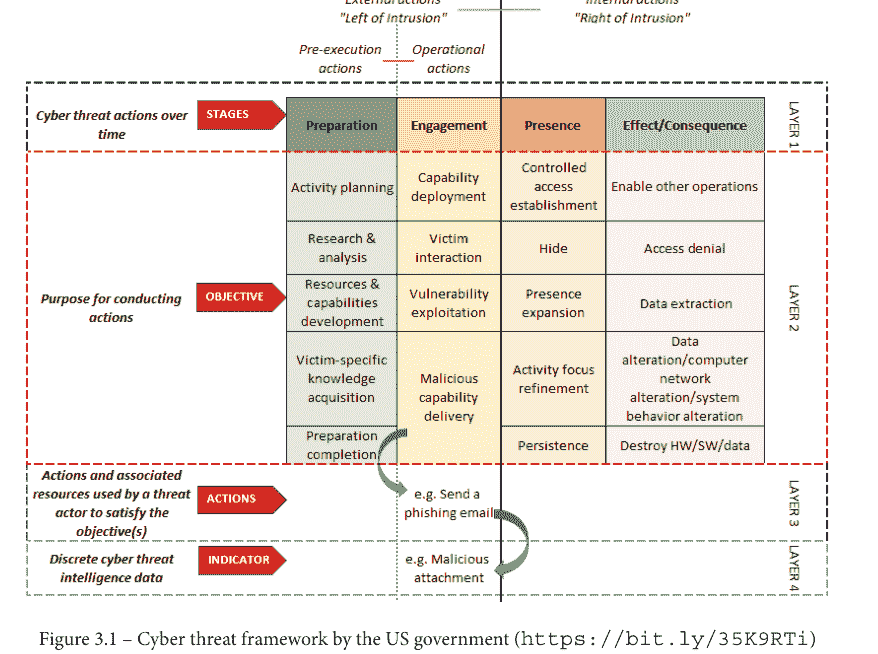
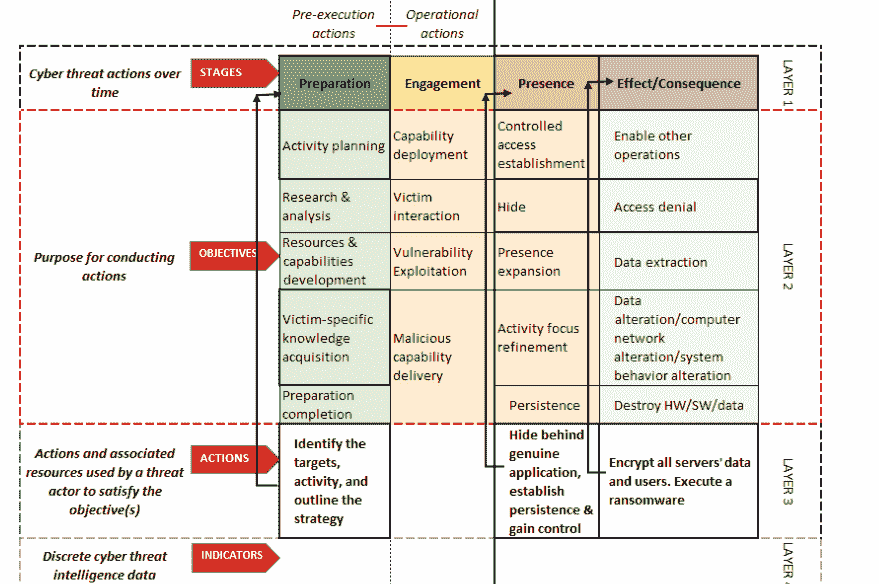
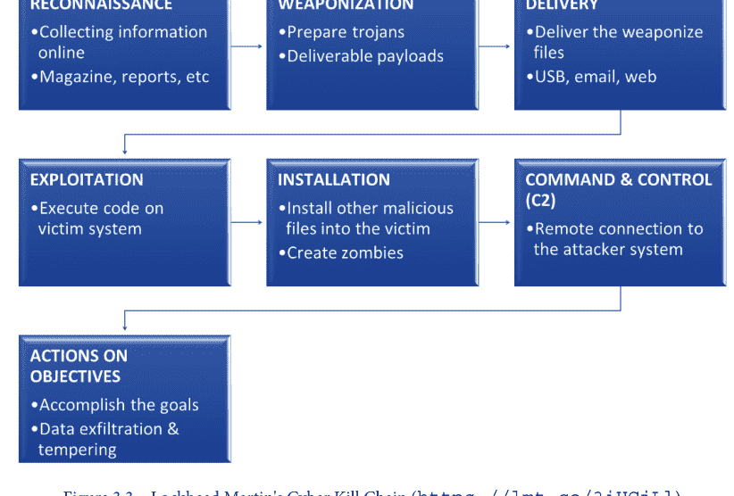
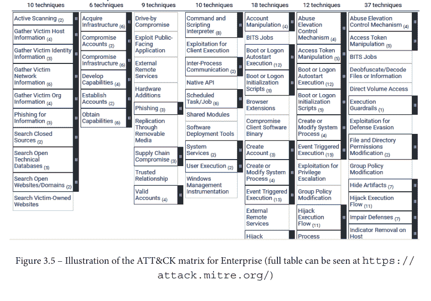
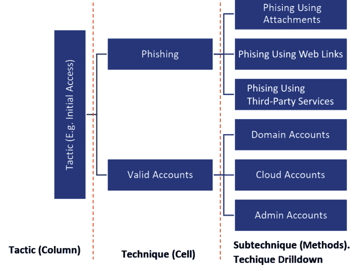
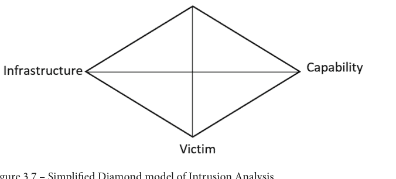
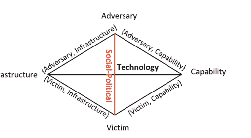
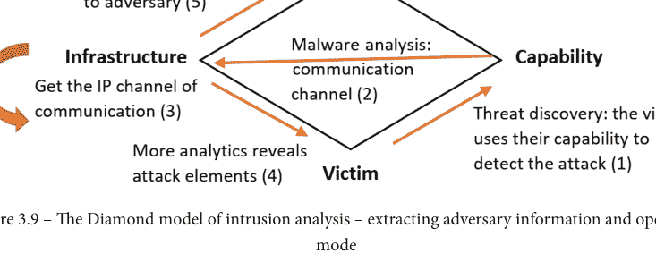

## 3 Cyber Threat Intelligence Frameworks

组织中充斥着来自不同厂商、用于不同任务的安全工具。你可能会发现一种工具执行漏洞评估，另一种用于恶意软件分析，还有一种用于欺诈检测和数据监控。即使是普通组织也拥有良好的安全工具库，因为大多数时候，战略团队会随着需求的出现而获取新工具。然而，如果这些工具没有得到适当的集成，它们可能会形成一个复杂的生态系统，使安全追踪变得困难。这种资源混乱不仅会减缓对威胁的响应效果；它还使得难以证明整个系统的**投资回报率（ROI）**。

本章重点介绍常见的威胁情报框架、为 CTI 项目选择合适的框架，以及它们如何用于构建情报。我们将进一步阐述传统情报生命周期中的每个组件或步骤如何与整个项目相互作用。

在本章结束时，你应该能够做到以下几点：

- 了解情报框架在 CTI 项目中的重要性。
- 解释并讨论三种最受欢迎的威胁情报框架。
- 在进行情报项目时选择首选框架。
- 将框架集成到安全生态系统中。

在本章中，我们将介绍以下主要主题：

- Intelligence frameworks – overview
- Lockheed Martin's Cyber Kill Chain framework
- MITRE's ATT&CK knowledge-based framework
- Diamond model of intrusion analysis framework

## Technical requirements

对于本章，未强调任何特殊技术要求。大多数用例如有必要将使用 Web 应用程序。

## Intelligence frameworks – overview

网络威胁情报围绕对手如何运作、他们正在做什么以及能够做什么展开，同时了解他们的**战术、技术和流程**（**TTPs**）以帮助构建可靠的防御系统。然后利用这些信息做出客观的业务决策来防御系统。CTI 并非孤立的领域；为了防御全球威胁，分析师和组织大多共享情报产品。需要一个标准框架来创建协作式网络防御环境。网络威胁框架可以被定义为威胁情报和防御的通用语言。美国政府开发了它以促进威胁活动的表征和分类，并识别对手行为的趋势和变化（https://bit.ly/35K9RTi）。因此，任何投资网络安全的组织都应使用网络威胁框架来集成这些能力并生成情报。以下部分强调了情报框架的好处。

## Why cyber threat frameworks?

网络威胁框架提供多种通用益处，包括但不限于以下内容：

- **通用语言：** 网络威胁框架提供了一种通用方式来传达和描述威胁信息。通过使用框架，两个或多个组织可以共享情报产品。例如，使用 MITRE ATT&CK 的威胁情报任务遵循一定数量的步骤，这些步骤对所有使用它的分析师都相同。
- **一致性：** 使用网络威胁框架允许团队一致地分析威胁，促进内部和外部结果。战略、战术和技术情报部门随后可以使用这些结果来支持决策并解释威胁情报计划的输出。
- **端到端威胁分析：** 网络威胁框架允许我们监控和捕获对手的活动（生命周期），从准备到攻击识别。
- 当分析师使用框架时，他们可以更早地发现威胁——即使对手只是进行侦察或非侵入性活动。它使他们能够对对手的行动和行为进行端到端视图（跟踪对手 TTP 的变化并促进威胁狩猎）。由于威胁行为者会投入资源发现新的系统入侵方法，因此了解其 TTP 如何演变至关重要。
- **系统集成：** 组织投资了大量安全工具和资源。然而，这些工具有时会增加安全生态系统的复杂性，导致方案混乱和对威胁的可见性丧失。框架使我们能够集成整个安全生态系统，以在多个领域和平台上提供价值。它们还结合内部和外部数据以获得更好的情报。
- **迭代与连续性：** CTI 是一个迭代和连续的过程。因此，威胁情报框架提供了一种简单的方式来持续学习和跟踪可能影响防御系统的变量。它帮助我们无休止地监控对手的行为及其行动方式。

威胁情报框架在开发和实施情报计划中至关重要。在下一小节中，我们将介绍网络威胁框架架构和运行模型。

## Cyber threat framework architecture and operating model

正如美国政府所述，通用网络威胁框架模型旨在通过纳入分层视角（关注网络细节）、采用结构化和记录的分类以及关注支持决策的证据来简化网络流程。它必须适应各种数据源、威胁行为者和任务。网络威胁框架架构如下图所示：

图 3.1 – 美国政府的网络威胁框架 (https://bit.ly/35K9RTi)

该框架使用四步流程来捕捉对手的生命周期，从准备必要能力到制造威胁后果。四步包括准备、接触、存在和后果。每个步骤都包含一定数量的目标和待执行的任务。让我们查看每个步骤的简短描述，了解对手是如何运作的：

-   **准备：** 准备是对手生命周期的第一步。在此阶段，对手收集有关目标的所有相关信息并计划攻击（一次有效的侦察）。为了发动攻击，对手使用主动（网络映射和枚举）和被动方法——例如开源情报或暗网研究——对目标系统进行深入研究。根据收集到的信息，对手准备资源并开发进入下一步（接触）所需的技能。他们通过确保已获取有关目标组织所需的所有知识和信息来完成此准备。
-   **接触：** 准备之后，对手已准备好与目标系统互动，这可能是你的组织。他们通过利用在准备阶段收集到的漏洞与目标互动。这种互动主要通过使用各种行动方式（社会工程学；即鱼叉式网络钓鱼或暴力破解系统）在目标中植入恶意软件或文件来实现。一旦攻击被发起并成功，对手将获得对目标的部分或完全控制权，这是下一步。
-   **存在：** 在此阶段，对手执行任务以完全控制系统并掩盖其踪迹（隐藏其存在）。他们可以进行权限提升以获得对系统的高级访问权限并造成更大破坏。如果需要未来进入，他们很可能会在目标系统中建立持久性。现在，他们已准备好破坏系统。
-   **后果/影响：** 影响或后果是对手生命周期的最后阶段，也是对目标执行实际行动的阶段。根据在准备阶段设定的目标，对手可以拒绝访问（执行 DoS 攻击——可用性）、窃取信息并访问敏感数据（保密性），以及按其意愿修改信息（完整性）。他们甚至可以关闭系统。

框架应能够在对手生命周期的每个点追踪威胁。CTI 分析师或团队必须将威胁映射到框架模型以确定威胁所在位置。让我们看一下以下示例：

> "使用威胁检测器，ABC 组织的安保团队怀疑来自特定国家的网络活动。他们发现，通过使用开源情报和暗网，过去 3 天内该国对该组织进行了大量搜索。"

> "恶意软件分析团队发现组织正在使用的第三方应用程序中存在恶意 DLL 文件。该 DLL 连接到来自该国特定地区的 IP 地址。"

> "ABC 公司遭到名为 Xyz 的勒索软件攻击，该勒索软件在向对手支付 1M 兰特的款项之前，阻断了对 ABC 系统的所有访问长达 24 小时。"

前述三个示例是可能发生在任何组织的真实场景。每个实例可能来自不同的来源。假设这三个场景来自不同来源，很难关联事件并建立情报——尽管可以立即采取行动。通过使用情报框架模型，威胁分析师可以将前述示例映射到所使用的框架中，如下图所示。他们还可以参与正确的行动以直接防止或应对威胁：

图 3.2 – 美国政府的网络威胁框架（https://bit.ly/35K9RTi）与我们的示例映射到第 1、2 和 3 层

第 1 层，网络分析师将网络事件映射到特定的对手生命周期步骤。示例 1、2 和 3 分别直接映射到准备、存在和后果阶段。

第 2 层，网络分析师将网络事件映射到其特定的目标。示例 1 在早期阶段被检测到。对手仍在计划攻击并获取有关组织的知识。在示例 2 中，对手已在系统中存在。隐藏和控制系统是该阶段对手的目标（因为访问已被授予）。示例 3 对对手来说是一个成功案例。他们现在必须让组织按照他们的音乐起舞——这是一个表达他们可以进行任何行动的说法。这就是目标。在这种情况下，拒绝对服务的访问被提供。

第 3 层，网络分析师描述对手已使用或可能用来实现目标的行动。在示例 1 中，对手可能在收集信息 3 天后建立策略。通过此举，他们已将 ABC 组织识别为目标。在示例 3 中，对手可能的行动是执行勒索软件并要求付款。

第 4 层，网络分析师强调对手已使用或可能用来行动的情报数据。在示例 1 中，指标可能是 Maltego 情报工具或暗网数据。在示例 3 中，数据可能是定制一种广为人知的勒索软件。

目标是将每个事件映射到框架流程，有用的 CTI 项目必须能够实现这一点。网络威胁框架不是也不应取代组织现有的安全工具、方法和模型。然而，这整合了多个现有平台上的数据并将其映射到其结构。它提供了一个集中的网络监控和数据交换点。在以下章节中，我们将介绍威胁领域中使用最流行的框架。

## Lockheed Martin 的网络杀伤链框架

Lockheed Martin 的网络杀伤链是分析师用于理解和分析对手行动的流行情报框架。它由 Lockheed Martin 于 2011 年开发。网络杀伤链将网络攻击、入侵和 **高级持续性威胁 (APTs)** 映射到情报框架的结构。它源于军事方法，通过描述在战争中攻击和摧毁敌人的方法。其军事本质使其成为正确识别威胁行为者、阻止他们并迅速捕获他们的残酷而有效的框架。因此，如果情报分析师希望建立强大的防御系统，全面理解该框架至关重要。网络杀伤链回答了这样一个问题：*对手为了实现其网络目标到底做了什么？*。对此问题的答案是一组对手常用的 TTP。

对手使用组织成链的流程（步骤）来策划攻击。该链具有链接的节点。为了实现目标，威胁行为者应按计划以链式结构（或按时间顺序）完成任务。因此，网络安全或情报分析师 *必须通过在流程的任何一点阻止攻击来打破链条*。根据框架的观点，攻击的成功取决于成功利用对手生命周期攻击的所有阶段。网络杀伤链使用七步流程来模拟对手的行为。它将任何（或所有）网络威胁和攻击映射到七个步骤或阶段。因此，任何攻击向量都可以使用该框架进行识别和分析。让我们查看如下图所示的模型的七个阶段/阶段：

-   **侦察：** 侦察始终是每次网络攻击的第一阶段。没有人攻击自己不知道的东西。对手通过对目标进行深入研究来计划攻击。他们确保收集相关信息以实现目标。在侦察阶段，对手的技巧包括使用 **开源情报 (OSINT)** 获取 IP 地址范围、域名信息、电子邮件地址、员工信息、新闻信息、网站信息，并发现面向公众的服务器。情报团队必须尝试在早期阶段检测侦察活动以建立情报并提取对手的潜在 *意图*。然而，阻止侦察活动并不容易，因为此类活动通常在组织防御系统和控制措施之外进行。

- **武器化：** 网络杀伤链的第二阶段是武器化阶段。在成功收集信息后，攻击者会利用收集到的数据准备攻击。根据已采用的目标和方法，他们可能会武器化合法文档、创建恶意软件并开发不可检测的特洛伊木马。由于存在经过精心设计的恶意软件、有效载荷和用于执行高级系统攻击的漏洞利用创建工具，因此*能力*预计是存在的。*只有少数熟练的攻击者能够编程其武器以入侵系统。* 然而，随着*威胁即服务*，即使是技术较差的攻击者也可以购买最先进的武器并发动毁灭性攻击。情报团队与内部安全团队必须对该阶段有清晰的可见性，并实施方法来检测武器化资源（包括恶意软件分析和扫描、入侵检测等方法）。

图 3.3 – 洛克希德·马丁的网络杀伤链 (https://lmt.co/3iHGjLl)

- **投递：** 攻击者已准备好发动攻击。投递阶段涉及用于将恶意文件传达给目标的技术。该框架将投递阶段分为两种风格：攻击者控制的投递（攻击者管理投递；例如，使用面向公众的服务器）和攻击者释放的投递（包括钓鱼、放置 USB 闪存盘等做法）。

情报团队制定阻止入侵的方法。这是链条中的一个关键步骤。如果攻击者通过此阶段，即使在后续阶段被检测到，他们也可能影响目标系统的运行。

- **利用：** 利用阶段是攻击者获得受害者访问权限的地方。他们利用系统漏洞进入系统。此阶段使用的技术包括利用软件、硬件和人类（社会工程学）中的漏洞。他们还可以使用*零日漏洞利用*或利用*未修补的漏洞*来获得访问权限。其他方法涉及打开恶意附件或浏览恶意网络链接。安全团队必须制定对策以防止或阻止攻击。
- **安装：** 除非操作是一次性任务，否则攻击者可能会安装持久后门以供未来入侵。这有助于他们在受害者系统中保持尽可能长时间的访问。情报团队必须制定检测后门的方法（使用诸如端点检测等方法）。攻击者在此阶段使用的一些技术包括更改注册表、添加环境变量或修改合法进程以实现持久性。
- **C2：** 一旦后门植入受害者，攻击者就会找到与之通信并接管控制的技术。网络杀伤链描述了威胁行为者用于与后门建立通信的技术。因此，防御团队可以使用对策来阻止攻击。C2 是情报团队和防御系统可以采取行动的最后一个阶段——在此之后，只剩下眼泪了。
- **行动：** 在此阶段，攻击者可以在目标系统上执行任何操作，从收集敏感信息到拒绝用户服务。该框架列举了一些最常用的攻击行为，包括权限提升、横向移动、内部侦察、收集和外泄数据、系统破坏、系统修改和数据损坏。在此阶段，防御者的目标是迅速检测到该行为以避免进一步损害。取证方法在此阶段用于收集有关入侵的证据（事件响应）。

网络杀伤链模型使用攻击者战术与可能的防御立场的比较方法。对于每个阶段，它都提供了针对相应攻击者行动的防御技术。

## 用例 – 洛克希德·马丁网络杀伤链模型映射

**场景和目标：** 一群黑客决定在投票通过客户不满意的政策后，关闭 ABC 保险公司。他们的唯一目标是尽可能长时间地关闭业务，以迫使公司取消这些政策。

该团体从公共互联网上收集电子邮件地址、域名信息、IP 范围和 SSL 证书信息。他们在 LinkedIn 上找到了 IT 管理员 Vanessa 的电子邮件地址，并在 Instagram 上了解了她的生活日常。他们还发现了面向互联网的公司路由器以及公司网站，用户可以在该网站上注册保险、联系公司并留言。

- Cyber Kill Chain 映射：*侦察。*
  **对策：** 持续收集网站访问日志以进行搜索活动，从网络管理员收集流量分析，并检测独特且可疑的反复浏览行为。
  该团体选择 **Metasploit Framework (MSF)** 作为其工具，用于生成嵌入文档中的一组恶意软件发送给 Vanessa。
- Cyber Kill Chain 映射：*武器化。*
  **对策：** 了解最常用的恶意软件生成平台，进行恶意软件分析，并识别和检测恶意软件有效载荷类型及其来源。
  该团体准备使用两种技术来入侵系统。他们向 Vanessa 发送电子邮件，并准备了一个 USB 闪存盘，其中包含准备好的武器，将物理安装在 Vanessa 的个人电脑上。
- Cyber Kill Chain 映射：*投递。*
  **对策：** 了解上游基础设施，了解人员及其角色，了解哪些信息可以被哪个用户访问，并经常进行取证重建。
  Paul 是该团体的一员。他在一个月前与 Vanessa 成为朋友，并能够去她家拜访。投递恶意代码的一种方式是 Paul 说服 Vanessa 打开 USB 闪存盘上的文档。或者，Paul 可以向 Vanessa 发送一封带附件的电子邮件，她会打开它。
- Cyber Kill Chain 映射：*利用。*
  **对策：** 对员工进行社会工程学实践培训，经常进行漏洞扫描，进行端点加固测试，并经常进行取证端点审计。
  当 Vanessa 连接到公司网络时，恶意文件在公司系统中传播。该武器在系统上安装了后门并实现了持久性。
- Cyber Kill Chain 映射：*安装。*
  **对策：** 安装入侵防御设备，经常审计注册表和进程，并审计端点是否存在异常文件生成。
  Paul 和他的团队已与植入的后门建立了反向连接，可以控制 ABC 保险系统。
- Cyber Kill Chain 映射：*命令与控制。*
  **对策：** 加固网络通信（使用代理），扫描 C2 网络，并监控异常端口。
  该团体已收集用户凭据，对数据库网络进行横向移动并外泄数据。最后，发动 DDoS 攻击以关闭公司，并附带信息说，*取消新政策，否则我们将烧毁这家公司。*
- Cyber Kill Chain 映射：*行动。*
  **对策：** 执行事件响应，扫描并识别外泄任务，并扫描对敏感数据库或存储库的访问。

这里描述的用例提供了如何将网络事件映射到网络杀伤链以及可用于破坏攻击链的可能对策技术的全局概述。这些对策并非排他性。框架和行业详细说明了我们可以使用的多种方法。CTI 团队必须能够就杀伤链每个阶段的有效行业领先对策提供建议。现在，让我们看看如何将洛克希德·马丁的网络杀伤链集成到情报产品或平台中。

## 将网络杀伤链模型整合到情报项目中

网络威胁情报模型例如网络杀伤链并不是安全的一个独立组成部分，而是一个需要整合到情报框架中以构建弹性防御系统的模型。在本小节中，我们将了解该模型如何应用于情报项目：

- **SIEM 丰富与优先级排序：** 大多数组织都有 SIEM 系统来管理安全事件。CTI 项目从不同来源收集数据并创建警报和指标。将警报和指标映射到网络杀伤链的每个阶段，有助于情报团队优先处理安全任务并识别构建弹性防御所缺少的组件。事件在杀伤链中映射的位置越高，优先级越高。例如，入侵检测系统警报和恶意软件存在警报不能同等对待，因为它们映射到不同的杀伤链阶段。最高优先级的事件必须迅速响应。
- **升级控制：** 当发生网络攻击时，会在组织内营造出不同的氛围。安全和情报团队需要确定如何处理网络威胁的升级。网络杀伤链在每个阶段评估攻击的影响程度，可指导 CTI 团队报告和升级网络事件。例如，已映射到杀伤链第七阶段的攻击必须被赋予关键优先级，并必须升级到战略团队（因为入侵者可能已经中断了业务）。映射到投递阶段的事件无需升级到战略层面，但可以在战术和技术层面处理。
- **识别安全防御中的差距并优先投资：** 使用网络杀伤链模型，情报团队可以将组织所有工具及其功能映射到模型阶段。分析团队通过指定组织是否拥有防御此类行动的工具和资源，来定义针对杀伤链每一步的潜在对抗行动矩阵。使用网络杀伤链的差距矩阵示例在下图中显示，其中包含七个 D，详见第 13 章《威胁情报指标、入侵指标和痛苦金字塔》：

| 优先级排名与链顺序 | 杀伤链阶段/反击 | Discover | Detect | Block | Disrupt | Degrade | Deceive | Destroy |
|---|---|---|---|---|---|---|---|---|
| ↓ | Reconnaissance | × | × | × |  |  |  |  |
|  | Weaponization | × |  |  |  |  |  |  |
|  | Exploitation | × | × | × | × |  | × |  |
|  | Installation | × | × | × | × | × | × |  |
|  | Command & Control (C2) | × | × | × | × | × | × |  |
|  | Actions on objectives | × | × | × | × | × | × |  |

Figure 3.4 – Intelligence gap matrix using the Cyber Kill Chain

基于网络杀伤链的情报差距将显示可能需要加强的安全防御领域，从而帮助安全投资（武器库中缺少哪些工具才能确保弹性防御系统？）。

- **评估系统的有效性和弹性：** 分析师需要记录威胁事件，并在攻击被检测、阻止或破坏的每个阶段在所选情报平台中插入标记。攻击被发现越早，缓解和反击的机会就越好。随着时间的推移，团队可以评估系统主要在杀伤链的哪个阶段检测、阻止或破坏网络攻击。这被称为 *有效性*。我们可以使用趋势或任何图形可视化来评估系统使用网络杀伤链的有效性。

在任何情报和防御项目中需要解决的另一个重要问题是系统的 *弹性*。如果对手改变技术、攻击特征或策略以实现相同目标，攻击是否仍能被检测到？情报分析师必须始终预见到对手可能改变策略。如果攻击发生变化后，系统仍能在杀伤链的任何阶段检测、阻止或破坏攻击，则系统是 *弹性* 的。

- **执行分析：** 分析师可以使用网络杀伤链来分析攻击（了解攻击是如何发生的、在哪个步骤被阻止以及如何被阻止）。在这种情况下，情报团队使用杀伤链的每个阶段来分析攻击。情报项目会产生大量数据，只有正确挖掘时才有帮助。杀伤链可以帮助分析师将分析分解为映射到其阶段的小部分。这确保了在执行分析任务时，对手攻击生命周期的各个方面都得到解决。
- **识别并追踪对手组织：** 网络杀伤链可以应用于情报产品，帮助组织根据其攻击结构将对手分组。当对手发动攻击时，组织将能够根据使用的 TTPs 对其组织进行分类。因此，随着时间的推移，分析多个网络杀伤链攻击会产生相似性和重叠指标，CTI 团队可利用这些指标快速识别和分类对手。这是在把握和预测威胁行为者目标方面迈出的重要一步。

洛克希德·马丁的网络杀伤链应整合到情报产品中，以提供更全面的威胁和攻击态势，并使防御系统具有弹性。在本小节中，我们了解了网络杀伤链如何改进情报项目。作为分析师，了解框架如何使用以帮助我们选择合适的模型至关重要。在下一小节中，我们将探讨网络杀伤链的好处。

## 网络杀伤链框架的好处

洛克希德网络杀伤链在网络空间中提供了多项好处。该框架的范围超出了其技术能力——它可用于独立于来源地预测威胁。让我们看看网络杀伤链模型的一些好处：

- 它在整个生命周期中监控网络攻击，帮助组织在任何阶段检测和反击攻击，使防御系统更有效、更灵活。
- 它将所有网络威胁映射到多个杀伤链阶段，有助于我们了解对手的行为。通过将行动映射到情报框架，分析师可以对每次攻击进行时间定位并制定正确的遏制方法。
- 它帮助组织确定安全基础设施的差距并提供增强防御系统的必要参数。
- 它可定制，允许组织灵活修改模型以适应组织安全需求。

多个情报平台使用洛克希德·马丁的网络杀伤链框架，提供敏捷方法以快速防御网络威胁。防御的目标是在任何阶段破坏杀伤链以阻止攻击。这是因为只有攻击通过所有链条步骤才被视为成功。因此，组织可以建立足够的情报在任何可能的时间点捕获对手。然而，攻击被检测和阻止越早，缓解和反击操作所需的精力和资源就越少。在下一节中，我们将介绍另一个流行的情报框架，即 MITRE 的 ATT&CK 知识库框架。

## MITRE 的 ATT&CK 知识库框架

ATT&CK 知识库框架是由 MITRE 于 2013 年创建的情报框架，用于帮助我们理解和分析对手用于入侵或攻击系统的常见战术。ATT&CK 代表 Attack, Tactics, Techniques, and Common Knowledge。MITRE 制定了该框架来描述对手通常用来渗透系统并执行任何利用和后利用活动的方法，包括但不限于权限提升、防御系统规避等。ATT&CK 使用通用框架概念来反映对手的攻击生命周期，从准备到后果。它从对手的角度监督攻击，同时详细说明攻击的可能目标和实现这些目标的方法。通过理解和描述对手的行为，该框架可用于检测攻击者的行动。该框架由社区维护，包含大多数对手的战术和技术。

## 工作原理

ATT&CK 分为三个技术领域：ATT&CK for Enterprise、ATT&CK for Mobile 和 Pre-ATT&CK。ATT&CK for Enterprise 包含大多数计算机操作系统（Linux、Windows、macOS 和云系统）中对手的行为。ATT&CK for Mobile 更多关注移动系统（Android 和 iOS）中对手的行为。最后，Pre-ATT&CK 关注的是实际攻击执行前的对手行为。MITRE ATT&CK 将对手行为结构化为 *战术* 和 *技术*，其中战术是在发起攻击时对手的目标，而技术是对手实现其战术目标的方式和方法。战术包括持久性、权限提升、数据外泄、影响等操作。因此，存在多个战术类别，每个类别都由许多技术组成。每种技术都描述了对手执行某种战术可使用的方法。战术和技术构成了企业版的 *ATT&CK 矩阵*，如下图所示：

图 3.5 – 企业版 ATT&CK 矩阵的说明（完整表格可查看 https://attack.mitre.org/）

每列是一个战术类别。列描述了对手可在目标中发起的全局任务。每个单元格都是用于完成全局任务的技术。对手的技能、专业知识以及特定工具的可用性决定了选择技术以入侵目标的方式。从上表可以看出，ATT&CK 提供了多个战术类别。任何安全专业人员都应能看出，这些是黑客和进攻性安全的标准步骤——从侦察到系统影响。在撰写本书时，ATT&CK 有 14 种对手战术，有效的安全分析师应了解这些战术。让我们查看可用的战术并提供每个战术的简短描述。有关每个战术和技术的更多详细信息，请参阅 MITRE 的网站（https://attack.mitre.org/）：

- **侦察**：侦察侧重于对手主要用于准备攻击的技术。他们使用的技术有助于主动或被动收集信息以规避组织安全并访问系统。侦察被认为是最长的步骤，因为它利用了对手攻击周期的其他阶段。例如，通过收集目标组织的电子邮件地址，对手可以使用钓鱼技术入侵系统。在此阶段，对手可以收集的信息包括目标系统的结构、员工/工作人员、IP地址范围、域名和子域名以及电子邮件地址结构。在撰写本书时，侦察战术包含 10 种已知且流行的技术。
- **资源开发**：资源开发战术侧重于对手用于获取策划网络攻击所需资源的各种技术。ATT&CK 框架描述了用于创建、购买或窃取任务所需资源的方法。资源示例包括配置账户、域名、基础设施和能力。其他战术利用此步骤的结果来支持攻击。例如，假设对手想要发起钓鱼攻击，那么他们很可能会配置域名或公共IP地址（以建立与远程系统的连接）以及电子邮件地址（用于发送特洛伊木马）。目前框架为资源开发记录了六种技术。
- **初始访问：** 在收集相关信息并获取启动攻击所需的资源后，对手的下一步很可能是发起对目标系统的访问。ATT&CK 模型的初始入口描述了对手在系统内获得立足点的技术和方法。该框架回答的问题是，*对手如何获得对受害者系统的初始访问权限？*。该框架描述了在网络攻击中广泛使用的九种技术。用于获取访问的方法包括钓鱼（最广泛使用的社会工程技术）和漏洞利用（利用公开的系统弱点，例如不安全的公共 Web 应用程序）。在撰写本书时，ATT&CK 已将其框架中集成了九种初始访问技术。
- **执行：** 执行战术是指对手的恶意代码在受害者系统中被执行时。ATT&CK 描述了最常用的恶意代码执行方法。对手使用诸如命令和脚本框架（PowerShell、AppleScript、Python 或命令行界面）等技术在本地或远程运行代码。黑客（对手）使用多种命令执行平台在目标系统中执行恶意代码。ATT&CK 框架提供了 10 种最流行的执行技术。
- **持久性：** 除非是一次性任务，否则对手通常希望保持对受损系统的访问。持久性是最流行——甚至是唯一——用于在受害者系统中保持立足点的战术。ATT&CK 框架对此描述了 18 种技术，包括注册表键执行、DLL 注入以及执行/启动守护进程。持久性是通过修改系统配置实现的。
- **权限提升：** 对手总是希望从受害者那里获得更多。权限提升战术用于获得对受损系统的高级访问权限。ATT&CK 描述了对手在受损系统中获得更高级别权限的常用技术。这些技术包括令牌操作、提示执行、策略修改以及许多其他方法。框架中描述了大量提升权限的方法。
- **防御规避：** 对手开展攻击时的最终目标是避免被检测到（保持完全匿名）。ATT&CK 描述了对手用于规避安全防御的技术。这些技术包括禁用防病毒软件、混淆和加密恶意代码以及滥用受信任的进程。该框架包含对手使用的 30 多种常见防御规避技术。
- **凭证访问**：凭证访问是网络攻击的基本目标之一。网络和竞争间谍活动依赖于敏感数据窃取。对手经常追逐此类信息。ATT&CK 揭示了最常用的凭证访问技术，例如数据库转储、键盘记录、暴力破解等。例如，对手可以使用键盘记录检索管理员用户名和密码并用它们控制受害者系统。ATT&CK 描述了 15 多种对手凭证访问技术。
- **发现**：发现战术用于获取有关受损系统的更多知识。ATT&CK 揭示了对手分析内部系统并突出可完全控制的不同组件的技术。这些技术包括查找域名、电子邮件、应用程序、目录结构等。框架中广泛使用并描述了 20 多种技术。
- **横向移动**：横向移动是指在受害者系统内部导航。例如从一个子域切换到另一个子域或从一个 VLAN 切换到另一个 VLAN 的技术就是横向移动的例子。ATT&CK 框架揭示了对手在系统中移动时常用的几种方法。
- **收集**：收集战术涉及收集对手为实现其初始目标所需的数据。例如，对手可能会从系统中收集用户名和密码、捕获受害者的屏幕活动或收集其击键。ATT&CK 揭示了可以帮助对手收集内部信息的技术。数据收集的一种知名技术是 **中间人 (MITM)** 攻击。
- **C2**：C2 战术涉及使用对手的技术与受损系统建立连接。有几种已知方法可用于在不被检测到的情况下实现对受害者的控制——例如使用加密通道和代理技术等技术。ATT&CK 揭示了其中几种技术，以帮助组织构建可靠的防御系统。
- **数据外泄**：数据外泄技术用于从系统中窃取信息。对手收集数据，对其进行加密、压缩，并以不可检测的方式将其带出系统。ATT&CK 框架描述了许多数据外泄方法（使用流量隧道、Web 服务等）。
- **影响**：影响涉及用于操纵、中断或破坏受害者的方法。对手可以发起 **拒绝服务 (DoS)** 攻击或加密受害者的数据以勒索赎金。ATT&CK 框架揭示了最常用的对手影响技术。

除企业行为矩阵外，ATT&CK 框架还描述了移动矩阵，其中包含之前的大多数战术及其相关技术。对于每种战术和技术，框架都提供了详细的描述以及如何缓解此类攻击。矩阵导航架构如下图所示：

图 3.6 – ATT&CK 矩阵导航架构

为了将此处描述的框架的理论概述与实际用例结合起来，我们将查看一个可以映射到真实网络攻击场景的模型。

## 用例 – ATT&CK 模型映射

**场景和目标：** 攻击者受竞争对手雇佣，窃取 ABC 公司的商业信息。由于这是商业间谍活动，攻击者获得了 orchestrate 攻击所需的资源。攻击者在未被检测到的情况下通过了信息收集和收集阶段。在信息收集阶段，攻击者在 LinkedIn 上遇到了 joe@abc.co.za。Joe 是足球迷：

- 战术映射：*初始访问。*

他们对组织发起攻击。他们选择使用 spearphishing（社会工程）通过系统管理员的电子邮件访问系统。他们准备并武器化（嵌入恶意代码）一份优秀的 PDF 格式体育期刊。该期刊通过伪造的发件人电子邮件地址发送给 Joe。

- 技术映射：*网络钓鱼。*

网络钓鱼通过电子方式传递恶意木马、链接或服务。在这种情况下，攻击者可以使用三种提到的网络钓鱼方法中的任何一种来访问系统。分析师将该活动映射到 ATT&CK 框架的网络钓鱼技术。

- 子技术（方法）映射：*定向网络钓鱼附件。*

Joe 收到一封伪装成 Alice 的电子邮件，发件人使用合法的 ABC 公司电子邮件域（alice@abc.co.za）。电子邮件包含一份 PDF，内容为“Possible transfer of Kylian Mbappe to Liverpool FC. Hey Joe, did you see the latest rumor about the arrival of Mbappe to Anfield? Check the attached article.” 分析师将该活动映射到使用电子邮件附件的 spearphishing。Joe 兴奋地打开了附件并阅读了文章。系统被攻破。

## 如何检测此类攻击

ATT&CK 框架建议使用入侵检测系统、电子邮件网关或爆破室来保护并检测使用恶意附件的网络钓鱼程序。然而，由于此类保护基于流量模式和数据包分析，攻击者可能会使用防御规避技术来绕过网络障碍。因此，它强烈建议使用防病毒软件（自动扫描带附件的电子邮件）、端点和网络感知（以检测 PDF 文档何时被打开）。

## 如何缓解此类攻击

框架为此类攻击提供了缓解措施。缓解措施包括安装防病毒软件（以隔离或删除恶意文件）和入侵防御设备（以阻止可疑活动）。它还包括基于 Web 的内容限制（阻止某些扩展并扫描附件的压缩文件）以及用户培训（培训用户检测可疑的电子邮件附件和链接）。如果 Joe 细心一点，他就会注意到这个骗局。

前述用例展示了 ATT&CK 框架如何将攻击者活动映射到战术和技术，并提供应对每种战术和技术的方法。通过查看缓解和检测步骤，目标组织可以评估并加强其防御系统。现在，让我们看看分析师和安全团队如何使用 ATT&CK 矩阵来构建情报。

## 集成 MITRE ATT&CK 框架

MITRE ATT&CK 框架在攻击者行为方面非常丰富，可以在许多方面支持组织的安全基础设施。通过采用该框架，组织可以执行以下操作：

- **模拟攻击者行为：** 他们可以使用威胁情报来了解攻击者的行为并检查安全系统的连贯性。他们还可以将每个威胁映射到框架中描述的战术和技术。
- **执行红队操作：** 即使组织从未被攻击过，也可以通过对组织进行道德黑客攻击并评估每个 ATT&CK 战术和技术对安全基础设施的影响来建立预防性安全系统。这是测试防御系统强度最好的方法。
- **执行分析：** 跟踪威胁活动并使用分析可视化威胁洞察至关重要。组织可以使用 ATT&CK 框架来分析、分组并发现可疑活动模式。
- **评估防御线的差距：** 通过使用 ATT&CK 框架，情报分析师可以识别安全系统的漏洞。这可以通过查看有多少以及哪些战术可以轻松渗透组织的防御系统来实现。ATT&CK 还可以帮助评估武器库中可用的安全资源。
- **评估 SOC 系统：** ATT&CK 系统暴露了防御的弱点。使用框架中可用的战术和技术，分析师可以快速评估 SOC 的有效性。SOC 系统检测威胁和响应入侵的速度有多快？
- **丰富情报项目**： MITRE 的 ATT&CK 框架会持续更新。因此，新的战术和技术会迅速添加到框架中，帮助组织获得新的指标并改进安全监控。

MITRE 的 ATT&CK 框架可以以两种方式集成到安全系统中：*手动* 和 *自动*。它也可以集成到 SIEM 系统中。从不同来源收集的数据被收集和分析以检测潜在威胁，并映射到 ATT&CK 框架以帮助我们了解攻击者的行为。它也可以集成到端点检测和响应系统中，以确定攻击者在攻击的哪个阶段处于何种位置。通过了解此类信息，分析师可以预测攻击对防御系统的影响。它也可以集成到云安全系统中。现在我们知道了如何使用 MITRE 的 ATT&CK 框架，让我们来看看它的一些好处。

## ATT&CK 框架的优势

MITRE 的 ATT&CK 框架为组织和全球安全界从技术和非技术角度提供了许多好处。以下是使用该框架的一些好处：

- 该框架在攻击者战术方面非常丰富，使其成为网络空间中使用最广泛的安全框架之一。
- ATT&CK 不仅用于情报项目，也用于跨 IT 部门操作。这意味着每个安全功能都可以独立使用该框架来映射、分析和响应威胁。
- ATT&CK 是一个开源框架，由安全社区维护。它维护着有关攻击者组织和已进行的网络战役的通用信息库。
- 它提供了一个集中环境，有助于创建、收集、共享和管理信息。
- 任何人、任何组织都可以使用它。

MITRE 的 ATT&CK 在网络安全领域被广泛使用，并且由于其全面且持续更新的攻击者行为库，在 CTI 环境中建立了强大的声誉。作为情报分析师，必须了解 ATT&CK 框架的优势。接下来，我们将介绍入侵分析的钻石模型。

## 入侵分析框架的钻石模型

入侵分析的钻石模型（https://bit.ly/3iHC6Hn）是另一个流行的情报框架，用于理解攻击者的行为和分析入侵。该模型易于表示，但与 Lockheed Cyber Kill Chain 和 MITRE ATT&CK 框架相比，应用起来更复杂、更强大。该框架将入侵活动表示为四个核心要素的函数：*攻击者*、*基础设施*、*能力* 和 *受害者*。这些要素在边缘上相互连接，以以钻石的形式表示它们之间的关系，因此得名钻石模型。该模型的简化形式如下图所示。钻石模型基于入侵分析的科学方法，为分析师提供有效的文档、综合和关联网络事件。该模型使用逻辑，即每个网络 *事件* 都涉及一个 *攻击者*，该攻击者利用 *能力* 通过某些 *基础设施* 来破坏 *受害者*。*事件* 与攻击者针对目标执行的行动相关联：

- **元特征**
  - 时间戳
  - 阶段
  - 结果
  - 方向
  - 方法
  - 资源

图 3.7 – 入侵分析简化钻石模型

如前图所示，钻石中的链接代表核心要素之间的主要连接和关系。CTI 团队或分析师使用这些关系来分析和创建网络威胁情报。然后元特征用于分析、分组和规划网络威胁分析。它们有助于在攻击之前、期间或之后构建事件。因此，它们在使用该模型进行入侵分析时至关重要。现在，让我们看看该模型的工作原理。

## 工作原理

每当检测到、识别到或阻止某个事件时，CTI 团队或分析师会填充钻石的顶点。分析师随后沿着钻石的边进行枢转，以显示有关威胁（或事件）的信息。后者用于揭示事件的能力、受害者以及使用的基础设施。在标准攻击中，攻击者执行一系列操作以达到目标，而钻石模型中的事件代表该过程的一个阶段。因此，完整的攻击由多个按顺序排列的事件组成，这些事件由攻击者与受害者的连接标记。按顺序排列的事件用于生成 *activity threads*，它们描述了攻击的流程。

分析师利用这一系列事件和生成的活动线程对攻击进行全面画像。只有在此之后，集成框架才能提供缓解措施。攻击流程促进了事件的相关性，以发现攻击者活动和动机，然后可用于开发 *activity groups*。所有钻石元素（核心元素和元特征）的组合被称为模型特征，并且存在于每个事件中。

每个特征都被赋予一个 *confidence value*，该值取决于其他参数，例如数据的事件来源、CTI 分析结果、数据的准确性等。给定一个特征，$F$，和一个置信值，$\sigma_F$，一个事件，$E$，可以表示如下：

$E = ((F_1, \sigma_{F1}), (F_2, \sigma_{F2}), (F_3, \sigma_{F3}), \dots, (F_n, \sigma_{Fn}))$

这里，$n$ 是特征的数量。函数元组的典型示例可以是 `adversary`、`capability`、`victim`、`infrastructure`、`timestamp_start`、`timestamp_end`、`phase`、`result`、`direction`、`methodology` 和 `resources`，以及它们各自的置信值——钻石模型的基本特征。然而，为了获得更深入的见解和分析灵活性，可以引入额外的特征，例如 IP 信息、域名详情、所涉及的应用等，以嵌套元组的形式呈现。模型元素特征的图形表示如下图所示：

- **元特征**
- 时间戳
- 阶段
- 结果
- 方向
- 方法论
- 资源

图 3.8 – 入侵分析的扩展钻石模型

该模型建立了攻击者与受害者之间社会和政治层面的关系。这得到了这样一种逻辑的支持：攻击者与受害者之间总是有关系的。连接可以是直接的也可以是间接的，并由攻击者的社会政治目标驱动（为市场利润进行的企业间谍活动、申诉、为乐趣等）。攻击者-受害者关系在钻石模型中至关重要，因为它有助于回答关键问题，例如为什么攻击者针对此受害者？攻击者是否针对了更多受害者？所有受害者是否有共同点？这些问题的答案提供了对攻击的更深入了解。例如，识别共享威胁空间中的受害者（具有相似特征的受害者）对模型至关重要，因为它有助于制定缓解策略。

它还将基础设施与能力之间的关系设定为技术关系。这种关系对模型也至关重要，因为它将技术（工具和技术）与基础设施（物理或逻辑的受害者环境）联系起来。

使用钻石模型时，集成框架的两个最关键的分析任务是填充钻石的顶点以及通过核心特征进行枢转以提取和发现数据元素。枢转是该模型的一大优势，应适当进行以暴露攻击者操作。现在，让我们看一个用例，了解钻石模型如何用于分析威胁（该用例在钻石模型的原始论文 at https://bit.ly/3iHC6Hn 中有详细说明）。

## 用例 – 入侵分析的钻石模型

**场景和目标**：未知攻击者成功在 ABC 保险系统中植入后门并建立连接以控制受损系统。扫描系统后，安全团队检测到持久性恶意文件，并决定使用钻石模型分析入侵。

分析师或集成框架填写钻石的特征，包括攻击者、受害者、能力 和 基础设施：

- 1. 分析师围绕受害者进行枢转以发现恶意软件。这包括分析受害者系统是否存在潜在威胁。
- 2. 分析师随后再次围绕技术对钻石进行枢转，以揭示恶意文件的通信方法论。这等同于建立能力与基础设施之间的关系。
- 3. 下一次枢转用于揭示事件的 IP 地址和其他元素。这是通过将攻击者连接到正在使用的基础设施（恶意文件）实现的。这被添加到基础设施-攻击者边。
- 4. 对发现进行分析以了解攻击的范围（受影响的主机、资产、资源等）。这是通过基础设施与受害者之间的关系实现的。
- 5. 然后对钻石进行分析以提取攻击者的信息及其操作方法。这些步骤如下图所示：

图 3.9 – 入侵分析的钻石模型 – 提取攻击者信息和操作模式

钻石模型生成情报，然后可将其输入到另一个框架如 Cyber Kill Chain 以构建更好的防御系统。尽管是手动的，该模型由于其稳健的实证方法，在处理威胁信息方面提供了高准确性。在本小节中，我们研究了钻石模型的基本运行模式。在下一小节中，我们将研究如何将其集成以提供情报。

## 将钻石模型集成到情报项目中

钻石模型可以集成到情报项目中，以帮助我们使用入侵的四个核心元素对威胁和攻击进行建模。它通过研究钻石特征之间的关系来链接和关联网络事件。以下几点解释了将模型与情报产品集成的好处：

- **知识差距识别：** 钻石模型要求分析师记录系统中发生的每个事件。因此，它提供了大量可用于分析以识别安全基础设施漏洞的信息。
- **分析改进：** 通过研究攻击流程（activity thread），钻石模型以其实证方法改进了入侵分析。它不仅使用攻击元素的事实，还使用分析支持的假设来支撑决策。对于每个入侵问题，都会生成、记录和测试假设。它还可以集成机器学习以揭示攻击者的数据模式。
- **与 SIEM 集成以增强指标：** 大多数 SIEM 和 SOC 系统通常只使用技术指标。钻石模型通过添加非技术、行为和概念指标来扩展指标范围，这有助于自动化系统检测事件的方式。例如，在传统的 SIEM 中，攻击者的 IP 地址被视为常规指标。然而，使用钻石模型，IP 地址代表更多内容（攻击者类型、附属的潜在组织、受害者类别等）。

在 *第 5 章，目标设定、CTI 策略程序和实际用例* 中，我们将研究一个实际用例，其中钻石模型已集成到情报产品中以分析入侵活动。在下一小节中，我们将总结入侵分析钻石模型的总体好处。

## 钻石模型的好处

钻石模型提供了多项好处，并在网络安全环境中得到广泛使用。其科学方法使其成为一个稳健可靠的情报框架，可应用于项目：

- 该模型易于使用，因为入侵分析中的参与者数量少于其他框架（整个模型围绕四个基本元素展开）。
- 钻石模型提供了全面的网络事件文档记录策略、威胁概览和事件自动关联。这使其易于任何分析师使用。
- 它可以集成情报用于实时网络防御并自信地对攻击者活动进行分类（它逐步纳入知识以构建适当的网络保护情报结构）。
- 一旦情报正确集成到钻石模型中，它可以利用分析能力预测攻击者操作并生成缓解程序。
- 由于其逻辑方法，它在分析有效性、熟练程度和精确度（以及准确性）方面引入了许多改进。

它可以与 Cyber Kill Chain 模型一起使用。这两个模型高度互补，因为 Cyber Kill Chain 将对手的行为视为一条链，直接关注效果（任务）。另一方面，Diamond 模型则生成执行 Cyber Kill Chain 各阶段所需的知识（情报）。

Diamond 模型可以集成到任何情报项目或产品中，以加强防御系统并了解对手的运作方式。它以钻石形状围绕所有入侵任务的原子元素（核心）旋转。威胁情报分析师使用此模型来调查和发现网络威胁。

## 摘要

本章介绍了优秀威胁分析师应了解的最普遍的威胁情报框架。我们解释了威胁情报框架的一般概念，以及为什么将其集成到网络威胁情报计划中很重要。分析师应更多地了解这些框架，以便为情报任务选择最合适的框架。然而，在选择情报框架时可以考虑一些参数。更实用的参数包括框架对威胁分析的深入程度、框架的范围（它涵盖哪些类型的威胁——云、企业、移动？）、框架更新以适应新威胁的频率、将其集成到威胁情报计划中的难易程度，以及理解其整体结构的难易程度。在下一章中，我们将回顾威胁情报的技艺和标准。
