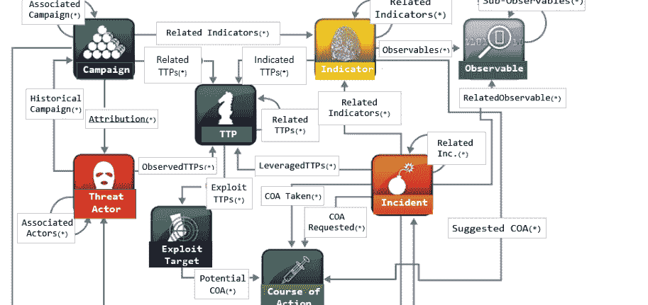
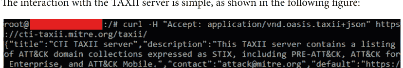
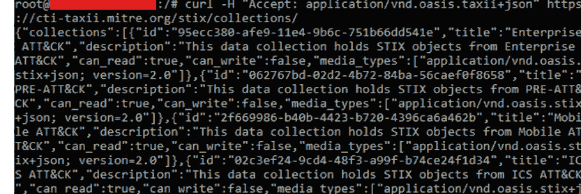
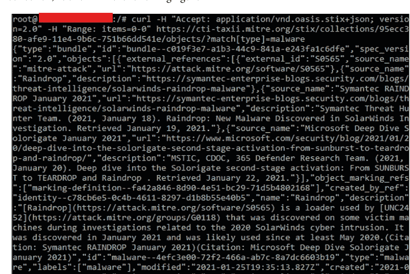
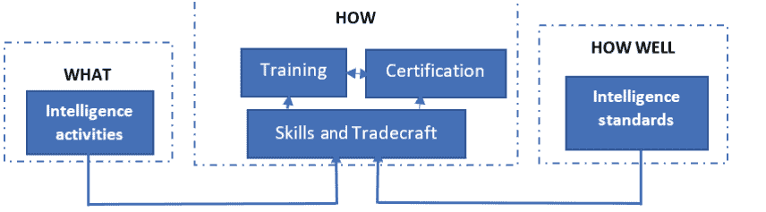

## 4 网络威胁情报技艺与标准

与其他任何计划一样，**网络威胁情报 (CTI)** 需要方法和技能来帮助安全分析师实现其预期目标。为了确保对网络威胁的协同响应，网络安全社区制定了组织可以遵循的技术（技艺）和标准，以在 CTI 流程中实现一定程度的统一。**CTI 技艺**提供了进行情报评估的方法和技能，而**标准**则提供了一种共同的方法（称为 *规范*）来应对威胁。本章使用这两个术语来指代共同的 CTI 语言。

本章探讨 CTI 的**分析技艺**和流行的标准，这些标准有助于创建服务水平模型，以确保 CTI 计划遵循正确的程序（即在交付给消费者之前，计划符合标准）。

在本章结束时，您应该能够做到以下几点：

- 了解并解释情报分析技艺是什么
- 了解并讨论 **情报界指令 (ICD) 203** 中定义的分析标准
- 了解并讨论 **结构化威胁信息表达 (STIX)** 标准及其在 CTI 中的应用
- 了解并讨论 **可信自动化指标信息交换 (TAXII)** 标准及其在 CTI 中的应用
- 了解 **空军指令 (AFI) 14-133** 及其在 CTI 中的应用

在本章中，我们将涵盖以下主要主题：

- 情报分析技艺的基础
- 了解并将 ICD 203 适应到 CTI
- 了解 STIX 标准
- 了解 TAXII 标准
- CTI 的 AFI 14-133 技艺标准

## 技术要求

对于本章，没有突出显示任何特殊技术要求。大多数用例如有必要将使用 Web 应用程序。

## 情报分析技艺的基础

情报分析技艺提供了进行威胁情报评估的方法。它被用作理解情报分析和最大限度减少 CTI 流程中错误 *通用* 且 *共享* 的语言。了解情报分析技艺对于组织和政策制定者至关重要，因为它为创建衡量威胁情报计划的标准提供了指导。本节采用的情报分析技艺基线改编自美国 **中央情报局 (CIA)** 的分析技艺笔记汇编（https://bit.ly/3K4WAY1）。CIA 的分析技艺笔记汇编强调了该机构如何支持情报消费者。CTI 分析师在一定程度上利用这一 CIA 模型来开展有效的威胁情报计划。有效的 CTI 计划将加强组织的<|message|> 安全态势并支持更好的安全政策。改编为 CTI 的 CIA 情报分析技艺笔记不构成标准，而是进行 CTI 计划时应考虑的一套技术和流程。*CTI 改编* 的情报分析技艺以 10 条笔记呈现，总结如下。

### Note 1 – 处理 CTI 消费者的利益

改编自原标题 *Addressing US Interests in Directorate of Intelligence Assessments*，本条强调 *定义* 和 *捍卫* **消费者利益**。CTI 计划是为他人（使用它们的组织和个人）制定的。CTI 的最终目标是使组织意识到网络威胁并增强其整体安全态势。因此，CTI 分析师必须了解组织的安全需求并将其转化为相关、可操作的要点。CTI 团队在进行威胁情报计划时必须维护 CTI 消费者的利益。

CTI 消费者的利益在组织内部可能很广泛，因为不同的安全职能可能对威胁情报有不同的期望。因此，威胁情报分析师必须确定 CTI 计划的主要利益相关者并了解他们的期望。这将使 CTI 分析师（或团队）能够直接解决每个消费者的需求。处理 CTI 消费者的利益是 CTI 需求的关键组成部分，如 *第 2 章、需求与情报团队实施* 中所讨论的那样。这一首条技艺笔记的另一个重要方面是，CTI 分析师应了解消费者对威胁情报的立场。换句话说，他们必须评估消费者的威胁情报意识水平或 CTI 成熟度。消费者的 CTI 立场有助于规划和实施正确的方法和技能来满足其利益。例如，对 *Level 3*（具有先进威胁情报结构的消费者或组织）、*Level 2*（具有中等威胁情报结构的消费者或组织）和 *Level 1*（威胁情报结构低或无的组织，例如初创公司）组织的 CTI 方法不应相同。

在进行 CTI 计划、设计和开发威胁情报标准或将威胁情报集成到业务中时，消费者（终端用户）应处于运营的中心。所有事情都应以促进消费者的业务运营为目的。CTI 分析师应提出这个关键问题：*消费者将从中获得什么？* 用于进行情报的方法还必须适应消费者利益和情报需求的变化，因为这些需求可能随着新业务需求或法规的变化而随时间推移而变化。

### Note 2 – 访问与可信度

将可操作的威胁情报集成到业务流程中使用的方法必须对消费者（组织和个人）*可靠* 且 *透明*——这在 CTI 分析师和消费者之间建立了信任。CTI 分析师旨在说服消费者威胁情报对他们有益，从而与第一条笔记（即 *处理消费者利益*）建立联系。

CTI 应基于事实和数据来支持安全决策。因此，CTI 分析师必须通过实施可靠的威胁情报计划来赢得消费者的信任。他们必须在该领域成为专家。他们必须讨论用于塑造威胁情报输出以进行战略、战术和运营安全决策的数据、假设、流程、结构和分析。专业知识和良好工作带来可信度。

CTI 消费者也可以利用这一情报技艺笔记来评估 CTI 计划的政策、标准和输出。例如，他们可以询问 CTI 计划是否支持决策制定或是否有助于识别安全基础设施中的差距。

### Note 3 – 假设的表述

分析方法必须详细说明威胁情报计划开发中使用的所有 *假设*。CTI 分析师使用的假设必须基于合理的推理，并且在需要时应易于辩护。

在 CTI 计划开始时并在做出技术承诺之前，CTI 团队必须定义 *关键驱动因素*（CTI 需求、需要保护的资产、需要交互的安全部门、消费 CTI 计划前的估计时间等）及其假设。对于每个驱动因素的假设，CTI 分析师必须准备相关论据来捍卫其可信度。

就威胁情报假设而言，分析师可能有不同的方法和结论。然而，他们必须基于事实、逻辑和精确性做出决策。假设容易出错，但对 CTI 计划方向的塑造很重要。因此，CTI 分析师应研究所有假设（基于逻辑和专业知识）和推定（基于证据），以进行稳健的分析评估。消费者的政策制定者也可以利用 CTI 分析师做出的假设来创建安全指南。


## Note 4 – 展望

Cybersecurity operations can be unpredictable and complex because adversaries can create advanced attack methods (for example, **Advanced Persistent Threats – APTs**). -> 网络安全运营可能难以预测且复杂，因为对手可以创建先进的攻击方法（例如，**高级持续性威胁 – APTs**）。
A CTI analyst should always be on the lookout to ensure that their consumers (customers or organizations) do not become victims – they must be aware of what is happening or could happen – **knowing the threat landscape**. -> CTI 分析师应始终保持警惕，以确保其消费者（客户或组织）不会成为受害者——他们必须了解正在发生或可能发生的事情——**了解威胁态势**。
Threat intelligence is based on evidence collected from different sources. -> 威胁情报基于从不同来源收集的证据。
Therefore, it is crucial to leverage the data and assess the defense mechanism. -> 因此，充分利用数据并评估防御机制至关重要。
For example, the CTI team or analyst can use the collected intelligence data (in the form of published reports, malware data, collective intelligence data, and more) to explore past threats and predict future threats. -> 例如，CTI 团队或分析师可以使用收集到的情报数据（以已发布报告、恶意软件数据、集体情报数据等形式）来探索过去的威胁并预测未来的威胁。
In *Chapter 9, AI Application in Cyber Threat Analytics*, we look at some methods used for proactive threat defense. -> 在*第 9 章，网络威胁分析中的人工智能应用*中，我们探讨了一些用于主动威胁防御的方法。

With **machine learning** (**ML**) and **artificial intelligence** (**AI**), organizations can use advanced analytics models to predict threats and attacks. -> 借助**机器学习**（**ML**）和**人工智能**（**AI**），组织可以使用高级分析模型来预测威胁和攻击。
However, AI and ML should not be considered standalone technologies for threat intelligence. -> 然而，AI 和 ML 不应被视为威胁情报的独立技术。
They must be combined with threat analytics and human expertise to be effective. -> 它们必须与威胁分析和人类专业知识相结合才能发挥效用。
Policy makers can leverage the threat landscape and the predicted threats to implement stronger security and data protection policies. -> 政策制定者可以利用威胁态势和预测的威胁来实施更强的安全和数据保护政策。
And organizations can leverage CTI's advanced analytics capabilities to address current and future threats through the following question: *How is threat intelligence protecting the organization from current and future threats?* -> 而组织可以通过以下问题利用 CTI 的高级分析能力来应对当前和未来的威胁：*威胁情报如何保护组织免受当前和未来威胁？*
A CTI analyst addresses an organization's short-term and long-term threat intelligence goals by answering that question. -> CTI 分析师通过回答该问题来解决组织的短期和长期威胁情报目标。

## Note 5 – 事实与来源

Threat intelligence relies on *evidence*. -> 威胁情报依赖于*证据*。
Evidence comes from data collected from different sources. -> 证据来自从不同来源收集的数据。
The integrity of a CTI program depends on the data source's credibility. -> CTI 计划的完整性取决于数据源的可信度。
Although assumptions and judgment can be incorporated in threat intelligence analytics, conclusive arguments must be based on facts. -> 尽管假设和判断可以纳入威胁情报分析中，但结论性论证必须基于事实。
Therefore, the CTI team must have a process to validate all data sources used in a CTI program. -> 因此，CTI 团队必须拥有验证 CTI 计划中使用的所有数据源的流程。
Due to the complexity of CTI operations, the data handling process must be transparent to identify missing components that can lead to analytics gaps. -> 由于 CTI 运营的复杂性，数据处理流程必须透明，以便识别可能导致分析差距的缺失组件。
The transparency of facts and sources increases an organization's confidence and trust in the CTI output result. -> 事实和来源的透明度增加了组织对 CTI 输出结果的信心和信任。
In other words, provide as many sources of information as possible. -> 换句话说，提供尽可能多的信息来源。

The CTI team (or analyst) must use industry best practices to handle and validate data sources. -> CTI 团队（或分析师）必须使用行业最佳实践来处理和验证数据源。
Policy makers should use the *Facts and sourcing* tradecraft note to document the best practices analysts should use for effective intelligence solutions. -> 政策制定者应使用*事实与来源* tradecraft 注释来记录分析师应为有效情报解决方案使用的最佳实践。
The original tradecraft notes (as in the CIA's compendium of analytic tradecraft notes) provide guidelines that can be used to authenticate intelligence sources and help intelligence analysts avoid interpretation errors. -> 原始 tradecraft 注释（如 CIA 的分析 tradecraft 注释汇编中所述）提供了可用于验证情报来源并帮助情报分析师避免解释错误的指南。
Some of those guidelines are adapted to CTI as follows: -> 其中一些指南已改编为适用于 CTI，如下所示：

- **Precision in what is known from the data:** A CTI analyst should (1) know the threat information available in a data source. They should report any information gaps internally and to the data source provider. Information can be adversaries **Tactics, Techniques, Procedures (TTPs)**, or threat-specific indicators (IP addresses, domains, hashes, and so on). (2) Select the correct data source for the threat intelligence program. -> - **从数据中已知内容的精确性：** CTI 分析师应 (1) 了解数据源中可用的威胁信息。他们应内部报告任何信息缺口并通知数据源提供者。信息可以是对手的**战术、技术和程序 (TTPs)**，或特定威胁指标（IP地址、域名、哈希值等）。(2) 为威胁情报计划选择正确的数据源。
- **Distinction of factual data components:** A CTI analyst should (1) identify valuable indicators in the collected data. These factual indicators can directly relate to adversaries' activities. (2) Understand the part of the data source that is not factual. For example, TTPs can uncover an adversary's capability and opportunity. But their true intent is unlikely to be identified through a threat intelligence shared report. An adversary's intent is often tracked over time. -> - **事实数据组件的区分：** CTI 分析师应 (1) 识别收集数据中的有价值指标。这些事实指标可以直接与对手的活动相关。(2) 了解数据源中非事实的部分。例如，TTPs 可以揭示对手的能力和机会。但其真实意图不太可能通过共享的威胁情报报告来识别。对手的意图通常会随时间推移而被追踪。
- **Possibility of deception:** Adversaries can manipulate indicators and information they share about themselves to confuse and mislead CTI analysts. For example, threat actors (or adversaries) can include random IP addresses, domains, and URLs in tools to hide the legitimate indicators. If facts are built on misleading information, the CTI result will be erroneous. Therefore, a CTI analyst should benchmark shared facts and information using different sources and platforms. Ensure data facts remain consistent across all sources. -> - **欺骗的可能性：** 对手可以操纵他们分享的指标和信息，以混淆和误导 CTI 分析师。例如，威胁行为者（或对手）可以在工具中包含随机 IP 地址、域名和 URL 来隐藏合法指标。如果事实建立在误导性信息之上，CTI 结果将出现错误。因此，CTI 分析师应使用不同来源和平台对共享的事实和信息进行基准比较。确保数据事实在所有来源中保持一致。
- **Collaboration on sharing intelligence:** Threat intelligence is a collaborative program. A CTI analyst should emphasize the importance of CTI sharing. Policy makers should also create policies that encourage external dissemination of threat intelligence, such as the best way to collectively fight cybercrimes and protect organizations. -> - **情报共享的协作：** 威胁情报是一个协作项目。CTI 分析师应强调 CTI 共享的重要性。政策制定者还应制定鼓励威胁情报外部传播的政策，例如集体打击网络犯罪和保护组织的最佳方式。

The preceding guidelines describe a CTI analyst's position face-to-face with information and data. CTI analysts must develop a strong character of assessing shared threat intelligence information (reports, data feeds, and so on). -> 前述指南描述了 CTI 分析师面对信息和数据时的立场。CTI 分析师必须培养评估共享威胁情报信息（报告、数据馈送等）的坚强品格。

## Note 6 – 分析专长

Analytic expertise identifies the *skills* to demonstrate intelligence knowledge. -> 分析专长确定了展示情报知识的*技能*。
The CTI team must showcase their knowledge and expertise on CTI matters. -> CTI 团队必须展示他们在 CTI 方面的知识和专业知识。
The expertise is demonstrated through professional experience, research, and certifications. -> 专业知识通过专业经验、研究和认证来体现。
Professional experience includes past projects and success stories. -> 专业经验包括过去的项目和成功案例。
Intelligence expertise is not linked to personal traits only, but also professionalism toward the organization's interests and goals (such as the on-time delivery of results and constant collaboration with the company's teams). -> 情报专业知识不仅与个人特质相关，还与对组织利益和目标的专业性相关（如按时交付成果并与公司团队保持持续协作）。
When an organization must make its security decisions based on your threat intelligence analysis skills, you must demonstrate your knowledge in the area and use facts to do so. -> 当组织必须基于你的威胁情报分析技能做出安全决策时，你必须展示你在该领域的知识并据此使用事实。

The demonstration of expertise builds credibility for the threat intelligence analyst. -> 展示专业知识为威胁情报分析师建立了可信度。
Policy makers through sound policies, need to ensure that the right people are selected for CTI programs. -> 政策制定者通过健全的政策，需要确保选对合适的人选加入 CTI 项目。
Organizations should use analytic expertise-related policies in the selection of CTI providers. -> 组织应在选择 CTI 提供商时使用与分析专长相关的政策。
The main question that should drive the appointment of a CTI provider is *how knowledgeable and skillful our prospective intel provider is?* -> 决定任命 CTI 提供商的主要问题是*我们潜在的情报提供商有多有知识和技能？*
An organization must evaluate a CTI provider's expertise based on the following four points: -> 组织必须根据以下四个要点评估 CTI 提供商的专业知识：

- 1. Interpretation and assessment of technical data -> - 1. 对技术数据的解释和评估
- 2. Reliability of the data to support the threat intelligence program and conclusive analytics -> - 2. 数据支持威胁情报计划和结论性分析的可靠性
- 3. Handling of ambiguity in the threat intelligence process -> - 3. 处理威胁情报过程中的模糊性
- 4. A demonstration, through use cases, of how threat intelligence will impact decision making -> - 4. 通过用例展示威胁情报将如何影响决策制定

There should be no limit in the amount of expertise an organization expects when selecting the right threat intelligence analyst or provider – the more knowledgeable the analyst, the better. -> 在选择合适的威胁情报分析师或提供商时，组织对专业知识的期望不应有限制——分析师知识越丰富越好。

## Note 7 – 有效摘要

The *Effective summary* tradecraft note identifies the skills to present intelligence results. -> *有效摘要* tradecraft 注释确定了呈现情报结果的技能。
A threat intelligence summary is a recommendation for what to do next. -> 威胁情报摘要是对下一步该做什么的建议。
An effective summary should not be boring. It must be *detailed* and *informative*. -> 有效的摘要不应枯燥。它必须是*详细*且*信息丰富*的。
Therefore, a threat intelligence analyst should write threat intelligence reports for all stakeholders focusing on new findings and the next steps. -> 因此，威胁情报分析师应为所有利益相关者撰写威胁情报报告，重点关注新发现和下一步行动。

On the contrary, we should ensure that the audience is hooked on it. -> 相反，我们应确保受众对其产生兴趣。
We must consider the audience's needs and time constraints. -> 我们必须考虑受众的需求和时间限制。
And, if possible, who they can share it with (for example, technical people or strategic people). -> 并且，如果可能的话，他们可以与谁分享（例如，技术人员或战略人员）。
Threat intelligence analysts face challenges in drafting appropriate content for consumers. -> 威胁情报分析师在为消费者起草适当内容时面临挑战。
However, the most important elements to consider should be the following: -> 然而，应考虑的最重要要素应如下：

- 1. Presenting and highlighting the key takeaways of the CTI program -> - 1. 呈现并突出 CTI 计划的关键要点
- 2. Using data, facts, and evidence to support the proposed takeaways -> - 2. 使用数据、事实和证据支持拟议的要点

Policy makers can rely on experienced threat intelligence analysts to create standard documentation styles to facilitate information sharing. -> 政策制定者可以依靠经验丰富的威胁情报分析师创建标准文档样式以促进信息共享。
Reporting is covered in Chapter 14, Threat Intelligence Reporting and Dissemination. -> 报告内容在第 14 章《威胁情报报告与传播》中有所涵盖。
Intelligence reports must be actionable. -> 情报报告必须具有可操作性。

## Note 8 – 实施分析

The Implementation analysis tradecraft note identifies the skills required to evaluate alternatives to achieve the business objectives. -> 实施分析 tradecraft 注释确定了评估实现业务目标的替代方案所需的技能。
It clarifies the tactics that the organization or the intelligence consumers should adopt. -> 它阐明了组织或情报消费者应采取的策略。
The threat intelligence analyst and the organization should work together to implement the correct strategy. -> 威胁情报分析师和组织应共同合作实施正确的策略。

A CTI analyst assesses and provides the results to the consumer, who then selects the right tactic to meet the business needs (take the appropriate actions based on the CTI program output). -> CTI 分析师评估并向消费者提供结果，消费者随后选择合适的策略以满足业务需求（根据 CTI 计划输出采取适当行动）。
For example, implementation analysis can identify the channels and techniques used by the adversaries and highlight how the consumer (organization or individual) is or is not vulnerable to those techniques. -> 例如，实施分析可以识别对手使用的渠道和技术，并突出消费者（组织或个人）对这些技术的脆弱性或不脆弱性。
So, implementation analysis provides the best evidence in understanding how the adversaries operate – it exposes the adversaries. -> 因此，实施分析提供了理解对手如何运作的最佳证据——它暴露了对手。
Therefore, a CTI analyst should give a high priority to implementation analysis. -> 因此，CTI 分析师应高度重视实施分析。

## Note 9 – 结论

The Conclusions tradecraft note identifies the skills required to decide on the final output. -> 结论 tradecraft 注释确定了决定最终输出所需的技能。
It presents the findings after an intense and complex threat intelligence process. -> 它在经过激烈且复杂的威胁情报流程后呈现发现结果。
The conclusions are essential as they define the primary value of threat intelligence programs. -> 结论至关重要，因为它们定义了威胁情报计划的主要价值。
CTI analysts must be precise and confident in their conclusions by separating important elements from other standard output elements. -> CTI 分析师必须通过将重要元素与其他标准输出元素区分开来，对其结论保持精确和自信。
Analysts must expose the threat patterns discovered in the data. -> 分析师必须揭示数据中发现的威胁模式。
A threat intelligence analyst's expertise is critical in the conclusions, especially when handling inconsistencies. -> 威胁情报分析师的专业知识在结论中至关重要，尤其是在处理不一致情况时。
Based on the threat intelligence output, they must identify the missing pieces (gaps) in the organization's (consumer) defense system. -> 基于威胁情报输出，他们必须识别组织（消费者）防御系统中的缺失部分（差距）。
Organizations must expect clear and precise threat intelligence verdicts to use that to make critical decisions. -> 组织必须期望清晰而精确的威胁情报裁决，以便据此做出关键决策。
A typical conclusion statement could be as follows: -> 一个典型的结论陈述可以如下：

*从 X 来源收集到的开源情报显示，过去 3 个月内，公司域名在两个最受欢迎的搜索引擎上被来自同一地区的 IP 地址大量搜索。*

结论对于消费者做出决策至关重要。然而，威胁情报分析师并非无所不知，他们还必须说明因知识不足而无法得出结论的情况。他们必须与其他分析师协作，在需要时填补知识差距。因此，保持透明至关重要。

## Note 10 – 技艺与反情报

**反情报**本身就是一个令人兴奋的话题。作为情报分析技艺，它提供了*混淆*对手情报系统并识别和对抗其*欺骗*工具的技能和方法。威胁情报分析师应为消费者开展威胁情报工作。然而，他们还应做到以下几点：

- *帮助防范间谍活动和敏感数据盗窃*，通过识别对手（威胁行为者）可能针对的组织资产。
- *支持分析工作以操纵对手攻击*，使之有利于组织。**欺骗**和**摧毁**是 CTI 分析师可以用来操纵对手攻击的**两种行动方案 (CoAs)**。它们将在后续章节中介绍。

聪明的对手可能会隐藏其踪迹，或只暴露他们希望他人看到的方面（这被称为*欺骗*）。如果处理不当，整个威胁情报计划都可能出现错误。欺骗以两种方式实现：

- **否认**：这是指以情报机构无法使用的方式呈现信息。对手会完全保护数据或痕迹。它遵循*不留痕迹规则*。
- **虚假信息**：这是指向公众呈现虚假信息。这是黑客和威胁行为者最常用的方法之一。例如，对手通过使用代理链、VPN 和域名重定向来掩盖其位置。

逃脱欺骗很棘手，需要大量努力和适当战术。CIA《分析技艺说明汇编》中的说明 10 提出了两种应对欺骗的方法：（1）通过破坏数据收集系统并注入错误信息来承认欺骗。（2）调整情报和结论性陈述的制作速度和谨慎程度。分析师必须花时间评估收集到的信息，并利用假设深入挖掘数据。分析师必须测试所有假设、假设和结论，以避免欺骗陷阱。他们可以使用一个简单的原则，例如*一切都可能是错的；让我们证明它是正确的*。必须突出收集数据中的每一个异常情况——这可以揭示隐藏或被误导的信息。

在本节中，我们已经看到威胁情报分析技艺是如何通过改编 CIA 的分析技艺说明而形成的（https://bit.ly/3K4WAY1）。然而，这并不是唯一的方法。每个情报提供者和分析师都可以研究和使用自己选择的技艺。然而，CIA 的技艺说明为理解开展有效情报分析所需的技能和方法提供了极好的基础。在下一节中，我们将介绍流行的**情报界指令 (ICD)** 分析标准。

## Understanding and adapting ICD 203 to CTI

ICD 是美国政府为监督情报行动而制定的指南和技艺标准（https://bit.ly/2NMkjDz）。ICD 集中包含多个标准，涉及网络情报的不同方面。本节探讨如何将*ICD 203*改编为 CTI 流程和分析。ICD 203 是一种威胁情报分析标准，管理情报产品和计划的*生产*和*评估*。该标准描述了分析师生产优质情报的责任。由于我们无法在本节中粘贴整个标准指南，我们将突出一些对全球 CTI 分析师有用的关键要素（不仅限于美国公民）。完整文件可从 https://bit.ly/2YxFThe 的链接下载。ICD 可通过以下指南改编为威胁情报：

- 1. **在考虑组织目标和使命的情况下将情报整合到每个分析产品中**：该指南与 CTI 的最终方向一致。CTI 计划必须与公司的目标和使命保持一致。
- 2. **维护评估方法以评估情报产品**：威胁情报分析师必须拥有标准流程来评估情报分析产品的完整性。
- 3. **开发情报培训和在分析技能方面的教育**：威胁情报计划的产出应用于改进和增强威胁情报分析知识材料、计划、技能、能力和技艺。
- 4. **基准化敏感信息保护**：*ICD 203* 促进隐私和对情报分析产品中使用的个人信息的保护。
- 5. **通过遵循本章情报分析技艺基线部分所述的 10 条技艺说明来指导情报分析和分析生产**：该指南涉及用于生产情报的数据来源和方法的质量和可信度。它还涉及如何处理过程中的不确定性（知识差距、目标行业、对手的行动等）。CTI 分析师必须在分析中保持客观，在结论上保持独立，并必须及时分享威胁情报产出，以便组织（消费者）采取安全行动。

*ICD 203* 涉及三方的责任：技术和战术团队（包括分析师）、战略团队（包括决策者和政策制定者）以及 CTI 项目负责人/经理。*ICD 203* 中描述的各方责任总结如下：

- *组织的<|message|> 技术和战术团队必须（1）确保标准在情报产品中正确应用，以及（2）持续对情报产品进行审查和评估。* 它必须设定并分离情报要素的评估标准。同样，CTI 的产出必须经过审查并向相关方呈现以供决策。最后，它必须编制一份事后分析文件，详细说明挑战和经验教训，并突出可用于培训的情报组成部分。
- *组织的战略团队确保标准在威胁情报计划期间得到维护和遵循。* 其工作范围包括*（1）回答威胁分析师或 CTI 团队提出的战略问题（例如，与情报产品中分析标准的应用相关的问题），（2）通过威胁情报分析发现回应社区关切，以及（3）以透明的方式履行所有职责，以便分析师能够在没有报复恐惧的情况下提出关切并表达自己。* 逻辑是战略团队执行业务行政流程和决策。威胁情报分析师和其他安全职能使用战略团队设定的流程、决策和政策有效地完成其任务。
- CTI 团队负责人/经理负责（1）确保情报产品遵循分析标准（ICD），（2）指定一名分析师负责团队中与程序和标准相关的所有事宜，（3）评估情报产品以确保其符合标准，以及（4）确保标准在情报培训和技能转移期间可见。

ICD 203 基于*情报分析技艺基线*部分中介绍的技艺骨架。我们建议您阅读完整文件以了解 ICD 203 的所有方面以及参与情报项目的各方的政策和责任。作为 CTI 分析师，您可以将 ICD 203 指南改编为您的 CTI 计划。

除了威胁情报分析技艺和分析标准外，还有威胁情报共享的标准。其中一些是**结构化威胁信息表达 (STIX)**、**可信自动化指标信息交换 (TAXII)**、目前包含在 STIX 2.0 中的**网络可观测表达 (CybOX)**，以及**恶意软件属性枚举与表征 (MAEC)**。这些标准在全书中都有讨论。然而，以下各节讨论了用于共享和收集威胁情报分析的流行 STIX 和 TAXII 标准。

## Understanding the STIX standard

STIX 是一种 CTI 标准，为组织防御网络威胁提供通用语言。它使用开源、结构化、标准语言促进情报分析的共享。该标准设计为简单使用。它灵活，可以自动化并与任何 CTI 平台集成。它使用**XML**（版本 1）和**JSON**（版本 2）语言来传达威胁信息。由于 XML 和 JSON 是流行的可解析语言，STIX 对安全分析师和工具来说高度可管理。该标准解决多个用例，例如*网络威胁分析*、*威胁指标模式规范*、*威胁响应管理*和*威胁情报共享*。让我们详细探讨这些用例。以下研究用例摘自 Sean Barnum 的白皮书（https://bit.ly/3FtJ9SE）。


## 使用 STIX 进行网络威胁分析

CTI 分析师从不同的数据源收集大量数据以构建情报。然而，作为情报分析师的工作并不止于此；对威胁事件进行 *分类* 以从数据中提取切实、可验证的信息至关重要。分析师会探索数据集以揭示对手的细节、威胁能力、威胁行为、行动以及更多元素。这些元素帮助分析师识别和选择将驱动安全决策的指标。在攻击场景中，CTI 分析师将评估攻击的入口点、其传播方法（链接、端口等）、路径和目标资产，然后评估攻击是否达到了其目的。必须记录攻击的全部细节。

## 使用 STIX 指定威胁指标模式

对于每个威胁事件，CTI 分析师都会探索数据的 *特定特征*，这些特征可能揭示关于该事件的关键信息。通过查看威胁指标模式，CTI 分析师可以发现攻击向量的可识别组件。例如，面对钓鱼攻击时，首先会分析源、作者、主题和内容（例如链接和附件）等参数。然后分析师可以使用 **MITRE ATT&CK** 和 **Lockheed Martin's Cyber Kill Chain** 等框架模型来探索攻击中表现出的 **战术**、**技术** 和 **程序**（**TTPs**）。最后，他们可以根据之前分析的攻击创建预测钓鱼模式的威胁指标。威胁指标模式的分析在威胁狩猎和取证操作中被广泛使用。根据组织的结构，CTI 范围可能包括或不包括威胁狩猎和取证操作等功能，以避免功能重叠。

## 使用 STIX 标准进行威胁响应管理

在 CTI 分析并报告威胁活动后，内部技术和战略团队必须决定 *行动*（即如何应对威胁）。根据威胁渗透的程度，对攻击的响应可以是反应式的或预防式的。*Reactive* 是指攻击已被利用。在这种情况下，**事件响应 (IR)** 团队负责应对事件。IR 分析师进行详细分析以确定是否造成了损害或在系统中安装了恶意软件。*Preventive* 是指系统能够自动或手动检测威胁，并在攻击被利用前采取适当的行动。例如，在钓鱼攻击中，预防措施可能是自动扫描所有附件（并丢弃任何潜在恶意的链接或附件）或在将邮件转发到收件箱前验证电子邮件地址。事件响应至关重要，因为它决定了公司应对发现威胁的能力。STIX 标准可通过以下方式用于威胁响应：（1）使用 STIX 指标对象以 STIX 语言表示和识别特定指标（例如恶意链接、恶意附件）。以及（2）使用 **STIX 关系对象 (SRO)** 来检测和响应其他组织已识别的威胁。

## 威胁情报信息共享

CTI 并不是一个孤立或保密的项目。其成功取决于情报界共享威胁信息的能力（共同目标是阻止网络攻击）。为了互补性，CTI 分析师应使用易于理解的语言与社区分享部分情报结果——这正是标准和框架发挥作用的地方。然而，应共享哪些信息取决于 CTI 团队和组织政策。STIX 允许 CTI 社区以 XML 或 JSON 格式共享威胁指标。

> **提示**
> 
> CTI 分析师应利用 **信息共享和分析中心 (ISACs)** 等社区进行威胁情报的传播和共享。ISACs 使最佳实践和威胁数据可供组织获取。在 *第7章，威胁情报数据源* 中，我们将探讨 ISACs。

STIX 通过探索称为 **STIX 域对象 (SDOs)** 的 CTI 操作标准组件之间的关系来解决安全用例。它以结构化、有效和一致的方式进行。我们现在将检查 STIX v1 架构的 STIX SDOs：



Figure 4.1 – STIX v1 架构

图 4.1 所示的架构展示了八个相互关联的元素，这些元素定义了 STIX 标准的结构（https://bit.ly/2MgIJ88）。它基于流行的 STIX v1 标准。这些元素代表了网络攻击的核心概念。STIX 对每个组件提供了更多细节，我们在本章中不会详细探讨。请参考前面的链接以了解每个元素的参数。STIX v1 SDOs 在以下要点中进行了解释：

- **可观测对象：** *可观测对象* 只是 CTI 分析师所看到的内容。它们包括文件名、文件扩展名、正在运行的服务、服务请求、注册表键等基本参数。要了解更多关于 STIX 可观测对象的信息，请参考 **Cyber Observable eXpression (CybOX)** 标准（http://cyboxproject.github.io/）。
- **指标**： *指标* 是情报分析师将可观测对象与定义当前威胁上下文的信息相结合的方式。分析师通过分析特定威胁的 TTPs 来生成指标。指标会被赋予一个置信值，这决定了其在防御系统中的重要性。指标应具有 `observable`、`title`、`type`、`valid_time_position`、`TTP` 和 `confidence` 级别。STIX 提供了创建指标模式的指南。STIX 使用 **IndEX (Indicator Exchange eXpression)** 语言来表示指标。
- **事件**： *事件* 是直接或间接影响组织安全性的事件的发生。事件由指标生成。当指标发出钓鱼攻击存在的警报时，会手动或自动（推荐）创建事件，安全团队需要对此做出响应。事件必须提供攻击的所有相关信息（例如先导指标、TTPs、可能影响或访问原始数据以进行更多分析）。STIX 提供了定义事件的结构化和标准方式。
- **TTPs**： *TTPs* 以极其详细的程度代表威胁的技术特征和行为——即 *它如何做到这一点*。它涵盖了用于策划攻击的基础设施和工具（例如 **Metasploit**、诸如 **Poison Ivy**、**Cobalt Strike** 之类的恶意软件）、进入目标的方式（例如钓鱼邮件）、扩展方式（例如用户打开文档、点击链接并执行应用程序）、传播方法（例如横向移动、多态能力）以及感染方法（例如规避障碍或创建隐蔽通道）。TTPs 描述了整个威胁模式。TTPs 是 CTI 操作的核心。STIX 定义了标准的结构来定义 TTPs 以促进信息共享和协作。
- **威胁行为者**：这些也被称为 *对手*。威胁行为者包括对手及其上下文信息，例如其意图、身份、过去的威胁活动、与其关联的事件或他们过去使用过的 TTPs。这有助于 CTI 分析师对对手进行画像。因此，STIX 为情报界提供了一种标准化和结构化的方式来呈现有关威胁行为者的信息。
- **活动**： *活动* 是具有 *相同意图* 的网络威胁的 *组*。CTI 分析师通过观察威胁行为者的信息、他们造成的事件以及 TTPs 来创建活动或对手组织。这就是为什么信息共享在 CTI 中至关重要，以便对 *网络活动*（也称为 *对手组织*）有一个全局视图。然而，并非所有对手都属于活动组。网络犯罪分子可以利用系统漏洞来策划攻击。因此，需要注意的是，你不需要成为针对性活动的一部分即可被归类为威胁行为者。STIX 使用行业最佳实践来定义网络威胁活动。


- **利用目标**：*利用目标* 与威胁行为者可以利用的系统 **漏洞** 相关。后者使用定义的 TTPs 来破坏系统。软件和硬件中的漏洞是导致泄露的主要原因。*第 11 章，可用性安全：威胁情报作为流程的一部分*，介绍了保护软件和硬件的一些基本最佳实践。STIX 使用行业最佳实践（如漏洞和漏洞利用数据库）定义了利用目标的结构。
- **行动方案**：*行动方案* 与安全团队在网络事件后采取的措施相关。分析师在发现网络攻击时采取必要的措施以防止或阻止攻击。行动方案必须定义补救事件所需的步骤。STIX 提供了呈现行动方案的标准结构，并且组织可以与社区分享它们如何应对威胁。STIX 的 *行动方案* 由以下几部分组成：（1）威胁管理中的相关 **阶段**，决定执行的是补救还是响应，（2）**类型** 的行动，（3）行动 **描述**，（4）行动 **目标**，（5）行动 **影响**，（6）行动 **成本**，以及（7）**效能**。

STIX 提出的标准遵循某些原则，以确保网络威胁得到明确呈现，以便在共享时，CTI 分析师拥有足够的数据来推动保护性安全措施。前面关于 STIX 元素的描述基于 STIX v1。在下一节中，我们将简要介绍 STIX v2。

## 了解 STIX v2 标准

STIX 是一个不断发展的标准。该标准于 2017 年公开发布，此后已从 STIX 2.0 发展到 STIX 2.1。两个版本之间的差异来自新添加的对象、概念等（https://bit.ly/3cE02uB）。在本节中，我们将介绍全局 STIX v2。

STIX v2 标准使用 JSON 来呈现威胁组件，并引入了两类对象：**STIX 域对象 (SDOs)** 和 **STIX 关系对象 (SROs)**。所有威胁事件方面均使用 STIX 对象及其关系来呈现。在 STIX v2 中，威胁信息可以使用原生方法（JSON）呈现，也可以通过使用 SROs 连接 2 个或更多 SDOs 以图形方式呈现。STIX v2 中代表威胁的 STIX 域对象共有 16 个。这些元素包括 STIX v1 的 8 个方面以及以下内容：

- **身份**：具有各自类别的团体、组织或个人（例如，个人、目标行业和运营区域）。
- **入侵集**：这是指描述特定威胁行为者的恶意行为和资源。STIX 试图将威胁行为者的所有属性归为一组行为和资源。
- **恶意软件：** STIX 定义了表示恶意软件信息的标准方式，以促进威胁情报社区内的共享。
- **恶意软件分析：** STIX 有助于对恶意软件分析或逆向工程产生的恶意软件信息进行建模。
- **工具：** 这是指威胁行为者用于策划攻击的资源。
- **位置：** 这是指威胁的地理位置，表示为国家、大陆、物理地址或经纬度坐标。STIX 有助于 CTI 对攻击位置进行建模。
- **注释：** 此 SDO 用于对威胁进行上下文说明并提供在任何 STIX 对象中均不可用的信息。附加信息应建模为文本。
- **观点：** 它与任何其他实体创建的 STIX 对象的评估相关。观点是主观的，应谨慎对待。例如，如果与该指标关联的活动对象不可靠或存在争议，CTI 分析师可以将该指标标记为误报。

STIX 还添加了报告威胁事件的结构。

> **STIX v2 中的域对象变更**
> STIX v1 中的一些域对象在 STIX v2 中已通过名称修改进行了扩展。例如，v1 中的 TTP 对象已扩展为 **攻击模式**，其中包括威胁行为者使用的所有方法。**利用目标** 域在 STIX v2 中已扩展为 **漏洞**，范围更广。

SROs 定义 SDOs 之间的交互。SRO 交互可以是 *关系* 或 *目击*。当 SRO 为关系类型时，会定义 `relationship_type` 对象并按属性名称和目标列出。当 SRO 为目击类型时，表示已观察到特定对象。以下代码示例说明了显示简单指标对象的 STIX v2 JSON 文件。三个代码块显示了可在单个 STIX 文件中存在的三种类型的恶意软件信息：

```
[
{
    "type": "indicator",
    "id": "indicator--ID",
    "created_by_ref": "identity Reference ",
    "created": "Date of creation",
    "modified": "Date of indicator modification",
    "labels": [
        "indicator label"
    ],
    "name": "Cobra Venom Malware",
    "description": "indicator description",
    "pattern": "[ file pattern ]",
    "valid_from": "Date from which the indicator became valid"
},
```

前面的代码代表指标类型的元素。该指标与特定恶意软件相关联。以下代码显示了关系类型的元素。此关系将前面的代码中的指标与最后一个代码示例中的恶意软件关联起来：

```
{
    "type": "relationship/sighted",
    "id": "relationship--ID",
    "created_by_ref": "Identity--reference",
    "created": "Date of creation",
    "modified": "Date of modification",
    "relationship_type": "indicates",
    "source_ref": "indicator--ID",
    "target_ref": "malware--ID"
},
```

以下是最后一部分代码，显示了恶意软件类型（Cobra Venom）的 STIX 元素，该元素与第一个代码片段中创建的指标相关联：

```
{
    "type": "malware",
    "id": "malware--ID",
    "created": "Date of Creation",
    "modified": "Date of modification",
    "created_by_ref": "identity--reference",
    "name": "Cobra Venom"
}
]
```

该 JSON 代码片段显示了恶意软件和指标类型的两个对象及其各自的属性。使用的指标是 indicator label。关系类型为 relationship 或 sighting。它使用 indicator--ID 作为源引用和 malware--ID 作为目标引用，以显示它正在关联两个对象（指标和恶意软件）。以下示例代表与 Poison Ivy 恶意软件关联的文件哈希（可通过 https://oasis-open.github.io/cti-documentation/stix/examples.html 访问）。它展示了 CTI 分析师如何对与对象关联的指标进行建模。代码分为三个块，每个块描述一种对象类型：

```json
{
  "type": "bundle",
  "id": "bundle--2a25c3c8-5d88-4ae9-862a-cc3396442317",
  "objects": [
    {
      "type": "indicator",
      "spec_version": "2.1",
      "id": "indicator--a932fcc6-e032-476c-826f-cb970a5a1ade",
      "created": "2014-02-20T09:16:08.989Z",
      "modified": "2014-02-20T09:16:08.989Z",
      "name": "File hash for Poison Ivy variant",
      "description": "This file hash indicates that a sample of Poison Ivy is present.",
      "indicator_types": [
        "malicious-activity"
      ],
      "pattern": "[file:hashes.'SHA-256' = 'ef537f25c895bfa782526529a9b63d97aa631564d5d789c2b765448c8635fb6c']",
      "pattern_type": "stix",
      "valid_from": "2014-02-20T09:00:00Z"
    },
    {
```

在前面的代码示例中，描述了第一个 STIX 对象元素。第一个元素为指标类型，描述了正在共享的入侵指标（IOC）。在 indicator_type 下提供了更多信息，即恶意软件活动。该指标用于指示 Poison Ivy 恶意软件的存在，该恶意软件由哈希键标识——pattern 参数中显示的 SHA256 键。

以下代码通过添加下一个 STIX 对象元素类型 – malware 来扩展前一个代码：

```
...
        "type": "malware",
        "spec_version": "2.1",
        "id": "malware--fdd60b30-b67c-41e3-b0b9-f01faf20d111",
        "created": "2014-02-20T09:16:08.989Z",
        "modified": "2014-02-20T09:16:08.989Z",
        "name": "Poison Ivy",
        "malware_types": [
            "remote-access-trojan"
        ],
        "is_family": false
    },
```

在前面的图中，我们看到恶意软件类型和名称。以下示例显示了 STIX 对象的最后一部分，即关系对象。在关系对象中，我们识别出 relationship_type 参数，其值为 indicates。完整的 STIX 模型可以解释如下：指标（SHA256 哈希值）表明存在名为 Poison Ivy 的远程访问木马恶意软件。关系应用于前两个 STIX 对象之间，如下所示：

```
{
        "type": "relationship",
        "spec_version": "2.1",
        "id": "relationship--29dcdf68-1b0c-4e16-94ed-bcc7a9572f69",
        "created": "2020-02-29T18:09:12.808Z",
        "modified": "2020-02-29T18:09:12.808Z",
        "relationship_type": "indicates",
        "source_ref": "indicator--a932fcc6-e032-476c-826f-cb970a5a1ade",

"target_ref": "malware--fdd60b30-b67c-41e3-b0b9-f01faf20d111"
}
]
}

STIX 代码示例整体描述了一个带有哈希值的指标，表明存在 Poison Ivy 木马。STIX 的 pattern 元素突出了恶意哈希。因此，恶意哈希的数据模型将具有 pattern、指标类型、恶意软件类型和关系详情。

STIX 越来越受欢迎，多个组织已采用该标准来表示威胁事件。使用 XML 和 JSON 有助于解析信息，因为它们是两种广泛使用的文件格式。

以下部分将介绍另一种广泛使用的威胁情报共享和收集标准 – TAXII。

## 了解 TAXII 标准

TAXII 是 CTI 的开源标准，可自动化信息共享流程。与 STIX 相比，TAXII 被视为通过 HTTPS 交换的 CTI 信息的 **传输机制**。该标准使用客户端-服务器架构来促进数据交换。协议标准定义了服务、消息和要求，以创建有效的共享环境。共享模式中定义了两种服务：

- **集合：** TAXII 服务器具有包含 CTI 对象的逻辑存储库。当 CTI 分析师安装 TAXII 服务器时，一组 CTI 数据会托管在其中。客户端使用 **集合** 服务从服务器请求 CTI 信息。因此，集合服务是一个 *接口*，用于与 TAXII 服务器存储库通信。它采用 *请求-响应* 模型。
- **通道：** 当分析师执行情报操作时，他们可能希望与安全社区的其他成员共享结果。TAXII 采用 *发布-订阅* 模型来促进 TAXII 客户端之间信息交换。因此，通道用于将情报数据推送给客户端。然而，必须知道 TAXII 标准尚未定义通道服务的规范。它将在未来的 TAXII 版本中定义，正如项目所指定的那样。

有关 TAXII 标准的更多信息，请参阅网站上的官方文档 (https://bit.ly/3Kdv0YQ)。

## TAXII 标准的工作方式

TAXII 使用 **RESTful API** 进行服务交互。TAXII 中的每个 API 都有一个 *实例* – TAXII 集合和通道的逻辑组。随着服务的交互，API 实例可在不同的 URL（位置）上访问。协议定义为每个 URL 都有一个 *API 根*，它成为主 API 的一个实例。因此，TAXII 服务器 API 可以有一个或多个 API 根，因为 API 根链接到 URL，并且多个 URL 可以链接到 TAXII 服务器实例。

集合和通道在逻辑上捆绑到 API 根中。我们可以通过使用三个 GET 请求从 TAXII 服务器检索信息：(1) 一个 GET 请求 *查找 URL 和 API 根的列表*，(2) 另一个请求 *查找由 API 根提供的集合标识符*，(3) 最后一个请求 *获取请求的 objects*。

与 TAXII 服务器的交互很简单，如下图所示：



图 4.2 – TAXII GET 请求说明

在 *图 4.2* 中，客户端请求在线 TAXII 服务器获取 URL 列表。格式化的 JSON 响应显示在以下代码示例中。我们可以看到 TAXII 使用 MITRE ATT&CK 框架和 STIX 格式来共享域集合：

```
{
  "title": "CTI TAXII server",
  "description": "This TAXII server contains a listing of ATT&CK domain collections expressed as STIX, including PRE-ATT&CK, ATT&CK for Enterprise, and ATT&CK Mobile.",
  "contact": "attack@mitre.org",
  "default": "https://cti-taxii.mitre.org/stix/",
  "api_roots": [
    "https://cti-taxii.mitre.org/stix/"
  ]
}
```

我们可以通过 collection 服务访问前述服务器的存储库。通过访问集合的目录，我们指向域对象，如下图所示：



图 4.3 – 使用 STIX 的 TAXII 集合请求

图 4.3 显示了 TAXII 服务器集合的响应。响应包含服务器返回的所有集合。每个集合元素包括 ID、标题和描述、读写权限以及媒体类型，后者与 TAXII 服务器使用的 STIX 标准相关：

```
{
    "collections": [
        {
            "id": "95ecc380-afe9-11e4-9b6c-751b66dd541e",
            "title": "Enterprise ATT&CK",
            "description": "This data collection holds STIX objects from Enterprise ATT&CK",
            "can_read": true,
            "can_write": false,
            "media_types": [
                "application/vnd.oasis.stix+json; version=2.0"
            ]
        },
```

以下代码示例显示了 PRE-ATT&CK 集合：

```
{
  "id": "062767bd-02d2-4b72-84ba-56caef0f8658",
  "title": "PRE-ATT&CK",
  "description": "This data collection holds STIX objects from PRE-ATT&CK",
  "can_read": true,
  "can_write": false,
  "media_types": [
    "application/vnd.oasis.stix+json; version=2.0"
  ]
},
```

以下代码示例显示了服务器响应中的 Mobile ATT&CK 集合：

```
{
  "id": "2f669986-b40b-4423-b720-4396ca6a462b",
  "title": "Mobile ATT&CK",
  "description": "This data collection holds STIX objects from Mobile ATT&CK",
  "can_read": true,
  "can_write": false,
  "media_types": [
    "application/vnd.oasis.stix+json; version=2.0"
  ]
},
```

最后一个服务器响应集合链接到 ICS ATT&CK：

```
{
  "id": "02c3ef24-9cd4-48f3-a99f-b74ce24f1d34",
  "title": "ICS ATT&CK",
  "description": "This data collection holds STIX objects from ICS ATT&CK",
  "can_read": true,
```

```
"can_write": false,
"media_types": [
"application/vnd.oasis.stix+json; version=2.0"
]
}
]
}
```

任何人都可以读取集合的内容，但不能写入。格式化的可读响应显示在前面的代码示例中。服务器输出不同的集合，其中包括 Enterprise ATT&CK、Mobile ATT&CK、PRE-ATT&CK 和 ICS ATT&CK 的情报详情。我们还可以查询特定集合，如下图所示：



图 4.4 – 域对象搜索的 TAXII 请求-响应示例

在请求中，我们访问 Enterprise ATT&CK 集合并搜索恶意软件对象。服务器会响应可用的恶意软件域对象。我们可以看到 MITRE ATT&CK 框架已将 SolarWinds 攻击添加到集合中。我们可以通过使用 ID 继续与 TAXII 服务器交互以获取更多信息。

TAXII 服务器可以本地（本地部署）配置以促进 CTI 数据共享。然而，该标准提供了情报界可以公开交互以检索威胁情报数据的服务器。此外，收集的数据可以集成到组织的 security infrastructure 中。有关 TAXII 的更多信息可在官方网站 (https://oasis-open.github.io/cti-documentation/taxii/intro) 找到。

接下来，我们将介绍另一个情报技艺标准，美国空军指令 14-133（AFI14-133）。

## AFI14-133 CTI 情报技艺标准

AFI14-133 是一份参考指南，一种情报技艺标准，提供军事方法进行的情报分析方法。它主要涉及空域和网络领域的情报。因此，它可以被改编以改进 CTI 程序。情报技艺标准定义了威胁情报的基本概念、情报生命周期、分析师的任务以及情报分析标准。此外，空军情报技艺定义了 10 个参数，用于评估分析的卓越性和完整性。它没有偏离 ICDs 或情报分析技艺；它通过添加 *及时性* 和 *客户参与* 作为关键属性来扩展它们。AFI14-133 定义的情报行动的 10 个特征如下：

- **及时性：** 在进行情报行动（或项目）时，时间是一个重要参数。按时交付情报产品可以简化决策过程，因为战略团队有更多时间审查和讨论分析。因此，AFI 14-133 建议情报应 *及时* 执行。该特征也适用于 CTI。想象一下生成一个 CTI 输出，其中大多数入侵指标已过期 – 该程序不会增加任何价值。CTI 必须及时进行。
- **适当的来源：** 可靠、可信和有效的分析的关键是数据源的可信度（如前所述，这在情报分析技艺中也得到了强调）。AFI14-133 包括客观的数据源质量、可信度和可靠性评估。


-   **准确性**：分析师应利用可用的威胁情报数据和分析方法做出准确的判断和评估。评估 CTI 计划的准确性将有助于发现分析中的差距、偏见以及可能的 tradecraft（即方法）错误，这将支持未来的行动。因此，CTI 计划必须在其所有阶段都准确。
-   **置信水平**：分析师必须指明每个指标、假设、判断和结论的置信水平。该标准为置信水平的分配定义了一个模板。
-   **假设与判断**：正如之前某些标准中已提到的，AFI14-133 指出分析师必须在情报、假设和判断之间划清界限。
-   **替代分析**：当威胁情报分析变得复杂并产生不确定性时，CTI 分析师需要纳入替代评估和假设。然而，替代分析必须由一名或多名分析师支持，以避免偏见。
-   **相关性**：分析输出是业务决策的关键驱动因素。因此，情报结果必须与客户目标、意图和请求保持一致。CTI 必须关注客户的需求，而非分析师的需求。他们必须确保情报可供规划阶段涉及的每个利益相关者使用，甚至超出原始范围。
-   **逻辑论证**：CTI 首先关乎证据。判断和结论必须合乎逻辑且与所使用的数据一致。讨论情报结果时必须考虑所有讨论和意见。
-   **实用性**：CTI 必须使用所有人（内部和外部）都能理解的语言。CTI 也是一个社区项目。因此，必须以 CTI 社区能够理解、整合并在其平台内自动化的方式呈现结果。CTI 输出应详细传播并在全球范围内共享，同时保持实用性——它仍然应具有可操作性。因此，CTI 分析师必须共享可操作的情报（入侵指标、攻击指标、对手行动等）。
-   **客户参与**：所有客户情报需求应在情报周期结束时得到解决。客户参与是成功情报的核心 tradecraft 标准。分析师将情报报告分发给相关利益相关者并回应反馈。

分析师必须超越模板和合规清单。他们必须确保所有指南完全一致，以避免情报分析中的错误和不一致。对 CTI 团队（或分析师）而言，妥善完善基本流程以向战略团队提供最佳评估至关重要。标准必须成为分析不可分割的一部分。

除了 AFI14-133 描述的标准属性外，它还敦促 CTI 团队分析与未遵守 tradecraft 标准相关的关切。客户技术、战略或政策制定团队提出的关于分析缺乏客观性的问题必须由 CTI 团队代表予以关注。

## 分析技能与 tradecraft

AFI14-133 描述了分析技能（即开展情报的能力）与 tradecraft（即推动情报所需的方法和 TTP）之间的关系。这种联系建立在三个支柱之上：the What、the How、和 the How well。The What 决定了分析师所进行的活动。这些活动包括发现、评估、解释、预测和交付等。The How 定义了活动的执行方式。The How well 描述了标准、指南和最佳实践，即 the How 活动 the What 应如何执行。分析师必须在活动（即他们必须建立分析技能）和 tradecraft（即他们必须了解部署分析技能的最佳实践）方面接受良好培训。AFI14-133 定义的分析技能与 tradecraft 之间的关系如下图所示：



图 4.5 – 分析技能与 tradecraft 关系

图 4.5 显示，分析师必须通过培训和认证获得必要的分析技能和 tradecraft 知识，以便很好地开展情报工作。AFI14-133 还强调了 tradecraft 对情报分析所需的基本技能，包括批判性思维和创造性思维、情报问题构建以及结构化分析技术（SATs）。该标准涵盖了威胁情报计划执行的大部分内容。

在以下部分，我们讨论 AFI14-133 涵盖的额外主题。

## AFI14-133 涵盖的额外主题

我建议阅读原始文档以充分利用 AFI14-133 (https://bit.ly/2YF101p)。然而，该文档详细说明了如何执行以下操作：

-   构建情报问题以发现差距、理解基础并正确推动数据收集阶段。它解释了构建情报需求和收集信息的有效方法。
-   开展 SATs 并解决分析过程中的偏见。
-   在情报产品中利用大数据、数据分析和数据科学。

本节讨论了 AFI14-133 tradecraft 标准以及它如何借鉴军事概念来指导分析情报流程。AFI14-133 是一个深入的 tradecraft 标准，为处理不同的情报生命周期流程提供了一种通用且有效的方法。它还详细说明了建立扎实情报分析能力所需的技能和培训。我们无法在本書中涵盖其所有细节。然而，我们将在本書后面处理的用例中介绍其中一些标准流程。

## 摘要

遵守标准有助于威胁情报的整合、结果的分发以及与情报界的互动，同时也保证了健全的基础和流程的建立。情报 tradecraft 标准从未相互矛盾，而是出于设计目的相互补充。因此，分析师了解它们（至少是最受欢迎的）以及它们在情报堆栈中解决的问题非常重要。本章涵盖了基于 CIA《分析 tradecraft 注释汇编》的情报分析 tradecraft 基线。它还涵盖了情报界指令 203 以及它如何适应 CTI。它讨论了空军指令 14-133 作为有效的情报 tradecraft 标准。最后，本章以示例讨论了两种最常用的威胁情报共享标准——STIX 和 TAXII。在下一章中，我们将结合前几章涵盖的所有主题，以说明情报的第一个整合阶段。我们还将借助实际示例介绍情报平台的主题。
