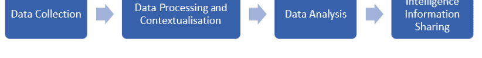
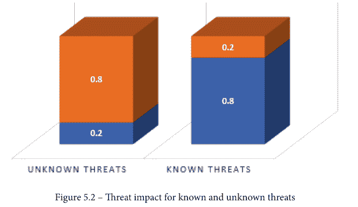
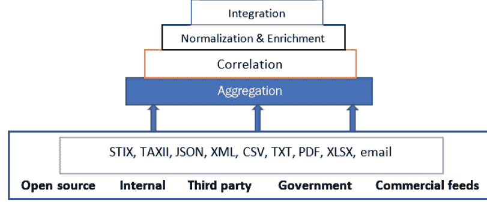
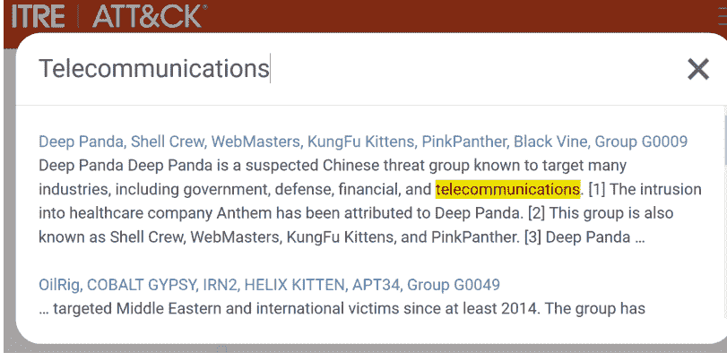

## 5 目标设定、CTI 策略程序和实际用例

**网络威胁情报** (CTI) 可能难以整合到公司的安全概况中。这种复杂性因组织网络安全成熟度和业务目标而异。根据安全资源和威胁情报的成熟度，组织可分为三个类别或级别：

-   Level 1 组织是指那些新进入 CTI 环境的组织。
-   Level 2 组织拥有安全工具并经常审查对手的活动——它们已建立了对 CTI 领域的特定知识。
-   Level 3 组织包括拥有先进安全工具和团队定期执行网络防御的组织。它们拥有 CTI 计划。


本章探讨在组织的安全基础设施中战略性地集成威胁情报以支持业务决策并增强防御机制的方法。它讨论了一些与 CTI 相关的实际用例，以及如何将 CTI 需求、生命周期和标准应用于特定任务。它通过分析具体场景，介绍了一种为组织构建 CTI 团队的基础方法。它还介绍了一个关键的 CTI 概念，即 **威胁情报平台 (TIP)**。

阅读本章后，您应能够做到以下几点：

- 理解 CTI 平台的概念以及如何为 CTI 项目选择一个平台。
- 理解威胁情报目标设定的概念、战略实施以及使用案例研究集成情报的程序。
- 将理论安全知识与行业用例相匹配，并与组织的安全等级相关联。

在本章中，我们将涵盖以下主要主题：

- 威胁情报战略地图和目标设定
- 威胁情报平台 – 概述
- 案例研究 1 – 面向 1 级组织的 CTI
- 案例研究 2 – 面向 2 级组织的 CTI
- 案例研究 3 – 面向 3 级组织的 CTI
- 安装 MISP 平台

## 技术要求

本章包含一个实践练习，用于安装本书中将使用的开源 TIP。必须满足以下技术要求：

- **硬件：** 拥有至少 64 GB 磁盘空间和 8 GB RAM 的计算机或服务器。建议使用 i5（或更高）处理器以顺畅运行 **恶意软件信息共享平台 (MISP) 虚拟机 (VM)**。
- **软件：** 安装虚拟化软件环境（本文使用 **VirtualBox**，但也可以使用 **VMware** 或其他虚拟化软件）。大多数虚拟化软件都支持所有主要操作系统。因此，任何操作系统都应该可以正常使用。
- **杂项：** 对所选虚拟化软件的网络和其他配置有基本了解。

> **注意**
> 即使不安装 MISP 平台，您仍然可以阅读本书并理解其概念。实践部分旨在为您提供执行某些威胁情报任务所需的基本技能。

## 威胁情报战略地图和目标设定

尽管开发了不同的 CTI 标准和方法，但塑造 CTI 战略并没有唯一的方法。然而，基于 CTI 生命周期和规划流程，组织可以战略性地使用情报来实现其目标并证明 CTI 项目的业务价值。本节探讨 Derek Brink（https://ibm.co/31t9HNK）提出的 **威胁情报战略地图** 以及每个情报分析师级别的目标。

威胁情报不仅仅是威胁分析的最终输出；它是一个将业务运营与有形成果联系起来的过程。这些成果是 *检测、预防* 和 *降低* 网络威胁和攻击至可接受且可管理的水平。CTI 的战略地图在下图中进行了总结：



图 5.1 – 威胁情报战略集成流程

希望将威胁情报集成到业务运营中的组织必须从多个来源和格式收集正确的数据（内部事件日志、会话、流量流、外部威胁数据和人工数据）。所有数据源必须集成并关联，以促进 *数据处理* 步骤，该步骤涉及清理、规范化和工程化数据以将其转换为业务上下文。CTI 团队必须分析处理后的数据以发现隐藏的信息模式和潜在威胁。威胁指标必须优先排序以促进补救操作并制定战术和战略行动。最后，分析输出必须与相关组织单位共享，以便做出明智的安全决策。由于威胁情报是一个迭代且持续的过程，CTI 团队必须不断重新评估情报共享，并将任何发现作为下一周期 CTI 需求的输入。因此，分析师或 CTI 团队必须了解其受众及其相应需求。

组织的安全情报战略必须优先将情报集成到所有现有安全功能中。安全情报目标和目标的定义方式旨在突出威胁情报的价值以及它如何在组织的各个安全单元中使用。在以下各节中，我们根据假设的现有安全基础设施设定目标。

## 目标 1 – 促进和支持实时安全运营

1 级分析师必须利用威胁情报输出在系统中执行实时活动管理。例如，使用 **Cyber Kill Chain** 框架可促进在攻击执行前检测、发现和阻止攻击。组织必须设定以下目标，以确保情报计划对日常业务运营具有价值：

- **目标 1 – 促进和支持网络事件和流量流的实时监控：** 无论大小，组织都拥有构成组织网络的资产，例如服务器、终端设备（移动设备、桌面设备和其他个人设备）、交换机、路由器、防火墙、**入侵检测系统 (IDSs)** 和 **入侵预防系统 (IPSs)**。这些资产在日志和会话中产生流量，必须实时收集、处理和分析。此分析使 1 级分析师能够实时很好地了解系统中正在发生的情况。
- **目标 2 – 促进和支持可疑事件和流量流的实时检测：** 1 级分析师必须使用威胁情报快速检测日常业务运营中的异常行为。分析师必须设置警报以实时发出潜在威胁存在的信号。
- **目标 3 – 促进和支持可疑事件和流量的初步调查和升级：** 对于 1 级分析师来说，不仅要监控和检测，还要采取初步行动来阻止和/或升级网络中的威胁和可疑活动至关重要。

## 目标 2 – 促进对网络威胁的有效响应

根据 **IBM** 报告（https://securityintelligence.com/category/threat-hunting/），组织检测已发生攻击的平均时间为 180 天（足以让威胁行为者最大化损害）。因此，威胁情报可用于减少成功攻击的检测时间。威胁情报 **入侵指标 (IOCs)** 不仅必须用于检测威胁和恶意流量，还必须用于高效有效地响应已发生的威胁，并追溯性地在网络中搜寻威胁。2 级分析师的目标属于此范围。组织必须制定政策和程序以帮助应对已进入系统的网络攻击。本级别分析师的安全情报目标如下：

- **目标 1 – 支持网络中网络事件的优先级排序：** 威胁情报 IOCs 分数将在网络事件发生时用于设定优先级。因此，这些分数将由 2 级分析师用来根据威胁对系统的影响进行排名。
- **目标 2 – 支持网络中网络事件的调查：** 威胁情报输出将用于推动网络取证调查以追踪和解决系统攻击。事件调查利用 CTI 的多个数据源、实时检测和深入分析及时减轻威胁风险。
- **目标 3 – 支持与网络事件相关的决策：** 威胁情报输出将用于减少在面对网络事件时做出安全决策所需的时间。对正在进行的威胁的实时检测使组织能够快速高效地行动。


## 目标 3 – 促进和支持网络威胁的主动追踪

威胁行为者变得越来越智能，在进行和开发新的攻击向量方面。因此，组织必须整合主动威胁情报以领先于坏人。威胁情报必须促进主动运营。这就是 **威胁狩猎** 发挥作用的地方。威胁狩猎是三级分析师的责任，需要高级技能才能进行。*目标 3* 的目标如下：

- **目标 1 – 支持和促进预测性威胁分析**：与威胁情报框架相关的威胁情报流程（网络杀伤链 MITRE **ATT&CK** 和 **入侵分析钻石模型** 框架）应促进并支持威胁的实时检测。其结果是对欺诈检测运营的重要输入。威胁情报使三级分析师能够识别威胁行为者的活动并设置预警警报以提醒可能的恶意活动。
- **目标 2 – 支持和促进威胁狩猎**：威胁情报输出可用于支持威胁狩猎运营，以识别已知和未知威胁。威胁狩猎使组织能够随时了解对手或威胁行为者的隐蔽行动。使用诸如入侵分析钻石模型之类的框架，CTI 分析师将威胁与其目标匹配，分析使用的能力，识别被针对的漏洞，并识别网络攻击正在进行的的基础设施。这些信息可用于狩猎威胁行为者并在组织使用之前发现新威胁。根据 IBM (https://www.ibm.com/topics/threat-hunting)，在任何给定时间，组织面临的威胁中有 20% 仍然未知，而这些威胁可能造成最严重的损害（即约 ~80% 的损害），如下图所示：

### 威胁影响（可见性与损害）



图 5.2 – 已知和未知威胁的威胁影响

威胁狩猎需要特定的技能。我们将威胁狩猎作为威胁情报目标，因为它可用于狩猎威胁并利用收集的大量安全数据。威胁狩猎是一个广泛的话题，我们不会深入探讨，但将在下一节中介绍其一些概念。

## 目标 4 – 促进和支持安全治理的更新与实施

威胁情报结果既用于战术也用于战略——战术上用于支持技术安全决策，战略上用于支持推动业务的战略决策。为目标 4 设定的两个主要目标如下：

- **目标 1 – 支持和促进政策升级**：使用基于证据的情报输出来设定新的安全政策或升级现有政策，以确保组织系统和人员的最大保护。安全利益相关者将使用情报结果来塑造安全战略。
- **目标 2 – 支持和促进资源管理**：使用情报输出通过有效分配资源来填补组织的安全差距。利益相关者将使用威胁情报结果来获取正确的工具和人员以执行安全。

战略集成过程必须尽可能自动化，以避免人为错误，加快执行过程，防止数据解释中的偏见，确保一致性并优化资源。因此，组织需要一个平台或工具来有效自动化这些流程——即需要 TIPs，详情见下一节。

## TIPs – 概述

如前几章所述，威胁情报不仅仅是输出产品，而是一个将威胁数据转换为可操作信息以支持业务决策并建立安全屏障以抵御传统和现代网络威胁的过程。进行威胁情报的过程在周期的每个步骤都需要时间和人力资源。手动处理整个安全情报过程可能具有挑战性。例如，从一个系统以结构化威胁信息表达式（STIX）格式获取数据，从另一个系统以 JSON 或 XML 格式获取数据，然后在解析、关联和分析后与团队共享分析输出，这可能是一个漫长而繁琐的过程。因此，需要 TIPs 来自动化该过程。

TIP 是一种工具、软件或技术，通过聚合、关联、分析和共享威胁情报信息来自动化威胁情报。在大多数情况下，它为威胁数据管理提供了一个集中点。TIP 高层架构如下图所示：



图 5.3 – TIP 高层架构

前一图中的架构展示了定义可靠 TIP 的基本特征。可靠的 TIP 必须提供以下内容：

- **有效的數據聚合层：** 威胁情报数据来自不同的来源，可以采用各种格式。TIP 必须自动聚合所有已知数据格式中的信息，包括但不限于 STIX、TAXII、JSON、CSV、TXT、XLSX 和电子邮件文件格式。聚合层对 CTI 程序至关重要，因为它将收集的威胁数据转换为平台可以轻松操作的单一语言。
- **可靠的关联层：** 在从多个数据源聚合数据后，TIP 自动关联数据以在收集的数据中提取的不同指标之间建立联系。这里的目标是深入挖掘数据以确定有关威胁的必要信息。因此，TIP 必须有效地且独立于数据源地关联数据。
- **数据规范化和丰富能力：** 数据规范化和丰富是昂贵的过程，因为它们涉及大量资源并需要高计算能力。*数据规范化* 很重要，因为它可以扩展和整合威胁数据——当数据来自不同来源时，其价值和权重可能不同。通过使用规范化，TIP 以扩展方式组合数据。*数据丰富* 涉及对威胁数据进行特征工程，这一点至关重要，因为它为 SOC 提供更多威胁信息。TIP 应集成第三方资源以增强威胁数据并确保可以提供更多见解。数据丰富为系统提供的数据添加了上下文。

### 数据丰富用例研究 – Poison Ivy 病毒

假设您的监控系统检测到与 **Poison Ivy 恶意软件** 相关的威胁。作为 CTI 分析师并通过情报共享，您从第三方收到包含 Poison Ivy 构建块转储的可靠数据。

为了为从内部系统识别的威胁添加上下文，您可以使用脚本从接收到的配置构建块中提取指标并用于分析，如 *第 10 章，威胁建模和分析 - 实用用例* 中所述。可以从配置中提取的一些信息包括使用的 *TCP 端口*（例如，80、443、8080、8000、1863），*进程互斥体*（例如，`%1Sj fhtd8`、`KEIVH^#$ $`），**命令与控制 (C2) IP**（例如，219.76.208.163、113.10.246.30 等），*用户名和密码*（例如，admin@338、th3bug），以及涉及的 *域名*（例如，`webserver.dynssl.com`、`webserver.freetcp.com` 等）。

提取信息后，您可以搜索监控数据中的模式以检查是否存在与报告的 Poison Ivy 木马相关的任何指标。

有关 Poison Ivy 的更多信息，请参阅其 **FireEye** 分析报告：
https://bit.ly/3EbX4Zw.

- **集成：** TIP 的干净数据（规范化和丰富后的数据）必须可被组织其他安全工具使用。诸如 **安全信息和事件管理 (SIEM)** 工具、票务系统、防火墙和 IPS 等工具必须使用 TIP 处理后的数据来执行网络活动的监控，使处理后的数据流向其他系统必须自动化。因此，TIP 需要支持和维护该数据流。例如，集成 SIEM 和日志管理可以使 CTI 分析师自动检测禁止的 IP 地址和域名。
- **分析和共享：** TIP 必须自动化威胁指标的分析并识别它们之间的关系以生成缓解步骤。其功能是自动揭示行为者的 **战术、技术和程序 (TTPs)** 并提取数据中的隐藏模式。信息以报告、仪表板、警报等形式显示。数据分析结果必须以对人类友好的方式呈现或可视化。TIP 还必须促进分析结果的共享并最大限度地减少对威胁和安全漏洞的响应时间。因此，必须将 TIP 分析与诸如事件响应和实时警报系统之类的工具集成。

TIPs 对于减轻手动工作并减少情报分析中的错误空间至关重要。行业中有多个 TIPs，既有商业也有开源。每个厂商提供的 TIP 具有不同的功能和能力，这对组织选择 TIP 来说可能至关重要。然而，组织在选择 TIP 时可以使用四个主要参数：*数据访问级别*、*集成能力*（与其他工具集成的难易程度）、*报告能力* 和 *定价*。组织想要投资 CTI 时面临的一个大难题是决定是否投资商业情报平台，也称为 **付费威胁情报 (PTI)**，还是依赖 **开放威胁情报 (OTI)** 和 **共享威胁情报 (STI)**。

除了主要 TIP 功能外，我们还介绍了威胁情报的战略地图，以帮助设定正确的目标并选择正确的情报方法。

下一小节将介绍三种类型的威胁情报服务和平台。


## 商业 TIPs

*商业 TIPs* 需要订阅或购买协议才能获取它们及其服务。它们以提供对威胁和对手的全面覆盖以及为客户提供众多功能而闻名。Xander Bouwman 等人的研究 (https://bit.ly/3blhGAI) 显示，商业 TIPs 与开源和共享 TIPs 呈现威胁态势的方式不同。因此，这两个平台之间没有重叠——贵组织从 PTI 获得的大多数服务与从 OTI 或 STI 获得的服务不同。该研究还表明，商业 TIPs 在覆盖范围、数量和指标方面存在差异。与 OTI 和 STI 相比，商业情报包含有关威胁、对手、TTPs 和指标的最新研究。由于资源充足的供应商维护它们，它们提供更多 IOCs、威胁检测的早期预警以及更高质量的分析。

PTI 由多个服务组成。根据供应商的不同，服务可能包括 IOCs、威胁报告、威胁行为者画像、漏洞和利用数据、新闻推送、**请求信息** (**RFI**) 以从供应商处获取更多信息、访问历史威胁报告的门户、分析以及针对威胁和安全漏洞的实时通知的威胁警报。

考虑 PTI 时另一个关键参数是价格。上述 Xander Bouwman 等人的同一项研究表明，商业 TIPs 可能很昂贵，为提供威胁情报的供应商提供服务，每年费用在 $100k 至 $650k 之间。然而，一些供应商仅提供集中平台来集成外部来源并执行高端分析，这类平台的费用每年在 $30k 至 $100k 之间。对于中小企业而言，这一价格可能难以承受。因此，组织需要在需求和预算之间取得平衡。商业 TIPs 种类繁多。一些知名商业 TIPs 包括解决方案 such as **IBM X-Force Exchange**、**FireEye iSIGHT**、**CrowdStrike Falcon-X**、**RecordedFuture**、**Anomali ThreatStream** 和 **AlienVault USM**。在下面的小节中，我们将介绍开源 TIPs 及其可以提供的优势。

## 开源 TIPs

对于希望将情报作为业务或安全运营的一部分集成的初创公司而言，由于订阅计划价格过高，投资付费 TIPs 可能不可行。因此，它们可以使用开源 TIPs 来运营安全情报计划。开源 TIPs 依赖开源和共享数据馈送来构建 IOCs、威胁数据、欺诈数据和漏洞信息的统一共享、关联和存储。许多公司使用开源情报（OSINT）平台，例如 MISP (https://www.misp-project.org/features.html) 和 OPENCTI (https://www.opencti.io/en/) 来保护系统免受威胁。大多数开源 TIPs 提供了进行情报所需的功能。这些功能包括但不限于 IOC 数据库、指标和其他威胁属性的自动关联、情报数据的存储和共享、对不同数据馈送和格式的支持、集成分析以及威胁事件的自动更新。

然而，系统支持是商业和开源 TIPs 之间最显著的差异之一。大多数 OSINT 平台建立在社区贡献和会员之上，并依赖社区善意来公开共享情报数据。另一方面，付费 TIPs 提供适当的支持和系统维护，供应商确保平台不断更新以适应新的威胁数据。

组织是否考虑付费或开源 TIPs 取决于其预算和技术需求。然而，Xander Bouwman 等人的研究表明，付费 TIPs 值得投资。在以下章节中，我们将讨论组织如何根据其成熟度水平拥抱和启动 CTI 以创建知情的防御系统。

我们使用 MITRE ATT&CK 方法进行威胁情报集成 (https://attack.mitre.org/resources/getting-started/)。根据组织的发展、基础设施复杂性和资源，组织可分为三个类别：Level 1、Level 2 和 Level 3。

在以下章节中，我们将介绍三个组织类别的案例研究，以及每个层级的组织如何制定情报计划。

## 案例研究 1 – Level 1 组织的 CTI

Level 1 组织拥有有限的网络安全基础设施，目前没有 TIP，但希望将其纳入其安全运营。

### 目标

Level 1 组织的情报目标是建立 *adversary activity monitoring* 和 *improved decision-making*。重点关注外部和内部对手。此类分析的输出用于做出业务决策。

### 策略

Level 1 组织可以通过以下战略步骤实施 CTI 团队或投资 CTI 计划：

- **Create a centralized CTI team:** 我们假设组织资源有限，无需创建分布式情报团队。相反，组织应使用内部受训的安全分析师，或将任务外包给一些经验丰富的情报分析师来启动项目。
- **Select a TIP:** 根据预算，Level 1 组织可以使用有限订阅的付费 TIP，或使用开源 TIP 作为起点。Level 1 组织使用 TIP 的优势在于大多数 TIP 集成威胁情报框架（such as MITRE ATT&CK）以便于 TTPs 引用。
- **Select one or more threat groups to analyze:** 根据业务范围（such as financial, telecommunications, education, marketing institutions, and so on），根据其受害者搜索威胁组织。
- **Perform TTP analysis of those threat groups:** 查看每个威胁组织的 TTPs 以了解它们如何入侵目标。记录其方法。如果可能，以受控方式对组织进行攻击测试，以评估组织是否容易受到这些攻击方法的影响。
- **Initiate a defensive plan:** 将有关威胁的信息与不同的安全部门（security operation center 或 network defense team）共享，以保护组织免受这些威胁行为者的侵害。使用 MITRE ATT&CK 框架可提供参考、建议和威胁的潜在影响。

所采取的策略使组织能够在现有（有限）基础设施上构建威胁情报并利用开源安全资源。

### 示例

导航到 MITRE ATT&CK 的 Groups 菜单，并使用业务范围作为搜索条件（such as telecommunications, financial, education, and so on）搜索威胁行为者，具体取决于组织的业务领域。结果显示在以下屏幕截图中：



Figure 5.4 – MITRE ATT&CK Group search's result, based on telecommunications threats

记录不同的威胁组织，例如 APT19、Codoso、Group G0093 等。点击该组织以获取有关所使用技术和所涉及软件的信息。

以下是一个 Level 1 组织如何使用所选威胁组织的示例：

- **Threat group**: *APT19*。
- **Group description**: Chinese-based threat group that targets various industries, including telecommunications。
- **Techniques used**: Their techniques range from protocol exploitation to data encoding to registry modification and **phishing**。The group uses more than 15 techniques to compromise systems。One of them is the *T1112 Registry key modification*。Refer to the MITRE page for more information about the T1112 technique used by the *APT19* group。


-   **Technique description**: 每种技术都在 MITRE Techniques 页面上有所描述。例如，T1112 技术允许攻击者操纵 **Windows 注册表**。他们可以删除、添加和修改注册表中的信息以实现持久化或执行恶意文件。
-   **Procedures used**: 攻击者（*APT19* 组织）使用的方法包括例如使用 SSH 端口 22 的恶意软件变种来操纵注册表键。然而，T1112 控制注册表还有其他几种方法，包括可以修改注册表的 **Cobalt Strike**。
-   **Mitigation approach**: 限制对注册表配置单元的访问，确保只有授权用户可以修改注册表键和文件。
-   **Detection techniques**: 将分析与 SOC 系统集成，以监控并记录注册表配置单元的任何更改。MITRE ATT&CK 框架提供了良好的检测和参考，用于跟踪注册表的更改并防范 *APT19* 组织的 T1112 技术。
-   **Software that can be used to conduct the attack**: **Cobalt Strike** 和 **Empire**。这些工具使用不同的技术来发起攻击。技术包括 **Abusive Elevation Control Mechanism**、**Access Token Manipulation**、**Account Discovery**、**Application Layer Protocol**、**System process modification** 等。

威胁情报团队可以研究这些组织并与防御团队共享信息以加强组织的安全性。此步骤必须针对所有威胁行为者及其技术执行（必须将威胁搜索限制在组织的范围内）。

Level 1 组织可以利用 MITRE ATT&CK 框架来分析针对相同范围内的组织所使用的不同威胁 TTP，并将输出与团队其他成员共享以创建预防性防御系统。下一节将介绍 Level 2 组织如何将威胁情报集成到业务中。

## 案例研究 2 – Level 2 组织的 CTI

Level 2 组织是指拥有成熟威胁情报计划的组织。它们已通过 Level 1 阶段，并准备将 CTI 纳入其文化。我们假设 Level 2 组织已建立 CTI 团队，定期监控威胁组织。

### 目标

Level 2 组织的信息情报目标是将情报分析 *self-map* 到特定的框架模型（如 MITRE ATT&CK 或 Cyber Kill Chain 模型）。通过利用威胁情报框架可以轻松实现这些目标。

### 策略

Level 2 组织可以通过遵循以下战略步骤集成 CTI 程序：

-   执行前一节的 Level 1 流程以了解对手的技术并收集内部日志和其他外部数据。
-   将分析输出（或报告）映射到所选框架。例如，要将安全报告映射到 MITRE ATT&CK，CTI 团队必须研究并理解对手的行为，将该行为链接到 ATT&CK 战术，并识别该特定战术中使用的 ATT&CK 技术。
-   将输出结果（情报分析到情报框架的映射）与社区共享，并将流程结果与其他威胁情报专业人员进行比较。

### 示例

以下是如何 Level 2 组织可以集成安全情报的示例：

-   **Description**: 假设在 Level 1 流程期间以及检查内部网络流量时，安全团队发现系统到外部元素的异常远程连接——可能的攻击。
-   **Study the behavior**: 该攻击创建到对手域的 **SOCKS connection**。SOCKS 连接在网络攻击中广泛存在，允许对手连接到受害者系统并执行恶意操作。因此，它使对手能够远程执行命令。
-   **Convert the behavior to a tactic**: 从行为研究中，我们可以将攻击链接到 MITRE ATT&CK 框架中的一种战术。在这种情况下，最合适的是 C2 战术。
-   **Map the tactic to the technique**: 在特定战术下的技术列表中搜索，以将威胁行为者行为映射到一个或多个 ATT&CK 技术。查看 MITRE C2 战术，我们可以看到 *Socket* 和 *Secure* 属于 **Non-Application Layer Protocol Technique**，即 *T1095*。这种映射使威胁情报团队能够创建威胁和对手行为的数据库。
-   **Share the result**: 将结果与公司其他部门和情报社区共享，以丰富通用框架。共享分析结果还允许 Cobalt Strike CTI 框架通过社区贡献而发展。

中型企业需要将信息映射到框架模型以促进未来的威胁分析并最大限度地减少检测使用与现有已识别和记录的威胁相同的 TTP 的潜在威胁所需的时间。具有深入业务知识的分析师应执行威胁和攻击的映射。映射后的数据随后可以与防御团队共享以实施保护计划。下一节将介绍 Level 3 组织如何从威胁情报计划中受益。

## 案例研究 3 – Level 3 组织的 CTI

Level 3 组织拥有先进的安全情报能力并具备足够的<|message|> 安全基础设施，拥有更多资源。Levels 1 和 2 被假定为先进组织业务系统的一部分。目标和重点将与 level 1 和 2 组织不同。先进组织拥有更多信息，内部和外部，因此数据来源更多。数据来源在 *Chapter 7, Threat Intelligence Data Sources.* 中有所介绍。

### 目标

Level 3 组织的信息情报目标是威胁和防御技术的优先级排序。在将不同信息（IOCs、TTPs、报告、外部情报等）映射到框架模型之后，先进组织必须根据其对系统的影响来优先考虑 TTP。

### 策略

通过遵循以下战略步骤，Level 3 组织可以将安全情报集成到其业务运营中：

-   **Identify the organization's top threats**: 这是在执行威胁建模和对对手和组织的有效侦察后实现的。
-   **Map the threats to the framework model**: 使用 MITRE ATT&CK 框架，分析人员必须将所有信息映射到 ATT&CK 框架。
-   **Prioritize the threats with a high impact on the system**: 基于情报和业务需求，CTI 团队与内部安全团队和其他战略领导者一起可以建立对手技术排名系统，以识别最危险的对手技术。**ATT&CK Navigator** (`https://github.com/mitre-attack/attack-navigator`) 可用于此目的。
-   **Aggregate the attacks by technique to facilitate the prioritization process**: 这也将为防御团队提供良好的输入，以了解哪些威胁必须首先关注。或者，将利益相关者和内部安全团队提供的业务和情报需求与分析结果进行匹配，以识别组织最关心的威胁。

### 示例

以下是如何 Level 3 组织可以使用 CTI 与 MITRE ATT&CK 框架来优先考虑威胁的示例：

-   **Top threats**: 在情报分析期间，CTI 团队关注 *APT19* 和 *APT3*，因为它们直接影响组织业务。
-   **Map the threat to the model**: 使用 ATT&CK 框架，我们识别 *APT19* 和 *APT3* 使用的技术。此信息可以直接从 MITRE 网站提取。
-   **Identify techniques with a high impact**: 我们使用 attack-navigator 创建两个组织的技术矩阵，给 *APT19* 和 *APT3* 分别打分为 *1* 和 *2*。
-   **Aggregate and prioritize the techniques**: 使用 ATT&CK Navigator，我们合并技术以识别两个高优先级威胁（*APT19* 和 *APT3*）共同使用的方法。然后我们优先考虑共同技术，如下图所示以绿色显示：


| 初始访问 | 执行 | 持久性 | 防御规避 | 发现 | 收集 | 命令与控制 | 渗出 |
|---|---|---|---|---|---|---|---|
| 驱动式入侵 | 命令和脚本解释器 | 账户操纵 | 去混淆/解码文件或信息 | 文件和目录发现 | 本地系统数据 | 入侵工具传输 | 通过 C2 通道渗出 |
|  |  |  | 修改注册表 | 权限组发现 |  | 多阶段通道 |  |
|  |  |  | 混淆文件或信息 | 远程系统发现 |  | 非应用层协议 |  |
|  |  |  |  | 系统信息发现 |  |  |  |
|  |  |  |  | 系统网络配置发现 |  |  |  |
|  |  |  |  | 系统网络连接 |  |  |  |
|  |  |  |  | 系统所有者/用户发现 |  |  |  |

图 5.5 – APT19 和 APT3 的企业版 MITRE ATT&CK Navigator（ATT&CK v9）

- **共享信息**：如果输出符合业务和情报需求，我们可以将结果与防御团队共享，以实施健全的防御系统。此方法可用于一个或多个威胁。

> **重要说明**
> MITRE ATT&CK 框架不断发展，会为企业、移动和 **工业控制系统（ICS）** 环境添加新的 TTP。例如，在 ATT&CK v9 中，添加了多个基于云和 Docker 的 TTP。ATT&CK T1204.003 技术描述了如何对 Docker 和云计算镜像（例如 **亚马逊网络服务（AWS）**、**Google Cloud Platform（GCP）** 和 **Microsoft Azure** 镜像）进行后门植入。有关 MITRE ATT&CK 更新的更多信息，请访问以下链接：https://attack.mitre.org/resources/updates/。

3 级组织可以通过优先考虑防御技术，利用威胁情报正确理解威胁和对手行为，从而建立有效的防御系统。下一节将解释安装 MISP 平台的步骤，该平台将在本书其余用例中使用。

## 安装 MISP 平台（可选）

MISP 如 TIPs – 概览 部分和官方网站所述，是一种开源 TIP 以及威胁情报共享的开放标准集合。为了避免为昂贵的 TIP 平台付费，我们将使用 MISP 平台将理论知识与实践示例联系起来。本节为可选内容，仅适用于希望完成实践练习以更好地理解本书中阐述的概念的组织和个人。

请参考 MISP 项目下载页面（https://www.misp-project.org/download/）在任何方便的操作系统上下载并安装 MISP。然而，本用例中使用的是自动生成的 VirtualBox MISP 镜像（OVA 文件）。OVA 文件可从 CIRCL（https://www.circl.lu/misp-images/latest/）获取。假设您知道如何将 OVA 文件导入 VirtualBox 环境。

MISP VM 的默认凭据如下所示（也在下载网站上提供）：

```
For the MISP web interface -> admin@admin.test:admin
For the system -> misp:Password1234
```

我们还添加以下配置以在 VM 主机上启用端口转发：

```
VBoxManage controlvm MISP_VM_NAME natpf1 www,tcp,,8080,,80
```

```
VBoxManage controlvm MISP_VM_NAME natpf1 ssh,tcp,,2222,,22
```

```
VBoxManage controlvm MISP_VM_NAME natpf1
dashboard,tcp,,8001,,8001
```

之后，我们应该已准备好 MISP 平台供练习使用。如果在安装 MISP 时遇到任何问题，请参考官方网站和在线论坛进行故障排除。请注意，您仍可在不安装平台的情况下阅读本书。

## 摘要

知道如何设定情报目标并采取正确的方法在组织中整合 CTI 对于 CTI 分析师至关重要。虽然商业 TIP 提供了许多好处，但组织仍可利用开源方案来建立健全的 CTI 项目。

本章介绍了如何设定 CTI 的基本目标和目的，以及它如何与其他安全职能协同工作。本章解释了威胁情报如何被战略性地实施，以及不同组织如何将其整合到业务流程中以做出明智的安全决策。本章还介绍了 TIP 及其在整合情报项目方面的优势。最后，本章介绍了开源 TIP MISP 的安装，该 TIP 在本书大部分内容中使用。

在下一章中，我们将研究网络威胁建模和对手分析。
