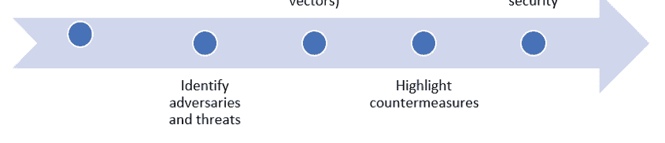
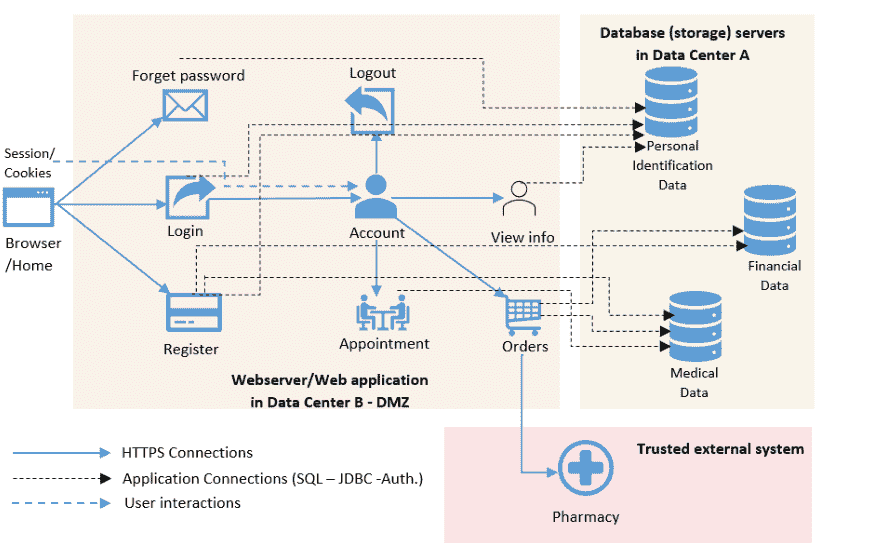
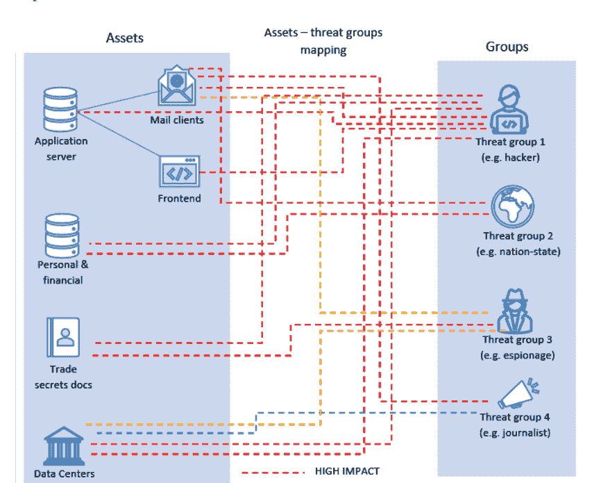
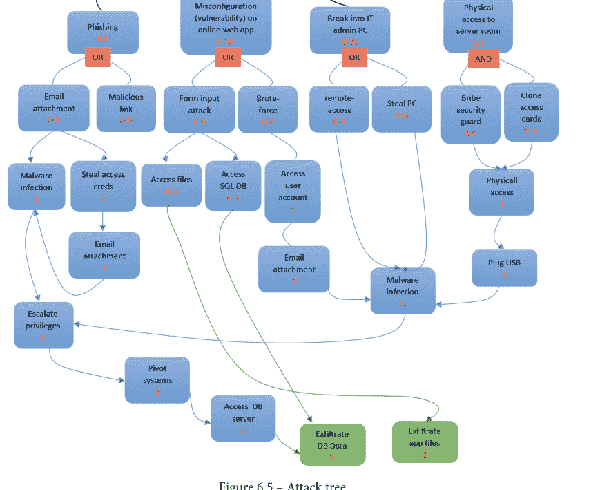
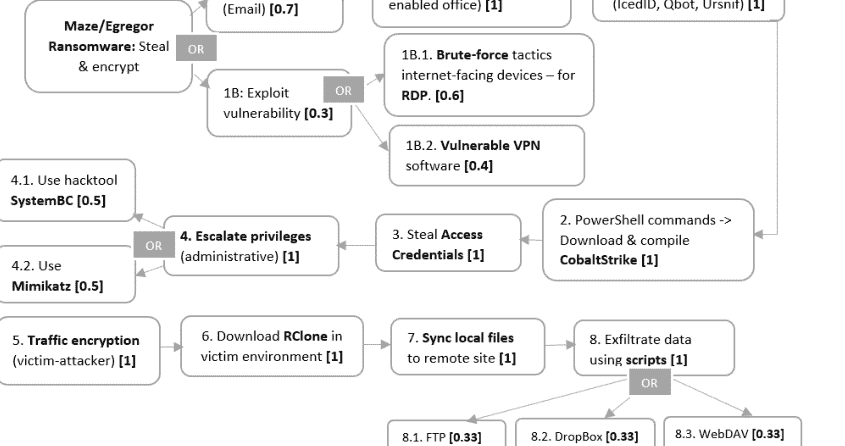
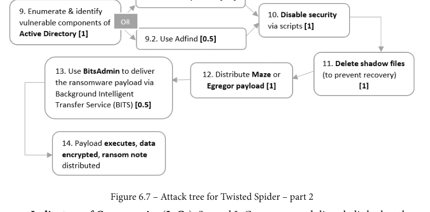
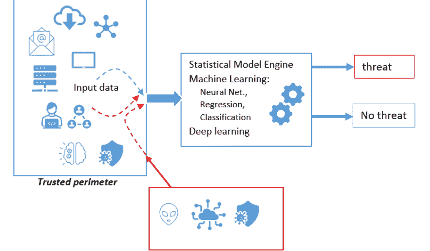

## 6 网络威胁建模与对手分析

为了实施健全的防御系统，至关重要的是了解需要保护的 *什么* 以及来自 *谁*。随着安全漏洞的增加，组织必须衡量和预测可能影响系统的潜在威胁并制定适当的缓解计划。威胁建模的目的即在于此。**威胁建模** 用于更好地了解自己、了解对手，并将两者映射以创建更好的防御（补救计划和资源保护）。当组织启动威胁建模时，需要突出两个主要组成部分：*组织资源* 和 *对手知识*。

本章侧重于战略性地建模威胁并分析对手的行为。本章旨在为您提供主动网络威胁分析和防御所需的方法。我们将研究对手建模，因为它是在识别对手行为和特征方面的重要概念。

在本章结束时，您应该能够做到以下几点：

- 理解威胁建模流程。
- 理解不同的威胁建模方法及其最佳应用。
- 理解 SIEM 及其在威胁情报和建模中的重要性。
- 理解并执行高级分析以识别异常用户行为。
- 理解并讨论对手分析的自动和手动技术。

在本章中，我们将涵盖以下主要主题：

- 战略威胁建模流程
- 威胁建模方法
- 使用 SIEM 的高级威胁建模
- 用户行为逻辑
- 对手分析技术

## 技术要求

对于本章，未突出显示任何特殊技术要求。大多数用例如有必要将使用 Web 应用程序。

## 战略威胁建模流程

威胁建模流程是一套 *系统化* 且 *结构化* 的步骤，有助于规划、配置和优化安全运营。它包括分解可用于确保和执行保护的必要元素。这些元素包括以下内容：

- **识别资产**：任何可能被对手入侵或想要的资源。
- **风险和漏洞评估**：能够突出显示系统流程，如果被利用，可能危及组织资产的能力。
- **对手和威胁**：针对或正在针对组织概况中资产的不同对手群体，他们的 **战术、技术和流程（TTPs）**，以及他们可用于利用系统流程的所有现有威胁向量。


安全或威胁情报分析师随后必须将这三个要素映射起来，以创建一个基础威胁模型，从而帮助实施坚实有效的<|message|>安全防御。威胁模型并非标准化的。因此，每个组织可能拥有不同的模型，具体取决于目标和业务概况。因此，我们可以推导出能够推动威胁建模流程发展的关键问题：*我们有什么可能引起攻击者兴趣的？谁可以攻击或针对我们的系统？他们如何攻击我们的系统？我们可以做什么来阻止攻击或至少降低其影响？系统现在安全吗？*

利用这些问题，我们可以构建一个威胁建模流程骨架，作为我们安全运营的基础，如下图所示：



图 6.1 – 基础威胁建模流程

每个步骤都涉及一套技术来简化建模过程。在以下小节中，我们将详细查看每个步骤并总结主要使用的技术。

## 识别和分解资产

第一步涉及突出显示对手可以攻击的资源——了解组织。资产根据其所属的业务单元进行分类。例如，您可以将资产分为四类：财务和个人数据、网络数据、知识产权以及系统可用性。系统可用性适用于那些一旦被破坏就会停止业务运营的资源。这包括软件应用程序、网络流量等。在识别和分解阶段，威胁情报分析师与内部安全成员一起，必须了解资产如何相互交互以及与外部世界的关系。他们必须围绕每个资产明确创建用例，以突出其效用（如何使用和操作）。通过了解每个资产的用例，分析师必须识别访问点（可以让黑客进入系统并破坏特定资产的点）并突出资产的信任级别（资产访问如何在内部和外部得到控制）。

资产识别包括服务器、终端、笔记本电脑、应用程序、知识产权、数据库、敏感文件、网络资源（带宽利用率）以及服务器机房等资源（对组织至关重要的任何物理和数字资源）。内部团队和情报分析师必须记录所有资产、其用途和位置。

第一步的另一个关键方面是资产分解。**分解**涉及拆分资产效用、突出入口点以及访问权限管理，以有效评估其安全性。通过分解资产，我们查看所有资产如何组合在一起，并确定资产可能在哪个点被针对。我们可以使用**数据流图**或**流程图**来分解组织资产。尽管数据流图最初并非为安全建模而设计（系统开发和工程），但它显示了应用程序的所有主要构建块及其工作原理。这显示了组件之间交互的方式，以及使应用程序运行所使用的协议和第三方应用程序。流程图以突出攻击者如何针对它们的方式分解资产。流程图使用这样一个概念，即攻击者关注的是资产不同用例之间的流程，而不是数据流。在这部分，我们使用两者兼顾，因为攻击者也可以利用应用程序层（如 Web 服务器、JDBCs、数据库服务器）和物理层（物理服务器安装的数据中心缺乏安全保障）的漏洞。典型医疗组织的资源分解如下图所示（资产并非详尽无遗但较为全面）。

从下图我们可以识别出资产列表（位于**数据中心 B**的**Apache Web 服务器**，其中包含面向用户的**医疗应用程序**，数据中心 B 也是 DMZ，以及三个包含用户**财务**、**个人**和**医疗信息**的数据库服务器，位于**数据中心 A**）：



图 6.2 – 威胁建模流程的基础资产分解

前述图表还显示了资产交互的不同用例应用程序。例如，患者可以注册、登录或使用忘记密码应用程序与系统后端交互。这些是系统中一些最常被针对的入口点。如果它们没有得到适当保护，攻击者可以注入恶意代码来破坏系统。前述图表还显示了在网络攻击期间可能受影响的不同资源。因此，它是一个良好的可视化，并为对策实施提供了第一个提示。

资产分解不是一个标准流程。它取决于组织的业务和敏感资源。它可以简单或复杂，取决于组织规模。使用流程图分解资产的过程包括以下内容：

- **确定资产的用例：** Web 或桌面应用程序（登录、搜索表单、联系表单、密码恢复、会话数据）。它还包括突出存储库和存储库、其内容和位置。
- **概述通信协议：** 这描述了资产如何在内部通信以及如何与外部系统（受信任或公共的，如互联网）交互。
- **概述可用于控制资产的其他资源：** 这可以是数字技术控制或物理服务器机房。

通过列出和分解资产（应用程序和基础设施），组织应该能够可视化什么可能引起对手的兴趣，以及什么可能是进入这些资源的潜在入口（也称为**攻击面**）。此步骤在执行威胁建模时非常重要。

## 对手与威胁分析

**对手**是网络安全术语，主要指具有恶意意图的攻击者或威胁行为者。众所周知，对手的首要目标是破坏**保密性、完整性、可用性（CIA）**三要素中的一个或全部。然而，在威胁建模的范围内，我们将对手定义为任何可以自愿或非自愿地攻击系统或发起对组织资产未经授权访问的人、机器人、工具和系统。我们在传统对手定义的基础上稍作扩展，因为某些对手无需具有恶意意图即可被归类为威胁。

此步骤涉及概述对手及其应用范围（能力、能力和目标）。组织可以选择按组或单独建模对手。此步骤回答了问题：“*谁在针对我们的系统？*”。以下是对手的非详尽列表，以及他们的活动范围。然而，建议每个组织都应列出详尽的对手或团体清单，包括不受信任的记者。同时也至关重要要确定对手、他们带来的威胁、其动机以及他们破坏您组织的可能性（这取决于行业、业务规模、政治环境、运营国家等），如下所示：

- **黑帽黑客：** 他们以访问复杂系统、绕过复杂安全基础设施而闻名（威胁包括系统入侵、欺骗、中间人攻击、社会工程攻击、冒充、系统入侵等）。这些人应引起任何组织的关注。此类别包括结构化黑帽黑客（*具备破坏系统扎实技能的专业人士*）和非结构化黑帽黑客（也称为 *脚本小子*）。他们的动机包括好奇心、自尊（名声）、经济利益、数据篡改、盗窃等。他们根据动机针对企业和个人。


-   **有组织犯罪**：有组织犯罪是组织和分析人员必须考虑的另一类对手。然而，根据业务类型及其目标，确定有组织犯罪是否对你构成威胁至关重要。*你是否有团体可以针对的东西？* 这类对手拥有资源，可能由有影响力的犯罪组织领导和控制（威胁包括网络钓鱼、信用卡欺诈、后门、高级恶意软件、rootkit、零日攻击、密码破解、C2 系统等）。其动机可能包括盈利、敏感数据窃取和未经授权的数据修改。有组织犯罪通常针对企业、信用卡公司（销售点）以及对它们有价值数据的任何组织。

-   **工业间谍**：在竞争的世界里，企业会不择手段地保持领先。工业间谍活动针对组织的商业秘密，这可能对企业及其完整性造成损害。因此，评估工业间谍活动的可能性至关重要。第一步应已识别需要保护的公司文件、IPRs 以及任何财产信息。工业间谍威胁包括具有长期目标的高级别攻击。其范围广泛且复杂。其动机包括技术和知识泄露以及关键企业数据窃取。间谍攻击发生的可能性取决于组织的业务领域、目标和需要保护的资产。

-   **内部人员**：内部人员难以检测或对抗，因为他们是企业的一部分。检测到他们忠诚度或意图改变的时刻并不简单。内部人员可能是不满的员工（可能拥有管理访问权限）或因不当行为无意中损害系统的普通员工。他们的威胁涵盖欺诈，从平庸表现到恶意代码，以及不安全的安保实践。根据其类别（恶意的内部黑客或训练不足的员工），其动机可能是经济利益、不满或仅仅是无意的错误。因此，在进行威胁建模时，将内部人员行为者群体纳入考虑至关重要。

-   **黑客行动主义者**：这类对手入侵系统以支持或不支持某些意识形态。作为企业，评估黑客行动主义团体是否对组织构成威胁至关重要。例如，对于从事社会政策和政治事务的公司或个人（律师、承包商和国家组织），将黑客行动主义者纳入对手定义矩阵至关重要，如 *对手分析技术* 部分后面所述。他们的动机包括意识形态支持，在一定程度上还包括利润。该类别的一些威胁包括勒索软件、网络钓鱼、**分布式拒绝服务 (DDoS)**、rootkit 和零日利用。该类别的攻击概率取决于组织的业务以及社会或政治立场。

-   **国家级黑客**：竞争不仅是经济上的，也是政治上的。随着国家间间谍活动最近的增加，各国在网络空间问题上采取了不同的立场。政府赞助黑客攻击其他政府以获取情报和其他动机。国家黑客也以针对个人和企业来为国家获取经济和技术利益而闻名。国家的支持（持牌黑客）使他们几乎无法触及且难以检测——他们被提供各种资源和新技术来开展恶意活动。他们的威胁包括 **高级持续性威胁 (APTs)**、**复杂的多向量攻击** 和 **关键基础设施破坏**。这一对手类别背后的动机包括政治和经济优势、社会或军事力量以及报复。地缘政治网络犯罪需要被任何希望提供可靠系统保护的组织考虑。国家赞助的黑客攻击发生的可能性取决于运营国家和业务领域。作者在以下链接中提供了有关国家级黑客的有用信息：https://bit.ly/3sKN6XT。

-   **网络恐怖分子**：恐怖组织对组织构成重大威胁。他们越来越少依赖军事战略，采用网络技术来实现其目标。尽管在大多数情况下，他们针对的是政府，组织仍需要在其对手矩阵中纳入它们。此类攻击发生的可能性取决于组织的业务领域及其与特定社会或政治意识形态的关联。与支持某个运动的政府承包律师事务所相比，在线商店组织不太可能遭受网络恐怖主义攻击。他们的威胁包括 APTs、勒索软件、网络钓鱼、DDoS 和供应链攻击。网络恐怖主义行为者的动机是通过暴力的意识形态。因此，组织必须在对手矩阵中对网络恐怖主义团体及其影响进行排序。

-   **其他非恶意团体**：攻击不一定是恶意的才能落入威胁类别。例如，如果互联网上共享的信息量没有限制，搜索引擎可能会使你的信息可供竞争对手使用。记者可能会尝试访问组织的敏感信息——不是为了造成伤害或破坏，而是为了发表他们的报道并 *证明一点*。未经适当培训的员工可能会无意中在系统中留下漏洞窗口。组织在建模威胁时必须考虑这一类别的攻击。

有几个对手团体。威胁情报分析师需要与内部安全利益相关者合作，识别所有潜在的威胁行为者并创建威胁地图以可视化威胁模型。

## 威胁分析

前面提到的每个对手都有其行动的动机。使他们成为威胁的是他们的 *意图*、*能力* 和 *机会*。威胁分析师必须将这些资产映射到对手，同时考虑威胁的三个特征。诸如 **MITRE ATT&CK** 框架之类的框架是高效映射对手团体与其所追求资产的方式。在建模过程的此阶段，分析师不必详细说明团体使用的技术。我们提供了对手资产地图，如下图所示，以说明这一概念。该地图需要根据已识别的资产和已定义的对手进行扩展：



图 6.3 – 简化的资产到威胁团体（对手）映射

前述图表说明了将资产映射到威胁团体的简单模型。例如，恶意黑客以针对组织中对他们有价值的任何或所有资源而闻名。他们可以根据目标针对服务器、加密数据并窃取敏感信息。如果黑客团体获得财务和个人信息访问权限，影响为 *高*。假设同一团体通过内部人员获得数据中心的物理访问权限。在这种情况下，影响也高，因为他们可以物理连接设备以植入恶意软件。国家赞助的黑客可能为了国家安全而获取个人信息。当他们获得个人信息数据库访问权限时，他们的风险变得很高。如果他们访问组织的电子邮件服务器（或消息），也可以被视为高风险。

一名想要发表报道的普通记者可能对组织构成风险。当他/她可以访问公司电子邮件（可将其用作报道的证据）时，他们的风险很高。当有公司大楼的物理访问权限时，他们的风险很低（信息不会轻易提供给他们）。

这种映射可以使用颜色进行，其中 *红色表示对组织的高影响* 而 *蓝色表示低影响*。或者，可以使用加权线进行，其中高加权线代表资产到对手的高影响或高风险链接。威胁情报团队必须将对手映射到资产，以了解每个对手构成的威胁水平。接下来，我们将查看第三步：攻击面和威胁向量。

## 攻击面和威胁向量

对手必须识别目标系统中的入口点（或入口点），以便发生网络攻击。特定系统所有入口点构成 *攻击面*。保护网络意味着减少攻击面——攻击面越少，遭受网络攻击的机会就越低。第三步的第一个任务是定义组织的所有攻击面。一旦识别出攻击面，对手就会选择最佳且最可靠的方法来执行攻击。这些被称为 *威胁向量*。第三步的第二个任务是突出对手使用的所有（如果不是大多数）威胁向量。最后一个任务是将攻击面映射到威胁向量以创建面-向量矩阵。


## 攻击面

在网络空间中存在两种基本的攻击面：*人员* 和 *设备*。虽然组织在设备安全方面投入了大量资源，但人员仍然是安全链中最薄弱的环节，也是网络和系统最常被针对的入口点。虽然近年来有所改善（钓鱼攻击从 25% 降至 3.4%），但根据 2020 年 Verizon 报告，人为错误仍占安全事件的 22%（https://duo.sc/3vam3Hd）。而根据 Gartner 报道，95% 的云入侵归因于人为错误（主要是配置错误）（https://on.wsj.com/3vchI6A）。诸如社会工程等完全基于操纵人类的技术占数据泄露的 70-90%（https://bit.ly/3naESHy）。所有这些统计数据表明，在进行威胁建模时，通过人员发生的网络攻击的可能性应设为 *高*。

另一方面，设备在网络和系统中发挥着至关重要的作用。无论是物理还是虚拟，它们都被用作终端、存储组件、网络元素、安全组件、服务器等。威胁分析团队必须列出网络中的设备和应用程序。团队必须对设备进行分类以便识别它们。例如，我们可以有六个设备类别：

- **基础设施：** 这是指促进通信、业务运营以及访问其他资源的设备或资源。其中包括服务器、交换机、路由器、防火墙、IDS、IPS、无线 **接入点 (APs)**、代理服务器、VPN 网关、**网络附加存储 (NAS)** 设备以及用于促进通信和访问的任何其他节点。这些设备为系统提供不同的服务。
- **应用程序：** 这是指网络元素或厂商提供的服务。分析师必须列出使用的不同服务，例如 DNS 服务、SMTP 服务、DHCP 服务、共享目录、NTP 服务、Web 应用程序、LDAP 等身份验证服务等。他们还必须列出可用于日常运营任务的常规应用程序（Office 365、Adobe 程序等）。
- **终端：** 这包括工作站、笔记本电脑、手机、打印机、销售点设备和工业机器等终端设备。分析师必须列出系统中所有可用的终端，以便进行可靠的保护。
- **物联网设备：** 随着连接设备数量预计在未来增长，多个组织已开始采用物联网技术。如果适用，这些设备需要添加到潜在攻击面列表中。此类设备包括生物识别扫描仪、智能监控摄像头、**语音 over IP (VoIP)** 设备和智能设备。制造自动驾驶汽车的公司也必须将它们添加到列表中，因为它们是攻击面。
- **云资源：** 这是指组织或个人的基于云的基础设施和应用程序，例如云存储、云网络（虚拟私有云）和云 Web 服务器。分析师必须了解组织运行的所有云服务。
- **供应链：** 供应链包括任何额外的资源，例如第三方许可、软件、应用程序和证书。所有这些都需要在攻击面列表中包含。

设备和人员构成了对系统的潜在风险，并为对手提供了极佳的攻击面。因此，为了保护系统，准确枚举所有现有攻击面至关重要。对于大型企业来说，列出所有终端设备具有挑战性。因此，有必要关注终端的类型及其已知漏洞。这在资源管理方面可作为政策和参考——例如，拒绝所有未安装最新操作系统的 workstation 的访问权限，可以成为一种有效的终端管理规则，以降低攻击发生的可能性。

## 威胁向量

对手使用多种方法和技术攻击网络和系统。MITRE ATT&CK 框架提供了攻击者执行不同任务所使用的全球大部分 TTP。威胁情报团队的任务是列出可用于破坏组织及其资源的攻击方法。然而，以下是威胁行为者实施攻击所使用的一些标准方法：

- **钓鱼：** 实施网络攻击的一种标准且广泛使用的方法。一般来说，钓鱼难以缓解，因为大多数时候，员工或个人不够谨慎或未接受足够培训来分析钓鱼内容的结构。根据 *Verizon 2020 报告*，几乎 25% 的数据泄露涉及钓鱼。钓鱼是恶意软件、勒索软件、数据窃取或篡改以及敏感数据泄露（电子邮件、身份等）的主要传播途径之一。情报团队必须意识到针对组织或个人的钓鱼尝试的可能性为 *高*。
- **恶意软件：** 恶意软件是许多数据泄露的核心。几乎每一次数据泄露都涉及恶意软件。**蠕虫**、**病毒**、**间谍软件** 和 **特洛伊木马** 都被用于执行恶意活动。虽然个人和家庭用户可能会忽视其影响，但恶意软件感染会完全破坏系统并影响整个网络的完整性和可用性。因此，情报团队需要考虑潜在恶意软件感染的高概率。
- **勒索软件**: 勒索软件趋势最近有所增加，根据同一份 Verizon 报告，它占恶意软件攻击的 27%。Statista 显示，2020 年登记的勒索软件攻击超过 3 亿次（https://bit.ly/3sN26Vg）。顾名思义，攻击的目标是锁定组织或个人的资源并要求支付赎金以解锁。勒索软件像大多数恶意软件一样，需要一个载体或其他威胁向量进入目标系统。它利用钓鱼、软件漏洞、恶意链接或远程控制协议等向量来破坏目标。情报团队必须意识到勒索软件攻击的概率为 *高* 且增长迅速。勒索软件最常见的三种感染方法涉及 **钓鱼**、**远程桌面协议 (RDP)** 和 **未修补的漏洞**。
- **弱、被盗和受损的凭证：** 用户名和密码仍然是最流行的身份验证方法。当它们未得到适当保护时，凭证可能会暴露给未经授权的人员，导致对账户或资源的非预期访问。弱密码可能被暴力破解并被恶意使用。管理员用户对凭证攻击构成高风险，因为其访问权限级别允许他们控制敏感资产。被盗或弱凭证占凭证盗窃泄露的 37%（根据 Verizon 报告）。被收集的凭证和其他 **个人身份信息 (PII)** 通常会被出售给犯罪团伙和经纪人（大多在暗网上）以通过定向攻击获得经济利益。
- **差或不存在的加密：** 处理敏感信息至关重要。加密不存在会给攻击者提供访问明文信息的机会。加密在 CIA 三元组的保密方面发挥着重要作用。加密应用于传输中或静态数据。如果处理不当，对手可以破解加密流量以访问明文信息。如果不存在加密，那么圣诞节就送给了攻击者。**中间人** 攻击也是一个威胁向量，它利用差的和不存在的加密来窃听网络流量。差的和缺失的加密是一个可归因于人为错误的向量。因此，评估加密流程至关重要。


- **误配置：** 误配置是人为错误风险，根据 Verizon 报告显示，截至 2020 年占漏洞事件的 22%。服务误配置也是当前大多数 Web 应用程序攻击的中心。误配置的示例包括未验证或验证不充分的表单输入以及配置不正确的 SSL 证书。此类威胁向量允许攻击者向系统注入恶意代码。一些利用误配置的其他向量包括 **SQL 注入**、**跨站脚本 (XSS)**、**代码注入**、**敏感数据泄露** 和 **身份验证损坏**，仅举几例。OWASP Top 10 主要描述了因误配置导致的安全漏洞。情报团队必须考虑误配置风险。*第 11 章，可用性安全：威胁情报作为流程的一部分* 提供了促进应用程序和产品安全开发的最佳实践。
- **未修补漏洞：** 组织或个人必须始终确保在产品或服务堆栈中使用最新修补的软件。如果目标未在其应用程序堆栈中修补软件，攻击者可以利用未修补漏洞作为攻击向量来入侵目标。然而，较少的漏洞事件与未修补漏洞有关，但其后果可能是致命的。最受欢迎的未修补漏洞攻击之一是 *2017 年 Equifax 泄露事件*，其造成超过 5 亿美元的损失和超过 10 亿美元的安全升级费用 (https://www.gao.gov/assets/gao-18-559.pdf)。因此，未修补漏洞不应被情报或内部安全团队轻视。

情报团队正确列举攻击者可能针对组织或需要安全保障的个人使用的潜在威胁向量至关重要。威胁向量列表中包含的细节越多，威胁向量到攻击面的映射越高效，缓解措施和建议就越好。

## 威胁向量到攻击面映射

在前两个小节中，我们列出了可以促进我们系统网络攻击的攻击面和威胁向量。下一个重要任务是构建 **向量-面矩阵** 和 **攻击树**，以将所有潜在的系统入口点与可用于利用它们的方法联系起来。向量-面矩阵如下图所示：

| 类别 | 攻击面 | 钓鱼 | 恶意软件 | 勒索软件 | 恶意入侵者 MITM | 社会工程学 | 弱密码 | 暴力破解 | 加密不足 | 误配置 | 未修补漏洞 | 凭证窃取 | 物理入侵 | 欺骗与投毒 |
|---|---|---|---|---|---|---|---|---|---|---|---|---|---|---|
| 攻击面\基础设施 | 服务器 |  | X | X | X |  | X | X | X | X | X | X |  |  |  |
|  | 存储 |  | X | X |  |  | X | X | X | X |  | X |  |  |  |
|  | 路由器 |  | X | X |  |  | X | X |  | X | X |  |  | X |  |
|  | 交换机 |  | X | X |  |  | X | X |  | X | X |  |  | X |  |
|  | 防火墙、IDS、IPS |  |  | X |  |  | X |  |  | X |  |  |  |  |  |
|  | Wi-Fi 接入点 |  |  |  | X |  |  | X |  |  | X | X |  |  |  |
| 应用 | DNS 服务 |  |  | X | X |  |  |  |  | X |  |  |  | X |  |
|  | DHCP 服务 |  |  | X | X |  |  |  |  | X |  |  |  | X |  |
|  | LDAP 认证 |  |  | X |  |  |  | X |  | X |  |  | X |  |  |
|  | SMTP 服务 |  |  | X | X |  |  |  |  | X |  |  |  |  |  |
| 终端 | 笔记本电脑 |  | X | X |  |  | X |  |  | X | X | X | X |  |  |
|  | 销售点 |  |  | X |  |  | X |  |  | X | X | X | X |  |  |
|  | 智能手机 |  | X | X |  |  | X |  |  | X | X | X | X |  |  |
| IoT 设备 | 生物识别扫描仪 |  |  | X |  |  |  |  |  | X | X |  | X |  |  |
|  | VoIP 设备 |  |  | X |  |  | X |  |  | X | X |  | X |  |  |
|  | CCTV 摄像头 |  |  | X |  |  |  |  |  | X | X |  | X |  |  |
| 云 | VPC |  |  | X |  |  |  |  |  | X |  |  |  |  |  |
|  | 云 Web 服务器 |  |  | X |  |  | X | X | X | X |  | X |  |  |  |
|  | 云存储 |  | X | X |  |  | X | X | X | X |  | X |  |  |  |
| 第三方 | 应用 (apache, Java 等) |  |  | X | X |  |  |  |  | X | X |  |  |  |  |
|  | 库 |  |  |  | X |  |  |  |  | X | X |  |  |  |  |
|  | SSL 证书 |  |  |  | X |  |  |  | X | X | X |  |  |  |  |
| 人 | 人、员工 | X |  |  |  | X |  |  |  |  |  |  |  |  |  |

图 6.4 – 简化的攻击面 – 威胁向量矩阵

如前图所示，矩阵的构建很简单。我们将攻击面放在一个轴上，将威胁向量放在另一个轴上。然后，如果适用，我们用标记填充矩阵的每个区块。例如，尽管社会工程学可以影响整个系统，但入口点是人员。然而，误配置可以成为除人员之外每个攻击面的入口点（例如，配置错误的服务器是一个有效的入口点，配置错误的 DNS 服务也是如此）。

威胁情报团队必须填写此矩阵以了解如何启动缓解计划。例如，假设我们知道暴力破解攻击会影响 Wi-Fi 接入点。在这种情况下，我们可以实施缓解策略以避免暴力破解 Wi-Fi 接入点，例如在连续多次失败尝试后锁定账户。

## 攻击树概念

**攻击树** 是情报和安全分析人员可用于说明资产如何被攻击的图表。它们是 **资产-向量映射** 的分层图。树的目标是突出导致资产攻击的潜在路径。我们可以使用攻击树以图形方式表示资产的攻击向量并促进对策和缓解措施的制定。我们选择一个 **根节点** 来构建攻击树（代表攻击目标）、**叶节点**（代表特定向量）以及 **OR/AND** 节点来描述到达叶节点的方式。树只能有一个根节点，但可能有多个叶节点。叶节点也可以拆分为多个子节点或 OR/ AND 节点：

- **选择根节点：** 所选根节点基于目标。分析师识别资产并提出问题，*可以被入侵的是什么？* 根节点的示例是 *窃取个人和信用卡信息*。
- **识别叶节点：** 叶节点是用于破坏根节点中所选资产的子目标或向量。对于前述示例，我们可以识别诸如 *钓鱼*、*误配置（或漏洞）*、对服务器室的 *物理访问* 以及 *侵入 IT 管理员的 PC* 等向量作为叶节点。
- **选择 OR/AND 节点：** 当必须实现所有攻击方法时使用 AND 节点。当必须完成一个或多个程序时使用 OR 节点。我们可以对钓鱼节点使用 *带附件的钓鱼邮件* OR *带恶意（克隆）链接的钓鱼邮件*。我们可以在误配置叶节点中使用 *输入表单攻击* OR *登录暴力破解*。
- **对非根节点进行排序：** 威胁情报分析师需要对所有非根节点进行排序。此排序决定每个叶节点或方法发生的可能性。在典型的攻击树中，排序可以通过布尔值（1 或 0，是或否）或分配值来实现。例如，分析师可以为窃取个人和信用卡信息的物理访问分配 *0.1* 或 *否* 的值。

使用这一概念，我们可以为一家中型金融机构创建一个全面的攻击树，使用关键资产（个人和信用卡信息数据库）。该树如下图所示：



## 图 6.5 – 攻击树

现有基础设施的分析必须支持排序。前图显示通过钓鱼攻击发生的概率很高。除非攻击者得到有访问权限的人员协助，否则进入服务器室的物理访问不太可能发生。与暴力破解身份验证应用程序相比，攻击者使用组织的在线应用程序进行的表单输入攻击是一个更可能尝试的选项。

情报分析师和安全团队应为所有资产创建攻击树以促进对策和缓解计划。在下一节中，我们将研究一个对手和攻击分析用例：Twisted Spider。


## 对手分析用例 – Twisted Spider

我们将要查看的第一个案例是被称为 Twisted Spider 的俄罗斯组织。以下要点提供了对该犯罪团伙的分析，该团伙构成了东欧犯罪卡特尔的一部分：

- **起源：** 东欧，主要使用俄语。
- **威胁向量：** 勒索软件，包含多种类型，包括 Maze 和 Egregor 勒索软件。
- **勒索软件技术：** 采用密钥的载荷执行保护，使恶意软件分析人员难以分析。该组织使用 Rclone (https://rclone.org/)，被称为云存储的瑞士军刀。它还利用 FTP 服务器、C2 服务器和 DropBox 等公共基础设施来外泄数据。
- **攻击限制：** 载荷无法在俄罗斯受害者上执行。该功能通过允许恶意软件检查受害者的语言来实现。旧苏联国家被排除在攻击之外。
- **活动和时间线：** Twisted Spider 在 2019 年 5 月至 2020 年 11 月期间使用 Maze 勒索软件，并在对每种恶意软件进行多次活动和伪装后迁移到 Egregor 勒索软件。
- **后果：** 该组织从医院、政府机构和私营部门组织等各种组织中勒索超过 7500 万美元。
- **匿名性：** 几乎不存在，因为该组织自愿吸引媒体关注，与杂志和网络安全新闻组织进行沟通。
- **一些值得注意的攻击和入侵：** *佳能 2020 勒索软件攻击*，几乎窃取了 10 TB 的数据。该组织的 Maze 勒索软件被用于此次入侵。该组织加密了 Canon、USA 数据并施压公司支付赎金以恢复数据。还有 *Cognizant 2020 勒索软件攻击*，该公司因此花费超过 5000 万美元进行修复。最后是 *Allied Universal 2019 勒索软件攻击*，大约 7 GB 的数据被勒索以索取赎金。BleepingComputer (https://bit.ly/2Ye11er) 已发布了许多此类入侵事件。

- **攻击树：** 该组织的攻击树可分为两个阶段：数据外泄和系统加密。如下图所示：



图 6.6 – Twisted Spider 的攻击树 – 第 1 部分

前述图表显示了数据外泄过程之前的攻击树。我们可以看到该组织使用钓鱼和漏洞利用来获取系统访问权限。他们还利用开放工具与远程服务器（C2 服务器）通信。以下图表显示了该组织攻击 TTPs 的第二部分：



图 6.7 – Twisted Spider 的攻击树 – 第 2 部分

- **入侵指标 (IoCs)：** 与 Twisted Spider 组织直接关联的多个 IoCs 已被公开。这些指标的详细信息可在以下链接中找到。然而，一些基础设施指标包括 C2 服务器 IP 91.218.114.30 和 91.218.114.31。IoCs 将在 *第 13 章，有效威胁情报指标、绩效指标和痛苦金字塔* 中更详细地介绍。

有关 Twisted Spider 的更多信息可在 https://analyst1.com/file-assets/RANSOM-MAFIA-ANALYSIS-OF-THE-WORLD%E2%80%99S-FIRST-RANSOMWARE-CARTEL.pdf 找到。

作为网络威胁分析师，了解如何对对手进行画像和分析至关重要。作为练习，你可以搜索任何对手组织并按照本节提供的结构对其进行分析。在下一节中，我们将研究识别威胁和攻击的对策的方法。

## 识别对策

对策涉及所有可以采取的步骤以防止攻击发生或最大限度地减少其影响。本阶段旨在回答以下两个问题：*我如何防止攻击？*，如果攻击已经发生，以及 *我如何控制损害？*，分析师在此创建每个攻击向量的表格，提供描述、可能的感染模式和可能的对策。在这里我们将提供一个向量及其对策的示例。我们还将提供制作威胁模型报告摘要的基本指南：

- **威胁向量 1：恶意软件攻击。**

**描述：** 恶意软件攻击发生在恶意软件植入系统并损害组织标准运营时。后果范围从服务中断到远程系统控制和完全系统关闭。请注意，恶意软件造成的损害可能比此处所述更大。

**感染模式：** 恶意软件感染可通过已知系统漏洞、未修补的软件应用程序、钓鱼、过时的易受攻击软件等发生。

**对策：** 恶意软件攻击很难避免，尤其是在零日漏洞利用的情况下。然而，安装可靠且最新的 *防病毒* 软件至关重要。*防火墙、IDS 和 IPS* 可降低恶意软件攻击的可能性。

- **威胁向量 2：弱、被盗和受损的凭据。**

**描述：** 凭据对于获取组织资源的访问权限非常重要。攻击者可以利用弱密码或身份验证流程。后果范围从敏感信息泄露到身份盗窃。

**感染模式：** 身份验证凭据盗窃可通过 **肩窥**、**垃圾箱挖掘**、**社会工程**、**中间人** 攻击或 **暴力破解攻击** 发生。

**对策：** 用户必须使用 *复杂且强壮的密码组合*（组织必须实施良好的密码策略）。*避免凭据共享*，尤其是在访问网络资源时。*实施双因素认证*。*定期重置密码*，不要使用重复或与之前使用过的密码相似的密码（强制执行频繁更改密码的策略）。通过共享情报来源 *持续追踪泄露的密码*，如果密码在公开场合被泄露，立即重置密码。*限制可接受的失败尝试次数*，以确保系统不会受到暴力破解或字典攻击，并 *采取适当的行动*。

### 重要说明

密码身份验证在可用性与安全性的问题上需要仔细考虑。复杂的密码可能会促使用户将其写下来以避免记忆的困难，这是一个安全风险。密码必须安全且合理。可用的安全问题将在 *第 11 章，可用性安全：威胁情报作为流程的一部分* 中讨论。

- **威胁向量 3**：钓鱼。

**描述**：钓鱼是一种网络方法，攻击者冒充合法机构或个人，促使目标采取会损害安全标准的行动。

**感染模式**：钓鱼可通过 *打开电子邮件附件*、*点击恶意链接*、从 USB 驱动器 *打开受感染的文件*（特洛伊木马）以及 *通过电话提供信息* 发生。

**对策**：*对用户/员工进行教育*以检测钓鱼内容。追踪网页浏览活动、被点击的电子邮件链接和被打开的文件。钓鱼很容易防范但难以检测。高级钓鱼技术难以防范，尤其是在非法流量使用合法渠道来扩展钓鱼活动时。由于社会工程是其主要途径，*用户意识* 是最佳对策。CTI 团队（或分析师）必须与安全意识团队的其他成员合作，建立坚实的意识并协助保护和反击钓鱼活动。

另一种有效表示对策的方法是将其纳入对手到资产映射中，如 *图 6.3* 所示。此方法提供了资产与对手之间可能对策的可视化表示。

## 系统重新评估

威胁建模战略流程的最后一步是在识别所有系统威胁组件后重新评估系统安全态势。此步骤介绍了最大限度减少攻击面的最佳实践。情报团队或组织安全部门必须执行以下操作：

- 在威胁模型输出后评估漏洞。定期执行 **漏洞评估** 至关重要，以确保系统入口点得到控制。


- 不时进行 **渗透测试**（这取决于组织的保险和法规要求，但应至少每年进行一次）以模拟真实的网络攻击并评估组织整体的安全态势。也称为 **道德黑客**，它是评估系统安全性的最有效方法（它允许你从对手的角度来看待安全）。然而，规划正确的渗透测试操作至关重要。有关不同类型的渗透测试及其优缺点，请参考以下链接：https://www.redscan.com/news/types-of-pen-testing-white-box-black-box-and-everything-in-between/。
- 监控网络流量以检测流量中的异常。可以使用网络监控工具、数据包分析器和基于人工智能的工具（例如，使用机器学习进行流量模式分析）来实现此目的。情报团队可以使用一组 **入侵指标 (IoCs)** 来检测网络中的异常行为。IoC 阻止列表和威胁狩猎可用于检测和阻止恶意流量。我们将在 *第 13 章，有效威胁情报指标、绩效指标和痛苦金字塔* 中讨论 IoCs。

在本节中，我们介绍了威胁建模的战略手动方法。在每个步骤中，威胁情报团队需要创建一个威胁地图来可视化不同资产的威胁和攻击流程（为每个潜在资产威胁创建攻击树）。文档在威胁建模过程中至关重要。因此，CTI 团队需要保存一份所有资产及其分解、攻击面、可能威胁向量和对策的最新文档。该文档由 CTI 团队拥有，但必须由战略、战术和技术安全团队进行更新。在下一节中，我们将介绍各种威胁建模方法论。

## 威胁建模方法论

威胁建模方法论是由一些专家安全组织制定的流程，以促进威胁建模过程。虽然组织可以开发威胁建模方法论，但已有多种现成的方法可以使用。你选择的方法取决于要建模的威胁。威胁建模使用多种方法，例如 **STRIDE** (https://bit.ly/3yKJzvP)、**DREAD**、**PASTA**、**TRIKE**、**VAST**、**OCTAVE** 和 **CVSS (NIST)**。在本节中，我们将介绍 STRIDE 和 NIST 方法论以及它们的工作原理。

## 重要说明

作为分析师，了解其余方法论以及它们如何应用于你的威胁建模练习至关重要。我们不会详细介绍所有这些方法论。

**损害、可复制性、可利用性、受影响用户、可发现性 (DREAD)** 也是微软开发的威胁模型方法论或风险评估框架。该方法使用上述五个组件来定量分析可能影响组织资源的不同威胁。CTI 分析师为每个元素分配值，所有这些值都可用于确定缓解计划的优先级。

**攻击模拟与威胁分析流程 (PASTA)** 将威胁缓解和对策视为业务问题。它采用七步战术流程来有效应对威胁。该模型帮助威胁情报分析师分析利用漏洞的攻击并将这些攻击映射到威胁案例。PASTA 通过关注业务影响（例如攻击导致的收入损失、系统修复或恢复成本等）超越了对应用程序和资产的建模。它将威胁影响和风险与业务相关联。通过使用 PASTA，CTI 团队或分析师可以专注于直接影响组织运营和环境的威胁。CTI 分析师模拟这些攻击以识别可使用的利用方式并实施对策。

TRIKE 是一种主要基于威胁和攻击防御方面的威胁模型和风险评估框架。与其他威胁模型相比，TRIKE 不关注攻击者的行为。它完全开源，可以作为威胁建模的桌面工具安装，也可作为电子表格使用。每个资产或应用程序组件都使用 **创建、读取、更新、删除 (CRUD)** 概念进行评估。

**视觉、敏捷、简单威胁 (VAST)** 从整个软件开发生命周期的角度来看待威胁建模。VAST 是 *ThreatModeler* 商业威胁建模工具的核心方法论。VAST 使用三个主要支柱进行威胁建模：自动化、集成和协作。

**运营关键威胁、资产和漏洞评估 (OCTAVE)** 是一种威胁建模和战略风险评估框架，利用组织内个人的知识来识别安全实践的状态。OCTAVE 采用问责制方法，让每个人都参与安全实践。该模型识别关键资产的风险并优先改进关键资产领域。OCTAVE 的特点有两个方面：*运营风险* 和 *安全实践*。该模型建立在三个阶段之上：基于资产的威胁概况构建、基础设施漏洞识别和安全战略开发。

## 使用 STRIDE 进行威胁建模

**欺骗、篡改、抵赖、信息泄露、拒绝服务和权限提升 (STRIDE)** 是微软作为安全开发生命周期一部分使用的威胁建模方法论。它是最古老的威胁建模流程。从缩写可以看出，STRIDE 使用一组定义的威胁向量进行威胁建模。它允许我们在早期开发阶段集成安全。因此，了解资产和应用程序需求非常重要，以确保最大程度地防止 CIA 三元组违规。让我们描述 STRIDE 及其应用：

- **威胁向量 1：欺骗。**
  - **描述：** 欺骗是一种网络攻击，攻击者试图冒充他人或某物。其目的是假装成合法实体并提取有用信息，例如凭据、IP地址、明文流量或提供远程访问。
  - **违反的组件：** AUTHENTICATION。
  - **示例：** 假装是 IT 管理员并推动目标在计算机上安装 DLL 文件以允许攻击者远程控制受害者系统，或假装是银行并推动用户从类似的发件人地址输入登录凭据。
  - **操作模式：** 欺骗可以应用于不同级别，包括文件（更改文件扩展名或创建多个文件）、进程（接管合法进程）、网络（ARP、IP、DNS）和用户（冒充用户）。
- **威胁向量 2：篡改。**
  - **描述：** 篡改是一种用于修改系统数据的攻击。攻击者可以修改静态数据（磁盘上或内存中）或传输中的数据（在网络中移动时）。
  - **违反的组件：** INTEGRITY。
  - **示例：** 自动在网络流量中的所有下载中嵌入恶意软件，或在数据通过网络传输时更改信号位。
  - **操作模式：** 篡改可以应用于文件（重定向到恶意文件、修改服务器配置文件）、代码（API 修改、内存数据攻击）或网络（修改网络中移动的数据、将流量重定向到恶意目的地）。
- **威胁向量 3：抵赖。**
  - **描述：** 抵赖涉及否认已完成某事的责任。它使得将操作与所有者关联变得困难。
  - **违反的组件：** NON-REPUDIATION。
  - **示例：** 向 Web 应用程序文件插入代码而不声称自己已执行此操作。
  - **操作模式：** 抵赖可以应用于不同级别，包括物理设备、应用程序、服务和用户（使用他人的凭据进行活动并否认，因为所有证据都指向原始凭据所有者）。
- **威胁向量 4：信息泄露。**
  - **描述：** 信息泄露是一种用于访问不应访问的信息的攻击——未经授权的访问。
  - **违反的组件：** CONFIDENTIALITY。
  - **示例：** 使用 SQL 注入提取个人信息或使用 XSS 访问系统用户名和密码哈希。
  - **操作模式：** 信息泄露可以通过利用权限问题（配置错误的访问控制、服务器访问权限）、安全（访问哈希和加密密钥）和网络流量（窃听网络流量）发生。
- **威胁向量 5：拒绝服务 (DoS)。**
  - **描述：** DoS 是一种用于中断或关闭系统操作的攻击，因此你被部分或完全拒绝访问网络资源。
  - **违反的组件：** AVAILABILITY。
  - **示例：** 向网络发送比其能处理的更多请求数据包以破坏流量流，或创建过多进程以使服务器或设备的内存崩溃。
  - **操作模式：** DoS 可以应用于进程（使内存和磁盘崩溃）、数据存储库（数据库、服务器）和网络（带宽利用消耗）。
- **威胁向量 6：权限提升。**
  - **描述：** 权限提升是一种用于增加权限并在未经授权的情况下访问资源的攻击。
  - **违反的组件：** AUTHORIZATION。


Examples: Gaining write access to a credit accounts database or increasing access privileges by modifying configuration or server files.

Operating mode: Elevation of privilege leverages poor access control management.

The main problem is understanding how attackers can spoof, tamper with, repudiate, disclose, deny access to, or elevate privileges in any part of the system or assets (infrastructure, applications, supply chain, IoT services, and others). The security team can then implement countermeasures as the system is analyzed or applications are developed. You can insert all the components of STRIDE into the design process and document the flows, countermeasures, and mitigation steps for future assessment and references. STRIDE uses the approach shown in Figure 6.1.

## Threat modeling with NIST

NIST defines a data-centric threat modeling approach rather than just following best security practices. The NIST approach considers each asset as a whole and deduces security needs based on individual cases. Using NIST, the CTI team focuses on the security stance of each asset instance, such as credit users' personal information stored in a database server inside a data center. The threat modeling of such a case would be different from the one of users' personal information stored in an IT admin's personal computer. The NIST threat model involves four steps: data and system identification and characterization, attack vector selection, security control characterization, and threat model analysis, as follows:

- **Identifying and characterizing the system and data of interest**: The CTI team identifies the system and the data that needs protection. Then, they determine how the system and the data are used in the organization. This includes identifying the following:

The authorized location of the data of interest: The CTI team must identify the different places where the data resides (storage) within the organization. It must also know the transmission mechanisms (how data of interest moves from one place to another and how it is handled while being transmitted). The analyst must be aware of the data's execution environment (is the data executed in memory or on disk? What processors handle processing such data?). Another critical factor when assessing a data location is to know how data is inserted or written to the system and how it is taken out (through printing or a screen display).

The detailed movement and behavior of the data: The CTI team needs to track the data and how it is handled. It is essential to understand how and what the users use the data for? What are the processes that handle them? What is the technology that supports the data and the system? This allows the CTI team to know where the data is the most vulnerable during its movement. For example, point-of-sale devices have been seen to be susceptible when data is in memory.

The security objectives of the data: How does the CIA triad apply to the data? The CTI team must identify which components of the triad are a priority. For example, in terms of personal information, confidentiality may be the top priority when modeling threats. Even if the data is breached, how can we make it impossible for the adversary to access it?

The authorization to access the data: The CTI must include all the processes and users that have access to the data of interest and their permissions. Identifying and characterizing data and systems is the first step in identifying where data can be vulnerable. Let's look at an example:

**Data of interest:** Users' credit information.

**Summary:** Users' credit information is stored in the organization server but accessible through VPN by different business units (tellers, IT admins, data analysts, and so on).

**System of interest components:** Users' laptops (a teller who looks at credit balance on the screen, a data analyst who downloads a subset of users' data to perform some operations on the local machine, or a developer who updates the system application to write data to the server). Printers (the teller or the analyst can print the dataset for different purposes). The authorized locations include the storage for each individual with access. The information is transmitted over LAN or WLAN. Execution is performed on server memory for the teller and local memory for the analyst.

**Security objectives:** Confidentiality is a priority when complying with the POPI Act. However, all the elements of the CIA triad matter. The modeling is, however, based on ensuring the confidentiality of the users' credit information.

From this example, we can identify all the users who have access to the data and handles it. Tellers, data analysts, and application developers have access (maybe different and limited).

- **Identifying and selecting attack vectors for the data of interest:** The CTI analyst identifies the threat vectors that can be used to compromise the data of interest. The more attack vectors the CTI identifies, the better for step 3. However, the analyst must assess the likelihood of each threat vector to be used in the scope of the model. When we use the preceding example, step 2 is applied as follows:

**Location 1:** Data stored on the local drive of the bank data analyst.

The attacker forces access to the analyst PC and copies the dataset. He/she gains physical access to the PC and installs malware. The attacker steals the analyst's VPN credentials. He/she downloads sessions and cookies on the PC. The attacker uses social engineering to install malware (keyloggers, spyware, or any malicious software) on the analyst PC.

**Location 2:** Data printed by the teller or the analyst.

Attackers monitor and break into the wireless network and capture all data sent to the printer. An attacker shoulder-surfs the teller to view the information printed on the screen. The attacker breaks into the wireless network and performs a MITM attack.

**Selected potential vectors:** Credential theft, session hijacking, implanting physical malware, wireless attacks, and spear phishing.

- **Characterizing the security controls for mitigation processes:** In this step, the CTI analyst identifies countermeasures and mitigation processes for each attack vector. Here, we assume that the organization has a security policy in place. The CTI needs to rank each measure taken to address the exploitation of each threat vector. This ranking depends on the organization. However, the high/medium/low approach works well. Step 3 for this example is as follows:

**Credential theft:** *Strong password using strong encryption* techniques (effectiveness: low; implementation cost: low; management and control: low; impact on usability: low; impact on performance: low). *Multi-factor authentication* (effectiveness: high; implementation: medium; maintenance: medium; usability impact: medium; performance impact: low).

**Session hijacking:** *End-to-end encryption* (effectiveness: high; implementation cost: low; management and control: low; usability impact: low; performance impact: low). *Random long session cookies* (effectiveness: high; implementation cost: low; management and control: low; usability impact: low; performance impact: low).

**Malware implant**: *Antivirus, IDSes, IPSes, firewalls* (effectiveness: high; implementation: high; maintenance and control: medium; usability impact: medium; performance impact: medium). *Patching vulnerabilities* (effectiveness: high; implementation cost: low; management and control: low; usability impact: medium; performance impact: medium).

**Wireless attacks**: *Strong encryption*, such as WPA-2 Enterprise and *strong passwords* (effectiveness: medium; implementation cost: low; management and control: low; usability impact: medium; performance impact: low).

**Phishing**: *User education* (effectiveness: high; implementation cost: low; management and control: low; usability impact: low; performance impact: low). *Phishing detectors* (effectiveness: high; implementation cost: medium; management and control: medium; usability impact: low; performance impact: low).

- **Analyzing the threat model**: In this step, the CTI analyst or team analyzes the results of the previous steps to assess the reliability of the implemented security protocols against their respective threat vectors. The analyst can assign a score to each measure to evaluate its contribution to the overall security stance. Countermeasures with high effectiveness can be given a set of values; the same goes for other countermeasures. In the end, the analyst calculates all the implications for each security control.

With that, we have seen that NIST can be used to model data-centric threats. The CTI team must document everything.

Threat modeling methodologies facilitate the process of analyzing risks to the organization's assets. The choice of methodologies depends solely on the organization, the assets or applications, and the business objectives. In the next section, we will look at how SIEM can be used for threat modeling.

## Threat modeling use case

The objective of this use case is to provide a practical threat model approach to scenarios. We will use the Equifax data breach as an executive summary and the base of the modeling process.


**场景：** 你是 ABCompany 的 CTI 分析师，ABCompany 是一家信用记录公司，与多家合作伙伴合作，包括银行、保险公司、零售和制造业。贵公司还通过在线网络门户处理信用争议，用户可在其中记录与任何组织的信用记录问题。由于金融和保险行业近期遭受网络攻击，且该行业个人数据泄露，你被要求研究 2017 年 Equifax 数据泄露事件，并为从事设计、被动防御和主动防御领域的其他安全专业人员提取有价值的信息。你还必须制定威胁模型，以识别可能成为目标的资源（和资产），并识别可能与威胁行为者关联的 TTPs。

## Equifax 数据泄露概述

在本节中，我们将通过提供执行摘要来总结数据泄露，说明所使用的威胁向量类型，确定时间线，将攻击映射到威胁情报框架，总结漏洞，识别泄露的后果，并查看为加强系统所采取的措施。

**执行摘要：** 2017 年 5 月至 7 月期间，Equifax，一家主要的信用记录公司，报告了一起重大数据泄露事件，近 1.5 亿人的个人和财务信息被窃取。攻击者利用了用于在线争议的数据库服务器之一上未修补的 Apache Struts 框架（Web 服务器）中的漏洞。该攻击在超过 2 个月时间内未被发现。

**威胁向量：** 未修补的漏洞、差或不存在的加密，以及配置错误（SQL 代码执行和易于系统横向移动）。

**时间线：** Equifax 攻击时间线如下：

- 1. 攻击者在 2017 年 3 月运行了漏洞扫描器，并在在线门户上运行的 Web 服务器软件 Apache Struts 中发现了一个已知漏洞。
- 2. 攻击者创建了利用程序，使用多种技术将其从 Equifax 系统中隐藏，并在数据库上执行 SQL 查询（约 9,000 次查询）。
- 3. 攻击者窃取了个人和财务数据。
- 4. 攻击者定位了额外的服务器，访问了未加密的登录凭据，并发出额外的系统命令以查询并从其他数据库窃取更多 PII。
- 5. 攻击者在未被发现的情况下潜伏了 2 个月，并在该期间（2017 年 5 月 13 日至 2017 年 7 月 29 日）窃取数据。
- 6. 2017 年 7 月 29 日，Equifax 正式宣布攻击。组织于 2017 年 9 月 7 日确定了泄露的范围。

现在，让我们来看攻击者（对手）为满足其需求而使用的不同技术。

**已识别的 TTPs：** 攻击者通过扫描网络进行 *主动侦察* 以寻找漏洞。结果，他们识别出一个面向互联网的服务器，托管在线门户争议，运行带有 CVE-2017-5638 *漏洞* 的软件。攻击者获得了访问权限并可以执行命令。攻击者使用 *现有的加密通信渠道* 将其活动与常规流量混合，实现了 *持久性*，并 *避免检测*。攻击者最终 *提升了权限* 并在其他数据库上 *运行系统命令*。你可以将此攻击映射到 MITRE ATT&CK 框架，如下图所示：

| 侦察 | 初始访问 | 持久性 | 权限提升 | 防御规避 | 收集 | 命令与控制 | 数据外泄 |
|---|---|---|---|---|---|---|---|
| 主动扫描 (2) | 利用面向公众的应用 | 有效账户 (4) | 有效账户 (4) | 主机上指示符移除 (6) | 来自信息存储库的数据 (2) | 入侵工具传输 | 通过替代协议外泄 (3) |
|  | 有效账户 (4) |  |  | 有效账户 (4) |  | 代理 (4) |  |

图 6.8 – 将 Equifax 数据泄露映射到 MITRE ATT&CK 框架

前述图表仅显示报告中发现的战术。请使用泄露报告中描述的战术和技术，并将它们链接到 MITRE TTPs。

**漏洞和安全差距：** 你需要思考并识别 Equifax 安全中的差距，这对于建模你的组织至关重要。我们可以识别四个可能的安全差距（根据报告，你可以识别更多）。我们有以下内容：

- **软件修补管理效率低下**：该漏洞在攻击前就已为人所知，并且已发布补丁，但组织未能应用。监控系统未能检查加密流量，因为 SSL 证书在 10 个月前已过期。
- **特权访问管理问题**：缺乏资源访问限制，因为攻击者可以将攻击扩展到另外 58 个数据库。
- **事件监控差距**：Equifax 拥有事件监控系统和日志。然而，外部系统扫描并未提醒安全团队，这本可以帮助在网络杀伤链的第一阶段阻止攻击。
- **个人数据存储问题**：Equifax 将个人数据以明文形式存储。

此列表并非详尽无遗。请阅读报告以识别任何有助于加强你的组织的相关信息。以下是一些预防措施：

**预防和对策：** 发生数据泄露后，Equifax 采取了一些行动来加强系统。其中一些行动包括以下内容：

- 用于识别和修补软件和应用程序的新管理流程。
- 数据和应用程序保护的新政策。
- 具有先进功能的新工具，用于持续监控网络流量。
- 通信监控，在组织外部边界执行。
- 内部服务器之间的流量限制并实施新的安全控制框架。
- 实施了新的终端安全工具以检测配置错误。
- 实施了风险意识计划并与董事会共享，CISO 直接向 CEO 汇报。

在此第一步中，你已总结了数据泄露，并可以与战略团队和小组其他成员分享主要要点。有关 Equifax 数据泄露的更多信息，请参阅 https://www.gao.gov/products/gao-18-559 和 https://bit.ly/3tkE5XC。

## ABCompany 的威胁建模

威胁建模并不简单。取决于组织和行业，部分组件可能会有所不同。目标是向你展示如何处理此类案例。我们将使用图 6.1 所示的逻辑和 STRIDE 映射。开始吧：

- **资产和分解：** 属于威胁模型的资产包括 *员工的 PII*（非互联网面向），*用户的 PII*（面向互联网且有会话保护），*信用信息*（面向互联网且有会话保护），*争议和政策文件*（非互联网面向），以及 *Web 门户*（SSL、会话保护和登录表单）。对手可能针对所有资产。

请注意，你可以根据自己的组织识别更多内容。

- **对手分析**：我们可以根据 Equifax 报告和发现的 MITRE ATT&CK 战术识别潜在对手。信用卡信息和 PII 数据可能被 *财务动机行为者*（黑帽黑客、有组织犯罪和恶意内部人员）针对。*黑客行动主义者* 和 *网络恐怖分子* 可能针对 Web 门户和面向公众的应用程序。争议和政策文件很敏感，可能被工业间谍（间谍活动）针对。
- **威胁识别**：基于 Equifax 泄露，我们可以突出 *未修补的漏洞*、*配置错误*、*弱加密和无加密*、*未受保护的凭据* 和 *系统横向移动*。然而，基于 ABCompany 可能面临的对手类型，我们可以添加 *网络钓鱼*、*恶意软件*、*勒索软件* 和 *零日威胁*。
- **攻击面**：ABCompany 有两个数据中心，运行 Linux 的 *物理服务器*。*员工* 拥有 *笔记本电脑*，可通过 *VPN* 访问 ABCompany 网络。Web 流量使用 *代理服务器* 进行代理。网络流量使用 *SSL 证书* 进行加密。客户也可以使用其 *终端设备* 登录客户门户。*合作伙伴*（银行、保险公司等）可以通过安全的公共网络访问用户的信用信息。请使用图 6.4 绘制威胁向量到攻击地图。
- **对策识别**：请参阅 *识别对策* 部分以记录所有可能威胁向量的对策。

使用此信息绘制简单的威胁建模地图，如下图所示：

**ABCompany**

| 员工个人身份信息 | 客户个人身份信息 | 客户信用信息 | 纠纷和政策文件 | Web 应用（门户） |
|---|---|---|---|---|
| 非公开<br>必须加密<br>*(必须在静态和传输中受保护)* | 面向公众<br>会话保护<br>*(必须在静态和传输中受保护)* |  | 非公开<br>必须在静态和传输中受保护 | 面向公众<br>登录表单<br>会话保护<br>*(持续监控活动)* |
| - 加密薄弱或不存在<br>- 篡改<br>- 欺骗（冒充）<br>- 不可否认（隐藏痕迹）<br>- 信息泄露 |  |  | - 勒索软件<br>- 篡改<br>- 文档盗窃<br>- 横向移动 | - 暴力破解<br>- 弱凭据<br>- 配置不当<br>- 跨站脚本<br>- 拒绝服务<br>- 权限提升<br>- 未修补漏洞 |
| 黑帽黑客<br>有组织犯罪<br>恶意内部人员 |  |  | 工业<br>间谍活动<br>有组织犯罪 | 黑客行动主义者<br>网络恐怖分子<br>脚本小子 |

图 6.9 – 简化的 ABCompany 威胁模型

这里，我们可以看到各种 STRIDE 组件。对大型组织而言，威胁建模可能资源密集。重要的是自动化该过程，以确保所有资产、向量和攻击面都能可靠地进行画像。这就是为什么我们必须拥有 SIEM 系统，正如下一节所述。

## 使用 SIEM 进行高级威胁建模

**安全信息和事件管理（SIEM）** 是一个平台、工具、产品或系统，允许安全专业人员聚合多个数据源，搜索安全和网络事件，并生成分析报告以支持业务决策。SIEM 通过将原始数据转换为人类可读且可解释的形式来完善威胁情报平台。SIEM 执行以下任务：

- **数据收集：** SIEM 收集网络中的安全事件。这可以是系统日志、网络设备日志、端点设备日志、应用程序日志或任何可分析的其他安全文档。
- **数据标准化：** SIEM 通过可靠的中介层处理数据，使所有收集的数据都处于系统可用的格式。通过标准化数据，SIEM 通过监控网络 *流量和事件* 来管理安全。它利用高级分析整合来自多个不同来源的收集数据，并在网络中精确定位事件（安全事件）。
- **数据关联：** 为了识别安全威胁，SIEM 使用分析方法关联原始数据，以在收集的数据中找到信息模式。关联是 SIEM 的重要任务，因为它使用规则或统计方法揭示来自相同或不同来源的数据之间的关系。
- **实时分析：** SIEM 将检测安全事件所需的时间降到最低，识别其来源并报告以供采取行动。所有网络流量和事件都实时处理，以便快速识别安全威胁。
- **报告：** 大多数 SIEM 系统都有报告和仪表板模块，允许安全分析师以有组织的方式查看网络威胁、警报、事件和感兴趣的流量。

由于 SIEM 可以对网络事件和流量进行实时数据分析，因此它在自动化威胁建模方面具有优势。使用 SIEM 进行威胁建模的优势包括 *准确识别资产*（因为 SIEM 数据日志来自网络所有节点）、*实时威胁识别* 和 *快速响应*。SIEM 报告和报警系统也可用于快速提醒我们威胁的存在。使用 SIEM 进行威胁建模的一些优势包括以下内容：

- **高级分析：** 自动识别系统中的异常行为，表明需要调查并可能存在威胁。SIEM 与其他数据源关联，还可以识别可能的威胁来源和类型。
- **完整建模自动化：** 使用 SIEM 时，数据和其他必要信息最初会被插入。对于完全自动化的 SIEM，数据收集和馈送通过 API 自动完成。因此，需要做的人工工作更少，可扩展性得到改善。
- **集成取证分析：** 由于所有数据都存储在同一位置，SIEM 允许您收集可用于调查威胁和攻击的系统事件和流量。SIEM 提供足够的证据来支持威胁和攻击案件。
- **自动化威胁和事件响应：** 一旦发现威胁或资产的漏洞，SIEM 会自动创建一组警报以引起安全团队的注意并采取行动。高级 SIEM 提供缓解和抵御已知威胁的参考。
- **威胁狩猎**：利用威胁情报数据，SIEM 允许您识别可能影响组织的新的威胁。当 SIEM 与机器学习功能和用户行为分析相结合时，威胁建模会通过新的威胁数据模式得到丰富。虽然超出了本书的范围，但威胁狩猎在基于 SIEM 的建模中至关重要，因为它通过简化威胁检测使分析师在对抗对手时占据上风。

SIEM 工具的示例包括 *IBM QRadar*、*AT&T AlienVault Unified Security Management*、*Splunk Enterprise Security* 和 *SolarWinds Security Event Manager*。虽然大多数这些工具都是商业的，但一些开源 SIEM 包括 *OSSEC*、*开源 HIDS 安全系统*、*Splunk Community Edition*、*Apache Metron* 和 *Elastic Search*。有关 SIEM 的更多详细信息将在 *第 12 章，SIEM 解决方案和情报驱动的 SOC* 中提供。在下一节中，我们将从攻击者和组织成员的角度审视用户行为逻辑。

## 用户行为逻辑

分析和逻辑多年来已成为安全不可或缺的一部分。然而，大多数分析都是在网络流量侧进行的，防火墙、入侵检测系统、入侵防御系统和防病毒软件会分析数据包。然而，用户是安全中最令人担忧的问题，因为一次安全失误就足以危及整个系统的安全。用户行为逻辑或 **用户行为分析（UBA）** 通过分析用户日常行为来关注 *内部威胁建模*：网络活动、启动的应用、访问的文件和数据库以及下载模式。

使用 UBA，您可以搜索并识别系统中的异常和不寻常行为，并以警报和指标的形式报告给相关利益相关者。UBA 独立于其来源分析所有流量。因此，UBA 可以建模内部威胁，并且如果与 SIEM 集成，则可以自动提供参考和对策。

## UBA 的优势

UBA 证明在 IT 基础设施安全中至关重要，因为它填补了当前威胁建模和安全方法的差距。安全系统可以轻松将攻击者登录组织门户的失败尝试标记为潜在威胁或攻击。让我们看看来自组织内部或合法用户的失败尝试。安全系统记录该活动，但由于来源受信任而不会标记它。这就是为什么黑客获得系统访问权限后可能会在被检测到之前长时间隐藏的原因（他/她在系统中像合法用户一样行事）。组织使用 *基于边界的* 安全来保护系统内部免受外部侵害。然而，随着最新泄露趋势，攻击者已表明他们可以访问边界并伪装成普通内部人员。UBA 软件提供以下优势：

- **内部和外部威胁的自动检测：** UBA 整合来自端点、网络、云、应用程序、情报、用户访问、电子邮件和任何其他内部来源的数据，以分析行为、隔离异常活动（从用户角度）并提供事件和流量的完整可见性。攻击者一旦以合法用户身份获得系统访问权限，尝试访问从未访问过的资源时将被标记。用户和系统行为的突然变化足以触发安全警报。UBA 识别绕过安全边界的威胁。
- **以用户为中心而非以事件为中心：** 虽然大多数安全系统跟踪设备和网络事件，但 UBA 明确深入研究人类（用户）行为模式，进行高级分析并检测行为中的异常（潜在威胁指标）。与其他安全工具如 SIEM 和 TIP 结合使用时，UBA 可提供对系统威胁和攻击的完整可见性。
- **运营支出节约：** 由于 UBA 是自动化系统，人工输入量最小化。UBA 可以减少情报或安全分析师的数量。然而，它并不取代传统安全系统。相反，它用于补充现有基础设施以改善组织的安全性。战略团队可以通过预算规划从 UBA 中受益。

通过将 UBA 集成到 CTI 项目中，组织可以超越传统的流量监控流程，增强系统快速识别异常系统行为的能力。


## UBA 选择指南 – 其工作原理

UBA 有两种工作方式：使用 *已定义规则* 和使用 *动态分析模型*。基于规则的 UBA 系统允许安全和威胁情报分析师定义公式和逻辑，强制系统报告违反这些规则和逻辑的行为。基于规则的 UBA 的典型示例是分析师围绕敏感文件创建规则，例如以下简单逻辑：

```
If sensitive file access:
    If user is not at work:
        raise a flag //potential malicious activity
    else if user not admin before:
        raise flag //possible elevation of privilege
    else:
        log the activity
        do not flag  //potential legitimate user
```

每当用户访问敏感文件时，UBA 会检查用户是否在工作时间内访问文件。如果不是，则标记此行为并通知相关利益相关者。如果访问文件的用户不是管理员，UBA 会标记该行为（这可能是潜在的权限提升）。否则，系统假定这是合法用户。基于规则的 UBA 要求分析师在该领域具有 *足够的专业知识*，并对 *对手使用的 TTPs* 有良好的了解。这对于促进实用规则的创建非常重要。

基于动态模型的 UBA 利用动态统计和机器学习对用户行为进行分类或归类。它自动分析用户的活动以检测所有属于可疑类别的活动。以下图表显示了 UBA 引擎分析内部和外部流量以判断行为是否为威胁：



图 6.10 – 简化的 UBA 模型

UBA 可以作为独立工具部署或集成到 SIEM 工具中。无论部署方式如何，在获取 UBA 解决方案时，组织必须关注某些重要特性：

- **大数据支持**：UBA 工具或软件必须支持大数据，因为安全数据以各种庞大的格式和不同的速度出现。大多数 SIEM 系统也支持大数据。
- **多数据源支持**：尽管 UBA 专注于用户行为，但它还必须支持事件和流以增强分析流程。它必须能够输入历史用户活动以及所有元数据，例如访问时间、权限、IP地址和电子邮件数据（收件人和发件人、对象、签名和嵌入链接）。
- **实时通知：** 它必须支持实时报告潜在威胁的能力，以便分析师采取行动。建议在做出威胁相关决策时拥有参考引擎。

UBA 是威胁建模、安全监控和攻击检测的重要工具。它扩大了组织的安全保护范围。根据预算，UBA 可能会增加运营安全预算的成本。然而，其好处不容忽视。在下一节中，我们将分析对手的工作方式以及组织可以采取什么措施来保护系统。

## 对手分析技术

网络攻击框架对于分析对手破坏 IT 基础设施所使用的技术非常重要。CTI 项目目标之一是构建有效的威胁和攻击策略。然而，要构建此类策略，情报分析师必须了解攻击者使用的基本方法。我们将以 IBM Xforce 框架模型方法为例（https://ibm.co/3xGsYdw）。该模型提供了全面的攻击知识，以最大限度地降低风险敞口并防止网络攻击。

网络攻击发生在各个阶段，具体取决于攻击类型、对手和目标系统，这些阶段可能顺序进行也可能不顺序。对手攻击分为两个主要操作：攻击准备和攻击执行。

### 对手攻击准备

在准备阶段，对手识别目标、设定目标并发起初始攻击以检查攻击是否成功。如果攻击成功，对手将转入执行操作。如果不成功，他们会修改攻击计划、改变技术并重新发起攻击。准备阶段执行的典型任务包括以下内容：

- **确定攻击目标：** 这是攻击的主要要求。对手可能想要窃取敏感数据或实施勒索软件以牟利。这是攻击计划实施的开始。
- **开展有效侦察：** 网络攻击者以耐心著称。对手可能会研究组织以识别潜在的访问点。搜索范围包括但不限于员工及其角色、客户、供应商、面向在线的资产、可能的门户以及过去的数据泄露历史。例如，找到组织 IT 经理在 LinkedIn 等社交平台上的电子邮件地址的对手可以将其用作潜在的攻击面。在侦察阶段，攻击者试图获取系统足迹。
- **准备战术、技术和流程（TTPs）：** 根据侦察步骤收集的信息，对手会识别可能对目标系统成功的 TTPs。获得 IT 经理电子邮件地址的对手可以构建可靠的网络钓鱼攻击。如果识别出面向在线的网络设备，对手可以使用已知漏洞入侵互联网网关或执行暴力攻击。在此步骤中，攻击者确定一旦进入目标系统可用于访问和扩展访问的恶意软件和技术。此时所有攻击向量都掌握在攻击者手中。
- **准备攻击基础设施：** 在选择适当的 TTPs 之后，对手会提供进行攻击的工具（软件、应用程序和技术）。对手可能会构建 **命令与控制（C2）** 通道与受害者通信。他/她还可能使用混淆技术以避免追踪攻击。因此，可以提供的一些资源包括域名（攻击者可能购买或使用免费在线域名）、服务器和代理（获取或使用免费在线服务器）、邮件服务（购买或使用在线免费网络服务）、SSL 证书（购买或使用免费在线证书）以及 VPN 服务（购买或使用免费 VPN 服务）。对于网络钓鱼攻击，对手可能会镜像合法资源（组织的网站、员工或门户）。
- **准备恶意软件和软件工具包：** 一旦工具和资源准备就绪，对手就会准备恶意软件和软件工具包。他/她选择用于创建恶意软件的工具、编程语言以及如何与受感染系统通信。对手要么开发用于攻击的恶意软件，要么重用现有恶意软件，要么从熟练的黑客处外包服务。对手还可以获取已知漏洞或零日漏洞以进行攻击。在大多数情况下，攻击在目标系统中执行之前会进行模拟和测试。攻击者在防火墙、杀毒软件和其他安全设备存在的情况下，在本地测试实验室中测试攻击行为。目标是确保攻击按预期工作。
- **确保操作安全**：对手不想被发现和识别。因此，他/她使用一切可能的方法隐藏可能暴露其身份的任何信息。在此阶段，攻击者确保每个暴露关键信息（IP地址、域名所有者、使用的网络服务等）的攻击痕迹被隐藏、混淆或无法从公共存储库中获得。对手可能在攻击暴露时有应急计划。
- **审查反馈循环**：这是一个持续的过程。对手审查准备步骤并确保收集的数据得到充分利用。他/她审查每个步骤，并在攻击准备周期中出现任何变化或更新信息时调整攻击计划。此任务在攻击的每个阶段执行，以确保其成功。
- **发起攻击**：对手现在准备好针对目标组织或个人发起攻击。攻击可直接或间接发起。直接攻击涉及与目标系统的即时接触，例如对 Web 应用程序使用 SQL 注入、在门户上使用被盗凭证、物理访问目标系统的 Wi-Fi 网络或向连接到目标网络的员工发送网络钓鱼电子邮件。
- **间接攻击**：间接攻击包括感染员工的笔记本电脑并等待其连接到目标网络以获得访问权限。对手还可以镜像组织的在线应用程序并诱骗员工访问恶意网站。攻击方法取决于目标组织的对手态势。
- **确定攻击结果**：对手评估攻击是否成功。如果发生完全或部分失败，对手可能会修改攻击计划并重建准备阶段。对手很有耐心；因此，他们可能会调整计划直到成功。在完全成功的情况下，对手进入攻击的下一阶段：*执行*。

本小节详细介绍了对手为准备和发起针对组织和个人的网络攻击所采取的步骤。网络攻击者在操作上具有韧性，组织也应如此，以确保系统在任何时候都不会被入侵。在下一节中，我们将提供一些防御性建议，组织可利用这些建议来检测和防范对手的准备阶段。


## 攻击准备对策

攻击准备在最后几个步骤（发起攻击）之前很难进行对策。然而，组织和个人可以采取一些最佳实践来确保系统安全。

CTI 团队需要为可能针对组织的潜在对手建立良好的威胁画像。威胁情报框架例如 MITRE ATT&CK 框架可用于识别对组织构成威胁的潜在对手群体。团队必须确定所选群体是否曾针对过该组织或同一投资组合下的其他组织。它必须突出对手对其组织的兴趣中可能的目标。以下是您可以采取的一些对策来为对手攻击做准备：

- **保护最关键的资产：** 这又回到了资产识别和优先级排序。CTI 团队必须列出关键资产以及保护它们的措施。他们还必须识别当前关键资产保护措施中的差距，并推荐可靠的方法，例如限制访问、加密传输中或静止状态的 PII，以及在员工本地机器上保护资产。
- **限制公开信息的数量：** 组织在网上发布的信息越多，对手为准备攻击和识别潜在攻击面所拥有的数据就越多。互联网网关信息、电子邮件地址、域名注册详情和第三方供应商都是可以为对手提供启动攻击项目所需知识的信息。因此，不公开此类信息会给对手的准备带来挑战。
- **教育员工和个人：** 在大多数网络攻击中都涉及人为因素。钓鱼和勒索软件等攻击仍然严重依赖人为操作。必须对员工进行教育，使其能够识别恶意活动（钓鱼邮件、恶意链接、镜像 Web 应用等）。诸如 `tesla.com` 和 `teslaa.com` 这样的域名并不相同；`microsoft.com` 和 `mikrosoft.com` 也是不同的。
- **安装钓鱼检测软件：** 必须拥有钓鱼检测器或拼写错误域名检测器（专门针对组织的私有域名）。这一措施可以防止域名伪造。

一些最佳实践可以帮助最小化或使对手的生活变得困难。痛苦金字塔可作为检测对手活动的参考。它还向您展示了每次安全团队拒绝金字塔某一层级访问时，对手会感到多么痛苦。组织必须成熟安全基础设施，以利用威胁情报有效保护系统。在下面的小节中，我们将查看攻击框架的第二阶段：执行阶段。

## 对手攻击执行

此步骤假设前一阶段已成功。对手采取一系列步骤在系统中建立立足点并达到目标。执行阶段可以根据对手使用的技术自动进行或基于事件进行。当使用自动执行时，恶意软件会在系统中传播而无需攻击者推动，并迅速感染系统。在基于事件的执行中，恶意软件依赖网络或用户事件扩展到系统中。对手执行以下步骤以确保其目标得以实现。

### 初始入侵和立足点建立

在此步骤中，对手可以访问系统中的一个或多个主机，或已能够访问网络。假设攻击者已作为受信任用户登录系统。他/她可以针对组织中权限更高的人员，因为电子邮件和消息来自受信任的边界。 spear phishing 用于此类目的。攻击者确保对被入侵主机的访问和控制得以维持。在此阶段，对手可以在被入侵主机上安装后门，以便通过第一阶段准备的 C2 通道进行远程访问和控制。

对手确保为受害者与攻击者服务器之间的双向通信适当地、安全地建立出站通信。C2 通道大多是加密的，且对手端服务器信息被混淆以隐藏攻击。后门和账户访问是攻击者建立立足点使用的两个主要策略。

### 访问扩展

在建立立足点后，对手尝试获得更多洞察并扩展其在受害者系统中的立足点。扩展访问的步骤包括 **权限提升**、**横向移动**、**内部侦察** 和 **访问持久化**，如下所示：

- **权限提升**：攻击者尝试访问更多资源，即使他/她没有预期的权限。攻击者可以使用凭据转储或哈希传递技术来绕过身份验证并获得 root 级资源访问权限。
- **横向移动**：对手尝试访问受害者系统中的其他网络、主机和存储库。Pivoting 是用于访问其他企业网络的方法之一。然而，像 **PsExec** 和 **net** 这样的命令使用的方法可以为其他组织资源提供访问权限。对手利用新旧技术在系统中移动。
- **内部侦察**：这是对手为实现目标并可能窃取超出计划的数据而必须进行的重要步骤。对手尝试从内部视角收集有关受害者的更多信息。他们可以利用操作系统的命令或使用扫描器（如 **Nmap**）来枚举系统。
- **访问持久化**：如果对手希望为未来攻击维持访问，则会这样做。他/她确保立足点在系统重启或清理后仍然持久。大多数对手使用后门和 Web shell（用于远程 Web 服务器控制）来在受害者系统中维持持久性。

对手操作的执行阶段很危险，因为他/她已访问系统。详细步骤并非按顺序进行，这意味着对手可以同时进行权限提升和持久化。在此阶段，受害组织只能依靠高级监控方法来检测攻击。这是因为一旦进入内部，对手很可能会规避各种防御系统。在下一小节中，我们将查看攻击执行的常见缓解技术。

### 攻击执行缓解程序

一旦攻击成功实施，安全团队的目标是在威胁完全清除之前将攻击影响降到最低。当系统已被入侵时，组织检测网络攻击需要时间。这是一个事实：大多数研究表明，检测已发生攻击的平均时间超过 30 天。让我们来看一些可以最小化攻击因素的安全最佳实践：

- **限制系统中的安装流程**：对手可能想要安装后门或其他恶意软件以扩展受害者的立足点。通过限制系统中软件的安装，安装恶意软件的权限会被限制或无效，除非攻击者拥有更高权限访问。
- **实施有效的访问控制**：使用 *最小权限* 概念。不要授予超出所需权限的权限。这一措施限制了对手可能拥有的访问级别并限制了他们在系统中的移动能力。实施并执行 *强密码策略*，使用 **多因素身份验证**（MFA）、频繁更改密码并禁止密码共享。
- **持续监控网络流量**：CTI 团队可以建议使用 SIEM、TIPs、传统监控工具和 UBA 有效监控网络流量并识别网络或用户流量模式中的异常。此对策包括监控入站和出站流量，以防止 C2 通道设置的出站通信。
- **实施强大的系统日志管理**：在设计良好的 IT 基础设施中，所有活动均以日志形式记录。攻击者以破坏系统日志（清除、删除和销毁）而闻名。因此，组织必须限制对日志文件的访问，以确保恶意和合法用户都不会篡改它们。
- **监控系统进程**：将恶意软件隐藏在合法进程中是对手规避防御系统的方法之一。安全团队需要监控系统进程并报告进程行为的变化。
- **实施有效的补丁管理**：安全团队必须确保所有系统软件、应用程序和服务都经常进行修补。此对策消除了因系统中的未修补或易受攻击的应用程序而被利用的可能性。自动化补丁管理流程至关重要。


- **建立充分的终端保护和管理并投资威胁狩猎：** 这有助于你在网络战领域领先于对手。必要时使用加密（尤其是针对敏感资产和数据）。当使用强加密时，如果攻击者没有解密手段，被窃取的数据可能毫无用处。

所有这些措施都是遏制措施，用于在发生入侵时防御系统并增强其安全态势。尽管如此，组织仍需要拥有可靠的 **事件响应 (IR)** 和 *取证* 团队来根除威胁并收集证据以追溯攻击源。CTI 团队和内部安全团队必须共同合作，以保护系统并在攻击发生时做好准备。

## Summary

威胁建模在构建情报方面是一个至关重要的主题。了解攻击面、威胁向量以及对手（及其动机）有助于形成良好的安全态势。本章通过关注 CTI 团队可以采用的不同方法来构建可靠威胁画像的方式，介绍了威胁建模。所有威胁建模方法的共同点都包括了解资产、向量和面，因为它们是攻击者感兴趣的点。威胁建模的结果用于选择应用于情报计划的数据源。

到目前为止，你应该能够执行威胁和对手建模。你还应该能够为建模任务选择适当的方法，或根据组织的要求定制方法。

在下一章中，我们将介绍威胁情报数据源。
