## 7 Threat Intelligence Data Sources

情报是基于对从不同来源和馈送收集的信息和数据进行分析而产生的。数据收集是一个任意操作，直接与为 CTI 项目设定的目标和要求相关联。为此，获取正确的数据至关重要。因此，数据馈送（或数据源）越可靠、越合适，对网络威胁的理解就越好，这有助于组织将防御系统调整到威胁态势。本章的主要目标是了解 *什么* 数据需要为情报收集以及 *在哪里* 可以获取。 本章将研究三种威胁数据源：**开源威胁情报 (OTI 或 OSINT)**、**共享威胁情报 (STI)** 和 **付费威胁情报 (PTI)**。PTI 也被称为封闭威胁情报。

本章重点介绍识别不同的威胁情报来源并将其与整体 CTI 计划联系起来。我们将为你提供必要的知识，以便评估一种或多种威胁馈送类型的需求，并使用各种来源执行情报数据收集。

到本章结束时，你应该能够做到以下几点：

- 了解不同的情报数据源以及如何为你的计划或组织定义合适的来源。
- 了解 OSINT 的作用及其在 CTI 计划中的应用。
- 了解在构建情报时对恶意软件数据的解析和分析。
- 了解共享和付费威胁馈送的好处。
- 了解如何为未来应用构建和存储情报数据。

在本章中，我们将涵盖以下主要主题：

- 定义威胁情报的合适来源
- 开源情报馈送 (OSINT)
- 用于威胁情报的恶意软件数据
- 其他非开源情报来源
- 情报数据结构化和存储

### Technical requirements

对于本章，没有突出显示任何特殊技术要求。大多数用例如有必要将使用 Web 应用程序。

### Defining the right sources for threat intelligence

选择数据源是 CTI 数据收集阶段的一部分。因此，这是利用情报增强安全的重要步骤。拥有基本安全防御系统的组织能够收集网络流量、日志以及系统中发生的任何其他活动。这些数据是情报的良好来源。然而，大多数公司会查看外部来源，以丰富威胁情报平台 (TIP) 或 SIEM，从而产生可靠的威胁情报结果。威胁数据源主要有两大类：内部和外部。让我们讨论两者的区别。

### Internal threat intelligence sources

内部来源包括来自内部系统内部的所有数据。这些来源包括 *网络日志*（网络元素日志，如防火墙、IDS、IPS、代理服务器、应用服务器等）、*用户日志*、*应用日志*、*内部恶意软件分析*、*历史网络安全事件报告* 和 *安全报告*。然而，要使内部数据构成良好的 TI 数据源，CTI 团队或分析师必须将其转化为有价值且有意义的内容。这就是 CTI 分析师多技能能力发挥作用的地方。虽然有用于将数据解析为特定格式的工具，但 CTI 分析师必须将系统日志、流量和报告处理为组织其他部门易于使用的用户友好格式。收集的内部数据发送到 TIP 或 SIEM 进行自相关和索引。一旦内部数据格式化后，即可查询以产生可操作的情报。

### Applying Internal Intelligence – Simple Case

我们假设恶意软件通过 **跨站脚本** (**XSS**) 漏洞感染系统，并在应用日志中留下痕迹。它试图与远程服务器（C2 服务器）通信。当尝试访问敏感目录时被检测并阻止。（1）TIP/SIEM 自动针对 XSS 执行（中等）、尝试与外部域通信（重大）以及提供敏感目录访问（严重）创建三个警报 – TIP/SIEM 连接到系统日志、流量、流和事件馈送。（2）分析师使用脚本解析系统日志、网络流量和事件并将其存储在数据库中。

分析师可以识别可能的 *入口点*（和 *漏洞*）、*所走路径* 以及恶意软件访问的 *文件* 和 *目录*。因此，他们可以提取攻击的传播范围和恶意软件文件。每当检测到威胁时，CTI 团队都会编目所有细节（路径、入口点、IP地址、域名信息等）并在它们之间建立相似度指标。这有助于推断威胁组织、其 TTPs 以及其在组织中的兴趣点，以增强防御系统。

TIP 或 SIEM 充当单一的中央聚合点并容纳各种数据源格式。

内部数据源在一定程度上可用于威胁情报。它们丰富且代表系统中发生的活动的完整洞察。然而，仅使用内部 TI 数据会带来两个可能的缺点：*反应式情报* 和 *对威胁态势的部分视图*，如下所述：

- **反应式情报**：使用内部来源，情报是基于从内部网络观察到的事件和流构建的。随着更多观察被 TIP 或 SIEM 存储和处理，CTI 团队构建情报。因此，系统无法配置为发现尚未见过的 *未知* 或 *全球* 威胁（攻击者可以利用这一漏洞来策划新攻击）。它只对已知的威胁做出反应。
- **对威胁态势的部分视图**：将情报限制在系统数据中，CTI 团队只能瞥见针对系统使用的威胁。然而，可能存在其他同类组织已记录的更多威胁。攻击者可以利用这一劣势，使用尚未被你的情报覆盖的已知 TTPs 来入侵你的组织。

将内部数据与外部数据源混合对于生成更可靠、更具反应性和预防性的情报至关重要。在下一节中，我们将介绍外部数据源以及它们如何丰富组织的威胁情报计划。

### External threat intelligence sources

外部 TI 来源涉及在组织外部收集的数据。这些数据来自不同的提供商和来源，例如社区、论坛、政府、其他执法机构、搜索引擎、暗网和安全杂志。所有这些数据都可以免费获取（OSINT 和 STI）或通过付费订阅获取（PTI）。最受欢迎的外部威胁数据包括以下内容：

- **TI 数据馈送**：这些是来自一个或多个来源的数据流。这些来源可以包括与恶意软件数据、客户遥测、人情报、SSL/TLS 证书、互联网扫描和爬取、**入侵指标 (IoC)** 以及反情报（蜜罐、DNS 监控等）相关的馈送。TI 馈送有两种类型：订阅式 TI 馈送（需要货币或简单的用户订阅）和开源 TI 馈送。社区和公司提供这些数据。


-   **政府来源和报告：** 这是由政府和执法机构提供的数据。美国国土安全部的 **自动化指标共享（AIS）** 是其中一个政府来源，分享威胁指标，如 IP 地址、域名以及恶意团体的钓鱼详情。**联邦调查局（FBI）** 是另一个与组织在情报事务中合作的执法机构。美国网络安全和基础设施安全局 **网络安全和基础设施安全局（CISA）**、英国 **国家网络安全中心（NCSC）**，以及美国 **国家安全局（NSA）** 是其他政府情报来源和报告的例子。执法机构构成可靠的外部来源，因为政府服务是网络犯罪分子最常攻击的目标之一。然而，这也取决于入侵事件的状态，因为执法数据依赖于已发生的入侵。
-   **众包数据：** 众包情报数据允许 CTI 团队或组织收集公开信息以提取安全问题的本地上下文。也称为集体情报，它允许你通过安全专家、分析师、博客等人的集体知识来提取可用于构建情报的信息。众包数据的示例来自安全分析师和管理人员博客的信息，他们分享自己经历过的新闻、问题、事件和活动。在发生入侵的情况下，相关安全分析师会与社区分享事件详情。众包数据的优势在于覆盖外语和团体，使组织能够更全面地了解威胁态势。FeedReader 是可用于聚合和管理 RSS 源（安全杂志、报告、博客等）的工具（应用程序）的示例。
-   **业务共性：** 当对手攻击一个组织（银行、医疗、零售等）时，他们很可能将攻击扩大到同一行业的更多组织。因此，具有相似业务概况的组织开始创建团体和社区以促进情报共享。这些团体出于共同目标共享情报指标、报告和 TTP。一个此类团体的示例是 **信息共享和分析中心（ISAC）**。

外部来源并非特定于组织。因此，选择合适的来源的需求就出现了。威胁数据源可以提供多种指标、行为者、战术、技术、流程等的流，这些流以随机且非上下文化的形式出现。这些来源可能会使 CTI 团队或分析师不堪重负，使其难以消费或证明其价值。因此，分析师需要从数据源中选择正确的源并适当使用。我们将研究三个组件，以减轻选择正确来源和适合情报的源的痛苦：组织概况、源的评估和数据质量。

## 组织情报概况

组织的威胁概况提供了情报所需数据的基线。它是 CTI 项目执行中多个流程结果的组合。组织概况必须考虑业务目标、CTI 需求、威胁情报框架和平台、技艺和标准，以及威胁建模操作的结果（用于评估资产、攻击面和威胁向量）。构建组织威胁概况以确定数据源将本书前六章联系在一起。以下要点详细说明了情报概况的考虑因素：

-   **业务目标：** CTI 团队或分析师必须了解组织的业务范围。这包括了解系统基础设施、业务线、可用资源、威胁情报预算等。请参阅 *第1章，网络威胁情报生命周期*，以了解有关业务目标、规划和 CTI 方向的更多详细信息。业务目标用于限制数据收集范围，因为我们可以将不属于组织业务线的威胁源搁置。我们可以用它们来隔离超出分配预算的源。
-   **CTI 需求：** CTI 团队或分析师必须了解组织的安全历史（过去的威胁、攻击和入侵）并使用 CTI 短期、中期和长期目标来选择正确的数据源。例如，通过依赖 CTI 需求，分析师可以搁置与针对组织的威胁团体无关的威胁数据源。当前的安全态势在选择正确的数据源方面也发挥着至关重要的作用。请参阅 *第2章，需求与情报团队实施*，以了解有关 CTI 需求的更多详细信息。
-   **威胁情报框架和平台：** 威胁情报平台和框架在选择威胁数据源方面至关重要。每个 TIP 都有特征和能力，包括但不限于从不同来源聚合数据的技术、支持的数据格式和存储管理。每个框架都有分析威胁团体和 TTP 的架构和模型。因此，用于 CTI 项目的框架、TIP 或 SIEM 决定了可以使用哪些类型的源。例如，分析师可以搁置无法与 MITRE ATT&CK 框架一起使用的源。他们可以跳过格式和 API 不被使用的 TIP 或 SIEM 支持的源。请参阅第 3 章，*威胁情报框架*，和第 5 章，*目标设定、CTI 策略的程序和实际用例*，以了解有关情报框架和平台的更多详细信息。
-   **技艺和标准：** CTI 分析师使用 API 连接到威胁数据源。这些 API 可能支持一种或多种威胁数据格式（STIX、TAXII、CSV、TXT 等）。虽然这也与框架和平台相关，但分析师需要选择可以轻松集成到现有安全基础设施的数据源。有关技艺和标准的更多详细信息在第 4 章，*网络威胁情报技艺和标准* 中提供。
-   **威胁建模：** 威胁建模为对手、他们对您组织的潜在兴趣、他们可以攻击的资产、可能的攻击面以及他们可用于入侵您组织的方法提供了极好的洞察。数据源提供了大量行为者、TTP、兴趣范围等。因此，通过将威胁建模输出与威胁源数据匹配，分析师可以选择适合该项目的正确源。请参阅第 6 章，*网络威胁建模与对手分析*，以了解有关威胁建模的更多详细信息。

情报概况是对当前系统能力以及在威胁数据投资方面需要做的事情的完美评估。诸如行业相关风险和攻击等参数与整体组织目标相匹配，并用于选择数据源。付费数据源可能很昂贵；因此，了解预算和需求可以帮助保护开支。第二部分将在下一节中讨论。

## 威胁源评估

组织情报概况可能是选择的基线，但在寻找适合摄入组织安全系统以进行威胁情报的合适数据源时，数据源本身才是主导因素。数据源需要使用以下列表中突出的标准进行评估。请注意，可以使用多个标准，但我们在这里只提供了最常用的标准：

-   **数据源：** 情报数据源有多种来源。CTI 团队必须确定项目所需的源类型。CTI 团队可能只对外部 IoC 感兴趣。在这种情况下，反情报或人力情报数据源将超出范围。
-   **数据周期：** 良好的数据源或源必须是最新的。提供的信息必须相关，并且源提供商必须指明源中包含的信息的相关周期。CTI 必须评估数据源是否可用于短期、中期或长期 CTI 目标。
-   **来源认证：** CTI 团队必须验证数据源的透明度，以了解其是否与项目相关且有价值——因此需要了解数据来自何处。例如，来自政府机构和其他执法组织的源可以被视为真实且透明。
-   **唯一数据百分比：** 没有人愿意为相同的数据付两次钱。CTI 团队需要突出源或来源之间的重叠，以最大限度地减少冗余信息的可能性。在使用付费威胁数据源时，查看数据的独特性至关重要。
-   **潜在投资回报率（ROI）：** CTI 团队必须分析源的内容，评估集成工作，突出可以从源或源中获得的好处，并计算操作的潜在 ROI。目标是了解信息是否给组织带来价值。

分析源或来源并不能保证信息内容的质量。分析师必须跟踪每个源的使用情况以及从中采取的安全措施。对于 1 级组织（请参阅第 5 章，*目标设定、CTI 策略的程序和实际用例*），审查所选源或来源的社区评级至关重要。除了评估源本身之外，CTI 分析师还必须查看源或来源提供的数据质量。这意味着使用任何必要的方法来评估源的内容。透明的来源提供数据内容的概览，帮助威胁分析师和安全专业人员就威胁源和来源做出明智的决策。在下一节中，我们将研究评估威胁数据质量。


## 威胁数据质量评估

质量评估是威胁数据源价值主张的重要贡献者。该价值由许多参数定义，例如数据中的指标类型和信息。然而，在评估威胁数据源的质量时，还必须考虑一些额外参数。数据源维护、更新、改进研究以及独特的视角都是威胁数据质量评估考虑的额外因素示例。TI 数据质量是保留来源的最佳输入。以下列表提供了一些可用于评估收集数据质量的参数：

- **Coverage:** CTI 团队必须确保数据源（或源）符合其预期。它必须涵盖其应涵盖的一切。预期的指标或信息必须以较高或最大比例被观察到。因此，必须在质量评估中加入覆盖率指标。*真正例、假阴性、真阴性 和 假阳性* 是可用于计算 TI 数据源覆盖率的指标。
- **Accuracy:** 获取数据后，CTI 团队或分析师必须通过分析真正例与假阳性的比率来评估其准确性。产生大量假阳性的数据馈送可能不适合安全用例。让我们设想一个需要战情室的优先安全警报，而事后你才知道那是假阳性。
- **Latency:** TI 质量评估的重要组成部分之一是延迟。它反映了从检测到潜在威胁向量到馈送或源提供警报所需的时间。CTI 团队必须确保数据源和用于集成的工具能让你快速收到潜在威胁的通知。
- **Ease of automation:** 原始威胁数据量可能很大。因此，处理数据需要大量人力。然而，通过 API 调用、脚本和平台，应该能够自动化整个数据馈送摄取过程——因此需要确保满足自动化便捷性要求。

> **重要提示**
> 在大多数情况下，数据质量是在数据源获取后才有效衡量。这意味着 CTI 团队可以集成开放源的数据并评估质量。然而，对于付费来源，首先集成数据可能并不容易。因此，建议组织在购买数据前先进行试用或概念验证。

CTI 团队必须确保数据与业务或运营行业相关且具有价值（投资和收入保护）。当组织的情报画像构建正确时，数据质量评估在一定程度上得以简化。

定义正确的 TI 数据来源是 CTI 项目成功的关键一步。你应该能够使用三个组件（组织情报画像、威胁源评估和威胁数据质量评估）来选择正确的情报数据源（或馈送）。在下一节中，我们将介绍最受欢迎的情报来源之一：**开源情报（OSINT）**。

## 开源情报源（OSINT）

威胁情报来源从私人渠道获取可能很昂贵。对于中小企业来说，花费数千美元订阅 TI 数据可能不现实（财务上不利）。然而，组织可以利用开放源的公共数据来构建情报。OSINT 源和馈送是公共形式集体情报的结果。组织、分析师和研究人员汇总并结构化其安全输出结果并免费发布为馈送。OSINT 来源包括公开馈送、搜索引擎、用户名、电子邮件地址、域名、社交网络、IP 和 DNS 查询以及 URL。OSINT 来源列表很长，CTI 团队必须能够为特定情报项目选择正确的 OSINT 数据。让我们来看看 OSINT 的一些优势。

### 开源情报的优势

顾名思义，开源数据源是公开可用的——尽管访问它们可能需要一些技能和额外工作。正因如此，它们已成为各类安全组织有吸引力的威胁信息领域。以下几点突出了 OSINT 爆炸式增长的主要原因：

- **Low or no cost**: 来自安全和 CTI 厂商的数据源和馈送价格昂贵，中小企业或预算紧张的组织可能难以承受。开源情报馈送节省预算并确保潜在更高的 **投资回报率（ROI）**，同时提供极佳的技术价值。
- **Public maintenance**: 大多数开源威胁情报数据由全球信息安全社区维护。研究人员和专家不断更新和丰富 OSINT 平台以实现通用目的：打击网络犯罪和保护资产。
- **Data accessibility**: OSINT 对所有人开放。这意味着安全分析师在必要时始终可以使用它们。其中大多数可通过 **应用程序编程接口（APIs）** 或简单注册和下载访问。
- **Data availability**: 社交媒体、搜索引擎和人类互动等 OSINT 始终存在。Twitter 上的公众论坛或 LinkedIn 上的文章始终可供公众访问，且主题经常更新。
- **Information sharing**: OSINT 的目标是让 infoSec 社区共享有关威胁、漏洞、利用、泄露、最佳实践等的信息。这一优势使组织能够建立预防措施。例如，在亚洲发现的利用可以帮助南非的组织采取预防措施（如修补或暂停攻击面，这可能导致该利用被用来攻击他们）。

许多组织，包括国家安全机构、执法机构和组织安全领导者，越来越依赖公共来源来制定情报策略。例如，通过监控公共论坛、社交媒体、新闻媒体和互联网流量，可以预见网络威胁。黑帽黑客在暗网（或暗网）上出售利用和敏感数据。暗网作为 OSINT 可用于识别已发生的泄露或可能的信息泄露。在下一节中，我们将介绍一些流行的公共数据源。

### 开源情报门户

有几个开源馈送可供组织用于开始为 CTI 项目收集数据。我们无法在此全部涵盖。相反，我们将讨论一些最常用的开源威胁情报平台，这些平台有助于组织启动 CTI 项目。这些来源是免费的，可能需要注册或会员资格。

### 国土安全部 – 自动化指标共享（AIS）

**自动化指标共享（AIS）** 允许实时共享威胁指标和防御程序，为组织提供最小化网络攻击和管理其可能造成的损害的必要组件（https://www.cisa.gov/ais）。许多社区、美国联邦部门、机构和外国公司都是 AIS 的一部分。情报免费共享。使用 AIS，参与者近实时共享指标、防御战术和缓解程序。

AIS 使用 **结构化威胁信息表达（STIX）** 和 **可信自动化指标信息交换（TAXII）** 分别进行威胁指标和机器对机器通信。它遵循客户端-服务器架构，参与者使用 STIX/TAXII 客户端与 **网络安全和基础设施安全局（CISA）** 服务器通信。获取 AIS 指标馈送需要以下步骤（更多细节见 CISA 网站）：

- 1. **Register with CISA:** 组织需要向 CISA 注册并签署条款和条件以启动会员流程。
- 2. **Deploy a STIX/TAXII infrastructure:** 组织必须安装 STIX/TAXII 客户端以与 CISA 服务器通信并交换威胁指标和防御措施。STIX/TAXII 是一个开源标准；因此，其基础设施可以内部构建或通过厂商获取。在 *第 5 章、目标设定、CTI 策略程序和实际用例* 中，我们部署了一个基本的 STIX/TAXII 客户端以连接到公共 STIX/TAXII 服务器并获取指标馈送。
- 3. **Acquire a Public Key Infrastructure (PKI) certificate:** 每个参与者必须拥有由 **联邦桥梁证书颁发机构** 提供的 PKI 证书。
- 4. **Sign an interconnection agreement and provide the IP address to CISA:** 潜在参与者必须签署协议以连接到 CISA 服务器并访问共享情报。他们必须向 CISA 提供公共 IP 地址以将其添加到参与者地址的受信任列表中。现在，组织已准备好与所有 AIS 成员交换情报。

CISA 通过匿名化情报提交来保护参与者的信息。这种保护是通过美国 2015 年 CISA 法案实现的，该法案为 AIS 成员授予责任、隐私和所有必要的保护。请注意，只要遵循所需步骤，任何组织都可以成为 AIS 成员。

### AlienVault – 开放威胁交换（OTX）

**开放威胁交换（OTX）** (`https://cybersecurity.att.com/open-threat-exchange`) 是一个开放的 TI 社区，促进协作和共享最新的威胁数据、趋势和技术。全球的安全专业人员和研究人员通过频繁提交威胁指标参与平台的成长。要使用 OTX，你需要订阅 **OTX 脉冲**，因为它提供与威胁相关的 IoC。OTX 可以通过使用 DirectConnect API 集成到 TIP 或 SIEM 中。API 将 OTX 情报与内部系统工具同步。


OTX 可作为 STIX/TAXII 服务器运行，使其可与任何 STIX/TAXII 客户端一起使用。它还可以集成到 MISP 平台中。所生成的部分 IoC 包括 IP 地址、域名、主机名、电子邮件、URL 和 URI、文件哈希、CIDR 规则、CVE 编号、文件路径等。使用 OTX 数据可以帮助您解决以下问题：

- **组织暴露程度：** 组织受威胁影响的严重程度。
- **威胁相关性：** 通过分析 OTX 情报，CTI 分析师可以确定威胁与组织的相关程度。
- **威胁行为者和组织：** OTX IoC 可帮助您识别威胁背后的对手和动机。
- **被针对的资产：** 根据收集的数据，OTX 可帮助您识别最受针对的资产。

> **重要说明**
> AlienVault OTX 是组织启动 CTI 项目时可使用的情报来源和服务之一。它不仅提供与 SIEM 和 TIP 的集成，而且还充当 STIX/TAXII 服务器，从而节省并保护商业 STIX 服务器的成本。

情报来源如 OTX 和 AIS 可被视为独立的情报平台。它们从多个数据源（如搜索引擎、论坛、电子邮件、日志等）中提取信息，并以 STIX/TAXII 或数据库文件等格式向公众提供。

## InfraGard 门户 – FBI

InfraGard 定义了 FBI 与其他部门（公共和私营）之间的合作伙伴关系。这是一种协作，FBI 与组织共享网络安全事件和威胁情报，以打击美国的网络犯罪。信息敏感性的要求和性质使其成为基于美国的会员来源——只有美国公司、学院和个人可以订阅该数据源。

InfraGard 将关键基础设施划分为 16 个部门，代表主要业务领域。组织（会员）可以访问 FBI 正在追踪的近期网络威胁和犯罪。更多信息可从官方网站获取 (https://www.infragard.org/)。

> **重要说明**
> 对来自第三方（如执法机构和政府来源）的 **入侵指标 (IOCs)** 进行核查至关重要。其中一些（如哈希、IP地址和域名）可能是合法程序或应用程序指标。不对 IOC 进行核查可能导致业务中断。有关更多信息，请参阅 *第 10 章，威胁建模和分析 – 实际用例* 中的入侵分析用例。

## Internet Storm Center (ISC) 和 DShield

Internet Storm Center 是一个开放且可访问的网络安全事件共享平台。SANS 研究所通过召集安全专家和组织共同分析互联网流量（大规模）以查找恶意活动来推动 ISC 的运行。它使用传感器每天收集入侵检测日志条目。它覆盖超过 50 个国家/地区的 50 万多个 IP 地址 (https://www.dshield.org/about.html)。ISC 致力于识别对手用于实施网络犯罪的站点，并提供有关各行业和地区策划的攻击类型的数据。

传感器收集互联网上可疑流量的信息。ISC 使用的这些传感器可与大多数网络安全元素（防火墙、IDS、宽带设备、操作系统数据）配合使用，并将数据发送到 DShield 数据库，由志愿者和机器分析以识别行为。结果发布在 ISC 网站 (https://isc.sans.edu/dashboard.html) 上，可通过脚本查看或查询。SANS 研究所还赞助 DShield 服务。CTI 分析师可以注册 DShield 以获得 *访问日志* 的好处，这些日志已收集并提交到数据库。注册可允许 CTI 团队下载日志并将其与内部安全系统（TIP 和 SIEM）集成。

许多组织在系统已被感染很长时间后才检测到网络攻击。ISC 鼓励组织将其网络安全日志提交给 Dshield 进行分析。因此，注册 DShield 的另一个优势是激活 *反击能力*，该能力允许 ISC 通知组织正在发生或已发生的攻击。

> **重要说明**
> 任何组织都可以使用 SANS 研究所的 DShield 服务来监控入侵尝试并保护系统。虽然注册提供一些好处，但提交网络元素日志并非必需。

有关 ISC 和 DShield 的更多详细信息，请访问本节第二段中提供的官方网站。

## 信息共享和分析中心 (ISACs)

**信息共享和分析中心 (ISACs)** (https://www.nationalisacs.org/) 为收集影响不同关键基础设施的网络威胁信息提供中心点。组织可以根据所属部门加入 ISAC。ISAC 会员资格可能需要付费，但提供的情报对公众来说价格合理或免费。各部门的 ISAC（如金融服务、通信、健康等）收集和分析威胁信息。生成的情报随后连同减轻风险和提高安全的工具一起与会员共享。加入 ISAC 的一些好处包括以下内容：

- 通过门户、平台和应用程序进行 24/7 部门特定的网络威胁监控和警报
- 为注册会员提供动手培训、演练、峰会和安全活动，以确保他们充分利用平台的优势
- 对网络事件的所有步骤提供可靠支持
- 支持 STIX/TAXII 标准

组织可以利用 ISAC 的优势将情报集成到业务运营中。会员费与组织的规模和基础设施相关（关键资产、收入、客户群和公司规模）。

## Abuse.ch

Abuse.ch (`https://abuse.ch/`) 是一个由瑞士专业人士拥有的开源平台，用于恶意软件跟踪和监控。该平台跟踪与不同恶意软件类型相关的指标，如 IP 地址、域名、URL、分布式站点、支付站点和 C2 服务器。众多安全专业人员、厂商、研究人员和执法机构使用 abuse.ch 来了解恶意软件使用的机制以及威胁行为者如何利用这些机制发起网络攻击。Abuse.ch 的主要项目包括 MalwareBazaar（用于共享恶意软件信息）、*Feodo tracker*（用于共享与 Feodo 恶意软件相关的僵尸网络 C2 服务器）、*I got phished*（用于获取有关网络钓鱼受害者的信息——域名、电子邮件地址、IP地址等）和 *SSL blacklist*（用于识别恶意 SSL 证书，帮助组织检测欺诈性 SSL 连接）。SSL blacklist 还帮助检测和阻止 TCP 层上的恶意软件僵尸网络 C2 通道。此外，还有 *URLhaus*，用于共享主要用于恶意软件分发的 URL 的信息，以及 *threat fox*，用于与网络安全领域共享 **入侵指标 (IoCs)**。

Abuse.ch 是一个非营利组织；因此，它允许 CTI 分析师、安全厂商和 IT 安全专业人员自由收集信息并构建更好的网络防御系统。从 abuse.ch 收集数据的两种标准方式是：使用提供的 API 或将数据作为 CSV 文件下载并加载到 TIP 或 SIEM 中。

> **重要说明**
> Abuse.ch 的 MalwareBazaar 提供了一个 Python API (`https://bazaar.abuse.ch/api/`)，CTI 团队可使用它将恶意软件样本（数据）集成到 TIP 或 SIEM 系统中。该 API 还可用于将恶意软件样本上传到 MalwareBazaar 数据库。后者也可用于浏览恶意软件信息。恶意软件样本必须谨慎处理，以避免分析过程中感染。

安全分析师和研究人员通过上传恶意软件样本、网络钓鱼数据和僵尸网络 C2 通道信息为平台做出贡献至关重要。这不仅丰富了平台，还帮助安全社区打击网络犯罪。


## 暗网、DarkReading.com、BleepingComputer.com 及其他新闻门户

暗网被视为恶意活动的地下世界。暗网托管了一些安全领域中最有价值的黑客论坛和用于恶意黑客工具和资源的市场。根据 2020 年 7 月的一份福布斯报告，超过 15 亿个登录凭据来自 10 万起数据泄露，被窃取并在暗网上出售 (`https://bit.ly/3uc4qp0`)。CTI 团队和分析师必须制定机制来收集暗网信息以识别潜在威胁。大多数付费情报来源会爬取暗网以获取额外的情报和威胁预警。然而，预算有限的小型企业可以通过开发内部网络挖掘运营系统（前提是具备必要的技能）来利用暗网收集威胁数据。暗网可以揭示重要的威胁信息，例如 *新开发的恶意软件*、*新漏洞利用* 和尚未在表层网络中为人所知或可用的 *零日漏洞*。CTI 分析师需要将从暗网收集的数据与 CTI 目标和要求保持一致，以回答以下基本问题：

- **热门话题**：暗网中的热门安全话题有哪些，它们如何影响我们？
- **供应商的存在**：在暗网论坛和市场中主要讨论哪些供应商？
- **行业存在**：哪些行业在论坛和市场中存在感更强？CTI 可以与 CTI 消费业务领域建立联系。
- **漏洞利用和恶意软件**：暗网上正在开发、使用或出售哪些漏洞利用？CTI 团队或分析师需要了解组织是否可能成为此类漏洞利用和恶意软件的目标。
- **漏洞**：新发现的漏洞及其利用是什么？CTI 团队随后可以评估组织对这些漏洞的抵御能力。
- **新威胁和组织**：暗网中是否有任何新威胁或组织正在彰显存在？

从暗网收集的数据可以帮助 CTI 团队做出安全决策，以保护组织免受已知和未知威胁。然而，有一些表层网站提供从暗网获得的新闻。其中之一是 Darkreading.com。

Darkreading.com (https://bit.ly/3omPMuh) 是一个安全新闻的在线社区。网站提供有关威胁、漏洞和行业趋势的最新新闻。它还允许信息安全环境讨论并建议针对这些威胁的可靠防御措施。Darkreading.com 爬取暗网和标准互联网，以生产关于网络安全事务的最可靠报告和新闻之一。它涵盖了 14 个社区，解决企业安全挑战：Analytics, Attacks and Breaches, Application Security, Careers and People, Cloud Security, Endpoint, IoT, Mobile, Operations, Perimeter, Physical Security, Risk, Threat Intelligence, and Vulnerabilities and Threats。DarkReading.com 提供重要信息（CVEs、攻击、威胁、IoCs 等），CTI 分析师可以用它们来构建情报。

BleepingComputer.com (https://www.bleepingcomputer.com/) 是一个流行的安全和技术新闻来源，通过其庞大的论坛提供最新的文章、报告和有关威胁及其他计算机主题的新闻。另一个用于威胁情报推送的重要新闻门户是 Hacker News (https://news.ycombinator.com/)。作为 CTI 分析师，您必须了解用于威胁数据推送的重要新闻门户。

## 搜索引擎和社交媒体

搜索引擎包含可供 CTI 分析师和公众使用的信息数据库。互联网用户会使用标准搜索引擎（如 Google、Bing 和 Safari）进行简单搜索，但进行安全信息搜索和检索时可能需要特定的搜索引擎。对手使用搜索引擎来规划和构建攻击画像（侦察、漏洞搜索、零日漏洞利用、连接到互联网的设备、系统归档等）。有多个安全搜索引擎，识别它们是 CTI 团队或分析师的责任。用于威胁情报数据收集的最广泛使用的引擎包括以下内容：

- **Shodan**: Shodan (https://www.shodan.io/) 是用于互联网连接设备的搜索引擎。CTI 团队可以使用 Shodan 数据监控和跟踪组织暴露的设备（网络元素或端点）。通过使用 Shodan 数据，分析师可以识别对手可能利用的漏洞和开放端口。它提供 API 将数据集成到 SIEM 或 TIP 中，以便与其他数据关联以获得可靠的情报。
- **ZoomEye**: 连接设备的数量仍在不断增加。ZoomEye (https://www.zoomeye.org/) 是一个检索互联网连接设备并对其开放端口和服务进行指纹识别的搜索引擎。CTI 团队可以使用 ZoomEye-python API 通过各种查询收集数据。API 文档可在官方网站上获得。
- **Censys**: Censys (https://search.censys.io/) 不仅仅是一个搜索引擎。然而，作为搜索引擎，它有助于监控和发现设备、域和站点配置。它报告开放端口、易受攻击的协议、服务、SSL 证书等。CTI 分析师可以使用 Censys 数据监控组织的攻击面。
- **Hunter**: 在侦察和攻击规划期间，对手会收集可能用于 spearphishing 的信息，例如电子邮件地址。Hunter (https://hunter.io/) 是专业人士用来收集企业电子邮件地址的搜索引擎。只需输入公司名称，系统就会返回与该公司关联的已验证电子邮件。Hunter 提供 API，分析师可以用它来分析与组织相关的公开信息。
- **GreyNoise**: GreyNoise (https://greynoise.io/) 是一个互联网扫描查找引擎。它提供所有扫描互联网的设备（IP地址）的数据。通过使用 GreyNoise 数据（通过其 API），CTI 团队可以识别针对组织的有害和恶意扫描并创建警报。GreyNoise 数据可以与 TIP、SIEM 或 **Security Operation Center (SOC)** 集成。您需要注册并获取 API 密钥。

这里展示了一个简单的搜索。首先，它返回所有扫描端口 554 的互联网设备及其标签（恶意或未知）。然后，它返回搜索与匹配 TLS/SSI 指纹的互联网设备：

```
raw_data.scan.port:554
raw_data.ja3.fingerprint:795bc7ce13f60d61e9ac03611dd36d90
```

> **重要提示**
> Greynoise 可以使用社区 API 轻松与 MISP 集成。
> 因此，对于 1 级组织而言，这可以是一个很好的起点。

- **WiGLE:** WiGLE (https://wigle.net/index) 可用于探索和绘制周围无线网络的地图。它通过使用无线网络信号强度和指定的地址（或智能手机的位置）来实现。它允许安全分析师精确定位位置（建筑物、公寓、房间）并查看附近网络的信息。WiGLE 提供各种安全机制（开放、WPA、WEP、WPA2 和 WPA3）来突出所有扫描无线网络的漏洞水平。安全或 CTI 分析师可以使用 WiGLE 信息来定位和评估组织的 Wi-Fi。他们还可以用它来评估特定区域是否由同一供应商提供 Wi-Fi 服务。CTI 分析师的另一个有价值的功能是分析 Wi-Fi 是否曾被任何人使用 WiGLE 发现或标记过——这可能是侦察的迹象。WiGLE 提供 Python API，可用于访问和从其数据库收集数据。
- **Pipl:** 虽然主要由黑客和渗透测试人员用于 spearphishing 目标，但 Pipl (https://pipl.com/) 允许 CTI 分析师评估个人公开暴露的个人信息数量。该网站被安全代理、政府机构和许多其他组织用于搜索有关个人的信息。Pipl 爬取大多数公共来源和深网以收集信息。CTI 团队或分析师可以使用 Pipl API 收集数据并将其集成到组织的 安全工具中。虽然它是商业产品，但其价格对中小企业和个人来说相当实惠。
- **Google Hacking:** Google hacking 或 Google dorking 是安全研究人员用来查找代码和配置中的公开信息和漏洞的搜索引擎。它是 OSINT 的良好来源，也集成到安全数据库中，例如 exploit-DB。搜索引擎依赖高级操作符来细化搜索。CTI 分析师需要了解如何将 Google dork 查询集成到内部安全系统中，以评估组织暴露的资源（文档、代码、配置、设备、摄像头等）。

CTI 团队可以使用许多开源或低成本搜索引擎来丰富 TIP 或 SIEM 系统。这里提到的网站列表并不详尽。因此，CTI 分析师的责任还包括识别可能对实现 CTI 目标有价值的搜索引擎。


如今，社交媒体提供的远不止连接人们的信息。借助 API，开发人员和安全分析师可以访问诸如 *Twitter 和 TweetDeck* (https://tweetdeck.twitter.com/)、*Facebook*、*LinkedIn* 和 *YouTube* 等社交网络，以执行 *搜索*、*检索分析* 和 *收集归档和文档*。这些功能有助于收集社交媒体情报数据——跟踪安全研究人员、媒体和机构，以了解漏洞利用、恶意软件样本和漏洞新闻。我们可以检索有关威胁、漏洞、漏洞利用、恶意软件、泄露等热门安全主题。在下面的小节中，我们将介绍一些 OSINT 或低成本的恶意软件数据收集站点。

## 公开可访问的恶意软件门户

大多数数据泄露报告和调查显示，高比例的网络攻击直接或间接涉及恶意软件。因此，CTI 团队或分析师需要收集与恶意软件相关的情报数据。许多网站或门户公开提供恶意软件分析功能。我们不会全部列出，但将提供一些可免费用于恶意软件分析和数据收集的恶意软件网站和链接：

- **VirusTotal**：VirusTotal (https://www.virustotal.com/gui/) 是一个免费的在线恶意软件分析平台，允许安全专业人员提交恶意软件文件并获取分析结果。分析结果会与请求者和 VirusTotal 的合作组织共享。通过 VirusTotal API（公开版或高级版），CTI 团队可以用遥测数据丰富内部安全工具，以促进警报报告并将数据与 TIP 和 SIEM 集成。
- **VirusShare**：VirusShare (https://virusshare.com/about) 是一个恶意软件样本存储库，为组织和个人提供访问恶意代码样本的途径。VirusShare 免费，但访问需受邀请。因此，组织或个人需要申请加入名单以获取数据访问权限。然而，它提供商业 API 用于数据馈送和数据的专业化搜索。
- **Any.run 社区**：Any.run (https://any.run/) 是一个恶意软件分析和沙箱平台，允许信息安全分析师访问实时的恶意软件数据处理、分析和 IoC 数据。它还可以用于丰富 TIP 和 SIEM。您可以注册该工具的社区版并下载恶意软件数据样本。
- **Intezer 社区版**：Intezer (https://www.intezer.com/) 是一个恶意软件分析、威胁狩猎和事件响应平台，允许分析师对恶意软件文件进行分类和逆向工程。Intezer 支持多种数据格式，包括 STIX。因此，它可以集成到现代 TIP 和 SIEM 中。

许多恶意软件网站提供免费分析和数据访问。CTI 团队或分析师必须搜索这些网站并了解它们如何使项目受益。

在本节中，我们查看了一些公开可用的开源和低成本数据源。OSINT 是一个广泛的研究和应用领域。因此，它需要透彻的理解和选择。大多数来源提供连接和收集数据（API 或数据库下载）的机制。在下一节中，我们将介绍开源情报资源的基本结构。

## OSINT 平台数据洞察（OSINT 框架）

收集 OSINT 数据可能具有挑战性（从哪里获取数据、如何收集以及在数据中寻找什么）。它需要对底层数据源有良好的了解。前一节中列出的 *开源情报门户* 来源，非常适合您开始收集数据时使用。作为 OSINT 框架 (https://osintframework.com/) 的一部分，可以收集更多信息。该框架总结了可用于收集和汇总安全信息的资源和工具。

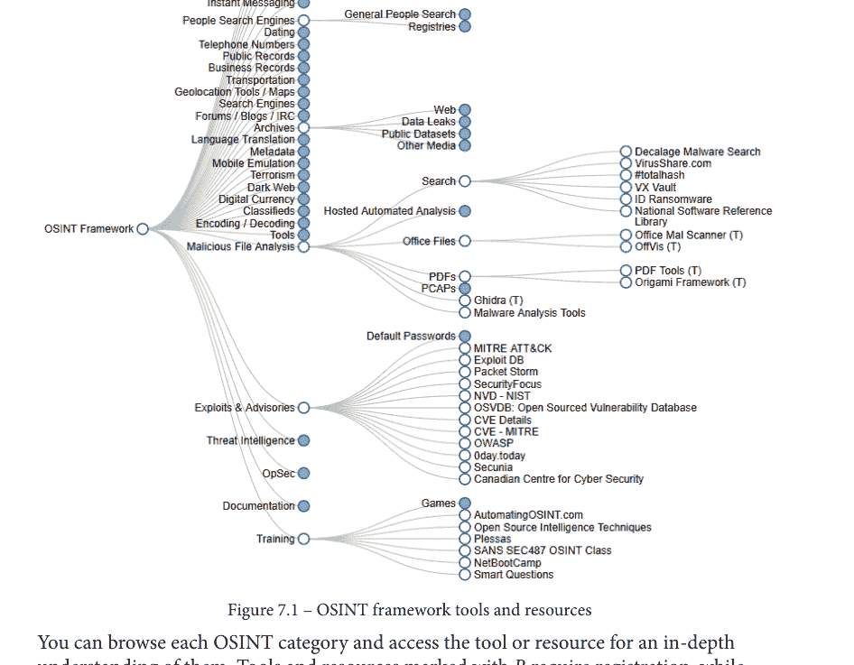

图 7.1 – OSINT 框架工具和资源

您可以浏览每个 OSINT 类别并访问工具或资源以深入了解它们。标记为 R 的工具和资源需要注册，而标记为 T 的工具需要本地安装。尽管该工具仍在更新和改进中，但可用于创建 OSINT 数据源列表。如果我们点击 Exploits & Advisories > MITRE ATT&CK，网站将重定向到 MITRE 官方网站以获取更多详细信息。在下面的小节中，我们将讨论 OSINT 数据的可能局限性。

## OSINT 局限性和缺点

OSINT 来源提供大量数据——数据可能是结构化或非结构化、受控或不受控（就开销而言）。使用 OSINT 时面临的一些挑战包括以下内容：

- **要求数据清洗：** 大多数 OSINT 数据或馈送是原始的，初始状态下无法直接使用。需要对其进行许多后处理操作，才能将其转换为可消费的格式（可查询、关联或与其他工具集成）。
- **来源验证：** 在处理威胁情报数据和馈送时，来源验证和评估至关重要。OSINT 的庞大性质使其难以评估，尤其是在手动情况下。想象一下尝试验证 10 个数据源。这是可以的，但可能需要时间和资源。如何验证来自进行企业或政府间谍活动的来源的 OSINT？这将 OSINT 与数据准确性问题联系起来。
- **信息过滤：** 在噪声很大的数据中查找所需信息是一个挑战。因此，有可能获得误导性信息，导致大量误报警报。

可以调用两个组件来解决 OSINT 的一些局限性：*数据收集自动化* 和 *领域专业知识*。数据收集自动化降低了人为错误的概率并提高了数据收集周期的速度。通过在收集过程中具备专业知识，CTI 团队可以找到将噪声与数据洞察以及产生的误报分离的最佳方法。因此，建议尽可能自动化收集过程。

OSINT 是情报项目启动的良好来源。因此，1 级和 2 级组织可以利用它来开始构建情报。然而，必须理解目标和 CTI 要求必须是 OSINT 数据收集过程的驱动因素。当选择合适的来源时，它们可以与内部数据相关联以提供可靠的情报。在下一节中，我们将介绍恶意软件数据及其在威胁情报中的用途。

## 恶意软件数据用于威胁情报

恶意软件是网络安全中最常用的词汇之一。它的出现给组织带来动荡和折磨，给攻击者带来欢愉。其概念复杂难以理解，因为它需要不同的一套技能和专业知识（架构、分析和设计）。然而，作为 CTI 分析师，了解恶意软件数据及其收集必须成为第二天性。在本节中，我们将介绍用于情报的输入 TIP 或 SIEM 的恶意软件数据。

VirusTotal、VirusShare 以及其他恶意软件沙箱等站点（或来源）由恶意软件分析引擎驱动，使其能够分析已上传文件的行为或链接，以将其分类为恶意或非恶意。尽管开源沙箱可以帮助 CTI 团队和分析师自动执行恶意软件分析，但了解恶意软件数据的基本信息至关重要。

> **重要说明**
> 恶意软件分析是一个独立的主题，不属于本书范围。我们仅提供了有关恶意软件的基本信息以及 CTI 分析师可以从恶意软件数据中提取的基本指标。

现代恶意软件设计技术可以绕过安全系统并避免检测。需要高级分析才能可靠地检测恶意软件威胁。CTI 团队或分析师旨在从数据中提取 IOC 并通过连接恶意软件相关数据源将其输入 TIP 或 SIEM。然后他们可以将这些数据与内部数据相关联，以创建未来威胁检测的警报。

## 恶意软件数据收集的好处

使用恶意软件数据进行威胁情报的关键好处包括以下内容：

- **恶意软件检测**：识别需要阻止的恶意软件 IOC。CTI 可以实施通知服务以报告可能的恶意软件威胁检测。
- **威胁优先级排序**：CTI 团队可以在恶意软件检测上创建高优先级警报，其中恶意软件威胁的优先级高于其他 IOC 警报。自动化威胁优先级排序使分诊任务更简单。


-   **威胁狩猎**：恶意软件数据 IOC 和工件可被威胁猎人用于在整个网络中识别相同的恶意操作。例如，如果恶意软件以某种方式修改目录文件，威胁猎人可以使用相同的行为来检查网络中类似的修改。
-   **未来研究的参考**：安全研究人员可以利用恶意软件数据来了解对手（或组织）使用的模式、技术、科技、代码和基础设施。它有助于预测对手设计的变更。

恶意软件数据在实施 TI 项目时至关重要。它为组织提供了做出有关恶意软件相关威胁的明智决策所需的手段。数据需要与系统流量相关联。

## 恶意软件组件

恶意软件旨在在受害者系统中执行特定任务。虽然恶意软件可以执行许多功能，但最可能包括窃取信息、破坏系统和修改系统。CTI 分析师需要了解恶意软件的不同组件，这些组件定义了其目的。它们在以下图表中进行了说明：

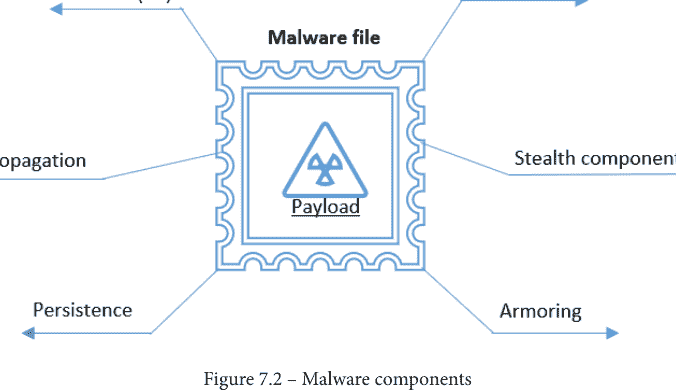

Figure 7.2 – 恶意软件组件

每个设计良好的恶意软件都将包含以下内容：

-   **Payload**: 有效载荷是恶意软件的核心部分，执行预期的恶意活动。它使用编程语言编写，被指示执行一个或多个任务。有效载荷可以被编程以隐藏其存在。
-   **Obfuscator**: 它掩盖有效载荷，使其无法被防病毒软件和其他安全设备和软件检测到。混淆是通过使用包装器、保护器和编码器来修改有效载荷的外观来实现的。恶意软件分析师的任务之一是对混淆器进行*reverse engineer*以访问有效载荷的代码。优秀的恶意软件设计者确保混淆器坚固且不可逆。压缩和加密是用于混淆恶意软件的两种方法。
-   **Stealth component**: 恶意软件会通过使用合法进程和端口、更改其属性或使用 rootkit 来隐藏自己。使用带有伪造扩展名的特洛伊木马，例如 `new_mercedes.jpg.bat`，或使用 `WriteProcessMemory()` API 劫持合法进程，是恶意软件逃避防御系统的示例，因此需要有效地监控系统进程并突出显示进程行为的变化。
-   **Armoring**: 攻击者设计恶意软件使其能够检测可能威胁它们的工具。它们倾向于在监控工具、虚拟环境和故障排除工具等工具存在时改变行为。复杂的恶意软件可以解除某些工具的武装以保护自己或修改其执行逻辑。Wireshark、VMWare、VirtualBox 和调试工具是恶意软件可以防御的工具示例。因此，恶意软件分析师需要在不同情况和环境下考虑恶意软件的行为。
-   **Persistence**: 除非设计者另有说明，否则恶意软件很可能会驻留在受害者系统中，使攻击者能够在必要时访问受害者系统——即使在系统重新启动后也是如此。在大多数操作系统中，攻击者依赖注册表、服务、持久程序和内存来使恶意软件持久化。例如，存储在 `C:\...\Programs\Startup`（Windows）或 `/etc/systemd`（Unix）中的任何恶意软件都可能在每次重新启动时随操作系统一起启动。
-   **Propagation**: 恶意软件会找到在受害者系统内部传播的方法。根据其类型（病毒、特洛伊木马、蠕虫、僵尸网络等），其传播可以是自动的（独立）或由外部触发器启动。例如，蠕虫可以在没有外部干预的情况下复制和传播。在评估恶意软件行为时，了解传播模式至关重要。
-   **Command and control**: C&C 或 C2 是*the way*植入的恶意软件与外部世界通信的方式，从攻击者接收命令以在受害者上执行更多操作。C2 依赖 IP 地址和域名与外部世界通信。IP 和域名可以嵌入有效载荷中，也可以使用现代算法动态生成以避免被阻止。

每个组件在恶意软件需要完成的恶意任务中承担特定角色。这些组件也是理解恶意软件行为的基本要素。对于计划建立内部恶意软件分析实验室的组织来说，了解这些细节对于理解恶意软件本身至关重要。

## 恶意软件数据核心参数

恶意软件分析的结果，无论是在本地进行还是使用从恶意软件来源收集的数据，都是一组*indicators*，有助于对抗和保护系统免受恶意软件攻击。这些指标是从恶意软件组件中提取的，有助于按功能和家族对恶意软件进行分组。以下图表显示了各种恶意软件数据指标：

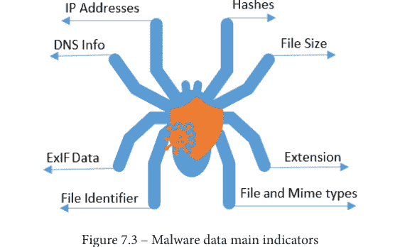

Figure 7.3 – 恶意软件数据主要指标

安全厂商正在采用先进技术来检测、隔离和清除恶意软件。*signature-based*方法由于攻击者使用的复杂混淆技术而变得越来越低效。但结合*behavior-based*分析（现代由 AI 驱动），厂商正在开发检测恶意软件的复杂方法。以下几点深入探讨了有助于 CTI 挖掘数据的恶意软件参数：

-   **Hashes:** 恶意软件使用许多加密哈希值进行识别并作为保护机制（例如通过修改哈希值来规避安全）。攻击者使用 MD5 和 SHA 家族（SHA1、SHA256、SHA224）等哈希算法来保护有效载荷。CTI 分析师必须提取恶意软件中使用的所有哈希值。
-   **File size:** 文件大小是另一个需要关注的参数。恶意软件代码（或内容）决定了文件的大小。
-   **Extension**: 恶意软件文件带有扩展名，这也决定了它们可以在哪个环境中运行。Windows 恶意软件可以根据设计者拥有 `.exe` 或 `.bat` 扩展名，或 Unix 环境的 `.sh`。然而，重要的是要知道恶意软件扩展名可以被混淆（例如*fileless malware*，完全在内存中运行）或伪造（以模仿流行的无害文件）。然而，一些工具和方法可用于分析无文件（*memory monitoring*）和伪造的恶意软件。
-   **File and mime types**: 文件和 mime 类型分别决定扩展名和内容。这是正确识别文件类型的两种方式。攻击者可以伪造扩展名，但 mime 会显示正确的身份。`PE32 executable (GUI)` 和 `application/x-dosexec` 分别是文件和 mime 类型的示例。
-   **File identifier**: *TrID*，也称为文件标识符，使用二进制签名识别文件类型。TrID 也可用于恢复文件。TrID 工具也可独立用于调查和取证案例。
-   **ExifTool data**: Exchangeable Image File Format 是大多数文件（如图片）的标准。Exif 工具可用于操作图像、视频和文档文件（如 PDF）。ExIF 数据可以包含操作系统、恶意软件或文档中的代码语言、字符集等字段。
-   **DNS info**: 如果运气好或技术足够，恶意软件数据可以报告远程或 C&C 服务器的域名信息。
-   **IP addresses**: 这与 DNS 信息相同；IP地址可以从恶意软件数据中提取。

根据数据，分析师可以提取必要的参数对恶意软件进行分类。

CTI 团队并不是集成恶意软件数据指标的唯一受益者。事件响应团队和安全运营分析师利用数据来发现恶意行为、创建警报并监控系统对恶意软件威胁的有效性。

恶意软件数据对于可靠的情报项目至关重要，并且有多个 OSINT 可用于收集恶意软件数据（其中一些已在上一节 *Open source intelligence portals* 中提到）。在下一节中，我们将研究付费情报来源。


## 其他非开源情报来源

付费情报来源正变得越来越成为开展情报工作的首选方式——对于能够承担服务成本的组织而言。付费情报的概念可分为 *精选付费情报* 和 *原始付费情报* 来源。某些提供商通过处理和聚合来自多个开放且低成本来源的数据来利用 OSINT，从而提供精选且丰富的情报数据。这些数据随后被出售给组织（精选 PTI）。其他提供商利用行业先进技术、研究、专有领先功能和定制信息来提供扩展的情报服务（原始 PTI）。精选 PTI 服务相比原始 PTI 服务成本更低且可以负担得起。然而，原始 PTI 的价值主张可能是其与 OSINT 和精选 PTI 之间的关键差异。

## 付费情报的优势

逻辑上，任何安全分析师都会认为付费情报的质量更高、可靠性更强于开源情报。我们的目标并不是证实或否定这一假设，而是为 CTI 分析师和安全利益相关者提供必要的知识，以便就付费或开源情报来源做出明智的决策。我们可以结合特定威胁和 feed 评估指标来突出付费情报的一些优势，如下所示：

- **信息准确性**：准确性是评估情报 feed 的重要指标，无论是开源、私下共享（来自社区）还是付费。不准确的信息可能对组织的防御态势造成破坏——误导性信息和误报。PTI 依赖专门的专家在向客户交付前分析 feed 的准确性。信息 *噪声* 会得到专业处理——在出现错误的情况下，存在一定程度的追责（商业、法律或运营，具体取决于协议）。
- **数据周期（时间）**：数据更新和上下文化的频率在评估 feed 时也很重要。开源情报来源主要依赖攻击案例的结果。首先，对入侵和威胁进行分析以识别关键的 IOC 和恶意组件，然后与公众或社区共享。这一过程有时会导致更长的延迟和检测周期——等到攻击被彻底分析时，可能已有多个组织成为受害者，或对手已更改 TTP。PTI 依赖持续的专家分析，通过不断以前瞻性视角更新来源，为客户提供预防策略。
- **处理与集成**：付费 TI 提供先进的集成和中介层，将信息导入其他安全平台。它们支持大多数行业情报标准和技术。这一特性优化了 CTI 团队将数据以用户友好格式获取所需的时间。
- **需求对齐**：情报必须可操作。因此，数据源必须与需求保持一致。付费 TIP 厂商倾向于与 CTI 团队和安全利益相关者坐下来讨论需求，并确保 feed 或提供的 TI 数据与组织目标保持一致。数据相关性至关重要。
- **信息保护**：虽然 OSINT 公开暴露，但 PTI 保护其价值和独占性。由于 PTI 厂商倾向于掩盖其技术，攻击者不知道何时被检测到并被处理。这一点为 PTI 消费者提供了优势。
- **厂商额外服务**：某些 PTI 厂商如 IBM、Microsoft、Cisco、Spirent 等也是设备和产品厂商。建立在这些厂商技术之上的组织基础设施可以以更低或免费的成本受益于额外的安全服务。其他 PTI 厂商也在这些 feed 之上提供额外服务——例如垃圾邮件过滤库、恶意软件检测盒和钓鱼识别服务。
- **广泛覆盖**：某些 PTI 包含 OSINT。这意味着 PTI 厂商可以访问开放和共享来源，并在发送给消费者之前对其进行处理（验证、清理和重新格式化）。这减轻了内部评估和分析开源 feed 的负担。
- **客户支持**：除了关注威胁指标外，付费情报厂商还提供平台和门户以下载报告、提问、提交问题或获取有关威胁和数据泄露的最新消息。包装式服务支持可以成为组织的吸引力组成部分，因为它们促进了厂商与客户之间的互动。

PTI 提供了许多优势和一些独特的好处，可以帮助组织收集与情报需求相匹配的相关数据，以便拥有足够准确的信息来构建有效的网络防御体系。

## 付费威胁情报挑战

PTI 提供了多项优势，但并非没有挑战。虽然它在数据质量方面有所提供，但 CTI 分析师或团队或安全利益相关者在选择 PTI 时必须考虑一些参数：

- **成本：** 原始 PTI 来源的成本可能超出中小型组织的承受范围。即使对于大型企业来说，确保成本不超过预算范围也很重要。根据月度订阅，feed 的费用范围可从 $1,500 到 $100k 不等，其中精选 PTI feed 是较便宜的选择。组织很容易发现自己为威胁数据 feed 支付超过 $1M。然而，这也取决于所需的 feed 数量。
- **Feed 重叠：** CTI 团队可能需要一个以上的付费情报来源以有效满足安全需求并获得更广泛的覆盖。然而，组合多个来源可能会导致信息重叠。许多付费情报 feed 覆盖相同的范围，甚至使用相同的私有来源。团队必须识别威胁来源重叠的区域，以避免为同一事物重复付费。
- **单个 feed 的上下文和范围：** 是的，某些 PTI 来源整合了 OSINT 和其他私有数据，但一个来源可以由一个或多个 feed 组成。在大多数情况下，组织按 feed 而非按来源付费。而且可能需要更多 feed 来覆盖组织的安全目标。每个 feed 类别可以关注组织的不同的方面，因为不同的安全部门可能需要各种 feed。feed 数量越多，订阅费也越高。

不同厂商以不同的方式应对 PTI 挑战，CTI 团队必须在投资 PTI 之前评估每个挑战（了解其对 CTI 项目的影响）。

## 一些付费情报门户

有许多来自顶级厂商的 PTI feed 可供 CTI 用于构建情报。我们在此不提供详尽的列表或给出最佳来源；相反，我们列举了一些可以帮助您朝着正确方向前进的 feed。我们也不关注厂商本身，而是情报 feed（即使 feed 或服务与厂商相关）。一些付费威胁情报 feed 包括 AT&T AlienVault、FireEye CTI、CrowdStrike Intelligence Exchange、RecordedFuture、HackSurfer、Symantec DeepSight、ThreatConnect、IBM X-Force、SecureWorks、Vipre、Kaspersky TI、Microsoft Graph Security、Cisco openVuln API、WildFire、Anomali、PhishLabs、DeCYFIR、Flashpoint Collab 等等。

Gartner (https://gtnr.it/3fkEkMZ) 提供了一份良好的 TI feed、产品和服务评测列表，分析师和利益相关者可将其用作厂商侦察的主要来源。大多数 TI feed 厂商提供 API 以促进与 SIEM 和 TIP 的集成。他们还提供情报产品和服务（TIP、SIEM、SOC、网络监控等）。

> **重要提示**
> 选择 feed 也意味着信任厂商或提供商，这可能不是一项简单的任务。然而，在计划购买情报 feed 时，除了优势之外，您还应考虑厂商的声誉、其在该领域的经验、已解决的用例、参考资料、路线图和用户评价。作为 CTI 分析师或安全利益相关者，您应评估这六个要点。

CTI 团队需要在购买或订阅数据 feed 之前研究来源或厂商。CTI 的职责还包括了解厂商的安全概况并确保组织最大化利用解决方案。关于开源和付费来源，CTI 分析师或团队需要知道如何结构化并存储原始和处理后的信息。在下一节中，我们将讨论情报数据的结构化和存储。

## 情报数据结构化和存储

本节假设您已选择相关的数据来源和 feed，并已通过 API 连接以获取数据。在这一点上，您希望高效可靠地组织和存储这些数据。数据结构化和存储分别与数据如何呈现和保存相关。良好的情报利用在很大程度上取决于数据如何被结构化和存储。


## CTI 数据结构化

情报数据必须结构化，以便于操作。公开访问的数据任人宰割——包括攻击者。因此，只要有任何机会损害数据，他们就会动手。故此，在收集数据时，必须以值得信赖的方式安全地呈现数据。结构化还涉及处理情报数据的一些最佳实践。我们将介绍在结构化情报数据时必须考虑的三个要点：

- **维护数据的 CIA：** 确保在数据收集和处理的整个周期内保持 CIA 三要素。API 必须安全，因为源 feed 连接到组织的内部网络。任何 *保密性* 方面的泄露都可能为攻击者提供窗口来入侵 API 并发动恶意攻击。CTI 团队必须确保收集或共享的情报在传输中或静止时未被 *篡改*。必须使用可靠的 API 密钥以确保完整性得到维护。CTI 团队还必须确保数据的可用性。
- **保持标准格式：** 确保收集的情报和数据（包括报告等）使用标准格式。这一特性使得熟悉标准格式的每个人都易于使用数据。团队和数据必须使用同一种语言。
- **共享数据：** 你可能希望与 infosec 社区共享你的 CTI 报告（结果）或处理后的数据。确保可共享的情报得到保护，并且可以被内部和外部使用者轻松访问（在与外部用户共享信息时始终考虑访问级别安全）。

当数据结构正确时，存储和共享变得容易。CTI 团队必须努力以适应目标受众的语言呈现情报（*战术性和技术性，或操作性*）。情报数据包含有价值的信息，但需要结构化并适当存储才能让你从中受益。在下一节中，我们将介绍情报如何存储。

## CTI 数据存储要求

收集的数据和情报必须存储在组织的环境中，以便在需要时访问。情报面向所有人；因此，任何安全职能都应能快速使用数据或信息。存储情报数据时，需要考虑三个指标：

- **可访问性**：安全人员、CTI 分析师和相关利益相关者必须能够随时访问数据或信息。事件响应团队可以使用数据来检测、分析和补救网络攻击。安全运营团队可以访问数据以执行系统监控。CTI 团队仍可访问数据进行评估并做出明智决策。
- **可用性**：收集的数据必须存储以便在需要时可用。组织必须确保存储基础设施（硬件和软件）得到妥善维护，并且所有应用程序运行良好且为最新版本。在最坏情况下，存储基础设施必须及时恢复以避免数据丢失。
- **检索速度**：情报数据和信息量可能很高。它属于大数据范畴。因此，存储基础设施必须设计为能够快速查询。扫描数十亿条指标记录会很烦人，如果后端设计不正确。

这些存储要求对于在组织内部和外部重现和消费情报至关重要。在选择 feed 时，CTI 团队必须评估存储数据的复杂性。

## 情报数据存储策略

公司以两种不同的方式存储情报数据和信息：*组织特定存储基础设施* 和 *威胁情报平台*。大型公司可以结合这两种方法以确保数据 *复制* 和 *归档*。（这是保持高可用性的最佳方法之一。在发生故障时，一个系统可作为另一个系统的备份。）

## 组织特定存储基础设施

组织可以构建自己的存储基础设施或使用云提供商托管数据。从 feed 收集的数据会被解析并内部存储在关系型或非关系型数据库中。然而，在构建基础设施时，需求（指标）必须匹配。大多数组织使用的存储基础设施方法包括以下内容：

- **关系型数据库**：关系型数据库可用于存储情报数据。然而，像原生 SQL 这样的关系系统在大规模数据查询中可能成为瓶颈，因此需要利用非关系存储和大数据。
- **非关系型数据库**：组织可以使用非关系型数据库存储数据。文档型和图型是组织可用于存储数据的两种非关系型数据库示例。
- **大数据平台**：组织可以利用 Hadoop 和 Spark 等大数据平台部署稳健的情报存储，并通过使用 Python、SQL 和 Java 等常见流行语言促进数据访问和查询。

组织不得忽视从零构建数据存储基础设施或采用云解决方案进行威胁情报存储的挑战。其中一些挑战如下：

- **基础设施维护**：尽管这不适用于公共云解决方案，但维护内部数据库需要成本。获取云处理服务（数据库、**提取转换加载 – ETL** 服务、解析器等）也不是免费的。
- **投入与效率**：组织可能需要获取构建用于解析、关联和聚合来自不同来源和 feed 的数据的弹性中介层的技能。中介层必须经过优化以支持快速处理和流式处理能力。
- **数据格式**：情报输出必须遵循特定标准（如 STIX/TAXII、CSV 和 JSON）进行存储，以便与 infosec 社区共享。因此，系统必须允许将使用的任何内部格式转换为标准格式。

构建内部存储基础设施的优势可能与成本保护有关。基于 Hadoop 和 Spark 等开源应用程序构建大数据平台的成本可能低于购买昂贵的 TIP。就效率和投入而言，内部数据存储系统可能不适合中小企业。

## 用于存储数据的威胁情报平台

可能最受欢迎的选择（尤其是对于 1 级和部分 2 级组织），TIP 可用作情报存储基础设施。这是有道理的，因为 TIP 是按照 CTI 标准构建的（例如，它们自动支持 STIX/TAXII 和 YARA 格式）并且可直接使用。它们还促进了与 infosec 社区其他成员的信息共享。大多数付费 TIP 很可能提供存储机制。然而，像 MISP 和协作威胁研究（CRITs）这样的开源 TIP 也提供存储功能。

> **重要提示**
> 对于刚接触 CTI（1 级）的组织，我建议在投入创建内部基础设施或昂贵的 TIP 之前，通过利用 MISP 等开源 TIP 来节省预算。MISP 被广泛使用，因为它提供多种功能并且得到妥善维护。MISP 在本书中用于实际用例。

CTI 团队和相关利益相关者必须选择正确的情报数据存储策略。在选择一个或两个存储基础设施时，你必须考虑需求以及情报将如何共享——CTI 是一个因社区共同目标而不断增长的领域：打击网络犯罪。

威胁情报数据 feed 在原始状态下是被动的。CTI 团队或分析师必须通过将其集成到现有安全系统、TIP 或安全信息和事件管理（SIEM）中使其活跃。通过这样做，TIP 或 SIEM 可以执行其主要任务之一——将外部数据 feed 与内部系统数据关联，以提供更多关于威胁的见解。


## Summary

收集 CTI 项目的正确数据是衡量项目成败的最重要指标之一。CTI 团队必须评估所有选定的来源并确保它们符合规划阶段设定的要求。无论您选择 OSINT 还是 PTI，都必须考虑一些参数（预算、准确性、数据更新频率、数据相关性、可用资源和业务需求），如本章所述。某些参数在组织或 CTI 团队选择数据源时可能可以协商，但其他参数可能不可协商，具体取决于目标和要求。适当的解决方案取决于组织的需求、要求和资源。然而，对于中小型组织而言，OSINT 足以构建情报。您应了解如何选择正确的来源、从何处获取数据、如何存储数据，以及将数据与其他安全平台集成的先决条件。在下一章中，我们将从组织的角度审视情报，以便有效防御威胁并保护数据。

## 8 Effective Defense Tactics and Data Protection

## Effective Defense Tactics and Data Protection

组织安全基础设施由多个不同的层组成。虽然 **威胁情报 (TI)** 专注于基于数据的知情循环安全防御和保护，并提供一种高效的方式来领先于网络威胁，但组织的第一道防线取决于安全如何整体融入业务运营。组织必须确保在任何时候（开发、集成、资源管理、通信等）都以任何代价维护安全最佳实践和政策。它必须结合人员、流程和技术，以确保关键数据在其整个生命周期内得到保护。数据和资源的 **保密性、完整性与可用性 (CIA)** 必须得到保留，并在 **传输中** 或 **静止** 时经常进行评估。

本章重点介绍为组织安全构建有效的防御屏障——TI 的一个重要部分是防止和遏制攻击。它提供了实现可靠数据保护的最佳实践。

在本章结束时，您应该能够做到以下几点：
- 了解与网络威胁防御系统相关的常见主要挑战和陷阱，并将项目与正确的防御策略相匹配
- 了解主动分析以保护组织免受威胁
- 了解风险和漏洞评估的重要性
- 了解如何在 TI 项目中纳入加密、标记化和其他数据保护机制
- 了解移动终端对 TI 格局的影响

在本章中，我们将涵盖以下主要主题：
- 强制执行 CIA 三要素 – 概述
- 威胁防御机制的挑战和陷阱
- 数据监控和主动分析
- 漏洞评估和数据风险分析
- 加密、标记化、屏蔽和隔离
- 终端管理

### Technical requirements

对于本章，未突出显示任何特殊技术要求。大多数用例如有必要将使用 Web 应用程序。

### Enforcing the CIA triad – overview

在保护关键数据（和资产）时，组织必须防范系统内部（故意和非故意）和外部（恶意和非恶意攻击者以及自然灾害）攻击的安全措施。数据安全的主要目标是确保 CIA 不受损害并且得到充分管理。在以下要点中，我们将查看一些数据安全用例以实现更好的系统保护。

### Enforcing and maintaining confidentiality

数据保密性必须始终在关键资产上保持 **静止**（存储在 **终端**、**数据库服务器** 和 **备份设备** 上的资产或数据）或 **传输中**（在系统内部或系统外部的两个点之间移动）。此外，作为安全或 **网络威胁情报 (CTI)** 团队的一部分，您必须确保以下内容到位并强制执行：
- **访问限制：** 只有合适的人员或应用程序需要访问组织的数据或资产。确保凭据不会在员工、组或应用程序之间重复使用和共享——例如，确保 **人力资源 (HR)** 员工不得直接访问员工的财务数据，财务人员无法访问技术运营数据，等等。
- **隐私：** 通过给予人员适当的访问权限来保护数据隐私。必须充分实施、遵循和执行访问管理策略——例如，员工可能有权访问 HR 门户查看其个人资料，但不能访问其他人的数据。然而，HR 经理可以访问所有人员的数据。
- **数据查看限制：** 必须将资产（和数据）的访问和操作限制在受信任的网络（通过诸如 **虚拟专用网络 (VPNs)** 和代理等服务）和授权设备——例如，**信息技术 (IT)** 经理只能通过公司 VPN 使用组织提供的终端访问组织的资源。同样，可以阻止通过个人终端设备访问以保护保密性。

提供的可能不仅仅是前三个要点。因此，组织必须制定坚实的政策来保护资产和数据保密性。当今大多数企业使用两个重要概念来有效管理系统保密性：*最小权限* 概念——仅授予必要的资产或资源访问权限，以及 *默认无权限* 概念——根据需要逐步分配访问权限。

### Enforcing and maintaining integrity

系统数据必须准确。用户必须能够信任他们交互的数据、软件或应用程序。系统必须设计为捕获并记录对数据或关键资产的任何修改。作为安全或 CTI 团队的一部分，您应确保以下内容到位并强制执行：
- **角色的明确定义：** 用户的角色必须明确定义——尤其是可以修改资产的人员。这可以通过创建 *功能用户组* 来实现。例如，某些员工可能在开发团队中拥有写入、更新和执行的权限，而其他人可能只有读取和执行权限但没有更新权限。组织必须制定强调角色的政策。
- **篡改数据识别：** 定义角色是 **完整性保证** 的第一步，但并不止于此。系统必须设计为记录或检测关键资产（数据）的任何更改，从静态资源到动态资源，例如 **流量**。使用监控工具（图形或命令行）通过突出显示不同的指标来增强对修改流量的识别，例如数据来源（**互联网协议 (IP)**、**域名系统 (DNS)**、用户名等）、流量目的地（数据库服务器、防火墙或其他用户等）、涉及的协议和应用程序等等。
- **修改警报：** **数据篡改** 不应仅被记录和监控，而应转换为在仪表板上显示的警报并通过电子邮件或 **短消息服务 (SMS)** 发送给相关方。在设计良好的基础设施中，这些警报根据访问的数据进行分类（分配优先级）——数据或资产越关键，重要性越高。

数据完整性管理可能具有挑战性，尤其是在涉及第三方访问（承包商、分包商、顾问等）时。您必须强制执行处理第三方角色等情况的完整性策略。另一个挑战是由于凭据被盗而识别资产篡改。让我们看以下示例：

**用例：** 数据保密性和完整性泄露分析

**场景 1：** 公司数据分析师 James 访问客户交易数据并下载其中一部分以构建推荐系统模型，从而改善产品和服务销售。

**场景 2：** 一名不满的员工 John 窃取 James 的凭据，伪造其 IP 地址，访问客户交易数据，并为恶意目的下载个人信息。


**场景 3：** 莫莉是詹姆斯的朋友，她属于关键数据访问的受信任组，出现了凭证问题。她请求詹姆斯分享他的凭证以避免项目延期。她使用詹姆斯的凭证访问并下载数据。

**系统行为：** 访问已记录，流量已捕获，警报以 `james_analyst` 创建，优先级为低，因为 `james_analyst` 是受信任用户。

在两种场景中，系统行为相同，将访问关联到詹姆斯作为用户，无法检测到潜在的违规行为。可能需要额外的安全层来应对此类挑战（使用 **多因素身份验证 (MFA)**、访问令牌、验证码等）。

我们可以看到保密性和完整性之间存在一定程度的重叠，因为角色和组定义了访问限制。

## 强制执行和维护可用性

系统必须设计成数据在 *需要* 时 *可访问* 且在合理 *时间范围* 内可用。检测可用性违规比保密性和完整性更容易——网络关闭、系统响应缓慢以及无响应不需要魔法就能识别。然而，它是 CIA 组件之一，可能受到多种因素的影响，例如自然灾害。这意味着在为可用性设计系统时又多了一件需要担心的事情（地震、火灾、雨水和风暴，可能对资产和数据造成损害）。可用性是三个参数的函数，*可访问性*、*存在* 和 *时间*。因此，作为安全或 CTI 团队的一部分，您应强调以下几点：

- **保留期限：** 数据应保留多久？系统必须设计为考虑 *短期*、*中期* 和 *长期* 可用性需求。以下两点在很大程度上取决于可用性需求。长期可能为 5 至 10 年，中期可能为 1 至 5 年，短期可能长达 1 年。保留组件不是标准化的，取决于业务目标。
- **响应时间：** 数据必须在适当的时限内可用，具体取决于可用性需求。对于短期访问，您可能需要一个 **延迟敏感系统**（*更短的响应时间*），因为数据或资产可能用于即时的业务决策。然而，对于历史数据，轻微延迟是可以理解的，对于归档数据，更长的延迟可能是可以容忍的。延迟容忍度对数据可用性至关重要。
- **位置和备份**：数据和资产必须存储以便在需要时可访问并存在。*在哪里* 和 *如何* 存储它们对于确保安全性和可用性至关重要。例如，将数据远离用户可能会在受限带宽系统中导致更多延迟；因此系统设计人员必须考虑数据和资产的位置，并确保提供完整保护。另一个重要的可用性要素是 *备份*。数据必须备份以防止丢失，并且恢复过程必须可靠。

关键数据（资产）和整个系统必须从开发周期的开始就得到充分保护，因为数据泄露可能对组织造成毁灭性打击。财务上，它们会影响您的利润，因为您可能需要恢复数据、加强安全并支付法律罚款费用，更不用说其他后果。因此，安全必须成为业务流程的一部分，正如我们在 *第 11 章，可用安全：威胁情报作为流程的一部分* 中所述。

组织在安全防御和数据保护方面面临许多挑战。我们将在下一节中探讨其中的一些挑战。

## 威胁防御机制的挑战与陷阱

构建可靠的 **防御系统** 是一项复杂任务，因为业务功能呈现出不同的安全需求。因此，战略团队在实施安全实践时需要考虑整个组织的安全需求和每个功能。然而，这并不容易，因为安全不应干扰业务运营——例如，在急诊室的患者登记设备上实施密码和 MFA 可能会延迟为需要立即护理的患者检索客户数据，同时设备仍需要受到保护以保护患者隐私。如果处理不当，此类挑战会促使组织做出不平衡的决策，从而在安全阶梯中引入陷阱。在下面的小节中，我们将了解组织战略团队面临的一些常见安全挑战。其中一些挑战已在前几章中介绍过。本章对此进行了更详细的介绍。

## 数据安全主要挑战

数据保护并非没有挑战。这些挑战可能是全球性的或行业特定的，但在组织中都需要解决。最终，高层目标仍然是保护敏感数据（资产）免受未经授权的访问和可能的滥用。

现在，让我们来看看一些数据安全挑战。

### 指数级数据增长

生成的数据量正以快速的速度增长。企业从不同的数据源积累数据，包括机器、人类和组织本身。数据增长是大数据时代的主要触发因素之一。然而，每个数据源都有不同的安全需求。让我们看看在一些热门且最受针对的行业中的数据增长情况，如下所示：

- **金融行业：** 随着来自客户个人信息、信用信息、专业数据（薪资、支出）等来源的大量敏感数据，金融行业收集了大量数据。移动支付的引入增加了数据量，因为客户现在每小时或每天可以进行大量交易。金融公司处理数十亿笔交易和兆字节的数据。这些公司必须考虑对其系统中所有静止和移动数据的保护。
- **医疗保健：** 医学的进步使该行业收集各种患者数据（包括健康相关和支付数据）。这些数据由健康小工具、应用程序和医院机器（放射科、扫描仪等）等来源生成。健康数据需要与保险公司、政府和其他相关方共享。大规模医疗数据不断在传输中。
- **交通运输：** 我们看到交通摄像头以较低的粒度从车辆生成数十亿笔交易。车辆注册详情由传感器和 **全球定位系统 (GPS)** 记录捕获。数据与公共和私人来源相关联，以识别车辆所有者、犯罪记录和其他参数。你可以想象必须处理的数据量。
- **电信 (telecom)：** 随着智能设备、网络元素和客户活动，**电信行业** 产生爆炸性数据。这些数据用于各种目的，并与其他数据源相关联，例如客户个人数据和银行信息。

零售、制造和 **物联网 (IoT)** 等其他行业也处于同一境地。存储和移动如此庞大的数据令人不堪重负。您的组织现在可能只处理小数据，但随着业务增长，它很可能会增长。战略团队在设计 IT 系统时必须将安全放在心上。

### 数据保护和隐私法规

地方和国家当局正在围绕隐私保护建立坚实的文化。正在制定多项法规以确保人口保护，其中大多数在范围和重点上有所不同，甚至可能重叠。根据公司运营区域，战略团队必须了解所有地方、区域、国家甚至国际法规。

> **重要说明**
> 一方面，法规合规失败可能导致组织因罚款而花费大量资金。但另一方面，法规合规成功甚至在数据泄露的情况下也能保护组织。

战略团队必须确保组织遵守所有法规。除了法规之外，行业可能还需要标准来保证数据保护。对于小型企业来说，处理适用于其行业的全部法规和标准可能令人不堪重负，但这是需要考虑的挑战，以避免处罚。

在医疗保健中，例如，战略团队需要考虑医疗个人信息安全和支付卡安全法规——分别为 **健康保险流通与责任法案 (HIPAA)** 和 **支付卡行业数据安全标准 (PCI DSS)**。它必须实施详细说明并强制执行处理静态或传输中医疗数据的流程和程序的政策。因此，了解适用于业务领域的法规至关重要。

### 数据处理和第三方组件

组织由多个需要和谐协同工作的业务功能组成。然而，整合这些功能并利用 **云计算** 等技术会增加业务运营的复杂性，并在堆栈中引入多个漏洞点。第三方软件和工具在业务 **开发运营 (DevOps)** 堆栈中广泛存在。由于组织对这些组件的控制较少（或没有），数据安全成为一个挑战。


这样一个案例就是 **Equifax 数据泄露事件** (https://bit.ly/34TD DnN)，其中第三方 **开源软件的 (OSS 的)** 漏洞 *Apache Struts* 被用来策划 2017 年最重大的泄露事件之一。尽管该漏洞在数天前已被发现并公开，Equifax 仍未能修补 Web 服务器应用程序。如果没有妥善结构化，补丁管理可能会很复杂。为了确保在 DevOps 和第三方组件方面具有可靠的防御机制，您应执行以下操作：

- **让安全驱动 DevOps 战略**：在 **DevOps** 的每一步评估安全态势。例如，确定关键资产存储的最佳方法。出于运营目的，您可能希望将敏感数据存储在本地而不是公共云中。您应在应用程序开发过程中评估其安全性，而不是在开发周期结束时。
- **分配明确的安全责任**：应为组织 DevOps 中涉及的各方分配角色。例如，对于第三方软件，确保安全所有权得到正确定义，而对于公共云服务，应有负责服务和应用安全的人员。**角色分配** 在安全流程中引入了问责制。
- **选择适当的安全管理方法**：**安全管理** 可以采用分布式或集中式安全管理方法。然而，这应避免业务职能各自为政。中小企业可以利用集中式方法来拥有一体化的管理基础设施。就问责制而言，后者是高效的，因为所有内容都在一个地方管理。

对基础设施安全进行漏洞评估和审计至关重要。变更和补丁管理也必须根据业务目标和要求进行规划，并传达给所有相关利益相关者。

## 网络安全技能短缺

网络安全具有挑战性，需要技术精湛且胜任的专业人员——具备技术和非技术技能的专业人员。社会所需的网络安全技能不仅仅是能在学校学到的。传统教育体系长期以来一直难以填补网络安全技能短缺。组织需要超越学术和传统学习体系，通过投资于人员（通过培训、演练和练习赋能他们）、在组织外部寻找（外包技能）以及关注除学术成就之外的能力（认证）来尝试填补这一差距。

在招聘或组建网络安全团队时，您应关注技能多样性、胜任力、韧性和适应性。这种方法并不意味着不应考虑大学学位。它意味着不应将其作为唯一的关注点，因为网络安全演进的速度很快，而传统教育体系的方法无法跟上这一节奏。

在下一节中，我们将介绍防御系统和数据安全的一些陷阱。

## 威胁防御机制的陷阱

当安全挑战未得到适当解决时，可能会产生严重后果。本节借鉴了 **国际商业机器公司 (IBM)** 提出的公司应避免的五项非排他性常见安全陷阱 (https://ibm.co/3x06B1i)。这些陷阱概述如下：

- **未能超越合规**：组织应在纸面上和实际操作中遵守标准和法规。获得合规认证后不应有任何自满的余地。可能有一项或多项法规和标准需要遵守；您必须确保始终保持合规。未能通过监管审计是不理想的。
- **解决方案**：将合规作为起点而非目标，在此基础上构建，并确保安全策略经常更新。如果可能，使用加密来保护静态数据和传输中的数据。
- **未能集中数据安全**：了解涵盖数据保护和隐私的授权。敏感资产或数据不应在组织内分散，因为分布式安全可能难以维护——应以集中方式关注数据安全。
- **解决方案**：始终了解敏感数据和资产的位置（无论是在本地还是在云中）。
- **无法分配责任**：指定具体人员担任安全负责人，负责保护数据和所有关键资产。经常进行内部审计，以确保在安全事件期间知道谁负责什么。
- **解决方案**：聘请 **首席数据官 (CDO)** 或 **数据保护官 (DPO)** 来监督敏感数据和资产安全。他们还必须确保整个系统安全。
- **未能解决已知漏洞**：Equifax 数据泄露事件可作为本案例的示例。Apache Struts 补丁在攻击前数天发布，但公司未能应用修复。当您未能修补已知漏洞时，您的组织会暴露于攻击之下。
- **解决方案**：建立可靠有效的补丁管理计划。执行漏洞评估，聘请道德黑客测试系统安全强度，并确保补丁尽快应用（一旦可用）。
- **未能高效监控数据活动**：您必须跟踪系统中所有用户的活动。注意 *谁*（具有适当安全访问权限的凭证）正在访问关键资产，来自 *哪里*（办公室 **局域网 (LAN)** 或远程），以及正在进行 *什么* 具体操作（修改、复制或提取）。
- **解决方案**：开发或部署可靠的数据监控系统，评估每个用户的活动并确定底层用户是否具有访问关键资产和数据的特权和权限。

创建可靠的防御系统以抵御当前和新兴威胁是复杂的，因为需要考虑许多参数。然而，您必须明白，没有两个行业的安全需求相同。攻击者了解他们针对的每个行业的挑战；IT 团队也应如此。现在，让我们来看看主动分析和监控。

## 数据监控与主动分析

数据监控和主动分析是两种众所周知的系统保护能力；因此，良好的安全防御必须具有监控解决方案和分析功能以实现保护。为了可靠地执行 TI 或安全防御的数据监控和分析，我们假设已满足一定数量的要求，包括以下内容：

- **数据位置**：您知道关键资产驻留在何处（本地、云中、结构化共享文件夹中以及员工终端上）。
- **目录**：您保留所有关键数据源的记录（前端应用程序、服务器及其信息）。
- **数据存在**：确保您了解所有关键数据的存在情况，因为如果您不知道其存在或位置，就无法监控关键数据。

数据监控（包括网络监控）使您和组织能够评估系统是否按预期运行。它以接近实时的方式查看系统操作。通过网络和数据监控，可以跟踪 **流量**、**延迟**、**可用性**、**正常运行时间** 和 **带宽利用率** 等参数以检测正常和异常行为。例如，流向包含关键数据的服务器的高流量可能会引起网络管理员和安全团队的关注，或者网络流量突然下降可能预示潜在威胁。此外，可靠的监控系统可以帮助检测系统故障和数据流中的瓶颈。

## 系统监控的优势

如果您想投资于它，了解数据安全监控的好处至关重要。以下要点从安全和运营角度提供了系统监控的好处：

- **对数据和网络的良好洞察**：这使网络中的一切都可见。它跟踪从源到目的地的事件和流程。例如，您可以查看哪些关键资产被访问最多、由谁访问以及具体做了什么（下载请求、删除请求等）。因此，它有助于快速做出 **开发-安全-运维-安全 (DevOpSec)** 决策。
- **识别系统运营中的差距**：系统监控分析每个组件及其使用方式。它可以帮助识别系统中哪些部分需要更多资源、升级或重组，以保护数据和拥有良好防御为目的。
- **更快识别安全威胁**：通过可靠的监控，系统可以更快地识别异常和恶意活动。这减少了人工工作量并优化了资源利用。

数据监控提供了跟踪系统细节的更好方式；因此，避免在活动中出现盲点至关重要。在以下小节中，我们将介绍如何将数据或网络监控集成到您的基础设施中。

## 高层架构

许多公司已经通过 **防火墙**、**入侵检测系统 (IDSes)**、**入侵预防系统 (IPSes)**、**探针** 等元素监控网络流量。因此，了解部署监控解决方案的基本架构至关重要。无论您使用的是内部开发还是购买的解决方案，您都需要掌握每种监控方法论的优缺点。架构如下图所示：

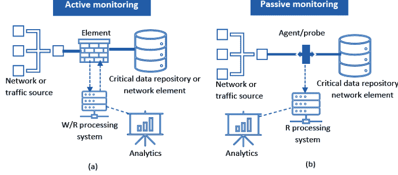

图 8.1 – 部署监控解决方案的架构

在 **主动监控** 场景中，监控设备直接部署在网络中以主动监控流量。监控对系统的运行有 *直接影响*。它具有 *读和写* 能力，这意味着监控设备可以改变网络行为（阻止、丢弃或隔离数据包）。由于设备直接安装在网络接口上，因此可以根据配置和功能 *减慢和过滤流量* 并 *消耗网络资源*。主动监控非常适合实时 *活动监控* 和 *策略执行*。它是一种 *主动* 方法。防火墙、IDS、IPS 和主动探针是用于主动监控的设备的示例。

在 **被动监控** 场景中，使用被动设备（如被动探针）。接口上的流量会被 *分流*，其中一小部分发送到监控系统。被动探测 *不允许写入或影响数据流*。它主要用于 *捕获和分析实时流量* 和 *提供统计信息*。它 *非常适合终端用户体验* 和性能指标，因为它可以在较长的时间段内分析数据。被动监控不会影响系统运行。

无论您选择哪种解决方案，强调业务需求都至关重要。将安全与运营进行基准比较，并确保没有一方被落下（组织必须力求实现最佳且安全的流程）。一些组织可以使用这两种方法，以获得主动和被动的网络或数据体验。

## 可靠监控系统的特征

在大多数情况下，您或您的组织可能会寻找网络和数据监控解决方案，以为基础设施实施额外的防御层。确保良好保护能力应关注的一些基准包括以下内容：

- **实时告警**：系统必须通知管理员和所有相关方有关可疑或不常见活动的通知。这可以通过电子邮件和短信进行。然后安全或管理团队可以采取行动。实时告警必须自动化且高效。
- **主动分析**：监控系统必须具有分析模块，允许组织在报告和仪表板中查看系统洞察。主动分析还必须提供对检测到问题的建议或对策。
- **与其他工具的集成**：监控系统必须整合和关联其数据与其他数据源，以拥有统一的数据保护结构，并为诸如 **安全信息和事件管理 (SIEM)** 系统、**威胁情报平台 (TIPs)**、事件管理系统等的路由机制提供支持。
- **广泛的使用范围**：对于预算有限的企业而言，好的工具必须具有广泛的用途。它必须涵盖数据、网络、数据库、安全、Web 应用程序和性能监控。覆盖的领域越多越好；否则，您将不得不投资于不止一个监控解决方案。
- **主动冗余**：监控工具必须通过自行维护系统的关键部分来确保高系统可用性。它确保在故障情况下关键功能不会被关闭。
- **嵌入式智能**：随着 **人工智能 (AI)** 和 **机器学习** 的兴起，可靠的监控工具包括行为分析、流量模式识别以及警报和事件的优先级排序等高级功能。

作为负责的安全分析师，您应了解工具使用的不同协议。

数据和网络监控在堆栈中提供了额外的安全层。结合主动分析，它们使组织能够对异常行为采取有效行动。好处不仅限于安全和威胁管理；它们扩展到多个领域，例如 **IT 系统管理**。在下一节中，我们将研究漏洞评估作为防御层。

## 漏洞评估和数据风险分析

组织必须经常评估其系统的漏洞。作为 CTI，您必须与漏洞评估团队合作，评估漏洞评估流程，并就硬件、软件、应用程序、服务和网络报告。漏洞管理团队也是战术和技术 TI 输出的主要消费者。漏洞评估必须 *自动化* 且易于集成到 *TIP* 或 *SIEM* 中。以下功能或任务应是您的漏洞评估工具或框架所期望的：

- **识别系统的安全缺陷**：在对手之前识别系统弱点。扫描整个系统域。识别数据库和文件系统的弱点（**结构化查询语言 (SQL)** 注入、弱凭据、用户权限过大、缺少补丁、加密不佳等），应用程序（代码注入攻击）、服务（配置）以及网络（Wi-Fi 加密攻击、开放端口、弱流程、弱用户身份验证等）。
- **系统配置基准测试**：漏洞评估必须用于将系统运行配置与推荐配置进行比较，并指出不合规区域——例如，漏洞评估必须突出显示弱加密并通知相关方其使用位置。
- **漏洞优先级排序**：为已识别的漏洞分配严重级别。严重级别通常根据漏洞带来的 *风险* 以及其 *利用* 的存在与否来设定。例如，与远程命令执行相关的漏洞必须归类为高或严重。漏洞随后根据严重级别进行优先级排序。
- **修复建议**：必须提供有关修复漏洞的建议，无论是嵌入在工具中还是由安全专家提供。您必须始终从高优先级漏洞开始，然后再处理其余部分。

基于上述漏洞评估流程的功能和任务，我们可以突出需要持续关注的四个系统领域，如下所示：（1）*主机漏洞评估*（评估关键网络元素，如服务器、交换机、路由器以及其上运行的所有服务和应用程序）。您必须跟踪员工在组织资源上运行的应用程序和程序。（2）*局域网/无线局域网 (WLAN) 漏洞评估*（评估有线和无线网络基础设施是否存在可能破坏它们的实践）。（3）*数据库漏洞评估*（评估常见弱点，最重要的是敏感数据攻击）。（4）*应用程序漏洞评估*（我们可以参考 **开放 Web 应用程序安全项目 (OWASP)** 排名前 10）。在下一节中，我们将介绍如何执行漏洞评估。

## 漏洞评估方法

根据业务或 CTI 目标，漏洞评估可以通过以下三种不同方式执行，如下所述：

- **黑盒评估：** 您可以要求您的安全团队或承包商团队通过从外部攻击系统（或您的防御）来评估系统，冒充真正的对手。不要提供任何信息来使流程变得容易。相反，挑战他们从 *外部视角* 识别所有潜在弱点。他们使用所有资源（开源情报）来攻击可能位于 **非军事区 (DMZ)** 中的资产。
- **白盒评估：** 您可以测试系统，通过向您的安全团队或承包商提供完整的系统信息。信息可以包括要评估的区域、凭据和资源。该方法的优势在于，遗漏某些组件的可能性几乎为零。因此，白盒评估非常适合彻底的系统评估。
- **灰盒评估：** 部署此方法时，您作为安全经理允许测试人员结合上述两种方法。您向测试人员提供最少的信息集，并要求他们自行推断其余部分。

组织需要使用这两种方法的组合，以获得系统防御的整体视角。以下小节解释了漏洞评估流程，该流程有时对安全专业人员来说有效执行起来具有挑战性。


## 漏洞评估流程

漏洞评估是通过对系统的一个或全部区域进行 *扫描* 实现的。因此，该流程必须与需求保持一致，并且必须自动化，以确保不会遗漏任何计划区域。该流程还取决于多个因素，例如所使用的框架或工具以及评估的目标。例如，如果你想执行漏洞评估以支持某项政策，其强度会与目标是针对潜在关键弱点采取行动时有所不同。

下图展示了漏洞评估流程：

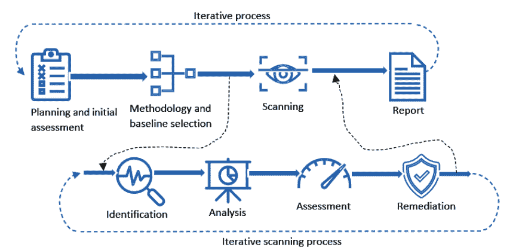

图 8.2 – 漏洞评估流程

如 *图 8.2* 所示，漏洞评估流程提供了一种高效、战略性的方式来评估系统是否存在潜在网络威胁。

> **重要提示**
> 
> 漏洞评估的规划、开发和执行必须由 **首席信息安全官 (CISO)** 或 **首席信息官 (CIO)** 监督，具体取决于组织的架构。IT 安全团队负责运行技术流程。

*图 8.2* 中显示的步骤接下来会进行解释，作为建立标准且高效的漏洞管理流程的指导方针。

### 规划与初步评估

写下评估的 *目标*。明确 *输出结果将用于何处*。你必须确定评估的 *范围*。*威胁建模* 的结果是漏洞评估的最佳输入，因为我们假设关键资产（和数据）以及潜在风险已被识别。如果未执行威胁建模（不推荐），你应识别所有关键资产（数据、应用程序、服务器等）并为每个资产定义风险。在此阶段，你确定诸如评估的 *持续时间*、*开始时间*、涉及的 *相关方*、*风险承受水平* 和 *业务影响* 等参数。

### 方法论与基线定义

组织选择评估的适当 *方法论*。根据目标，组织可以使用黑盒、白盒或灰盒方法论。该方法论促进了对系统的 *信息收集*。评估人员需要知道系统信息是否会被提供，或者他们是否应独立执行 *侦察*。如果信息将被提供，评估人员需要了解将提供哪些信息。此阶段的最后一步是选择合适的 *漏洞评估工具（或扫描器）*。评估流程的第一步和第二步必须得到充分记录。

### 执行漏洞扫描

评估人员必须强调 *合规要求*，以确保扫描流程有效。此阶段可以通过两种方式执行：**手动** 或 **自动**。推荐采用自动化流程；不过，组织可以同时执行两种方式并对结果进行基准比较。对于使用工具的自动化流程，必须确保在必要时使用 *正确的策略*。这些策略必须适用于内部和外部系统组件，如下所述：

- **内部漏洞扫描**：你对系统的关键资产进行内部扫描。在这种情况下，组织可以使用安装在网络端点的扫描器来执行评估。这种类型的扫描对于识别员工、人为错误或具有系统访问权限的恶意行为者可以利用的漏洞至关重要。
- **外部漏洞扫描**：你对关键公共资产进行扫描——即可从组织外部用作攻击面的资产。此类扫描使用公共网络（互联网）执行，有助于组织在全世界之前意识到弱点。

内部和外部漏洞扫描对组织至关重要；因此，它们必须被视为有效防御机制的一部分。漏洞扫描涉及的步骤如下：

- 1. **识别漏洞：** 在此阶段，扫描器运行以识别系统中的所有潜在弱点。结果是一份 *检测到的漏洞的综合列表*。此步骤依赖于多个组件，例如漏洞数据库和 TI 数据源（这就是为什么必须将漏洞评估工具与 TIPs 或 SIEMs 集成的原因）。
- 2. **分析检测到的漏洞：** 在此阶段，你需要识别每个已识别漏洞的 *根本原因* 以及其适用的资产或资源（*系统组件*）。典型的例子可能是组织 Web 服务器上未修补的应用程序软件。当原因和组件确定后，修复流程会更加确定。
- 3. **评估漏洞：** 使用风险分析来优先排序已识别的漏洞。后者根据严重性进行排名，严重性基于业务影响和受影响资产确定。数据风险评估将在后续章节中讨论。
- 4. **修复漏洞：** 目标是补救已识别的漏洞。此步骤可以通过直接解决问题（配置更新、修补）、引入新安全策略和程序或更新现有策略和程序，以及获取新工具来加强系统来完成。

> **重要提示**
> 漏洞评估和系统扫描操作不得孤立进行。它们需要 **安全运营中心 (SOC)**、高级支持、变更管理、补丁管理、配置管理等部门之间的协调。

系统扫描和漏洞评估流程必须是一个 *迭代* 过程。安全利益相关者必须定义定期进行漏洞评估和系统扫描的时间，以确保防御系统保持最新。现在让我们来看漏洞评估工具。

### 漏洞评估工具

漏洞评估工具允许组织自动执行整个系统扫描。它们识别、分析和评估系统弱点并提供建议步骤。因此，你可以根据预算和需求使用商业或开源漏洞扫描器。

### 可靠工具的特征

漏洞工具应根据其可执行的扫描进行选择，如下所示：(1) *扫描 Web 应用程序*（查找 Web 应用程序中的漏洞）。(2) *扫描协议*（查找协议、端口和服务中的漏洞）。(3) *扫描网络*（识别网络数据包、元素、端点和物联网设备中的漏洞——这包括 *主机* 和 *网络*）。(4) *扫描云服务和应用程序*。工具可以具有一种或多种扫描能力。

对组织而言投资漏洞评估工具可能具有挑战性，尤其是刚开始整合网络安全或 TI 的组织。目标是在工具库中拥有尽可能多的模块。然而，可靠的漏洞评估工具的主要考虑因素或功能包括以下内容：

- **更新的漏洞数据库**：新漏洞被频繁发现。工具必须拥有最新的行业漏洞。你需要了解工具的更新程序和策略。开源工具的信息可以在互联网或工具网页上找到。
- **更少的误报**：误报可能误导分析并削弱系统的防御。确保工具检测到的漏洞是真实的，并且误报率不过高（超过某一阈值）。
- **自动评估**：确保工具能够对漏洞进行排名以便于优先排序，并且允许用户基于排名进行筛选——例如，你必须能够仅选择和分析关键漏洞。
- **自定义策略创建**：确保工具可配置。安全团队可以为特定用例创建自定义策略。
- **支持同时扫描**：多重扫描可能不是首要需求，但具备该功能是有益的，因为它允许团队并行扫描系统的不同部分。
- **可靠的报告**：确保工具生成包含图表（即时和趋势）的报告，以减轻手动生成报告的负担。
- **提供建议**：确保工具提供补救或缓解已识别漏洞的建议。

对于开源工具，检查公开评论以及平台的维护方式至关重要。另一个需要检查的重要要素是供应商的声誉（针对商业工具）。在以下小节中，我们将介绍漏洞工具必须具备的主要组件。


## 漏洞评估工具的组件

本节利用 SysAdmin、Audit、Network 和 Security（SANS）学院关于审计漏洞工具的白皮书（https://bit.ly/3gaAdne）来突出漏洞评估工具的强制性组件。确保这些模块或组件包含在您想要投资的工具中。组件如下图所示：

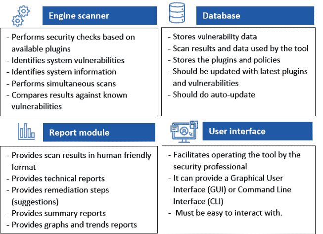

Figure 8.3 – 漏洞评估工具的组件

组件包括引擎扫描器、数据库、报告模块和用户界面（UI）。报告模块必须提供涵盖技术和战略范围的报告。这些报告被不同的组织部门使用，必须相应地定制。

## 漏洞评估工具示例

请注意，这里列出的工具并非基于偏好；相反，它们基于互联网搜索的流行度和个人经验。您可用于漏洞评估和审计的一些工具包括以下：(1) OpenVAS（社区版和商业版）；(2) Nexpose（社区版和商业版）；(3) Nessus（社区版和商业版）；(4) Acunetix（社区版和商业版）；(5) Nmap（开源）；(6) IBM QRadar（商业版）；(7) Qualys Vulnerability Management（Qualys VM）（社区版和商业版——可执行云扫描）；(8) Microsoft Baseline Security Analyzer（MBSA）；(9) Appknox；(10) Burp Suite（社区版和商业版）。

使用之前研究的特征和组件来评估您想要投资的每个工具。

## 漏洞和数据风险评估

漏洞扫描的输出用于评估每个弱点所附带的风险。虽然大多数漏洞评估工具都包含风险分析，但了解这一概念至关重要，尤其是对于执行手动漏洞扫描的组织或个人。风险分析或审查的目标是对漏洞进行排序，以便优先处理高风险漏洞。评估漏洞时应考虑多个因素：受影响的 *系统部分*、*受风险数据*、*利用可行性*、被利用时对 *业务的影响* 以及被利用时的 *潜在损害*。最受欢迎的漏洞评估方法之一是 **通用漏洞评分系统（CVSS）**。

CVSS 为每个漏洞分配一个数值分数以突出其严重性。分数可以转换为关键、高、中、低等级别。您的组织可以根据业务需求更改定性表示（但仍保留逻辑）。CVSS 是一个独立于厂商的开放标准。它是大多数 **通用漏洞披露（CVE）** 评级中最重要的因素。

CVSS 使用三个指标组来评估漏洞严重性：基础、时间性和环境指标。分析师根据漏洞特征分配分数。

### 基础指标和基础分数

基础指标代表漏洞的恒定内在特征。以下概述了用作基础指标的两个指标集：

- **Exploitability**：利用漏洞的难易程度。利用可行性函数由以下组成：（1）**The attack vector (AV)**，其值可以是 network (*N*=0.85)、adjacent (*A*=0.62)、local (*L*=0.55)、或 physical (*P*=0.2)，取决于可从何处发起利用。（2）**The attack complexity**，其值可以是 low (*L*=0.77) 或 high (*H*=0.44)。利用越不复杂，得分越高。（3）**The privileges required (PR)**，其值可以为 none (*N*=0.85)、low (*L*=0.62 或范围更改时为 0.68) 或 high (*H*=0.27 或范围更改时为 0.5)，取决于授权。（4）**The User Interaction**，其值可以为 none (*N*=0.85) 或 required (*R*=0.62) 如果利用需要用户交互。
- **Impact**：这决定了被利用的漏洞对 CIA 三元组的破坏力。它是以下功能的函数：（1）*Confidentiality (C)*，（2）*Integrity (I)*，和（3）*Availability (A)*。可分配的值可以是 high (*H*=0.56) 或 low (*L*=0.22)。

然后您可以使用以下公式计算基础分数 cvss_b。首先计算 **exploitability score (ES)**，然后计算 **impact sub-score (ISS)**，然后根据 **scope unchanged (SU)** 或 **scope changed (SC)** 计算 **impact score (IS)**，如下所示：

```
ES = 8.22 × AV × AC × PR × UI
ISS = 1 − {(1 − C) × (1 − I) × (1 − A)}
IS = { 6.42 × ISS if scope unchanged
(7.52 × (ISS − 0.029) − 3.25 × (ISS − 0.02))^{15}
cvss_b = { 0 if IS ≤ 0
{ roundup(min(IS + ES,10)) if scope unchanged
roundup(min(1.08 × (IS + ES),10)) if scope changed
```

Figure 8.4 – CVSS 基础分数计算

前述公式提供了 CVSS 基础分数，一个介于 0 到 10 之间的值，如图 8.8 所示。

### 时间性指标和时间性分数

时间性指标考察随时间变化的漏洞特征。没有补丁且易于利用的漏洞得分更高。使用的指标包括以下：

- **Exploit code maturity (E)**：反映了针对该漏洞使用利用的可能性。其值可以为 not defined (X=1)、high (H=1)、functional (F=0.97)、**proof-of-concept (POC)** (P=0.94)、或 unproven (U=0.91)，取决于利用代码对公众的可用性。
- **Remediation Level (RL)**：确定在有或没有官方补丁的情况下修复漏洞的可能性。其值可以为 not defined (X=1)、unavailable (U=1)、workaround (W=0.97)、temporary fix (T=0.96)、或 official fix (O=0.95)。
- **Report Confidence (RC)**：这突出了关于漏洞的技术信息是否存在。其值可以为 not defined (X=1)、confirmed (C=1)、reasonable (R=0.96)、或 unknown (U=0.92)，取决于技术信息，例如根本原因。

然后您可以使用以下公式计算时间性分数 ts：

ts = roundup(cvss_b × E × RL × RC)

Figure 8.5 – CVSS 时间性分数（ts）计算

由于 E、RL 和 RC 介于 0 和 1 之间，且 cvss_b ≤ 10，时间性分数将在 0 到 10 之间（0 ≤ ts ≤ 10）。

### 环境指标和分数

环境指标突出了资产对组织的重要性。它们使用 CIA 三元组来分配值，由以下组成：

- **Security requirements**：分析师将受影响的资产映射到 CIA 三元组：**Confidentiality Requirements (CR)**、**Integrity Requirements (IR)**、和 **Availability Requirements (AR)**。例如，与可用性相关的资产会被分配高分。值可以为 not defined (X=1)、high (H=1.5)、medium (M=1)、或 low (L=0.5)，取决于对 CIA 的影响。
- **Modified base metrics**：这些是根据用户环境对基础指标的修改。它们被分配与基础指标相同的值。

环境分数 es 定义如下：

es = { 0 if MIS ≤ 0 ; roundup(roundup(min(MIS + MES, 10)) × E × RL × RC) if m.scope unchanged ; roundup(roundup(min(1.08 × (MIS + MES),10)) × E × RL × RC) if m.scope changed }

Figure 8.6 – CVSS 环境分数（es）计算

这里，M 和 m 表示 modified，MES = ES（只需将指标更改为修改后的值），修改后的影响分数（MIS）由以下公式给出：

MIS = { 6.42 × ISS if m.scope unchanged ; 7.52 × (ISS − 0.029) − 3.25 × (ISS × 0.9731 − 0.02)^13 }

Figure 8.7 – CVSS 环境 MIS 计算

CVSS 分数主要取决于基础指标（这些指标在计算总体分数时是强制性的，而其余指标是可选的）。定性排名如下图所示：

| Rating | Score |
|---|---|
| None | 0.0 |
| Low | 0.1 – 3.9 |
| Medium | 4.0 – 6.9 |
| High | 7.0 – 8.9 |
| Critical | 9.0 – 10.0 |

Figure 8.8 – CVSS 分数定性评级量表

有关评分标准的更多详细信息，请参阅此处：https://www.first.org/cvss/v3.1/specification-document。分析师可以为每个漏洞分配分数并计算严重性或分数。这些算法嵌入在大多数漏洞评估工具中。如果未嵌入，安全团队需要将其集成到流程中。

漏洞评估和数据风险分析对于构建有效的防御系统至关重要。然而，该过程需要高效地规划和执行。运营和管理需要共同努力以优化漏洞评估和风险分析。该过程必须是迭代的，以确保基础设施得到可靠保护并且防御系统保持最新。您现在应该能够开展（规划、启动和实施）漏洞管理计划。下一节将介绍当数据在传输中或静态时被合法或非法请求时，您如何保护数据。

## 加密、标记化、屏蔽和隔离

部署安全基础设施时，必须将敏感数据保护视为首要任务。您需要使系统了解在敏感数据被访问或请求时（静态或传输中）如何反应。加密、标记化、屏蔽和隔离可保护数据本身，无论是静态还是传输中。在下一节中，我们将研究加密作为一种防御机制。


## Encryption as a defense mechanism

贵组织的数据可能一直在流动，面向客户的公司通过网络或互联网传输数据（传输中的数据）；或者，数据可能只是静止在某一个或多个位置（公司文件系统和员工硬盘——静态数据）。您需要确保数据从离开其所在位置到请求者所在位置期间，或在静态时都受到保护。您对敏感数据应用的安全级别决定了风险状况。攻击者不会停止尝试入侵传输中或静态的数据。请使用最新且合适的加密技术来保护敏感数据。

为保护传输中的数据，请使用*加密传输机制*。这种做法允许在**传输控制协议 (TCP)**/IP 栈的较高层（如应用层和传输层）进行数据保护。因此，数据在离开网络元素或端点之前就已受到保护。无论配置如何（客户端-服务器或服务器-服务器），贵组织必须用于传输中数据的技术包括**安全套接层 (SSL)**/**传输层安全 (TLS)**。TLS 是 SSL 的升级版，支持一些最强的加密方式（**Rivest-Shamir-Adleman (RSA)** 和 **高级加密标准 (AES)**）。所有涉及数据移动的应用程序和目录（**超文本传输协议 (HTTP)** Web 服务器、**文件传输协议 (FTP)**、Telnet、**简单邮件传输协议 (SMTP)**、目录、数据库）都应通过 SSL/TLS 进行（**HTTP 安全 (HTTPS)**、**FTP 安全 (FTPS)**、**安全 Shell (SSH)**——安全 Telnet 版本）。应关闭未加密端口。确保在加密-解密过程与数据传输速度之间取得平衡。加密/解密过程变慢会导致系统请求-响应过程迟缓。

> **重要说明**
> 传输中数据最常见的攻击是**中间人 (MITM)** 攻击。近年来，攻击者已开发出将 SSL/TLS 应用程序降级为非 SSL/TLS 应用程序的方法，尤其针对 HTTP、FTP 等服务器-客户端通信，使用诸如 **SSLStrip** 之类的工具。因此，请确保在所有相关应用程序上强制执行**严格传输安全 (STS)**。

为保护静态数据，请确保*在存储前加密敏感数据*或*加密存储组件（硬盘、文件系统等）*。您也可以同时使用两种方法；但是，请确保安全不会影响可用性。始终使用最先进的加密算法以优先考虑加密并保护数据。使用云服务时，您必须评估云服务提供商的数据安全措施。

## Tokenization as a defense mechanism

**令牌化**与加密一样，可用于保护传输中或静态的数据。不同之处在于它使用令牌（随机生成的值）而不是密钥。该过程的优势在于敏感数据无需离开贵组织，并且无法使用底层令牌进行逆向还原。相反，存储在令牌库（数据库）中的令牌用于建立与原始数据的引用或关系。被泄露的令牌不会向攻击者提供必要的信息。对于金融行业或涉及支付流程的组织而言，在加密之上使用令牌化以提供最大安全性是一种良好实践。例如，PCI DSS 始终建议组织用另一种数据保护形式补充加密流程。加密是可逆的，这意味着攻击者有机会访问原始数据。为了满足 PCI DSS 要求，一些组织会增加令牌化。

## Masking and quarantining

您必须设计系统以妥善管理未经授权的访问——将用户限制为只能查看或操作其有权访问的内容（*最小权限原则*）。并非组织中的每个人都有权完整查看敏感数据。掩码是指对数据的一部分进行混淆。用户的信用卡号码可能仅显示前三位和最后三位数字，并用字符如 341*************967 替换中间数字。财务部门的员工在请求信息时可能可以查看所有薪资，除了高管。窃取此类普通用户凭证的攻击者只能处理掩码数据。因此，当数据由内部或外部用户请求时，您需要强制执行数据保护策略。

安全系统必须考虑当系统收到可疑请求时该如何处理。最佳实践包括将这些请求隔离、停止用户访问、记录所有活动并提醒相关方采取行动。诸如 IPS、IDS 和防病毒应用程序等网络元素具有隔离网络中非法和可疑请求或活动的能力。隔离是防止因员工失误和恶意攻击者而产生的威胁的最佳方式。

加密、令牌化和掩码是至关重要的*数据混淆*技术，必须在组织中使用（或至少其中一种）来保护敏感数据（或资产）。您必须根据组织的业务和安全要求评估和选择每种技术。您必须实施强大的安全控制来保护数据（如有需要，使用防火墙、IDS、IPS 和代理服务器）。所有数据请求必须记录并分析。在下一节中，我们将看到一次数据泄露用例，并强调加密本可以如何防止该事件。

## Endpoint management

最佳的安全防御实践之一是确保只有符合最低安全要求的授权设备才能连接到网络，包括笔记本电脑、台式机、移动设备以及任何可以连接到网络的终端用户设备（电子电路板等）。未授权或与工作无关的端点应通过具有有限访问权限的访客网络。然而，系统中端点的数量可能使控制和管理变得不切实际，因此需要一个自动化且基于策略的端点管理系统。将端点管理作为额外安全防御层的主要目标包括以下内容：

- **权限控制**：通过权限策略，您应选择需要连接到网络的端点类型——例如，策略可以优先考虑具有特定特征（制造商、型号、操作系统等）的个人电脑。
- **用户访问控制 (UAC)**：端点管理可以与用户的凭证关联。此功能将允许您跟踪和监控每个用户用于访问关键资产的设备。
- **访问凭证强制执行**：端点管理可以通过强制使用**令牌**、**访问密钥对**（加密）和**多因素认证 (MFA)** 来执行密码策略。

端点管理包括安全和保护，使得设备数据访问的更改被记录并暴露以避免安全威胁，从而加强防御屏障。此外，端点管理应允许与其他安全平台（如 SIEM 和 TIP）集成。

## Reliable endpoint management requirements

无论您是想自行开发端点管理系统还是外包，都应有推动开发策略的元素。后者必须基于安全要求，同时保持业务的正常运行。开发端点策略或选择平台时应考虑的元素包括以下内容：

- **管理并保护移动端点**：静态端点可能比移动动态端点更容易管理。然而，在人们可以远程工作的时代，设备必须在组织安全边界之外进行跟踪和保护，因此策略必须适应这一点。


-   **支持所有端点类型**：端点管理必须涵盖所有可以连接到网络的设备类型（笔记本电脑、打印机、智能手机、智能设备、平板电脑、电子板、工业机器等等）。此外，还必须涵盖物理和虚拟端点。
-   **支持所有操作系统**：虽然 Windows 仍是最流行的操作系统，但有效的端点管理系统必须涵盖所有操作系统（Windows、Linux、macOS、Android、iOS）。它还必须针对定制和个性化的操作系统或软件进行调整。
-   **促进补丁管理**：确保可以使用系统强制执行软件补丁，并且涵盖所有主要补丁。
-   **保持用户灵活性**：虽然端点管理系统对网络设备强制执行策略和标准，但它不得损害用户在其设备上工作的能力。虽然主要目标仍然是以尽可能低的成本加强安全，但操作必须保持高效。
-   **识别并提醒不合规情况**：确保端点系统识别不符合贵组织政策和行业法规的设备。最极端的情况下，它必须自动解决合规问题或提醒安全或 IT 团队。
-   **与其他平台集成**：构建有效防御的思路是避免不同的安全组件各自为政。因此，端点管理系统必须具备与 SIEM、TIP、监控系统等其他 IT 系统无缝集成的能力（使用 **应用程序编程接口 (API)** 或自定义连接）。此外，SIEM 或 TIP 必须作为所有安全平台的集中式系统运行。

投资端点管理系统可能成本高昂；因此，成本因素必须始终考虑在内，尤其是对于预算有限的组织而言。组织可以根据功能和需求获取一个以上的端点管理系统。当使用多个平台时，确保集成和互操作性得以保持以便于维护和支持。以下章节将介绍移动端点管理以及它与端点管理系统有何不同和挑战。

## 移动端点管理

移动设备的使用量呈指数级增长，已超过笔记本电脑、打印机等静态设备的使用量。移动设备架构、日常使用方式和能力使其对端点系统构成更大挑战。想象一下，一名员工使用手机访问企业网络，同时下载游戏和音乐、访问种子网站，并在浏览互联网时点击随机链接。他们的设备就成为攻击者与企业网络之间的桥梁。让我们来看一下可能的移动设备安全威胁。

## 移动安全威胁与对策

安全威胁在移动设备上可能与传统端点不同，这是由于架构调整所致。例如，与笔记本电脑相比，移动设备与内核的交互并非直接的。相反，用户需要通过各种应用程序来与设备操作系统交互。因此，我们可以将移动安全威胁分为以下三类：

-   **基于内核的威胁**：这些威胁发生在操作系统功能（权限、root 应用程序等）发生有意或无意更改时。例如，对移动端点进行 root 或越狱以访问操作系统核心会使设备容易受到网络攻击。*因此，您必须强制执行限制已 root（或越狱）移动设备访问网络的策略。*
-   **基于应用程序的威胁**：网络钓鱼同样适用于移动设备，移动应用程序对资源的访问权限各不相同。如果您向武器化应用程序授予敏感数据访问权限，不仅您的设备会成为受害者，您连接的任何网络都将面临风险。因此，您必须*强制执行用户如何管理和授予应用程序权限的策略*（这可以通过教育实现）。系统必须识别*存在安全风险的移动设备*（获取其 **标识符 (IDs)**、**国际移动设备身份码 (IMEI)**、型号、制造商等）。系统应能够*在风险较高时阻止此类设备。*
-   **社会工程和网络威胁：** 社会工程学将始终是最有效的攻击手段之一，即使针对移动设备也是如此。下载恶意文件并在克隆网站上输入凭据可能会让攻击者获得访问权限。另一种访问设备的方式是通过网络攻击。攻击者可以通过访问企业无线网络（例如使用 **中间人攻击 (MITM attack)**）来收集端点信息。因此，您必须*对员工进行安全最佳实践的教育并强制执行 LAN 和 WLAN 网络保护（无线保护访问 2-企业版 (WPA2-Enterprise) 或最新的 WPA3 加密）*。当使用开放接入点时，确保员工无法通过其访问其他网络。

移动设备[content]
-   **支持所有端点类型**：端点管理必须涵盖所有可以连接到网络的设备类型（笔记本电脑、打印机、智能手机、智能设备、平板电脑、电子板、工业机器等等）。此外，还必须涵盖物理和虚拟端点。
-   **支持所有操作系统**：虽然 Windows 仍是最流行的操作系统，但有效的端点管理系统必须涵盖所有操作系统（Windows、Linux、macOS、Android、iOS）。它还必须针对定制和个性化的操作系统或软件进行调整。
-   **促进补丁管理**：确保可以使用系统强制执行软件补丁，并且涵盖所有主要补丁。
-   **保持用户灵活性**：虽然端点管理系统对网络设备强制执行策略和标准，但它不得损害用户在其设备上工作的能力。虽然主要目标仍然是以尽可能低的成本加强安全，但操作必须保持高效。
-   **识别并提醒不合规情况**：确保端点系统识别不符合贵组织政策和行业法规的设备。最极端的情况下，它必须自动解决合规问题或提醒安全或 IT 团队。
-   **与其他平台集成**：构建有效防御的思路是避免不同的安全组件各自为政。因此，端点管理系统必须具备与 SIEM、TIP、监控系统等其他 IT 系统无缝集成的能力（使用 **应用程序编程接口 (API)** 或自定义连接）。此外，SIEM 或 TIP 必须作为所有安全平台的集中式系统运行。

投资端点管理系统可能成本高昂；因此，成本因素必须始终考虑在内，尤其是对于预算有限的组织而言。组织可以根据功能和需求获取一个以上的端点管理系统。当使用多个平台时，确保集成和互操作性得以保持以便于维护和支持。以下章节将介绍移动端点管理以及它与端点管理系统有何不同和挑战。

## 移动端点管理

移动设备的使用量呈指数级增长，已超过笔记本电脑、打印机等静态设备的使用量。移动设备架构、日常使用方式和能力使其对端点系统构成更大挑战。想象一下，一名员工使用手机访问企业网络，同时下载游戏和音乐、访问种子网站，并在浏览互联网时点击随机链接。他们的设备就成为攻击者与企业网络之间的桥梁。让我们来看一下可能的移动设备安全威胁。

## 移动安全威胁与对策

安全威胁在移动设备上可能与传统端点不同，这是由于架构调整所致。例如，与笔记本电脑相比，移动设备与内核的交互并非直接的。相反，用户需要通过各种应用程序来与设备操作系统交互。因此，我们可以将移动安全威胁分为以下三类：

-   **基于内核的威胁**：这些威胁发生在操作系统功能（权限、root 应用程序等）发生有意或无意更改时。例如，对移动端点进行 root 或越狱以访问操作系统核心会使设备容易受到网络攻击。*因此，您必须强制执行限制已 root（或越狱）移动设备访问网络的策略。*
-   **基于应用程序的威胁**：网络钓鱼同样适用于移动设备，移动应用程序对资源的访问权限各不相同。如果您向武器化应用程序授予敏感数据访问权限，不仅您的设备会成为受害者，您连接的任何网络都将面临风险。因此，您必须*强制执行用户如何管理和授予应用程序权限的策略*（这可以通过教育实现）。系统必须识别*存在安全风险的移动设备*（获取其 **标识符 (IDs)**、**国际移动设备身份码 (IMEI)**、型号、制造商等）。系统应能够*在风险较高时阻止此类设备。*
-   **社会工程和网络威胁：** 社会工程学将始终是最有效的攻击手段之一，即使针对移动设备也是如此。下载恶意文件并在克隆网站上输入凭据可能会让攻击者获得访问权限。另一种访问设备的方式是通过网络攻击。攻击者可以通过访问企业无线网络（例如使用 **中间人攻击 (MITM attack)**）来收集端点信息。因此，您必须*对员工进行安全最佳实践的教育并强制执行 LAN 和 WLAN 网络保护（无线保护访问 2-企业版 (WPA2-Enterprise) 或最新的 WPA3 加密）*。当使用开放接入点时，确保员工无法通过其访问其他网络。

移动设备[content]
-   **支持所有端点类型**：端点管理必须涵盖所有可以连接到网络的设备类型（笔记本电脑、打印机、智能手机、智能设备、平板电脑、电子板、工业机器等等）。此外，还必须涵盖物理和虚拟端点。
-   **支持所有操作系统**：虽然 Windows 仍是最流行的操作系统，但有效的端点管理系统必须涵盖所有操作系统（Windows、Linux、macOS、Android、iOS）。它还必须针对定制和个性化的操作系统或软件进行调整。
-   **促进补丁管理**：确保可以使用系统强制执行软件补丁，并且涵盖所有主要补丁。
-   **保持用户灵活性**：虽然端点管理系统对网络设备强制执行策略和标准，但它不得损害用户在其设备上工作的能力。虽然主要目标仍然是以尽可能低的成本加强安全，但操作必须保持高效。
-   **识别并提醒不合规情况**：确保端点系统识别不符合贵组织政策和行业法规的设备。最极端的情况下，它必须自动解决合规问题或提醒安全或 IT 团队。
-   **与其他平台集成**：构建有效防御的思路是避免不同的安全组件各自为政。因此，端点管理系统必须具备与 SIEM、TIP、监控系统等其他 IT 系统无缝集成的能力（使用 **应用程序编程接口 (API)** 或自定义连接）。此外，SIEM 或 TIP 必须作为所有安全平台的集中式系统运行。

投资端点管理系统可能成本高昂；因此，成本因素必须始终考虑在内，尤其是对于预算有限的组织而言。组织可以根据功能和需求获取一个以上的端点管理系统。当使用多个平台时，确保集成和互操作性得以保持以便于维护和支持。以下章节将介绍移动端点管理以及它与端点管理系统有何不同和挑战。

## 移动端点管理

移动设备的使用量呈指数级增长，已超过笔记本电脑、打印机等静态设备的使用量。移动设备架构、日常使用方式和能力使其对端点系统构成更大挑战。想象一下，一名员工使用手机访问企业网络，同时下载游戏和音乐、访问种子网站，并在浏览互联网时点击随机链接。他们的设备就成为攻击者与企业网络之间的桥梁。让我们来看一下可能的移动设备安全威胁。

## 移动安全威胁与对策

安全威胁在移动设备上可能与传统端点不同，这是由于架构调整所致。例如，与笔记本电脑相比，移动设备与内核的交互并非直接的。相反，用户需要通过各种应用程序来与设备操作系统交互。因此，我们可以将移动安全威胁分为以下三类：

-   **基于内核的威胁**：这些威胁发生在操作系统功能（权限、root 应用程序等）发生有意或无意更改时。例如，对移动端点进行 root 或越狱以访问操作系统核心会使设备容易受到网络攻击。*因此，您必须强制执行限制已 root（或越狱）移动设备访问网络的策略。*
-   **基于应用程序的威胁**：网络钓鱼同样适用于移动设备，移动应用程序对资源的访问权限各不相同。如果您向武器化应用程序授予敏感数据访问权限，不仅您的设备会成为受害者，您连接的任何网络都将面临风险。因此，您必须*强制执行用户如何管理和授予应用程序权限的策略*（这可以通过教育实现）。系统必须识别*存在安全风险的移动设备*（获取其 **标识符 (IDs)**、**国际移动设备身份码 (IMEI)**、型号、制造商等）。系统应能够*在风险较高时阻止此类设备。*
-   **社会工程和网络威胁：** 社会工程学将始终是最有效的攻击手段之一，即使针对移动设备也是如此。下载恶意文件并在克隆网站上输入凭据可能会让攻击者获得访问权限。另一种访问设备的方式是通过网络攻击。攻击者可以通过访问企业无线网络（例如使用 **中间人攻击 (MITM attack)**）来收集端点信息。因此，您必须*对员工进行安全最佳实践的教育并强制执行 LAN 和 WLAN 网络保护（无线保护访问 2-企业版 (WPA2-Enterprise) 或最新的 WPA3 加密）*。当使用开放接入点时，确保员工无法通过其访问其他网络。

移动设备[content]
-   **支持所有端点类型**：端点管理必须涵盖所有可以连接到网络的设备类型（笔记本电脑、打印机、智能手机、智能设备、平板电脑、电子板、工业机器等等）。此外，还必须涵盖物理和虚拟端点。
-   **支持所有操作系统**：虽然 Windows 仍是最流行的操作系统，但有效的端点管理系统必须涵盖所有操作系统（Windows、Linux、macOS、Android、iOS）。它还必须针对定制和个性化的操作系统或软件进行调整。
-   **促进补丁管理**：确保可以使用系统强制执行软件补丁，并且涵盖所有主要补丁。
-   **保持用户灵活性**：虽然端点管理系统对网络设备强制执行策略和标准，但它不得损害用户在其设备上工作的能力。虽然主要目标仍然是以尽可能低的成本加强安全，但操作必须保持高效。
-   **识别并提醒不合规情况**：确保端点系统识别不符合贵组织政策和行业法规的设备。最极端的情况下，它必须自动解决合规问题或提醒安全或 IT 团队。
-   **与其他平台集成**：构建有效防御的思路是避免不同的安全组件各自为政。因此，端点管理系统必须具备与 SIEM、TIP、监控系统等其他 IT 系统无缝集成的能力（使用 **应用程序编程接口 (API)** 或自定义连接）。此外，SIEM 或 TIP 必须作为所有安全平台的集中式系统运行。

投资端点管理系统可能成本高昂；因此，成本因素必须始终考虑在内，尤其是对于预算有限的组织而言。组织可以根据功能和需求获取一个以上的端点管理系统。当使用多个平台时，确保集成和互操作性得以保持以便于维护和支持。以下章节将介绍移动端点管理以及它与端点管理系统有何不同和挑战。

## 移动端点管理

移动设备的使用量呈指数级增长，已超过笔记本电脑、打印机等静态设备的使用量。移动设备架构、日常使用方式和能力使其对端点系统构成更大挑战。想象一下，一名员工使用手机访问企业网络，同时下载游戏和音乐、访问种子网站，并在浏览互联网时点击随机链接。他们的设备就成为攻击者与企业网络之间的桥梁。让我们来看一下可能的移动设备安全威胁。

## 移动安全威胁与对策

安全威胁在移动设备上可能与传统端点不同，这是由于架构调整所致。例如，与笔记本电脑相比，移动设备与内核的交互并非直接的。相反，用户需要通过各种应用程序来与设备操作系统交互。因此，我们可以将移动安全威胁分为以下三类：

-   **基于内核的威胁**：这些威胁发生在操作系统功能（权限、root 应用程序等）发生有意或无意更改时。例如，对移动端点进行 root 或越狱以访问操作系统核心会使设备容易受到网络攻击。*因此，您必须强制执行限制已 root（或越狱）移动设备访问网络的策略。*
-   **基于应用程序的威胁**：网络钓鱼同样适用于移动设备，移动应用程序对资源的访问权限各不相同。如果您向武器化应用程序授予敏感数据访问权限，不仅您的设备会成为受害者，您连接的任何网络都将面临风险。因此，您必须*强制执行用户如何管理和授予应用程序权限的策略*（这可以通过教育实现）。系统必须识别*存在安全风险的移动设备*（获取其 **标识符 (IDs)**、**国际移动设备身份码 (IMEI)**、型号、制造商等）。系统应能够*在风险较高时阻止此类设备。*
-   **社会工程和网络威胁：** 社会工程学将始终是最有效的攻击手段之一，即使针对移动设备也是如此。下载恶意文件并在克隆网站上输入凭据可能会让攻击者获得访问权限。另一种访问设备的方式是通过网络攻击。攻击者可以通过访问企业无线网络（例如使用 **中间人攻击 (MITM attack)**）来收集端点信息。因此，您必须*对员工进行安全最佳实践的教育并强制执行 LAN 和 WLAN 网络保护（无线保护访问 2-企业版 (WPA2-Enterprise) 或最新的 WPA3 加密）*。当使用开放接入点时，确保员工无法通过其访问其他网络。

移动设备[content]
-   **支持所有端点类型**：端点管理必须涵盖所有可以连接到网络的设备类型（笔记本电脑、打印机、智能手机、智能设备、平板电脑、电子板、工业机器等等）。此外，还必须涵盖物理和虚拟端点。
-   **支持所有操作系统**：虽然 Windows 仍是最流行的操作系统，但有效的端点管理系统必须涵盖所有操作系统（Windows、Linux、macOS、Android、iOS）。它还必须针对定制和个性化的操作系统或软件进行调整。
-   **促进补丁管理**：确保可以使用系统强制执行软件补丁，并且涵盖所有主要补丁。
-   **保持用户灵活性**：虽然端点管理系统对网络设备强制执行策略和标准，但它不得损害用户在其设备上工作的能力。虽然主要目标仍然是以尽可能低的成本加强安全，但操作必须保持高效。
-   **识别并提醒不合规情况**：确保端点系统识别不符合贵组织政策和行业法规的设备。最极端的情况下，它必须自动解决合规问题或提醒安全或 IT 团队。
-   **与其他平台集成**：构建有效防御的思路是避免不同的安全组件各自为政。因此，端点管理系统必须具备与 SIEM、TIP、监控系统等其他 IT 系统无缝集成的能力（使用 **应用程序编程接口 (API)** 或自定义连接）。此外，SIEM 或 TIP 必须作为所有安全平台的集中式系统运行。

投资端点管理系统可能成本高昂；因此，成本因素必须始终考虑在内，尤其是对于预算有限的组织而言。组织可以根据功能和需求获取一个以上的端点管理系统。当使用多个平台时，确保集成和互操作性得以保持以便于维护和支持。以下章节将介绍移动端点管理以及它与端点管理系统有何不同和挑战。

## 移动端点管理

移动设备的使用量呈指数级增长，已超过笔记本电脑、打印机等静态设备的使用量。移动设备架构、日常使用方式和能力使其对端点系统构成更大挑战。想象一下，一名员工使用手机访问企业网络，同时下载游戏和音乐、访问种子网站，并在浏览互联网时点击随机链接。他们的设备就成为攻击者与企业网络之间的桥梁。让我们来看一下可能的移动设备安全威胁。

## 移动安全威胁与对策

安全威胁在移动设备上可能与传统端点不同，这是由于架构调整所致。例如，与笔记本电脑相比，移动设备与内核的交互并非直接的。相反，用户需要通过各种应用程序来与设备操作系统交互。因此，我们可以将移动安全威胁分为以下三类：

-   **基于内核的威胁**：这些威胁发生在操作系统功能（权限、root 应用程序等）发生有意或无意更改时。例如，对移动端点进行 root 或越狱以访问操作系统核心会使设备容易受到网络攻击。*因此，您必须强制执行限制已 root（或越狱）移动设备访问网络的策略。*
-   **基于应用程序的威胁**：网络钓鱼同样适用于移动设备，移动应用程序对资源的访问权限各不相同。如果您向武器化应用程序授予敏感数据访问权限，不仅您的设备会成为受害者，您连接的任何网络都将面临风险。因此，您必须*强制执行用户如何管理和授予应用程序权限的策略*（这可以通过教育实现）。系统必须识别*存在安全风险的移动设备*（获取其 **标识符 (IDs)**、**国际移动设备身份码 (IMEI)**、型号、制造商等）。系统应能够*在风险较高时阻止此类设备。*
-   **社会工程和网络威胁：** 社会工程学将始终是最有效的攻击手段之一，即使针对移动设备也是如此。下载恶意文件并在克隆网站上输入凭据可能会让攻击者获得访问权限。另一种访问设备的方式是通过网络攻击。攻击者可以通过访问企业无线网络（例如使用 **中间人攻击 (MITM attack)**）来收集端点信息。因此，您必须*对员工进行安全最佳实践的教育并强制执行 LAN 和 WLAN 网络保护（无线保护访问 2-企业版 (WPA2-Enterprise) 或最新的 WPA3 加密）*。当使用开放接入点时，确保员工无法通过其访问其他网络。

移动设备[content]
-   **支持所有端点类型**：端点管理必须涵盖所有可以连接到网络的设备类型（笔记本电脑、打印机、智能手机、智能设备、平板电脑、电子板、工业机器等等）。此外，还必须涵盖物理和虚拟端点。
-   **支持所有操作系统**：虽然 Windows 仍是最流行的操作系统，但有效的端点管理系统必须涵盖所有操作系统（Windows、Linux、macOS、Android、iOS）。它还必须针对定制和个性化的操作系统或软件进行调整。
-   **促进补丁管理**：确保可以使用系统强制执行软件补丁，并且涵盖所有主要补丁。
-   **保持用户灵活性**：虽然端点管理系统对网络设备强制执行策略和标准，但它不得损害用户在其设备上工作的能力。虽然主要目标仍然是以尽可能低的成本加强安全，但操作必须保持高效。
-   **识别并提醒不合规情况**：确保端点系统识别不符合贵组织政策和行业法规的设备。最极端的情况下，它必须自动解决合规问题或提醒安全或 IT 团队。
-   **与其他平台集成**：构建有效防御的思路是避免不同的安全组件各自为政。因此，端点管理系统必须具备与 SIEM、TIP、监控系统等其他 IT 系统无缝集成的能力（使用 **应用程序编程接口 (API)** 或自定义连接）。此外，SIEM 或 TIP 必须作为所有安全平台的集中式系统运行。

投资端点管理系统可能成本高昂；因此，成本因素必须始终考虑在内，尤其是对于预算有限的组织而言。组织可以根据功能和需求获取一个以上的端点管理系统。当使用多个平台时，确保集成和互操作性得以保持以便于维护和支持。以下章节将介绍移动端点管理以及它与端点管理系统有何不同和挑战。

## 移动端点管理

移动设备的使用量呈指数级增长，已超过笔记本电脑、打印机等静态设备的使用量。移动设备架构、日常使用方式和能力使其对端点系统构成更大挑战。想象一下，一名员工使用手机访问企业网络，同时下载游戏和音乐、访问种子网站，并在浏览互联网时点击随机链接。他们的设备就成为攻击者与企业网络之间的桥梁。让我们来看一下可能的移动设备安全威胁。

## 移动安全威胁与对策

安全威胁在移动设备上可能与传统端点不同，这是由于架构调整所致。例如，与笔记本电脑相比，移动设备与内核的交互并非直接的。相反，用户需要通过各种应用程序来与设备操作系统交互。因此，我们可以将移动安全威胁分为以下三类：

-   **基于内核的威胁**：这些威胁发生在操作系统功能（权限、root 应用程序等）发生有意或无意更改时。例如，对移动端点进行 root 或越狱以访问操作系统核心会使设备容易受到网络攻击。*因此，您必须强制执行限制已 root（或越狱）移动设备访问网络的策略。*
-   **基于应用程序的威胁**：网络钓鱼同样适用于移动设备，移动应用程序对资源的访问权限各不相同。如果您向武器化应用程序授予敏感数据访问权限，不仅您的设备会成为受害者，您连接的任何网络都将面临风险。因此，您必须*强制执行用户如何管理和授予应用程序权限的策略*（这可以通过教育实现）。系统必须识别*存在安全风险的移动设备*（获取其 **标识符 (IDs)**、**国际移动设备身份码 (IMEI)**、型号、制造商等）。系统应能够*在风险较高时阻止此类设备。*
-   **社会工程和网络威胁：** 社会工程学将始终是最有效的攻击手段之一，即使针对移动设备也是如此。下载恶意文件并在克隆网站上输入凭据可能会让攻击者获得访问权限。另一种访问设备的方式是通过网络攻击。攻击者可以通过访问企业无线网络（例如使用 **中间人攻击 (MITM attack)**）来收集端点信息。因此，您必须*对员工进行安全最佳实践的教育并强制执行 LAN 和 WLAN 网络保护（无线保护访问 2-企业版 (WPA2-Enterprise) 或最新的 WPA3 加密）*。当使用开放接入点时，确保员工无法通过其访问其他网络。

移动设备[content]
-   **支持所有端点类型**：端点管理必须涵盖所有可以连接到网络的设备类型（笔记本电脑、打印机、智能手机、智能设备、平板电脑、电子板、工业机器等等）。此外，还必须涵盖物理和虚拟端点。
-   **支持所有操作系统**：虽然 Windows 仍是最流行的操作系统，但有效的端点管理系统必须涵盖所有操作系统（Windows、Linux、macOS、Android、iOS）。它还必须针对定制和个性化的操作系统或软件进行调整。
-   **促进补丁管理**：确保可以使用系统强制执行软件补丁，并且涵盖所有主要补丁。
-   **保持用户灵活性**：虽然端点管理系统对网络设备强制执行策略和标准，但它不得损害用户在其设备上工作的能力。虽然主要目标仍然是以尽可能低的成本加强安全，但操作必须保持高效。
-   **识别并提醒不合规情况**：确保端点系统识别不符合贵组织政策和行业法规的设备。最极端的情况下，它必须自动解决合规问题或提醒安全或 IT 团队。
-   **与其他平台集成**：构建有效防御的思路是避免不同的安全组件各自为政。因此，端点管理系统必须具备与 SIEM、TIP、监控系统等其他 IT 系统无缝集成的能力（使用 **应用程序编程接口 (API)** 或自定义连接）。此外，SIEM 或 TIP 必须作为所有安全平台的集中式系统运行。

投资端点管理系统可能成本高昂；因此，成本因素必须始终考虑在内，尤其是对于预算有限的组织而言。组织可以根据功能和需求获取一个以上的端点管理系统。当使用多个平台时，确保集成和互操作性得以保持以便于维护和支持。以下章节将介绍移动端点管理以及它与端点管理系统有何不同和挑战。

## 移动端点管理

移动设备的使用量呈指数级增长，已超过笔记本电脑、打印机等静态设备的使用量。移动设备架构、日常使用方式和能力使其对端点系统构成更大挑战。想象一下，一名员工使用手机访问企业网络，同时下载游戏和音乐、访问种子网站，并在浏览互联网时点击随机链接。他们的设备就成为攻击者与企业网络之间的桥梁。让我们来看一下可能的移动设备安全威胁。

## 移动安全威胁与对策

安全威胁在移动设备上可能与传统端点不同，这是由于架构调整所致。例如，与笔记本电脑相比，移动设备与内核的交互并非直接的。相反，用户需要通过各种应用程序来与设备操作系统交互。因此，我们可以将移动安全威胁分为以下三类：

-   **基于内核的威胁**：这些威胁发生在操作系统功能（权限、root 应用程序等）发生有意或无意更改时。例如，对移动端点进行 root 或越狱以访问操作系统核心会使设备容易受到网络攻击。*因此，您必须强制执行限制已 root（或越狱）移动设备访问网络的策略。*
-   **基于应用程序的威胁**：网络钓鱼同样适用于移动设备，移动应用程序对资源的访问权限各不相同。如果您向武器化应用程序授予敏感数据访问权限，不仅您的设备会成为受害者，您连接的任何网络都将面临风险。因此，您必须*强制执行用户如何管理和授予应用程序权限的策略*（这可以通过教育实现）。系统必须识别*存在安全风险的移动设备*（获取其 **标识符 (IDs)**、**国际移动设备身份码 (IMEI)**、型号、制造商等）。系统应能够*在风险较高时阻止此类设备。*
-   **社会工程和网络威胁：** 社会工程学将始终是最有效的攻击手段之一，即使针对移动设备也是如此。下载恶意文件并在克隆网站上输入凭据可能会让攻击者获得访问权限。另一种访问设备的方式是通过网络攻击。攻击者可以通过访问企业无线网络（例如使用 **中间人攻击 (MITM attack)**）来收集端点信息。因此，您必须*对员工进行安全最佳实践的教育并强制执行 LAN 和 WLAN 网络保护（无线保护访问 2-企业版 (WPA2-Enterprise) 或最新的 WPA3 加密）*。当使用开放接入点时，确保员工无法通过其访问其他网络。

移动设备[content]
-   **支持所有端点类型**：端点管理必须涵盖所有可以连接到网络的设备类型（笔记本电脑、打印机、智能手机、智能设备、平板电脑、电子板、工业机器等等）。此外，还必须涵盖物理和虚拟端点。
-   **支持所有操作系统**：虽然 Windows 仍是最流行的操作系统，但有效的端点管理系统必须涵盖所有操作系统（Windows、Linux、macOS、Android、iOS）。它还必须针对定制和个性化的操作系统或软件进行调整。
-   **促进补丁管理**：确保可以使用系统强制执行软件补丁，并且涵盖所有主要补丁。
-   **保持用户灵活性**：虽然端点管理系统对网络设备强制执行策略和标准，但它不得损害用户在其设备上工作的能力。虽然主要目标仍然是以尽可能低的成本加强安全，但操作必须保持高效。
-   **识别并提醒不合规情况**：确保端点系统识别不符合贵组织政策和行业法规的设备。最极端的情况下，它必须自动解决合规问题或提醒安全或 IT 团队。
-   **与其他平台集成**：构建有效防御的思路是避免不同的安全组件各自为政。因此，端点管理系统必须具备与 SIEM、TIP、监控系统等其他 IT 系统无缝集成的能力（使用 **应用程序编程接口 (API)** 或自定义连接）。此外，SIEM 或 TIP 必须作为所有安全平台的集中式系统运行。

投资端点管理系统可能成本高昂；因此，成本因素必须始终考虑在内，尤其是对于预算有限的组织而言。组织可以根据功能和需求获取一个以上的端点管理系统。当使用多个平台时，确保集成和互操作性得以保持以便于维护和支持。以下章节将介绍移动端点管理以及它与端点管理系统有何不同和挑战。

## 移动端点管理

移动设备的使用量呈指数级增长，已超过笔记本电脑、打印机等静态设备的使用量。移动设备架构、日常使用方式和能力使其对端点系统构成更大挑战。想象一下，一名员工使用手机访问企业网络，同时下载游戏和音乐、访问种子网站，并在浏览互联网时点击随机链接。他们的设备就成为攻击者与企业网络之间的桥梁。让我们来看一下可能的移动设备安全威胁。

## 移动安全威胁与对策

安全威胁在移动设备上可能与传统端点不同，这是由于架构调整所致。例如，与笔记本电脑相比，移动设备与内核的交互并非直接的。相反，用户需要通过各种应用程序来与设备操作系统交互。因此，我们可以将移动安全威胁分为以下三类：

-   **基于内核的威胁**：这些威胁发生在操作系统功能（权限、root 应用程序等）发生有意或无意更改时。例如，对移动端点进行 root 或越狱以访问操作系统核心会使设备容易受到网络攻击。*因此，您必须强制执行限制已 root（或越狱）移动设备访问网络的策略。*
-   **基于应用程序的威胁**：网络钓鱼同样适用于移动设备，移动应用程序对资源的访问权限各不相同。如果您向武器化应用程序授予敏感数据访问权限，不仅您的设备会成为受害者，您连接的任何网络都将面临风险。因此，您必须*强制执行用户如何管理和授予应用程序权限的策略*（这可以通过教育实现）。系统必须识别*存在安全风险的移动设备*（获取其 **标识符 (IDs)**、**国际移动设备身份码 (IMEI)**、型号、制造商等）。系统应能够*在风险较高时阻止此类设备。*
-   **社会工程和网络威胁：** 社会工程学将始终是最有效的攻击手段之一，即使针对移动设备也是如此。下载恶意文件并在克隆网站上输入凭据可能会让攻击者获得访问权限。另一种访问设备的方式是通过网络攻击。攻击者可以通过访问企业无线网络（例如使用 **中间人攻击 (MITM attack)**）来收集端点信息。因此，您必须*对员工进行安全最佳实践的教育并强制执行 LAN 和 WLAN 网络保护（无线保护访问 2-企业版 (WPA2-Enterprise) 或最新的 WPA3 加密）*。当使用开放接入点时，确保员工无法通过其访问其他网络。

移动设备[content]
-   **支持所有端点类型**：端点管理必须涵盖所有可以连接到网络的设备类型（笔记本电脑、打印机、智能手机、智能设备、平板电脑、电子板、工业机器等等）。此外，还必须涵盖物理和虚拟端点。
-   **支持所有操作系统**：虽然 Windows 仍是最流行的操作系统，但有效的端点管理系统必须涵盖所有操作系统（Windows、Linux、macOS、Android、iOS）。它还必须针对定制和个性化的操作系统或软件进行调整。
-   **促进补丁管理**：确保可以使用系统强制执行软件补丁，并且涵盖所有主要补丁。
-   **保持用户灵活性**：虽然端点管理系统对网络设备强制执行策略和标准，但它不得损害用户在其设备上工作的能力。虽然主要目标仍然是以尽可能低的成本加强安全，但操作必须保持高效。
-   **识别并提醒不合规情况**：确保端点系统识别不符合贵组织政策和行业法规的设备。最极端的情况下，它必须自动解决合规问题或提醒安全或 IT 团队。
-   **与其他平台集成**：构建有效防御的思路是避免不同的安全组件各自为政。因此，端点管理系统必须具备与 SIEM、TIP、监控系统等其他 IT 系统无缝集成的能力（使用 **应用程序编程接口 (API)** 或自定义连接）。此外，SIEM 或 TIP 必须作为所有安全平台的集中式系统运行。

投资端点管理系统可能成本高昂；因此，成本因素必须始终考虑在内，尤其是对于预算有限的组织而言。组织可以根据功能和需求获取一个以上的端点管理系统。当使用多个平台时，确保集成和互操作性得以保持以便于维护和支持。以下章节将介绍移动端点管理以及它与端点管理系统有何不同和挑战。

## 移动端点管理

移动设备的使用量呈指数级增长，已超过笔记本电脑、打印机等静态设备的使用量。移动设备架构、日常使用方式和能力使其对端点系统构成更大挑战。想象一下，一名员工使用手机访问企业网络，同时下载游戏和音乐、访问种子网站，并在浏览互联网时点击随机链接。他们的设备就成为攻击者与企业网络之间的桥梁。让我们来看一下可能的移动设备安全威胁。

## 移动安全威胁与对策

安全威胁在移动设备上可能与传统端点不同，这是由于架构调整所致。例如，与笔记本电脑相比，移动设备与内核的交互并非直接的。相反，用户需要通过各种应用程序来与设备操作系统交互。因此，我们可以将移动安全威胁分为以下三类：

-   **基于内核的威胁**：这些威胁发生在操作系统功能（权限、root 应用程序等）发生有意或无意更改时。例如，对移动端点进行 root 或越狱以访问操作系统核心会使设备容易受到网络攻击。*因此，您必须强制执行限制已 root（或越狱）移动设备访问网络的策略。*
-   **基于应用程序的威胁**：网络钓鱼同样适用于移动设备，移动应用程序对资源的访问权限各不相同。如果您向武器化应用程序授予敏感数据访问权限，不仅您的设备会成为受害者，您连接的任何网络都将面临风险。因此，您必须*强制执行用户如何管理和授予应用程序权限的策略*（这可以通过教育实现）。系统必须识别*存在安全风险的移动设备*（获取其 **标识符 (IDs)**、**国际移动设备身份码 (IMEI)**、型号、制造商等）。系统应能够*在风险较高时阻止此类设备。*
-   **社会工程和网络威胁：** 社会工程学将始终是最有效的攻击手段之一，即使针对移动设备也是如此。下载恶意文件并在克隆网站上输入凭据可能会让攻击者获得访问权限。另一种访问设备的方式是通过网络攻击。攻击者可以通过访问企业无线网络（例如使用 **中间人攻击 (MITM attack)**）来收集端点信息。因此，您必须*对员工进行安全最佳实践的教育并强制执行 LAN 和 WLAN 网络保护（无线保护访问 2-企业版 (WPA2-Enterprise) 或最新的 WPA3 加密）*。当使用开放接入点时，确保员工无法通过其访问其他网络。

移动设备[content]
-   **支持所有端点类型**：端点管理必须涵盖所有可以连接到网络的设备类型（笔记本电脑、打印机、智能手机、智能设备、平板电脑、电子板、工业机器等等）。此外，还必须涵盖物理和虚拟端点。
-   **支持所有操作系统**：虽然 Windows 仍是最流行的操作系统，但有效的端点管理系统必须涵盖所有操作系统（Windows、Linux、macOS、Android、iOS）。它还必须针对定制和个性化的操作系统或软件进行调整。
-   **促进补丁管理**：确保可以使用系统强制执行软件补丁，并且涵盖所有主要补丁。
-   **保持用户灵活性**：虽然端点管理系统对网络设备强制执行策略和标准，但它不得损害用户在其设备上工作的能力。虽然主要目标仍然是以尽可能低的成本加强安全，但操作必须保持高效。
-   **识别并提醒不合规情况**：确保端点系统识别不符合贵组织政策和行业法规的设备。最极端的情况下，它必须自动解决合规问题或提醒安全或 IT 团队。
-   **与其他平台集成**：构建有效防御的思路是避免不同的安全组件各自为政。因此，端点管理系统必须具备与 SIEM、TIP、监控系统等其他 IT 系统无缝集成的能力（使用 **应用程序编程接口 (API)** 或自定义连接）。此外，SIEM 或 TIP 必须作为所有安全平台的集中式系统运行。

投资端点管理系统可能成本高昂；因此，成本因素必须始终考虑在内，尤其是对于预算有限的组织而言。组织可以根据功能和需求获取一个以上的端点管理系统。当使用多个平台时，确保集成和互操作性得以保持以便于维护和支持。以下章节将介绍移动端点管理以及它与端点管理系统有何不同和挑战。

## 移动端点管理

移动设备的使用量呈指数级增长，已超过笔记本电脑、打印机等静态设备的使用量。移动设备架构、日常使用方式和能力使其对端点系统构成更大挑战。想象一下，一名员工使用手机访问企业网络，同时下载游戏和音乐、访问种子网站，并在浏览互联网时点击随机链接。他们的设备就成为攻击者与企业网络之间的桥梁。让我们来看一下可能的移动设备安全威胁。

## 移动安全威胁与对策

安全威胁在移动设备上可能与传统端点不同，这是由于架构调整所致。例如，与笔记本电脑相比，移动设备与内核的交互并非直接的。相反，用户需要通过各种应用程序来与设备操作系统交互。因此，我们可以将移动安全威胁分为以下三类：

-   **基于内核的威胁**：这些威胁发生在操作系统功能（权限、root 应用程序等）发生有意或无意更改时。例如，对移动端点进行 root 或越狱以访问操作系统核心会使设备容易受到网络攻击。*因此，您必须强制执行限制已 root（或越狱）移动设备访问网络的策略。*
-   **基于应用程序的威胁**：网络钓鱼同样适用于移动设备，移动应用程序对资源的访问权限各不相同。如果您向武器化应用程序授予敏感数据访问权限，不仅您的设备会成为受害者，您连接的任何网络都将面临风险。因此，您必须*强制执行用户如何管理和授予应用程序权限的策略*（这可以通过教育实现）。系统必须识别*存在安全风险的移动设备*（获取其 **标识符 (IDs)**、**国际移动设备身份码 (IMEI)**、型号、制造商等）。系统应能够*在风险较高时阻止此类设备。*
-   **社会工程和网络威胁：** 社会工程学将始终是最有效的攻击手段之一，即使针对移动设备也是如此。下载恶意文件并在克隆网站上输入凭据可能会让攻击者获得访问权限。另一种访问设备的方式是通过网络攻击。攻击者可以通过访问企业无线网络（例如使用 **中间人攻击 (MITM attack)**）来收集端点信息。因此，您必须*对员工进行安全最佳实践的教育并强制执行 LAN 和 WLAN 网络保护（无线保护访问 2-企业版 (WPA2-Enterprise) 或最新的 WPA3 加密）*。当使用开放接入点时，确保员工无法通过其访问其他网络。

移动设备[content]
-   **支持所有端点类型**：端点管理必须涵盖所有可以连接到网络的设备类型（笔记本电脑、打印机、智能手机、智能设备、平板电脑、电子板、工业机器等等）。此外，还必须涵盖物理和虚拟端点。
-   **支持所有操作系统**：虽然 Windows 仍是最流行的操作系统，但有效的端点管理系统必须涵盖所有操作系统（Windows、Linux、macOS、Android、iOS）。它还必须针对定制和个性化的操作系统或软件进行调整。
-   **促进补丁管理**：确保可以使用系统强制执行软件补丁，并且涵盖所有主要补丁。
-   **保持用户灵活性**：虽然端点管理系统对网络设备强制执行策略和标准，但它不得损害用户在其设备上工作的能力。虽然主要目标仍然是以尽可能低的成本加强安全，但操作必须保持高效。
-   **识别并提醒不合规情况**：确保端点系统识别不符合贵组织政策和行业法规的设备。最极端的情况下，它必须自动解决合规问题或提醒安全或 IT 团队。
-   **与其他平台集成**：构建有效防御的思路是避免不同的安全组件各自为政。因此，端点管理系统必须具备与 SIEM、TIP、监控系统等其他 IT 系统无缝集成的能力（使用 **应用程序编程接口 (API)** 或自定义连接）。此外，SIEM 或 TIP 必须作为所有安全平台的集中式系统运行。

投资端点管理系统可能成本高昂；因此，成本因素必须始终考虑在内，尤其是对于预算有限的组织而言。组织可以根据功能和需求获取一个以上的端点管理系统。当使用多个平台时，确保集成和互操作性得以保持以便于维护和支持。以下章节将介绍移动端点管理以及它与端点管理系统有何不同和挑战。

## 移动端点管理

移动设备的使用量呈指数级增长，已超过笔记本电脑、打印机等静态设备的使用量。移动设备架构、日常使用方式和能力使其对端点系统构成更大挑战。想象一下，一名员工使用手机访问企业网络，同时下载游戏和音乐、访问种子网站，并在浏览互联网时点击随机链接。他们的设备就成为攻击者与企业网络之间的桥梁。让我们来看一下可能的移动设备安全威胁。

## 移动安全威胁与对策

安全威胁在移动设备上可能与传统端点不同，这是由于架构调整所致。例如，与笔记本电脑相比，移动设备与内核的交互并非直接的。相反，用户需要通过各种应用程序来与设备操作系统交互。因此，我们可以将移动安全威胁分为以下三类：

-   **基于内核的威胁**：这些威胁发生在操作系统功能（权限、root 应用程序等）发生有意或无意更改时。例如，对移动端点进行 root 或越狱以访问操作系统核心会使设备容易受到网络攻击。*因此，您必须强制执行限制已 root（或越狱）移动设备访问网络的策略。*
-   **基于应用程序的威胁**：网络钓鱼同样适用于移动设备，移动应用程序对资源的访问权限各不相同。如果您向武器化应用程序授予敏感数据访问权限，不仅您的设备会成为受害者，您连接的任何网络都将面临风险。因此，您必须*强制执行用户如何管理和授予应用程序权限的策略*（这可以通过教育实现）。系统必须识别*存在安全风险的移动设备*（获取其 **标识符 (IDs)**、**国际移动设备身份码 (IMEI)**、型号、制造商等）。系统应能够*在风险较高时阻止此类设备。*
-   **社会工程和网络威胁：** 社会工程学将始终是最有效的攻击手段之一，即使针对移动设备也是如此。下载恶意文件并在克隆网站上输入凭据可能会让攻击者获得访问权限。另一种访问设备的方式是通过网络攻击。攻击者可以通过访问企业无线网络（例如使用 **中间人攻击 (MITM attack)**）来收集端点信息。因此，您必须*对员工进行安全最佳实践的教育并强制执行 LAN 和 WLAN 网络保护（无线保护访问 2-企业版 (WPA2-Enterprise) 或最新的 WPA3 加密）*。当使用开放接入点时，确保员工无法通过其访问其他网络。

移动设备[content]
-   **支持所有端点类型**：端点管理必须涵盖所有可连接网络的设备类型（笔记本电脑、打印机、智能手机、智能设备、平板电脑、电子板、工业机器等）。同时还必须涵盖物理和虚拟端点。
-   **支持所有操作系统**：虽然 Windows 仍是最流行的操作系统，但有效的端点管理系统必须覆盖所有操作系统（Windows、Linux、macOS、Android、iOS）。它还需针对定制和个性化的操作系统或软件进行适配。
-   **促进补丁管理**：确保可通过系统强制执行软件补丁，并覆盖所有主要补丁。
-   **保持用户灵活性**：端点管理系统虽需对网络设备强制执行策略和标准，但不得影响用户在设备上开展工作的能力。在以尽可能低的成本收紧安全为主要目标的同时，操作必须保持高效。
-   **识别并提醒不合规情况**：确保端点系统能识别不符合组织政策和行业法规的设备。极端情况下，必须自动处理合规问题或向安全或 IT 团队发出警报。
-   **与其他平台集成**：构建有效防御的思路是避免安全组件各自为政。因此端点管理系统必须能与 SIEM、TIP、监控系统等其他 IT 系统无缝集成（使用 **应用程序编程接口 (API)** 或自定义连接）。此外，SIEM 或 TIP 必须作为所有安全平台的集中式系统运行。

投资端点管理系统成本可能很高；因此成本因素必须始终计入，尤其是预算有限的组织。组织可根据功能和需求获取一个以上端点管理系统。使用多平台时，需确保集成和互操作性得以维持以便维护和支持。下一节将介绍移动端点管理及其与端点管理系统的差异和挑战。

## 移动端点管理

移动设备使用量呈指数级增长，已超过笔记本电脑、打印机等静态设备。移动设备架构、日常使用方式和能力使端点系统更具挑战。设想一名员工用手机访问企业网络，同时下载游戏和音乐、访问种子网站并在浏览时点击随机链接。其设备就成为攻击者与企业网络的桥梁。让我们看一下可能的移动设备安全威胁。

## 移动安全威胁与对策

移动设备上的安全威胁可能因架构调整而与传统端点不同。例如，与笔记本电脑相比，移动设备与内核的交互并非直接，用户需通过各类应用与操作系统交互。因此可将移动安全威胁分为三类：

-   **基于内核的威胁**：当操作系统功能（权限、root 应用等）发生有意或无意变更时出现。例如对移动端点进行 root 或越狱以访问操作系统核心会使设备易受网络攻击。*因此必须强制执行限制已 root（或越狱）移动设备访问网络的策略。*
-   **基于应用程序的威胁**：网络钓鱼同样适用于移动设备，移动应用对资源的访问权限各不相同。若向武器化应用授予敏感数据访问权限，不仅设备会受害，连接的网络也会受风险。因此必须*强制执行用户如何管理和授予应用权限的策略*（可通过教育实现）。系统必须识别*存在安全风险的移动设备*（获取其 **标识符 (IDs)**、**国际移动设备身份码 (IMEI)**、型号、制造商等）。系统应能在风险较高时*阻止此类设备。*
-   **社会工程和网络威胁：** 社会工程学始终是最有效的攻击手段之一，即使针对移动设备亦然。下载恶意文件并在克隆网站输入凭据会让攻击者获得访问权限。另一种方式是通过网络攻击。攻击者可通过访问企业无线网络（例如使用 **中间人攻击 (MITM attack)**）收集端点信息。因此必须*对员工进行安全最佳实践教育并强制执行 LAN 和 WLAN 网络保护（无线保护访问 2-企业版 (WPA2-Enterprise) 或最新的 WPA3 加密）*。使用开放接入点时，需确保员工无法借此访问其他网络。

移动设备[content]
-   **支持所有端点类型**：端点管理必须涵盖所有可连接网络的设备类型（笔记本电脑、打印机、智能手机、智能设备、平板电脑、电子板、工业机器等）。同时还必须涵盖物理和虚拟端点。
-   **支持所有操作系统**：虽然 Windows 仍是最流行的操作系统，但有效的端点管理系统必须覆盖所有操作系统（Windows、Linux、macOS、Android、iOS）。它还需针对定制和个性化的操作系统或软件进行适配。
-   **促进补丁管理**：确保可通过系统强制执行软件补丁，并覆盖所有主要补丁。
-   **保持用户灵活性**：端点管理系统虽需对网络设备强制执行策略和标准，但不得影响用户在设备上开展工作的能力。在以尽可能低的成本收紧安全为主要目标的同时，操作必须保持高效。
-   **识别并提醒不合规情况**：确保端点系统能识别不符合组织政策和行业法规的设备。极端情况下，必须自动处理合规问题或向安全或 IT 团队发出警报。
-   **与其他平台集成**：构建有效防御的思路是避免安全组件各自为政。因此端点管理系统必须能与 SIEM、TIP、监控系统等其他 IT 系统无缝集成（使用 **应用程序编程接口 (API)** 或自定义连接）。此外，SIEM 或 TIP 必须作为所有安全平台的集中式系统运行。

投资端点管理系统成本可能很高；因此成本因素必须始终计入，尤其是预算有限的组织。组织可根据功能和需求获取一个以上端点管理系统。使用多平台时，需确保集成和互操作性得以维持以便维护和支持。下一节将介绍移动端点管理及其与端点管理系统的差异和挑战。

## 移动端点管理

移动设备使用量呈指数级增长，已超过笔记本电脑、打印机等静态设备。移动设备架构、日常使用方式和能力使端点系统更具挑战。设想一名员工用手机访问企业网络，同时下载游戏和音乐、访问种子网站并在浏览时点击随机链接。其设备就成为攻击者与企业网络的桥梁。让我们看一下可能的移动设备安全威胁。

## 移动安全威胁与对策

移动设备上的安全威胁可能因架构调整而与传统端点不同。例如，与笔记本电脑相比，移动设备与内核的交互并非直接，用户需通过各类应用与操作系统交互。因此可将移动安全威胁分为三类：

-   **基于内核的威胁**：当操作系统功能（权限、root 应用等）发生有意或无意变更时出现。例如对移动端点进行 root 或越狱以访问操作系统核心会使设备易受网络攻击。*因此必须强制执行限制已 root（或越狱）移动设备访问网络的策略。*
-   **基于应用程序的威胁**：网络钓鱼同样适用于移动设备，移动应用对资源的访问权限各不相同。若向武器化应用授予敏感数据访问权限，不仅设备会受害，连接的网络也会受风险。因此必须*强制执行用户如何管理和授予应用权限的策略*（可通过教育实现）。系统必须识别*存在安全风险的移动设备*（获取其 **标识符 (IDs)**、**国际移动设备身份码 (IMEI)**、型号、制造商等）。系统应能在风险较高时*阻止此类设备。*
-   **社会工程和网络威胁：** 社会工程学始终是最有效的攻击手段之一，即使针对移动设备亦然。下载恶意文件并在克隆网站输入凭据会让攻击者获得访问权限。另一种方式是通过网络攻击。攻击者可通过访问企业无线网络（例如使用 **中间人攻击 (MITM attack)**）收集端点信息。因此必须*对员工进行安全最佳实践教育并强制执行 LAN 和 WLAN 网络保护（无线保护访问 2-企业版 (WPA2-Enterprise) 或最新的 WPA3 加密）*。使用开放接入点时，需确保员工无法借此访问其他网络。

移动终端[content]
-   **支持所有端点类型**：端点管理必须涵盖所有可连接网络的设备类型（笔记本电脑、打印机、智能手机、智能设备、平板电脑、电子板、工业机器等）。同时还必须涵盖物理和虚拟端点。
-   **支持所有操作系统**：虽然 Windows 仍是最流行的操作系统，但有效的端点管理系统必须覆盖所有操作系统（Windows、Linux、macOS、Android、iOS）。它还需针对定制和个性化的操作系统或软件进行适配。
-   **促进补丁管理**：确保可通过系统强制执行软件补丁，并覆盖所有主要补丁。
-   **保持用户灵活性**：端点管理系统虽需对网络设备强制执行策略和标准，但不得影响用户在设备上开展工作的能力。在以尽可能低的成本收紧安全为主要目标的同时，操作必须保持高效。
-   **识别并提醒不合规情况**：确保端点系统能识别不符合组织政策和行业法规的设备。极端情况下，必须自动处理合规问题或向安全或 IT 团队发出警报。
-   **与其他平台集成**：构建有效防御的思路是避免安全组件各自为政。因此端点管理系统必须能与 SIEM、TIP、监控系统等其他 IT 系统无缝集成（使用 **应用程序编程接口 (API)** 或自定义连接）。此外，SIEM 或 TIP 必须作为所有安全平台的集中式系统运行。

投资端点管理系统成本可能很高；因此成本因素必须始终计入，尤其是预算有限的组织。组织可根据功能和需求获取一个以上端点管理系统。使用多平台时，需确保集成和互操作性得以维持以便维护和支持。下一节将介绍移动端点管理及其与端点管理系统的差异和挑战。

## 移动端点管理

移动设备使用量呈指数级增长，已超过笔记本电脑、打印机等静态设备。移动设备架构、日常使用方式和能力使端点系统更具挑战。设想一名员工用手机访问企业网络，同时下载游戏和音乐、访问种子网站并在浏览时点击随机链接。其设备就成为攻击者与企业网络的桥梁。让我们看一下可能的移动设备安全威胁。

## 移动安全威胁与对策

移动设备上的安全威胁可能因架构调整而与传统端点不同。例如，与笔记本电脑相比，移动设备与内核的交互并非直接，用户需通过各类应用与操作系统交互。因此可将移动安全威胁分为三类：

-   **基于内核的威胁**：当操作系统功能（权限、root 应用等）发生有意或无意变更时出现。例如对移动端点进行 root 或越狱以访问操作系统核心会使设备易受网络攻击。*因此必须强制执行限制已 root（或越狱）移动设备访问网络的策略。*
-   **基于应用程序的威胁**：网络钓鱼同样适用于移动设备，移动应用对资源的访问权限各不相同。若向武器化应用授予敏感数据访问权限，不仅设备会受害，连接的网络也会受风险。因此必须*强制执行用户如何管理和授予应用权限的策略*（可通过教育实现）。系统必须识别*存在安全风险的移动设备*（获取其 **标识符 (IDs)**、**国际移动设备身份码 (IMEI)**、型号、制造商等）。系统应能在风险较高时*阻止此类设备。*
-   **社会工程和网络威胁：** 社会工程学始终是最有效的攻击手段之一，即使针对移动设备亦然。下载恶意文件并在克隆网站输入凭据会让攻击者获得访问权限。另一种方式是通过网络攻击。攻击者可通过访问企业无线网络（例如使用 **中间人攻击 (MITM attack)**）收集端点信息。因此必须*对员工进行安全最佳实践教育并强制执行 LAN 和 WLAN 网络保护（无线保护访问 2-企业版 (WPA2-Enterprise) 或最新的 WPA3 加密）*。使用开放接入点时，需确保员工无法借此访问其他网络。

移动终端[content]
-   **支持所有端点类型**：端点管理必须覆盖可连接网络的所有设备类型（笔记本、打印机、智能手机、智能设备、平板、电子板、工业机器等），并覆盖物理和虚拟端点。
-   **支持所有操作系统**：Windows 虽最流行，有效的端点管理系统必须覆盖所有操作系统（Windows、Linux、macOS、Android、iOS），并适配定制和个性化操作系统或软件。
-   **促进补丁管理**：确保可通过系统强制执行软件补丁并覆盖所有主要补丁。
-   **保持用户灵活性**：端点管理系统需对网络设备执行策略和标准，但不得影响用户在设备上的工作能力。在以最低成本收紧安全的同时保持操作高效。
-   **识别并提醒不合规情况**：确保端点系统能识别不符合组织政策和行业法规的设备，极端情况下需自动处理合规问题或向安全/IT 团队报警。
-   **与其他平台集成**：有效防御需避免安全组件各自为政。端点管理系统必须能与 SIEM、TIP、监控系统等 IT 系统无缝集成（使用 **应用程序编程接口 (API)** 或自定义连接）。SIEM 或 TIP 需作为所有安全平台的集中系统运行。

投资端点管理系统成本高，成本因素必须始终计入，尤其对预算有限的组织。组织可按功能和需求部署多个系统，使用多平台时需保持集成和互操作性以便维护支持。下一节介绍移动端点管理及其差异与挑战。

## 移动端点管理

移动设备使用呈指数增长，已超过笔记本、打印机等静态设备。移动设备架构、日常使用和能力使端点系统更具挑战。员工可能用手机访问企业网络，同时下载游戏音乐、访问种子网站并点击随机链接，设备成为攻击者与企业网络的桥梁。以下为可能的移动设备安全威胁。

## 移动安全威胁与对策

移动设备安全威胁因架构调整而与传统端点不同。例如与笔记本相比，移动设备与内核交互不直接，需经各类应用与操作系统交互。因此可分为三类：

-   **基于内核的威胁**：操作系统功能（权限、root 应用等）发生有意或无意变更时出现。如对移动端点 root 或越狱访问核心会使设备易受攻击。*因此必须强制执行限制已 root（或越狱）移动设备访问网络的策略。*
-   **基于应用程序的威胁**：网络钓鱼同样适用于移动设备，应用对资源访问权限不同。若向武器化应用授予敏感数据访问权限，设备受害且连接网络亦受风险。因此必须*强制执行用户管理及授予应用权限的策略*，可通过教育实现。系统必须识别*存在安全风险的移动设备*（获取其 **标识符 (IDs)**、**国际移动设备身份码 (IMEI)**、型号、制造商等），并能在风险高时*阻止此类设备。*
-   **社会工程和网络威胁：** 社会工程学始终是最有效攻击手段之一。下载恶意文件、在克隆网站输入凭据会让攻击者获访问权限。网络攻击也是途径，攻击者可通过访问企业无线网络（如使用 **中间人攻击 (MITM attack)**）收集端点信息。因此必须*对员工进行安全最佳实践教育并强制执行 LAN/WLAN 保护（无线保护访问 2-企业版 (WPA2-Enterprise) 或最新 WPA3 加密）*。使用开放接入点时，需确保员工无法借此访问其他网络。

移动设备[content]
- **支持所有端点类型**：端点管理须覆盖所有可连网设备类型（笔记本、打印机、智能手机、智能设备、平板、电子板、工业机器等），并覆盖物理和虚拟端点。
- **支持所有操作系统**：除 Windows 外，有效系统须覆盖 Windows、Linux、macOS、Android、iOS，并适配定制操作系统或软件。
- **促进补丁管理**：须能通过系统强制执行软件补丁并覆盖主要补丁。
- **保持用户灵活性**：系统执行策略标准时不得影响用户工作，以最低成本提升安全同时保持操作高效。
- **识别并提醒不合规情况**：系统须识别不符合组织政策和行业法规的设备，必要时自动处理或报警给安全/IT 团队。
- **与其他平台集成**：端点管理系统须能与 SIEM、TIP、监控系统等无缝集成（使用 **应用程序编程接口 (API)** 或自定义连接），SIEM/TIP 需作为集中系统运行。

投资端点管理系统成本高，须计入成本，尤其预算有限组织。可部署多系统，使用多平台时须保持集成与互操作性。下一节论述移动端点管理及其挑战。

## 移动端点管理
移动设备使用指数增长，已超笔记本、打印机等静态设备。架构、使用方式和能力使端点管理更难。员工用手机访问企业网，同时下载游戏音乐、访问种子站、点击随机链接，设备成为攻击者与企业网的桥梁。以下为移动设备安全威胁。

## 移动安全威胁与对策
移动威胁因架构不同于传统端点。与笔记本不同，移动设备与内核不直接交互，需经应用交互。可分为三类：
- **基于内核的威胁**：操作系统功能（权限、root 应用等）被有意或无意变更。如 root 或越狱会使设备易受攻击。*须限制已 root/越狱设备访问网络。*
- **基于应用程序的威胁**：钓鱼同样存在，应用权限各异。授予武器化应用敏感数据访问会使设备和网络受风险。须*规范用户管理及授予应用权限*，可通过教育。系统须识别*存在安全风险的移动设备*（**标识符 (IDs)**、**国际移动设备身份码 (IMEI)**、型号、制造商等），高风险时*可阻止设备。*
- **社会工程和网络威胁：** 社会工程始终有效。下载恶意文件、在克隆站输入凭据会泄露访问。网络攻击也可获取信息，如通过企业无线网进行 **中间人攻击 (MITM attack)**。须*对员工进行安全最佳实践教育并强制 LAN/WLAN 保护（无线保护访问 2-企业版 (WPA2-Enterprise) 或 WPA3 加密）*，开放接入点时防止员工横向访问其他网络。

移动设备[content]
- **支持所有端点类型**：端点管理必须涵盖所有可连接网络的设备类型（笔记本电脑、打印机、智能手机、智能设备、平板电脑、电子板、工业机器等），并涵盖物理和虚拟端点。
- **支持所有操作系统**：Windows 虽最流行，有效的端点管理系统必须覆盖所有操作系统（Windows、Linux、macOS、Android、iOS），并适配定制和个性化操作系统或软件。
- **促进补丁管理**：确保可通过系统强制执行软件补丁并覆盖所有主要补丁。
- **保持用户灵活性**：系统执行策略和标准时不得影响用户在设备上的工作能力，以最低成本提升安全同时保持操作高效。
- **识别并提醒不合规情况**：系统须识别不符合组织政策和行业法规的设备，极端情况下自动处理或向安全/IT 团队报警。
- **与其他平台集成**：系统须能与 SIEM、TIP、监控系统等无缝集成（使用 **应用程序编程接口 (API)** 或自定义连接），SIEM/TIP 需作为集中系统运行。

投资端点管理系统成本高，须计入成本，尤其预算有限组织。可按需部署多系统，使用多平台时须保持集成与互操作性。下一节介绍移动端点管理及其挑战。

## 移动端点管理

移动设备使用呈指数增长，已超过笔记本、打印机等静态设备。架构、使用方式和能力使端点管理更具挑战。员工可能用手机访问企业网，同时下载游戏音乐、访问种子站、点击随机链接，设备成为攻击者与企业网的桥梁。以下为移动设备安全威胁。

## 移动安全威胁与对策

移动威胁因架构与传统端点不同。与笔记本不同，移动设备与内核不直接交互，需经应用交互。可分为三类：
- **基于内核的威胁**：操作系统功能（权限、root 应用等）被有意或无意变更。如 root 或越狱会使设备易受攻击。*须限制已 root/越狱设备访问网络。*
- **基于应用程序的威胁**：钓鱼同样存在，应用权限各异。授予武器化应用敏感数据访问会使设备和网络受风险。须*规范用户管理及授予应用权限*，可通过教育。系统须识别*存在安全风险的移动设备*（**标识符 (IDs)**、**国际移动设备身份码 (IMEI)**、型号、制造商等），高风险时*可阻止设备。*
- **社会工程和网络威胁：** 社会工程始终有效。下载恶意文件、在克隆站输入凭据会泄露访问。网络攻击也可获取信息，如通过企业无线网进行 **中间人攻击 (MITM attack)**。须*对员工进行安全最佳实践教育并强制 LAN/WLAN 保护（无线保护访问 2-企业版 (WPA2-Enterprise) 或 WPA3 加密）*，开放接入点时防止员工横向访问其他网络。

此类设备[content]
- **支持所有端点类型**：覆盖所有可连网设备及物理/虚拟端点。
- **支持所有操作系统**：覆盖 Windows/Linux/macOS/Android/iOS 及定制系统。
- **促进补丁管理**：可强制执行并覆盖主要补丁。
- **保持用户灵活性**：执行策略不影响工作，以低成本提升安全。
- **识别并提醒不合规情况**：识别不合规设备，必要时自动处理或报警。
- **与其他平台集成**：可与 SIEM/TIP/监控系统集成，使用 **应用程序编程接口 (API)** 或自定义连接。

投资成本高，需计入成本。可多系统部署，需保持集成互操作。下一节为移动端点管理。

## 移动端点管理
移动设备使用增长快，超静态设备。架构和使用使管理更难。员工用手机访问企业网同时进行高风险行为，设备成桥梁。

## 移动安全威胁与对策
威胁因架构不同。可分三类：
- **基于内核的威胁**：操作系统功能变更，如 root/越狱。*须限制此类设备访问网络。*
- **基于应用程序的威胁**：钓鱼存在，应用权限不同。须*规范权限管理*，识别*风险设备*（**标识符 (IDs)**、**国际移动设备身份码 (IMEI)** 等），高风险时*可阻止。*
- **社会工程和网络威胁：** 社会工程有效。恶意文件、克隆站泄露凭据。网络攻击如 **中间人攻击 (MITM attack)**。须*教育员工并强制 LAN/WLAN 保护（无线保护访问 2-企业版 (WPA2-Enterprise)/WPA3）*。

此类设备[content]
- **支持所有端点类型**：覆盖所有可连网设备及物理/虚拟端点。
- **支持所有操作系统**：覆盖 Windows/Linux/macOS/Android/iOS 及定制系统。
- **促进补丁管理**：可强制执行并覆盖主要补丁。
- **保持用户灵活性**：执行策略不影响工作，以低成本提升安全。
- **识别并提醒不合规情况**：识别不合规设备，必要时自动处理或报警。
- **与其他平台集成**：可与 SIEM/TIP/监控系统集成，使用 **应用程序编程接口 (API)** 或自定义连接。

投资成本高，需计入成本。可多系统部署，需保持集成互操作。下一节为移动端点管理。

## 移动端点管理
移动终端使用增长快，超静态设备。架构和使用使管理更难。员工用手机访问企业网同时进行高风险行为，设备成桥梁。

## 移动安全威胁与对策
威胁因架构不同。可分三类：
- **基于内核的威胁**：操作系统功能变更，如 root/越狱。*须限制此类设备访问网络。*
- **基于应用程序的威胁**：钓鱼存在，应用权限不同。须*规范权限管理*，识别*风险设备*（**标识符 (IDs)**、**国际移动设备身份码 (IMEI)** 等），高风险时*可阻止。*
- **社会工程和网络威胁：** 社会工程有效。恶意文件、克隆站泄露凭据。网络攻击如 **中间人攻击 (MITM attack)**。须*教育员工并强制 LAN/WLAN 保护（无线保护访问 2-企业版 (WPA2-Enterprise)/WPA3）*。

此类终端[content]
- **支持所有端点类型**：覆盖所有可连网设备及物理/虚拟端点。
- **支持所有操作系统**：覆盖 Windows/Linux/macOS/Android/iOS 及定制系统。
- **促进补丁管理**：可强制执行并覆盖主要补丁。
- **保持用户灵活性**：执行策略不影响工作，以低成本提升安全。
- **识别并提醒不合规情况**：识别不合规设备，必要时自动处理或报警。
- **与其他平台集成**：可与 SIEM/TIP/监控系统集成，使用 **应用程序编程接口 (API)** 或自定义连接。

投资成本高，需计入成本。可多系统部署，需保持集成互操作。

## 移动端点管理
移动终端使用增长快，超静态设备。架构和使用使管理更难。员工用手机访问企业网同时进行高风险行为，设备成桥梁。

## 移动安全威胁与对策
威胁因架构不同。可分三类：
- **基于内核的威胁**：操作系统功能变更，如 root/越狱。*须限制此类设备访问网络。*
- **基于应用程序的威胁**：钓鱼存在，应用权限不同。须*规范权限管理*，识别*风险设备*（**标识符 (IDs)**、**国际移动设备身份码 (IMEI)** 等），高风险时*可阻止。*
- **社会工程和网络威胁：** 社会工程有效。恶意文件、克隆站泄露凭据。网络攻击如 **中间人攻击 (MITM attack)**。须*教育员工并强制 LAN/WLAN 保护（无线保护访问 2-企业版 (WPA2-Enterprise)/WPA3）*。

终端[content]
- **支持所有端点类型**：覆盖所有可连网设备及物理/虚拟端点。
- **支持所有操作系统**：覆盖 Windows/Linux/macOS/Android/iOS 及定制系统。
- **促进补丁管理**：可强制执行并覆盖主要补丁。
- **保持用户灵活性**：执行策略不影响工作，以低成本提升安全。
- **识别并提醒不合规情况**：识别不合规设备，必要时自动处理或报警。
- **与其他平台集成**：可与 SIEM/TIP/监控系统集成，使用 **应用程序编程接口 (API)** 或自定义连接。

投资成本高，需计入成本。可多系统部署，需保持集成互操作。

## 移动端点管理
移动终端使用增长快，超静态设备。架构和使用使管理更难。员工用手机访问企业网同时进行高风险行为，设备成桥梁。

## 移动安全威胁与对策
威胁因架构不同。可分三类：
- **基于内核的威胁**：操作系统功能变更，如 root/越狱。*须限制此类设备访问网络。*
- **基于应用程序的威胁**：钓鱼存在，应用权限不同。须*规范权限管理*，识别*风险设备*（**标识符 (IDs)**、**国际移动设备身份码 (IMEI)** 等），高风险时*可阻止。*
- **社会工程和网络威胁：** 社会工程有效。恶意文件、克隆站泄露凭据。网络攻击如 **中间人攻击 (MITM attack)**。须*教育员工并强制 LAN/WLAN 保护（无线保护访问 2-企业版 (WPA2-Enterprise)/WPA3）*。

终端[content]
- **支持所有端点类型**：覆盖所有可连网设备及物理/虚拟端点。
- **支持所有操作系统**：覆盖 Windows/Linux/macOS/Android/iOS 及定制系统。
- **促进补丁管理**：可强制执行并覆盖主要补丁。
- **保持用户灵活性**：执行策略不影响工作，以低成本提升安全。
- **识别并提醒不合规情况**：识别不合规设备，必要时自动处理或报警。
- **与其他平台集成**：可与 SIEM/TIP/监控系统集成，使用 **应用程序编程接口 (API)** 或自定义连接。

投资成本高，需计入成本。可多系统部署，需保持集成互操作。

## 移动端点管理
移动终端使用增长快，超静态设备。架构和使用使管理更难。

## 移动安全威胁与对策
威胁因架构不同。可分三类：
- **基于内核的威胁**：操作系统功能变更，如 root/越狱。*须限制此类设备访问网络。*
- **基于应用程序的威胁**：钓鱼存在，应用权限不同。须*规范权限管理*，识别*风险设备*（**标识符 (IDs)**、**国际移动设备身份码 (IMEI)** 等），高风险时*可阻止。*
- **社会工程和网络威胁：** 社会工程有效。恶意文件、克隆站泄露凭据。网络攻击如 **中间人攻击 (MITM attack)**。须*教育员工并强制 LAN/WLAN 保护（无线保护访问 2-企业版 (WPA2-Enterprise)/WPA3）*。


**数据泄露成本：** 大约 **美元（USD）** *2亿美元*，包括客户赔偿、支付给信用卡公司和银行的费用，以及公司承担的其他成本（*1.79亿美元*）不含法律费用。

家得宝数据泄露事件是攻击如何影响组织并暴露其安全策略漏洞的示例。

你应持续监控连接到网络时的终端活动并报告其整体安全态势。安全团队必须做好准备处理和应对大规模终端攻击（这意味着制定终端攻击**事件响应（IR）**程序）。所有流程必须尽可能自动化以优化防御。多家安全厂商提供终端管理服务。

## Summary

实施正确的防御机制并从一开始就确保数据保护是最好的网络安全实践。如果你的系统从一开始就不安全，**网络威胁情报（CTI）**计划将不会有效。我们看到当前威胁防御系统存在若干挑战。因此，作为安全专业人员或处理数据的组织，你需要确保数据安全至关重要。组织无需投资大量各自为政的工具。相反，它应考虑投资合适的技能，以在业务 DevOps 周期中使用最佳实践。你应能够识别与组织相关的安全挑战并推动数据保护策略。DevOps 和安全要求必须引领防御策略。在下一章中，我们将探讨 AI 如何驱动 CTI。

## 9 AI Applications in Cyber Threat Analytics

## AI Applications in Cyber Threat Analytics

在经历多年的承诺和未能实现之后，**人工智能（AI）**——通过**机器学习（ML）**和**深度学习（DL）**——终于成为新一代分析系统和应用的催化剂，这些系统和应用正在改变全球各行各业。**网络安全**总体上和**威胁情报**具体上都不是例外，它们也从 AI 应用中受益。由于从许多不同来源收集了大量数据，人类使用传统方法获得有价值的洞察变得具有挑战性。AI 有助于发现隐藏的数据模式，从而支持安全决策。我们可以利用 AI 算法来优化和自动化诸如**资产保护**、**未知威胁分类**和安全**事件响应（IR）**等任务。安全和威胁情报厂商已在其解决方案堆栈中集成 AI。然而，虽然 AI 可以帮助网络防御，但它也可以助长网络攻击，使对手获得相同的技术以提高其操作的复杂性，因此在双方都起到了力量倍增器的作用。

本章重点介绍威胁情报计划中的 AI 应用以及它们如何提高系统安全性。其目的是帮助组织了解 AI 集成在网络防御中的好处，并转向主动安全态势。

在本章结束时，你应该能够做到以下几点：

- 了解 AI 对网络威胁项目可能做出的贡献。
- 将 AI 定位在组织的**网络威胁情报（CTI）**计划和安全堆栈中。
- 了解**安全信息和事件管理（SIEM）**工具如何利用 AI 能力实现更好的网络防御，并以**IBM QRadar Advisor**方法为例。

在本章中，我们将涵盖以下主要主题：

- AI and CTI
- Positioning AI in a CTI project
- AI Integration – the IBM QRadar Advisor approach

## Technical requirements

对于本章，未强调任何特殊技术要求。大多数用例如有必要将使用 Web 应用程序。

## AI and CTI

在*第7章，威胁情报数据源*中，我们描述了用于收集情报的各种数据源。内部和外部数据源被收集、处理并关联，以创建可操作的威胁分析案例。威胁分析师或 CTI 团队的任务之一是发现可能指示潜在威胁的*信息模式*。然而，由于以下几个原因，人类执行此任务具有挑战性：*在检查大数据威胁时出现错误，结果解释存在偏差，分析中遗漏关键数据模式，*以及*处理时间延长*。所有这些都可能导致威胁情报实施无效。以下是 AI 在 CTI 中的一些好处：

- **对威胁的更快响应：** AI 和 ML 可以高效应用于结构化和非结构化数据，并比人类更快地学习威胁行为。通过使用**监督式**和**无监督式**模型，基于 AI 的情报平台可以检测威胁模式并相应响应。因此，对威胁事件的标准响应时间从几天缩短到几分钟。此外，超过 70% 的安全专业人士表示 AI 允许对威胁做出更及时的反应（https://bit.ly/3gHDmv2）。因此，组织正努力从基于规则的威胁响应转向基于 AI 的威胁响应（或将两者结合以实现有效防御）。例如，针对特定关键资产的攻击可以迅速在所有同类关键资产上被阻止。AI 还使威胁缓解、取证操作和 IR 中的根本原因分析更快。
- **威胁的早期检测：** AI 可以通过学习数据并发现使用手动或基于规则的模型时可能未被注意到的威胁模式来增强 CTI。它通过演进系统参数不断适应威胁行为检测的变化。例如**用户行为分析**（**UBA**）就是 AI 对早期威胁检测贡献的体现。AI 增强的探索性数据和描述性分析是早期威胁和系统异常检测的最大推动因素。
- **预测分析：** 威胁分析师和安全团队收集的数据用于训练 AI 模型以预测威胁。这是领先于网络犯罪分子的方法之一。*威胁狩猎*或*非基于签名的威胁检测*等用例展示了 AI 在打击网络犯罪分子中的力量。安全系统学习并分析之前的攻击、威胁、攻击尝试和成功攻击后的系统行为，并利用这些信息构建情报。后者甚至可用于对抗未见威胁和**高级持续性威胁（APTs）**。
- **分析偏差减少：** 分析大量涌入的数据可能具有挑战性。CTI 需要对结果进行可靠的解释以允许采取行动的决策。在**预测分析**中，偏差主要归因于数据。然而，在**安全分析**的背景下，偏差可能由人类、机器（集成规则）或所使用的工具引入。在做出决策时，CTI 分析师必须确保分析反映数据且不引入刻板印象。AI 减少分析偏差。
- **误报：** 误报是资源浪费、不必要能源使用和效率低下的一大原因，并可能让你的组织花费金钱。想象一下收到潜在威胁的警报。你紧急召集所有团队并中断业务，最后才发现这是一个误报。将 AI 与人类能力相结合是避免误报的最佳方式。

AI 有潜力为网络防御带来大量改进，尤其是在管理威胁和泄露的成本方面。它还可以使我们作为安全专业人员的工作更高效，因为工作重点转移到由 AI 算法识别的威胁分析上。下一节将介绍网络威胁狩猎及其优势。

## Cyber threat hunting

未知威胁是全球数据泄露的主要原因之一。因此，组织必须找到在打击网络攻击中采取主动的方法。**网络威胁狩猎**本身就是一门科学，值得单独写一本书。本节介绍组织如何建立威胁狩猎计划，并从实用但高层次的角度受益于这些计划。它还说明了 AI 在增强网络威胁狩猎中的重要性。


威胁狩猎正在成为——或已经成为——大多数 **安全运营中心 (SOCs)** 的不可或缺的一部分。虽然 IR 和取证调查为网络威胁和攻击提供了一种被动响应方法，但威胁狩猎使组织能够主动出击。然而，在威胁狩猎之前存在两个主要问题。第一个是 *我的组织能做到吗？* 第二个是 *我们从哪里开始？* 虽然威胁狩猎的概念可能不明确，让我们探讨一些有助于组织的要素。(1) 其理念是 *识别系统安全可能遗漏的内容*。因此，我们的狩猎不仅仅是通过调查已识别的威胁（被动）进行，还通过搜索我们尚不了解的内容。(2) 我们可以通过有效的 **探索性数据分析 (EDA)** 来利用威胁狩猎。这正是 AI 和现代分析流程可以提供很大帮助的地方。然而，小型组织可以从基础分析开始，以识别系统中的异常行为。(3) 我们可以用简单的分析工具开始威胁狩猎之旅，例如 **Microsoft Excel**（随着数据量的增长可能会显示局限性）和开源 **商业智能 (BI)** 平台。或者，我们也可以投资 *威胁狩猎平台*（例如，**Exabeam**、**Mantix4 Cyber Threat Hunting**、**Infocyte HUNT** 等）和 SIEM 系统（例如，**Splunk**、**QRadar**、**CrowdStrike Falcon** 等）来自动化流程并扩展狩猎范围。最后，(4) 我们可以投资人员并在组织内部建立 *威胁狩猎技能*。威胁狩猎利用了 IR、取证调查和威胁情报分析方面的技能。虽然一些组织专注于流程复杂性以获取专家和昂贵的劳动力，但小型企业可以利用内部安全知识来构建他们想要的威胁狩猎画像。让我们看一下将威胁狩猎与组织的 CTI 流程和安全堆栈集成的策略。

## 威胁狩猎集成策略

集成威胁狩猎是每个组织都希望解决的挑战。主要挑战是知道从哪里开始。然而，了解组织的整体安全需求、成熟度水平和 CTI 立场对于定位威胁狩猎计划至关重要。*1 级*、*2 级*和 *3 级* 组织以不同的方式集成威胁狩猎，如下图所示：

图 9.1 – 1 级、2 级和 3 级组织的威胁狩猎集成策略

图 9.1 说明了将威胁狩猎集成到不同组织业务运营中的基本要求（附任务摘要）。在以下小节中，我们将扩展 1 级、2 级和 3 级威胁狩猎策略。

## 1 级组织

我们假设 1 级组织没有成熟的 CTI 程序，但拥有用于流量、事件警报和数据收集的基础设施——换句话说，是保护系统的最低要求。因此，确保您 (1) 部署基本 SOC 系统和 IR 团队，(2) 从不同的网络元素和端点收集数据并将其馈送到集中系统，最后，(3) 从开源外部来源收集数据以增强安全监控基础设施。在满足所有上述条件后，1 级组织可以通过完成以下工作开始深入威胁狩猎计划：

- 探索数据以识别异常的事件和流量。组织必须利用内部安全分析师来执行基本狩猎操作。

| 1 级 | 2 级 | 3 级 |
|---|---|---|
| **满足基本安全要求：**<br>- 集中式 SOC 和基础 IR。<br>- 收集内部和开源外部数据。<br><br>**集成基础狩猎：**<br>- 利用内部团队。<br>- 使用 Excel 和开源 BI 等分析工具。 | **满足基本安全要求：**<br>- 满足 1 级要求。<br>- 拥有成熟的 IR 团队。<br>- 频繁收集和扩展数据馈送。<br>- 开始规划 CTI。<br><br>**集成基础狩猎：**<br>- 分析和 AI 技术，例如分类。<br>- 数据检查和 IOC 识别。<br>- 创建威胁狩猎策略。<br>- 收集最新的威胁数据。 | **满足基本安全要求：**<br>- 满足 2 级要求。<br>- 拥有 CTI 程序。<br>- 拥有自动化的安全流程。<br><br>**集成基础狩猎：**<br>- 建立熟练的狩猎团队。<br>- 创建更多与 CTI 对齐的狩猎策略。<br>- 获取威胁狩猎平台。<br>- 自动化狩猎流程。 |

- 使用 Excel 或开源 BI 应用等基础分析工具。例如，可以使用 **Grafana** 来分析存储在 **Hadoop 分布式文件系统 (HDFS)** 中的威胁数据。分析流程的目标是使用适当的视觉化工具深入了解数据。

对处理良好且清理过的威胁数据进行汇总统计可以显示内部团队可以调查的异常流量和事件。随着时间的推移，1 级组织成长为 2 级对于加强防御系统和增强威胁狩猎操作至关重要。接下来，我们将查看 2 级组织。

## 2 级组织

对于 2 级，我们假设您的组织具有一定水平的威胁分析，从内部来源收集数据，并拥有良好的系统安全策略。此外，流程以某种方式被记录并被不同的业务职能使用。2 级组织拥有 CTI 程序。2 级组织必须确保 (1) 已部署 SOC 系统，(2) 有一个处理网络事件的团队（IR 团队），并且 (3) 它频繁地从内部和外部来源收集数据。威胁狩猎可以通过以下方式得到采用：

- 应用分析技术对 *恶意* 和 *非恶意* 流量和事件进行分类。组织可以利用现有的 IR、取证和威胁情报分析师来执行威胁狩猎。
- 检查收集的数据并识别可能发出潜在威胁信号的 **入侵指标 (IOCs)**。
- 为威胁狩猎程序创建策略。该策略可以是（行业特定）或根据组织的业务和安全要求进行定制。
- 确保数据馈送或来源经常更新以收集最新的威胁数据。

2 级组织应处于开展威胁狩猎计划的有利位置。接下来，我们将查看 3 级组织如何将威胁狩猎计划与安全堆栈中的 CTI 集成。

## 3 级组织

对于 3 级，我们假设您的组织拥有先进且成熟的 CTI 程序，具有自动化数据收集、威胁建模和分析流程。将威胁狩猎集成到组织安全程序的最佳方式是通过完成以下工作：

- 组建具有正确技能的威胁狩猎团队。在这里，组织可以专注于专业知识并通过聘请合适的人员执行复杂的狩猎活动。
- 根据威胁情报要求创建更定制的威胁狩猎策略——您必须考虑所有业务职能的要求。
- 获取一个自动化整个狩猎流程并能随数据扩展的威胁狩猎平台。此外，该平台必须促进与现有安全基础设施（SIEM 工具、**威胁情报平台 (TIPs)** 和用于安全监控的其他工具）的集成。

对于 3 级组织，在参与高级威胁狩猎计划之前，拥有成熟的 CTI 程序至关重要。威胁行为者正在不断演变，威胁防御者也应如此。开始时规模小是可以的；然而，增长应该是不可避免的。

在以下小节中，我们将查看驱动威胁狩猎的流程。

## 威胁狩猎流程

目前，威胁狩猎流程尚未标准化。因此，许多威胁狩猎提供商和组织依赖研究人员创建的自定义程序和策略来促进狩猎流程。然而，其中一些流程可能难以遵循或实施。在本节中，我们简化了狩猎流程以适应所有组织。该流程如下图所示：

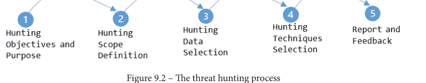

图 9.2 – 威胁狩猎流程


威胁狩猎涉及的步骤如下。

## 突出狩猎的目的

开始时，您应确定整个计划的目标：*Why are you hunting?* 这是首先要问的问题。战略团队必须将计划映射到业务目标以回答该问题。在第一步中，您必须定义将驱动整个流程的*hypothesis*。假设定义的中心问题是*What are you looking for?* 领域知识是生成假设的关键。一个简单的理论可以如下：

- **假设**：攻击者可以创建**命令与控制（C2）**通道与您的组织通信并外泄敏感数据。
- **我们可以寻找的内容**：我们可以检查和分析常用于 C2 通道的各种协议。然后，我们可以使用威胁情报框架 such as **MITRE ATT&CK**、**Cyber Kill Chain**和**Diamond Model**来提取攻击者在该任务中使用的**战术**、**技术**和**流程（TTPs）**。例如，查找可用于不可检测通信的应用层协议（HTTP、HTTPS、FTP、DNS）。MITRE ATT&CK 框架涵盖大约 16 种 C2 技术。也很重要的是，您*only look for what applies to your organization*。

一旦您确定了威胁狩猎计划的目标和目的，就很重要限制操作范围（以避免狩猎范围过广）。换句话说，您需要定义狩猎范围。

## 定义狩猎范围

第二步是定义威胁狩猎必须进行的环境——也称为*system under test*。例如，您可能希望在受限的业务区域执行该流程，并选择特定的系统子网、主机、服务器和应用程序。以下是范围限制的示例：

- **狩猎范围**：使用包含客户数据文件系统和组织在线应用程序 Web 服务器的企业网络，其中子网 IP 为 `192.168.12.0/24` 和 `192.168.16.0/26`。
- 确保范围定义正确并反映*purpose*。不要扩大或缩小范围，因为您可能会使流程不堪重负或遗漏威胁的存在。为了延续前面的示例，我们希望狩猎可能与包含关键数据的企业网络部分通信的 C2 通道。因此，我们需要突出包含关键数据的设施。

## 识别数据源

您必须为狩猎选择正确的数据。数据选择在很大程度上取决于手头的任务。到目前为止，您应该能够获取内部和外部数据（即来自网络、终端、应用程序、恶意软件、情报等的数据）。下面显示了可使用的示例数据源。

### C2 通道的数据源

使用网络和应用程序数据。重点关注安全网络元素日志（例如，防火墙、IDS、IPS、代理、应用程序日志（HTTP、DNS、FTP、SSL、SMTP））、终端数据、数据编码、加密哈希数据以及协议隧道数据和记录（例如，VPN 日志）。您必须使用内部和外部数据以获得对威胁狩猎过程更全面的视图。在将数据源用于威胁狩猎流程之前，始终确保对其进行验证。

## 选择威胁狩猎技术

威胁狩猎*technique*使您能够主动参与任务。威胁狩猎可以使用多种技术和方法。每种方法或技术的输出都不同。狩猎技术选择取决于业务目标和组织成熟度。一些流行的威胁狩猎技术包括以下内容：

- **Searching**以识别指示威胁存在的威胁指标。分析人员可以依赖*data queries*和*data exploration techniques*。
- **Clustering/segmentation**根据模式相似性对系统事件和流进行分组。聚类是 heavily 受益于 AI 和 ML 的任务之一。您可以使用统计技术或无监督 ML 算法来聚合系统事件和流行为。输出是*labeled groups of common behavior*。
- **Categorization/classification**使用定义的（标记的）标准对流和事件进行分类。此过程也可以利用 AI 和监督式 ML 以获得最佳结果。简单的分类可以是二元分类（正常或异常、1 或 0、是或否等）。复杂的分类可以有多个类别（例如，正常内部、正常外部、异常内部、异常外部）。
- **Stack counting**以提取某些事件或流的发生次数并确定任何异常元素。堆栈计数在处理相同来源和功能数据的子集时非常有效，例如防火墙日志。

以下是技术选择的示例：

**Techniques：** 为了狩猎 C2 威胁，使用*searching*查询指标（例如，IP地址、域名、加密哈希、协议、端口、SSL 证书）可能具有恶意。比较 IOCs 与之前收集的和公开的数据以确定其合法性。使用*classification*来识别恶意与非恶意流量。统计每个端口和协议应用程序的流量事件数量（例如，请求和响应）（*stack counting*）——例如，统计使用端口 8080 通信的事件数量或使用**File Transfer Protocol (FTP)**的事件数量。请注意，您可以根据目标执行更多操作。ML 模型提供了更多威胁狩猎的技术和用例。

## 报告和反馈

准备一份包含调查结果的报告。包括使用必要插图进行的所有分析。在每个步骤中使用问题。例如，*were the data sources sufficient?* 或 *were the chosen techniques successful?* 评估是否满足成功标准。利用调查结果为未来操作创建威胁狩猎数据库或存储库。创建一个**deep packet inspection (DPI)**签名数据库以在未来触发通知是一个很好的做法。

威胁狩猎对组织至关重要，应有效执行以避免误解。将威胁狩猎集成到组织的 security operations 中并非魔法——它需要适当的策略。大多数专门的威胁狩猎提供商正在利用 AI 和 ML 来增强其解决方案能力。

虽然 AI 和 ML 使组织能够开发更好、更可靠的防御机制，但它们也使对手能够增强其 TTPs 以策划复杂、未被检测到且破坏性强的攻击。下一节将介绍对手如何利用 AI。但首先，让我们看看将威胁狩猎与 CTI 结合的好处。

## 将威胁狩猎与 CTI 结合的好处

威胁狩猎并不完全依赖于威胁情报，因为它补充了与 IR、威胁检测和取证流程相关的标准安全运营。威胁狩猎计划可以通过利用内部安全监控数据、系统日志和其他检测工具启动——我们可以将其标记为*internal intelligence*。这种方法（即在没有 CTI 的情况下进行狩猎）主要包括以下内容：

- 在*internal*数据中搜索 IoCs，例如恶意软件哈希、字符串、C2 域名、IP地址等。威胁猎人随后使用 IoCs 在网络中搜索类似活动。这种方法在威胁狩猎任务中很常见。目标是快速响应 IoCs。然而，它容易受到多态性和变态等规避技术的影响，其中更改指标签名会使检测系统难以检测。更改哈希、IP地址和域名等 IoCs 可以是一种廉价的策略，对手只需付出很少的努力即可。请参阅第 13 章，*Threat Intelligence Metrics, Indicators of Compromise, and the Pyramid of Pain*，了解有关 IoCs' discovery 的更多信息。
- 搜索*host and network artifacts*，例如对手使用的协议（例如，HTTP、FTP、SMTP 和 SSH）以及安全边界周围异常流量的迹象。威胁猎人使用网络和主机工件来发现异常的网络和用户活动。然而，这可能需要存在可疑活动，例如尝试在系统中进行横向移动或数据移动（外泄）。当我们搜索并识别对手的主机和网络工件时，我们迫使他们改变其利用方法，这对他们来说可能是一项更昂贵的任务。
- 搜索网络活动中的*abnormal patterns*。威胁猎人使用大数据分析方法、ML 和 DL 来发现和预测潜在威胁。然而，这种方法的一个缺点是误报率，这会降低模型的效率。在此级别执行分析需要大量数据以及对威胁上下文（用例）的良好定义，以便理解输出。输出可以是对可疑行为的分类、预测或分段。


威胁情报超越了内部数据源（*馈送*）的收集和处理。通过使用可操作的情报，我们对 IoCs、网络和主机痕迹以及对手的 TTPs 获得了更深入的洞察。虽然 IoCs 和系统痕迹可能会发生变化，但对手很少修改其作案手法。对手的 TTPs 直接与所使用的技术及其限制相关联。因此，情报分析可以帮助提取用于威胁狩猎的 TTPs、对手组织和基础设施。TTPs 位于 **痛苦金字塔**（https://www.sans.org/tools/the-pyramid-of-pain/）的顶端，这意味着如果我们能够在 TTP 层面检测和响应威胁，对手就需要从头开始重建其整个攻击策略。

MITRE ATT&CK 框架提供了一个实用的 TTPs 参考，可用于基于 TTP 的威胁狩猎。Diamond 模型提供了一种有效的方法来发现能力、基础设施、对手画像和受害者，可用于 IoCs 狩猎、网络痕迹狩猎和主机痕迹狩猎。Cyber Kill Chain 提供了一种高效的方法来理解整个攻击结构。它是一个 *进攻性* 情报框架，可用于识别和预测网络威胁。

CTI 为威胁狩猎提供了良好的基准，因为它有助于（1）识别安全基础设施中的差距，（2）对对手意图、能力和机会提出假设（假设形成是威胁狩猎方法论中的关键），以及（3）通过使用 **威胁情报平台 (TIPs)** 和 SIEM 工具收集和处理数据。TIPs 和 SIEM 工具（在大多数情况下）旨在处理大数据并执行高级分析和可视化。威胁告警和优先级排序是威胁狩猎的重要驱动因素，因为它们支持范围定义。根据组织业务和 CTI 需求，威胁建模输出可以突出可能影响组织的威胁，并指导威胁猎手追踪正确的对手、TTPs 和威胁。

CTI 与 **网络威胁狩猎 (CTH)** 之间的平行关系可以通过分析由 R. Daszczyszak、D. Ellis、S. Luke 和 S. Whitley 在 MITRE 白皮书中发表的 TTP 狩猎方法论 V 图（https://bit.ly/3GnP9cy）来建立。该图示在下图中显示：

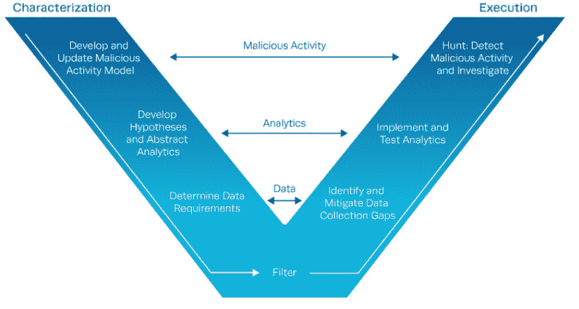

图 9.3 – 由 R. Daszczyszak 等人提出的 TTP 威胁狩猎 V 图

该方法基于恶意活动表征和威胁狩猎执行，二者各占据 V 图的一条腿。该图具有三个层次：活动、分析和数据处理。图中的组件将在以下章节中详细介绍。

## 表征

表征组件涉及理解对手行为并提取他们可能采用的不同 TTPs。CTH 分析师使用 CTI 数据收集、报告、分析和研究来理解和识别对手在不同攻击面上的运作模式。作为分析师，我们使用 MITRE ATT&CK 或 Diamond Model 等 CTI 框架来识别和优先排序 TTPs。该活动模型为分析师提供有关可能发生变化或保持不变的 TTPs 的信息。

在识别出 TTP 后，分析师会针对已识别的 TTPs 提出假设。这些假设必须建立在不太可能发生变化的 TTPs 上。一种流行的横向移动技术是使用 Server Message Block (SMB) 协议或 Windows 管理共享进行文件共享 – MITRE ATT&CK ID T1021.002。例如，如果对手使用文件共享，则一个假设是查看与文件移动相关的计划任务。

然后利用这些假设来收集正确的数据。内部和外部数据必须为当前任务收集并进行情境化。

用于情报收集的数据会被过滤和分析以用于威胁狩猎。搜索范围决定了哪些数据部分对操作仍有价值。*时间*、*表面* 和 *行为* 决定了对手狩猎的策略。*时间* 组件有助于识别狩猎的初始时期或特定对手的活动时期。TIPs 和 SIEM 系统具有数据保留期，可将操作定位在时间上。*表面* 组件允许分析师选择与攻击面相关的数据。例如，对于 **Linux** 系统，收集的 Windows 情报可能无关紧要。*行为* 组件允许分析师识别可能恶意影响系统的 TTPs。

## 狩猎执行

与 CTI 数据收集要求类似，分析师必须验证数据、识别数据中的差距并确定其可用性。如果数据不完整，分析师必须通过寻找新的数据源或 feeds 来弥补差距。在数据得到验证后，分析师可以实施和测试分析。他们构建分析查询以检测 TTPs 中突出的运作模式（或表征的阶段 1，如 *图 9.3* 所示）。

> **关于分析查询的说明**
> 
> 分析的实施和测试高度依赖于组织或分析师使用的平台。例如，QRadar 和 Splunk 的客户可能有不同的分析实施方式。创建查询的最佳方式是保持通用（即查看高级组件，如协议和进程创建），而不是具体（例如协议名称、进程 ID 等）。对攻击面有良好的理解对于实施有效的分析查询至关重要。

执行组件的最后阶段是通过检测真实活动并对其进行调查来进行狩猎。该过程可能具有挑战性。然而，MITRE 白皮书为此定义了步骤，如下图所示：

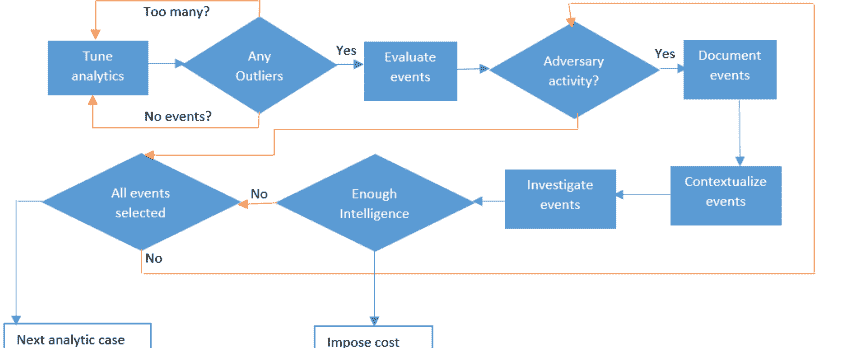

图 9.4 – 威胁狩猎执行流程

执行流程是迭代的，并在以下几点中进行说明：

- **分析调优**：确保为每个 TTP 开发的分析反映恶意活动事件。目标是减少需要查看的事件数量。这通过正确编写查询来实现。
- **检查异常值**：检查分析数据是否异常。如果异常值太多，分析师需要再次调整分析模型。如果查询后没有事件，分析师需要重新审视之前的步骤——因为如果没有事件就无法进行狩猎。
- **评估事件**：分析师利用技能和专业知识评估从分析过程中提取的每个事件。目标是将每个事件分类为恶意或非恶意。如果事件不恶意，则转到下一个事件。如果事件恶意，则分析它，然后转到下一要点。
- **记录事件**：作为分析师，我们必须记录恶意安全事件。分析师必须记录与事件相关的所有信息：时间线、受影响的主机、用户和恶意软件信息以及活动图。分析师可以使用发现的 IoCs 在外部和内部系统之间进行横向排查以获取更多信息。
- **情境化事件**：事件情境化使分析师能够理解每个事件的上下文。识别导致该特定结论的事实（事件是否恶意）。我们必须将事件与系统组件（如文件、进程、用户信息和通信协议）关联起来。
- **调查恶意事件：** 作为分析师，我们必须识别安全事件的根本原因。提取导致此类事件的不同活动。入侵分析是一种可在此步骤应用的技术（请参阅 *第 10 章，威胁建模和分析 – 实用案例*）。我们使用 Diamond Model 和 Cyber Kill Chain 反向工作并重构事件。分析师必须执行数据横向排查以识别系统中的类似行为，直到所有类似行为的可能性耗尽且所有分析完成。

分析师必须报告该过程的结果，战略和战术团队将利用其做出安全决策以加强系统。技术团队的任务是通过适当的操作响应事件，以确保组织领先于对手。

威胁情报对威胁狩猎至关重要。良好的 CTI 程序通过保持更新的数据源（通过开放、付费和共享 feeds）和更新的对手画像（通过最新的 TTPs 和对手行为）来促进威胁狩猎。它通过将检测类型扩展到超出 IoCs 或基于网络/主机的狩猎技术来丰富威胁狩猎。使用威胁情报进行狩猎可以通过在痛苦金字塔的顶端运作来拒绝对手访问，使其对该事业的投入变得极其困难。然而，下一个章节将探讨对手如何利用 AI 来保持攻击。

## 对手如何利用 AI

AI 是一个开放的领域，这意味着它对网络安全有有利和不利的贡献。对手可以利用 AI 技术来增强 TTPs。例如，想象一下恶意软件代码可以实时适应系统的防御以避免检测，或恶意软件代码可以更改其签名以绕过防病毒工具。威胁行为者不断开发智能恶意程序以策划复杂且难以检测的攻击。以下几点强调了智能攻击中 AI 的一些应用：

- **智能恶意软件：** 在这种情况下，攻击者使用 AI 将合法文件和链接武器化以向系统注入恶意代码。注入的代码学习系统对其的行为并启动其他操作，例如收集系统防御信息或报告阻止其操作的系统功能。通过学习系统，它可以冒充真正的应用程序和进程以变得不可见。它还可以 *自我评估* 以了解触发防御系统的代码部分，并 *自我执行* 以在保持其最低功能的同时混淆系统防御。


智能恶意软件可以以 **蠕虫** 的形式工作，具有在系统中智能 *自传播* 的能力。这些 *自动检查系统是否存在漏洞* 并利用它们在系统中传播。

- **智能逻辑炸弹**：攻击者转向基于 AI 的攻击的目的是确保恶意操作尽可能隐蔽地执行。智能逻辑炸弹是一种并非最初具有恶意的恶意软件，但在植入系统后会构建这种能力。它们可以根据时间或其他系统触发条件发展，例如感知未修补软件程序的存在、跟踪用户数量，或在执行攻击前到达特定的系统区域。除其触发功能外，智能逻辑炸弹还可以具有智能恶意软件能力。因此，智能逻辑炸弹对防御系统而言具有挑战性。
- **智能攻击向量**：攻击者正在增强整个 TTPs 堆栈，包括攻击向量。后者在设计和交付方面变得越来越复杂。社会工程、网络钓鱼和漏洞利用是一些通过 AI 增强的攻击向量的例子。AI 驱动的软件程序可以爬网互联网寻找漏洞并自动发起全周期攻击。

组织安全防御必须高效。因此，CTI 分析师必须了解对手用于开发 AI 和非 AI 威胁和攻击的 TTPs，以便有效控制组织的网络空间。基于规则的防御难以跟上基于 AI 的攻击（主要是因为威胁和恶意代码中嵌入了智能）。基于规则的安全和情报多年来一直有效，但基于 AI 的安全采用正在迅速增长。因此，有必要适应这一趋势。

AI 成为有效系统防御关键的证明是其被大多数厂商的 **威胁情报平台 (TIPs)** 和 **安全信息和事件管理 (SIEM)** 工具所包含。然而，正如前几段所述，AI 为每个人服务（防御者和攻击者）。因此，你必须确保你的组织能够领先于复杂的攻击。

在下一节中，我们将了解 AI 在组织安全架构中的定位。

## AI 在 CTI 程序和安全架构中的定位

AI 在网络安全中的采用正以更快的速度增长。因此，你必须知道在组织的安全架构中将其定位在哪里。

首先，AI 必须集成到 SOC 中，其主要目标是保护网络、关键资产和数据、端点、应用程序以及云服务。

其次，它还必须集成到 IR 流程中，以便在如图 9.5 所示的情况下充分响应和缓解威胁：

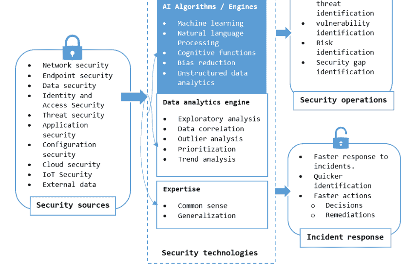

图 9.5 – AI 在安全架构中的集成

第三，它必须集成到 TIP 和 SIEM 工具中，以实现客观可靠的威胁情报分析。

最后，AI 必须集成到组织的威胁狩猎计划中，如本章第一部分 AI 和 CTI 中所述。

分析师必须保护系统和关键数据（以及资产）并遵守法规和标准。然而，SOC 系统面临诸多挑战（例如，大量信息需要处理、工作量过载、流程优先级效率低下、缺乏技能、领导层期望）。AI 可以解决这些挑战并连接海量数据以提取有用的安全信息，从而帮助弥合组织的安全差距并允许采取行动。它还提高了分析师的效率。

由于组织检测入侵存在相当大的时间差距，AI 变得对实施及时的网络安全威胁和入侵响应至关重要。许多组织承认其在打击网络犯罪中的影响。它还通过自动威胁模式分析降低了检测和响应威胁的成本，从而降低了整体事件响应周期工作量。然而，目前尚无 AI 完全自主运行的迹象。因此，必须在你的组织中建立 AI、安全数据分析与人为因素（专业知识）之间的良好协作。这三个组件必须协同工作才能实现最佳系统保护。

## 重要说明

嵌入 AI 的安全平台对中小型企业而言可能成本高昂。尽管提供商使用专有算法来增强其产品的性能，但 1 级和 2 级组织可以利用开源 AI 模型作为初始步骤。首先，你必须了解你的 AI 项目应聚焦于何处。其次，你必须根据 AI 集成的复杂性识别对你和组织而言的关键用例。例如，行为分析、欺诈和入侵检测是一些 AI 用例，它们提供高业务效益且集成复杂度低，因此你可以始终从这些开始。

AI 在安全架构中的集成对组织而言具有挑战性。因此，某些组织（主要是 3 级企业）更愿意投资于嵌入此类功能的工具和平台。在下一节中，我们将了解 IBM QRadar 如何利用 AI 来增强系统保护。

## AI 集成 – IBM QRadar Advisor 方法

网络安全行业中有多种 AI 驱动的 SIEM 工具。然而，在本节中，我们将使用 **IBM QRadar Advisor**，因为它可通过 **IBM 安全学习学院** (https://bit.ly/3L6MRRy) 轻松访问，并且拥有可用的培训和资源。QRadar 是 IBM 提供的一款多用途 SIEM 平台，用于解决一些安全挑战并保护你的组织。其优势包括以下内容：

- **安全运营任务自动化：** 它通过自动化常规任务来最大化安全团队的工作效率，实现快速威胁检测。
- **安全分析：** 它分析并关联来自多个来源（外部和内部）和格式的数据，以提供有关威胁和关键数据（资产）的可操作见解。其分析能力包含威胁优先级排序和警报。
- **MITRE ATT&CK 映射：** 该工具嵌入了 MITRE ATT&CK 框架，便于将威胁事件和流程映射到相关阶段、类别或 TTPs。这对根本原因分析很重要。
- **驻留时间缩减：** 它集成了 AI（使用 **Watson** 应用），结合其自动化功能，可减少调查和响应网络威胁和事件所需的时间。
- **嵌入式威胁狩猎：** 分析师在对抗网络威胁时变得主动。QRadar Advisor 作为工具，利用高级分析、自动化流程和集成 AI 提供可靠的威胁狩猎引擎。
- **预置用例：** 组织面临的安全挑战之一是识别可推动系统保护和安全情报的高影响力用例。QRadar Advisor 拥有用于异常检测、攻击优先级排序以及深入原始事件的算法、规则和策略。然而，你也可以创建自定义策略来满足组织的具体需求。
- **用户友好型 GUI：** 用户界面包含菜单、按钮、小工具和其他功能，使其易于交互。它支持高级可视化功能，例如资产、用户、IoC 等之间的图形关系。
- **嵌入式法规和标准合规规则：** 该解决方案允许你将资产和数据分组到业务单元以进行法规审计。**《健康保险流通与责任法案》(HIPAA)**、**通用数据保护条例 (GDPR)** 和 **支付卡行业数据安全标准 (PCI DSS)** 是包含在 QRadar Advisor 中的一些合规包。


- **模块化集成与价格：** 一个组织可以根据特定功能购买 QRadar，并在业务需求发展时进行升级。这种能力带来了灵活的定价。
- **维护与支持：** 该解决方案由 IBM 全面支持，并提供支持门户供贵组织在出现问题时提交工单。

QRadar Advisor 展现出诸多优势。我们可以看到它解决了本书中提出的绝大多数安全挑战。用于网络安全的 IBM Watson 应用构成了 QRadar Advisor 的 AI 引擎，提供强大的认知分析和机器学习能力。

### QRadar 简化架构

QRadar 由不同的引擎和模块组成，形成整个技术栈。该工具收集数据（包括事件和流），对其进行聚合和关联，然后存储以供实时分析和其它应用功能使用。简化架构如下图所示：

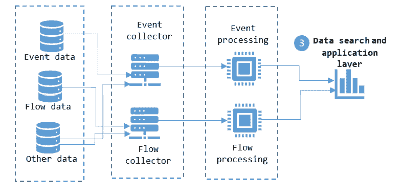

图 9.6 – QRadar 简化架构

架构层如下：

- **数据采集层：** 该层从系统中收集流和事件。它还可以收集外部数据以丰富解决方案。该层由两个主要组件构成：事件收集器和流收集器。数据会被解析、预处理并规范化为平台上层可用的结构化格式。
- **数据处理层：** 数据处理层包含规则引擎，可让您创建自定义规则和使用案例。规则和使用案例生成威胁信息、警报和优先级。事件和流分别处理。其他 QRadar 模块使用数据处理层来创建功能。
- **数据搜索层：** 这是应用层，以人类可读的方式提供系统安全性的分析和可见性（例如，图表、报告、彩色警报等）。

如前述列出的优势之一所述，QRadar 支持模块化部署，允许您选择或购买所需的模块。QRadar 模块包括以下内容（此列表并非详尽）：

- **QRadar Risk Manager：** 用于风险分析、评估和控制
- **QRadar Vulnerability Manager：** 用于漏洞评估和管理
- **QRadar Incident Forensics：** 用于调查和事件响应
- **QRadar Advisor with Watson：** 用于 AI 集成和机器学习
- **QRadar Security Analytics：** 用于自动化和主动威胁分析

了解您的需求对于获取正确的模块至关重要。

QRadar 采用集中式系统保护机制并集成其他现有安全工具。在下一节中，我们将介绍如何部署 QRadar。

### 部署 QRadar

购买 QRadar 后，您有多种部署方式，具体取决于组织规模、系统拓扑和 IT 基础设施。然而，QRadar 部署主要有两种方法和四种模型。方法包括 **单主机部署**（整个解决方案运行在单一系统上）和 **多主机部署**（组件运行在不同主机上）。QRadar 单主机部署适用于中小型企业（以及公众暴露度较低的企业）。随着企业发展和业务需求变化，解决方案可以扩展。

部署受许可限制，按 *每秒事件数* 和 *每分钟流数* 计量。部署 QRadar 时需要考虑的另一个重要因素包括 *存储容量*，它决定了 *保留期*。

部署模型包括（1）本地部署（即安装相关硬件、软件或虚拟机），（2）托管服务（即软件即服务 SaaS 的意义），（3）云上部署（私有或公有），最后是（4）混合部署（结合本地部署和 SaaS 或基础设施即服务 IaaS）。

有关 IBM QRadar 的更多详细信息，请访问以下链接：

- QRadar SIEM，https://ibm.co/3x136bu.
- QRadar 用于可见性、检测、调查和响应，https://ibm.co/3x1P5dF.
- QRadar 用例，https://ibm.co/3x3WU2e.

### 对您或您的组织有什么好处？

我相信您在想为什么我们花了这么多时间在 IBM QRadar 解决方案上。作为负责决策的 CTI 或安全分析师，您可能希望获取或建议一个 SIEM 解决方案。您可以将 IBM QRadar（作为现有且知名的 AI 驱动 SIEM 解决方案）作为参考点深入细节。这意味着您应该知道可以从 AI 驱动的 SOC、SIEM 工具、IR 解决方案或威胁狩猎平台中期待什么。

其他类似工具包括 Securonix（https://www.securonix.com/）、Splunk（https://splk.it/3A47isT）、AlienVault USM（http://soc.att.com/3jlimM5）等。在第 12 章《SIEM 解决方案和情报驱动的 SOC》中，我们将介绍 SIEM 和 SOC 运营。

### 摘要

AI 正在改变网络安全领域，推动防御和进攻战术。因此，组织必须为将 AI 集成到业务安全运营中制定适当的路线图。AI 正在推动 CTI、威胁狩猎、SOC、IR 以及许多服务，以解决三个关键用例：系统保护、领先于对手以及更快的威胁响应。在本章中，我们介绍了威胁狩猎及其在安全情报中的重要性。我们还表明 AI 是双刃剑，因为它既可以服务于组织也可以服务于对手。因此，您应该能够向战略团队强调 AI 在您 CTI 项目中的重要性，将 AI 定位在您组织的安全堆栈中，并就 AI 驱动安全工具（无论是内部设计还是从第三方供应商获取）的采购和部署提供建议。在下一章中，我们将介绍网络威胁建模和入侵分析的实际用例。
