## 11 可用性安全：威胁情报作为流程的一部分

与其它开发和运营实践相比，**开发与运营** (**DevOps**) 方法已被证明对组织而言高效且灵活。DevOps 的主要功能是利用高效的开发周期交付高质量的顶级解决方案，其成功归功于跨职能协作以及开发与 IT 运营的融合。安全专业人员与 DevOps 团队协作面临的挑战促使需要转向 **开发、安全与运营** (**DevSecOps**)，从开发任务开始就集成安全。

**网络威胁情报 (CTI)** 增强了组织的安全态势，安全正成为每个组织文化的一部分。它对威胁态势（已知和未知威胁）的了解有助于做出最佳安全决策以保护资产，包括软件应用程序。因此，将威胁建模和分析纳入组织的开发和运营生命周期可以促进安全集成到流程中，保护组织的软件应用程序免受网络攻击。由于非安全人员经常使用组织的应用程序，因此必须确保安全不会妨碍他们的心理和认知能力，因此需要平衡安全性和可用性。

本章重点关注业务运营和系统（软件或硬件）开发安全。作为威胁情报分析师，本章的目的是为您提供知识，以便从构思阶段开始评估、建议和协助将威胁分析纳入产品和服务。

在本章结束时，您应该能够做到以下几点：

- 了解在 CTI 项目中发挥重要作用的安全指南。
- 了解威胁分析如何集成到身份验证程序中。
- 使用威胁建模来强制在系统开发和业务运营中创建和实施健全的策略。
- 了解心理模型以及它们如何用于改善威胁防御。
- 了解考虑网络威胁的系统架构的基础知识。

在本章中，我们将涵盖以下主要主题：

- 安全运营的威胁建模指南
- 现代业务中的数据隐私
- 社会工程和心理模型
- 基于情报的 DevSecOps 高层架构

### 技术要求

本章使用 **社会工程工具包 (SET)**。该工具预装在 KALI-Linux 操作系统 (OS) 中，或可安装在任何基于 Unix 或 Windows 的 OS 上。KALI 可安装在 VirtualBox（本书中使用）或 VMware 等虚拟化环境中。KALI 预构建映像可从 Offensive Security 网站下载（`https://www.kali.org/get-kali/#kali-virtual-machines`）。

或者，该工具可在 Ubuntu 上通过克隆以下仓库安装，`https://github.com/trustedsec/social-engineer-toolkit/`，并通过 `requirements.txt` 使用 `pip3 install -r requirements.txt` 和 `python3 setup.py` 命令在终端安装。

### 安全运营的威胁建模指南

在构建或设计解决方案时，大多数组织专注于 **可用性** 或 **人机交互**（客户如何使用解决方案，学习起来有多容易），而安全通常被放在最后。想象一下您的公司想要开发一个社交网络应用程序；DevOps 经理已经在思考应用程序的技术要求、功能和功能。要求基于 *必须能够* 的概念。例如，用户 *必须能够* 使用其 Gmail 或 Facebook 账户登录；他们 *必须能够* 访问所有组织技术报告。或者系统 *必须能够* 记录所有用户的活动，等等。然而，您必须确保所构建的解决方案同时安全且易于使用，因此需要在流程工作流中集成安全设计。威胁情报可以通过将威胁模型和分析与每个设计组件关联来帮助在早期开发阶段集成安全。

可用性安全概念的既定重点包括身份验证过程，这是潜在攻击面的重要参数。以下小节介绍可用性安全和软件应用程序安全的指南。

### 可用性安全指南

可用性安全指南可作为防止和缓解网络威胁的机制。这些指南适用于资源访问，并限制对手执行敏感数据访问、系统横向移动和数据外泄等任务。以下小标题描述了指南以及它们如何防止和缓解对手的 **战术、技术和程序 (TTPs)**。我们参考 **MITRE ATT&CK** 和 **D3fend (https://d3fend.mitre.org/)** 框架来研究指定的战术和技术。

### 最小权限原则

本节不描述如何在组织中实施最小权限原则。它强调该概念如何用作威胁缓解和预防技术。最小权限原则是全球安全最佳实践。通过将用户权限或特权限制在工作职能范围内，您可确保仅授予最低和必需的访问级别。它适用于人类和非人类（工具、系统、应用程序）用户。最小权限概念消除了对永久本地管理员访问的需求并强制执行任务相关特权。有效的最小权限实施可以帮助 **权限提升** 和 **防御规避战术**。在以下内容中，我们使用 MITRE ATT&CK 框架进行威胁建模和分析方法来说明该概念：

- **威胁组织**：APT29 – SVR（鱼叉式网络钓鱼活动）
- **组织描述**：俄罗斯对外情报局自 2008 年起运作。被认为是 **SolarWinds 攻击**（https://bit.ly/2Wd7jvv, https://bit.ly/39FlsVs）的策划者，他们针对政府、研究机构、咨询、电信和其他技术组织。
- **使用的战术**：权限提升 (TA0004) 和防御规避 (TA0005)
- **使用的技术**：绕过 **用户账户控制 (UAC)** 以执行管理员级任务（https://bit.ly/2XMkXLs）。此类攻击向量需要管理员权限才能有效运行。然而，如果 UAC 保护设置为最高特权级别（管理员），用户特权可被利用，允许用户在没有 UAC 警报或通知的情况下提升权限（规避安全工具）。APT29 将有效载荷注入 `rundll32.exe` 以自动执行并访问受限目录（https://attack.mitre.org/techniques/T1218/011/）。


- **程序**：Spearphishing 活动作为起点。感染系统、执行侦察并识别访问凭证。禁用安全工具以隐藏痕迹。将有效载荷注入 DLL 文件并外泄数据。
- **检测**：监控文件系统，扫描系统是否存在潜在的进程注入，分析日志中对敏感资产的访问情况，收集已知威胁组织和 TTPs 的情报，监控注册表文件并对任何异常行为或未经授权的访问发出警报。
- **缓解措施**：检测 UAC 可能具有挑战性。使用 `eventvwr.exe` 进行无文件绕过和 **注册表劫持**（https://bit.ly/3lXkz0a）是规避传统进程监控的技术的例子，因此需要先进的缓解技术。虽然缓解 UAC 绕过攻击的方法有多种，例如软件更新、UAC 控制和账户审计，但最有效的缓解技术是 *将用户从管理员组中移除* 并使用最小权限原则。在这种情况下，攻击者无法执行管理员任务，也无法在系统中横向移动。

最小权限原则缩小了攻击面并限制了横向移动、命令执行和恶意软件影响。它通过完全允许用户执行其常规任务来实现这一点，确保生产力与安全保持在同一水平。在下一节中，我们将介绍 **易任务安全加固**。

## 易任务安全加固

可用性安全关系到用户在不损害安全的情况下完成常规任务的难易程度。在执行任务时，用户会被授予对其控制的资源（或资产）的 *权限*。以下是一些示例：

- 银行出纳员需要 *读写权限* 来检索和写入系统中的客户信息。他们需要访问客户数据库（敏感信息）。出纳员必须在没有安全干扰的情况下为客户服务。
- 医生需要在患者数据上拥有 *读写修改* 权限。系统必须允许医生在不关注安全流程的情况下执行这些任务（例如，要求医生在每次 4 分钟不活动后重新登录的系统可能会影响其在紧急情况下的工作效率）。
- 软件开发人员或架构师可能需要对现有基础设施进行更改（意味着访问更多可能导致服务中断的资源）。

在对设计中或开发中的系统进行威胁建模时，分析师必须识别主要的用户任务和所赋予的系统权限。了解系统如何授予访问权限以及可以访问哪些信息至关重要。通过确保最少的权限授予最简单的任务，可以实现易任务安全加固。它允许验证如果攻击者获得系统访问权限可能发生的风险。

## 用户同意和系统对信息访问的响应

系统对用户行为的响应对于整体安全建模至关重要。设计良好的系统（在可用性和安全性之间取得平衡）必须知道何时允许用户以及哪些步骤会触发访问。用户在访问信息时应了解授予他们的权限。系统在用户获得系统访问权限后必须安全地运行。用户同意和系统响应可以通过在设计过程中集成常见的对手 TTP 反制措施来用于嵌入式智能。让我们看看用户同意和系统响应如何体现可用性安全：

- **战术：** 执行 (TA0002)（参考 MITRE ATT&CK 框架）。
- **技术：** 恶意文件执行 (T1204.002)。
- **程序：** AppleJeus – https://us-cert.cisa.gov/ncas/alerts/aa21-048a。朝鲜的加密货币恶意软件最初于 2018 年被发现。拉撒路组织利用 AppleJeus 渗透了多个行业，包括电信、金融以及全球多个国家的政府。*用户需要执行 MSI 安装程序来运行恶意软件。*
- **用户同意：** 设计系统以警告用户从未知来源运行文件的风险。用户必须了解如果选择执行文件所承担的风险。必须使用对用户可见的清晰消息，并明显突出首选选项（即不继续执行该操作）。
- **系统响应：** 有时，用户并不总是做正确的事情。因此，系统响应作为另一层安全防护。你必须实现系统以扫描来自不可信方或外部来源的文件，警告用户，并丢弃（或删除）文件，然后阻止在其他文件中隐藏的程序执行。

用户同意和系统响应必须是设计的一部分。当与良好的 TTPs 分析相关联时，它们为用户提供可用且安全的环境。

## 用户访问限制的自动系统行为

首先，想象一个用户可以访问他们不应该拥有的敏感数据（低级用户拥有高级权限）。其次，想象一个用户可以访问一个数据库并自动获得对另一个他们不应该访问的数据库的访问权限。例如，软件开发人员可以访问员工数据库、合同和薪资信息。为什么软件开发人员会访问合同和薪资数据？因为他们可以——他们已被授予访问权限。优秀的可用性安全必须做到以下几点：

- 允许用户 *在不费太多力气的情况下降低其访问权限*。如果访问已被破坏，此选项很危险。没有任何攻击者会想要最小化访问权限来进行恶意活动。攻击者总是瞄准本地管理员或最高权限。
- 自动限制用户访问信息并显示正确消息（例如，*访问被拒绝。无权限访问数据*）。这是推荐的选项。

随着技术和设计的进步，现代系统都构建了有效的权限和数据访问控制。而且用户和系统都需要被监控以确保遵循最佳安全实践。

用户交互和系统行为始终共同工作以提供更好的体验。由于用户并不总是使用最佳实践，因此考虑提供可靠安全同时兼顾用户的系统和解决方案至关重要。

本节讨论了系统设计和开发的四个基本可用性安全准则。从 CTI 分析师的角度来看，对适用于系统设计的威胁进行建模并在开发过程中整合建议，是帮助组织将 DevOps 转变为 DevSecOps 的优秀实践，以实现安全但可用的系统。下一节将介绍身份验证过程中的可用性，这是所有系统和应用程序不可或缺的一部分。

## 软件应用程序安全指南

网络安全多年来一直是人们关注的概念，至今仍吸引着大多数 IT 专业人士的注意。从安装 **防火墙**、**入侵检测** 和 **预防系统** 等硬安全到访问控制和数据丢失预防等软安全，网络安全在保护计算机系统及其数据的 **机密性、完整性和可用性（CIA）** 方面发挥着至关重要的作用。因此，大多数组织利益相关者为网络安全投入预算和财务资源是合理的。然而，最近的统计数据显示，对组织和个人构成最大威胁和攻击的是应用程序攻击，例如前端攻击和 TCP/IP 第 5 层攻击（`https://www.imperva.com/docs/DS_Web_Security_Threats.pdf`）。威胁行为者从网络转向应用程序目标的关注点转变可以由 *在线存在增加和网络基础设施收紧* 证明。使用 SQL 注入攻击网页身份验证应用程序比使用 IP 分片攻击绕过两个防火墙更容易。软件层面的信息资产必须得到有效保护以确保安全运行。**开放式 Web 应用程序安全项目（OWASP）** 排名前十（`https://bit.ly/3HQDnre`）是支持安全应用程序安全的标准示例。接下来的小节将介绍软件应用程序和网络的基本安全实践和威胁模型。

## 情报驱动或威胁知情的渗透测试

**渗透测试** 或 **pen 测试** 已存在很长时间。熟练的专业人员使用 pen 测试通过利用漏洞来评估系统的安全性。其传统目标是从对手角度评估安全态势。如果你正在阅读本书，你应该熟悉渗透测试、进攻性安全或红队。随着攻击的复杂化，常规 pen 测试不足以保证系统安全运行。因此，需要利用威胁情报使流程更智能。我们谈论的是 *情报驱动的渗透测试*。

情报驱动的渗透测试利用威胁情报计划来模拟对手的 TTPs。情报驱动的渗透测试人员执行两个关键任务：

- **威胁画像**：对组织进行画像并计划针对组织最关键的资产和其他资源，就像对手会做的那样。根据 CTI 报告和威胁建模输出，情报驱动的渗透测试人员必须识别可能被威胁行为者针对的资源。
- **攻击策略**：威胁知情的渗透测试人员必须应用更新的 TTPs 来攻击组织。他们可以利用 MITRE ATT&CK 情报框架来模拟强大的攻击。因此，他们需要威胁仿真计划，重点不仅在于技术，还在于对手如何利用它们。


常规渗透测试与情报驱动渗透测试之间的主要区别在于，常规渗透测试依赖于标准的IT框架和流程。威胁情报未被考虑。这意味着渗透测试的有效性完全取决于渗透测试人员的经验和技能。情报驱动或威胁感知渗透测试依赖于威胁情报输出。CTI每个阶段的输出都会输入到渗透测试程序中。

## 情报驱动渗透测试的优势

情报驱动渗透测试的优势包括以下内容：

- **完全聚焦于实时和真实世界的攻击场景**：CTI用于了解不同的对手群体（对其进行画像）、识别其TTP（使用MITRE ATT&CK）并制定攻击。情报驱动渗透测试可以模拟**高级持续性威胁（APTs）**。
- **良好的对手感知**：情报驱动渗透测试提供了对手对组织了解情况的优秀反映。
- **有效帮助对抗对手**：为情报驱动渗透测试实施的TTP和攻击策略可识别系统中的安全漏洞，并据此应用必要的对策。
- **对网络态势的整体理解**：常规渗透测试受诸多限制，例如攻击面约束——组织可以拒绝对特定资产、系统或应用程序进行测试。然而，对手攻击特定资产不需要你的许可。通过执行情报驱动渗透测试，我们确保整个系统得到覆盖和测试。

情报驱动渗透测试为组织带来诸多益处。然而，要使测试有效（并避免退回到传统渗透测试），组织必须建立CTI项目。现在让我们来看情报驱动渗透测试的流程和方法。

## 情报驱动渗透测试方法论

基于情报的渗透测试遵循标准的渗透测试流程，但在整个流程中增加了CTI任务。流程如下图所示：

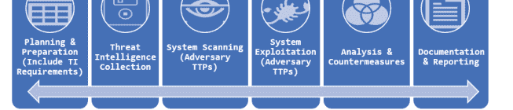

图 11.1 - 情报驱动渗透测试流程

让我们在以下要点中详细了解该流程。该流程需要由专业人员执行。我们使用以下场景来解释该流程。

你默认是一名威胁感知渗透测试人员和CTI分析师。你已被要求为ABC公司执行情报驱动渗透测试。ABC是一家总部位于南非的高科技公司。他们向政府提供软件和硬件解决方案。你需要执行以下任务：

- 1. **规划和准备：** 本步骤旨在收集渗透测试的全局和CTI需求。情报驱动渗透测试人员设定目标并定义最终目标。所有决策都与组织的战略团队讨论。因为这是一项情报驱动的进攻性测试，攻击范围在此级别未定义。规划和准备对测试成功至关重要。
- 2. **威胁情报收集：** 从CTI团队收集威胁情报报告、分析和数据。威胁情报有助于定义目标具体信息（威胁行为者可能针对的资产、应用程序、行业、系统）并了解对手的行为。其输出塑造了测试人员必须模拟的真实世界攻击场景。最终目标是定义*真实世界的测试用例和评估设置*。

情报收集后必须对规划阶段进行调整。在定义测试用例后，威胁感知渗透测试人员分析对手的TTP，选择适当的工具和方法，并定义交战规则以防止测试期间的潜在损害。

### 审查收集到的情报

在情报审查期间，你将*APT12组织或熊猫*识别为对手。APT12 (https://cybermaterial.com/apt12/) 已针对高科技公司、媒体机构和政府（符合你的组织特征），其主要意图是*数据和信息窃取*和*间谍活动*。其方法涉及*武器化Word*和*PDF文档以及可执行文件*。其一些技术包括以下内容：

- (1) **网络钓鱼**（初始访问战术）
- (2) **客户端执行** 使用浏览器URL、打开恶意文档或第三方应用程序如Adobe Flash（执行战术）
- (3) **进程注入**（持久化战术）
- (4) **动态解析**和**网络服务**用于通信和安全规避（命令与控制战术）

与APT12相关的恶意软件示例包括**Ixeshe**、**RapidStealer**、**Iheate**和**WaterSpout。**

请注意，以上所有信息均可从MITRE ATT&CK网站获得。现在我们可以通过定义交战规则来修订规划。例如，我们将在所有敏感资产上使用**黑盒测试**，例如**企业数据、知识产权数据、财务数据**和**商业秘密**，因为这些是对手的目标。我们*备份敏感数据存储库*以防其被入侵。我们还为测试设置了**C2基础设施**。现在我们准备进入下一步。

- 3. **系统扫描：** 扫描阶段使用对手TTP执行系统侦察。目标是使用*步骤1*和*步骤2*信息来识别组织中的潜在漏洞。实际上，你需要扫描工具来执行此任务。作为经验丰富的网络安全专业人员，我们采用手动和自动方法来发现漏洞。让我们利用MITRE ATT&CK来规划和执行侦察阶段。

请注意，APT12如何选择特定目标或执行侦察没有直接方法。MITRE ATT&CK列出了主要用于侦察的*10*种技术。

### ABC公司的侦察任务
我们搜索*开放网站和域名*以获取有关ABC公司的任何信息。我们浏览社交媒体、网站和财务报告以获取*主机*和*网络*信息，例如与ABC关联的*账户、名称、电子邮件、使用的技术、运行的应用程序、IP范围*和*域名*。我们可以使用一些工具包括*Google、Shodan、Maltego、Wireshark、VirusTotal*和*域名查询*工具。我们利用**开源情报（OSINT）**执行被动侦察。我们可以使用*Metasploit、Nmap、OpenVAS*和其他工具对系统进行主动侦察扫描。

了解每种工具和扫描技术的优缺点至关重要。

- 4. **系统利用：** 利用涉及对系统的实际攻击。威胁感知渗透测试人员使用从*步骤3*提取的漏洞和信息来利用系统。利用阶段必须符合规划阶段设定的交战规则和要求。对于ABC的测试，目标是敏感信息外泄。

### ABC的利用视角

查看APT12使用的TTP，我们可以使用以下方法规划攻击并利用ABC系统：

**武器化Word或PDF文档。** 确保*IXESHE恶意软件*（https://bit.ly/3GIv7d0）在客户端执行时被交付给受害者。使用提供的链接 https://attack.mitre.org/software/S0015/ 来了解IXESHE，这是一种归因于APT12组织的恶意软件。

**通过 spearphishing 投递武器化文件。** 我们假设在侦察期间获得了IT经理的电子邮件地址。如果文档被点击，恶意软件将被安装，我们将获得对ABC网络的远程访问。如果没有，请重新执行*步骤3*和*步骤4*。

**修改系统注册表**以实现持久化并避免检测。恶意软件可以使用注册表值和文件名在系统中伪装。例如，创建如下的注册表运行项：`HKEY_CURRENT_USER\Software\Microsoft\Windows\CurrentVersion\Run`。使用合法名称如`AcroRd32.exe`、`Updater.exe`或`acrotry.exe`。我们可以使用`%APPDATA%\Locations`、`%APPDATA%\Adobe`或`%TEMP%`文件夹来隐藏。

**使用HTRAN将恶意软件注入正在运行的进程。** 我们可以通过使用进程注入来实现权限提升。一旦获得提升的权限，我们就可以使用恶意软件下载额外的文件，例如**远程访问工具（RAT）**以执行横向移动。

**收集数据。** IXESHE恶意软件可以从本地系统收集数据。它还可以列出系统中的文件和目录。

**设置命令与控制通信。** 我们使用APT2 DNS计算方法来识别命令与控制的端口和IP地址。此方法使攻击变得多样化并绕过C2通道过滤。由于APT12曾使用博客和WordPress作为C2通道，我们可以在攻击期间利用网络服务进行通信。我们也可以使用Google Drive或社交媒体如Twitter来隐藏通信。

**通过设置的C2基础设施外泄数据。** 如果我们到达此阶段，攻击已成功。

我们已利用MITRE ATT&CK和全球知识来推断攻击流程。然而，你的步骤可能会根据识别的对手意图或组织而有所不同。


5. **分析和对策：** 利用真实模型对系统进行利用后，情报渗透测试人员应分析结果并推荐缓解措施。完整的入侵分析在此步骤中会有所帮助。参考 *第10章，威胁建模和分析 - 实际用例，* 以了解如何进行 CTI 入侵分析。使用 MITRE ATT&CK 框架提取潜在的建议和缓解程序。

6. **文档和报告：** 情报驱动和经典渗透测试的最后一步是报告。渗透测试人员必须详细报告其所有发现。该文档将由战略、运营和战术团队使用，以加强系统的安全性。

情报驱动的渗透测试对于确保系统、应用程序和资产安全至关重要。它还可以通过提供攻击的实际感知来补充网络威胁狩猎。威胁信息渗透测试非常适合紫队演练，其详细的攻击仿真计划非常适合用于 **入侵和攻击模拟 (BAS)** 工具，如 AttackIQ、FireEye 的 Mandiant 和 Rapid7 Metasploit Pro。希望减轻漏洞并避免潜在攻击的组织应考虑情报驱动的渗透测试。以下小节将源代码分析作为安全实践进行探讨。

## 情报驱动的应用程序源代码分析

源代码分析是用于应用程序的另一种安全评估。未受保护的应用程序会使系统容易受到网络攻击。Equifax、SolarWinds、CAM4、Aadhar 等多起泄露事件均源于特定应用程序的程序或源代码中的错误或缺陷。标准源代码分析允许我们分析应用程序源代码并识别潜在弱点。然而，与渗透测试一样，传统的源代码分析不考虑威胁情报。情况是大多数分析人员使用一组工具，静态或动态，来检查应用程序代码。我们可以通过查看威胁情报分析和报告中可能针对组织的威胁概况和行为者来进行情报代码分析。

为了确保应用程序代码的可用安全性，安全专业人员应执行以下操作：

- 使用 *威胁建模* 来识别可能引起对手兴趣的应用程序。此过程还将使我们能够确定对手可能用来入侵系统的攻击向量和攻击面。
- 使用情报驱动分析提取对手使用的 TTPs。然后我们将 TTPs 与应用程序关联。例如，APT28 组织 (https://attack.mitre.org/groups/G0007/) 已被关联到将面向公众的应用程序作为初始访问战术进行利用。这意味着如果 APT28 是已识别的对手之一，我们必须确保所有面向公众的应用程序可用且安全。
- 使用已识别的威胁向量和行业标准对组织应用程序执行情报驱动的代码分析。例如，利用 OWASP Top 10 来分析 Web 应用程序漏洞。

代码分析有三种类型：**静态**、**动态** 和 **交互式**。它们都超出了本书的范围。但它们是值得研究的良好主题。然而，以下链接提供了有关 NIST 源代码分析工具的信息 (https://bit.ly/2YieAv6)。下一节将介绍为安全运营的第三方应用程序管理。

## 第三方应用程序管理

组织使用大量第三方软件——例如当你使用 **Apache** 或 **Nginx** 作为 Web 服务器，**MySQL** 作为数据库服务器，**Twitter APIs** 向 Twitter 服务器发送请求并接收响应，或向源代码添加库时。第三方软件应用程序也是世界各地多起泄露事件的原因。在选择第三方应用程序时，尤其是关键服务应用程序（Web 服务器、数据库服务器、DNS 服务器等），我们需要通过询问以下问题进行安全风险评估：

- 用于开发应用程序的 **安全标准和措施**。
- **补丁管理：** 了解安全补丁发布的频率。补丁管理向我们表明软件应用程序的受支持和维护情况。
- **安全测试：** 我们需要了解用于测试应用程序安全性的标准以及测试频率。

为安全运营的第三方风险评估方法遵循以下给出的风险因素的标准表述：

*风险 = 威胁 + 漏洞 + 资产*

该表述在以下几点中被简单解释：

- **风险：** 我们需要识别获取未受保护第三方软件的可能后果。这些后果可能包括 *业务中断*、*身份盗窃* 或 *私人数据丢失*、*财务损失*、*声誉损害*，甚至 *生命损失*。例如，使用 Apache 和 **Oracle SQL** 作为 Web 和数据库服务器的银行需要知道其中任何一个应用程序的安全漏洞都可能对业务造成灾难性后果。
- **威胁：** 我们需要了解威胁行为者所呈现的 *意图*、*能力* 和 *机会*。例如，*网络罪犯* 可能带有 *财务动机* 或 *受国家资助的行为者* 带有 *间谍激励*。我们执行有效的对手画像（行为者和其动机）。
- **漏洞：** 我们需要识别可能随第三方应用程序而来的漏洞。漏洞包括 *人为错误*、*流程中断*、*软件错误*、*无效的输入验证* 和 *硬件错误*。对于 Web 应用程序，可以使用 OWASP 标准来突出漏洞。
- **资产：** 我们需要识别威胁行为者可能针对的资产（所有资源）。后者可能是服务器、终端站、软件应用程序或数据。这里一个很好的练习是识别 *攻击面* 和 *潜在利用的成本*。

CTI 通过有效的威胁建模提供对威胁、漏洞和资产的更好概览。风险评估分析师可以使用 CTI 数据、报告和分析与特定供应商讨论第三方应用程序的安全态势。因此，威胁建模促进了安全风险评估。

使用威胁情报进行第三方安全风险管理的益处包括以下内容：

- **威胁、漏洞和资产的自动提取：** 如果没有威胁情报的自动提取，我们必须执行三个不同的任务来获取风险评估表述的三个要素（每个要素一个任务）。组织需要为此类任务分配资源。必须进行完整审计以提取资产。CTI 使公司能够深入查看威胁、行为者、资产和漏洞概况。
- **安全态势的现实案例**：CTI 提供了安全现实状态的视图。它突出了对手的历史、其方法和目标。这些方法提供了常见的 TTPs，包括在注册表文件、文件夹和进程等颗粒度级别被利用的漏洞。对对手方法的这种深入理解以便有效防御通常被称为 **威胁信息防御** (https://bit.ly/3f5Ht27)。

制定处理第三方软件应用程序的安全策略至关重要。同样，拥有良好的补丁执行策略也很关键。组织应确保应用程序始终保持最新并应用最新补丁。Equifax 数据泄露证明，延迟应用已发布的补丁可能对组织造成灾难性后果。

系统面临的一个风险是数据隐私丢失。数据隐私是可用安全的重要组成部分。以下部分将探讨现代业务中的数据隐私，包括挑战、标准和数据隐私泄露的后果。

## 现代业务中的数据隐私

*第 8 章，有效防御战术和数据保护，* 重点关注数据保护和安全，探讨了各种方法、程序、挑战和最佳实践，以最大化数据安全性。然而，保护数据不仅仅是防止威胁行为者访问或滥用数据；它还扩展到 *数据的适当处理* ——即数据隐私的目标。数据保护似乎对网络安全专业人员和高管来说是一个简单的概念（确保数据保密性、完整性和可用性得到维护）。但当谈到数据隐私时，理解变得令人困惑。我们需要思考隐私，回答以下问题：*数据是如何合法收集的？数据如何存储？数据如何合法共享？*

问题中的术语 *合法地* 至关重要，因为现代业务中对数据隐私有严格的法规。可用安全必须考虑隐私，因为许多用户希望有效使用系统，同时也希望做到以下几点：

- **保护其个人身份信息 (PII)**：用户通过保护其数据来确保隐私和安全。
- **了解其数据的使用情况**：用户希望有权知道其数据如何被使用。用户应知道访问数据的实体和机构。他们还需要知道数据访问的目的。


- **对数据利用拥有控制权：** 在大多数情况下，系统被赋予控制 PII 利用的权限。然而，用户也应保留保留或授予其个人数据控制权的权利。因此，可用安全必须考虑 *有效的用户监督*。

法规义务和限制对于维护可用安全和隐私至关重要。如本书中反复所述，组织在处理个人数据时必须了解当地、国家、国际和行业特定的法规。通过实施 *强有力的隐私政策* 可以在高层面上体现可用隐私。

## 现代社会中可用隐私的重要性

当前时代正见证数据生成、收集、存储和共享的巨大增长。大型公司（Facebook、Google、Twitter 等）和小型企业（在线商店）利用数据来提高收入。可用隐私确保收集的数据得到适当处理。良好的可用隐私政策具有以下主要好处：

- **在与数据直接相关的主体之间建立信任和问责：** 良好的隐私政策确保了用户与任何行使隐私的另一方之间信息处理的透明度。组织应通过明确向用户解释其数据如何被处理（收集、使用、共享以及与谁共享）来保证隐私——并且必须征求用户同意以收集、使用或共享此类敏感数据。私人数据管理至关重要，因为它保护客户（或用户）和组织。
- **限制非法监视：** 无论是针对性广告活动、spearphishing、政府监视还是间谍活动，用户都有免受监视的自由。人们经常引用 *nothing to hide, nothing to fear*，这是一个陈词滥调，对用户的隐私没有帮助。在可用隐私方面，目标是给予客户或用户控制权。私人数据可用于许多破坏性和建设性的目的。然而，此类决定应属于相关方。

> **你知道吗？**
>
> 根据科学研究，生物识别数据保留了个人的若干医学轮廓，例如从痕迹获得的精神病状况、从生物识别行为获得的神经病理学以及从指纹和面部图像获得的染色体异常（https://bit.ly/3CVTeTj）。

生物识别认证是最受欢迎和最可靠的认证形式之一。它被手机、办公室、保险、健康公司以及金融和教育机构使用。在大多数情况下，人们较少关注生物识别数据（指纹、面部图像、虹膜模式、手掌印等）在采集后如何被使用。例如，获得生物识别数据访问权限的制药公司可以发起针对性广告活动，为用户尚未意识到的疾病推荐药物和治疗方法。因此，个人数据收集组织应清晰透明地解释数据将如何被使用。而我们用户，在了解详情后必须说“是”或“否”。

> **你知道吗？**
>
> 包含您个人信息的在线调查可以揭示诸如习惯、信仰以及政治、社会或宗教倾向等个性特征，这些特征可用于描绘和预测您的行为。请参阅剑桥分析丑闻（https://nyti.ms/3kjtMzE）。

在线问卷在评论、评分或意见中变得越来越流行。通过填写这些调查，我们无意中分享了大量个人信息。

数据隐私是地方、国家和国际安全的问题，也是可用安全的重要因素。

## 威胁情报与数据隐私

CTI 提供了确保基础设施安全（包括资产和敏感数据保护）的反应性和预防性方法。有效对抗威胁行为者依赖于在社区内共享威胁情报。然而，在共享或收集情报时存在隐私泄露的担忧。有了保护人们数据的法规，我们最后想要的是 CTI 项目违背它们。因此，需要强有力的政策和控制措施以确保以下几点：

- 情报数据共享不会在指标或 TTP 中暴露个人信息。
- 从开放、共享或付费源收集的数据不会违反任何安全或隐私法规。这意味着组织和数据源提供方都必须遵守隐私保护法规。
- 只有有权方才有权查看或操作收集或共享的数据 – *隐私控制*。

CTI 管理中的数据隐私有助于规范和保护不同主体之间的信息流。多项政府法规（或法律）推动情报和数据共享，例如 **EU-GDPR**、**South African POPIA**、**Canadian PIPEDA** 等；一些情报共享法案和法规规范共享指标中 PII 的保护。**Cyber Intelligence Sharing and Protection Act (CISPA)** 和 **Cybersecurity Information Sharing Act (CISA)** 是在安全领域积极使用的两项情报法规，尽管它们是美国的。所有这些法规只有一个目标：保护用户的隐私。

如本书中反复所述，了解适用于该计划的所有当地、国家、国际和行业特定法规至关重要。您必须保证在 CTI 生命周期任何阶段数据隐私都不会受到损害。

> **数据隐私与数据安全**
>
> 拥有安全的基础设施并不意味着组织符合数据隐私法规。尽管它们经常被互换使用，但区分数据安全和隐私很重要。数据安全保护数据免受威胁行为者的侵害。数据隐私管理数据的收集、使用和分发。未经用户同意获取的个人数据的加密存储库违反了数据隐私规则。

现代社会的数据隐私不容忽视。几家公司因此被罚款。2021 年，亚马逊因用户隐私处理被报告处以 7.46 亿欧元的 GDPR 罚款（https://bit.ly/3r3nXZZ）。2020 年，意大利数据保护局因其直接针对用户且未经同意的激进营销策略，对 Telecom Italia 处以 2780 万欧元的 GDPR 罚款（https://bit.ly/3fdTRNy）。2019 年，法国国家数据保护委员会（CNIL）因其隐私处理对 Google 处以约 5000 万欧元罚款（https://bit.ly/3FaNpI9）。Facebook 因 2015 年的剑桥分析丑闻被罚款约 50 万欧元。如果违规发生在欧盟 GDPR 实施之后（始于 2018 年 5 月），处罚本可能更严重。

在设计系统和维护其安全时，优先考虑用户隐私至关重要。组织必须确保健全的政策和控制措施来保护自己和用户。以下部分讨论 **社会工程** 和 **心理模型** 以实现安全操作。

## 社会工程与心理模型

人类是技术和系统的首要使用者。他们也可能是最容易破坏安全规则的因素。大多数组织确保人类（或员工）和技术（或系统）为共同的业务目标而契合。人类与计算机的交互在网络安全和威胁情报中尤为关键，因为它使分析师能够了解人们在使用系统或置于其面前的技术时的心理和认知能力。**Human-Computer Interaction (HCI)** 是活跃的研究领域；威胁行为者和分析师都在利用它来攻击或保护系统。

社会工程是非技术性的，利用心理操纵使人们给予你想要的东西。在安全环境中非常常见，它已成为一门艺术，也是最成功的攻击向量之一。另一方面，心理模型帮助你理解用户对系统和网络的认知。

## 社会工程与威胁情报

社会工程是威胁行为者最常用的攻击向量之一，因为成功时它能直接访问目标系统。与其他攻击向量相比，它几乎没有问题。攻击旨在利用人类固有的心理能力，使他们做认知上能够或不能做的事情。社会工程包括多种攻击技术，包括但不限于钓鱼、spearphishing、smishing、诱饵、肩窥、尾随和 scareware（勒索）。威胁行为者和情报分析师使用社会工程来实现其议程。以下两个部分将介绍双方如何利用社会工程。

## 威胁行为者 – 钓鱼活动

多个威胁行为者或对手组织已通过钓鱼进行社会工程以实施侦察和初始访问战术。让我们看一些威胁行为者发起的钓鱼活动示例：

- **Gold Southfield：** 一个自 2019 年以来活跃的、具有财务获利意图的威胁组织。该组织的初始访问技术是钓鱼和可信关系。它依赖 *恶意垃圾邮件* 电子邮件消息来访问受害者系统。与 Gold Southfield 相关的恶意软件之一是 **REvil (Sodinokibi)** 勒索软件，据 Secureworks Counter Threat Unit 称，它可能与旧的 **GandCrab** 勒索软件有关（`https://bit.ly/3oeeoWG`, `https://bit.ly/30eZzeo`）。


- **Dragonfly 2.0:** 一个针对关键政府部门的俄罗斯威胁组织。该组织使用电子邮件 *精准钓鱼* 活动，通过附件或 URL 访问受害者系统。电子邮件使用了合同协议主题。该组织使用 **Server Message Block** (**SMB**) 协议检索 Microsoft Office 功能，并利用 SMB 请求在身份验证过程中捕获用户的凭据 (`https://bit.ly/3oi61cu`)。与 Dragonfly 2.0 相关的一些恶意软件包括 **Trojan.Karagany**。有关该组织更多信息可在 `https://bit.ly/3H7cJuC` 找到。
- **The Frankenstein campaign:** 一个在 2019 年 1 月至 4 月期间发起网络攻击的未知组织。该行动利用钓鱼计划和用户执行在受害者系统上安装恶意代码 (`https://bit.ly/30ejuKg, https://attack.mitre.org/groups/G0101/`)。

超过 85% 的威胁组织在其 TTP 中具有社会工程技术（请参阅 MITRE ATT&CK 组织及其 TTP）。

## CTI 分析师的社会工程学

社会工程学是情报分析人员的一种合适的非技术性和非侵入性数据收集方法。他们可以利用它促使人们透露可用于 CTI 或反情报计划的机密信息。在大多数情况下，CTI 分析师冒充攻击者和威胁行为者以发现漏洞和安全意识方面的差距。他们试图收集敏感信息，例如信用卡信息、地址、电话号码、对安全问题的看法、最新活动、IP地址、目标区域以及任何可能对组织构成威胁的信息。获得的信息随后被用于识别与用户相关的潜在攻击和安全漏洞，分析可能在组织中成功的攻击，并通过培训和用户意识计划实施对策以阻止威胁。

分析师应能够采用适当的社会工程技术（冒充、窃听、肩窥、垃圾翻找、尾随、搭便车等）来收集用户数据（关键信息）。

## 社会工程学用例 – 钓鱼

社会工程攻击可以从零开始构建，需要技能和专业知识才能手动实施。然而，开源工具如 **Social-Engineer Toolkit** (**SET**) 和 **SpeedPhish Framework** (**SPF**) 可以帮助通过人类操纵收集情报。无论我们使用手动还是自动钓鱼攻击，整体流程如下：

- 1. **进行良好的侦察**：*钓鱼攻击的成功取决于其说服力，能否促使受害者采取行动*（点击发送的链接或打开邮件中附带的文件）。你必须了解目标、他们的喜好和日常习惯。例如，包含合同和政策的精心撰写邮件对采购经理比对操作工程师更有效。在此步骤结束时，你必须拥有电子邮件（或多封电子邮件）、电话号码或用于初始攻击的任何指示符。
- 2. **计划攻击**：侦察后，*确定你想要策划的钓鱼攻击类型*。你是针对单个个人（精准钓鱼），还是针对许多人？选择你将使用的投递方式：你将使用带附件的电子邮件、链接，还是冒充安全代理并误导目标透露信息？假设你使用重定向到链接的附件（威胁行为者广泛使用的技术）。
- 3. **武器化攻击元素**：*准备要附带的文件并嵌入链接*。文档中嵌入的链接不需要具有恶意性即可绕过安全检查。它只是用于重定向到恶意链接或下载。克隆或创建一个令人信服的页面，用于收集数据或下载恶意软件的链接。
- 4. **实施监听器**：我们（安全分析师）使用监听器来检查攻击是否成功以及是否已与受害者系统建立主要通信。它配置了所需参数，例如远程命令服务器 IP、端口和服务用户。一旦监听器就位，攻击就可以启动。
- 5. **执行攻击**：向目标发送电子邮件并等待他们点击链接并建立通信。

使用上述步骤，我们可以使用 SET（https://github.com/trustedsec/social-engineer-toolkit: Social-Engineer Toolkit (SET) 来自 TrustedSec 的仓库；SET 的所有新版本都部署到该仓库）策划社会工程攻击。该链接还提供了安装指南。Kali Linux 将 SET 作为操作系统的一部分提供。以下步骤仅与 Kali 上的 SET 相关：

- 1. 通过在 Kali 终端输入 setoolkit 打开 SET 工具（如果未以 root 身份运行，则使用 sudo setoolkit）。同意条款和条件。SET 菜单显示在以下图中：

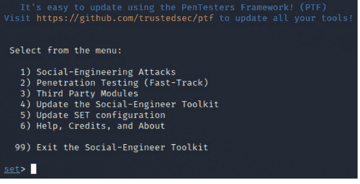

图 11.2 – SET 主菜单 – Kali Linux

- 2. 通过输入数字选择适当的菜单选项。在本例中，我们输入 1。工具提供了社会工程攻击选项，如下图所示：

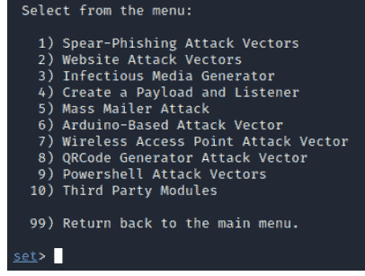

图 11.3 – SET 工具的社会工程攻击选项

该工具提供了多种社会工程攻击。请参阅工具文档以获取有关每种攻击的更多详细信息。

- 3. 选择 1 用于精准钓鱼攻击向量或 2 用于网站攻击向量。通过选择选项 3 创建凭据收割攻击方法，如下图所示：

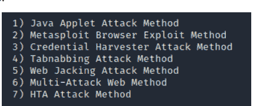

图 11.4 – SET 上的精准钓鱼攻击向量

- 4. 选择凭据收割攻击选项。我们可以创建网页模板、克隆站点（例如银行或电子邮件提供商站点），或导入自定义文件以调整攻击。
- 5. 插入收割器的 IP 地址（用于测试时放置 Kali 机器 IP 地址）并输入要克隆的 URL。凭据收割器（监听器）将启动，等待连接以捕获所有 POST 消息。监听器显示在以下图中：

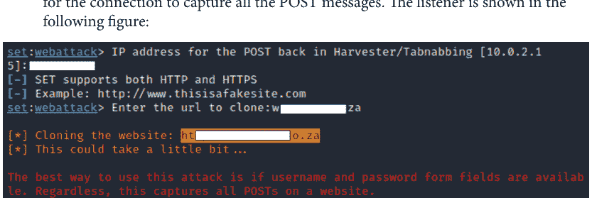

图 11.5 – SET 上的凭据收割器监听器

- 6. 将克隆的站点发送给用户。数据将被收集并显示在屏幕上。

> **注意 – 公共访问**
> 对于 WLAN 之外的用户，请确保 Kali 机器在发起攻击时可公开访问。你可以使用静态公共 IP 地址并允许 Kali 通过端口 80 接受来自公共源的连接。

了解如何通过社会工程收集数据对于 CTI 分析师至关重要。多种工具可用于社会工程攻击和数据收集。你也可以通过从零开始创建攻击来挑战自己，这对于控制攻击产物（例如你希望如何执行或应用任何自定义）至关重要。

## 社会工程学评估活动

社会工程评估在打击社会工程攻击中至关重要。它有助于识别可能针对组织或个人使用的潜在威胁和攻击面。它还显示了组织对最常见的初始访问战术的准备情况。许多组织现在使用情报驱动的进攻性安全方法来测试其安全态势。因此，他们会发起内部钓鱼和精准钓鱼活动，以测试员工在面对社会工程攻击和技巧时的反应。这种评估使组织和个人能够做到以下几点：

- **培训员工掌握社会工程技术：** 通过模仿实际攻击场景，组织提高意识，降低攻击风险。
- **采取更有效的<|message|>安全立场：** 组织在网络和数据保护上投入更多。然而，员工的粗心仍可能导致泄露，无论系统多么安全。社会工程评估活动有助于识别可能加强系统的安全解决方案。一个例子可能是发现员工可能点击任何收到的电子邮件后，为系统添加垃圾邮件过滤工具。
- **保护收入和支出：** 社会工程评估活动有助于防止攻击。我们知道数据泄露的成本可能对组织造成毁灭性打击。预防措施是避免安全泄露财务后果的好方法。
- **提高信任和信心：** 员工参与网络安全之旅的组织往往会受到合作伙伴和客户的信任。我们都希望信任组织保护我们的数据。社会工程评估可以帮助保障业务运营。

在大型组织中，安全意识团队会执行内部和模拟社会工程攻击以不断增强安全意识。CTI 分析师与他们就最新威胁进行互动。因此，了解社会工程学是威胁情报和可用安全的重要组成部分。起草安全策略时必须考虑系统与人类的交互。虽然我们希望防范社会工程攻击，但我们也必须查看攻击期间或之后系统的行为，因此需要从用户和系统两个视角审视心理模型。


## 可用性中的心理模型

当网络和系统被设计时，用户（或员工）并不在场。他们肯定不会参与代码、架构或设计的贡献。然而，他们必须使用这些系统。他们依靠之前的经验和知识来使用系统——*心理模型*。设计安全解决方案时必须考虑心理模型。系统必须知道如何对特定事件（例如点击恶意链接）做出反应并反映用户。然而，心理模型是概念性的或理论性的。它们基于用户的信念和经验；因此，心理模型的数量与用户数量一样多（https://bit.ly/3otBlFq）。

在设计或选择**威胁情报平台 (TIP)**或 SIEM 工具时，确保其用户界面可用——界面与用户使用能力之间的差距不应过大。

在开发或选择应用程序工具（威胁情报或标准日常工具）时，为实现一致且不令人困惑的认知模型，我们必须包含以下功能（https://bit.ly/3ccv8rw, https://bit.ly/30sm8wf）：

- **Affordances**：系统必须告诉用户该做什么以及如何在其中导航每一个功能。系统用户界面必须将功能映射到我们观察到的内容——例如，将点击链接或下载文件与系统行为关联，例如防病毒扫描启动。但系统必须清晰地指示操作和行为，以显示每个重要控制的可见性并对用户操作提供反馈——必须使用合适的标签来引导用户。
- **Constraints**：系统必须阻止用户执行未经许可的操作，并促使他们只执行合法操作。约束可以通过适当的 安全指南实现。也可通过适当的反馈实现。一个典型例子是用户打开木马文件后对其进行隔离或删除。系统必须禁止该操作并说明*原因*，以便用户下次更加谨慎。
- **Conventions**：系统必须使用标准或通用的方法和程序，尽可能使用户的心理模型保持一致。例如，SIEM 工具中的红色警报必须始终表示危险事件或流程。现在想象一个系统中绿色代表危险。那将造成混淆，并与用户的心理模型不一致。请注意，惯例可能受文化、地区或国际标准的影响。

设计良好的系统可以提高可用性，而用户对系统的了解程度决定了他们使用系统的效果。尽管用户的心理模型有助于可用性，但更新它们也很重要。作为希望强制执行良好安全行为的分析师，激发威胁情报消费者的认知能力可以帮助实用的 CTI 产品。例如，我们可以经常与员工和利益相关者讨论威胁情报，并以其他系统（内部或外部）作为参考。后者可用于改变心理模型。心理模型可以帮助培训员工采用安全实践。这是在人机交互中的一种自我教育方法。在下一节中，我们将介绍 CTI 的高层架构。

## 基于情报的 DevSecOps 高层架构

设计安全应用程序时，必须进行并传达对威胁向量、控制措施和攻击面的逻辑分析。软件应用程序可能会随着时间推移或业务需求的变化而变得复杂。应用程序越复杂，保护它所需的技巧、工具和资源就越多。因此，CTI 分析师应拥有安全架构的蓝图——以了解应用程序组件如何协同工作。他们还必须了解其上下文。大多数安全架构专注于抵御网络攻击——*安全加固*。设计人员配置并集成能够中和网络威胁的控制方法。安全加固使系统更可控——部署和配置完成后，应用程序预计能够检测、阻止、隔离或删除威胁。然而，安全加固不足以保护系统和应用程序免受当今的**高级持续性威胁 (APTs)**和其他复杂攻击。需要能够防御高级攻击并适应不断增长的威胁态势的动态和灵活架构。Scott C. Fitch 和 Michael Muckin（来自洛克希德·马丁公司）将基于情报的防御称为*可防御架构*（https://1mt.co/3HiqNkW）。

可防御架构或情报主导的高层架构利用 CTI 最佳实践使安全架构适应威胁态势。设计的系统（或待开发的系统）必须适应对手的 TTPs。情报主导的安全基础设施的特征包括以下内容：

- **Resilience:** 系统（或应用程序）必须设计为完全弹性。这意味着情报主导系统的目标是适应对手的变化，同时它还必须在攻击下运行、承受攻击并从中恢复。
- **Threat modeling:** 架构计划必须纳入威胁建模和分析。后者用于识别系统适当的和有效的 安全措施。威胁建模与安全加固在情报架构设计和实施中至关重要。
- **System verification:** 系统（或应用程序）需要经过验证。有效的情报主导架构必须对其漏洞进行测试。测试方法将取决于业务目标和需要保护的资产。然而，最常见的方法包括漏洞评估、渗透测试（标准和情报主导的渗透测试）、代码分析、输入验证和安全控制评估。
- **Security administration:** 可防御架构必须考虑系统管理要求（补丁管理计划、更新和升级流程）。安全管理应由组织的政策和威胁情报分析主导。例如，发现新的对手活动和 TTPs 是系统设计或配置修订的触发因素。
- **Threat countermeasures:** 情报主导设计的系统必须知道如何应对威胁。情报分析和威胁建模使分析师能够创建威胁地图和对策。CTI 输出可用于创建可在系统中部署的安全规则。例如，假设我们发现对手使用 C2 通道（技术）通过 Empire 平台（流程）进行数据外泄（战术）。在这种情况下，我们可以设计系统以检测并通知以下情况：（1）系统中 PowerShell 和解释器的使用，这可能意味着命令和控制任务已启动，（2）对敏感资产的访问——无论是授权还是未授权，系统必须检测该活动，（3）网络连接的创建（套接字创建、连接复制、快速变化 DNS 等），以及（4）系统内部或向外部目标传输大量或特定大小数据的异常移动。我们在 TIP 或 SIEM 上创建安全规则并将其上传到 IDS 和 IPS，以检测并阻止与 C2 域的恶意通信。

这里给出的特征直接与 Scott C. Fitch 和 Michael Muckin 描述的基于情报的安全架构生命周期相关联（https://1mt.co/3HiqNkW）。该生命周期包含四个阶段，*设计*、*构建*、*运行*和*防御*，可与威胁建模、系统评估、系统管理和对策相关联。

我们可以从*图 11.6*中看到，正如这里所述，某些特定于 CTI 的任务被添加到架构知识流中：

- 威胁建模和分析是整个设计阶段的一部分。


-   预期行为在构建系统以理解其对威胁和异常行为的响应方面至关重要。
-   攻击者目标是 CTI 流程中的关键部分。因此，要将其整合到情报驱动的架构中，了解不同威胁行为者的意图和能力至关重要。我们可以利用威胁情报框架（如 **Diamond model** 和 **MITRE ATT&CK**）来对攻击者进行画像。
-   TTPs 在 CTI 项目中也至关重要。了解攻击者的方法论使我们能够很好地防御威胁。TTPs 位于痛苦金字塔的顶端——这意味着揭露攻击者的 TTPs 会迫使他们撤退并重新思考策略。
-   将已知的攻击向量纳入防御阶段很重要，因为它可以预见常见威胁。
-   威胁分析通常会产生不同的威胁指标，例如恶意域名、IP地址、哈希值和文件名。**Indicators of Compromise (IoCs)** 可用于创建安全规则，从而加强防御。

架构流程图如下图所示：

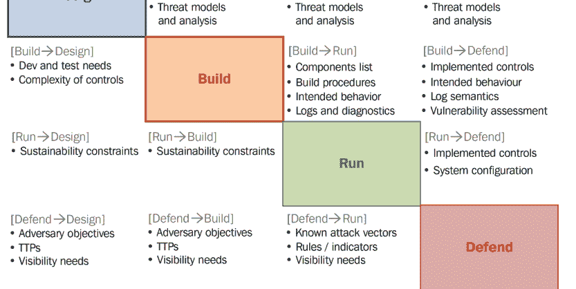

Figure 11.6 – 情报驱动的可防御架构知识流

前述图示的知识流使威胁情报能够影响安全架构（整个实施）并确保防御改进和安全的业务运营。然后，我们可以使用情报驱动的方法来看待企业架构。我们专注于可见性、可管理性和生存能力方法。

高层架构着眼于整体企业安全。它专注于业务运营的主要构建块。并且应显示组织各组件之间的关联。在企业层面，不包括实施细节。其重点在于全局可见性——它提供对网络活动的洞察。

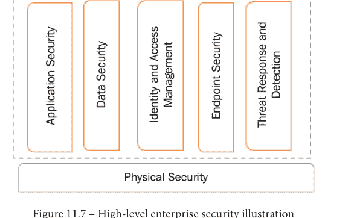

Figure 11.7 – 高层企业安全示意图

安全设计可分为四层堆栈：物理层、逻辑安全层、安全管理层和战略层，负责风险、政策、合规和治理。主要目标是保护组织资产和敏感资源。因此，必须高度考虑威胁分析。逻辑层显示组织的资产（应用程序、数据、终端、个人信息等）。

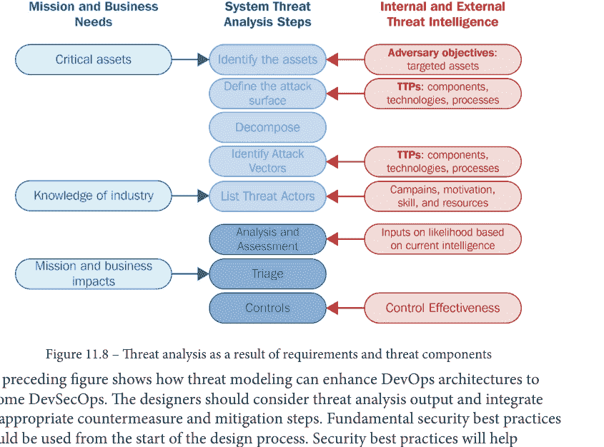

Figure 11.8 – 作为需求和威胁组件结果的威胁分析

前述图示显示了威胁建模如何增强 DevOps 架构以成为 DevSecOps。设计人员应考虑威胁分析输出并整合适当的对策和缓解措施。基本的安全最佳实践应从设计过程开始使用。安全最佳实践将有助于解决常见威胁并保护组织的资产。我们为以下目的设计基于情报的架构：

-   **Visibility:** 这使分析师能够监控系统中的活动。它提供系统（或应用程序）事件和流的可见性。在设计安全架构时，必须集成可见性控制。我们需要了解特定系统或应用程序组件（例如 Web 服务器）上发生了什么，或者指示系统在发生异常活动时通知我们并识别所有访问过该系统的用户。
-   **Manageability:** 这是关于管理和分析对手行为。系统（或应用程序）必须可管理才能有效保护组织。补丁管理、系统升级和配置属于系统可管理性。可管理性将威胁情报整合到安全堆栈中。它动态促进为安全增强而添加规则和策略。例如，可管理性可以通过将其添加到流量过滤工具中来阻止恶意的 C2 域名。
-   **Survivability**: 系统必须在遭受攻击的情况下继续正常运行。这是必不可少的组成部分，因为它使我们能够对攻击者进行画像，揭示其真实动机。系统设计必须兼顾生存能力，以防止数据丢失、系统关闭或完全系统接管（勒索软件）。计算机网络利用和计算机网络攻击操作赋予系统不同的生存能力特征。作为分析师，您需要了解在利用或攻击情况下需要启动哪些操作。操作可以是网络利用的 *discovery* 或 *recovery*，或网络攻击的 *disruption* 或 *destruction*。

威胁情报在构建可防御架构中至关重要。尽管工程师和开发人员是设计和实施安全系统架构的主要资源，但威胁情报分析师在确保有效防御机制方面发挥着关键作用。情报驱动设计的理念是摆脱传统设计和架构（仅关注系统加固）。架构必须适应不断变化的威胁态势以达到良好的网络弹性水平，因此需要利用 CTI 实现安全架构。

## Summary

可用安全是网络安全和威胁情报不可或缺的一部分。组织希望保护自己；他们必须在不妨碍用户有效使用其系统的情况下做到这一点。与威胁情报相关的可用安全为我们提供了避免网络攻击并最大化用户体验的最佳实践。

在本章中，我们研究了安全运营的威胁建模指南，其中我们回顾了可用安全指南，以确保安全性和可用性协同工作。我们讨论了现代业务中的数据隐私及其与威胁情报的相关性。然后我们讨论了社会工程和心理模型，以了解我们的认知能力如何积极或消极地促进运营安全。最后，我们回顾了用于安全和可防御架构和设计的情报驱动实践。

在下一章中，我们将研究 SOC 和 SIEM 在威胁情报计划中的重要性。

## 12 SIEM 解决方案和情报驱动的 SOC

## SIEM 解决方案和情报驱动的 SOC

日常监控和分析组织的安全态势对于对抗网络攻击至关重要。**security operations center (SOC)** 是任何组织系统安全的基石，因为它完成了日常安全监控、跟踪和分析的任务。由 **people**、**processes** 和 **technologies** 组成，它被认为是系统中发生的流和事件的中心点。因此，一个良好的 SOC 单位促进了对威胁和事件的调查和响应。**security information and event management (SIEM)** 解决方案是组织用来收集、聚合、关联、分析和优先处理威胁数据源和 feed 的系统，以便识别安全事件和事件。然后 SOC 分析师可以利用 SIEM 输出采取保护措施。从上述解释中，我们已经可以确定 SOC 和 SIEM 解决方案之间的区别。SOC 是一个业务单元（部门或组织职能），由人员（分析师）、流程和技术组成，目标只有一个：*constant system protection*。另一方面，SIEM 解决方案是用于 *security data engineering and analysis* 的系统、工具或平台（从数据工程到数据分析和机器学习，用于高级 SIEM 系统）。

对于许多安全研究人员和专业人士来说，SIEM 解决方案被视为有效 SOC 的基础和关键要素。例如，SIEM 系统收集网络日志、访问日志、终端活动日志和电子邮件日志。它将它们关联成事件和流以检测网络中的威胁或异常活动。警报被生成并发送给 SOC 团队以便进一步处理。后者根据警报的性质（威胁或事件）进行调查或响应。网络威胁态势正在演变；网络攻击变得复杂且继续变得更加复杂。新的对手 **tactics**、**techniques, and procedures (TTPs)** 和基于 **artificial intelligence (AI)** 的攻击将挑战传统的 SOC。SOC 需要适应新威胁。因此，需要 **cyber threat intelligence (CTI)** 计划来填补安全空白、增强 SIEM 解决方案并改进 SOC。

本章重点介绍威胁情报在 SIEM 和 SOC 运营中的重要性。它还解释了情报在 SIEM 解决方案中的集成。作为 CTI 分析师，了解 **incident response (IR)** 的基础知识、创建主动安全监控策略以及执行事件和流优先级排序以促进 SOC 运营至关重要。本章演示了 SIEM 工具如何集成和关联来自多个 feed 和来源的数据以提供自动化的可操作情报。

到本章结束时，您应该能够做到以下几点：

-   了解如何自动化和统一 SOC 运营以实现主动和被动的威胁情报防御。
-   了解如何优化 SOC 团队以避免因虚假威胁警报（误报）而浪费时间和资源。
-   在 IR 运营中集成分析模型以优化检测并尽可能最小化 **mean time to repair (MTTR)**。
-   将情报集成到组织的 SIEM 解决方案中并使其成为一种文化。

在本章中，我们将涵盖以下主要主题：

-   通过 SIEM 工具进行主动和被动防御
-   使 SOC 智能化 – 情报驱动的 SOC
-   威胁情报 IR


## 技术要求

对于本章，未突出显示任何技术要求。大多数用例将使用 Web 应用程序。

## 将威胁情报集成到 SIEM 工具中 – 通过 SIEM 工具实现被动和主动防御

在没有 CTI 计划的组织中，SIEM 工具会从所有连接到网络的设备（服务器、无线接入点、防火墙、IDS 和 IPS）、应用程序（例如，软件应用程序和协议应用程序）以及终端（例如，PC、打印机和移动设备）收集系统日志和内部文档。它从不同的系统环境和不同格式收集数据。然后将其整合、关联并转换为人类可读的格式。系统和人员可以查询处理后的数据以识别异常活动。SIEM 系统会生成警报（报警），指示可能的威胁或攻击。所有系统事件和流量必须记录下来以确保适当的内部可见性。SIEM 系统可以根据检测到的活动帮助进行被动和主动系统防御。被动防御是在数据泄露（或网络事件）已经发生时的系统保护机制。而主动防御是指在首先尽量减少或避免网络事件或泄露的系统保护结构。在下面的小节中，我们将介绍 SIEM 的高层架构和组件。后者也将帮助您作为 CTI 分析师评估应采购哪种 SIEM 系统。

## SIEM 工具的系统架构和组件

现代 SIEM 系统由多个组件组成，其中一些是强制性的。大多数 SIEM 厂商采用模块化架构，系统组件可以根据业务协议和需求进行购买。许可模式决定了组件数量、可监控事件数量和数据存储，对选择 SIEM 系统至关重要。然而，SIEM 系统涉及的功能包括安全信息管理和事件管理，如下图所示：

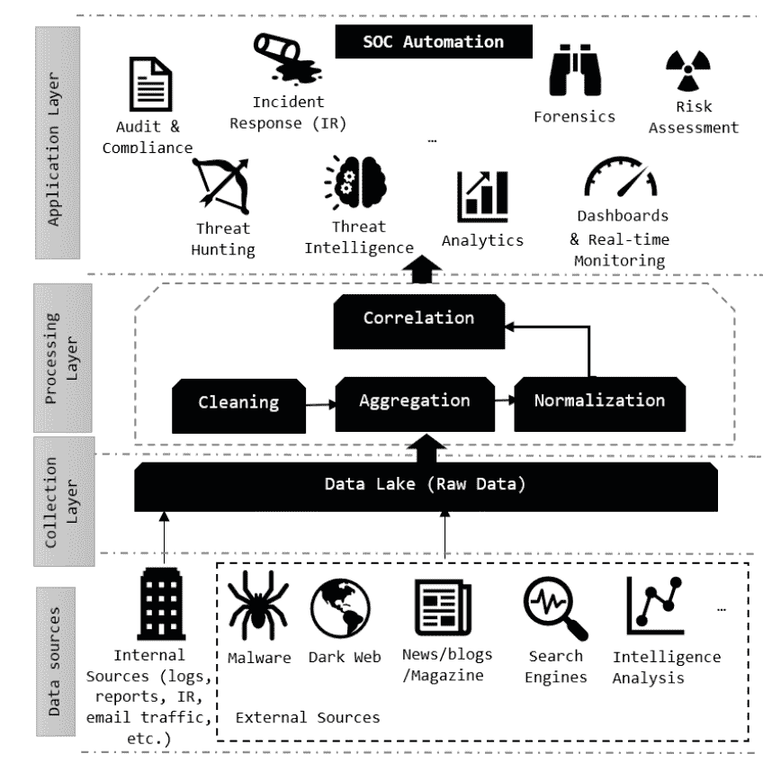

图 12.1 – 高级 SIEM 系统的高层架构和组件

通过查看图 12.1 中的架构，我们可以看到 SIEM 工具是 SOC 运营的基本系统。基本 SIEM 架构可分为四个层：**数据来源**、**数据收集**、**数据处理**和**应用**。让我们详细了解每一层。

### 数据源层

数据源层是 SIEM 堆栈的最底层。一些分析师不将其视为 SIEM 的一部分；然而，了解组织可用于安全监控的数据源非常重要。例如 **日志**、**先前事件分析**、**取证报告**、**策略**和**规则**等内部数据构成了新部署 SIEM 系统的第一个数据源或馈送。因此，组织应具备良好的数据和流量监控基础设施。

拥有 CTI 计划的组织可以从诸如 **恶意软件数据**、**暗网报告**、**安全新闻**、**情报分析**和**安全厂商**等外部数据源和馈送中受益。组织拥有的数据源或馈送越多，获得更好安全洞察的可能性就越高。然而，必须关注数据质量，以避免可能压倒 CTI 分析师的噪音，并考虑组织的预算和战略规划。数据源获取需要与组织的目标、安全和情报需求保持一致 – 请参阅 *第 7 章，威胁情报数据源*，以了解情报所需的数据以及数据获取位置。

### 数据收集层

SIEM 系统必须从不同来源收集数据并存储原始数据（本地和云端）。收集层取决于 **存储容量**、**内存大小**、**处理能力**和**连接器类型**。后者可以采用直接连接、**应用程序编程接口**（**API**）或转发器来获取数据：

- **直接连接**：用于与数据源存储库的直接链接。例如，本地 SIEM 收集层可以拥有连接到组织事件数据库服务器的 WLAN 电缆。在这种情况下，SIEM 直接从服务器收集事件数据。云 SIEM 工具可以使用直接连接服务（如 **AWS Direct Connect**）来访问组织私有 WLAN 中的数据源。
- **API**：用于 SIEM 工具与所需数据源或馈送之间的基于软件的连接。API 是情报数据收集的流行方法之一。外部恶意软件数据源例如 **VirusTotal** (https://bit.ly/3r3zA1g) 和 **VirusShare** (https://bit.ly/30T3Gx2) 提供 API 支持以访问和下载用于情报的恶意软件数据和元数据。
- **转发器**：这些是 *软件代理*，SIEM 厂商将其安装在组织的内部存储库中，以自动将数据（例如，日志、报告和事件）发送到 SIEM 系统。

> **安全说明**
> 转发器和 API 是第三方应用程序。它们必须经过安全测试。SIEM 厂商必须详细说明为保护从收集到交付的数据传输而采取的安全措施。组织必须制定强有力的第三方应用程序访问策略，涵盖所有运营和战略要求以确保安全连接。

收集的数据存储在数据湖中以供历史参考和归档。因为原始数据不能直接使用，所以需要进行处理以转换为人类可读格式——这是数据处理层的任务。

### 数据处理层

数据处理层，也称为 **中介层**，负责对原始数据进行 **预处理**、**处理**和**标准化**。一个良好的 SIEM 系统必须具有强大的中介层，支持大多数数据表示标准（STIX、TAXII、CSV 等）。以下过程在处理层中完成：

- **数据清洗**：数据湖中的数据未经处理，可能包含不准确、重复、损坏和不完整（缺失）的记录。SIEM 数据清洗功能检测并纠正原始数据中的异常。用于清洗数据的方法取决于厂商。然而，分析师需要理解这些方法。
- **数据聚合**：数据馈送（或来源）使用不同的事件周期。为了保持一致性，SIEM 系统必须确保数据在所有来源中统一聚合以便于关联。数据聚合单元负责以简洁的格式组合和分组数据。聚合数据允许分析师进行统计和探索性分析。例如，代理日志事件可能每分钟收集一次，而接入点日志每 30 分钟收集一次。SIEM 系统必须考虑收集间隔并适当聚合这两个数据集，以将代理日志与接入点日志关联起来。
- **数据规范化**：数据源必须以可读格式组织。建议将数据规范化为关系结构以使其可查询。SIEM 系统在必要时分配键和变量，例如 IP 地址、域名和哈希值。数据经过索引并干净地存储以实现快速搜索和排序。
- **数据关联：** 数据关联允许 SIEM 工具在不同（或所有）规范化数据集之间建立关系。关联过程提供了对系统中事件和流量的更全面（水平）视图。例如，给定一个报告的 C2 域名 malicious.com，通过对代理日志和来自外部来源的情报报告进行数据关联，我们可以识别出所有与该外部 C2 域名通信的内部 IP 地址。关联对于应用层很重要，因为它还可以突出系统中或系统外部的类似事件或流量。

数据处理是 SIEM 系统中最关键的层。如果原始数据处理不正确，SIEM 输出对不同的安全团队将没有帮助。数据科学的 **垃圾进垃圾出（GIGO）** 原则在这里适用。下一小节讨论应用层。

### 应用层

应用层由安全基础设施和用例的不同功能组成。架构中所述的应用部分并非排他——根据组织结构，可能更多或更少。SIEM 处理并关联的数据可以按如下方式帮助不同部门：

- **高级安全分析：** 大多数现代 SIEM 系统提供高级分析平台。该平台分析 SIEM 处理后的数据以 *提取模式*，从而精确定位潜在威胁或入侵。它识别并标记可疑指标，使安全分析师能够进行调查。然后，它使用 SIEM 数据执行 *行为分析* 以识别系统中的异常活动。**用户行为分析（UBA）** 已成为大多数 SIEM 系统不可或缺的一部分。

例如，敏感的组织文件仅由执行组访问（正常行为）。非执行用户访问了该文件（异常行为）。系统会标记此类行为。现代 SIEM 工具利用 **机器学习** 或 **统计方法**（或两者）来增强分析能力。

- **安全仪表板：** SIEM 系统具有仪表板模块，可图形化地了解系统安全状况。仪表板由一个或多个关于威胁态势、指标、威胁分析、生成的警报以及更多安全用例的报告组成。仪表板案例的示例包括过去 12 个月内识别的威胁数量、每个资产类别的异常行为数量以及系统中使用的最频繁的通信流。SIEM 系统附带预定义的仪表板。然而，根据组织的需求对其进行定制至关重要。SIEM 仪表板显示的任何内容都必须与公司目标保持一致。


-   **威胁情报：** 大多数先进的 SIEM 工具提供集成威胁情报的能力，了解过去和现在的威胁、活动、对手及其 TTP，以便有效保护系统。SIEM 中的威胁情报可促进自动响应和主动防御。
-   **威胁狩猎：** 现代 SIEM 系统不仅集成威胁情报，还集成威胁狩猎，使组织能够领先于威胁和对手。
-   **SOC 自动化：** 可能是任何 SIEM 系统的初始关键要素，SOC 自动化对于安全运营至关重要。SIEM 工具会生成安全警报、事件和异常行为，供分析师用于日常安全运营。例如，当 SIEM 工具发现并发出入侵警报时，取证和事件响应团队会立即收到通知。SOC 自动化可以减少采取安全措施所需的时间。SIEM 工具上适当的 **入侵指标 (IOCs)** 和事件优先级在 SOC 中至关重要。

SIEM 系统可以具有其他组件，并且可以与其他安全功能接口，例如恶意软件逆向工程和分析团队、网络防御和渗透测试团队，以及在需要时解决方案架构团队。

> **注意 – SIEM 解决方案选择与采用**
> 现代 SIEM 工具对中小企业来说可能很昂贵。选择对业务运营和强大的安全态势至关重要的组件至关重要。例如，一级组织可以利用具有最少但有效的组件的开源 SIEM 工具。他们可以专注于内部数据收集和一些 OSINT 源——成本极低或无需成本的任务。然后他们可以利用开源 BI 工具进行仪表板和基础分析。后者可用于流和事件优先级排序以及通知，以支持 SOC 活动。二级组织可以根据预算利用功能更强大的开源或商业 SIEM 工具。拥有成熟 CTI 程序和威胁狩猎能力的组织可以部署完整的 SIEM 系统。

SIEM 系统对 SOC 和其他安全功能很重要。因此，建议希望集中管理安全事件和日志的组织采用。下一小节我们将介绍一个实用的 SIEM 用例。

## SIEM 安全应用 – OTX 与 OSSIM 用例

SIEM 系统可以部署在本地、云端，或作为服务由厂商或提供商外包。虽然存在优秀的商业 SIEM 工具，但也有小型企业可以利用的开源 SIEM 工具。其中之一就是 AlienVault OSSIM with OTX。本小节介绍 AlienVault 开源安全信息和事件管理 OSSIM (https://cybersecurity.att.com/products/ossim)。

### AlienVault Open Threat Exchange (OTX)

AlienVault OTX 是 AT&T Cybersecurity (https://otx.alienvault.com) 的开源威胁情报交换平台。OTX 提供构建威胁情报的服务。以下步骤提供了使用 OTX 创建情报的实用指南：

-   1. 在 OTX 网页上注册并登录以激活您的个人资料：https://otx.alienvault.com。
-   2. 打开仪表板视图，如下图所示。在仪表板中，我们可以可视化包含沙箱警报和报告计数的恶意软件集群。我们还可以看到已订阅的脉冲、安全新闻和事件，以及顶级社区贡献者。

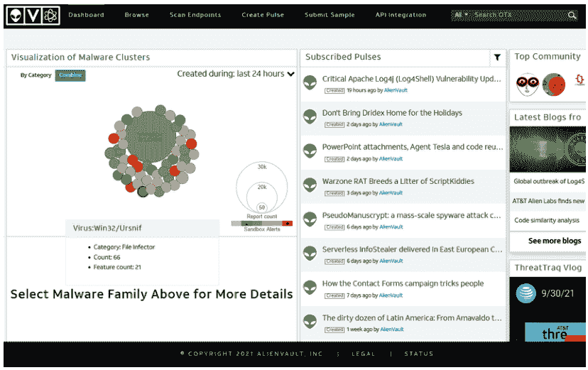

图 12.2 – 显示恶意软件集群和情报脉冲的 OTX 仪表板页面

-   3. 我们可以按类别查看恶意软件并选择特定恶意软件以获取详细信息。
-   4. 点击与您想要调查的特定恶意软件家族相关的任何脉冲。**pulse details** 页面打开，包含 *description, reference, group, targeted industry,* 和 *MITRE ATT&CK ID*，将威胁链接到不同的 MITRE ATT&CK 技术。如下图所示：

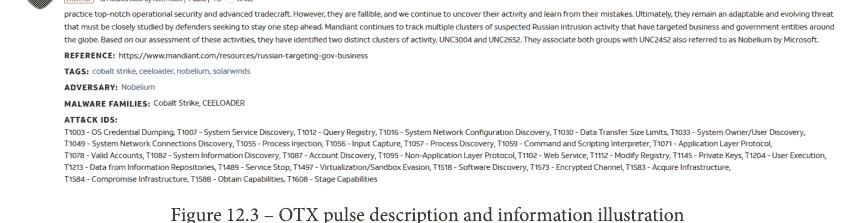

图 12.3 – OTX 脉冲描述和信息说明

-   5. 前述脉冲报告了一个针对政府和企业实体的威胁。您可以查看所有 IOC 及其类型。**TYPES OF INDICATORS** 条显示与该威胁关联的每个 IOC 的不同计数，如下图所示：


图 12.4 – OTX IOC 图形视图

-   6. 您可以通过点击 **Add to group** | **Create New Group** 或 **Browse a group to join** 将脉冲添加到新的监控组。您可以以 STIX、OpenIOC 或 CSV 等格式下载脉冲。其他活动包括将脉冲嵌入您的网站或克隆脉冲。
-   7. 使用 YARA 规则，您还可以将脉冲添加到 OTX 配置文件。将脉冲添加到 OTX 的内容在 *Chapter 15, Threat Intelligence Sharing and Cyber Activity Attribution - Practical Use Cases* 中介绍

以下示例展示了从 OTX 下载的基本威胁脉冲 STIX 数据：

```
{
    "contact_information": "https://otx.alienvault.com/",
    "created": "2021-12-07T17:02:42.599Z",
    "id": "identity--ab072f15-9b87-4ee1-898f-b584d41f29b0",
    "identity_class": "organization",
    "modified": "2021-12-07T17:02:42.599Z",
    "name": "Open Threat Exchange",
    "type": "identity"
},
{
    "created": "2021-12-07T17:02:44.000Z",
    "description": " / CC=US ASN=AS1239 SPRINTLINK",
    "id": "indicator--3f52e4c7-67cc-4f05-8704-35f85609297f",
    "labels": [
        "scanning_host"
    ],
    "modified": "2021-12-07T17:02:44.000Z",
    "name": "OTX pulse_name=Suspected Russian Activity Targeting Government and Business Entities Around the Globe",
    "pattern": "[ipv4-addr:value = '63.162.179.166']",
    "type": "indicator",
    "valid_from": "2021-12-07T17:02:44.000Z",
    "valid_until": "2022-01-06T00:00:00.000Z"
},
{
    "created": "2021-12-07T17:02:44.000Z",
    "description": "",
    "id": "indicator--121ec8b4-ec70-4da4-95df-a8073204ef0d",
    "labels": [],
    "modified": "2021-12-07T17:02:44.000Z",
    "name": "OTX pulse_name=Suspected Russian Activity Targeting Government and Business Entities Around the Globe",
    "pattern": "[file:hashes.MD5 = '1d3e2742e92264b7063db8cafed6531']",
"type": "indicator",
"valid_from": "2021-12-07T17:02:44.000Z"
},
...
```

我们可以查看脉冲的详细信息。如果您已有 SIEM 工具，OTX 还可以通过直接连接到 OTX 服务或解析脉冲到其中，作为情报数据源集成。

OTX 是开源的，任何威胁情报分析师都可以使用它下载对手的 IOC，以加强安全防御。例如，与前述脉冲关联的 22 个 IOC 可以添加到 SIEM 规则、IDS 和 IPS 中，以隔离和阻止恶意流量。

### AlienVault OSSIM

OSSIM 是开源 SIEM，可以从 AT&T Cybersecurity 网站 (https://cybersecurity.att.com/products/ossim) 下载。ISO 可以安装在 VirtualBox 或 VMware 等虚拟环境中。OSSIM 可以帮助组织执行以下任务：

-   **资产发现：** 该模块识别组织资产和端口。您可以对系统资产和端口执行主动和被动扫描。资产清单和扫描结果会被保留。
-   **漏洞评估：** 该工具使用集成的 OpenVAS 扫描器识别漏洞。它允许您扫描系统（主机、网络和应用程序）以查找漏洞。
-   **威胁检测：** OSSIM 集成 IDS（网络和主机入侵检测）功能。这意味着它可用于检测威胁并添加规则来管理流量。它利用 Snort 等开源 IDS/IPS 工具进行流量异常检测。它还提供文件完整性监控，以了解文件是否已被修改、删除或创建。
-   **行为分析：** OSSIM 可以帮助识别系统行为的变化，例如带宽使用量的激增，这可能是由恶意软件引起的。OSSIM 集成 NetFlow。
-   **安全情报：** 核心处理模块。它可以关联来自不同来源的数据。该模块是 AlienVault 商业 SIEM USM 与开源 SIEM OSSIM 之间的主要区别。后者的许可证有限（大约少于 100 条规则）。


OSSIM 也可以作为独立服务器部署。完整的安装指南可以通过以下链接访问：https://bit.ly/31DLKXB。最低系统要求为 2 个 CPU 内核、4-8 GB RAM、50 GB HDD 以及 E1000 兼容的网卡。必须考虑为扩展服务或全部实例激活增加系统容量。

OTX 可以集成到 OSSIM 中以获取最新的威胁情报数据。一旦该功能启用，OTX 的数据将流入您的 OSSIM 平台。OSSIM 上也可以配置更多数据源。预算有限的小型企业可以利用 OTX 和 OSSIM 部署 SIEM 系统。我建议先从开源 SIEM 系统开始了解其工作原理，然后可以逐步升级到功能更强大的商业工具。下一节讨论威胁情报在 SOC 中的益处。

## 使 SOC 智能化 – 基于情报的 SOC

当今安全运营面临诸多挑战，随着威胁态势的不断变化和对手 TTP 的日益复杂化。组织必须制定新的策略来持续监控系统，而不仅仅依赖基于规则和签名的流量监控。有效的 SOC 必须适应不断增长的威胁态势。威胁和入侵必须得到适当管理，以限制成功攻击的暴露面。因此，需要将情报与安全运营相结合的基于威胁情报的 SOC。CTI 有助于 SOC 适应对手的 TTP。让我们看看传统 SOC 面临的主要挑战。

## 安全运营关键挑战

传统 SOC 在防御复杂攻击方面面临若干挑战。其中一些挑战包括以下内容：

- **威胁可见性有限：** 虽然大多数组织实施 SOC 进行安全监控，但威胁管理是安全运营的关键部分。仅关注 SIEM 系统的内部数据收集不足以实现有效防御。这意味着组织在防御从未遇到过的威胁方面的能力会减弱。许多隐蔽攻击可能未被检测到并绕过安全保护。因此，我们不能仅依赖防火墙、入侵检测和防护（IDS 和 IPS）日志来了解安全方面的情况。

- **安全告警管理效率低下：** 数据解读在 SOC 中至关重要。事件和流量需要被正确（自动推荐）分析以识别威胁。误报是 SOC 告警和优先级排序的另一个挑战。如果管理不当，组织将浪费资源在不重要的告警（误报）上，而错过真正的威胁。多年来分析师收到的告警总数不断增长，约有 17% 的组织每天收到超过 100,000 条告警（https://bit.ly/3lu9Niw）。全球超过 30% 的安全告警未被调查，且在特定地区和国家该比例更高（https://bit.ly/3pjmIoE）。

- **无法情境化威胁和入侵指标：** 当 SIEM 系统生成大量缺乏上下文的告警时，SOC 分析师很可能被误导，专注于错误任务（误报，导致安全监控脱节）。**情境化**使分析师能够将 IOC 的线索联系起来，以了解用于访问系统的可能 TTP。因此，仅依赖内部监控可能会导致对恶意活动的视角缺失。例如，CTI 分析师分享了有关新检测到的 C2 域的情报。如果您的组织不知道该域，其在 SIEM 系统中的存在可能不会被标记。您将无法确定是否正在遭受攻击、谁在攻击您、攻击的动机以及对手还具备什么能力——这对于**高级持续性威胁（APTs）**尤其相关。

- **缺乏熟练的 SOC 分析师：** 安全技术的复杂性、云基础设施的采用以及大数据安全数据的收集、处理和分析暴露了人力资源方面的差距。熟练安全分析师的水平和数量是适当 SOC 运营的一大挑战。SOC 分析师的繁重工作导致人员流失增加（https://bit.ly/3DuPmZ3）。组织必须授权个人填补这些差距或外包部分 SOC 功能。

大型组织会产生大量数据（大数据）。因此，对于这种情况不建议使用手动流程；因此需要 SOC 自动化——在收集、分析和运营任务（检测、预防、响应和预测）方面的自动化。威胁情报通过自动化最密集的安全运营帮助 SOC 解决这些挑战，如以下小节所述。

## 情报融入安全运营

SOC 是组织抵御威胁和攻击的最佳第一道防线。这意味着它必须具备完善组织的职能并有效运作。然而，产生的告警数量之多使得分析师无法全部处理。解决方案是一种将大多数安全运营集中化并自动化，同时提供上下文和优先级的方法。

威胁情报帮助 SOC 分析师使威胁告警和 IOC 可操作。因此，它通过以下方式解决标准 SOC 挑战：

- **提供足够的威胁可见性**：CTI 项目需要良好的数据收集计划，这对 SOC 有益。收集的数据包含可与内部和遥测数据关联的 IOC，以更好地理解网络活动。这一能力提高了威胁检测。从一个 IOC 出发，情报分析师可以横向追踪系统以确定其影响范围。例如，在代理服务器日志中发现的 C2 服务器 IP 地址是一个需要进一步分析的指标。SIEM 工具和/或 **威胁情报平台（TIP）** 应与内部和外部数据进行交叉关联，以确定该 IP 地址是否与恶意软件感染相关，如果是，则识别受感染的终端，检查敏感数据访问和外泄，并推荐缓解措施。SOC 分析师与情报分析师合作分析并响应任何检测到的威胁。

- **情境化指标并优先处理告警**：高级数据处理和分析（CTI 项目的核心要素之一）对于情境化和优先处理告警至关重要。在情报需求得到妥善制定后，SIEM 工具和 TIP 等基础设施可以突出与组织无关的威胁，帮助 SOC 分析师专注于相关告警。高级分析可用于优先排序和分级告警（或 IOC）。当 IOC 得到正确框定时，SOC 或 CTI 分析师可以提取对手的 TTP、意图和活动并对其进行画像。

- **减少误报告警**：误报是任何 SOC 分析师的头痛问题。想象一下花费数小时调查被标记为恶意的 IOC，但实际上并非如此——组织可能会蒙受经济损失。威胁情报和高级分析（利用机器学习技术）可以通过为 IOC 提供上下文、将指标与其他情报信息关联以及识别 IOC 生命周期来帮助减少误报

- **强制自动化**：由于需要集成、处理和分析大量数据源，威胁情报推动组织自动化大多数繁琐任务。

SOC 增强是威胁情报的广泛用例之一。后者将对手语言（TTP、意图、能力和机会）翻译成组织可理解的语言，用于战略、战术和技术决策。组织必须确保 SOC 能够适应监控、检测、预防和对抗复杂攻击。另一个从情报中获益良多的安全职能是 IR，我们将在以下小节中展开。

## 威胁情报与 IR

安全事件和入侵在所难免。Forrester 报告称，至少有 50% 的安全利益相关者表示在一年内经历过一次入侵（https://bit.ly/3lJMDoj）。良好的安全态势不仅仅在于保护系统免受威胁；它还包括为被攻击时做好准备。IR 是安全基础设施中的关键单元。IR 分析师需要确保组织为最坏情况做好准备——实现对威胁的更快响应并最小化事件对业务的影响。IR 面临的挑战与以下小节中总结的传统 SOC 系统中的挑战相同。

## IR 关键挑战

IR 在打击和缓解网络事件和入侵方面至关重要。其及时性、效率、效能和专业知识决定了组织处理事件和入侵的能力。然而，上述要素主要受以下挑战影响：

- **告警管理：** SIEM 工具或其他任何安全监控工具中告警和通知的增加使得 IR 分析师难以集中注意力。缺乏告警优先级排序是另一个挑战，也是安全监控中的资源浪费。当您的 SOC 团队每天收到 1,000 条告警时，必须建立机制来分诊需要关注的告警。


-   **威胁分析与分类**：误报警报对于事件响应分析师来说也是一个挑战。如果真实威胁和事件未能及时被发现，发生泄露的可能性很高。缺乏高级分析和威胁分类会降低事件响应团队的有效性。它还使得 CTI 分析师难以理解威胁态势，因为他们无法完成情报周期——他们无法识别是谁以及什么正在攻击组织。

-   **缺乏熟练的事件响应分析师**：事件响应需要经验以及多种领域的知识组合。例如，事件响应分析师必须具备*网络取证调查技能、恶意软件分析和逆向工程技能以及威胁情报技能*，以分析和利用情报框架流程——**MITRE ATT&CK**、**Cyber Kill Chain**和**钻石模型**。缺乏熟练的事件响应分析师是事件响应有效性的挑战。因此，需要培训员工、招聘合格分析师或外包技能。

每个组织都需要解决上述挑战，以最大化事件响应团队的潜力。一个良好的 SOC 可以促进部分事件响应任务。每个事件或生成的警报都需要被情境化，以帮助加快决策过程。威胁情报提供了可被事件响应团队利用以快速响应和缓解威胁的操作优势（我们在下一小节中探讨它们）。

## 将情报整合到事件响应中

事件响应需要良好的*准备*和*规划*阶段。在此上下文中，准备是指为事件和泄露做好准备。规划是指事件和泄露发生时如何处理。威胁情报有助于发现对手组织、活动和 TTP 以保护您的组织。后者可以通过*将入侵指标情境化、将指标与对手的 TTP 连接起来、并指导缓解步骤*来增强事件响应。威胁情报支持两个层级：*反应性*和*主动性*层级。

### 用例：SolarWinds 攻击

**摘要**：APT 自 2020 年 3 月起入侵公共和私营部门。
**初始访问**：DLL 投毒 – 通过武器化 `solarwinds.orion.core.businesslayer.dll` 在 SolarWinds Orion 平台代码中进行供应链攻击。
**C2 域名**：`avsvmcloud.com`、`deftsecurity.com` – 模仿 SolarWinds 流量 (T1195.002)。IP地址：`20.140.0.1`、`13.59.205.66`、`65.153.203.68`。
**规避战术**：T1027.003 – 使用具有受害者本地 IP 地址的虚拟专用服务器进行 C2 流量混淆。
**权限提升**：TA0004 战术 – 在高度特权目录中添加身份验证令牌和凭据。
**持久化**：TA0003 战术 – 添加登录凭据和系统进程修改 T1543.003。
**命令与控制**：Web 协议 – T1071.001。
**数据外泄**：收集信息 – 危害 **安全断言标记语言 (SAML)**。参考：https://bit.ly/3EuLjwW。

根据前述案例，我们可以看到情报如何帮助反应性和主动性事件响应。SolarWinds 数据泄露被用作示例，并以 MITRE ATT&CK TTPs 作为参考。

## 威胁情报与反应式响应

事件响应默认是反应式的。这意味着当检测到威胁时，事件响应分析师才会介入。典型的反应式事件响应将按如下方式进行：

-   1. SIEM 系统根据代理服务器日志标记 `avsvmcloud.com` 域的 *警报*。它表明存在潜在的入侵指标。
-   2. CTI 分析师（手动或半自动化）或 SIEM 或 TIP 工具（自动化且推荐）将检测到的域名与外部情报进行关联以 *情境化* IOC。他们可以使用 VirusTotal 和恶意软件订阅源等平台。他们将 IOC 映射到相关 APT 组织。在此步骤中，CTI 分析师提取与该组织关联的其他 IOC（IP地址、哈希值和附加域名）。
-   3. 系统（SIEM、TIP 或 SOAR）*优先处理*警报并将其标记为关键，需要事件响应和 CTI 团队的全部关注。
-   4. CTI 分析师执行系统横向排查以确定系统与 C2 域之间通信的程度。横向排查过程还揭示了其他关联 IOC 的存在，例如 13.59.205.66。警报被转变为 *事件*。它可以移交给事件响应团队（取决于结构）。请注意，在特定组织中，CTI 分析师可以执行基础取证分析以匹配对手 TTP。攻击范围在最后确定。
-   5. 事件响应团队执行 *分诊流程* 以识别受风险数据以及 APT 组织访问组织敏感数据的可能性。他们使用威胁情报来识别针对观察到的分析的外泄技术。此时，事件被转变为 *泄露*。相关内部和外部机构需要被通知。
-   6. 事件响应团队通过隔离受损系统部分来启动 *遏制流程* 以限制泄露影响。此步骤中可以执行的一些活动包括阻止所有 C2 通信、移除敏感数据权限以及将受影响主机从网络中移除。
-   7. 事件响应团队通过移除 APT 组织在系统中的存在并关闭导致攻击的安全漏洞来 *修复* 攻击。一些任务包括阻止流量、移除受损账户以及终止恶意进程。
-   8. 事件响应团队可以开始从泄露中恢复系统。
-   9. 所有参与反应式事件响应的安全团队都必须就事件撰写事后分析报告。

我们可以从反应步骤中看出，情报驱动的事件响应在事件响应流程生命周期中涉及更多具体和务实的步骤。这些步骤包括警报情境化、与其他数据源的自动关联、威胁映射到对手组织活动以及优先级排序。事件响应团队的工作得到优化，处理事件所需的时间减少。

## 威胁情报与主动响应

事件响应与采取必要的步骤来检测、阻止和缓解攻击相关。这意味着在响应之前必须先识别攻击。因此，主动式事件响应对许多组织和战略团队来说难以理解。

主动响应是可从威胁情报中显著受益的事件响应类型。它包括加强事件响应流程的准备和规划阶段。团队在攻击发生前构建威胁、漏洞和对手的知识。实现这一目标的唯一方法是利用 CTI 项目。典型的主动式事件响应将按如下方式进行：

-   1. 安装监控工具（SIEM、TIP 或 SOAR）以收集、处理、关联和分析安全数据源。
-   2. 将威胁情报分析集成到工具中。它们提供威胁态势分析、对手画像以及安全领域最新的 TTP。
-   3. 执行威胁建模以识别可能被威胁行为者针对的组织资产。您还识别主要使用的威胁向量。
-   4. 安全团队利用威胁情报 IOC 和 APT 的 TTP 来加强安全。例如，您可以添加防御规则以阻止与 13.59.205.66 或 avsvmcloud.com 之间的任何通信。

前述四个步骤为事件响应团队领先于对手提供了坚实起点。基于威胁情报的主动式事件响应减少了对事件的反应时间，并帮助组织在事件发生前做好准备。威胁情报确实正在改变大多数安全功能的工作方式。下一节将探讨将情报集成到 SIEM 系统的好处。

## 将威胁情报集成到 SIEM 系统

SIEM 解决方案正成为实时 SOC 功能支持的事实标准工具。因此，SIEM 工具（或解决方案）必须在决策支持方面坚实有效。大多数现代 SIEM 工具包含威胁情报功能。情报为安全监控带来主动性。将它集成到 SIEM 系统中可在以下方面提供帮助：

-   对威胁、对手及其 TTP 提供深入洞察。它详细说明威胁态势，帮助组织了解可能针对他们的活跃活动和组织。
-   减少误报并优先处理警报，帮助 SOC 和事件响应分析师专注于重要的警报——那些具有高影响分数的警报。
-   为 SOC 团队提供在检测到 IOC 时采取行动所需的资源和信息。


- 增强系统检测威胁的能力，得益于其关联内部和外部来源数据的能力、在发现恶意 IOC 时生成实时情境化警报，以及将 IOC 映射到对手组织、活动和 TTP。
- 通过加快 IR 流程阶段（如准备、分类、分析、补救）来支持事件响应。它还通过关联内部数据与外部数据 feed 来提供事件范围。
- 促进威胁狩猎以发现未知威胁。

市场上存在多种 SIEM 工具。选择完全取决于组织的预算和需求。一些流行的 SIEM 工具包括 **Datadog Security Monitoring**、**Splunk Enterprise**、**IBM QRadar**、**AlienVault USM**、**SolarWinds SEM** 和 **McAfee ESM**。请注意，该列表并非详尽。还有许多其他商业 SIEM 工具。

将威胁情报集成到 SIEM 中必须是任何希望增强安全防御的组织的优先事项。其用例并不止于 SOC 和 IR。它扩展到漏洞和风险管理，以及欺诈管理。它还通过指导正确的<|message|>安全策略和投资来支持安全领导活动。因此，在投资 SIEM 时，请确保威胁情报能力已集成到工具中。

## Summary

威胁情报应具有实用性和可操作性。其基于证据的特性使其对许多安全用例具有价值：SOC、IR、漏洞管理、风险分析、欺诈检测和预防，以及威胁狩猎。在本章中，我们研究了威胁情报如何通过增强 SIEM 能力来赋能 SOC。我们讨论了 SIEM 架构及其用于主动和被动防御的用例。然后我们讨论了情报的两种用例（SOC 和 IR），描述了它如何解决 SOC 和 IR 的挑战。最后，我们回顾了将情报集成到 SIEM 中的好处。

IOC 和痛苦金字塔已在前几章中简要讨论过。在下一章中，我们将深入探讨威胁情报指标、入侵指标和痛苦金字塔。我们讨论 CTI 分析师如何将它们用于 CTI 分析。
