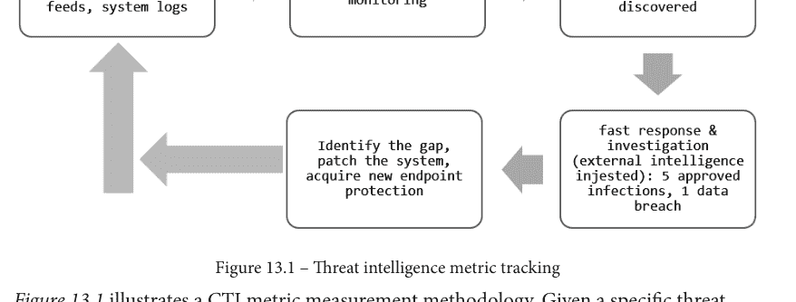
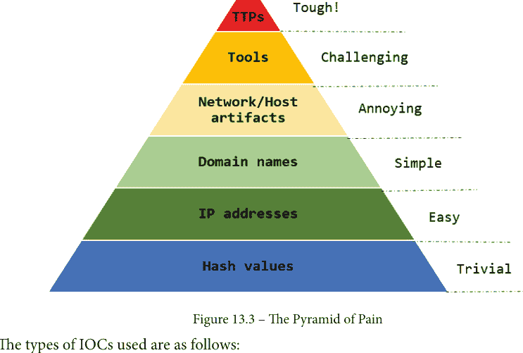
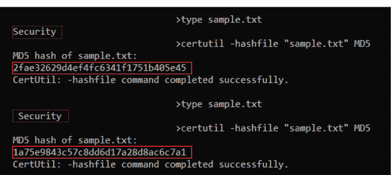
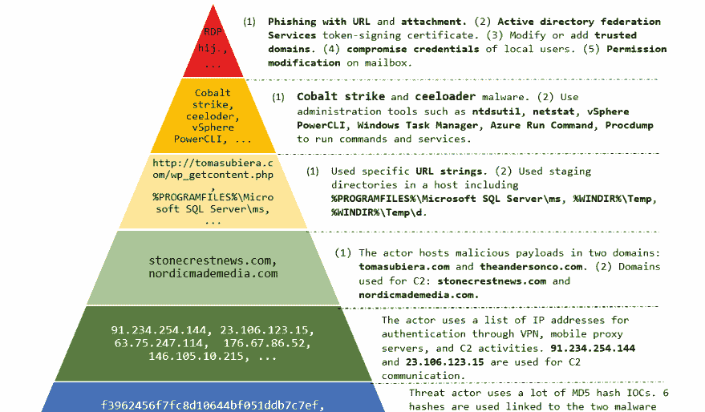
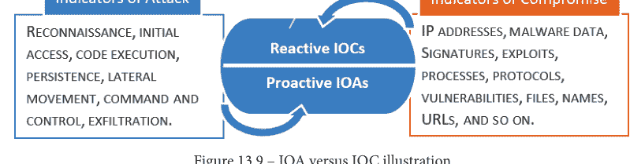

## 13 Threat Intelligence Metrics, Indicators of Compromise, and the Pyramid of Pain

在执行威胁情报计划时，必须有一套标准来确定其对整体系统安全和业务的贡献。这意味着 **Cyber Threat Intelligence (CTI)** 分析师或团队必须选择 *security intelligence metrics*，以证明该计划的存在，无论是在战略、运营还是战术层面。

作为 CTI 分析师，我们始终在系统中寻找威胁或泄露证据，以分析安全暴露和对手的活动。而这些证据正是使威胁情报可操作的关键。它们被称为 **Indicators of Compromise** (**IOCs**)。对手使用许多 IOC，而我们分析师如何应对它们，将决定造成对手实现其恶意目标的 *level of pain*。本章重点介绍用于情报评估的安全指标和计划有效性的衡量，包括 CTI 团队。它解释了 IOC 及其在 CTI 分析师工作中的重要性。它还探讨了如何使用 **Pyramid of Pain (PoP)** 有效地拒绝对手的访问。最后，它回顾了攻击指标的概念。

在本章结束时，您应该能够做到以下几点：

- 了解 CTI 指标的要求和基线（您 CTI 计划的成功标准）
- 了解 IOC、其重要性和其类别
- 了解 PoP 以及您如何在威胁情报计划中使用它
- 了解 **Indicators of Attack (IOAs)** 的新概念

在本章中，我们将涵盖以下主要主题：

- 理解威胁情报指标
- IOCs，CTI 的战头
- The PoP，the adversary padlock
- 理解 IOAs

## Technical requirements

对于本章，未突出显示任何技术要求。大多数用例将使用 Web 应用程序。

## Understanding threat intelligence metrics

像任何其他计划一样，威胁情报需要评估标准来确定其有效性。然而，定义有助于威胁情报计划评估的指标并非易事，仍在被安全研究人员研究。尽管如此，大多数安全研究人员和专家都利用其专业知识来定义跟踪 CTI 计划整个生命周期的指标。这就是本节采用的方法。

总体而言，性能指标需要讲述系统、应用程序或计划的故事。例如，在蜂窝通信中，一些值得注意的指标包括 **network availability**（订阅者访问网络资源的能力）、**network retainability**（用户发起服务的输出，例如数据呼叫的成功和失败）以及 **network mobility**（在移动中保持使用服务的能力）。每个指标类别都包括其他性能指标。相同的概念可以应用于威胁情报计划。

CTI 分析师必须找到一种方法来衡量 CTI 计划的 *actionable, accurate, and capable* 程度（在增强组织安全或具有可操作性方面）。因此，推动情报指标的主要问题是 *How helpful or valuable is the generated intelligence?* 让我们来看情报指标要求。

## Threat intelligence metrics requirements

CTI 指标要求用于证明计划的需求及其在战略、运营和战术层面的存在。它们也可以用于了解组织的威胁态势；因此，CTI 分析师首先需要为 CTI 计划构建性能指标要求。推动 CTI 指标要求的主要问题应分为两个层面回答：**security posture level** 和 **security team efficacy level.**

## Security posture level requirements

态势层面的威胁情报指标要求是通过识别 *how was threat intelligence generated? How reliable were the data sources? How did it help the organization strengthen the defense and respond to threats?* 构建的。在解决计划的实用性时，您需要考虑以下三类情报：

- **Strategic**：情报如何帮助战略团队做出决策。例如，一个简单的答案是 *it helped identify the gap in asset protection and motivated the strategic team to acquire an endpoint monitoring solution.*
- **Operational**：情报如何帮助运营团队应对威胁和攻击。例如，*it helped discover a reported indicator of compromise in the system. It reduced the time to respond to an attack* – 您可以提供指标的估计值，例如 *it reduced the response time by 80% compared to last year's similar attack response time.*
- **Tactical:** 情报如何帮助防止威胁和攻击。一个典型的例子是 *threat intelligence helped identify security gaps by detecting early database servers’ vulnerabilities, identifying adversaries (and tactics, techniques, and procedures – TTPs) targeting our business sectors by exploiting those specific vulnerabilities, and securing all our database servers.*

必须跟踪所有安全活动（自动推荐）以在周期结束时基准测试和评估计划。性能衡量必须与 CTI 和业务要求保持一致。CTI 指标可用性和价值跟踪在下图中说明：

图 13.1 – Threat intelligence metric tracking

图 13.1 说明了 CTI 指标衡量方法。给定来自数据源的特定威胁，(1) 我们评估数据 feed 并获取数据 – 数据可能是从暗网上收集的新漏洞。(2) 收集到的数据被馈送到安全信息和事件管理（SIEM）工具或威胁情报平台（TIP）进行自动处理并与其他外部和内部数据关联。(3) 系统对漏洞创建警报并根据漏洞利用情况附加优先级级别。(4) 安全运营中心（SOC）团队调查警报并确定漏洞是否影响了组织。最后，(5) SOC 团队根据漏洞识别安全差距，更新安全规则和策略，并向补丁管理和战略团队报告以加强安全。给出的工作流程应证明需要工具、技术以及可能的新人员以实现有效防御。

我们需要跟踪以下指标：

-   **入侵尝试：** 一个 **关键绩效指标 (KPI)** 示例是 *入侵尝试检测率*。
-   **安全事件：** KPI 示例包括 *安全漏洞数量* 和 *安全漏洞成功/失败率*。
-   **系统 IOC 延迟：** 报告 IOC 的延迟 – 从数据 feed 中发现到在 SIEM 工具上创建警报的时间。
-   **系统对策有效性：** 响应威胁和攻击的速度和效率。

在下面的小节中，我们将讨论安全团队效能指标。CTI 分析师必须在定义 CTI 的安全态势要求时富有创造性。

## 安全团队效能指标

评估威胁情报计划不仅涉及战略、技术和战术价值，还考虑 CTI 团队分析和响应威胁的能力。您的组织可能拥有良好的情报计划（例如，数据收集、有效的 SIEM/TIP 解决方案和自动化流程），但如果安全团队没有将计划付诸实践所需的技能和专业知识，则该计划将无效。

在安全领域，衡量主要基于审计和检查清单。然而，衡量 CTI 团队的能力可能很棘手。CTI 需要及时性和警惕性，因为对手可以利用任何分心；因此，CTI 团队有效性的一些关键指标包括以下内容（请注意，该列表并非详尽）：

-   **团队准备情况：** 团队在防止攻击（战术）、检测和响应威胁（运营）以及与利益相关者沟通以做出安全决策（战略）方面准备得如何？该指标涉及对团队的画像（专业知识、技能、人数、角色，以及水平和垂直沟通——同事之间以及高层管理与 CTI 分析师之间）。
-   **平均解决时间 (MTTR) 和平均检测时间 (MTTD)：** 团队检测、分析、调查和解决安全问题花费了多长时间？他们的响应如何影响攻击影响？CTI 管理员应跟踪此类指标。请注意，*平均修复时间*、*平均响应时间* 和 *平均恢复时间* 也是 MTTR 缩写可接受的含义。
-   **阻止的威胁和攻击数量**：团队成功识别并阻止了多少实际威胁和攻击，且具有可衡量的活动影响。它包括内部和外部威胁。
-   **系统修补率**：在威胁情报分析中识别出高风险 **通用漏洞和暴露 (CVE)** 后，系统修补的速度有多快。这部分属于团队效能，因为补丁管理至关重要。Equifax 未修补 CVE-2017-5638 漏洞导致了严重泄露。

> **重要说明**
> 
> 关于安全模拟的说明：从未被入侵或攻击过的组织可能没有评估其 CTI 或 SOC 团队的方法。没有组织希望被入侵。因此，他们必须做好准备。模拟网络威胁、攻击和事件最常用的方法之一是使用 **安全演练**。安全演练允许组织针对模拟的真实威胁测试某些反应。

安全团队效能对于打击网络犯罪至关重要。因此，建立强大的 CTI 团队并投资分析师培训非常重要。团队在 CTI 计划执行期间的工作方式也可以帮助高管做出良好的安全决策。战略团队始终希望看到 CTI 计划的 **投资回报率 (ROI)**。

## 威胁情报指标基线

一个有效的 CTI 团队必须提供足够的 *事实*、*思路* 和 *笔记* 来指导安全决策，例如在什么资产上何时需要修补、建议安全架构变更或投资人员。需要为相关方建立指标基线，以便了解什么是 *好* 和 *坏*。我们在此基础上构建了 *Gavin Reid* (https://bit.ly/3mnuAV1) 设定的基线。

指标骨架包含四个类别，每个类别都有团队需要解决的问题基线：

-   **输入指标**：与组织的威胁情报平台或 SIEM 工具生成的数据源和警报相关联。
-   **分析指标**：与情报分析相关联。
-   **输出指标**：与计划结果相关联。它们衡量 SOC 团队如何利用情报来促进其工作并保护系统。
-   **影响指标**：与威胁和攻击对系统造成的安全影响相关联。

前文解释的威胁情报基线由以下图表说明（图 13.2）：

-   **影响**
  -   可直接归因于威胁情报的发现百分比 - 输出映射到数据 feed。
  -   直接与情报关联的事件响应工单
  -   受威胁情报影响的警报和工单重新优先级排序（例如，紧急修补、架构变更）
  -   直接针对该组织的主动攻击/威胁组织数量
  -   延迟（最大值、平均值）- 从通知到行动再到解决方案

-   **输出**
  -   跟踪的新外部活动/威胁组织数量
  -   正在跟踪的漏洞
  -   添加到 SOC 工作流中的 TTP 数量（Yara、IDS 签名）
  -   添加到 SOC 工作流中的 IOC 数量（IP地址、域名、哈希值、恶意软件元数据）
  -   Feed 效能（新增数据、旧数据过期、数据唯一性）

-   **分析**
  -   跟踪的新外部活动/威胁组织数量
  -   成功完成的情报项目
  -   受 CTI 影响的利益相关者互动次数
  -   尽职调查 - feed 评估
  -   未能正确预见安全事件的情况
  -   错误分析的数量
  -   提供与需求相关的威胁情报的利益相关者数量

-   **输入**
  -   有多少警报通过情报得到增强？
  -   正在摄取多少个 feed？

图 13.2 – 情报指标基线说明

CTI 分析师和管理人员在选择情报指标时应谨慎。建议使用 CTI 团队可以管理或控制的指标。威胁情报指标必须始终根据其帮助组织做出更好安全决策的能力来选择。组织还可以根据 CTI 和业务需求自定义情报指标。现在我们已经掌握了情报指标的背景，让我们讨论 IOCs，这是威胁情报的重要组成部分。

## IOCs，CTI 的弹头

我们在几乎所有前面的章节中都谈到了 IOCs 中的 **哈希**、**域名** 和 **IP地址**。你可能已经大致了解了它们的使用方式。本节提供更多细节，帮助你深入理解这一概念。*IOCs 是可操作情报的支柱。* 它们是系统中异常行为的证据；因此，安全监控围绕着观察系统中的 IOCs 展开。威胁情报收集的数据包含 IOCs——用于加强组织的安全态势。例如，内部数据如日志包含用户的 IP 地址、时间戳、访问的资产、用户名和远程连接详情，反映了所有内部活动。外部数据包含对手、**战术、技术和流程 (TTPs)** 以及 IOCs，CTI 团队可利用这些来保护系统。

IOCs 是威胁情报分析、取证调查和事件流程的起点。它们可以是以下其中一种：

-   **原子型**：具有 *静态上下文含义*，例如 IP 地址、域名和电子邮件地址。原子型 IOC 在特定上下文中提供相同的对手活动含义。
-   **计算或提取型**：作为进一步调查的结果，例如哈希值、可执行映像文件和正则表达式。例如，在分析恶意软件文件后，分析师会提取特定指标，如哈希键（例如 `MD5`、`SHA-1` 或 `SHA256`）、文件类型（例如 x86-64 MS Windows 可执行文件或 Win64 EXE）以及 **多用途互联网邮件扩展 (MIME)** 类型（例如 `application/x-dosexec`）。
-   **行为型**：作为对原子型和提取型 IOC 进行逻辑分析的结果。例如，用于下载恶意文件或远程命令执行的脚本。

IOCs 本身是被动的，但在实现情报方面至关重要。让我们看看 IOCs 在威胁情报和安全监控中的重要原因。

## IOCs 的重要性

IOCs 被认为是威胁情报或安全监控的弹头。它们是对手用来策划恶意活动的工具。*在每一次攻击中，对手都会使用两个或多个指标来执行其任务。* 因此，检测并阻止它们会中断对手在您系统中的工作。

IOCs 的复杂性取决于对手的资源、能力和专业知识。IOCs 的实用性取决于对手的运作模式。例如，用于多个目标的多次行动的 IOCs 比对手仅使用一次的 IOCs 更有价值。当 IOCs 用于单个目标时，威胁情报分析师必须迅速行动。IOCs 可以从简单的原子指标到混淆且复杂的恶意代码不等。正确监控 IOCs 以有效检测和响应安全威胁和事件至关重要。IOCs 在安全中的重要性总结如下：

- IOCs 用于检测威胁活动。例如，在日志文件中检测到 242smarthome.com 域的存在是与可能针对教育机构的网络钓鱼活动相关的恶意活动的迹象 (https://bit.ly/3rYtW4j)。
- IOCs 提供攻击范围并识别对手的程序。分析师可以准确确定发生了什么以及如何发生。
- IOCs 可以加快响应时间并减少 MTTR。它们在事件响应中至关重要。当经过良好上下文化的 IOC 被标记以引起关注时，安全团队的反应是有效的。在预分析任务上花费的精力更少，例如上下文化和误报分析。
- IOCs 用于主动安全。例如，威胁情报数据 feed 包含 IOCs，安全分析师可以使用它们对潜在威胁执行系统扫描。通过将外部 IOCs 映射到内部数据源，组织可以加强安全态势，及时修补和更新安全策略。
- IOCs 是威胁情报共享的基本组成部分。当我们共享情报时，实际上共享的是 IOCs 及其历史记录。

实际上没有 IOCs 就没有情报，也没有安全监控；因此，没有 IOCs 就没有安全。反病毒软件检测 IOCs。入侵检测和预防系统基于 IOCs 检测并阻止流量；因此，IOCs 对安全而言就像弹头对导弹一样。它是造成损害的部分。让我们来看一下 IOCs 的不同类别。

## IOCs 的类别

IOCs 可以很好地指示对手的技术和程序。作为威胁情报和安全分析师，了解 IOCs 的不同类别至关重要。IOCs 有四个主要类别：**基于网络的**、**基于主机的**、**基于电子邮件的**和**行为指标**。

### 了解基于网络的 IOCs

基于网络的指标用于关联受损系统和对手基础设施。它们直接与系统的操作系统和连接组件交互。一些基于网络的 IOCs 包括以下内容：

- **IP 地址**：最受欢迎的基于网络的 IOCs 之一。它们可以在涉及 TCP/IP 第三层的任何地方使用。对手经常使用 IP 地址；因此，它们很可能出现在入侵分析或仅威胁尝试案例中。虽然 IPv4 被广泛使用，但 IPv6 地址也需要由安全团队监控。然而，重要的是对 IP 地址进行上下文化，因为它们可能会更改。这些 IOCs 通常与 **命令与控制 (C2)** 工具相关，例如特洛伊木马和后门。对手可以通过无意、不知道或故意在程序中包含它们来混淆分析师。这就是为什么 IP 地址在 C2 工具中出现的方式对上下文化至关重要。
- **域名和应用程序协议**：这些 IOCs 主要用于 C2 战术。后者将受害系统控制权交给对手；因此，必须仔细监控这些 IOCs 以检测组织与对手之间的通信。域名很容易更改。因此，其动态特性使得分析师和工具（如 SIEMs 和 TIPs）难以监控。用于 C2 的一些通信技术包括 **域名系统 (DNS)**、**文件传输协议 (FTPs)**、**简单邮件传输协议 (SMTPs)**、**网络协议 (HTTP)** 和 **(HTTPS)**、**服务器消息块 (SMB)**、**安全 Shell (SSH)** 和 **远程桌面连接 (RDP)**。所有上述协议都可携带恶意流量并用于数据外泄。最近识别出的恶意域名示例（由 Open Threat Exchange 共享）是 `laodiplomat.com` (https://bit.ly/3pLfBp6) 和 `musicandfile.com` (https://bit.ly/3m1OWDh)。这两个域名都与 APT40 组织相关 (https://bit.ly/3pU9WNn)。
- **统一资源定位符 (URLs)**：对手将网络和主机流量重定向到恶意目的地。URL 是重要的网络 IOCs，因为它们帮助分析师隔离威胁行为者使用的路径。例如，网络钓鱼 URL 在点击时可将用户重定向到特定路径。监控工具必须跟踪数据源中出现的所有 URL。

基于网络的 IOCs 比其他 IOCs 更容易提取和监控。在以下小节中，我们来看基于主机的 IOCs。

### 了解基于主机的 IOCs

**基于主机的 IOCs** 是计算指标。它们主要用于持久性、防御规避、凭据访问和横向移动战术。一些基于主机的 IOCs 包括以下内容：

- **文件名和哈希值**：这些 IOCs 与恶意文件相关。共享和开源情报来源包含与恶意软件相关的 IOCs，包括对手使用的常见名称和哈希值（MD5、SHA256、SHA1 和 SSDeep）。安全分析师可以使用报告的文件名和哈希值扫描系统中是否存在它们。防病毒、入侵检测、防火墙、代理日志以及任何其他基于签名的安全工具是扫描恶意软件 IOCs 存在的主要数据源，因为它们可能无法检测到它们。一旦系统检测到此类 IOC 的存在，必须生成警报并采取行动。恶意软件 MD5、SHA1 和 SHA256 哈希值的示例分别为 `4eaba920c8c6d7c6bb7abe79123f5f48`、`9f140975c84160952a7a5200a9c413c5000f1cb0` 和 `fa119383c756de0413bfc07452477ad1de0941c0119ce4e5805bbace238c75e9`。需要注意的是，对手可以修改文件名和哈希值以混淆并绕过你的系统安全。
- **进程名称和 ID**：进程名称和 ID 与恶意文件或代码相关。当恶意软件安装在主机上时，它会创建或隐藏在现有的合法进程后面以避免检测。Windows 或 Unix 中的每个进程都有名称和 ID。此 IOC 类型用于防御规避、持久性和权限提升等战术。例如，在执行内存分析时，识别未知进程、并行运行的相同进程以及最近安装的可疑进程至关重要。后者可能是攻击的迹象。安全团队必须确保正确审计权限和运行服务。并且软件的安装应得到正确控制。
- **互斥 (Mutex)**：Mutex 对象通常用于软件以锁定某些功能。对手使用它们以避免重新感染系统；因此，在执行入侵分析时，搜索恶意软件主要使用的 mutex 对象很重要。威胁情报 feed（例如恶意软件数据）提供访问 mutex 对象的途径。Mutex 常用于防御规避战术；然而，并非所有恶意软件代码都包含 mutex 对象。
- **注册表键：**对手喜欢操纵注册表文件、键和不同的内核功能，因为这有助于他们控制某些操作系统任务。此 IOC 类型主要用于持久性和权限提升战术。**启动自动启动**执行是对手用于注册表修改的技术。对手将程序添加到启动文件夹并使用注册表键作为引用。这意味着每次用户登录时，注册表键都会启动恶意程序执行。一些注册表键 IOCs 包括 `HKEY_CURRENT_USER\Software\Microsoft\Windows\CurrentVersion\Run` 和 `HKEY_LOCAL_MACHINE\SOFTWARE\Microsoft\Windows\CurrentVersion\Explorer\Shell Folders`。例如，APT18 使用 `HKCU\Software\Microsoft\Windows\CurrentVersion\Run` 键创建持久性 (https://bit.ly/3IZLWS3)。检测注册表键 IOCs 具有挑战性；因此，监控注册表文件中的异常更改至关重要。

基于主机的 IOCs 初看很难检测。提取它们需要对受感染主机进行分析。取证和恶意软件分析用于提取基于主机的 IOCs，可用于对攻击者进行画像。

> **重要说明**
> 基于主机的 IOCs 是攻击或入侵的迹象。监控、跟踪和分析它们需要恶意软件分析、逆向工程和取证知识——熟练分析师的特质。然而，像防病毒软件和动态沙箱这样的工具可以帮助自动化一些流程。然后 IOCs 可用于扩展安全防护设备中的签名数据库。

下一小节中，我们将介绍基于电子邮件的 IOCs。

## 理解基于电子邮件的 IOC

电子邮件 IOC 是恶意投递和系统访问的迹象。钓鱼是用于侦察和初始访问战术最常用的技术之一。CTI 分析师分析钓鱼活动以提取用于向目标系统分发恶意数据的电子邮件 IOC。电子邮件地址包含许多原子性和计算性 IOC，使其成为安全监控的关键指标。基于电子邮件的 IOC 包括以下内容：

- **电子邮件头**：电子邮件头揭示了其来源和目的地的许多信息。从头信息中可以追踪邮件路径。完整的邮件头会显示诸如 *(1)* 预期收件人 (*Delivered-To*) 等元素，这是一个可用于检测钓鱼活动的 IOC。理想情况下，*Delivered-To* 必须与电子邮件收件人相同。例如，Delivered-To: mdj@gmail.com。否则就是危险信号。*(2)* 最后访问的邮件服务器 IP 地址 (*Received and X-Received*)，一个包含最后 SMTP IP 地址、ID 和电子邮件接收时间的 IOC。例如，Received: by 2002:a05:6a10:410e:0:0:0:0 with SMTP id e14csp464069lpxc; Sun, 12 Dec 2021 07:26:39 -0800 (PST)。*(3)* 返回路径 (*Return-path*)，*(4)* 发送者信息 (*Received-From*)，一个突出显示源信息的 IOC，以及 *(5)* 身份验证机制 (*Authentication-Results*)，详细说明邮件服务器使用的身份验证技术的 IOC。例如，Authentication-Results: mx.google.com; dkim=pass header.i=@gmail.com header.s=20210112 header.b=epTW0BpI; spf=pass (google.com: domain of celinetamaria8@gmail.com designates 209.85.220.41 as permitted sender)。身份验证签名和使用的哈希值也在头信息中提供。前述头信息细节取自一封 Google 垃圾邮件。你可以从电子邮件头中提取 IP 地址、电子邮件地址、域名、哈希值以及许多其他 IOC。
- **电子邮件内容**：另一个重要的电子邮件 IOC 是内容。电子邮件内容可能包含网络型 IOC，例如电子邮件主题、URL、电话号码，或行为型 IOC 例如附件，以及揭示主机型 IOC 例如文档哈希键。这些 IOC 可以与外部威胁情报数据一起使用，以识别潜在的恶意文件。系统安全可以推断文档签名以确定其是否恶意。例如，APT12 已使用武器化的 MS Office 和 PDF 文档通过电子邮件作为系统访问技术 (https://bit.ly/3EXI3u6)。**BazarCall** 是一项利用恶意电话呼叫分发恶意软件的活动。该活动使用没有附件或 URL 但包含电话号码的钓鱼邮件。然后，呼叫中心将用户重定向到下载包含恶意软件的表单 (https://bit.ly/3rKxoz3)。

> **重要提示**
> CTI 分析师应理解并解释不同的电子邮件头。从中提取的 IOC 可以在检测潜在钓鱼活动方面发挥重要作用。邮件应用程序，如 Gmail、Outlook、Mailbird 和 Thunderbird，具有不同的头结构。然而，部分内容是相同的；因此，熟悉电子邮件头 IOC 对威胁情报分析师至关重要。

电子邮件攻击向量包含多个对威胁情报和取证分析有用的 IOC。然而，在网络安全中伪造电子邮件指标非常普遍且容易（一个 SMTP 服务器和一个开源邮件应用程序即可实现）。尽管它们可以被伪造，但始终有可能提取源计算机或服务器的真实身份（需要特殊技能）。

## 理解行为型 IOC

恶意活动总会在网络或主机中产生特定行为，通常源自不常见的来源。行为型 IOC 对于识别数据外泄、服务中断或恶意文件执行等战术至关重要。常见的行为型 IOC 包括以下内容：

- **远程命令执行**：攻击者可以利用脚本解释器、PowerShell 或 Unix shell 在受害系统上运行脚本和二进制文件并执行系统命令。远程命令执行需要先建立初始访问。在初始访问期间，他们（威胁行为者或攻击者）向目标系统投递有效载荷以允许远程控制。APT37 使用 Ruby 脚本运行有效载荷并接管受害者的远程控制 (https://bit.ly/3GIcDs9, https://bit.ly/3oUs76s)。命令执行也可以由 **动态链接库 (DLL)** 启动。安全监控必须包括在适用情况下禁用解释器和 shell，安装更新的防病毒工具以检测恶意文件。
- **来自不常见来源的可疑活动**：组织应了解常见的标准流量来源。例如，**数字卫星电视 (DSTV)** 仅在特定非洲国家运营。如果系统收到来自南美洲的流量或请求，应将其标记。SIEM 工具和 TIP 必须能够识别源自不常见来源的可疑流量。
- **多次请求或尝试**：大量请求和尝试是异常行为的指标。攻击者可能会多次尝试暴力破解资产并获取账户访问权限。他们还可以发送多次请求以提升权限或访问敏感文件。在大多数情况下，这些失败尝试会被记录在系统中。监控工具必须检测这些 IOC，这很可能表明未经授权的访问已被或正在发起。著名的银行木马 **Qakbot** 就是一种可执行暴力破解攻击窃取凭据的恶意软件示例 (https://attack.mitre.org/software/S0650/)；因此，了解其行为可以帮助安全分析师检测其存在。请注意，许多信息窃取木马可以发起多次请求来入侵系统。
- **分布式拒绝服务 (DDoS) 攻击和影响可用性的行为**：另一种重要的行为型 IOC 类型包括影响可用性的活动。攻击者可能会通过向其发送无法处理的持续请求来破坏正常系统运行。这些请求可能源自 **僵尸网络**。如今，僵尸网络可以被租用或购买来策划 DDoS 攻击。*流量增加、异常高的带宽使用、系统性能下降和高延迟* 可能表明正在进行攻击；因此，这些 IOC 必须得到适当监控。
- **异常外发流量**：这是数据向外部系统（如 C2 服务器）移动的迹象。此类 IOC 主要用于外泄操作期间的数据窃取。攻击者通常在移动数据前对其进行打包、压缩和加密以避免检测。而在大多数情况下，他们使用非工作时间以避免引起怀疑。因此，你必须监控异常外发流量，而不论移动数据的大小（因为攻击者可能会使用固定大小的数据传输以避免触发警报 – MITRE 技术 T1030）。

行为型 IOC 需要密切监控。行为型 IOC 众多，因为攻击者可能会采用多种 TTP 来入侵系统。因此，作为 CTI 分析师，你必须知道如何检测它们并对每一种做出反应。目标应是检测可能表明异常活动的任何迹象。例如，不常见的临时文件创建必须被标记。

## 识别 IOC

在前一小节中，我们讨论了 IOC 的类别。然而，了解 *如何在网络或主机中识别它们* 至关重要。一些潜在攻击或入侵的关键指标包括以下内容：

- **异常外发网络流量**：未经授权的数据从网络外发是入侵的迹象。此时，监控仅有助于检测数据泄露并限制损害。它必须考虑数据移动的时间、数据大小、数据类型、目的地和使用的协议。威胁行为者知道如何操纵这些元素以避免检测；因此，需要标记任何敏感数据的异常移动。
- **多次登录失败**：多次不成功的登录尝试是攻击的迹象。合法账户在两次或三次不成功登录尝试后会启动密码恢复。不存在的用户名尝试可能是暴力破解活动的迹象。非工作时间未经授权但合法的系统访问也可能是攻击的迹象。建议监控并调查登录尝试并采取适当的对策，例如在多次失败尝试后或工作时间后禁用用户访问。
- **数据量增加**：这也可能表明数据移动（外泄）。希望外泄数百万条信用卡数据的攻击者会产生过量流量。然而，通过压缩技术，他们可以伪装在常规流量之后；因此，需要仔细跟踪流量量的任何异常变化。
- **对特定资产的多次请求**：假设你有一个带有输入 HTML 元素的 Web 应用程序（例如评论或联系我们页面）。攻击者可能会尝试对该特定页面进行多次 SQL 注入或 XSS 攻击以访问系统。或者假设在过去 24 小时内，两名员工一直在查询同一个研发项目数据库（例如 *SELECT queries*）。此类活动会导致对特定资产的多次请求，可能表明一次尝试或攻击。系统必须能够标记这些活动。
- **地理异常**：来自不在贵组织业务目标列表中的国家或地区的访问尝试，或 IOC 的存在，是攻击的迹象。你应扫描这些 IOC。此类 IOC 必须被标记以供调查。

-   **异常用户账户活动：** 攻击者需要在受害者系统中执行某些任务，因此需要更高权限。因此，特权用户账户的异常行为是攻击或入侵的迹象。必须监控所有特权用户账户的异常行为。这有助于识别被入侵的账户和恶意内部人员。例如，访问运营或采购资产的人力资源账户应被标记。企业或工业间谍活动以及知识产权盗窃常通过特权账户的异常活动发生。
-   **异常 HTML 响应大小：** HTML 响应大小的变化可能是被入侵或泄露的迹象。在大多数情况下，当数据从一个地方传输到另一个地方时，响应大小会变大。诸如 SQL 注入等用于提取数据的攻击会增加 HTML 大小。例如，如果你有一个正常的 200 KB HTML 响应，然后突然看到 40 MB 的响应，就应提醒安全团队。HTML 响应大小作为 IOC 被超过 40% 的威胁猎人使用 (https://bit.ly/30wDvvT)。Web 服务器日志、代理服务器日志和防火墙日志是可帮助你监控 Web 流量的数据源。
-   **异常 DNS 请求：** 检查系统中来自特定主机的异常 DNS 请求。超出网络边界的 DNS 请求可能是攻击的迹象，需要关注。威胁情报平台和 SIEM 工具应识别异常 DNS 请求，因为它们可能正在查询 C2 服务器，而该操作可用于在你的系统中下载恶意软件。
-   **端口-应用程序流量不匹配：** 标准 TCP 和 UDP 端口用于特定协议通信。然而，在网络攻击中，攻击者可能会使用不常见的端口。不常见端口的激活和使用可能表明系统已被渗透。必须监控端口的流量以及在其上运行的所有应用程序。你应阻止未使用的端口并审计所有开放端口。
-   **可疑注册表或系统文件更改：** 注册表文件和引用键常用于持久化和权限提升战术。攻击者可以通过安装抵抗启动过程的后门来实现持久化。注册表文件的异常更改是入侵的迹象（通常是成功的）。因此，监控注册表文件的任何更改至关重要。可以通过创建干净注册表文件的快照然后跟踪更改来实现。
-   **意外系统修补：** 这种 IOC 不太可能但很常见。攻击者不喜欢与其它攻击者共享受害者系统。因此，他们在入侵后可能会加强系统安全。你应保留所有应用程序和资产的版本。安全团队必须标记任何非其发起的修补操作（软件升级）；因此，安全监控工具必须拥有活动和资产版本的数据库。

威胁行为者使用多种技术入侵系统，所有这些技术都涉及一个或多个 IOC。因此，IOC 知识及其重要性不容过分强调。IOC 是任何威胁情报分析的起点。通过有效监控它们，攻击和入侵可以被预防或最小化，从而保护组织的收入。诸如 SIEM、防火墙、IDS、IPS 和防病毒软件等安全系统必须具备识别 IOC 的反复模式并更新安全策略的能力。这正是 **人工智能 (AI)** 提供了诸多优势的地方。基于 AI 的监控工具可以自动检测异常数据模式、预测并根据多种聚合（IOC 性质、来源、行为、历史和时间）对 IOC 进行分类。

安全监控和 IOC 跟踪的目标是阻止攻击者的活动，或至少使他们的工作尽可能具有挑战性。PoP 正有助于实现这一点。在下一节中，我们讨论疼痛金字塔。

## PoP，攻击者锁

PoP 已在前几章中简要提及，以解释 IOC 和攻击者行为的某些概念。在本节中，我们将详细研究它。PoP 描述了 IOC 之间的关系，并说明了如果你阻止这些 IOC 将会给攻击者带来多少痛苦。每当你拒绝一个 IOC 时，攻击者就需要更改一个或多个 TTP 才能继续攻击。在下面的小节中，我们将研究 PoP 中使用的指标类型及其应用。

### PoP 指标

在安全监控方面，IOC 并非具有相同的权重（价值或重要性）。了解网络攻击中哪个 IOC 是优先事项可以帮助 CTI 分析师降低威胁影响并使攻击者的生活复杂化。如以下图所示，PoP 由 David J. Bianco 于 2013 年创建 (https://bit.ly/3p2caLJ)。它包含与痛苦指数相关的六个 IOC：

Figure 13.3 – 疼痛金字塔

IOC 使用的类型如下：

-   **哈希值**：恶意文件（如恶意软件和脚本）通过哈希值（唯一标识）识别。恶意软件中使用的哈希示例包括 MD5、SHA1 和 SHA256。
-   **IP地址**：攻击者用于网络层通信的 IPv4 或 IPv6 地址或网段。
-   **域名**：域名如 `stonecrestnews.com` 或与特定域关联的子域如 `email.domain.com` 或 `contractor.domain.com` – 与 `domain.com` 关联。
-   **网络伪迹**：攻击者在网络上造成的 IOC。网络中每一条恶意流量字节都是网络伪迹。HTTP 响应、HTTP User-Agent、用于数据外泄的网络协议以及 **统一资源标识符 (URI)** 模式都是网络伪迹的示例。
-   **主机伪迹**：攻击者在主机上造成的 IOC。任何一台或多台主机上的恶意活动都被视为主机伪迹。示例包括注册表文件、可疑进程以及因恶意软件执行而创建的数据。
-   **工具**：攻击者用于策划攻击的软件和任何实用程序。任何攻击者工具都被视为 PoP 的一部分。示例包括创建恶意软件、特洛伊文件、后门和暴力破解应用程序的工具。
-   **TTPs:** TTP 定义了攻击者为实现目标而使用的战术、技术和流程。这里考虑从侦察到数据外泄（或任何行动）的所有步骤。你应在网络杀伤链的每个阶段识别使用的每个 TTP。例如，使用 MITRE ATT&CK，我们可以突出用于侦察和初始访问战术的网络钓鱼。并且许多技术可用于这些战术，例如带有恶意附件的电子邮件、URL 和电话号码。

作为 CTI 分析师，至关重要的是了解和理解 PoP 的 IOC、它们的含义以及如何在系统中识别它们。请参阅上一节阅读有关关键 IOC 以及如何处理它们的内容。以下小节解释了 PoP 及其在情报和事件响应中的使用。

### 理解 PoP

金字塔的颜色和宽度对于理解 IOC 对攻击者活动的影响至关重要。金字塔顶部为红色，底部为蓝色，最大的部分为绿色（两步）。与顶部相比，金字塔底部的 IOC 对攻击者的影响很小。随着我们向上攀升金字塔，拒绝 IOC 所需的努力变得巨大。推动 PoP 解释的问题是 *攻击者找到变通方法会有多痛苦？*

**哈希值** 用于数据完整性和签名。每个输入都有其哈希值；因此，两个不同的恶意软件文件不能具有相同的哈希值。这意味着如果攻击者使用哈希值已注册在安全签名数据库中的恶意软件，系统很可能会阻止此类恶意软件。然而，哈希值非常容易更改。攻击者只需更改一个字符或在恶意软件代码中添加几个 NULL 字符，哈希值就会改变。以下图示出了一个示例。

我们可以看到 "Security" 和 " Security "（带空格）具有不同的哈希值：

Figure 13.4 – 内容修改后文件的 MD5 哈希值

模糊哈希 however，可以查看输入文件之间的相似性并确定相似程度。使用诸如 **SSdeep** 之类的哈希可以揭示不同恶意软件家族之间的关系，使其成为恶意软件分析中的重要技术。模糊哈希对变化具有一定的抵抗力。然而，依赖哈希来阻止对手的行动并不理想。但这并不意味着不应跟踪哈希值。

**IP addresses** 从根本上是最常用的 IOC。它们是网络通信的杰作。没有一个或多个 IP 地址，对手与目标系统之间就没有任何连接。直白地说，这意味着拒绝对手的 IP 地址就是拒绝他们与你的组织通信。然而，为了回答本小节的问题，我们强调 IP 地址有很多。这意味着对手可以根据需要随时更改其 IP 地址，且几乎不费力。或者，使用网络匿名技术（例如 **VPN**、**proxychains** 和 **The Onion Router – Tor**），攻击者可以每分钟更改 IP 地址而无需付出努力或成本。因此，拒绝对手的 IP 地址可能不会阻止他们。再次强调，这并不意味着你不应监控它们。它们应在适当的上下文中进行分析。

**Domain names** 为浅绿色，因为相比 IP 地址，更改它们需要多一点努力。任何想要注册和托管域的人都必须向服务提供商支付费用，包括对手。虽然存在免费的 DNS 服务，但它们可能需要超过 24 小时才能为公众所知（相比之下 IP 地址只需几分钟）。为了回答主要问题，我们说更改域名比哈希和 IP 地址更困难，但对有耐心或有资源的对手来说是 *simple*。

**Network and host artifacts** 为对手带来了一些明显的挑战。颜色变为浅黄色，宽度变小。在此层级拒绝对手的访问会迫使他们重新配置或重新编译其工具，这意味着他们需要付出更多努力和时间。然而，分析人员在检测和拒绝这些 IOC 时也必须付出更多努力。假设对手使用一种依赖特定字符串模式来搜索或扫描你的系统的侦察工具。如果你拒绝或阻止包含该字符串模式的请求，你将迫使对手评估该工具。请求是如何被检测和阻止的？又该如何应对？在那里，他们在继续之前必须多思考一下。

另一个例子是为持久性使用账户操纵。假设对手修改账户权限组以实现持久性。通过对所有特权账户实施多因素身份验证策略或强制执行访问控制策略，你迫使他们寻找新的方式来实现持久性。对主要问题的回答是，重新配置其工具对对手来说会很 *annoying*。

向上移动金字塔的是 *Tools*，为黄色，比网络/主机 artifacts 更小。在此层级拒绝对手的活动会迫使他们研究和开发新工具以继续攻击。这可能需要他们投入 *additional resources*、*time* 和 *money* 来实施变通方案。其后果是他们将不得不停止攻击，因为他们很可能需要培训并精通他们实施的新工具。假设你的 **antivirus** (**AV**) 或 YARA 规则可以检测并阻止性质、行为和物理构成相似的恶意软件文件。对手将不得不设计或找到新工具来生成不同的恶意软件 artifacts 以绕过你的 AV 或 YARA 规则。对主要问题的回答是，对手实施新工具会很 *challenging*，但并非不可能。受国家资助的行动者可能拥有所有资源。然而，你的目标是尽可能多地挑战他们，直到他们放弃。

*TTPs* 位于金字塔的顶端，为红色且尺寸最小。当你在 TTP 层级拒绝对手时，你触及了其运营的核心。他们只有两个选择，(1) 放弃，或 (2) 从头开始重新启动整个行动。想象一下花费数年计划一次攻击却被阻止。你可能需要更多时间（数年）来重新思考整个策略。当你能在这一层级阻止对手时就会发生这种情况。目标是 *stop the attack itself*，而不是工具或其 artifacts。例如，检测和阻止 SQL 注入和 XSS 攻击会迫使对手思考通过 Web 应用程序向你的系统注入代码的新方法。如果你检测并拒绝传递哈希攻击，对手必须寻找新的方法来破坏你的身份验证系统。然而，从防御角度来看，在这一层级检测和阻止攻击需要付出大量努力。对本小节主要问题的回答是，对手重新进行攻击会很 *tough*。

让我们看看 PoP 如何映射对手情报：

- **Sources**：AlienVault OTX (https://bit.ly/3sfr7Ms)，FireEye's Mandiant (https://bit.ly/3yBr0M9,https://bit.ly/3Fa2EeY)。
- **Pulse**：怀疑 Nobelium 集团针对全球政府和企业实体的活动。
- **Reported by and date**：2021-12-07 由 FireEye's Mandiant 报告。
- **Description**：Nobelium 集团以使用先进的传统工艺和安全技术来破坏其目标而闻名。他们攻击政府实体和企业。
- **Malware families**：*Cobalt Strike* 和 *Celoader*
- **MITRE ATT&CK ID**：报告了许多攻击 ID：T1003、T1007、T1012、T1016、T1030、T1033、T1033、T1049、T1055、T1056、T1057、T1059、T1071、T1078、T1082、T1087、T1095、T1102、T1112、T1145、T1204、T1213、T1489、T1497、T1518、T1573、T1583、T1584、T1588 和 T1608。请参考 MITRE ATT&CK 框架 (https://attack.mitre.org/) 获取技术 ID。

根据 Mandiant 对该脉冲的情报，我们可以推导出以下 PoP：

图 13.5 – 针对全球政府和企业实体的 Nobelium 活动的 PoP 说明

*图 13.5 显示了如何将 IOCs 和 TTPs 映射到 PoP 的不同层级。*

所使用的技术数量表明对手组织资源丰富且有能力。你必须配置你的安全系统以扫描情报脉冲中提供的 IOC。例如，如果系统可以检测 Cobalt Strike 和 Celoader 恶意软件的签名，你可以在工具层级检测对手活动。因此，使 Nobelium 难以入侵你的系统。然而，如果该行为者定期更改其 IP 地址，扫描提供的 IP 地址将不会有效。但如果你能阻止网络钓鱼活动，该组织将无法轻松访问你的系统。

作为 CTI 和安全分析师，目标始终是在 PoP 的最高层级拒绝对手。在执行入侵分析或响应事件时，检查攻击的行为，推断网络和主机 artifacts，识别工具，并理解攻击本身。然后，将对手情报与 PoP 进行对照，将每个 IOC 放置在金字塔的正确层级。最后，问一个问题，如何在此金字塔层级检测对手活动？

现在 PoP 的背景及其用途已得到适当介绍，我们将讨论网络杀伤链的七个 Ds（CTI 分析师可以针对对手活动采取的行动）。我们将讨论七个 Ds、IOCs 和 PoP 之间的关系。

## 理解杀伤链行动的七个 Ds

杀伤链的七个 Ds 包含 CTI 分析师可以采取的七个行动。它们是 Discover、Detect、Deny、Disrupt、Degrade、Deceive 和 Destroy。它们构成了网络杀伤链框架的行动方案（CoA）矩阵（见图 13.6），并有助于防御系统：

| | Discover | Detect | Deny | Disrupt | Degrade | Deceive | Destroy |
|---|---|---|---|---|---|---|---|
| Reconnaissance | | | | | | | |
| Weaponization | | | | | | | |
| Delivery | | | | | | | |
| Exploit | | | | | | | |
| Install | | | | | | | |
| Command & Control | | | | | | | |
| Action | | | | | | | |

图 13.6 – 网络杀伤链和七种行动方案（CoA 矩阵）

对于网络杀伤链的每个阶段，使用从威胁情报分析或报告中提取的相关指标填充一个或多个行动方案。行动在以下要点中解释：

- **Discover：** 此行动对于识别系统中 IOC 的存在至关重要。例如，在进行入侵分析时，你在代理或 Web 服务器日志中发现了一个 IOC（URL、域名或 IP 地址）。这表明对手可能在过去已进入你的系统，有或无你的知情。一旦发现 IOC 存在，就很清楚你需要执行完整的入侵分析。Discover 是最普遍的 CoA，并通过系统搜索和横向排查应用于大多数 IOC。

-   **检测**：此操作与*威胁识别*相关。检测依赖于在对手活动时对 IOC 存在的警报。一旦检测到威胁，分析人员可以采取必要的行动来破坏并结束杀伤链。检测需要有效的<|message|> 安全监控系统，例如 SIEM 解决方案。
-   **拒绝**：此操作*阻止对手的活动发生*。例如，基于其 IOC 阻止钓鱼邮件将拒绝对手访问系统。此类操作在 PoP 的最高层级阻止他们。另一个*拒绝*操作是阻止与恶意 TCP 建立关联的 IP 地址（CoA 应用于 PoP 的 IP 地址层级）。
-   **破坏**：此操作涉及在进行中干扰对手的活动。假设对手已发起 C2 服务器通信以在您的系统中下载并执行恶意代码。您组织的安全沙箱工具检测并停止该进程。活动被破坏，攻击失败。您已在 PoP 的工具层级阻止了攻击。*目标是使攻击或尝试失败。* TCP 会话时间设置是另一个*破坏*操作的例子，因为某些恶意通信可能需要更长的会话。
-   **降级**：此操作涉及*降低对手活动的有效性和效率*。降低对手活动的有效性可能会导致其成功。因此，这不是一个最优的 CoA。然而，在不可抗力情况下，它可能是正确的做法，为安全团队争取更多时间来计划反击。假设您通过 FTP 发现数据外泄，且无法关闭整个协议服务。您可能希望降低带宽大小以减慢数据传输，为安全团队争取时间实施最优对策。此 CoA 的目标是*减缓对手的行动*。
-   **欺骗**：此 CoA 涉及通过提供错误信息或视角来误导对手。执行此 CoA 需要大量专业知识。您希望让对手感觉攻击成功了，而实际上并未成功——使用*蜜罐适合此类 CoA*。示例包括（1）邮件重定向到*黑洞* – 网络中静默、隔离的部分，对发送者不提供邮件接收的确认以及（2）攻击重定向到蜜罐。通过欺骗对手，安全分析人员可以监控和分析其攻击程序以熟悉 TTPs。
-   **摧毁：**此操作涉及通过攻击并摧毁对手基础设施来对攻击采取反制措施。目标是做一些事情以长期结束对手的行动。作为分析人员，了解*摧毁* CoA 的法律影响至关重要。*摧毁* CoA 的示例包括*(1)* 黑客攻击黑客（访问对手基础设施并执行破坏性网络攻击）以及*(2)* 向当局报告活动，导致逮捕。

前述点中描述的七个 CoA 可以与 PoP 结合使用，使对手的体验尽可能不愉快。以下图示显示了一个填充了指标的 CoA 示例：

|  | 发现 | 检测 | 拒绝 | 破坏 | 降级 | 欺骗 | 摧毁 |
|---|---|---|---|---|---|---|---|
| **侦察** | 网站页面、Twitter 资料 (@companyDirector) | 系统扫描警报、网络搜索警报 | IOC 阻止（IP、端口扫描） | 中断钓鱼活动 |  | 虚假邮件应用 | 威胁情报供应商 |
| **武器化** | 嵌入 JS 的文档 (research.pdf) | 附件 PDF 哈希警报 |  |  |  |  | 准备恶意代码 |
| **投递** | 钓鱼邮件、IP地址 (194.150.215.153) | 钓鱼活动警报 | 可疑邮件阻止 | 邮件隔离、即时 IP 黑名单 | 附件剥离、IP 和端口速率限制 | 重定向恶意邮件 | 对手基础设施软件中的漏洞 |
| **利用** | 挂钩运行进程 (explorer.exe) | 多次登录失败尝试 | 禁用易受攻击的应用、修补系统 | 启用攻击面减少、PowerShell 限制 |  | 蜜罐：故意进程注入漏洞 | 对手基础设施中的更多漏洞 |
| **安装** | 恶意软件存在 (explorer.exe) | 文件执行失败尝试 | 权限和许可限制 | 沙箱工具：停止恶意文件执行 |  | 蜜罐：故意漏洞 | 恶意软件到对手基础设施 |
| **命令与控制** | IP 地址 (125.19.103.198)、URL 路径 (Sys/files/) | 与 C2 域通信失败尝试 | 防火墙 IP/域阻止 | 长会话终止、 |  | 蜜罐：IP、DNS 重定向 | 到对手基础设施的连接代理 |
| **行动** | HTTP POST：RAR 文件（外泄 46.168.5.140） | 多次尝试访问客户 PII | 防火墙 IP/域阻止 | 当 HTML 响应异常时终止会话 | FTP 传输速率降低 | 蜜罐：IP、DNS 重定向 | 逮捕、加密对手资产、关闭 |

图 13.7 – 填充的 CoA 矩阵示例

该图显示了在每个杀伤链阶段采取的不同 CoA。矩阵的填充不应是随机的。它是情报分析的结果。

> **重要提示**
> 重要的是要注意 CoA 矩阵中的并非所有单元格都必须填写。
> 单元格是基于提取的 IOC 填写的。因此，在分析过程中不要对某些单元格保持为空感到惊讶。

在接下来的两个小节中，我们将探讨如何利用 CoA 来增强安全态势。

## 选择 CoA 及共同点

在对对手采取行动之前，了解 CoA 之间的排他性非常重要。前两个 CoA（发现和检测）是被动的，其余的是主动的。被动 CoA 在它们之间或与其他任何 CoA 之间都不是相互排斥的。这意味着鉴于对攻击或对手的情报，您应该在系统中搜索其 IOC 的存在（发现），并且您必须实施安全措施以在未来识别这些 IOC（检测）。发现和检测可以同时发生。然而，如果您阻止了恶意 IP 地址（拒绝），您就不需要再破坏、降级或欺骗对手了。一个主动 CoA 会阻止其他 CoA。因此，只需要一个主动 CoA 来反击对手。主动 CoA 是相互排斥的。适当主动 CoA 的选择取决于 CTI 团队的技能和以下小节中解释的情报增益/损失指数。

## 网络威胁情报增益/损失

当关于对手的情报被共享时，对手通常被迫关闭其基础设施。或者，他们会暂时撤退，然后带着新的基础设施和 TTPs 再次出现。情报增益/损失（IGL）是美国军方用来评估在已知对手情报的情况下对特定对手采取主动 CoA 的决策的概念。目标是确定 CoA 的增益或损失。例如，阻止 IOC 进入系统可能会通知对手该 IOC 被阻止，并且您将无法收集其数据。如果您破坏攻击，虽然您阻止了它，但您不会从中学到太多。为了帮助分析人员选择相关的 IOC，我们使用 IGL 指数，如下图所示。我们以带有附件的恶意钓鱼邮件为例：

| 主动 CoA | 指标/TTP | 收益 | 损失 |
|---|---|---|---|
| 拒绝 | 阻止恶意邮件。 | 邮件被丢弃，未获得情报。 | 对手意识到其邮件未被投递。 |
| 破坏 | 使用垃圾邮件检测器隔离邮件。 | 邮件被缓解，如果事件响应进行调查则可能获得情报。 | 可能的投递失败。对手意识到邮件被丢弃。 |
| 降级 | 邮件附件剥离。 | 攻击被缓解。文档可由事件响应进行分析。 | 对手可能意识到邮件附件未被打开。 |
| 欺骗 | 将邮件重定向到黑洞以供事件响应分析。 | 获取新的指标和 TTP 以供进一步分析。 | 无。对手认为邮件已投递，但实际上被发送到蜜罐。 |
| 摧毁 | 查找对手基础设施中的漏洞。 | 了解对手的能力。阻止其进行未来攻击。 | 无。对手不知道您正在攻击他们。 |

图 13.8 – 网络威胁情报增益/损失概念图示

根据目标，组织可以选择适当的 CoA。IGL 指数有助于分析人员选择 CoA。确定哪个主动 CoA 不可能实现至关重要。例如，使用蜜罐欺骗对手需要技术专业知识、财务资源和系统理解。构建蜜罐可能超出您组织的范围。在这种情况下，欺骗 CoA 不是适当的选择。

The CoA 还可以帮助识别安全态势中的差距——它 pinpoint 系统可能需要增强的区域。IGL 偏好以及指标（和 TTPs）应指导您对 CoA 的选择。

The PoP 是对手入侵您系统的能力的痛点。CTI 分析师需要将其用于 IOC 映射。作为 CTI 分析师，您不应只关注跟踪 IP 地址、哈希值和域名来扫描网络；您应尽力在金字塔的顶层阻止对手访问。您的目标必须是拒绝 TTPs 或攻击本身。在下一节中，我们将讨论 IOAs。

## 了解 IOAs

决心的对手可以发现目标系统中使用的软件应用程序和代码中的漏洞。零日利用和其他无恶意软件的攻击在监控工具或日志中几乎没有或没有证据；因此，监控工具很难捕捉到它们的存在。问题是，*当没有 IOC 警报时，您的组织如何知道自己正遭受攻击？*

IOAs 通过检测对手的 *意图* 来专注于主动安全。与代表攻击或入侵证据的 IOCs 相反，IOAs 与对手为了入侵系统必须采取的步骤和行动相关。虽然 IOAs 有很多解释，但最直接的理解是 *IOAs 是实时指标，位于 TTPs 的战术和技术层面*。与其关注对手使用的程序，您应关注 *对手的行为*。行为型 IOCs 与 IOAs 接近，更侧重于异常的系统行为。让我们看一个用例。

最标准的攻击结构包括以下阶段：

- 1. **侦察**：对手学习并收集有关目标的信息。侦察的 IOC 示例是主动扫描网络的 IP 地址，或不断在不同搜索引擎和数据库中搜索您组织信息的 IP 地址。另一个 IOC 可能是 Web 元数据中的 HTTP/S user-agent 字符串。侦察的 IOA 示例包括主动扫描（来自单个源的大量 ICMP 消息）和网络钓鱼（发送相似邮件以收集信息）。
- 2. **初始访问**：对手尝试访问目标系统。此步骤的 IOC 示例涉及网络钓鱼邮件元数据（如 IP 地址、域名、哈希值、SMTP 详情、URL 和附件）。IOA 的示例将是初始访问战术和网络钓鱼技术（大多数高管收到的神秘和可疑邮件）。
- 3. **执行：**对手尝试在受害者系统中运行恶意代码。对手可能依赖用户打开附件以执行代码或点击链接下载恶意软件。IOCs 包括恶意软件哈希值、互斥体、IP 地址和域名。IOAs 的示例将包括执行战术及其所有技术。与其阻止 IOCs，您需要防止命令执行、禁用未使用的解释器并控制执行权限。
- 4. **持久化：**对手尝试在受害者系统中维持其存在。IOCs 将包括 Exaramel 后门 (https://bit.ly/3pbYUnE) 元数据（哈希值、互斥体、域名、IP 地址、SSDeep 和文件类型）。IOAs 将包括持久化战术和技术（例如，您需要停止系统修改并仅允许特定进程在启动时自动启动执行）。
- 5. **防御规避：**对手尝试隐藏并绕过安全措施。IOC 示例包括进程创建、DLL 注入和文件创建。然而，一些恶意软件代码可能在内存中运行，或一些攻击可能是无恶意软件的。IOA 专注于防御规避战术本身。
- 6. **横向移动：**对手尝试在受害者系统中移动。IOAs 将关注战术本身及其技术（如远程服务利用、特定账户的异常行为和内部 spearphishing），而不仅仅是 IOCs（尝试访问目录的用户的 IP 地址、用于远程服务的协议以及软件部署工具的使用）。
- 7. **命令与控制：**对手尝试与受害者系统通信以获取进一步指令并完全控制。IOCs 专注于 C2 服务器域名、IP 地址、协议、特定编码方法和 URL。IOAs 专注于 C2 战术和技术（协议层通信、可移动媒体、流量编码和数据混淆）。
- 8. **数据渗出：**对手从受害者系统中窃取数据。他们在传输数据时避免被检测。IOCs 例如将包括 C2 IP 地址、域名和 URL。IOAs 将包括渗出战术及其技术。您应防止流量复制、限制文件传输大小并防止未经授权的外部通信。

IOAs 大多与对手可能采取的步骤及其可能的目标相关；因此，IOAs 主要与战术相关，其次与技术相关。IOAs 和 IOCs 的说明如下图所示：

图 13.9 – IOA 与 IOC 说明

> **重要说明**
> 在某种程度上，IOCs 和 IOAs 之间的界限可能很模糊。例如，行为型 IOCs 不关注域名、IP 地址和哈希值等分析证据片段。它们集中于异常观察。IOAs 仍是安全社区正在研究和开发的概念。

诸如 SIEMs 和 TIPs 之类的安全监控工具需要监控和收集 IOAs。通过立即监控和警报 IOAs，安全团队变得主动。当检测到 IOA 时，在威胁情报的帮助下，安全团队可以搜索 IOCs 来验证攻击。在大多数情况下，系统中存在 IOCs 很可能表明发生了入侵，因此需要同时跟踪 IOAs 和 IOCs。

## 摘要

威胁情报在价值可见且在战略、运营和战术上得到证实时至关重要。作为 CTI 团队的一部分，您必须选择合适的指标来展示该计划的价值。您还必须了解 IOCs 和 IOAs 以更好地跟踪安全事件和流程。本章我们研究了威胁情报指标，讨论了其要求和基线。我们还讨论了 IOCs、其重要性、类别以及如何在系统中识别它们。然后我们研究了 PoP 及其对对手活动的适用性。PoP 显示，对手能够承受的痛苦程度取决于您作为分析师所使用的指标类型。最后，我们回顾了 IOAs 的概念，这对于检测可能没有可见 IOCs 的攻击很重要。

在下一章中，我们将研究威胁情报报告和传播，这是 CTI 生命周期中的最后阶段，然后再重复整个 CTI 计划。
