## 14 威胁情报报告与传播

有效和成功的 **网络威胁情报 (CTI)** 的秘诀在于其共享、安全领域的协作，以及最重要的，在初始阶段具有健全的 **优先情报需求 (PIRs)**。PIRs 在 *第 2 章、需求和情报团队实施* 中进行了讨论。

集体知识提供更好的洞察，并增加打击网络犯罪和做出明智安全决策的机会。例如，共享的情报报告和脉冲 (**AlienVault Open Threat Exchange**) 包含对手组织、活动、恶意软件、**战术、技术和流程 (TTPs)** 以及相关的 **入侵指标 (IOCs)**，可用于增强系统安全并追踪对手。威胁情报分析师执行威胁分析，连接不同的 IOCs 和 TTPs，并推断出诸如 *对手名称*、*活动名称*、*使用的恶意软件* 和 *目标概况* 等参数。此外，他们需要了解如何内部和外部创建和传播威胁情报报告。因此，威胁情报输出必须在内部共享以加强组织的安全态势，并在外部共享以帮助其他组织加强其安全态势。

本章重点介绍威胁情报报告和传播。它为分析师提供策略和方法，以为战略、战术和运营团队编写有效的文档。此外，它还提供了提取特定威胁情报报告要素（如对手活动和恶意软件家族）的指南。

在本章结束时，您应该能够做到以下几点：

- 了解威胁情报报告的类型，如何使报告有价值以及如何撰写报告。
- 通过分析了解对手活动的概念。
- 了解并掌握威胁情报共享和最佳实践。
- 掌握威胁情报反馈循环的概念。

本章将涵盖以下主要主题：

- 了解威胁情报报告
- 构建和理解对手的活动
- 传播威胁情报
- 威胁情报反馈循环

## 技术要求

对于本章，未强调任何特殊技术要求。大多数用例如有必要将使用 Web 应用程序。


## 理解威胁情报报告

威胁情报报告是详细说明攻击、指标、行动、对手（例如威胁行为者）、TTP 以及目标系统信息的文档。它们代表一种结构良好的威胁信息形式，支持业务决策（可操作的情报）。内部安全职能（例如取证、事件响应、欺诈和补丁管理团队）可以使用威胁情报报告来促进其工作。CTI 分析师需要了解两种威胁情报报告。

## 威胁情报报告的类型

根据其特征和内容，有两种可操作且可供其他团队使用的 CTI 报告：提供全球威胁态势感知的 **威胁态势报告** 和提供已执行威胁分析详细信息的 **威胁分析报告**。

## 威胁态势报告

理解威胁态势是 CTI 分析师工作的重要组成部分。组织必须了解其面临的威胁类型。威胁态势报告是一种威胁情报报告，提供对特定时期影响组织、其行业及其用户的网络威胁的全面理解、洞察和警示。它包括以下内容：

- **业务风险评估**：报告应包括对组织当前面临和可能面临的业务风险和威胁的审查。建议在业务风险评估中纳入与每个风险相关的成本以及风险发生的可能性。
- **影响组织运营行业的网络威胁**：威胁态势报告的关键要素之一是实际的 **威胁态势分析**。CTI 分析师应包括影响组织和同一业务线组织的全球网络威胁。
- **威胁行为者及其画像**：报告应纳入威胁行为者的画像信息——那些可能针对组织的威胁行为者。威胁行为者的详细信息必须映射到其各自的意图、动机和 TTP。
- **安全优先级**：报告还应包括安全优先级和评级，以帮助安全预算和资源分配。优先级最高的安全问题必须始终排在首位。此外，建议您为安全问题分配的优先级提供理由——为什么这个问题至关重要？

威胁态势报告提供了组织安全态势的出色战略和执行层视图。此外，它提供了构建财务模型所需的必要要素，可用于构建良好的威胁情报商业案例——以证明 **投资回报率 (ROI)**。CTI 分析师必须确保威胁建模和风险管理计划得到正确执行，以编制有效的威胁态势报告。

## 威胁分析报告

CTI 项目的输出（例如收集、分析和方法）应存储并在内部共享以增强系统安全——威胁分析报告。威胁分析报告是一种威胁情报报告，提供对威胁、攻击和入侵的全面分析。应从所有报告中生成和分析 CTI 指标，并定期向战略团队（至少每季度一次）汇报。构成威胁分析报告的信息类型，或应包含在报告中的信息类型，列如下：

- **威胁行为者：** 报告应包含威胁行为者信息和发展情况。分析过的威胁和攻击应分配给相关的威胁行为者组织和行动。对于新发现的攻击 TTP，填写威胁行为者信息可能具有挑战性。因此，分析师需要了解如何构建行动。
- **攻击历史和位置：** 报告应包括攻击历史。它可以采用趋势分析的形式，也可以只是描述性分析。还必须包括攻击位置，以帮助识别大多数攻击起源的地理区域。
- **威胁行为者的意图：** CTI 报告还应包括威胁行为者攻击系统的动机和意图。这部分可能难以提取。然而，恶意软件分析、事件响应和对手 TTP 可用于挖掘威胁行为者的意图。
- **目标和受害者画像：** 报告应包括威胁和攻击的受害者和目标的详细画像。此信息有助于识别威胁行为者主要针对哪些行业、地理区域和系统。
- **攻击影响和业务风险：** 报告应包含对攻击对业务的影响和潜在风险的评估。例如，勒索软件威胁或攻击会影响服务运营。国家支持的攻击可能会损害敏感数据的保密性——以窃取商业机密或重要文件。
- **威胁行为者使用的 TTP：** 报告应包含攻击中使用的战术和技术（方法）的详细信息。此外，还必须包括程序，例如使用的恶意软件类型和工具。在这部分，分析师可以依赖威胁情报框架（例如 **MITRE ATT&CK**、**Cyber Kill Chain** 和 **Diamond model**）来描述攻击 TTP。
- **与其他攻击的交集：** CTI 分析师应包括攻击与其他发现威胁之间 TTP 的相似性；因此，表明外部或共享情报的重要性。
- **指标和事件的详细信息：** 报告应包括可用于检测和发现系统中的此类攻击的 IOC。外部 CTI 消费者将更依赖这些细节来监控和扫描其系统中的威胁和入侵。
- **对策和缓解步骤：** 报告应详细说明针对所讨论攻击的缓解步骤和对策。这将帮助消费者了解如何处理此类威胁或攻击。
- **再次发生的概率：** 报告还应说明此类攻击在未来再次发生的可能性。CTI 分析师必须充分了解攻击的动态性，以确定对策是否对攻击及其变种提供永久解决方案。

顾名思义，分析报告源于威胁情报分析。它是不同安全部门（取证、事件响应、恶意软件分析和恶意软件逆向工程团队）之间的联合努力。所有检测和发现的威胁、攻击和入侵分析必须得到充分记录。

了解两种情报报告之间的差异以及每份报告的受众是谁至关重要。

## 使情报报告具有价值

威胁情报的价值取决于其 *质量* 和最终用户对其的 *消费*。此外，CTI 分析师应基于各团队的安全需求来最大化该价值。然后，一旦威胁情报与相关部门共享，CTI 分析师必须收集威胁情报消费者的反馈，以在下一个周期改进计划。然而，从共享的威胁情报中提取价值可能具有挑战性和令人沮丧。因此，CTI 分析师应尽力共享 *可操作、简洁和客观* 的威胁情报报告。创建有价值的情报报告时需要考虑的一些要素包括以下内容：

- **工作质量：** 确保您生成的情报包含威胁和攻击的详细信息。报告的细节必须是最新的且可使用。报告结构必须遵循行业标准。
- **在报告前共享威胁情报分析：** 在生成威胁情报报告之前，确保在每次威胁分析后将输出与不同团队共享。他们的反馈将帮助您了解整体报告是否有用。
- **内部需求和需要：** 确保报告中解决了所有安全团队的需求和要求。例如，(1) 威胁态势报告的内容应使管理层和执行团队受益。此外，(2) 威胁分析报告应使 SOC 团队、事件响应团队、漏洞管理团队和红队受益。
- **演示格式：** 您应考虑为特定受众准备的报告的演示格式。如果目标受众不理解报告，它将没有价值。例如，威胁分析报告对于 C 级高管——也称为 **Chiefs**——来说可能过于技术化。
- **执行摘要：** 确保在报告开头包含执行摘要。摘要对于提供报告中共享内容的整体概念至关重要。它应简洁明了，直截了当。
- **反馈收集：** CTI 是一个循环过程。您应始终考虑受众反馈以在下一个周期改进计划（此反馈用作下一次运行的初始威胁情报需求）。反馈指出了 CTI 输出中对受众可操作且有价值的领域。此外，它们可以帮助改进报告。


生成有价值的报告是证明您的 CTI 项目需求的关键。确保所有受众都能从该项目中受益。保持报告自解释性很重要。生成的情报越具可操作性，就越容易将其应用于安全改进。让我们来看一个威胁情报报告的示例模板。

## 一个威胁情报报告模板示例

正如本章所述，威胁情报报告必须满足在项目规划阶段设定的目标和要求。它们可以按周、双周、月、季度、学期或年度（不推荐）生成。简单、可靠且可操作的情报报告模板的结构如下图所示。它应包括以下内容：

- **报告详情**：开展威胁情报项目的分析师（们）的详细信息。这包括他们的全名、职位、公司名称和报告日期：

## 1. 报告详情

*开展威胁情报的 CTI 分析师（们）的详细信息*

| 分析师全名: | Bob Legi |
| 分析师职位: | Cyber Threat Intelligence Analyst |
| 公司名称: | XYZ Security |
| 报告日期 | 2021-07-17 |

Figure 14-1 – 威胁情报报告第 1 节 – 报告详情

威胁情报报告第 1 节的示例模板如前图所示。

**客户详情**：这些是生成威胁情报的客户或公司的详细信息。它包括 *公司（个人）全名*、*客户行业*、*客户组织类型*（小型、中型或大型）和 *客户地理位置*。客户详情部分的示例如下图所示：

## 2. 客户详情

*负责 CTI 项目的客户详细信息*

| 客户姓名: | Steven Barn |
| 客户职位: | Cyber Defense Coordinator |
| 公司名称: | Department of Energy |
| 客户行业: | Government |
| 客户位置: | Pretoria, South Africa |
| 组织规模: | >2000 staff members |

Figure 14.2 – 威胁情报报告第 2 节 – 客户详情

**测试详情**：本节包括情报生成方式的详细信息。它包括测试的 *开始* 和 *结束日期*、*持续时间*、*测试类型*、执行测试的 *人数* 以及 *分析的资产*。测试详情部分的示例如下图所示：

## 3. 测试详情

*执行的测试详细信息*

| 开始日期: | 2021-07-01 |
| 结束日期: | 2021-07-15 |
| 持续时间: | 15 days |
| 测试（报告）类型: | Tactical & Operational Threat Intelligence |
| 测试团队规模: | 3 employees |
| 分析的资产: | Web servers:192.168.8.11 - 192.168.8.17
Proxy server: 192.168.8.67
Web application: deptenergy.gov.co.za |

Figure 14.3 – 威胁情报报告第 3 节 – 测试详情

- **执行摘要**：这是总结威胁及其业务影响的执行摘要。本节是分析摘要——威胁情报摘要的要点。简单示例如下图所示：

## 4. 执行摘要

*(在进行分析后插入威胁情报摘要)*

```
As requested by the Department of Energy, a bi-weekly Cyber Threat Intelligence program was initiated to evaluate the organization’s security posture considering all web-related assets. The output has shown that the Department of Energy is vulnerable to a recent threat launched by the Russian group NOBELIUM, also known as APT29. This threat targets government organizations and results in sensitive data theft, trade secrets exfiltration, and espionage operations. It uses a variant of a well-known malware, the Cobalt Strike. This threat should be considered a high priority ...
```

Figure 14.4 – 威胁情报报告第 4 节 – 执行摘要

执行摘要也可以包含要点，以便快速浏览和理解。

- **交通灯协议 (TLP)**：TLP 用于共享信息。它使用四色方案来突出适用于接收方测试的预期共享边界（请参阅 https://www.cisa.gov/tlp 和 https://www.first.org/tlp/）。它是一套指定方式，用于确保适当的受众接收敏感信息，例如情报报告。此外，它还促进共享方之间的协作。TLP 可包含威胁情报应用范围内关于威胁、其风险及其影响的信息。TLP 指定的威胁情报报告应突出显示所包含的每个威胁或入侵分析的 TLP 颜色。TLP 颜色定义如下：

- **TLP:RED** 表示情报不得披露，且仅限参与者或特定人群。CTI 分析师可以在情报报告或分析可能导致隐私泄露、声誉受损等情况时使用 **TLP:RED** 标记。此类示例之一是包含用户、运营和公司数据私人信息的 CTI 报告。它只能由 CTI 分析师和执行团队之间保留或共享。

- **TLP:AMBER** 表示共享仅限于参与者的组织。CTI 分析师可以在情报报告需要由这些组织的其他团队（如取证和威胁狩猎）或任何可信第三方使用时使用 **TLP:AMBER** 标记。CTI 分析师应明确敏感信息共享的限制。

- **TLP:GREEN** 表示共享仅限于社区。CTI 分析师可以使用 **TLP:GREEN** 标记以允许在组织内部、与承包商以及与合作组织（如同一业务领域）之间共享情报。
- **TLP:WHITE** 表示信息共享不受限制。分析师可以使用 **TLP:WHITE** 标记表示情报可以与所有人共享。在大多数情况下，带有 **TLP:WHITE** 的情报不包含敏感信息。

TLP 模板如下图所示：

## 5. 交通灯协议

*（按 TLP 颜色标明威胁数量 – 威胁根据其风险等级和业务影响进行排序和优先级划分。）*

| TLP | TLP:RED | TLP:AMBER | TLP:GREEN | TLP:WHITE |
|---|---|---|---|---|
| **威胁数量** | *(高风险：不披露)* | *(高至中风险：有限披露)* | *(中至低风险：有限披露)* | *(低风险：披露不受限制)* |
|  | 0 | 0 | 1 | 0 |

Figure 14.5 – 威胁情报中的 TLP

- **分析方法**：包括用于分析威胁和入侵的过程的详细信息。报告的本节包含 CTI 周期每个阶段所采取的步骤。分析方法对于与其他安全团队协作至关重要：

## 6. 分析方法

（详细说明生成威胁情报所使用的方法）

### 6.1. 威胁数据收集、评估和处理

### 6.1.1. 执行的任务

（列举数据收集、评估、处理期间执行的任务）

### 6.1.2. 考虑因素

（插入应用于每个任务的考虑因素）

### 6.1.3. 使用的工具和技术

（详细说明用于收集、评估和处理数据的技术和工具）

### 6.2. 威胁分析/威胁态势分析

（提及目标受众和正在生成的报告类型）

### 6.2.1. 执行的任务

（列举分析阶段执行的任务）

### 6.2.2. 考虑因素

（插入应用于每个分析任务的考虑因素）

### 6.2.3. 使用的工具和技术

（详细说明用于威胁情报分析的技术和工具）

Figure 14.6 – 报告的分析方法部分

分析方法模板的示例如前图所示。模板的第 6.2 点必须根据威胁情报报告类型进行更改。


- **威胁详情**：本节包含每个威胁和入侵的技术细节。以下图表中展示了本节的示例。请注意，必须在每个威胁后以全文形式添加注释或细节：

## 7. 威胁详情

*(插入分析结果/细节。包含对手 TTP)*

| | |
|---|---|
| 威胁 ID： | AA21-148A. |
| 检测/发现日期： | 28-06-2021 02:00:00 AM |
| TLP - 等级/优先级： | Green |
| 威胁名称： | 精心策划的 Spearphishing 活动针对政府组织、国际政府组织和非政府组织。 |
| 威胁描述： | 一个精明的网络威胁行为者利用 Constant Contact（一家合法的电子邮件营销软件公司）的受损终端用户账户，冒充美国政府组织并分发指向恶意 URL 的链接。 |
| 对手组织： | APT - 对手 APT29 |
| 战术： | 初始访问、防御规避、权限提升、命令与控制、执行。 |
| 技术： | MITRE ATT&CK T1036-Masquerading, T1055-Process Injection, T1105-Ingress Tool Transfer, T1204-User Execution, T1566-Phishing. |
| 程序： | Cobalt Strike 恶意软件 |
| 相关威胁： | Log4j 扫描主机 (https://bit.ly/3zO2tB), Log4J 利用 (https://bit.ly/3zOXX4V), Nobelium 入侵集合的钓鱼活动 (https://bit.ly/3ptAvKv), 等等。 |

图 14.7 – 报告中的威胁详情部分

前述图表的细节取自 AlienVault Open Threat Exchange (https://otx.alienvault.com/pulse/60b224742b93e6e93be5e9dc/)。然而，我们已修改 TLP 以反映模板案例的 TLP 部分和执行摘要部分。

- **攻击指标 (IOCs)**：本节包含分析期间识别出的所有 IOCs 的详细信息：

## 8. 攻击指标 (IOCs)

(为每个威胁插入 IOCs，以便使用者采取行动，例如端点 IOCs 扫描、防火墙规则更新等。)

| | |
|---|---|
| 威胁 ID | AA21-148A |
| 威胁名称 | 精心策划的 Spearphishing 活动针对政府组织、国际政府组织和非政府组织。 |
| 指标 | |
| 类型 | 详情 |
| IPv4 | 83.171.237.173, 208.75.122.11, 192.99.221.77 |
| 域名 | theyardservice.com, worldhomeoutlet.com |
| URLs | http://worldhomeoutlet.com/jquery-3.3.1.min.woff2, http://static.theyardservice.com/jquery-3.3.1.min.woff2, etc... |
| Hashes-SHA256 | d035d394a82eae14b25e273f99eae8e2369da828d6b6fdb95076fd3eb5de142, ee44c0692fd2abf01d17c4ab5c8ac67f7938cbc681f885b17ec9a5614088c, 94786066a64c0eb260a28a2959fcd316d175ad8e0a5e6823f6fb2a5a916, etc... |

图 14-8 – 报告中的 IOCs 部分

如有必要，报告应包含所有 IOCs 和攻击指标 (IOAs)，以帮助狩猎和 SOC 等团队执行对这些 IOCs 的安全监控和跟踪。前述图表中显示了一个示例。

请注意，IOCs 列表可以扩展。因此，根据组织和目标受众，IOCs 也可以作为单独的列表提供，以免使报告显得杂乱。

- **建议措施**：本节包含缓解威胁的步骤。它还应突出显示当前安全控制如何缓解或不缓解威胁带来的风险。对于每个实际生成的警报，分析必须推荐对策，这些对策必须包含在报告中。如果不需要采取任何行动，应在报告中提及。本节的示例显示在以下图表中：

## 9. 建议措施

(插入对威胁的建议、推荐和缓解步骤。建议必须与每个威胁相关联。)

### 9.1. 关注领域

(详细说明需要安全增强的业务领域。例如，端点安全。)

### 9.2. 集成策略

(详细说明如何将分析结果集成到现有的安全系统中。例如，扫描所有端点以查找 IOCs)

### 9.3. 分发和共享方法

(详细说明威胁情报报告将在内部和外部如何分发。)

图 14.9 – 报告中的建议部分

正如前面所解释的，报告的每个元素都有其自己的部分。此外，组织可以自定义其威胁情报报告模板。例如，对于内部生成的威胁情报，客户详情部分可以更改为组织详情。必须不断调整报告以适应您的受众。它必须解决受众或 CTI 使用者的要求和期望。

## 威胁情报报告编写工具

手动编写威胁情报报告可能具有挑战性，但并非不可能。自动化始终是效率和速度的关键。因此，CTI 分析师可以利用安全报告工具来编写威胁情报报告。大多数 SIEM 工具和威胁情报平台 (TIPs) 都有报告模块（各种格式）。开源的恶意软件信息共享平台 (MISP) 是具有报告模块的威胁情报和共享平台之一。其他安全工具，例如渗透测试工具、分析工具等，也可用于生成报告。确保您拥有一个工具（可以是 SIEM 系统的一部分）来帮助您创建情报报告。

威胁情报报告是证明 CTI 计划效益的关键推动因素。因此，它必须正确生成。报告必须创建和传播的频率取决于安全和业务目标和要求。建议尽可能自动化该过程以最大化时间和效率。在下一节中，我们将讨论提取对手信息和概况的方法。

## 构建和理解对手的活动

假设您已执行威胁或入侵分析。分析师提出的两个问题是：我们如何命名威胁行为者？以及我们如何将它们与活动联系起来？活动构建和跟踪具有挑战性，尤其是在新检测到的威胁或活动的情况下。构建对手活动依赖于分析师的经验以及随着时间的推移进行的威胁和入侵分析。然而，对手活动提取的基础建立在以下几点之上：

- 过去的情报分析：为了提取对手名称和活动，您应该查看随着时间的推移的威胁分析或入侵分析。如果您的组织是 CTI 新手，您可能没有过去入侵的数据或报告。在这种情况下，您需要关注下一个要点。然而，随着您进行更多分析，您开始建立威胁情报语料库。
- **外部情报分析：** 您应该订阅外部情报源和分析（例如恶意软件数据、厂商报告、ISACs、安全新闻等）并建立威胁和入侵趋势。订阅与您组织威胁态势相关的情报——收集直接针对您和同一业务线组织的威胁行为者和活动概况。
- **过去的指标和数据：** 一旦您收集并分析了数据，请考虑 IOCs 和数据。通过交叉检查来自不同来源的收集的 IOCs 和数据来构建对手活动。
- **行动方案：** 您不仅仅收集威胁信息；您利用它来增强安全态势。这意味着您将该信息与内部数据相关联，以在系统中发现、检测、拒绝、破坏、降级、欺骗或摧毁对手活动。您可以使用不同的行动方案来命名您的对手。
- **未来入侵属性：** 行为 IOCs 可以很好地指示威胁行为者及其动机。他们如何发起访问？他们如何实现持久性？他们如何执行代码？他们针对哪些关键资产？通过了解他们的 TTPs，您可以预测一些攻击组件。因此，您可以确定可能在未来攻击您组织的对手。一些随着时间推移观察到的行为 IOCs 以及未来攻击的概率可以识别或定义对手组织和活动。

> **重要提示：用于活动构建的外部报告**
> 
> 外部情报对于理解对手活动至关重要。然而，组织对归因对手活动有不同的标准。因此，建议您使用内部名称来识别相同的对手活动，如果您只跟踪该活动的话。如果不是，您可以使用公共名称，例如 APT19。您应该创建一个命名约定来推动活动识别和跟踪。

例如，俄罗斯组织 *APT29*（由 Mandiant 和 FireEye 命名）被 SentinelLABS (https://bit.ly/3HjVntD) 称为 *NobleBaron*，被 Microsoft (https://bit.ly/3sIlIV4) 称为 *Nobelium*，并被 CrowdStrike (https://bit.ly/3FPkGTW) 称为 *Cozy Bear* 和 *CozyDuke*。


## 命名对手活动

没有通用标准或规范控制对手活动或威胁行为者团体的命名。组织根据自身的惯例和标准来命名团体。如前所述，俄罗斯组织 APT29 在不同组织中拥有不同的名称。威胁情报专家组织，例如 CrowdStrike、FireEye、Microsoft 等，使用特定的惯例来命名威胁行为者。然而，CTI 分析师可以借鉴的最佳实践。命名对手时应避免的做法包括以下内容：

- **工具的使用**：不建议使用工具、技术或流程来命名威胁行为者活动或团体，因为这些可能发生变化或被不同团体共享。
- **使用国家名称**：不建议使用团体所在国家，因为这也可能发生变化。
- **使用重大外部事件**：也不建议这样做。组织可能会诱惑将入侵名称分配给活动或威胁团体。但如果该团体再次发动入侵会怎样？因此，不应将事件名称用作活动或团体名称。

强烈建议在命名活动或团体时不要使用会随时间变化的名称。相反，建议使用易于追踪和记忆但独一无二的名称。名称也不应过于揭示。

FireEye 的 Mandiant (https://bit.ly/317dnrM) 使用带数字的 APT 作为威胁团体的名称，这是最受欢迎的命名方式之一。示例包括俄罗斯组织 APT29 和 APT28、伊朗组织 APT39，以及中国组织 APT1、APT2、APT3 和 APT19。

然而，你不必复制这些名称。只要易于追踪并与外部情报命名相关联，CTI 团队就可以利用灵感为对手活动找到合适的名称。

## 高级持续性威胁 (APTs) – 快速概述

当我们谈论 **高级持续性威胁 (APTs)** 时，我们指的是网络攻击的复杂程度。APT 使用先进技术来入侵即使是最安全的 IT 基础设施。过去，它们主要与国家支持的威胁行为者相关。然而，现在拥有相关资源的威胁行为者可以策划隐蔽攻击。APT 的一些特征如下：

- APT 的目标主要是 *高价值目标* 和 *大型企业*，包括但不限于 *政府* 和 *主要商业组织*，涉及金融、医疗保健、电信、技术、运输、制造等多个领域。然而，中小企业也不应轻视 APT。
- 其动机包括但不限于 *数据窃取*、*间谍活动* 和 *运营破坏*。在大多数情况下，APT 窃取敏感信息、机密信息，或破坏系统以服务于某些议程。
- APT 攻击始终具有持续性 – *在较长的时间内*。攻击者意图窃取数据并在系统中长期潜伏，以便发起其他攻击——确保其操作的连续性。
- 其广泛的攻击方法包括通过钓鱼活动进行 *社会工程学*、*渗透*（内部人员）以及 *人力情报*（例如，提供关键系统信息的员工）。凭借其资源，APT 还可以利用 *系统漏洞* 和 *零日漏洞*。

组织在面对 APT 时必须始终保持警惕。高级持续性攻击是通过一系列步骤实现的，如下图所示：

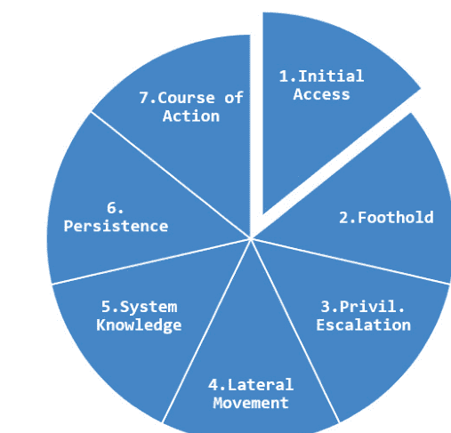

图 14.10 – 标准 APT 攻击阶段

前述步骤在以下要点中进行了解释：

- 1. **获取初始访问**：APT 攻击者将尝试通过多种技术渗透你的组织，例如 spear-phishing、钓鱼和利用零日漏洞。此步骤是阻止攻击的最佳时机。超过此阶段后，阻止 APT 将变得棘手。
- 2. **建立立足点**：一旦进入系统，APT 攻击者会安装后门（或后门网络）并创建隧道，以便悄悄与受损系统交互。他们使用多态性和变态性等先进方法使恶意软件动态化并掩盖痕迹。
- 3. **提升权限**：在建立立足点后，APT 攻击者会使用多种方法获取管理员权限。他们使用漏洞利用、进程注入、修改以及许多其他技术来提升权限。
- 4. **横向移动**：一旦 APT 攻击者获得管理员访问权限，他们可以将攻击扩展到其他系统（如服务器、工作站和第三方网络）。
- 5. **学习系统：** APT 攻击者执行内部侦察，了解系统并收集实现目标所需的任何信息。他们确定可以利用的漏洞。
- 6. **实现持久性：** 与常规黑客攻击相比，APT 的特点是能够在被发现前长期潜伏在受损系统中。APT 攻击者在系统重启后仍可控制系统。他们可以安装多个恶意软件以确保连续性。
- 7. **执行行动：** 最后，APT 攻击者可以实现其预期目标：窃取敏感数据。

组织必须始终警惕 APT。它们并不容易缓解，尤其是当攻击者已建立立足点时。挑战在于使用多个后门，增加了他们重新获得对你系统访问的机会。防范 APT 需要不仅仅是监控、使用防病毒软件、入侵检测、入侵防御等，因为这些攻击的隐蔽性极强。威胁情报是打击 APT 的有效方式。

## 追踪威胁行为者和团体

追踪威胁行为者（尤其是 APT）可能具有挑战性，特别是对于 CTI 入门级的一级组织而言。多家公司持续追踪它们并发布其信息。因此，对于一级组织和一些二级组织，建议使用公共框架作为监控对手团体和活动的起点。以下为一些流行的开源平台，可用于追踪并通过活动和团体增强你的威胁情报：

- **MITRE 团体追踪器：** MITRE 追踪团体、威胁行为者、入侵集合和活动中的对手活动。它是使用最广泛的威胁行为者追踪框架之一。最知名的威胁团体都可以在 MITRE 平台上找到 (https://attack.mitre.org/groups/)。它引用了大多数知名命名惯例。因此，你的组织可以将分析威胁与其他名称映射以追踪对手活动。
- **CrowdStrike 对手宇宙：** CrowdStrike 对手宇宙按行业和目标国家对对手信息进行分组。你可以根据业务领域和国家监控相关团体 (https://adversary.crowdstrike.com/en-US/)。
- **Mandiant APT 团体洞察：** Mandiant APT 团体洞察提供可用于追踪对手的 APT 和威胁行为者列表。Mandiant 使用流行的编号格式 APT1、APT2、APT28 等 (https://www.mandiant.com/resources/apt-groups)。

用于追踪对手和活动的商业平台也存在。根据你组织的 CTI 级别和预算，你可以选择开源或商业平台。你必须确保追踪器持续更新——这是了解敌人的重要部分。一些现代 SIEM 工具和 TIP 包含威胁行为者追踪功能。

## 淘汰威胁情报和对手活动

没有什么能永久运行，CTI 和对手活动也不例外。将会有时，情报团队必须评估该计划的有用性以及对手活动的消解。淘汰整个计划与使活动绝对化是不同的。然而，两者都可能产生业务影响后果，在淘汰任何一方之前必须考虑这些后果。分析师在 CTI 方面提出两个主要问题是：我们何时停止 CTI 计划？以及我们何时停止追踪对手活动？

## 重新思考 CTI 计划

只要 CTI 计划能够加强安全态势并优化安全运营，对组织就有帮助。当计划变得停滞时，其存在需要重新评估。然而，在讨论取消任务或重新思考威胁情报时，我们通常指的是取消特定的行动方案（杀伤链模型的 7 个 D 中的一个或多个）。让我们以发现和检测行动方案为例。

CTI 计划通过 IOC 和 IOA 帮助检测威胁和发现入侵。这种分析随后会与不同的团队共享，例如取证团队、事件响应团队和恶意软件分析团队。当出现以下情况时，应重新评估 CTI 计划和行动方案：

- **它误导了 SOC：** 当 SOC 依赖威胁情报时，后者必须切实且准确。如果其输出误导 SOC 或对 SOC 没有价值，则应淘汰并重新思考。
- **它产生大量误报：** 误报是分析师最糟糕的噩梦，因为它们浪费时间。分析师必须执行系统检查以识别误报警报的原因。部署在误报警报上的资源无法收回。因此，当 SIEM 工具报告大量误报时，必须取消该行动方案（检测）并重新评估计划。


-   **其服务变得影响业务**：组织的核心业务可能并非*安全*，除非它是安全服务提供商。因此，即使在威胁或攻击下，业务运营也必须得到保护和维持。如果威胁情报成为业务运营的绊脚石，就必须质疑其存在和结构。例如，需要银行长时间或数天关闭服务的缓解或反制措施流程应重新评估。
-   **其投资回报率难以证明**：威胁情报是高层安全决策的驱动力（例如，基础设施架构变更、系统、工具采购等）。然而，战略团队要投资 CTI，就需要了解其价值。如果后者无法简洁清晰地证明，该项目必须重新考虑。

通过反馈和生成的分析，CTI 团队应了解项目价值减弱的时机。它必须利用其专业知识找到重启项目和行动方案的方法和途径。然而，必须注意的是，被降优先级的行动方案不得完全从安全雷达中移除。*IOC 和 IOA 必须保留以供历史参考*，以帮助未来追踪对手。想象一下停止检测威胁。

## 对手战役的退役

当对手的 TTP 被揭露时，在大多数情况下该战役不太可能继续。然而，战役背后的个人仍然存在，可以改变其 TTP 并发起其他战役。或者，他们可以消失很长时间，并在组织分心并将其排除在外时重新出现。因此，不应退役战役。它们应被归档或冻结，但仍需监控。建议您执行以下操作：

-   如果可能，永久存储对手战役信息。此过程至关重要，因为 CTI 团队可以将新战役的某些 TTP 映射到旧的 TTP，以跟踪在不同战役下运作的对手。
-   改变战役的状态而不是停止跟踪。例如，看似不活跃的战役可以置于休眠状态。CTI 团队有权选择处理被动战役的适当方式。

威胁行为者，尤其是 APT 行为者，在追求目标时可能具有韧性。因此，组织必须始终关注不活跃的战役。

要构建战役，我们需要识别入侵和威胁的趋势。分析人员使用杀伤链和钻石模型执行入侵和威胁分析（请参阅 *第 10 章，威胁建模和分析 – 实际用例*）。随着时间的推移，这些模型的结果有助于构建情报库。基于 IOC 和 TTP，趋势可以是具体的、临时的或永久的。通过将入侵分析与外部数据相结合，您可以识别趋势数据中的清晰模式。此外，这些观察到的趋势是定义对手战役的关键要素。在下一节中，我们将讨论威胁情报共享。

## 传播威胁情报

威胁情报需要共享以协同防御威胁和攻击——通过帮助组织适应不断变化的网络威胁态势来提高意识。CTI 必须及时共享，内部和外部均可，使用正确的内容和呈现方式。

不同消费者对情报的需求不同。这包括他们希望如何接收 CTI 输出。最受欢迎的情报传播方式如下：

-   **应用程序编程接口 (APIs)**：这是最受欢迎的传播方法之一。它们构成了许多安全推送的基础。API 大多被使用是因为它们可以轻松集成到 SIEM、IDS、IPS 和防火墙等安全工具中。通过 API（或推送）共享威胁情报更快、更高效。请注意，今天大多数情报 API 和推送都有良好的文档。因此，它们易于与其他内部工具集成。
-   **个性化报告**：威胁情报输出可以作为针对目标受众需求量身定制的报告共享。个性化报告处理量较少，可立即使用。然而，CTI 分析师必须考虑报告的结构、内容、消费者的水平以及他们希望报告的频率。
-   **可共享和可搜索的存储库**：另一种传播情报的方法是创建所有分析的存储库并向消费者提供访问权限。消费者可以搜索恶意软件信息、IOC、IOA、对手等。公共数据库如 **VirusTotal** 和 **VirusShare** 就是公开可共享和可搜索存储库的两个例子。此外，您的组织可以创建可内部或外部使用的威胁存储库。

无论您选择哪种方法传播情报，都要牢记目标受众的需求。让我们来看一下威胁情报传播的一些考虑因素和挑战。

## 情报传播的挑战

共享情报并非没有挑战。这些挑战可能从组织的声誉到法律考虑不等。此外，威胁情报的两个终端用户（生产者和消费者）都可能面临这些挑战。它们包括以下内容：

-   **信任**：生产威胁情报需要大量努力。*CTI 团队与消费者之间必须建立信任，才能从中获得价值。* 信任可以通过技能、工作质量、可操作性以及 CTI 团队与组织其余部分（或外部传播的社区）之间的持续沟通来建立和维护。然而，信任很难建立却很容易破坏。因此，CTI 团队必须保持高工作标准。
-   **格式**：首先，组织生产威胁情报输出供内部使用。这意味着它们可能只生产适合其工具和系统的结果。共享威胁情报结果需要输出标准化——以促进互操作性。因此，一些组织可能需要将其格式转换为全球格式以便传播。然而，如今大多数 TIP 支持流行的共享格式。
-   **敏感信息保护**：CTI 分析师共享在系统中发现或检测到的威胁和入侵分析结果。这些分析通常包含敏感信息，如姓名、IP地址、电子邮件地址、文档和安全日志。共享威胁情报输出时必须保护数据，因为敏感信息泄露可能对组织造成毁灭性打击。制定良好的信息共享政策至关重要。
-   **法律要求**：共享情报时，请考虑法律规定（例如，内部、地方、国家和国际（如有必要））。后者将维护共享中的隐私和协作。法律要求对于合法控制进出组织的信息至关重要。然而，法律程序和检查可能会在威胁情报传播中引入延迟。因此，您需要在法律规定和 CTI 共享之间取得平衡。
-   **共享情报的评估**：在消费之前，共享情报的质量、准确性和可用性至关重要。并非所有共享的情报输出对您都有帮助。因此，在接收外部情报时，您需要评估其准确性和对您安全态势的适用性。

此处提供的挑战并非详尽无遗。组织可能因其地理位置、运营行业或业务线而面临其他挑战。CTI 分析师或团队应评估所有要求，以确保情报共享流程不附带风险。

## 战略、战术和运营情报共享

在传播情报时，了解目标受众以及应以何种格式向他们呈现数据至关重要。

**战略消费者**，也称为业务经理和高级管理人员，专注于高层安全情报。战略情报使他们能够做出预算决策、资源分配和政策制定。他们主要是非技术人员（他们可能有或没有技术背景）。因此，战略情报必须以报告形式共享，提供*对安全态势和 CTI 在整体安全态势中的贡献的洞察*。您应突出*项目带来的收益*并证明投资回报率。请注意，战略情报不对外共享。

**运营消费者**，也称为技术安全分析师，专注于在日常运营中使用情报。他们使用 IOC 来检测和响应威胁。他们采取适当的安全措施以确保系统持续受到保护（例如，更新安全规则、阻止恶意软件等）。他们非常技术化。因此，他们的情报报告应包含许多技术细节，包括 *IOC*、*攻击* 和 *战役*。由于他们立即消费产品并使用其内容，其情报可以以 API、YARA 规则、**结构化威胁信息表达** (**STIX**) 和 **可信自动化情报信息交换** (**TAXII**)、OpenIOC 和 CSV 的形式共享。

**战术消费者**专注于对手 TTP 以及对手如何攻击组织。他们识别安全态势中的漏洞并提出缓解步骤。因此，他们的情报输出必须包含详细的 *对手 TTP* 和 *缓解步骤*。它应包括对手执行战术时使用的 *威胁攻击向量* 和 *工具*（例如，他们如何访问系统、如何执行代码、如何绕过安全、如何提升权限以及如何实现对受损系统的命令和控制）。您可以通过报告或推送的形式共享战术情报。


组织或 CTI 团队应根据需求和受众决定共享格式。混合受众内容或向受众发送错误情报会降低其价值。

## 威胁情报共享架构

随着组织进入威胁情报传播阶段，了解共享架构至关重要。因为 CTI 具有协作性，组织和个人通常使用三种方法交换情报，如下图所示：

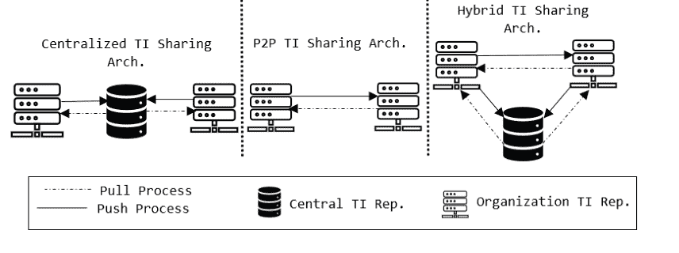

图 14.11 – 威胁情报架构

三种架构分别是集中式、点对点（P2P）和混合式，后者结合了前两种架构。

以下几点解释了这三种架构：

- **集中式威胁情报共享：** 配置一个中央存储库来存储交换的情报。组织（或成员）将可共享的情报推送到中央存储，并拉取其他组织共享的情报。使用中央架构时，共享情报会被审查并与所有成员共享。因此，中央服务器越强大，分发情报的质量越好。虽然一些中央枢纽可用于直接情报分发，但其他枢纽可提供额外服务，例如评估共享信息、处理，以及与其他数据的关联和丰富。 使用集中式方法的优点包括 (1) *统一的信息存储库*，便于维护和管理访问；(2) *维护标准格式* – 无需拥有多种共享格式；(3) *可靠性* – 如果某个成员的连接失败，其他成员不受影响，情报共享也不受影响；(4) *成本效益高*，因为每个成员只需维护一个连接（或一对用于冗余的连接）；(5) *数据交换中冲突很少或没有*，因为成员仅连接到中央枢纽；并且 (6) *加入容易*，因为你只需连接到中央枢纽。然而，集中式共享架构也有其缺点，例如 (1) *单点故障*。如果枢纽故障，共享基础设施将停机，意味着成员无法访问共享情报。另一个缺点是 (2) *完全依赖中央存储库*。服务器的任何故障、延迟或攻击都会影响所有成员。大多数开源共享平台，如 AlienVault OTX，使用集中式共享架构。
- **P2P 威胁情报共享：** P2P 威胁情报架构类似于网状网络配置。共享情报的组织直接连接到彼此的系统。每个组织在共享之前需要丰富其情报数据。 P2P 威胁情报共享架构的优点包括 (1) 组织之间 *更快、更直接的分发*，以及 (2) *没有单点故障*，因为成员的断开连接不会影响其他共享组织 – 冗余。 P2P 的缺点包括 (1) *多种格式*：即如果没有商定共享格式，适应所有格式就会变得困难。 – 一个成员必须理解其他成员的数据格式。此外，还有 (2) *成本问题*，由于扩展。随着成员数量增加，扩展系统的成本也会增加。每个成员都需要为新成员添加连接。 P2P 威胁情报架构仅适用于少数组织群体。
- **混合威胁情报共享：** 混合威胁情报共享架构结合了前两种架构的优点。中央枢纽充当催化剂，执行身份验证、访问管理、请求处理等管理任务。混合架构的主要优点是 *冗余*。情报可以直接与对等方共享并保存在中央存储库中。然而，*成本可能是此类实施的障碍*。混合架构适用于三级组织（拥有成熟 CTI 项目）。

选择架构时，CTI 分析师必须考虑威胁情报和业务需求、预算以及希望加入的共享社区。加入 ISACs 等社区可以使组织受益。然而，还有其他需要考虑的事项，例如访问控制、成员数量、共享的情报类型、会员费用、情报保留期、运营行业，最重要的是适用的条款和条件。例如，加入政府主导的 CTI 共享组可能会带来额外的挑战、条款和条件（安全许可、机密数据等）。分析师在传播或选择威胁情报社区时需要评估所有参数。

*只要协议、数据和成员的专业知识与其实体目标一致，组织可以加入一个或多个威胁情报共享社区。对于初创和一级组织，建议您从具有开源存储库的集中式威胁情报架构开始。然后，如果必要，逐步迁移到混合情报共享架构。*

## YARA 规则和威胁情报共享格式

**Yet Another Recursive Acronym (YARA)** 是流行的开源工具，用于恶意软件和威胁检测、分类和共享（https://bit.ly/3eLZD99）。它是一个多用途工具，可以被恶意软件分析师、威胁情报分析师和事件响应分析师利用。对于 CTI 分析师，YARA 的规则可用于创建 IOC 并定义要与其他分析师共享的分析属性（例如元数据、标题等）。以下是 YARA 的一些特征：

- 它依赖模式匹配来检测和发现恶意软件家族。YARA 的主要用途是恶意软件分析和检测。
- 其规则可以集成到安全工具中，例如 SIEM 工具、TIPs 和入侵检测系统，以检测、阻止和传播恶意软件签名和 IOC。多个安全工具支持 YARA 创建自定义规则，包括 MISP（一个开源威胁情报平台）。
- 它与流行的 IOC 共享格式兼容，例如 STIX、TAXII 和 **Cyber Observable Expression (CyBox)**。分析师可以使用 YARA 扫描系统以查找恶意软件入侵。
- 它可以安装在 Unix（Linux 和 OS X）和 Windows 工作站上并支持终端执行。
- 其规则易于编写和共享。

以下片段展示了 YARA 规则的示例（https://bit.ly/3eOE8V4）。YARA 的结构与 C 编程语言类似：

```
/*
    A YARA multi-line comment
*/
rule ExampleRule //An example rule to show YARA structure
{
    strings:
        $my_text_string = "text here"
        $my_hex_string = { E2 34 A1 C8 23 FB }
        $my_regex_str = /md5: [0-9a-zA-Z]{32}/
    condition:
        ($my_text_string or $my_hex_string) and $my_regex_str
}
```

语法结构可以描述如下：

- The `rule` identifier: 这是 `rule` 的名称。它在编程中充当函数。它开始每个 YARA。规则包含两部分（`strings` 和 `condition`）以及元数据的可选组件。元数据用于添加描述、标题和其他描述性信息。
- The `strings` section: 这定义了要搜索的字符串。字符串可以用作 *文本*（在双引号中）或 *十六进制*（在大括号中）。每个字符串变量以 $ 字符开头。十六进制字符由空格分隔。 YARA 字符串有三种类型：（1）*十六进制* 字符串，可以对未匹配的字节使用通配符；（2）区分大小写的 *文本* 字符串 – 在字符串末尾使用 `nocase` 可使其不区分大小写；以及（3）用于匹配任何字符字符串的正则表达式。它们必须用正斜杠括起来。
- The `condition` section: 这是每个 YARA 规则所必需的。它使用布尔表达式和算术指示规则何时必须向我们发出警报。此外，它包含规则的逻辑。


A string can be an IP address, a domain name, or a specific hash value. A regular expression (regex) can be a URL or a mutex pattern. You can count the number of times a string variable appears in the file.

Understanding the essential components of a YARA rule is fundamental for writing and interpreting them. However, more complex rules can be created (including global and private rules and modules). Once a YARA rule has been created, it can be uploaded to the security tools for IOCs and malware scanning.

> **重要提示：面向 CTI 分析师的 YARA**
> YARA 对于事件响应分析师和恶意软件分析师至关重要。CTI 分析师不必是编写 YARA 规则的专家。然而，他们必须能够编写简单的规则并理解复杂的规则以实现系统集成。

*第 15 章，威胁情报共享与网络活动归因 - 实际用例，* 涵盖了使用 YARA 规则进行恶意软件检测和 IOC 创建的实际用例。有关 YARA 的更多信息，请访问可在网站上找到的官方文档 (https://yara.readthedocs.io/en/v3.5.0/index.html)。

其他流行的威胁情报共享格式包括以下内容：

- **结构化威胁信息表达 (STIX)**：这是一种用于威胁情报交换的开源语言 (https://bit.ly/3eOODYs)。STIX 在 *第 4 章，网络威胁情报技艺与标准* 中有所介绍。另一个有用的用例在 *第 15 章，威胁情报共享与网络活动归因 - 实际用例* 中有所介绍。
- **可信自动化指标信息交换 (TAXII)**：这是一种使用 HTTPS 进行网络威胁信息（STIX 格式的 CTI 信息）通信的协议。TAXII 也在 *第 4 章，网络威胁情报技艺与标准* 中有所介绍。
- **网络可观测表达 (CybOX)**：这是一种用于共享和传达网络可观测物的结构化语言 (https://cyboxproject.github.io/)。请注意，CyBox 已集成到 STIX 2.0 中。

- **恶意软件属性枚举与表征 (MAEC)**：这是一种社区开发的用于共享恶意软件信息的结构化语言 (`https://maecproject.github.io/about-maec/`)。MAEC 的优势包括 (1) 改善反恶意软件信息的沟通，(2) 减少分析重复，因为它可以确定特定恶意软件是否已被分析，(3) 在分析公开时增强对恶意软件的全球认知，(4) 使恶意软件分析过程更快。它被称为 *非签名恶意软件分类语言*。此外，它使用 JSON 格式，将所有恶意软件可观测物作为属性。
- **通用攻击模式枚举与分类 (CAPEC)**：这是指一个开源的常见攻击模式目录 (`https://capec.mitre.org/`)。该目录提供了一个详细说明相关攻击并与社区共享的模式。一些攻击模式包括 SQL 注入、跨站脚本、会话固定、HTTP 响应拆分等。

前述格式被称为 MITRE 格式。现代 SIEM 工具和 TIP 支持大多数威胁情报共享格式。然而，如果组织使用自定义格式，CTI 分析师（或 CTI 团队）应能够将其解析为更标准的格式。他们可以采用自动化技术或手动脚本。

## 一些信息共享与协作平台

威胁情报共享平台促进组织之间的情报传播。虽然大型企业（即三级组织）可以建立情报共享基础设施，但一级和二级组织可以利用现有平台。大部分可用的共享平台由安全社区和厂商支持和维护。一些流行的开源 TIP 包括以下内容：

- **MISP** (`https://www.misp-project.org/`)：这是最常用的开源威胁情报和共享平台之一。由欧盟共同赞助，MISP 用于收集、共享、存储和关联不同网络攻击中使用的 IOC。MISP 在 *第 5 章，目标设定、CTI 策略程序和实际用例* 以及 *第 10 章，威胁建模和分析 - 实际用例* 中有所介绍。然而，更多信息可在官方 MISP 网站上找到。
- **AlienVault OTX** (`https://otx.alienvault.com`)：该开源威胁情报平台由 AT&T Cybersecurity 创建。AlienVault OTX 在 *第 12 章，SIEM 解决方案和情报驱动的 SOC* 中进行了介绍。

- **Blueliv 威胁交换网络** (https://community.blueliv.com/)：这是一个用于共享 IOC 以进行威胁防护的网络平台。它包含网络威胁地图、恶意软件沙箱、用于与内部系统集成的 API，以及提供威胁行为者活动和画像的时间线。以下屏幕截图中显示了一个示例：

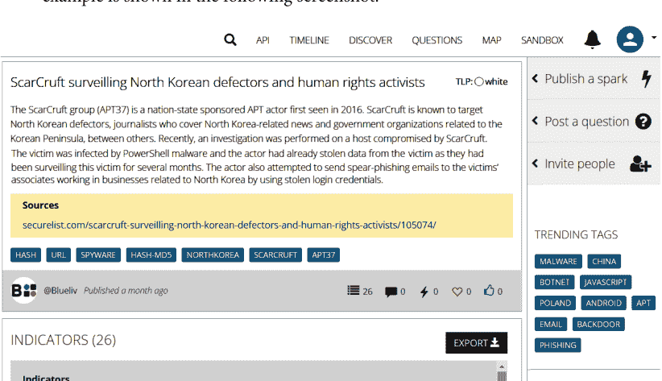

图 14.12 – Blueliv 威胁交换网络时间线

该系统是开源的。因此，您可以注册并探索威胁交换平台的功能。

- **Anomali STAXX** (https://www.anomali.com/resources/staxx)：这是一款提供 STIX/TAXII 数据源便捷访问的工具。STAXX 可从 Anomali 官方网站下载并通过五个简单步骤设置：(1) 下载 STAXX OVA 文件并将其导入虚拟机环境。(2) 使用配置向导设置 STAXX。(3) 使用工具的向导配置 STIX/TAXII 源。(4) 选择情报源。(5) 设置情报数据更新计划，工具即可使用。

- **Cyware 威胁情报交换** (https://cyware.com/ctix-stix-taxii-cyber-threat-intelligence-exchange)：这是一款具有摄取、分析、丰富和共享功能的客户端-服务器 TIP。它支持所有已知的情报共享格式，包括 STIX（1.0 和 2.0）、MISP、CybOX、MAEC、YARA、PDF、电子邮件和基于文本的格式。

组织也可以利用商业共享平台进行传播。其他情报共享平台包括 IBM X-Force Exchange（免费和商业版）、McAfee Threat Intelligence Exchange、ThreatConnect、ThreatExchange 和 YaraShare。

## 威胁情报反馈循环

用户反馈对 CTI 项目的成功至关重要。CTI 团队必须确保威胁情报创建者与客户之间保持持续的反馈循环，因为它能改善您的威胁情报项目。反馈过程必须是 *互动的* 和 *协作的*。它应该是互动的，因为 CTI 团队必须能够质疑客户的评论，而后者可以提供改进建议。双方必须相互倾听。它应该是协作的，因为反馈需要参与项目的意愿。CTI 团队必须确保客户了解他们的评论和意见有多么宝贵。让我们讨论一下为 CTI 项目获取反馈的好处。

## 了解 CTI 反馈循环的好处

反馈循环是一种需要在上下文中理解的机制。如今，一些组织引入了社会工程演练（或练习）的概念，例如，用于识别可能成为社会工程攻击（最常用的初始访问手段）受害者的员工。然后，他们为其组织培训。其他组织使用问卷（或调查）来获取用户的反馈。威胁情报是一个循环过程——随着威胁形势的演变，CTI 项目也应随之演变。因此，反馈对于 CTI 的发展至关重要。那么，*为什么威胁情报反馈很重要？* 对此问题的回答在以下几点中给出：

- **丰富情报需求**：情报反馈用于重塑项目的交付成果。它表明 CTI 项目是否令人满意。因此，CTI 团队利用情报反馈来设定新需求。
- **提高 CTI 准确性**：反馈帮助 CTI 团队评估项目的有效性。该项目对消费者来说有多大可操作性？该项目是否有助于改善组织的安全态势？


- **指导数据收集**：威胁情报反馈可识别已收集数据中的任何差距。不同团队可以指出所收集的数据是否充分。
- **帮助评估项目**：威胁情报反馈帮助 CTI 团队评估整体项目。

威胁情报反馈可以作为不同章节添加到情报报告中。此外，它可以作为战略报告的一部分使用——向战略团队展示该项目的可操作性和质量。CTI 团队不应削弱消费者对该项目的意见。

## Methods for collecting threat intelligence feedback

没有标准的收集威胁情报反馈的方法。CTI 团队应了解受众并制定适当的方法来收集消费者的意见和评论。威胁情报分析师使用的一些方法包括以下内容：

- **报告中的 URL 链接**：CTI 团队在报告内添加反馈部分并提供评论和意见的链接。该方法更适用于电子生成和分发的报告——组织创建平台让消费者下载最新的 CTI 报告并留下反馈。
- **每次威胁情报分析后的安全调查**：CTI 团队可以收集关于单个威胁或入侵分析案例的反馈，然后将其汇总为全局反馈。该方法被称为 *部分反馈收集*。它具有很大的价值，因为它可以帮助分析师即时调整需求、添加更多数据并增强分析流程。

> **重要提示：反馈时机**
> 虽然威胁情报反馈对项目改进至关重要，但其时机（时间要素）必须最优且务实。如果消费者提供反馈的时间过长，后者可能不再能有效重塑项目。例如，对于每月生成的威胁情报战略报告，应适用两周的时间，给团队足够的时间调整需求。然而，如果战略团队在报告上提供其观点的时间超过一个月，则下一份报告将不会有反馈。

无论使用何种方法，威胁情报反馈都应促进生产者和消费者之间的协作和互动。此外，应对消费者的响应应用适当的时机，以保持 CTI 项目的有效性。

## The threat intelligence feedback cycle – use case

假设您已生成一份威胁情报报告并通过网络链接与 SOC 团队的其余成员共享。反馈循环如下：

1. 蓝队 *访问* 月度战术报告并打算用它来更新系统防御，包括防火墙、端点和入侵防御系统规则（使其具有可操作性）。
2. 蓝队意识到所生产的情报不够及时，因为某些 IOC 和对手战役已被退役。他们以 *简便* 且 *易于理解* 的方式向 CTI 团队提供此信息。
3. 蓝队通过解释非更新情报输出的 *后果* 来 *扩展第二点*，例如无法监控最近的威胁和攻击。此时，CTI 团队拥有足够的信息来重塑需求。例如，他们将从月度情报改为每周或双周报告。
4. 蓝队从第 1 点（反馈循环）重新开始。

这里描述的循环为 CTI 收集反馈提供了一种直接的方法。我们随后可以总结反馈流程，如下图所示：

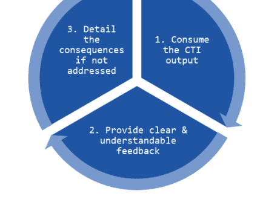

Figure 14.13 – The threat intelligence feedback loop cycle

威胁情报反馈循环在 CTI 项目中至关重要。您需要确保所生产的 CTI 具有可操作性并使所有消费者受益。做到这一点的最佳方式是确保所有消费者满意并且项目投资回报率可以得到证明。CTI 流程是一个闭环。只要项目处于活跃状态，就必须考虑消费者的反馈。因此，反馈流程也成为一个闭环。

## Summary

威胁情报报告对于确保 CTI 项目使组织受益并且所有相关方都了解组织面临的威胁和攻击至关重要。报告必须根据接收者的需求进行定制。随着情报的创建，它需要内部和外部传播——威胁情报是一个协作和互动的主题。因此，建议您加入一个或多个共享社区。然而，您应根据支持、维护、推送和拉取请求、成本、条款和条件等因素评估想要加入的社区。

本章介绍了威胁情报报告，讨论了 CTI 分析师应考虑的情报报告类型。它讨论了如何使报告具有价值并使用简单模板创建报告。然后，它详细介绍了如何理解和构建对手战役、追踪威胁行为者、退役战役以及退役 CTI 行动方案。它提供了 APT 的全球概述。最后，它讨论了威胁情报传播的细节以及反馈循环在 CTI 中的重要性。

尽管报告、传播和反馈被认为是 CTI 的最后阶段，但必须理解 CTI 是一个循环过程。因此，最后阶段为下一周期的第一阶段提供输入。

在下一章中，我们将使用实际案例研究威胁情报共享和 IOC 构建。

## 15 Threat Intelligence Sharing and Cyber Activity Attribution – Practical Use Cases

## Threat Intelligence Sharing and Cyber Activity Attribution – Practical Use Cases

共享威胁情报已被证明对安全社区有益，帮助组织在战略、战术和运营层面受益。情报可以通过多种方式和格式共享。**网络威胁情报 (CTI)** 分析师或团队必须能够起草威胁情报报告并为内部和外部传播准备输出。在进行威胁情报时，他们应了解如何从分析中构建威胁活动组和战役。对网络领域中国家或国家支持的行动者影响以及高级网络犯罪分子的威胁的认识，对于追踪最复杂的网络活动至关重要。之前的攻击和入侵表明，国家支持的行动者可以针对私人机构。因此，CTI 分析师或团队在必要时应能够进行 **竞争假设分析 (ACH)** 并将威胁和攻击归因于国家支持的行动者。

本章重点介绍实用的威胁情报共享方法以及如何将网络活动归因于战役、威胁组织或威胁行为者。它为分析师配备了开发和共享 **入侵指标 (IOCs)** 以增强内部安全并进行外部传播的实用技能。它还为分析师提供了威胁追踪的知识。

到本章结束时，您应该能够做到以下几点：

- 使用 YARA 规则开发或发现 IOC 并用它们检测和阻止攻击。
- 设置 Anomali STAXX，一种基于 **结构化威胁信息表达/可信自动化情报交换 (STIX/TAXII)** 的开源情报分发平台。
- 使用威胁情报共享平台进行情报共享。
- 从威胁分析中构建活动组并将分析与每个组关联。
- 进行 ACH 将网络活动归因于国家支持的组织。

在本章中，我们将涵盖以下主要主题：

- 创建和共享 IOC
- 理解和执行威胁归因

## Technical requirements

此用例使用 **SANS 调查取证工具包 (SIFT) 虚拟机 (VM)**。它可以安装在 **VirtualBox 或 VMware** 上。或者也可以使用 Ubuntu 机器。SIFT 的下载和安装步骤可以在官方网站上找到：https://www.sans.org/tools/sift-workstation/。

*第 10 章，威胁建模和分析 – 实用案例* 中执行的分析及其工件也是必需的。

## Creating and sharing IOCs

让我们考虑在 *第 10 章，威胁建模和分析 - 实用案例* 中执行的入侵分析，其中显示了简化的杀伤链发现操作。分析期间提取的其他一些指标包括 `executable.1640.exe` 的哈希值，`12cf6583f5a9171a1d621ae02b4eb626`，以及 `resoh.ru` 域名：

| 阶段 | 发现 |
|---|---|
| 侦察 | 网站页面：event-mogul/about 页面。LinkedIn、Twitter。电子邮件地址及研究 affiliations |
| 武器化 | research_tech.pdf (嵌入式 JavaScript) |
| 投递 | 钓鱼 (email)。194.150.215.153 |
| 利用 | 挂钩运行进程 (explorer.exe) |
| 安装 | read_sl.exe (在 explorer.exe 上), executable.1640.exe, ~/.exe (outlook 临时文件夹) |
| 命令与控制 (C2) | 125.19.103.198 Sys/files/ |
| 行动 | 46.168.5.140, 数据外泄 - FTP, HTTP POST/GET (RAR docs project cobra), C0d0s123 (密码) |

图 15.1 – 入侵分析的简化版网络杀伤链模型

分享威胁情报使网络威胁的防御更有效。在成功分析后，CTI 分析师应选择正确的格式和平台在内部和外部传播结果。本节介绍 IOC 共享以及使用 YARA 检测恶意流量。

## 用例一 – 使用 YARA 开发 IOC

YARA 常用于恶意软件检测和流量监控。其结构已在第 14 章，威胁情报报告与传播中介绍。CTI 分析师应熟悉基本的 YARA 规则及其应用。本用例帮助 CTI 分析师熟悉使用 YARA。

**用例场景：** 你为 ABC 公司进行了入侵分析并识别出与攻击相关的 IOC。战术团队要求你创建一个 YARA 规则以在未来检测类似攻击和恶意软件。

**用例目标：** 本用例的目标是练习针对 IOC 生成和验证 YARA 规则以保护系统。完成此练习后，你应能够编写可在特定条件下检测网络事件的规则。

解决本用例的步骤如下：

- 1. **确保 YARA 正常工作：** 登录 SIFT VM（或 Ubuntu 机器）并测试 YARA。测试 YARA 的基本方法是创建一个虚拟规则。打开终端并执行 echo "rule <rule name> { condition: true}" > <yaratest_rule>，然后执行 yara <rule name> <rule name> 命令。输出显示在下图中：

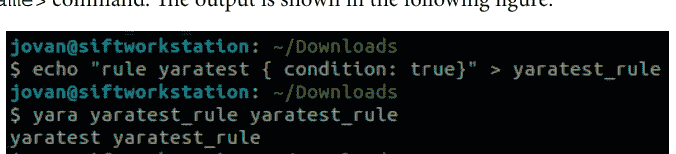

图 15.2 – 测试 Yara 规则 – 示意图

输出显示 yaratest 规则与 yaratest_rule 文件匹配。如果未安装该工具，请在终端执行 sudo apt install yara 命令。使用 yara --help 命令查看可为 YARA 规则配置的语法和选项。一般语法如下所示：

```
yara [Option]... [Namespace:]rules_file... File | Dir | PID
```

- 2. **创建规则以检测 IOC：** 我们创建规则以检测以下 IOC：46.168.5.140 和 125.19.103.198 IP 地址以及 12cf6583f5a9171a1d621ae02b4eb626 MD5 哈希。使用文本编辑器创建规则并将其保存为 .yara 文件，如下图所示：

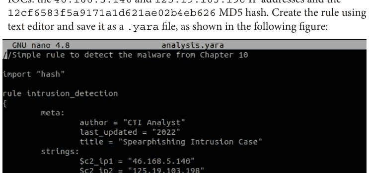

图 15.3 – 入侵检测的 Yara 规则代码

该规则定义了三个变量、两个 IP 地址和 ddraw.dll 字符串。条件定义为如果任何字符串与流量文件、内存转储、文件或进程匹配，则应生成警报。

- 3. **针对内存转储验证规则：** 我们使用在 *第 10 章，威胁建模与分析 – 实际用例* 中执行的入侵分析的内存转储。执行以下命令：

```
yara -s analysis.yara memorydump.vmem
```

命令和输出显示在下图中：

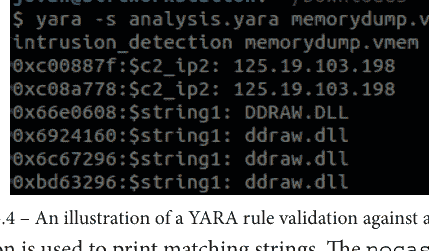

图 15.4 – YARA 规则针对内存转储验证的说明

-s 选项用于打印匹配的字符串。可以在搜索时添加 nocase 参数以移除大小写敏感性。字符串搜索的另一个重要参数是 wide 属性。它允许在字符串以每个字符两个字节编码时仍进行搜索。

输出显示 YARA 规则中的指标与内存转储中的指标匹配。它还提供了扫描文件中内存地址。我们可以看到 125.19.103.198 已位于两个不同的内存地址 0xc00887f 和 0xc08a778 中，并且 ddraw.dll 字符串可在六个不同的内存地址上找到。现在，我们知道该规则将在内存中检测到这些 IOC。

- 4. **针对文件验证规则：** 我们测试规则根据哈希值检测恶意文件。我们使用来自 *第 10 章，威胁建模与分析 – 实际用例* 的 executable.1640.exe 文件。执行以下命令：

```
yara -f analysis.yara forensic_files/
```

输出显示在下图中。

```
jovan@siftworkstation: ~/Downloads
$ yara -f analysis.yara forensics_files/
intrusion_detection forensics_files//executable.1640.exe
intrusion_detection forensics_files//1640.dmp
intrusion_detection forensics_files//memorydump.vmem
```

图 15.5 – YARA 规则针对目录验证的说明

-f 选项用于快速扫描并匹配字符串。如果当前目录是要扫描的目录，请使用 yara -f . 命令。我们可以看到规则已检测到三个包含与条件匹配的部分的文件。请注意，可执行文件位于内存转储和 1640.dmp 文件中。现在，我们可以确定我们的 YARA 规则将检测到恶意文件。

> **重要说明 – 规避技术**
> 诸如 **高级持续性威胁 (APTs)** 之类的威胁采用复杂的规避技术。成功攻击和数据泄露的增长证明，包括防病毒、入侵检测和防火墙在内的安全系统可能无法检测到恶意软件和 IOC。因此，建议更新 YARA 规则数据库，频繁扫描系统以查找 IOC，并确保 *CTI 程序有效。*

作为 CTI 分析师，你已学习如何使用 YARA 创建 IOC 并对其进行验证。建议在投入生产前先验证规则。对于更复杂的 YARA 规则、使用库和外部文件以及使用 Python 进行自动化，请参阅官方文档页面：https://bit.ly/3tZxggj。

## 用例二 – 使用 Anomali STAXX 共享情报

Anomali STAXX 基于 STIX 和 TAXII 共享标准。它已在上一章中介绍，其中包含作为独立基础设施安装平台的基本步骤。我们将在本用例中研究 CTI 分析师如何利用 STAXX 执行情报共享。

**用例场景：** ABC 公司希望你为与严重依赖 STIX/ TAXII 标准的其他组织建立威胁情报协作而设置 STAXX 基础设施。此外，CTI 经理希望你使用已安装的基础设施发布之前的入侵分析的输出。

**用例目标：** 本用例的目标是熟悉 STAXX 平台并使用广泛使用的 STIX/ TAXII 标准发布和共享威胁情报。Anomali STAXX 促进威胁情报的共享和收集。

用于解决本用例的步骤如下：

- 1. **下载 STAXX OVA 文件：** 从网站 (https://bit.ly/3nZcBoO) 下载 STAXX **开放虚拟设备** (**OVA**) 文件并将其保存到本地计算机。
- 2. **导入并配置 STAXX VM：** 将 OVA 文件导入虚拟化环境。本例中我们将使用 VirtualBox。成功导入设备后，启动 VM。控制台用户名和密码分别为 anomaly 和 anomalistaxx。你将在首次登录时被要求更改密码。控制台窗口显示在下图中：

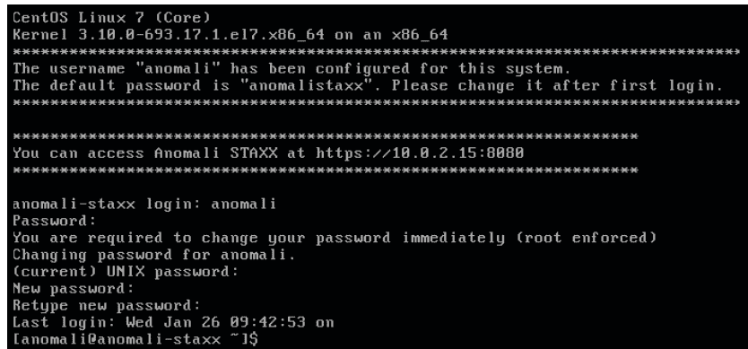

图 15.6 – 成功安装后 Anomali STAXX 控制台窗口

请注意访问链接：https://10.0.2.15:8080。10.0.2.15 是 VM **网络地址转换 (NAT)** 适配器 IP 地址。它不能通过主机直接访问。你应通过导航到 **VM | 网络 | 适配器 1 | 高级 | 端口转发** 来启用 NAT 端口转发。添加规则，如下图所示，然后单击 **确定** 完成配置：

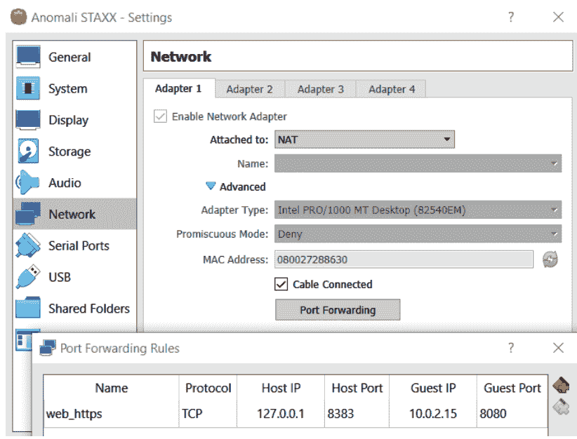

图 15.7 – STAXX VM 的端口转发配置

或者，你可以使用 *桥接适配器* 设置代替 NAT 以允许主机和 VM 之间直接通信。

- 3. **访问 Web 界面：** 打开 Web 浏览器并导航到 https://127.0.0.1:8383，接受证书消息，你应被重定向到如下图所示的 Anomali STAXX 平台登录页面。用户名和密码分别为 admin 和 changeme，你将在首次登录时被要求更改密码：

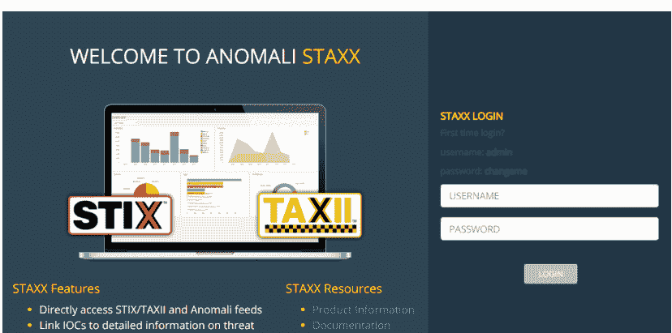

图 15.8 – Anomali STAXX 威胁情报平台的登录页面

登录后，欢迎页面会显示 STIX/TAXII 服务器配置向导，我们将在下一步中进行探索。

4. 配置 STIX/TAXII 服务器：您可以配置自己的 STIX/TAXII 服务器，如果您有的话。或者，您也可以使用 Anomali 的默认 STIX/TAXII 服务器 LIMO。单击 USE ANOMALI LIMO 并根据系统配置检查或取消选中代理服务器配置。在本练习中，我们将保持未选中状态，如以下屏幕截图所示：

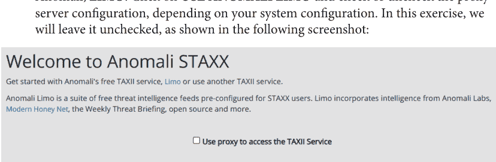

图 15.9 – Anomali STAXX 欢迎页面和 STIX/TAXII 服务器向导

成功设置 LIMO 后，单击 **LET'S TRY STAXX**。您必须接受许可协议的条款和条件。请注意，初始设置后您可以配置额外的 STIX/TAXII 服务器。

- 5. **查看 STIX/TAXII 可观测数据**：STAXX 为选定时间段提供具有可观测数据的深入仪表板。您可以深入查看每个指标或可观测数据以获取更多信息。以下图示显示了仪表板的下钻视图：

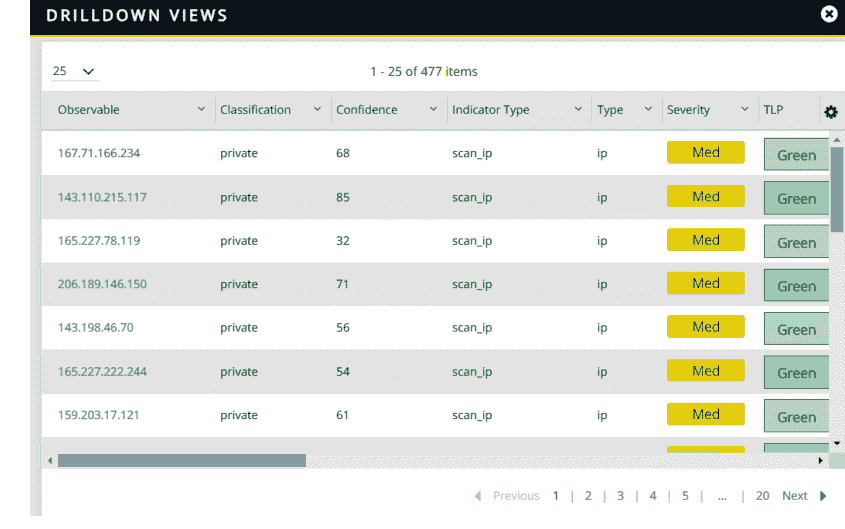

图 15.10 – 来自主仪表板的 Anomali STAXX 下钻视图

前一幅图显示了 IP 地址作为可观测数据，并附带严重性、**Traffic Light Protocol (TLP)**、源（或来源）等信息。单击可观测数据以查看其详细信息。您可能需要使用 `https://bit.ly/3IJ1pox` 链接免费注册 Anomali 才能查看可观测数据详细信息。**ACTIVITY** 页面提供了搜索可观测数据和应用筛选器的机制。

6. **配置可观测数据**：Anomali STAXX 允许 CTI 分析师与社区共享可观测数据。(1) 单击菜单栏上的 **IMPORTS** 以调出可观测数据导入页面。(2) 填写从入侵分析中提取的 IOC。以下 IOC 已添加：`125.19.103.198`、`46.158.5.140`、`resoh.ru` 和 `12cf6583f5a9171a1d621ae02b4eb626`。(3) 选择威胁类型。这里我们选择 **malware**。(4) 将置信度级别设置为 70%。(5) 将严重性设置为 **High**，因为这是对系统的攻击。(6) 为活动添加一个或多个标签。我们将添加以下标签：`suspicious-IP`、`suspicious-domain`、`phishing-malware` 和 `victim-finance`。(7) 设置适当的 TLP 颜色。让我们将其设置为 **Red**。(8) 单击 **Import** 以导入可观测数据信息。可观测数据配置显示在以下图中：

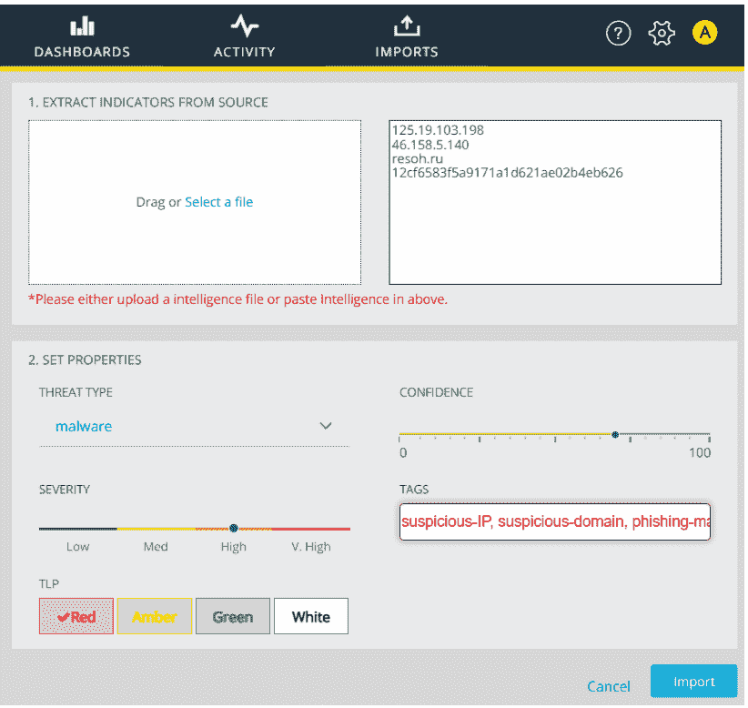

图 15.11 – Anomali STAXX 可观测数据配置页面

导入与我们的分析相关的可观测数据后，会出现批准或拒绝窗口，如下图所示。仔细验证插入的数据后，单击 Approve Import 按钮：

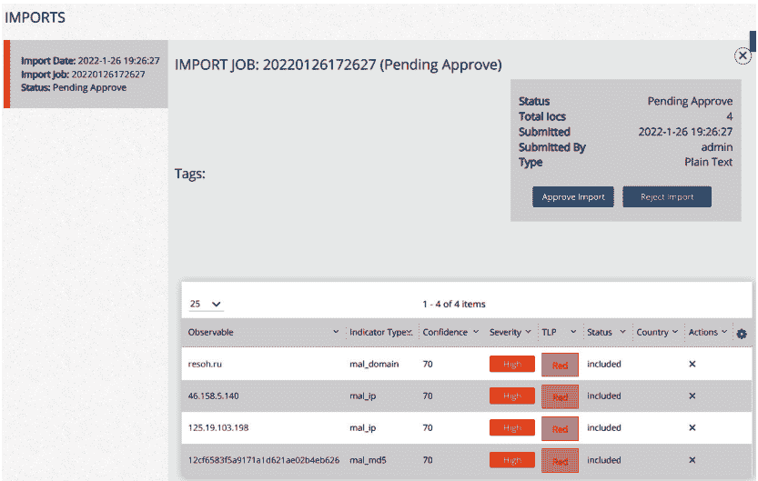

图 15.12 – Anomali STAXX 可观测数据审批页面

批准后，状态将从待批准更改为已批准，您可以将可观测数据推送到远程或公共 STIX/TAXII 服务器。

7. **共享可观测数据**：要将可观测数据推送到 STIX/TAXII 服务器，(1) 选择您想要共享的所有可观测数据或指标，然后 (2) 单击 **Push Observable** 按钮，如下图所示：

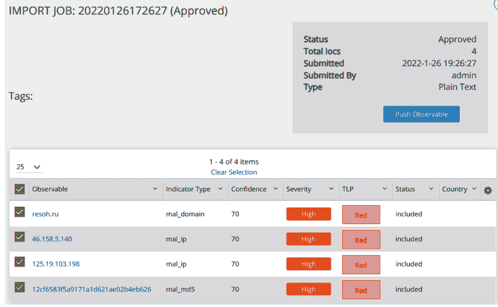

图 15.13 – 已批准的可观测数据和共享配置

集合信息页面打开。您需要插入名称、描述、推送频率，最重要的是 IOC 被推送到的 STIX/TAXII 站点。PUSH OBSERVABLES 窗口显示在以下图中：

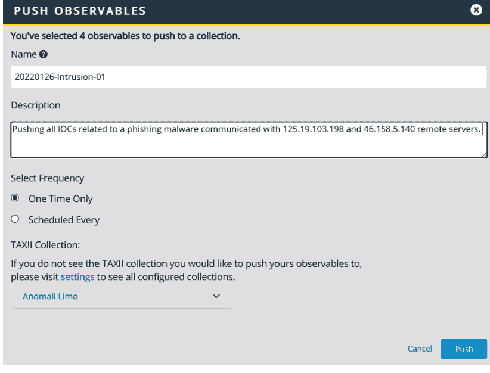

图 15.14 – STAXX PUSH OBSERVABLES 窗口

我们的 IOC 被推送到 LIMO STIX/TAXII 服务器，社区的其余成员可以使用共享的威胁情报来增强其安全态势。

Anomali STAXX 是一个强大的基于 STIX 的 CTI 共享平台。本节展示了设置 Anomali STAXX 客户端并连接到 STIX/TAXII 服务器进行威胁情报共享的基本步骤。有关收集、配置和管理 Anomali STAXX 客户端的更多信息，请参阅随 OVA 文件提供的《安装和管理员指南》文档。

请注意，一级（入门级 CTI）和二级（中级 CTI）组织可以利用 STAXX 和恶意软件信息共享平台（MISP）进行经济高效的威胁情报应用。

## 用例三 – 通过平台共享情报

共享威胁情报对于全球打击网络攻击至关重要。CTI 分析师共享 IOC 以揭露威胁行为者的活动。威胁情报共享平台对于有效的情报协作至关重要。它们还有助于流程自动化。

**用例场景：** 对于已执行的入侵分析，您需要将结果发布到一个或多个平台，以增强安全社区的能力。这将使社区能够丰富和更新威胁和 IOC 数据库。

**用例目标：** 该用例的目标是通过开源情报共享平台展示威胁情报共享。我们只会选择一个共享平台。然而，CTI 分析师需要调查其他平台。

我们需要共享的 IOC 包括两个 IP 地址、一个域名和一个 MD5 哈希键：分别为 `125.19.103.198` 和 `46.158.5.140`、`resoh.ru` 和 `12cf6583f5a9171a1d621ae02b4eb626`。

**使用的平台：** AlienVault **Open Threat Exchange (OTX)**

AlienVault OTX 在 *第 12 章，SIEM 解决方案和情报驱动的 SOC* 中介绍过。CTI 分析师可以利用它以 *脉冲* 的形式共享威胁和入侵分析。以下步骤用于解决此用例。请注意，其中一些步骤不会重复，因为我们假设 CTI 分析师已在 *第 12 章，SIEM 解决方案和情报驱动的 SOC* 中完成它们：

- 1. **登录 AlienVault OTX：** 导航到 https://otx.alienvault.com 并使用有效凭据登录 OTX。如果您没有有效凭据，请在提供的链接上免费开设账户。
- 2. **创建新脉冲：** (1) 在菜单栏上单击 **Create Pulse** 以创建新脉冲。脉冲创建页面打开。选择一种方法将 IOC 添加到脉冲中。您可以 (2) 输入文本或插入 URL，(3) 附加文件，或 (4) 手动添加指标。脉冲创建页面显示在 *图 15.15* 中。

对于此用例，我们将选择文本输入类型。将所有 IOC 复制并粘贴到字段 (4) 中，如图所示。OTX 提取工具将自动提取 IOC。添加文本后，(5) 单击 **Extract Indicators** 按钮以填充 IOC。

图 15.15 为视觉清晰度而被截断。仅显示与此点相关的部分：

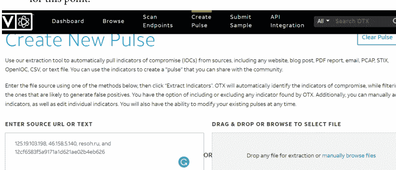

图 15.15 – AlienVault OTX 脉冲创建页面 – 输入字段

3. 验证已填充的 IOC：向下滚动到 IOC 部分以查看同一页面上的已填充指标。输出显示在以下图中：

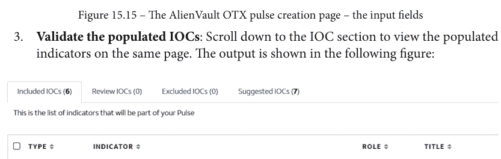

| 类型 | 指标 | 角色 | 标题 |
|---|---|---|---|
| IPv4 | 46.158.5.140 | scanning_host |  |
| FileHash-MD5 | 12cf6583f5a9171a1d621ae02b4eb626 |  | MS_Visual_Cpp_2005 |
| FileHash-SHA1 | 61ed2778d7669d6838523369fd04278626303362 |  | MS_Visual_Cpp_2005 |
| FileHash-SHA256 | 5b136147911b04f1f012ce82dfd24c4e2c79553b65d3240ecea2dcab4452dcb5 |  | MS_Visual_Cpp_2005 |
| IPv4 | 125.19.103.198 |  |  |
| Domain | resoh.ru |  |  |

图 15.16 – AlienVault OTX 已填充 IOC 的 IOC 视图

一些值得考虑的有趣事实是，我们输入了四个 IOC，但 OTX 填充了六个 IOC。它自动添加了恶意文件的 SHA1 和 SHA256 键。哈希键自动被赋予标题：MS_Visual_Cpp_2005，并且平台建议了与提取的 IOC 相关的另外七个 IOC，如下图所示。OTX 会自动将 IOC 与其他 CTI 分析师共享的威胁情报相关联：

| 类型 | 指标 |
|---|---|
| URL | http://125.19.103.198:8080/zb/v_01_c/in/ |
| URL | http://125.19.103.198:8080/zb/v_01_a/in/ |
| URL | http://125.19.103.198:8080/zb/v_01_a/in |
| URL | http://125.19.103.198:8080/ |
| Domain | semelyontour.ru |
| Domain | dpasssjufjkaksss.ru |
| Domain | copsdifbnsasdf.ru |

图 15.17 – 与提取的 IOC 自动关联的额外 IOC

另外两个域名和四个 URL 与我们的 IOC 关联。您应将鼠标悬停在每个建议的 IOC 上以将其添加到提取的 IOC 中。您还可以使用新发现的 IOC 扫描 ABC 公司的系统以查找额外的恶意活动。

- 4. **填写脉冲详细信息**：OTX 允许您添加详细信息，例如 TLP 颜色、脉冲标题、描述、对手、标签、组、行业、目标国家、恶意软件家族和 ATT&CK 技术 ID。


5. **提交脉冲：** 你可以公开分享脉冲或将其保留为私有脉冲。对于本练习，我们将保持其为私有。创建并共享的脉冲如下图所示：

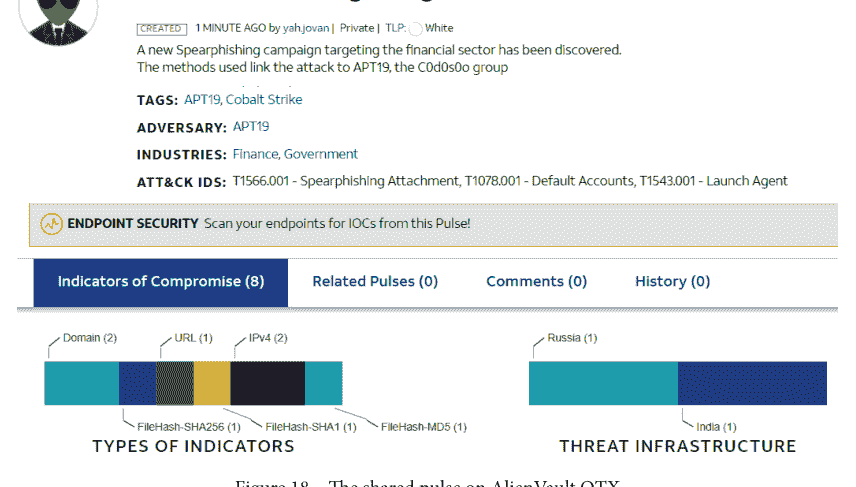

图 18 – AlienVault OTX 上的共享脉冲

脉冲通过 OTX 平台共享。如果设置为公开，社区可以添加共享的 IOC 以增强其端点安全。

我们已成功通过 AlienVault OTX 创建并共享了一个脉冲。安全专业人员广泛使用 AlienVault OTX。因此，CTI 分析师应熟悉它——它是完全开源的。

CTI 分析师可以使用许多威胁情报共享平台来对外传播情报。虽然某些平台需要订阅，但其他平台是开源的。本书无法演示所有平台。然而，你可以研究其他平台，例如完全开源的 MISP、提供免费版本的 **IBM X-Force Exchange**（不过，要获得更多功能，你需要升级账户），以及 **Blueliv Threat Exchange Network**。该列表并非详尽无遗或排他性。因此，作为 CTI 分析师，你可能会遇到其他优秀的威胁情报共享平台。最重要的是理解并适应你选择使用的产品。

## 理解和执行威胁归因

威胁归因对于了解对手的活动以及组织可能面临的威胁非常重要。与依赖事实（证据）的威胁和入侵分析相反，对手归因基于评估，如下述入侵分析的 **钻石模型** 所总结：

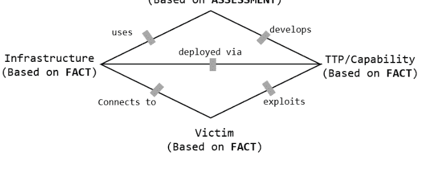

图 15.19 – 用于威胁归因的钻石模型

我们利用 **战术、技术和程序 (TTP)**、**受害者** 和 **基础设施** 将威胁或攻击归因于 *特定组织、活动，* 和 *行为者*（包括 *国家行为者*）。由于威胁归因基于评估，因此必须考虑进行评估时的置信水平。置信度评估必须得到证据和事实的支持（IOC、对手意图、能力和机会）。置信度评估级别对于 *用例 4、5，* 和 *6* 至关重要，解释如下：

- **高置信度评估**：置信水平在有强有力证据且没有矛盾事实支持评估时为高。例如，假设在入侵分析期间，你发现的 IOC 和 TTP 与网络杀伤链模型中超过两个阶段的 X 活动中的其他入侵相关联。在这种情况下，你可以 *高置信度* 地说攻击与活动 X 有关。
- **中等置信度评估**：置信水平在有足够证据但仍有讨论余地时为中等。例如，假设你正在追踪活动 X，在入侵分析期间，你发现 IOC 和 *一些* TTP 与该活动在网络杀伤链的多个阶段相关。然而，其他 TTP 与之不相关。在这种情况下，你可以 *中等置信度* 地说攻击与活动 X 有关。
- **低置信度评估：** 置信水平在证据很少且存在有效陈述和假设来挑战评估时为低。IOC 与杀伤链模型的一个阶段中的活动相关联的入侵分析是典型例子。使用 spearphishing 配合 Microsoft Office 和 RAR 附件作为投递方式的攻击并不意味着它与 APT28 或 Sofacy 组织有关。

评估可以表示为方程，给出以下表达式：

*评估 = 置信水平 + 分析 + 证据 + 来源*

CTI 分析师依赖支持数据使评估可信。因此，了解正在执行的归因类型至关重要——它取决于 CTI 分析师（或团队）正在追踪的内容。然而，请注意，威胁和攻击归因并非简单的任务。它需要时间进行分析、形成假设并收集证据以支持评估。在本节中，我们将简明扼要地提供归因概念的骨架。

> **重要说明 – 国家行为者追踪**
> 
> 国家行为者不应被组织轻视。它们提供了大量关于威胁的见解，这些威胁可能间接或直接与你的组织相关。CTI 分析师如果其利益与客户没有重叠，往往会忽视它们。然而，你永远不知道你的组织何时会成为国家行为者的目标，尤其是出于 *间谍活动、商业机密窃取* 和 *政治经济* 目的。因此，追踪它们很重要。然而，组织应通过优先考虑要追踪的威胁和行为者来平衡被攻破的风险与被攻破的成本——你无法追踪所有 APT。

在以下用例中，我们将了解 CTI 分析师如何利用威胁分析结果实际构建活动组。

## 用例四 – 从威胁分析构建活动组

识别组织、活动和威胁行为者对于追踪组织内的网络活动至关重要。我们可以使用已进行的入侵分析和 ACH 的组合来构建活动组。本用例的目标是提供一个框架，利用网络杀伤链和钻石模型创建威胁活动组。

用例场景：你是一家 ABC 公司的 CTI 分析师，已进行了多次入侵分析。你被要求识别 ABC 应监控的威胁组织以保护系统。此外，你还收到了来自同行（外部情报）和安全运营中心（SOC）团队的威胁信息。提供的处理信息如下图所示：

入侵分析 1
受害者：银行

| 杀伤链阶段 | 分析 |
|---|---|
| 侦察 |  |
| 武器化 |  |
| 投递 |  |
| 利用 | Hook 运行进程 |
| 安装 | 3PARA RAT 恶意软件 |
| 命令与控制 | 受损 IP 地址和域名，Meterpreter 后门 |
| 行为 | 个人信息窃取 |

入侵分析 2
受害者：保险公司

| 杀伤链阶段 | 分析 |
|---|---|
| 侦察 |  |
| 武器化 |  |
| 投递 |  |
| 利用 | CVE-2021-45105 |
| 安装 | 4H RAT |
| 命令与控制 | Meterpreter 后门，端口 8080 |
| 行为 | 拒绝服务 (DoS)，Meterpreter 后门文档外泄 |

入侵分析 3
受害者：能源公司

| 杀伤链阶段 | 分析 |
|---|---|
| 侦察 |  |
| 武器化 |  |
| 投递 |  |
| 利用 |  |
| 安装 | COM 脚本小程序，下载 Cobalt Strike 信标 |
| 命令与控制 | 编码域名 |
| 行为 | 通过开放的 C2 通道外泄合同信息 |

入侵分析 4
受害者：保险公司

| 杀伤链阶段 | 分析 |
|---|---|
| 侦察 |  |
| 武器化 |  |
| 投递 | 恶意 MS Office 文档的 spearphishing |
| 利用 | 用户执行（社会工程） |
| 安装 |  |
| 命令与控制 |  |
| 行为 |  |

图 15.20 – 同行提供的用于活动组设置的分析结构化示例

第 14 章《威胁情报报告与传播》涵盖了构建和理解对手活动的 fundamentals。那些 fundamentals 包括过去的威胁和入侵分析、外部情报分析、过去的指标和数据、应对措施以及未来入侵属性。我们假设过去的分析以图 15.20 中提供的结构化信息形式可用。

根据本用例的要求，构建活动并追踪威胁组织的简单流程如下：

- 1. **识别潜在的唯一活动组**：检查钻石模型中的常见元素，如受害者和能力（TTP）。我们可以看到入侵 1 和入侵 2 共享相同的受害者（银行和保险公司都与金融行业相关），并且都利用 Metasploit 后门。入侵 4 与入侵 1 和 2 共享相同的受害者，但没有提供能力的证据。入侵 3 针对不同的行业并采用不同的 TTP。因此，我们可以识别出三个需要监控的唯一组。
- 2. **提取与组织关联的活动组**：ABC 是一家金融服务提供商。因此，入侵集 1 和 2 与组织直接相关。然而，入侵 4 可能是感兴趣的，因为它也针对金融部门。
- 3. **突出信息和分析中的差距**：识别可能有助于构建令人信服的威胁行为者和活动追踪的缺失信息。识别活动组的大多数决策基于钻石模型的两个顶点（受害者和能力）。重要的是关注并考虑剩余的顶点（基础设施）以了解攻击的物理和逻辑结构。入侵 4 不完整。分析师应请求更多信息以填补网络杀伤链的剩余阶段。

在这种情况下，分析师已识别出三个初始的唯一活动组进行监控。然而，我们可以根据目标受害者模式创建两个活动。两个活动组针对相同的受害者概况——金融行业。仅使用了四次入侵来解释分析师在构建活动组时将考虑的概念和步骤。然而，在现实生活中，一个组织可能拥有数百个结构化分析可供构建。


## 用例五 – 将分析与活动组关联

一旦你创建了活动组或战役以便随时间监控，就必须将分析与这些活动关联起来。最佳实践是将分析与活动组或战役关联起来，是构建表格并使用网络杀伤链和 Diamond 模型框架对指标进行分类。让我们考虑图 15.1 中的杀伤链分析。活动组监控的证据分类显示在下图中：

| 杀伤链阶段 | Diamond 模型元素 | 行动过程（发现） | 活动组 1（入侵 1 & 2） | 活动组 2（入侵 4） | 活动组 3（入侵 3） |
|---|---|---|---|---|---|
| : |  |  |  |  |  |
| 投递 | 对手 | C0d0s0 |  |  |  |
| 投递 | 能力/TTP | 钓鱼（电子邮件） |  | ++ |  |
| 投递 | 基础设施 | IP 地址，附件 |  | ++ |  |
| 投递 | 受害者 | ABC（银行、金融） |  | ++ | -- |
| 利用 | 对手 | C0d0s0 |  |  |  |
| 利用 | TTP | 文件打开，Hook 运行进程 | ++ |  |  |
| 利用 | 基础设施 | Explore.exe |  |  |  |
| 利用 | 受害者 | ABC（银行、金融） | ++ | ++ | -- |
| 安装 | 对手 | C0d0s0 |  |  |  |
| 安装 | TTP | Hooking 运行进程，脚本 |  |  |  |
| 安装 | 基础设施 | 恶意软件 Executable_1640.exe, reader_sl.exe | +- |  | +- |
| 安装 | 受害者 | ABC（银行、金融） | ++ |  | -- |
| 命令与控制 | 对手 | C0d0s0 |  |  |  |
| 命令与控制 | TTP | Web 服务 |  |  |  |
| 命令与控制 | 基础设施 | IP 地址，URL 路径 - Sys/files/ | +- |  |  |
| 命令与控制 | 受害者 | ABC（银行、金融） | ++ |  | -- |
| 行动 | 对手 | C0d0s0 |  |  |  |
| 行动 | TTP | FTP，HTTP GET/POST |  |  |  |
| 行动 | 基础设施 | IP 地址，协议，文档外泄 | ++ |  |  |
| 行动 | 受害者 | ABC（银行、金融） | ++ |  | -- |
|  |  |  | 14/40 ~ 35% | 8/40 ~20% | 1/40 ~2.5% |

图 15.21 – 活动组监控的证据分类

在分析过程中考虑所做假设对于更好地监控威胁活动组和战役至关重要。在前面的图中，我们将 *第 10 章，威胁建模和分析 – 实际用例* 中进行的入侵分析填充到 *图 15.3* 中提供的活动组。++ 符号表示杀伤链阶段和钻石顶点与活动组或战役以 *高置信度* 对齐。+- 表示杀伤链和钻石顶点与活动组 *部分* 对齐。例如，先前分析的入侵的安装杀伤链阶段的钻石 *基础设施*（参见 *图 15.21* 中突出显示的部分）依赖于恶意软件安装作为执行模式，具体为 `executable_1640.exe` 和 `reader_sl.exe`。活动组 1 也依赖于恶意软件安装，但使用 3PARA，一种 **远程访问木马（RAT）**。因此，它们在总体基础设施上匹配，但在具体方面不匹配。我们知道许多威胁行为者依赖恶意软件安装作为执行方法。-- 符号表示存在杀伤链阶段和钻石顶点的证据，但它们与活动组或战役不匹配。最后，空单元格表示我们没有证据做出结论或评估。

在表格末尾，分析师应计算威胁分析属于特定活动组或战役的概率。没有计算属于战役或活动组的可能性的标准。表格中显示了一个简化的模型，其中 + 为 1，– 或空单元格为 0。然而，根据活动情况，复杂的归因模型可以向表格添加加权参数。例如，在监控战役时，钻石模型的 *受害者* 参数可能比其他顶点具有更大的权重。CTI 分析师（或团队）在实施威胁归因机制时应具有创造性。

## 用例六 – 一种 ACH 以及将活动归因于国家行为者组

在 CTI 中，ACH 被用作分析方法，以识别和选择最佳假设来支持威胁场景。该选择涉及制定多个相互竞争的假设，用证据支持假设以证明归因合理，并选择不一致性较小的假设并拒绝其他假设。

> **重要说明 – ACH 在 CTI 中的实用性**
> ACH 用于统计学、数学、心理学和数据科学。虽然它在克服思维和分析中的某些局限性方面显示出有效性，但在 CTI 中必须谨慎并受限制地使用。威胁情报分析师应仅在没有或较少技术证据支持威胁情报分析或场景时使用 ACH。

网络战并非神话。许多数据泄露表明政治经济冲突可能与网络犯罪相交。政府已对其他政府和私营组织使用网络攻击。最广为人知的国家主导的网络攻击之一是朝鲜于 2014 年 11 月对 *索尼影业娱乐* 的 *alleged* 攻击（https://bit.ly/3rw1yoc, https://bit.ly/3qG3AmC, 和 https://bit.ly/3KBzhp8）。用于诸如 WannaCry 之类的勒索软件攻击的 **EternalBlue** 漏洞利用工具由美国 **国家安全局（NSA）** 开发（https://wapo.st/3rxVWVz）。国家行为者攻击的数量随时间推移而增加（https://bit.ly/3qKCtGM）。因此，CTI 分析师必须意识到这一点并保护组织免受其侵害。

### 用例目标
本用例的目标是展示 CTI 分析师如何利用 ACH 为进一步分析选择最佳假设。它还展示了如何利用 **开源情报（OSINT）** 使用 ACH 分析国家行为者。

### 用例场景
你是一家使用 **监控与数据采集（SCADA）** 进行流程的制造公司的分析师。你已收到有关 *Stuxnet*（及其演变 *Stuxnet 2*）恶意软件的情报。你还发现 Stuxnet 处于以色列和伊朗之间政治冲突的风口浪尖，首先用于 2010 年伊朗核电站攻击（https://bbc.in/3rzQwyi）并 alleged 在 2020 年伊朗核设施攻击中重新使用（https://bit.ly/3GVG1e2）。你需要使用 ACH 评估 Stuxnet 是否对你的组织构成威胁，并评估以色列对 2010 年和 2020 年伊朗核设施攻击的归因。

### 用例工具
Pasquale Stirparo 提供的 ACH Excel 模板用于此分析（https://bit.ly/3nNia56）。请注意，你也可以创建自己的 ACH 模板。或者，可以使用 PARC ACH 执行任务（https://bit.ly/3Itvh84）。

### 使用 ACH 评估 Stuxnet 是否对组织构成威胁
以下步骤用于对我们组织的 Stuxnet 恶意软件（一种蠕虫）进行 ACH。注意 *H* 和 *E* 分别用于假设和证据：

- 1. **制定假设**：我们需要创建有关恶意软件的假设。你可以自由列举尽可能多的假设。我们将只创建三个，如下：*H1* – Stuxnet 蠕虫对我们的组织不构成威胁。*H2* – Stuxnet 蠕虫对我们的组织构成威胁。*H3* – Stuxnet 影响 SCADA 系统，但我们的组织防护良好。因此，我们的系统无法被 Stuxnet 攻破。
- 2. **识别支持假设的证据**：我们需要识别可以启发我们评估的证据或事实。请注意，可以使用外部情报为 ACH 生成事实。有关 Stuxnet 的一些证据包括以下内容：*E1* – Stuxnet 是一种攻击基于 SCADA 的系统的蠕虫。*E2* – Stuxnet 使用 .lnk 快捷方式的副本通过可移动媒体传播。*E3* – Stuxnet 使用 HTTP 与 C2 服务器通信。*E4* – Stuxnet 修改系统进程。*E5* – Stuxnet 检查特定的操作系统、注册表项和漏洞，如果条件不满足则不传播。*E6* – Stuxnet 使用 autorun.inf 传播。*E7* – 我们组织的安全措施已更新，恶意软件无法在没有适当权限的情况下渗透或执行。*E8* – 我们的组织容易受到攻击，可能被 Stuxnet 攻破。*E9* – Stuxnet 于 2010 年首次被发现。*E10* – Stuxnet 自 2010 年以来一直被重复使用至今。
- 3. **将证据分类为意图、机会或能力**：我们应根据威胁特征的元素对证据进行分类。它使我们能够理解我们正在进行的评估。**意图**涵盖 *E1* 和 *E2*。**机会**包括 *E9* 和 *E10*。**能力**涵盖 *E3*、*E4*、*E5*、*E6*、*E7* 和 *E8*。
- 4. **对提供的证据进行诊断**：模板或 PARC ACH 工具允许分析师根据不一致性对假设和证据进行评级。这些级别包括 *II*，表示证据与假设 *高度不一致*；*I*，表示证据与假设 *不一致*；*NA*，表示证据与假设 *不适用*；*N*，表示 *中性*；*C*，表示证据与假设 *一致*；以及 *CC*，表示证据与假设 *高度一致*。
- 5. **设置每条证据的可信度和相关性**：可信度和相关性使分析师能够确定对证据价值的信心。可信度和相关性级别包括 *高（H）* – 具有高可信度或相关性的证据，*中（M）* – 具有中等或适度可信度或相关性的证据，以及 *低（L）* – 具有低可信度或相关性的证据。
- 6. **查看和评估生成的不一致性分数**：我们现在可以查看每个假设的不一致性分数并按从高到低对假设进行排序。不一致性分数最高的假设被认为是最佳假设。

上面从 *步骤 1* 到 *步骤 6* 生成的 ACH 显示在下图中。请注意，并非所有证据都适用于假设。因此，在必要时应使用 *不适用* 选项：

| 类别 | 证据 | 证据类型 | 可信度 | 相关性 | H1 - Stuxnet蠕虫对我们的组织不构成威胁 | H2 - Stuxnet蠕虫对我们的组织构成威胁 | H3 - Stuxnet影响SCADA系统，但我们的组织防护良好 |
|---|---|---|---|---|---|---|---|
|  |  |  |  |  | -18.191 | -5.656 | -15.433 |
| 意图 | E1-Stuxnet是一种攻击基于SCADA系统的蠕虫 | 报告 | H | H | II | CC | I |
| 意图 | E2-Stuxnet使用.lnk快捷方式的副本通过可移动介质传播 | 报告 | H | M | C | CC | II |
| 能力 | E3-Stuxnet使用HTTP与C2服务器通信 | 报告 | M | M | I | C | N |
| 能力 | E4-Stuxnet修改系统进程 | 报告 | H | M | N | C | I |
| 能力 | E5-Stuxnet检查特定的操作系统、注册表键和漏洞，如果条件不满足则不传播 | 报告 | H | M | N | N | N |
| 能力 | E6-Stuxnet使用autorun.inf传播 | 报告 | M | L | II | C | I |
| 能力 | E7-我们组织的安全已更新，恶意软件无法在没有适当权限的情况下渗透或执行 | 分析 | H | M | CC | II | CC |
| 能力 | E8-我们的组织存在漏洞，可能被Stuxnet入侵 | 分析 | M | H | II | CC | II |
| 机会 | E9-Stuxnet首次于2010年被发现 | 报告 | H | L | N | N | N |
| 机会 | E10-Stuxnet自2010年以来一直被重新使用至今 | 报告 | M | L | I | C | N |

## 图 15.22 – 威胁归因案例的 ACH 说明

对于每个证据和假设，我们都已填写诊断要素。例如，E8与H1高度不一致，因为如果组织存在漏洞，则Stuxnet构成威胁。E7与H2的相同原理适用——如果恶意软件无法渗透我们的系统，则Stuxnet不能对组织构成威胁。当假设和证据相互矛盾时填写不一致，当两者匹配时填写一致。

图 15.22 显示，假设 2 的绝对加权不一致得分最小为 5.656，或不一致得分最高为 -5.656，与假设 1 和 3 相比。因此，我们评估Stuxnet蠕虫对组织构成威胁。需要采取必要的预防措施来解决这个问题。

## 评估对以色列发动2010年和2020年伊朗核设施袭击的归因：

以下步骤用于评估伊朗袭击归因于以色列国家行为体的归因。我们将遵循ACH过程中使用的相同步骤：

- 1. **制定假设**：通过选择具有先进网络基础设施并有能力对核电站发动攻击的国家来创建假设。假设如下。*H1* – 美国攻击了伊朗。*H2* – 以色列攻击了伊朗。*H3* – 俄罗斯攻击了伊朗。*H4* – 朝鲜攻击了伊朗。*H5* – 中国攻击了伊朗。*H6* – 印度攻击了伊朗。*H7* – 是其他国家行为体。我们选择这些是因为美国、伊朗、以色列、俄罗斯、中国、印度和朝鲜都是网络活动的活跃国家。你可以添加任何其他国家。
- 2. **识别支持假设的证据**：识别支持假设的证据。我们起草了以下证据：*E1* – Stuxnet针对使用Microsoft Windows操作系统的设备。*E2* – Stuxnet针对现代SCADA系统并可破坏核电站。*E3* – Stuxnet收集工业控制系统信息并导致离心机失常。*E4* – 大多数受害者来自亚洲国家。*E5* – Stuxnet的初始访问是通过感染的闪存驱动器。*E6* – Stuxnet利用了Windows系统漏洞，包括零日漏洞。*E7* – Stuxnet由美国和以色列创建以针对核电站，等等。
- 3. **将证据分类为意图、机会或能力**：意图涵盖*E1*、*E2*、*E3*和*E4*。机会包括*E7*。能力包括*E5*和*E6*。
- 4. **执行提供的证据诊断**：我们通过选择假设与其证明之间的适当不一致级别来执行诊断，如*图 15.23*所示。
- 5. **设定每条证据的可信度和相关性**：我们设定每条证据相对于假设的可信度和相关性，如*图 15.23*所示。
- 6. **查看和评估生成的不一致得分**：我们评估ACH以提取不一致得分最小的假设。

生成的ACH显示在下图中。注意，使用公开信息和OSINT来完成ACH矩阵是可以的：

| 类别 | 证据 | 证据类型 | 可信度 | 相关性 | H1 - 美国 | H2 - 伊朗 | H3 - 以色列 | H4 - 俄罗斯 | H5 - 朝鲜 | H6 - 中国 | H7 - 印度 | H8 - 其他 |
|---|---|---|---|---|---|---|---|---|---|---|---|
|  |  |  |  |  | 0 | -19.4 | 0 | -10 | -10 | -8 | -8.71 | -8.707 |
| 意图 | E1 - Stuxnet针对伊朗 | 报告 | H | H | CC | II | CC | CC | CC | CC | CC | CC |
| 意图 | E2 - Stuxnet针对现代SCADA系统并可破坏核电站 | 报告 | M | L | C | C | C | C | N | N | C | N |
| 意图 | E3 - Stuxnet收集工业控制系统信息并导致离心机失常 | 报告 | H | H | C | I | C | I | I | N | N | N |
| 意图 | E4 - 大多数受害者来自亚洲国家 | 报告 | L | M | CC | N | CC | C | C | C | I | I |
| 能力 | E5 - Stuxnet的初始访问是通过感染的闪存驱动器 | 报告 | H | M | C | I | C | N | N | N | N | N |
| 能力 | E6 - Stuxnet利用了Windows系统漏洞，包括零日漏洞 | 报告 | M | M | C | C | C | C | C | C | C | C |
| 意图 | E7 - Stuxnet由美国和以色列创建以针对核电站 | 分析 | H | H | CC | II | CC | II | II | II | II | II |

图 15.23 – 国家支持威胁归因案例的 ACH 说明

图 15.23 简化以说明如何对国家行为体进行威胁归因。该图显示美国和以色列的绝对加权不一致得分最低。让我们看一些重要的证据解释：

- - **E1：** 2010年和2020年的袭击针对伊朗。网络战的增长表明，如果有政治或经济原因，具有先进网络基础设施的国家可以相互攻击。然而，作为国家行为体，伊朗不太可能攻击自己。因此，我们使E1与H2高度不一致，但与其余高度一致。注意，你也可以根据你的证据有不同的意见。例如，一位分析师可能会指出，由于伊朗与俄罗斯的关系，这两个国家不太可能相互攻击。
- - **E5：** Stuxnet的初始访问是通过感染的闪存驱动器（https://bit.ly/3FVmhak）。插入的感染闪存驱动器引发了伊朗2010年核电站袭击，因为据称的工厂未连接到互联网。然而，尽管原始Stuxnet于2012年过期，但仍有其他蠕虫从中创建以针对制造公司。其中一些蠕虫包括Industroyer（https://bit.ly/3IvP8Ue）和Crashoverride（https://bit.ly/3qYiXae）。因此，我们使E5与H1和H3一致，与H2不一致，对其余为中性。

- - **E7：** Stuxnet的创建和发展已被多个来源归因于美国和以色列（https://wapo.st/3nVtyAF）。因此，我们使*E7*与*H1*和*H3*高度一致，与其余高度不一致。

应遵循相同的逻辑来解释和填写其余信息。

> **重要说明 – 关于用例**
> 
> 该用例已用于练习ACH。CTI分析师应识别支持其分析的基本证据。他们必须考虑每条证据与假设相关联的置信水平。请注意，选择*H1*和*H3*作为绝对加权不一致假设最小并不意味着美国或以色列攻击了伊朗。

ACH的典型结论应至少依赖于两条最重要和无可争议的证据——例如*E7*和*E1*。所有其他证据用于支持假设。结论示例如下：

最高可能性的假设基于两条与意图相关的证据。伊朗发电厂的袭击与Stuxnet恶意软件针对伊朗核电厂的目标及其据称由美国和以色列创建的目标一致。然而，该分析有限，因为尚未发现机会证据。

在构建国家或国家支持的威胁归因时，其他需要考虑的因素是政治和经济关系以及其他政府合作伙伴关系。两位CTI分析师可能对同一用例有不同的ACH输出。因此，你应根据你收集的信息和事实填写ACH矩阵。

## 总结

在CTI流程上建立实践技能是CTI分析师有价值的原因。CTI分析师应能够使用手动方法和工具来回答CTI问题。建立技能的最佳方式是通过练习、培训和研究威胁情报。本章介绍了开发和共享IOCs，演示了如何为安全增强创建YARA规则，以及使用Anomali STAXX和AlienVault OTX等平台共享情报。它还说明了构建威胁活动组、跟踪活动以及将网络活动归因于国家支持（国家）和非国家支持威胁行为体的方法。作为CTI分析师，你也熟悉了竞争性假设的分析。


CTI 是使网络威胁防护有效的拼图的一部分。在安全功能的核心中，它驱动着 **SOCs**，并将其从已知的传统 SOC 转变为情报驱动的 SOC。诸如取证、事件响应、风险管理、安全审计、威胁狩猎、渗透测试和安全分析等安全团队均可从威胁情报中受益。每个团队都可以使用 CTI 输出来改进其指标。其高效性和协作性正在证明其价值，因为许多组织试图踏上 CTI 之旅。

本书记述的内容建立在 CTI 生命周期之上，利用理论和实践深入探讨了周期的每个阶段。本书在逻辑上分为三个部分。第一部分，从 *第1章，网络威胁情报生命周期* 到 *第5章，目标设定、CTI 策略程序和实际用例*，涉及 CTI 生命周期、需求、技艺和标准，以及 CTI 在安全运营中的集成。第一部分首先对 CTI 生命周期进行了总结性解释，深入了解每个阶段的主要任务。然后详细说明如何生成情报需求、实施 CTI 团队以及定义 CTI 应用领域，广为人知的是威胁情报的类型（战略、运营和战术情报）。它讨论了 CTI 框架，它们在 CTI 分析中至关重要，以及它们如何协同工作。它还涵盖了可以推动 CTI 项目取得成功结果的技艺和标准。最后，它指导 CTI 分析师和组织设定情报目标并实施策略，将情报集成到组织的 安全堆栈中，使用实际示例。

第二部分，从 *第6章，网络威胁建模和对手分析* 到 *第10章，威胁建模和分析 – 实际用例*，涵盖了威胁建模、分析、数据收集和防御机制。它首先介绍了网络威胁建模和对手分析，提供了使用适当方法战略性地建模威胁和分析对手所需的知识。然后它研究了威胁情报数据源，展示如何定义正确的来源、收集数据并将其存储以供将来使用。它还研究了防御机制和数据保护，强调了与网络威胁防御相关的挑战，如何使用示例将 CTI 程序映射到防御策略、数据监控的重要性以及主动分析。然后它涵盖了 **人工智能** (**AI**) 在威胁情报中的潜在影响，讨论了 AI 对 CTI 的益处、其在安全堆栈中的位置以及 **安全信息和事件管理** (**SIEM**) 解决方案对其的采用。最后，第二部分以动手用例结束，说明分析师如何利用 CTI 执行入侵分析。

第三部分，从 *第11章，可用安全：威胁情报作为流程的一部分* 到 *第15章，威胁情报共享和网络活动归因 – 实际用例*，研究了将 CTI 文化化。它首先通过研究可用安全指南、威胁建模和分析在政策制定中的益处、威胁防御中思维模型的用途以及基于情报的 DevSecOps 架构的实施，使 CTI 成为业务流程的一部分。然后它研究了威胁情报在 SIEM 解决方案和 SOC 运营中的重要性 – 如何将 CTI 集成到 SIEM 工具中并使 SOC 智能化。它还涵盖了用于 CTI 评估和有效性测量的安全指标，包括 CTI 团队评估。它研究了 IOCs、痛苦金字塔和 **攻击指标 (IOAs)**。然后它使用示例讨论了威胁情报报告、分发和反馈循环，为分析师提供构建战略、战术和运营报告的策略。它详细说明了如何构建和理解对手的活动。最后，它涵盖了使用 YARA 和 STIX/TAXII 平台等不同标准进行 IOCs 开发的手动用例、使用共享平台进行情报分发、活动组和用于威胁活动跟踪的活动构建，以及使用 ACH 将网络活动归因于国家支持的行动者。

通过本书 *掌握网络情报*，我们为安全专业人员配备了执行威胁情报职责的基础知识和技能。我们还为组织配备了采用和将威胁情报集成到安全运营中的策略和工具。本书提供的理论和实践知识应有助于个人在 CTI 认证之旅中。
