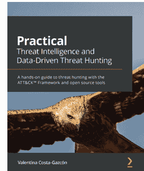
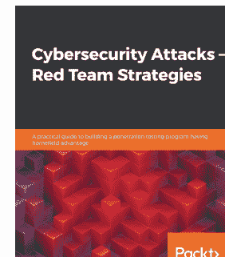

## Index

### A

Abuse.ch
  关于 200
  网址 200
Abuse.ch, 项目
  Feodo tracker 200
  I got phished 200
  Malware Bazaar 200
  SSL blacklist 200
  threat fox 200
  URLhaus 200
访问扩展，对手
  攻击执行
访问持久化 182
内部侦察 182
横向移动 182
权限提升 182
主动监控 235
活动组
  与威胁分析关联 461, 462
  从威胁分析构建 458-460
Acutenix 243
高级加密标准
  (AES) 算法 301

高级持续性威胁
  组 19 (APT19) 301
高级持续性威胁
  (APTs) 259, 325, 362
  关于 419
  攻击阶段 420
  特征 419
高级威胁建模
  与安全信息和事件
    管理 (SIEM) 171-173
对抗性战术、技术、
  和通用知识
  (ATT&CK) 289
对手
  关于 142, 272
AI，利用 272
黑帽黑客 142
网络恐怖分子 144
黑客活动分子 143
工业间谍 143
内部人员 143
国家黑客 144
有组织犯罪 143
其他非恶意组织 144

对手分析
  技术 177
  用例 154, 156
对手攻击执行
  关于 181
  访问扩展 182
  立足点建立 181
  初始入侵 181
  缓解程序 183
对手攻击准备
  关于 177
  对策 180, 181
  任务 177-179
对手活动
  构建 416
  行动方案 417
  外部情报分析 417
  外部报告 417
  未来入侵属性 417
  命名 418
  过去指标和数据 417
  过去情报分析 416
  退役 423
对手画像
  构建 301
可用性 342
AFI14-133 工艺标准
  关于 109
  准确性 110
  附加主题 112
  替代分析 110
  分析技能 111
  适当来源 109
  假设，与判断对比 110
  置信水平 110
  客户参与 110
  逻辑论证 110
相关性 110
时效性 109
实用性 110
AI 应用，在智能攻击中
  智能逻辑炸弹 273
  智能攻击向量 273
  智能恶意软件 272, 273
AI 在 CTI 中
  分析偏差减少 259
  益处 258
  威胁检测 259
  误报 259
  预测分析 259
  对威胁的响应 258
AI 集成
  IBM QRadar Advisor 方法 276
  在安全堆栈中 274, 275
AlienVault OSSIM with OTX 357
AlienVault OTX
  关于 197, 357, 432
  情报，使用...创建 357-360
  参考链接 432
AlienVault USM
  关于 369
  网址 279
Amazon Web Services (AWS) 132
分析指标 376
竞争假设分析 (ACH)
  使用 462-468
分析，威胁情报
  关于 17
  SAT，使用 18
分析专业知识 89
分析查询 270
Anomali STAXX
  关于 433
  参考链接 433

Any.run
  关于 206
  网址 206
Apache 330
AppleJeus
  参考链接 322
应用领域，情报团队
  运营情报 48
  战略情报 48
  战术情报 48
基于应用的威胁 252
应用层，SIEM 架构
  关于 355
  高级安全分析 355
  安全仪表板 355
  SOC 自动化 356
  威胁狩猎 356
  威胁情报 356
应用编程
  接口 (API) 251
应用 147
APT12
  示例 326
  参考链接 326
APT 攻击阶段
  行动方案，执行 421
  立足点，建立 420
  初始访问，获取 420
  横向移动，执行 420
  持久性，实现 421
  权限，提升 420
  系统，学习 421
人工智能 (AI) 87, 236, 388
资产
  分解 140-142
  识别 140, 141
资产-向量映射 152
原子 IOCs 378

### B

攻击复杂度 244
attack-navigator
  参考链接 130
attack-pattern 100
攻击面 142, 146-148
攻击、战术、技术和通用知识 (ATT&CK) 67
攻击树 150-153
攻击向量 (AV) 244
自动化指标共享 (AIS)
  关于 189, 195
  网址 195
自动系统行为
  用于用户访问限制 323
可用性要求 (AR) 246
接近途径 (AA) 37
AWS Direct Connect 353
基础指标，漏洞和数据风险评估
  计算 245
  可利用性 244
  影响 244
BazarCall 383
行为 IOCs
  异常外发流量 385
  关于 378, 384
  影响可用性的行为 385
分布式拒绝服务 (DDoS) 攻击 385
  多次请求或尝试 385
  远程命令执行 384
  可疑活动，来自
    不常见来源 384
生物识别认证 334
黑盒评估 238

## C
黑盒测试 327
黑帽黑客 142
BleedingComputer.com 202
Blueliv 威胁情报交换网络
- 关于 433, 456
- 参考链接 433
启动自动执行 382
僵尸网络 385
入侵与攻击模拟 (BAS) 工具 329
身份验证破坏 150
Burp Suite 244
C2 基础设施 327
加拿大 PIPEDA 335
Ceeloader 393
Censys
- 关于 203
- 网址 203
中央情报局 (CIA) 汇编
- 参考链接 84
集中式威胁情报共享架构 428
挑战，情报传播评估
- 共享情报评估 425
- 格式 425
- 法律要求 425
- 敏感信息保护 425
- 信任 425
特征化组件 269
首席数据官 (CDO) 232
首席信息官 (CIO) 239
首席信息安全官 (CISO) 239, 310
Chiefs 408
CIA 三元组
- 可用性，强制执行 227
- 可用性，维护 227
- 保密性，强制执行 225
- 保密性，维护 225
- 完整性，强制执行 226
- 完整性，维护 226
- 概述 224
CIRCL
- 参考链接 132
客户端执行 326
云计算 230
云资源 148
Cobalt Strike 98, 393
Cobra 300
Cobra Venom 101
代码注入 150
Codoso
- 参考链接 301
威胁协作研究 (CRITs) 221
收集的情报
- 复审 326
收集服务 104
命令与控制 (C2) 工具 380
商业威胁情报平台
- 关于 123
- AlienVault USM 123
- Anomali ThreatStream 123
- CrowdStrike Falcon-X 123
- FireEye iSIGHT 123
- IBX X-Force Exchange 123
- RecordedFuture 123
共同点
- 选择 397
通用攻击模式枚举与分类 (CAPEC)
- 关于 432
- 网址 432
通用漏洞和暴露 (CVE) 244
通用漏洞评分系统 (CVSS) 244
受损凭证 149
计算的 IOC 378
结论陈述 90
置信度评估级别
- 高置信度评估 457
- 低置信度评估 458
- 中等置信度评估 457
保密性、完整性和可用性 (CIA) 324
保密性要求 (CR) 246
约束 342
情境化 362
逆向思维技术
- 关于 18
- AB 团队 19
- 魔鬼代言人 18
- 假设分析 19
惯例 342
反情报 91
对策
- 关于 157
- 对手攻击准备 180, 181
将威胁搜猎与 CTI 耦合
- 益处 267, 268
- 特征化 269
- 搜猎执行 270-272
行动方案 (CoA) 矩阵 394
行动方案 (CoAs)
- 关于 91
- 选择 397
创建、读取、更新、删除 (CRUD) 160
创意时间 227
- 保留期 227
CTI 团队，保密性
- 访问限制 225
- 数据视图限制 225
- 角色定义 226
- 修改警报 226
- 隐私 225
- 篡改数据识别 226
网络情报共享与保护法案 (CISPA) 335
网络杀伤链框架 95, 116, 289
网络可观测表达式 (CybOX)
- 关于 94, 431
- 参考链接 431
网络安全和基础设施安全局 (CISA) 189, 196
网络安全技能差距 8, 9
网络恐怖分子 144
网络威胁分析
- 使用 STIX 95
网络威胁框架
- 架构 54
- 示例 56-58
- 运行模型 54
- 参考链接 52
网络威胁框架，对手生命周期阶段
- 影响或后果 55
- 参与 55
- 准备 55
- 存在 55
网络威胁框架，益处
- 共同语言 53
- 一致性 53
- 端到端威胁分析 53
- 迭代与连续性 53
- 系统集成 53
网络威胁搜猎
- 关于 259
- 将威胁搜猎与 CTI 耦合 267, 268
网络威胁搜猎 (CTH) 268
网络威胁情报 (CTI)
- 关于 5, 9
- 收益/损失 398
- 目标 281
- 标准 83
- 团队 225
- 技艺 83
Cyware 威胁情报交换
- 关于 433
- 参考链接 433
## D
D3fend
- 网址 320
损害、可复制性、可利用性、受影响用户、可发现性 (DREAD) 160
Darkreading.com 202
暗网 201
数据收集层，SIEM 架构
- 关于 353
- API 353
- 直接连接 353
- 转发器 354
Datadog 安全监控 369
数据丰富
- 用例研究 121
数据流图 140
数据完整性管理
- 用例 226, 227
数据监控和分析
- 主动监控 235
- 特征 236
- 高层架构 235
- 被动监控 235
- 执行 233
- 要求 233
数据规范化 121
数据隐私
- 关于 332
- 在现代业务中 332
- 与数据安全相比 335
数据处理层，SIEM 架构
- 关于 354
- 数据聚合 354
- 数据清洗 354
- 数据关联 355
- 数据规范化 354
数据保护官 (DPO) 232
数据风险分析 237
数据保密 225
数据安全挑战
- 网络安全技能差距 8, 9
- 网络安全技能短缺 232
- 数据处理和第三方组件 230
- 数据保护和隐私法规 230
- 数据指数增长 229
- 新隐私法规 8
- 运行复杂性 7
- 安全警报和数据增长 7
- 威胁态势 6
数据源层，SIEM 架构 353
数据篡改 226
欺骗
- 关于 91
- 否认 91
- 虚假信息 91
深度包检测 (DPI) 266
可防御架构
- 关于 343
- 参考链接 343
防御规避战术 320
防御机制，DevOps
- 确保 231
防御系统 228
延迟敏感系统 227
非军事区 (DMZ) 238
拒绝服务 (DoS) 攻击 71
开发-运维 (DevOps) 堆栈 230
开发-安全-运维-安全 (DevOpSec) 234
设备类别，攻击面
- 应用程序 147
- 云资源 148
- 端点 147
- 基础设施 147
- 物联网设备 147
- 供应链 148
DevOps 231
诊断技术
- 关于 18
- 竞争假设分析 18
- 变化指标 18
- 信息质量检查 18
钻石模型
- 关于 289, 345, 457
- 用于网络杀伤链阶段 308-310
入侵分析钻石模型
- 关于 76
- 益处 80
- 集成，益处 80
- 集成到情报项目中 79, 80
- 参考链接 76
- 用例 78, 79
- 工作原理 77, 78
基于 Docker 的 TTP 132
域名 391
域名系统 (DNS) 226, 285, 380
Dragonfly 2.0 127, 337
DShield
- 关于 198
- 网址 198
动态链接库 (DLL) 384
基于动态模型的 UBA 176
## E
EASport 服务器 292
易任务安全加固
- 关于 321
- 示例 321, 322
有效性 65
有效摘要 89
权限提升 162
基于电子邮件的 IOC
- 关于 383
- 电子邮件内容 383
- 电子邮件头 383
加密
- 作为防御机制 248
文件结束 (EOF) 标签 303
端点管理
- 关于 250
- 数据泄露用例 253
- 移动端点管理 252
- 主要目标 250
- 要求 250, 251
端点 147
引擎，用于威胁情报
- 数据收集
  - Censys 203
  - Google 黑客 204
  - GreyNoise 203
  - Hunter 203
  - Pipl 204
  - Shodan 202
  - WiGLE 204
  - ZoomEye 202
环境指标，漏洞和数据风险评估
- 修改的基础指标 246
- 安全要求 246

环境评分、漏洞和数据风险评估计算 246, 247
Equifax 数据泄露
关于 167, 231
执行摘要 167
已识别的 TTPs 168
预防和对策 169
参考链接 169
威胁向量 167
时间线 167
漏洞和安全差距 168
EternalBlue 漏洞利用工具 463
道德黑客 159
EU-GDPR 335
证据 87
Exaramel 后门 400
可利用性评分 (ES) 245
利用阶段
命令和控制
通信设置 328
数据收集 328
通过设定的 C2 基础设施外泄数据 328
进程注入 328
通过 spearphishing 投递武器化文件 328
武器化 Word 或 PDF 文档 328
漏洞利用目标 100
探索性数据分析 (EDA) 260
外部威胁情报来源
关于 188
业务共性 189, 190
群众外包数据 189
政府来源和报告 189
TI 数据源 188

## F
联邦桥梁证书机构 196
联邦调查局 (FBI) 189
文件传输协议 (FTP) 248
已填充的 CoA 矩阵 396
FireEye 418
Frankenstein 活动 337
模糊哈希 391

## G
GandCrab 勒索软件
参考链接 336
垃圾进垃圾出 (GIGO) 原则 355
通用数据保护条例 (GDPR) 8
全球定位系统 (GPS) 229
Gold Southfield 336
Google 云平台 (GCP) 132
Google 黑客 204
Grafana 262
灰盒评估 238
GreyNoise
关于 203
URL 203

## H
Hacker News 202
黑客活动人士 143
Hadoop 分布式文件系统 (HDFS) 262
哈希 390
健康保险可携性与责任法案 (HIPAA) 230
Home Depot POS 数据泄露
分析 254, 255
主机工件 391
基于主机的 IOCs
关于 381
文件名 381
哈希 381
互斥 (Mutex) 381
进程名称和 ID 381
注册表键 382
人机交互 (HCI) 336
人力资源 (HR) 225
Hunter
关于 203
URL 203
搜寻执行
分析调优 271
事件上下文化 271
事件记录 271
事件评估 271
调查恶意事件 272
检查异常值 271
执行 270
搜寻范围 264
Hybrid Analysis
URL 299
混合威胁情报共享架构 429
超文本传输协议 (HTTP) 248, 287
假设 264

## I
IBM QRadar
关于 244, 369
参考文献 279
IBM QRadar Advisor 方法
关于 276
优势 276, 277
部署 QRadar 278
QRadar 简化架构 277, 278
IBM Security Learning Academy
参考链接 276
IBM X-Force Exchange 456
ICD 203
关于 92
处理职责 93, 94
战略团队 93
技术和战术团队 93
标识符 (IDs) 252
影响指标 376
影响评分 (IS) 245
影响子评分 (ISS) 245
实施分析 90
事件响应 (IR)
关于 184, 255, 288, 364
挑战 364
整合情报 365, 366
团队 96
单位 12
IndEX (Indicator Exchange eXpression) 98
指标 283
攻击指标 (IoCs)
关于 9, 12, 15, 103, 117, 159, 188, 198, 200, 262, 345, 356, 372, 378
原子 IoCs 378
行为 IOCs 378, 384
类别 379
计算 IoCs 378
域名 389
基于电子邮件的 IOCs 383
哈希值 389
主机工件 389
基于主机的 IOCs 381
识别 386-388
IP 地址 389
网络工件 389
基于网络的 IOCs 380
重要性 378, 379
工具 389
TTPs 390
工业控制系统 (ICS) 132
工业间谍 143
行业数据增长
金融行业 229
医疗保健 229
电信行业 229
交通运输 229
信息披露 162
信息共享和分析中心 (ISACs)
关于 25, 96, 199
优势 199
URL 199
信息共享和协作平台
关于 432
AlienVault OTX 432
anomali STAXX 433
Blueliv Threat Exchange Network 433
Cyware Threat Intelligence eXchange 433
MISP 432
信息技术 (IT) 225
InfraGard
关于 197
参考链接 198
基础设施 147
输入指标 376
内部人员 143
完整性保证 226
完整性要求 (IR) 246
情报分析工艺基线 84
基于情报的架构
可管理性 347
存活能力 348
可见性 347
基于情报的防御架构
参考链接 343
基于情报的 DevSecOps 高层架构
关于 343
特征 343
情报界指令 (ICD)
关于 92
指南 92, 93
标准 92
情报数据
数据收集 14, 15
外部来源 15
内部来源 14
组织特定存储基础设施 220
处理 15-17
存储 219
在威胁情报平台中存储 221
存储策略 219
结构化 217, 218
基于情报的 SOC 361-363
情报框架
概述 52
选择 13
情报增益/损失 (IGL) 398
基于情报的应用程序源代码分析
关于 329
动态 330
交互式 330
静态 330
基于情报的渗透测试
关于 324
优势 325
分析和对策 329
攻击策略 324
文档和报告 329
方法论 325, 326
规划和准备 326
系统利用 327
系统扫描 327
威胁情报收集 326
威胁画像 324
基于情报的安全基础设施
架构流程 345, 346
知识流 344
生命周期 344
弹性 343
安全管理 344
系统验证 344
威胁对策 344
威胁建模 344
情报项目
整合入侵分析的钻石模型 79, 80
整合 Lockheed Martin 网络杀伤链 64
情报需求收集 13
情报需求开发
关于 33, 34
开发行动方案 41
当前网络威胁评估 40, 41
情报准备 42, 43
网络防御影响
描述 36-39
运营环境
定义 34, 35
情报来源 88
情报团队
应用领域 48, 49
实施 46
布局 44, 45
先决条件 44
结构化 46, 47
内部威胁情报来源
关于 187
缺点 188
国际商业机器公司 (IBM) 232
国际移动设备身份码 (IMEI) 252
物联网 (IoT) 230
互联网协议 (IP) 226
Internet Storm Center (ISC)
关于 198
URL 198
Intezer
关于 206
URL 206
入侵分析案例
关于 284
构建对手画像 301
钻石模型，用于网络杀伤链阶段 308-310
磁盘分析 293
收集早期指标 306, 307
分析外泄数据 300, 301
指标收集和情境化 284
情报分类 289-291
分析恶意文件 302-306
恶意软件分析 298-300
恶意软件数据收集 298
内存分析 293
枢转到主机操作 294-298
枢转到网络操作 291-293
通过外部数据源枢转 285
通过内部数据源枢转 286-288
反向工程 298-300
入侵检测系统 (IDSes) 234
入侵防御系统 (IPSes) 234
IOAs
关于 399
与 IOC 对比 400
IoT 设备 147
IP 地址 391
IPOE 33
ISO 27002
URL 34
IT 系统管理 236

## J
JSON 94

## K
- 基于内核的威胁 252
- 关键驱动因素 86
- 关键绩效指标 (KPI) 375
- CTI 项目关键阶段
  - 情报框架选择 13
  - 情报需求收集 13
  - 威胁建模 13
- 杀伤链行动
  - 关于 394
  - 欺骗 395

## L
- 恶意软件分析 298-300
- 恶意软件数据收集 298
- 内存分析 293
- 枢转到主机操作 294-298
- 枢转到网络操作 291-293
- 通过外部数据源枢转 285
- 通过内部数据源枢转 286-288
- 反向工程 298-300
- 入侵检测系统 (IDSes) 234
- 入侵防御系统 (IPSes) 234
- IOAs
  - 关于 399
  - 与 IOC 对比 400
- IoT 设备 147
- IP 地址 391
- IPOE 33
- ISO 27002
  - URL 34
- IT 系统管理 236
- 降级 395
- 拒绝 395
- 销毁 396
- 检测 395
- 发现 394
- 扰乱 395
- 横向移动 71
- 叶节点
  - 关于 152
  - 识别 152
- 最小权限原则
  - 关于 320, 321
  - 实施 320
- 局域网 (LAN) 233
- Lockheed Martin 网络杀伤链
  - 关于 59
  - 行动 61
  - 优势 66
  - 投递 60
  - 利用 61
  - 安装 61
  - 侦察 59
  - 武器化 60
  - 用例 62, 63
- 将 Lockheed Martin 网络杀伤链整合到情报项目中
  - 关于 64
  - 识别对手组织 66
  - 跟踪对手组织 66
  - 执行分析 66
  - 升级控制 64
  - 识别差距 64, 65
  - SIEM 丰富和优先级排序 64

## M
系统的有效性和弹性，评估 65
机器学习 (ML) 87, 236
恶意文件
  分析 302-306
Maltego
  网址 306
恶意软件攻击
  关于 148, 157
  对策 157
  感染模式 157
恶意软件属性枚举和表征 (MAEC) 94
  关于 432
  参考链接 432
MalwareBazaar
  参考链接 200
恶意软件组件
  关于 210
  装甲 211
  命令与控制 211
  混淆器 211
  有效载荷 210
  持久性 211
  传播 211
  隐蔽组件 211
恶意软件数据，核心参数
  关于 212
  DNS 信息 213
  ExifTool 数据 213
  扩展名 213
  文件和 MIME 类型 213
  文件标识符 213
  文件大小 212
  哈希值 212
IP地址 213
恶意软件数据，用于威胁情报 关于 209
优势 209, 210
恶意软件数据收集 298
恶意软件信息共享平台 (MISP)
  关于 311, 416
  网址 311
恶意软件门户
  Any.run 206
  Intezer 206
  VirusShare 205
  VirusTotal 205
Mandiant
  参考链接 418
Mandiant APT 组织洞察
  参考链接 421
中间人攻击 (MITM)
  攻击 71, 149
掩蔽 249
McAfee ESM 369
平均解决时间 (MTTR) 375
中介层 354
使用 SIFT Workstation 进行内存分析
  参考文献 295
针对可用性的心理模型
  关于 342
  可用性 342
  约束 342
  惯例 342
  参考链接 342
消息摘要 5 (MD5) 哈希 297
Metasploit 98
Microsoft 418
Microsoft Azure 132
## N
Microsoft 基线安全分析器 (MBSA) 244
配置错误 150
MISP 事件分析 312
MISP 订阅源管理 311
MISP 平台
  关于 432
  安装 132, 133
  参考链接 124, 432
MISP 项目
  参考链接 132
MITRE ATT&CK
  关于 95, 145, 289, 320, 345,
  参考链接 124
MITRE 组织跟踪器
  关于 421
  参考链接 421
Mitre 的 ATT&CK
  知识型框架
  关于 67
  攻击检测 73
  优势 75
  集成 74, 75
  缓解实践 74
  网址 69
  用例 73
  工作原理 68, 69
Mitre 的 ATT&CK 知识型框架，对抗性战术
  收集 71
  命令与控制 (C2) 71
  凭据访问 71
  防御规避 70
  发现 71
  执行 70
  外泄技术 71
  影响 71
  初始访问 70
横向移动 71
持久性 70
权限提升 70
侦察 69
资源开发 69
移动端点管理
  关于 252
  对策 253
  安全威胁 252
移动安全威胁
  基于应用的威胁 252
  基于内核的威胁 252
  社会工程和网络威胁 253
模型特征 77
修改影响分数 (MIS) 246
多因素认证 (MFA) 227
多用途互联网邮件扩展 (MIME) 288
MySQL 330
国家网络安全中心 (NCSC) 189
国家安全局 (NSA) 189
  参考链接 463
国家行为体
  跟踪 458
国家组织
  属性 462-468
国家黑客
  关于 144
  参考链接 144
Neo4j
  网址 307
Nessus 243
net 方法 182
网络和数据监控
  高层架构 234
  参数 234
网络工件 391
网络可用性 373
基于网络的 IOC
  关于 380
  应用协议 380
域名 380
IP地址 380
统一资源定位符 (URL) 380
网络移动性 373
网络保留性 373
新隐私法规 8
Nexpose 243
Nginx 330
NIST
  用于威胁建模 163-166
NIST 800-53
  网址 34
NIST CSF
  网址 34
NIST 源代码分析工具
  参考链接 330
Nmap 244
不存在的加密 149
非开源情报来源 214
非根节点
  排名 152
nslookup 工具 286
## O
OOSIM
  参考链接 357
OPENCTI
  参考链接 124
开源情报 (OSINT)
  关于 59, 285, 327, 463
  优势 194, 195
  数据洞察 206, 207
  局限性 208
  来源 194
开源情报 (OSINT) 门户
  关于 195
  Abuse.ch 200
  自动指标共享 (AIS) 195, 196
  BleedingComputer.com 202
  Darkreading.com 202
  暗网 201
  DShield 198
  信息共享和分析中心 (ISACs) 199
  InfraGard 197, 198
  互联网风暴中心 (ISC) 198
  开放威胁交换 (OTX) 196, 197
  搜索引擎 202-204
  社交媒体 205
开源威胁情报平台
  关于 124
  MISP 平台 124
  OPENCTI 124
开放威胁交换 (OTX)
  关于 196, 197
  参考链接 196
开放威胁情报 (OTI) 122
OpenVAS 243
开放 Web 应用安全项目 (OWASP)
  关于 238
  参考链接 324
运营复杂性 7
运营消费者 426
运营关键威胁、资产和漏洞评估 (OCTAVE) 160
OR/AND 节点
  关于 152
  选择 152
组织情报概况
  关于 190
  CTI 需求 190
  业务目标 190
  威胁情报框架和平台 191
  威胁建模 191
  工艺和标准 191
组织特定存储基础设施
  大数据平台 220
  挑战 220
  非关系型数据库 220
  关系型数据库 220
有组织犯罪 143
OSINT 框架
  网址 206
OSSIM
  关于 360
  资产发现 360
  行为分析 360
  参考链接 360
  安装指南参考链接 361
  安全情报 360
  威胁检测 360
  漏洞评估 360
OTX 脉冲 196
输出指标 376
## P
P2P 威胁情报共享架构
  关于 428
  优点 428
  缺点 428
付费威胁情报 (PTI)
  关于 122
  优势 214, 215
  挑战 216
  门户 216, 217
  来源 214
部分反馈收集 435
被动监控 235
支付卡行业数据安全标准 (PCI DSS) 230
渗透测试
  关于 159, 324
  参考链接 159
性能指标 373
个人身份信息 (PII) 149
网络钓鱼
  关于 148, 149, 158, 326
  对策 158
  感染模式 158
威胁行为者的网络钓鱼活动
  Dragonfly 2.0 337
  Frankenstein 活动 337
  Gold Southfield 336
Pipl
  关于 204
  网址 204
枢轴 282
销售点 (POS)，端点数据泄露用例
  关于 253
  架构 254
Poison Ivy 恶意软件
  关于 98, 103, 121
  参考链接 122
PoP
  关于 372, 388, 390
  对手情报映射 392, 393
    推断 393
    指标 388
预测分析 259
CTI 项目的主要功能
  事件响应单元 12
  预防措施 11
  战略支持单元 12
端点管理的主要目标
  访问凭据执行 250
  权限控制 250
  用户访问控制 (UAC) 250
优先情报需求 (PIR) 30
权限提升 320
所需权限 (PR) 244
SIEM 工具的主动防御 351
流程图 140
攻击模拟和威胁分析流程 (PASTA) 160
进程标识符 (PID) 295
进程注入 326
概念验证 (POC) 245
个人信息保护 (POPI) 法案 8
保护性 DNS (PDNSs)
  参考链接 306
协议数据单元 (PDUs) 292
proxychains 391
PsExec 方法 182
发布-订阅模型 104
痛苦金字塔
  参考链接 268
## Q
Qakbot 385
QRadar 模块 278
QRadar 简化架构
  关于 277
  数据收集层 277
  数据处理层 278
  数据搜索层 278
质量评估 193
Qualys 漏洞管理 (Qualys VM) 244
隔离 249
## R
随机访问内存 (RAM) 293
勒索软件
  关于 149
  参考链接 149
Rclone
  网址 154
SIEM 工具的被动防御 351
被动情报 188
侦察任务 327
注册表劫持
  参考链接 321
远程访问木马 (RAT) 462
远程桌面协议 (RDP) 149, 289
否认 162
请求-响应模型 104
信息请求 (RFI) 123
威胁情报需求阶段
  实际系统入侵 26
  现有泄露 26
  过去的威胁和攻击 25
  可能的指标 27
  安全措施 27-29

## S

投资回报率 (ROI) 406
REvil (Sodinokibi) 勒索软件 336
Rivest-Shamir-Adleman (RSA) 248
角色分配 231
根节点
  关于 152
  选择 152
基于规则的 UBA 175
范围变更 (SC) 245
范围未变更 (SU) 245
评分标准
  参考链接 247
脚本小子 142
安全外壳 (SSH) 248, 289, 380
安全套接层 (SSL) 248
安全警报与数据增长 7
安全分析 259
安全最佳实践
  用于最小化攻击因素 183, 184
安全演练 376
安全加固 343
安全信息和事件管理 (SIEM)
  关于 16, 221, 236, 286, 374
  优势，用于威胁建模 172
  组件 352, 353
  用于安全 357
  主动防御 351
  反应式防御 351
  系统架构 352
  任务，执行 171
  威胁情报
    集成 351, 368, 369
  用于高级威胁建模 171-173
安全管理 231
安全运营中心 (SOC)
  关于 241, 260, 349
  挑战 361, 362
  挑战，解决 363, 364
  情报驱动的 SOC 363, 364
安全风险评估
  补丁管理 330
  执行 330
安全标准和措施 330
安全测试 330
安全模拟 376
安全堆栈
  AI 集成 274, 275
Securonix
  网址 279
敏感数据泄露 150
服务器消息块 (SMB) 269, 380
服务包 3 (SP3) 254
共享威胁情报 (STI) 122
Shodan
  关于 202
  网址 202
短消息服务 (SMS) 226
SIEM 优势，用于威胁建模
  高级分析 172
  自动化威胁和事件响应 172
  集成取证分析 172
  建模自动化 172
  威胁狩猎 173
SIEM 架构
  关于 353
  应用层 355, 356
  数据收集层 353, 354
  数据处理层 354, 355
  数据源层 353
  SIEM，用于安全
    AlienVault 开放威胁交换 (OTX) 357
    AlienVault OSSIM 360
  SIEM 任务
    数据收集 171
    数据关联 172
    数据规范化 172
    实时分析 172
    报告 172
简单邮件传输协议 (SMTP) 248, 289, 380
社会工程学
  关于 336
  评估活动 341
  面向 CTI 分析师 337
  网络威胁 253
  钓鱼活动，由威胁行为者发起 336
社会工程学用例，钓鱼攻击
  攻击要素，武器化 338
  攻击，执行 338
  攻击，规划 338
  侦听器，实现 338
  侦察，执行 338
社会工程师工具包 (SET)
  关于 338
  安装，在 Kali 上 339-341
  参考链接 339
软件应用程序安全指南
  关于 324
  情报驱动的应用程序源代码分析 329, 330
  情报驱动的渗透测试 324
第三方应用程序管理 330
SolarWinds 攻击
  关于 109
  参考链接 320
SolarWinds SEM 369
复杂的多向量攻击 144
南非 POPIA 335
特定情报需求 (SIRs) 31
SpeedPhish 框架 (SPF) 338
Splunk
  网址 279
Splunk Enterprise 369
欺骗 161
间谍软件 148
SQL 注入 150
SSdeep 391
SSLStrip 248
标准攻击结构，阶段
  命令与控制 400
  防御规避 400
  执行 400
  数据外泄 400
  初始访问 399
  横向移动 400
  持久化 400
  侦察 399
STIX 域对象 (SDOs) 96
STIX 关系对象 (SRO) 96
STIX 标准
  关于 94
  威胁指标模式，使用其指定 95
  威胁情报信息共享 96
  使用，用于网络威胁分析 95
  使用，用于威胁响应管理 96
STIX v1 标准
  架构 96
  活动 98
  应对措施 99
  利用目标 99
  事件 98
  指标 98
  可观测对象 97
  威胁行为者 98
  TTPs 98
STIX v2 标准
  关于 99
  域对象更改 100
  身份 99
  位置 100
  恶意软件 100
  恶意软件分析 100
  备注 100
  观点 100
  结构 100-104
  工具 100
被盗凭证 149
战略消费者 426
战略支持单元 12
严格传输安全 (STS) 248
STRIDE
  关于 161
  应用 161
  用于威胁建模 161
结构化分析技术 (SAT)
  关于 18, 111
  反向技术 18
  创造性 367, 368
  反应式响应 366, 367
威胁情报生命周期 5
威胁情报指标
  关于 372
  基线 376, 377
威胁情报指标要求
  关于 373
  安全态势级别要求 373-375
  安全团队效能指标 375, 376
威胁情报平台 (TIPs)
  商业威胁情报平台 123
  关于 186, 268, 342, 374
  功能 121, 122
  高层架构 121
  开源威胁情报平台 124
  概述 120
威胁情报报告
  关于 405
  示例模板 409
  威胁分析报告 406, 407
  威胁态势报告 405
  类型 405
  有价值的情报报告，创建 408, 409
  编写工具 416
威胁情报报告模板
  关于 409
  分析方法 412, 413
  客户详情 410
  执行摘要 411
  入侵指标 (IoCs) 414, 415

推荐操作 415, 416
报告详情 409
测试详情 410
威胁详情 414
威胁情报需求
关于 25, 29
长期需求 32
中期需求 31
短期需求 29, 30
威胁情报共享架构
关于 427
集中式威胁情报
共享 428
混合威胁情报共享 429
P2P 威胁情报共享 428
威胁情报共享格式
通用攻击模式枚举
和分类 (CAPEC) 432
网络可观测表达式
(CybOX) 431
恶意软件属性枚举和
表征 (MAEC) 432
结构化威胁信息
表达 (STIX) 431
可信自动化交换
指示信息 (TAXII) 431
威胁情报来源
定义 186
外部 188, 189
内部 187
威胁情报战略地图
关于 115, 116
有效响应，促进
对网络威胁 117
有效响应网络
威胁，促进 117
有效响应网络
威胁，支持 117

目标，设定 115
主动跟踪网络威胁，
促进 118, 119
主动跟踪网络威胁，
支持 118, 119
实时安全运营，
促进 116
实时安全运营，
支持 116
安全治理实施，
促进 119, 120
安全治理实施，
支持 119, 120
威胁态势报告
关于 405
业务风险评估 405
影响组织的网络威胁 405
安全优先事项 405
威胁行为者 405
威胁模型和分析方法
检测 321
组描述 320
缓解措施 321
程序 321
战术 320
技术 320
威胁组 320
ThreatModeler 160
威胁建模
关于 13
与 NIST 163-166
与 STRIDE 161
威胁建模指南，用于
安全运营
关于 319
软件应用程序安全
指南 324
可用安全指南 320

威胁建模方法
关于 159
DREAD 160
OCTAVE 160
PASTA 160
威胁建模过程
关于 138, 139
对手 142
对手和攻击分析
用例 154
资产，分解 140-142
资产，识别 139-141
攻击面 146
对策，识别 157
系统重新评估 158
威胁分析 145, 146
威胁向量 146
威胁建模过程，元素
对手 138
资产，识别 138
风险评估 138
威胁 138
漏洞评估 138
威胁建模用例
ABCompany 169-171
关于 166
高级威胁建模，
与 SIEM 171
Equifax 数据泄露摘要 167-169
威胁预防措施 11
威胁响应管理
使用 STIX 标准 96
威胁向量
关于 146, 148
攻击面映射 150, 151
令牌化
作为防御机制 249
流量 226

交通灯协议 (TLP)
关于 411
TLP:AMBER 411
TLP:GREEN 412
TLP:RED 411
TLP:WHITE 412
传输控制协议 (TCP) 248
传输层安全 (TLS) 248
Trojan.Karagany 337
木马 148
可信自动化交换
指示信息 (TAXII)
关于 431
参考链接 431
TTPs 392
Twisted Spider
关于 154-156
参考链接 156
Twitter APIs 330
## U
统一资源标识符
(URI) 模式 389
未修补漏洞 149, 150
在现代社会中可用的隐私
益处 333
考虑隐私 332
重要性 333
可用安全指南
关于 320
易任务安全加固 321
最小权限原则 320
用户同意和系统响应 322
用户交互和系统
行为 323
用户账户控制 (UAC) 320
用户行为分析 (UBA) 259

## V
- 关于 173
- 优势 174
- 自动威胁检测 174
- opex 节省 174
- 选择指南 175-177
- 用户关注 174
- 用户同意和系统响应
  - 程序 322
  - 系统响应 322
  - 战术 322
  - 技术 322
  - 用户同意 322
- 重要情报报告
  - 创建 408
  - 执行摘要 408
  - 反馈收集 408
  - 内部需求和需要 408
  - 演示格式 408
  - 威胁情报分析 408
  - 工作质量 408
- 向量和对策
  - 示例 157, 158
- 向量-表面矩阵 150
- VirtualBox 360
- 虚拟局域网 (VLANs) 254
- 虚拟专用网络 (VPNs) 225
- VirusShare
  - 关于 205, 424
  - 参考链接 353
  - URL 205
- VirusTotal
  - 关于 205, 285, 424
  - 参考链接 353
- 视觉、敏捷、简单威胁 (VAST) 160
- VMWare 360

- VPN 391
- 漏洞 99
- 漏洞和数据风险评估
  - 关于 244, 247
  - 基础指标 244
  - 基础分数 245
  - 环境指标 246
  - 环境分数 246
  - 时间指标 245
  - 时间分数 246
- 漏洞评估
  - 关于 158, 237
  - 黑盒评估 238
  - 外部漏洞扫描 240
  - 功能 237
  - 灰盒评估 238
  - 初始评估 240
  - 内部漏洞扫描 240
  - 方法和基线
    - 定义 240
    - 规划 240
  - 过程 239
  - 漏洞扫描，执行 240
  - 白盒评估 238
- 漏洞评估工具
  - 关于 241
  - 特征 242
  - 组件 243
  - 示例 243, 244
- 漏洞扫描
  - 检测到的漏洞，分析 241
  - 漏洞，访问 241
  - 漏洞，修复 241
  - 漏洞，识别 241

## W
- 弱密码 149

白盒评估 238

WiGLE

关于 204

URL 204

Wireshark 286

蠕虫 148

## X
XML 94

## Y
Yet Another Recursive Acronym (YARA)

关于 429

特征 429

用于 CTI 分析师 431

参考链接 429

规则 312

结构 430, 431

## Z
ZoomEye

关于 202

URL 202

Packt.com

订阅我们的在线数字图书馆，全面访问超过 7,000 本书籍和视频，以及行业领先的工具，帮助您规划个人发展并推进职业生涯。更多信息，请访问我们的网站。

## 为什么订阅？
- 花更少时间学习，花更多时间编码，使用来自 4,000 多名行业专业人士的实用电子书和视频
- 使用专为你打造的技能计划提升学习
- 每月获得一本免费电子书或视频
- 全文可搜索，便于快速访问重要信息
- 复制粘贴、打印和书签内容

你知道 Packt 为每本出版的书籍提供电子书版本，支持 PDF 和 ePub 文件吗？你可以在 packt.com 升级到电子书版本，作为印刷书籍客户，你有权享受电子书副本的折扣。更多详情请联系我们 customercare@packtpub.com。

在 www.packt.com，你还可以阅读免费技术文章合集，订阅各类免费通讯，并获得 Packt 书籍和电子书的独家折扣和优惠。

## 你可能喜欢的其他书籍

如果你喜欢这本书，你可能对 Packt 出版的其他书籍感兴趣：

## 实用威胁情报与数据驱动威胁狩猎

Valentina Costa-Gazcón

ISBN: 9781838556372

- 了解 CTI 是什么，其关键概念，以及它如何用于防止威胁和保护你的组织
- 探索 TH 过程的不同阶段
- 对收集的数据建模并了解如何记录发现
- 在实验室环境中模拟威胁行为者活动
- 使用收集的信息检测入侵并验证查询结果
- 使用文档和策略向高级管理层和更广泛的业务传达流程

## 网络安全攻击 – 红队策略

Johann Rehberger

ISBN: 9781838828868

- 了解与安全漏洞相关的风险
- 实施构建有效渗透测试团队的策略
- 使用知识图谱绘制主场
- 使用索引和其他实用技术搜寻凭证
- 获得蓝队工具洞察以增强红队技能
- 使用适当的数据传达结果并影响决策者

## Packt 正在寻找像您这样的作者

如果您有兴趣成为 Packt 的作者，请访问 authors.packtpub.com 并立即申请。我们已与成千上万的开发者和技术专业人士合作，就像您一样，帮助他们与全球技术社区分享见解。您可以提交通用申请、申请我们正在招聘作者的特定热门主题，或提交您自己的想法。

## 分享您的想法

现在您已经完成了 *掌握网络情报*，我们很想听听您的想法！如果您是在 Amazon 购买了本书，请点击这里直接前往该书在 Amazon 的评论页面并分享您的反馈，或在您购买该书的网站上留下评论。

您的评论对我们和技术社区非常重要，将帮助我们确保提供优质的内容。

