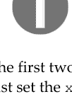
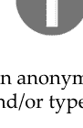
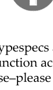
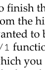

# 1 为即将开始的旅程做准备

欢迎踏上这段不可思议的旅程！这是奥德赛的开始，将带你了解 Elixir 的众多特性，以及如何使用它们来构建、测试、部署和维护应用程序。如果你尚未熟悉函数式编程，这段旅程可能需要你转变思维方式以及对编程（以及一般问题解决）的思考方式。

在深入阅读本书之前，我们想指出，本入门章节是有意保持简短的。尽管我们将介绍该语言、其工具和生态系统，但这不会是一份完整的参考指南。Elixir 将文档视为一等公民，这体现在其模块和函数的出色文档中。因此，我们决定教你如何搜索所需内容，并以本书的核心概念——构建一个 Elixir 应用程序为目标。我们认为这种务实的方法能为你带来最大价值，因为你能够跟随一个应用程序从其诞生到生产环境，包括有时被忽视的部署和监控。

在本章中，我们将涵盖以下主题：

- Elixir 中的数据类型
- 使用模式匹配及其如何应用于各种类型
- 使用函数并将它们打包到模块中
- 使用集合
- 使用经典的控制流结构（如 `case`）
- 在函数上使用类型规范
- 创建行为，并在其他模块中采用它们
- 使用协议使我们的函数具有多态性
- Elixir 自带的一些最有用的工具
- 直接调用 Erlang 库
- 通过端口与操作系统进程交互

### 为什么是函数式编程？

我们本身来自面向对象的背景，不能过分强调这种转变的价值。采用函数式编程范式会带来一些好处，例如以下几点：

- 数据转换流程变得更加明显。这与面向对象编程中通常发生的情况形成对比，在面向对象编程中，对象力求封装数据；而在函数式编程中，我们使用函数来改变数据。这使得应用于数据的转换变得明确，进而使以这种方式编写的应用程序更容易理解。
- 函数（大多）是无副作用的。有了不可变数据，你可以确信你持有的某个变量的引用值将保持不变，因为如果另一个函数或进程想要更改它，必须先创建副本——并在该副本上操作。这使得代码更容易分析和理解，因为你可以确信你的变量会保持你所期望的状态。然而，请注意，由于 Elixir 不是纯函数式语言，你的代码仍可能产生副作用。例如，如果一个函数写入文件，就会产生副作用。
- 程序可以轻松并行化。作为不可变性的额外好处，通常非常简单地并行化这种类型的程序，因为不存在共享状态。

具有不可变数据的一个可能缺点是，你可能会产生性能损失，因为每次需要更改某物时，都必须复制它。这在很大程度上取决于实现方式，虽然这种担忧通常是合理的，但 Elixir 在编译代码时采用了巧妙的技术来最大程度地减少这种影响。例如，在某些条件下，Elixir 在创建新变量时可以直接指向现有变量，因为它知道所有变量都是不可变的并且永远不会改变。

如果你被所有这些函数式编程术语弄得不知所措，就躺下放松吧，因为我们将在整本书中更详细地探讨这些概念。


## Elixir 与 Erlang

Elixir 由 José Valim 创建，运行在 Erlang VM（也称为 BEAM）上。Erlang 由 Ericsson 在 30 多年前开发，旨在提高公司电信系统的可靠性和可扩展性。如今，它被用于多种不同的场景，从数据库系统到聊天应用。Erlang 的设计中内置了容错和分布式特性，以运行具有九个九可靠性的系统而闻名。

Erlang 的运行时天生就是分布式的，因为它被设计为可同时部署在多个电信交换机上。在 Erlang VM 上运行的程序可以通过轻松地将应用程序分布到多个节点上来利用这一点，也可以在多个 CPU 上分布——因为多核只是分布式系统的一种特殊情况。这是在当今环境下 Erlang VM（因此也是 Elixir）的一个令人难以置信的卖点，因为 CPU 的速度并没有变得更快，我们看到的是具有越来越多核心的 CPU 出现。

在本章开头，我们将介绍 Elixir。从其数据类型开始，我们还将介绍模式匹配、匿名和命名函数、模块以及一些控制流结构。然后，我们将了解如何处理集合，之后将简要介绍行为和协议。本章将以 Elixir 提供的令人难以置信的工具概述结束，以及一些利用 Elixir 与 Erlang 之间现有互操作性的方式。

## Elixir 的数据类型

我们现在将描述 Elixir 的数据类型，它们扩展了 Erlang 的数据类型。Elixir 是一种动态编程语言。因此，你不需要声明每个变量的类型——它取决于变量在每个时刻所持有的值。

为提高学习体验，我们将在过程中提供一些示例。目前，我们将只使用 Elixir 的 REPL，IEx（Interactive Elixir 的缩写）。要启动 IEx 会话，你必须在机器上安装 Elixir。如果尚未安装，Elixir 有一个官方页面提供说明，无论使用包管理器、预编译版本，还是自行从源代码编译：

```
http://elixir-lang.github.io/install.html
```


我们不会深入探讨 Elixir 中每种类型的内存使用情况。如果你对此感兴趣，官方 Erlang 文档包含详细的信息：http://erlang.org/doc/efficiency_guide/advanced.html.

前提是你已在机器上安装了 Elixir，输入 `iex` 在终端启动新的 IEx 会话。通过它，你可以在机器上运行本章中的示例。请注意，你默认的 `iex` 提示符包含括号中的数字，表示当前会话中已输入的表达式数量，例如 `iex>(1)`。为使输出更简洁，我们在示例中去掉了这个数字。

我们将在本章末尾的 *工具和生态系统* 部分更详细地探讨 IEx。在以下各小节中，我们将提及 Elixir 中的一些内置模块。我们将在 *函数和模块* 部分探讨模块是什么——目前，知道模块是一个函数集合就足够了。


当你完成 IEx 会话后，可以按两次 `Ctrl + C` 或 `Ctrl + \`. 这将终止运行 Erlang 运行时（以及所有后台作业）的操作系统进程。或者，你也可以通过在 shell 中输入 `System.halt` 以更礼貌的方式停止系统。

## 整数

此类型包含如你所料，不能带小数部分的数字。整数的大小会根据其大小动态调整——你不必担心这一点：整数在增长时会简单地占用内存中更多的字。以下是使用整数的一些基本算术：

```
iex> 25 + 8
33
```

为了提高代码的可读性，你还可以在整数的数字之间使用下划线，如下所示：

```
iex> 1_000_000 - 500_000
500000
```

除了十进制外，Elixir 还支持以二进制、八进制和十六进制（分别使用 0b、0o 和 0x）书写的整数：

```
iex> 0b10001
17
iex> 0o21
17
iex> 0x11
17
```

## 浮点数

在 Elixir 中，浮点数用小数点书写，小数点前后都有数字，这意味着 .1 在 Elixir 中不是有效的浮点数（如 JavaScript 中那样）。在 Elixir 中，你必须明确并写出前导 0——因此在这种情况下，你应写 0.1。以下是两个浮点数相乘的示例：

```
iex> 0.1 * 0.5
0.05
```

你也可以使用指数表示法书写浮点数，如下所示：

```
iex> 0.1e3
100.0
```

浮点数以 IEEE 754 双精度表示，可提供 15 到 17 位有效十进制数字。如往常一样，在比较浮点数相等时应谨慎。

请注意，除法运算符（/）始终返回浮点数，即使除法的结果可以是整数：


```
iex> 4/2
2.0
```

如果你想规避这种行为，请使用 Kernel 模块中自动导入的 div 函数。另外，如果你想获取除法的余数，请使用 rem 函数。

## 原子

*原子* 是一种常量，其值就是其自身名称。它们始终以冒号（:）为前缀，后跟字母数字字符（可能还包括 _ 或 @）。它们可能以感叹号或问号结尾。原子与 C 中的枚举和 Ruby 中的符号类似。以下是一些原子的示例：

```
iex> :ok
:ok
iex> :error
:error
iex> :some_descriptive_name!
:some_descriptive_name!
iex> :value@start
:value@start
```

你可以使用以下语法创建包含任意字符的原子：

```
iex> :"Atom name with arbitrary characters#$%^"
:"Atom name with arbitrary characters#$%^"
```

与 Elixir 中的所有数据结构一样，原子在创建后不能被修改。此外，它们不会被垃圾回收。原子保存在 *原子表* 中，并在编译时，其值被替换为该表中条目的引用。这使得比较原子非常高效。正如你在本书中将学到的，这是 Elixir 中原子的主要用途之一，因为我们不断将函数的返回值与某个期望的原子进行匹配。


由于原子不会被垃圾回收，不要从你无法控制的来源动态创建原子，否则你很容易用完为原子表分配的全部空间。例如，如果你正在解析 JSON 响应并从中创建映射，不要使用原子作为其键——改用字符串（这两种类型，映射和字符串，将在本章后面描述）。

## 布尔值

Elixir 有三个与布尔运算相关的值：`true`、`false` 和 `nil`（其中 `nil` 表示值的缺失——类似于大多数其他语言中的 `null`）。然而，这些只是一些语法糖，因为在内部它们表示为同名的原子，如以下示例所示：

```
iex> true == :true
true
iex> false == :false
true
iex> nil == :nil
true
```

你有常见的布尔运算符 `or`、`and` 和 `not`：

```
iex> true or false
true
iex> true and false
false
iex> not false
true
```

然而，这些运算符在第一个参数上是类型严格的：它们只接受 `true` 或 `false`。如果你传入其他参数，将会得到 `BadBooleanError`。

这就是 *真值性* 和 *假值性* 概念的用武之地。与 Ruby 或 C 中发生的情况类似，`false` 和 `nil` 被视为 *假值* 值，而其他所有值都被视为 *真值*。处理 *假值* 和 *真值* 值的运算符是 `&&`（and）、`||`（or）和 `!`（not）：

```
iex> "a value" || false
"a value"
iex> "a value" && false
false
iex> nil && "a value"
nil
iex> !"a value"
false
```

注意这些运算符如何根据参数进行短路。对于 `||`，它返回第一个 *真值* 值，而对于 `&&`，它返回第一个 *假值* 值（在两种情况下，如果这些条件永远不成立，它们将返回最后一个值）。

你还有其他正常的比较运算符，例如大于（`>`）和不相等（`!=`）——完整列表可在 https://hexdocs.pm/elixir/operators.html 找到。其中值得指出的是 *严格相等* 运算符，它除了比较值外，还比较类型：

```
iex> 3 == 3.0
true
iex> 3 === 3.0
false
```


## 元组

*元组* 用于将固定数量的元素组合在一起。它们可以保存任何值——甚至是其他元组。它们在内存中连续存储，这提供了对元组内部元素恒定的访问时间。你可以通过花括号（{ 和 }）将元素包围起来创建元组，并用逗号分隔元素：

```
iex> {:ok, 3.14}
{:ok, 3.14}
```

在 Elixir 中，元组的常见用法是对函数的结果进行模式匹配，以确保其成功（通常使用一个 :ok 原子）或处理错误。我们将在本章后面学习模式匹配和函数。

要访问元组内部的元素，我们使用 elem 函数（来自 Kernel 模块），提供元组和一个基于零的索引：

```
iex> result = {:ok, 3.14}
{:ok, 3.14}
iex> elem(result, 1)
3.14
```


Kernel 模块中的函数会被自动导入。因此，我们不需要用模块名作为前缀。

要更改元组上的元素，可以使用 put_elem 函数。其参数与 elem 函数类似，但你还需要提供该位置的新值：

```
iex> put_elem(result, 1, 1.61)
{:ok, 1.61}
iex> result
{:ok, 3.14}
```

注意 result 变量没有改变。正如我们在本章开头讨论的那样，Elixir 中的数据是不可变的。因此，虽然我们用新值更新了元组，但原始元组并未改变——Elixir 在原始元组的副本上更新了值。这样我们的代码就是无副作用的，任何持有 result 变量引用的其他函数都不会有意外。

在 Elixir 中，普遍的建议是元组应保存最多四个元素——如果超过这个数量，你可能应该使用其他类型。

## 列表

列表是通过用方括号（[ 和 ]）将我们想要的元素包围起来创建的，用逗号分隔值。内部，列表被实现为单向链表，这意味着访问列表元素是一个 O(n) 操作。列表不像其他语言中的数组那样在内存中连续存储。与元组一样，列表元素可以是任何类型：

```
iex> [1, :an_atom, 0.5]
[1, :an_atom, 0.5]
```

我们有 ++ 和 -- 运算符，它们是列表独有的，分别用于连接和减去列表：

```
iex> [0, 1, 1] ++ [2, 3, 5]
[0, 1, 1, 2, 3, 5]
iex> [0, 1, 1] -- [1, 2, 3]
[0, 1]
```

要检查某个元素是否存在于列表中，可以使用 in 运算符：

```
iex> 1 in [0, 1, 1, 2, 3, 5]
true
iex> 99 in [0, 1, 1, 2, 3, 5]
false
```

要获取列表的头部，我们使用 hd 函数，而要获取列表的尾部，我们使用 tl 函数：

```
iex> hd([0, 1, 1, 2, 3, 5])
0
iex> tl([0, 1, 1, 2, 3, 5])
[1, 1, 2, 3, 5]
```

注意，这里尾部的语义是指不包含其头部的列表（它本身也是一个列表），而不是列表的最后一个元素。我们将在 Working with collections 部分更深入地探讨这一概念，并提供更多关于如何操作列表的示例。参考资料，你可以在 https://hexdocs.pm/elixir/List.html 找到有关列表可执行操作的详细列表。


向列表追加是一个 O(n) 操作，因为我们需要遍历整个列表。向列表 prepend 是 O(1)。要向列表 prepend 一个元素，可以使用以下语法：[new_element | list]。

## 映射

映射是键值数据结构，其中键和值可以是任何类型。它们类似于 Ruby 中的哈希和 Python 中的字典。要创建映射，你将键值对用 %{ } 包围，并在键和值之间放置一个 =>，如下例所示：

```
iex> %{ :name => "Gabriel", :age => 1}
%{age: 1, name: "Gabriel"}
```

在这种情况下，键都是同一类型，但这不是必需的。如果你的键是原子，可以使用以下语法使映射声明更简单：

```
iex> %{name: "Gabriel", age: 1}
%{age: 1, name: "Gabriel"}
```

要访问与某个键关联的值，将键放在映射前方的方括号内：

```
iex> map = %{name: "Gabriel", age: 1}
%{age: 1, name: "Gabriel"}
iex> map[:name]
"Gabriel"
```

与映射声明一样，当键是原子时，我们对其有语法糖：

```
iex> map.name
"Gabriel"
```


当你尝试获取映射中不存在的键时，使用 map.key 语法会引发 KeyError 错误——与 map[key] 语法不同，后者会返回 nil。

要更新映射中的键，可以使用 %{map | key => new_value}。如果键是原子，我们可以使用前面描述的相同记法：

```
iex> %{map | age: 2}
%{age: 2, name: "Gabriel"}
```


如果你来自面向对象编程背景，你可能会本能地使用以下语法来更改键的值：map[key] = new_value。记住在 Elixir 中所有类型都是不可变的，你永远不会对数据结构本身进行操作，而总是对其副本进行操作。

这仅适用于映射中已存在的键——这一限制允许 Elixir 在更新映射时优化并重用字段列表。如果想插入新键，使用 Map 模块中的 put 函数：

```
iex> Map.put(map, :gender, "Male")
%{age: 1, gender: "Male", name: "Gabriel"}
```

与其他所有类型一样，在官方文档 https://hexdocs.pm/elixir/Map.html 中，你可以找到关于可以对映射做什么的相当详细的参考。

## 二进制

二进制是一组连续的字节。你可以通过 << 和 >> 包围字节序列来创建它们。这里我们创建了一个两字节的二进制：

```
iex> <<5, 10>>
<<5, 10>>
```

在十进制中，一个字节只能包含最高 255 的值（否则会溢出）。如果我们想存储大于 255 的值，需要告诉运行时使用更多空间来存储此二进制：

```
iex> <<5, 256>>
<<5, 0>>
iex> <<5, 256::16>>
<<5, 1, 0>>
```

如你所见，当我们指定大小（本例中为 16 位）时，输出会多出一个字节并且溢出没有发生。大小不必是 8 的倍数。在这种情况下，二进制通常称为位串。

大多数程序员不会处理如此低级别的数据，因此你使用二进制的频率可能不会很高。然而，在某些场景下它们非常有用，例如处理文件的头部以找到魔数并识别文件类型，甚至在手动处理网络数据包时。

## 字符串和字符列表

字符串是包含 UTF-8 代码点的二进制。你可以用通常的双引号语法创建字符串：

```
iex> "hey, a string"
"hey, a string"
```

字符列表顾名思义，是字符代码的列表。你可以使用单引号语法创建它们：

```
iex> 'hey, a charlist'
'hey, a charlist'
```

由于这只是一个列表，你可以使用 hd 函数获取第一个字符的代码：

```
iex> hd('hey, a charlist')
104
```


你可以使用 ? 运算符找出某个字符的代码。例如，要找出小写字母 d 的字符代码，你可以使用 ?d。

两种表示都支持字符串插值：

```
iex> "two plus two is: #{2+2}"
"two plus two is: 4"
iex> 'four minus one is: #{4-1}'
'four minus one is: 3'
```

两种表示也都支持 heredoc 记法，这通常用于编写文档。要创建它，使用三个单引号或双引号：

```
iex> """
...> a string with heredoc notation
...> """
"a string with heredoc notation\n"
iex> '''
...> a charlist with heredoc notation
...> '''
'a charlist with heredoc notation\n'
```


heredoc 字符串/字符列表的结束分隔符必须单独占一行。

Elixir 提供了 sigils 作为声明字符串或字符列表的另一种语法，如果你想在字符串中包含引号，这会很有用。你可以使用 ~s 创建字符串，使用 ~c 创建字符列表（它们的 uppercase 版本 ~S 和 ~C 类似，但不进行插值或转义字符）：

```
iex> ~s(a string created by a sigil)
"a string created by a sigil"
```


```
iex> ~c(a charlist created by a sigil)
'a charlist created by a sigil'
```

还有一个值得提及的 sigil：~r，它用于正则表达式。在下面的代码片段中，我们使用 Regex 模块中的 run 函数来示例 ~r sigil 的用法：

```
iex> Regex.run(~r{str}, "a string")
["str"]
iex> Regex.run(~r{123}, "a string")
nil
```

你可以在 http://elixir-lang.github.io/getting-started/sigils.html 找到支持的 sigil 列表（以及如何创建自己的 sigil！）。

在 Elixir 社区中，约定只在指代双引号格式时使用术语 string。这一区别很重要，因为它们的实现非常不同。String 模块中的函数只适用于双引号格式。你应该始终使用双引号格式，除非需要使用 charlist——例如在使用 Erlang 库时就是这种情况。你可以使用以下函数在两种格式之间进行转换：

```
iex> String.to_charlist("converting to charlist")
'converting to charlist'
iex> List.to_string('converting to string')
"converting to string"
```

## 其他类型

我们现在将简要描述一些其他类型。我们将从一些已描述类型的构建之上开始：关键字列表、范围、mapsets 和 IO 列表。

### 关键字列表

关键字列表是一个列表，其元素具有特定格式：它们是元组，其中第一个元素是原子（第二个元素可以是任何类型），如下例所示：

```
iex> [name: "Gabriel", age: 1] = [{:name, "Gabriel"}, {:age, 1}]
[name: "Gabriel", age: 1]
```

我们可以使用以下语法创建关键字列表：

```
iex> keyword_list = [name: "Gabriel", age: 1]
[name: "Gabriel", age: 1]
iex> keyword_list[:name]
"Gabriel"
```

从前面的代码片段可以看出，关键字列表确实是一个以原子开头的元组列表；你可以使用与在 map 中相同的语法访问关键字列表中的值。或者，你可以使用 Keyword 模块中的 get 函数。请注意，这种声明关键字列表的方式只是语法糖，因为内部仍然是元组列表——这意味着在关键字列表中搜索项目的时间复杂度是 O(n)，而不是像 map 中那样是 O(1)。

在关键字列表中，与 map 不同，你可以为给定键拥有多个值。此外，你可以控制其元素的顺序。通常，关键字列表用于允许函数接收任意数量的可选参数。我们将在本章后面讨论命名函数时展示此示例。你可以在 https://hexdocs.pm/elixir/Keyword.html 找到可以在关键字列表上执行的所有操作。

### 范围

范围，与 Ruby 中的情况类似，表示两个整数之间的区间。要创建范围，我们使用以下方式：

```
iex> 17..21
17..21
iex> 19 in 17..21
true
```

与列表的处理方式类似，我们可以使用 in 运算符检查某个数字是否在范围的开始和结束之间。

### MapSets

如果你在 Elixir 中寻找 set 的实现，你要找的就是 MapSet。你可以使用 MapSet 模块中的函数创建和操作它们。以下是一些示例：

```
iex> set = MapSet.new
#MapSet<[]>
iex> set = MapSet.put(set, 1)
#MapSet<[1]>
```

```
iex> set = MapSet.put(set, 2)
#MapSet<[1, 2]>
iex> set = MapSet.put(set, 1)
#MapSet<[1, 2]>
```

集合按定义不能包含重复项。因此，插入已存在的值不会产生任何效果。你可以在 https://hexdocs.pm/elixir/MapSet.html 找到 MapSet 模块的文档。

在结束本节之前，我们必须提及三种与底层 Erlang VM 相关的类型。它们如下：

- **引用：** 引用是一种由 Kernel.make_ref 函数创建的类型。该函数创建几乎唯一的引用，大约每 2^82 次调用会重复一次。我们在本书中不会使用引用。
- **端口：** 端口是对资源的引用。Erlang VM 使用它与外部资源（如操作系统进程）交互。我们将在本章后面讨论 Elixir 与 Erlang 之间的互操作性时，再多谈一些关于端口的内容。
- **PID：** PID 是用于标识 Erlang VM 中进程的类型。你将在本书后面开始使用 Erlang VM 进程时看到 PID 的实际应用。

为了完成本节，有一个我们想要强调的函数：i 函数，它是从 Kernel 模块自动导入的。你可以使用它来了解有关数据类型更多信息。它将打印你作为参数传递的项的数据类型信息。以下是使用字符串的示例：

```
iex> i("a string")
Term
"a string"
Data type
  BitString
Byte size
  8
Description
  This is a string: a UTF-8 encoded binary. It's printed surrounded by
  "double quotes" because all UTF-8 encoded codepoints in it are printable.
Raw representation
  <<97, 32, 115, 116, 114, 105, 110, 103>>
Reference modules
  String, :binary
Implemented protocols
  IEx.Info, Collectable, List.Chars, String.Chars, Inspect
```

至此，我们已经完成了对 Elixir 数据类型的巡览！我们没有深入细节，但通过本节中留下的链接，你会看到 Elixir 文档是多么出色，以及弄清楚某个函数的作用或某个参数的用途是多么容易。

我们现在将进入 Elixir 最突出的特性之一（也是肯定会改变你编写程序方式的特性）：模式匹配。

## 模式匹配

当我们描述 Elixir 的数据类型时，我们使用 = 运算符将某种类型的值绑定到变量。我们没有停下来解释实际发生了什么，因为语法与大多数动态编程语言非常相似。事实上，它如此相似，以至于乍一看我们假设它工作方式相同。

如果你没有函数式编程背景，你的第一反应会把 = 运算符称为赋值运算符。然而，在 Elixir 中，它被称为匹配运算符。让我们通过一些示例来看看这种命名差异的原因：

```
iex> x = 3
3
iex> x * 3
9
iex> 3 = x
3
iex> 2 = x
**(MatchError) no match of right hand side value: 3
```



我们在 IEx 会话中看到了第一个异常被抛出。我们将在本章后面讨论控制流时再讨论它们。

前两个语句类似于你在使用赋值运算符时看到的情况——我们只是将 x 变量设为 3，然后将该变量乘以 3，得到预期的结果 9。现在，注意接下来几行发生了什么。我们在 = 运算符的左侧有一个整数字面量，这是一个有效表达式，返回值为 3。你正在看到匹配运算符的实际效果。

与代数中的方程类似，该运算符尝试将左侧的模式与右侧的项进行匹配。在前一个代码片段的第一行，这意味着将左侧的 x 变量与右侧的 3 项进行匹配。

Elixir 可以通过将 x 变量绑定到 3 项使匹配成功。在第三行，我们再次匹配左右两侧，并且成功，因为 x 的值为 3，因此两侧相等。在下一行，我们尝试将字面量 2 与 x 变量匹配。Elixir 找不到使此匹配工作的方法，这导致抛出错误。需要指出的是，变量绑定只发生在 = 运算符的左侧——当它们在右侧时，变量 simply 被其值替换。

从这个代码片段中，我们还可以注意到我们始终有一个返回值——即使在进行模式匹配时也是如此。这是预期的行为，因为 Elixir 中的一切都是表达式——没有语句。你可以执行的每个操作都会始终返回一个值，无论你是在控制台打印内容还是发出 HTTP 请求。虽然你可以用表达式和语句实现同样的事情，但始终有返回值非常有用，因为你可以将函数链接在一起，并根据返回的值定义程序流程。在模式匹配的情况下，当它成功时，我们总是得到右侧匹配的项。

匹配运算符并不局限于将变量绑定到简单值——它实际上是一个非常强大的运算符，能够解构复杂的数据类型（并使你的代码变得极其易读）。我们现在将展示如何将此运算符用于上一节中介绍的几种类型，同时演示模式匹配过程的其他方面。

### 元组的模式匹配

下面的代码片段展示了如何在元组上进行模式匹配：

```
iex> {number, representation} = {3.1415, "π"}
{3.1415, "π"}
iex> number
3.1415
iex> representation
"π"
```

这里的过程与我们在前一个代码片段中描述的相同。通过在左侧设置 {number, description} 模式，我们声明我们期望一个包含两个值的元组——同样，如果不是这种情况，将会抛出 MatchError。在这种情况下，匹配成功，我们可以看到变量 number 和 representation 被绑定到预期值。


与 Erlang 不同，Elixir 允许你重新绑定变量，这就是为什么以下代码可以工作：

```
iex> a = 1
1
iex> a = 7
7
```


然而，一个变量在每次匹配中只能绑定一次：

```
iex> {a, a} = {3, 3}
{3, 3}
iex> {a, a} = {2, 3}
** (MatchError) no match of right hand side value: {2, 3}
```

在第一行，匹配成功是因为每个 a 都绑定到相同的值 3。在第二行，我们得到 MatchError，因为我们在同一匹配中将 a 绑定到两个不同的值。本章后面我们将看到如何通过使用 pin 运算符使 Elixir 在这方面表现得像 Erlang。

我们可以进一步设定期望，使用左侧的字面量：

```
iex> {3.1415, representation} = {3.1415, "π"}
{3.1415, "π"}
iex> representation
"π"
```

现在我们的期望是一个包含两个元素的元组，其中第一个是 3.1415 浮点字面量。我们也可以将此用于 Elixir 的其他类型，例如列表或映射。当我们将此技术应用于函数时，它会变得更有成效，我们将在下一节看到。

## 列表上的模式匹配

列表上的模式匹配类似于元组上的模式匹配。下面是一个简单示例：

```
iex> [first, second, third] = ["α", "β", "γ"]
["α", "β", "γ"]
iex> first
"α"
iex> second
"β"
iex> third
"γ"
```

这里没有什么新东西。如果例如我们不关心列表的第二个元素呢？这时 _（下划线）匿名变量就很方便：

```
iex> [first, _, third] = ["δ", "ε", "ζ"]
["δ", "ε", "ζ"]
iex> first
"δ"
iex> third
"ζ"
```

我们再次匹配一个包含三个元素的列表，但现在将第二个元素绑定到 _ 变量，这意味着我们接受该位置的任何内容，并且不会使用其值。


_ 变量永远不能被读取——如果这样做，你将得到一个 CompileError：

```
iex> _
** (CompileError) iex:83: unbound variable _
```

这样，Elixir 保护你免于无意中读取此变量，这很容易导致应用程序出现意外行为。

正如我们在数据类型部分提到的，你可以使用 Kernel 模块中的 hd 和 tl 函数来获取列表的头和尾。你也可以使用模式匹配来实现相同目的：

```
iex> [first | rest_of_list] = ["α", "β", "γ"]
["α", "β", "γ"]
iex> first
"α"
iex> rest_of_list
["β", "γ"]
```

虽然在这个人为的示例中，这种方法没有带来好处，但该技术是使用递归操作列表的基本要素。我们将在《使用集合》部分更详细地介绍这一点。

## 地图上的模式匹配

要在映射上使用模式匹配，我们使用想要匹配的键值对设置模式，如以下示例所示：

```
iex> %{"name" => name, "age" => age} = %{"name" => "Gabriel", "age" => 1}
%{"age" => 1, "name" => "Gabriel"}
iex> name
"Gabriel"
iex> age
1
```

请注意，在这种情况下我们匹配了映射的所有键，但这不是必要的——例如，我们只匹配 age 即可。然而，你的模式只能包含正在匹配的映射上存在的键，否则会引发 MatchError。

有时，你可能想匹配变量的值，而不是将其重新绑定到新值。为此，你可以使用由 ^ 字符表示的 pin 运算符：

```
iex> name = "Gabriel"
"Gabriel"
iex> %{name: ^name, age: age} = %{name: "Gabriel", age: 1}
%{age: 1, name: "Gabriel"}
iex> %{name: ^name, age: age} = %{name: "Jose", age: 1}
** (MatchError) no match of right hand side value: %{age: 1, name: "Jose"}
```

正如前面的代码片段所示，我们将 name 变量绑定到 "Gabriel"。然后我们像本节前面那样匹配一个映射，这次使用 name 变量的内容。这等同于在左侧使用 "Gabriel" 字面量。当我们尝试匹配具有与 pin 变量不同的值的映射时，我们会得到 MatchError，正如预期的那样。


使用 pin 运算符时，你使用的变量必须已经绑定，因为如果它不存在，运算符不会绑定该变量。如果你对不存在的变量使用 pin 运算符，你会得到一个 CompileError，指出你尝试使用的变量未绑定。

## 二进制和字符串上的模式匹配

以下示例展示了如何对二进制数据使用模式匹配：

```
iex> <<first_byte, second_byte>> = <<100, 200>>
<<100, 200>>
iex> first_byte
100
iex> second_byte
200
```

如在描述二进制数据时之前所述，当你直接处理字节时，例如从给定网络协议解析数据包，这会非常有帮助。通过将模式匹配应用于二进制数据，你可以根据需要提取位或字节，同时代码保持极其简洁表达。

由于字符串在底层只是二进制数据，我们可以使用前面代码片段中相同的策略：

```
iex> <<first_byte, second_byte>> = "YZ"
"YZ"
iex> first_byte
89
iex> second_byte
90
```

然而，当处理字符串时这并不是很有帮助，因为你得到的是字符在 UTF-8 中的十进制编码（此外，由于 UTF-8 是变长编码，一个码点可能占用多个字节）。要匹配字符串，最好的方法是使用 String 模块中的函数，例如 starts_with?、ends_with? 或 contains?。

正如本节开头所解释的，Elixir 中的一切都是表达式，在模式匹配中，匹配成功时表达式的右侧会被返回。由于这种行为并考虑到 Elixir 会重新绑定左侧的变量，我们可以编写如下表达式，将多个变量绑定到相同的值：


```
iex> x = y = 100
100
iex> x
100
iex> y
100
```

## 函数和模块

尽管在数据类型部分没有提到，函数在 Elixir 中也是一种类型——事实上，它们是 first-class 公民，可以分配给变量并作为参数传递给其他函数。

与大多数函数式编程语言一样，函数是一种重要类型，因此它们有自己的章节，与其他内置类型分开。

我们将首先探索匿名函数，然后解释模块和命名函数，最后用模块属性和指令的快速概览结束本节。

## 匿名函数

匿名函数，通常称为 lambda，是使用 fn 关键字创建的，如以下示例所示：

```
iex> plus_one = fn (x) -> x + 1 end
#Function<6.99386804/1 in :erl_eval.expr/5>
iex> plus_one.(10)
11
```

在这里，我们定义了一个接受一个参数的函数，我们将其命名为 x，并简单地将 1 加到提供的参数上。然后我们将此匿名函数绑定到名为 plus_one 的变量，并使用前面代码片段中可以看到的语法用 10 作为参数执行它。如预期，我们得到 11。



Elixir 中没有 return 关键字——函数的返回值是其最后一个表达式返回的值。

匿名函数也可以根据提供的参数的值和/或类型具有多个实现。让我们通过示例来看看：

```
iex> division = fn
...> (_dividend, 0) -> :infinity
...> (dividend, divisor) -> dividend / divisor
...> end
#Function<12.99386804/2 in :erl_eval.expr/5>
iex> division.(10, 2)
5.0
iex> division.(10, 0)
:infinity
```

假设我们想要一个特殊的除法函数，而不是在除以 0 时引发 ArithmeticError，而是直接返回 :infinity 原子。这就是这里看到的匿名函数所实现的功能。使用模式匹配，我们说当第二个参数（除数）为 0 时，我们简单地返回 :infinity。否则，我们只需使用 / 算术运算符执行正常除法。

除了具有多个体的 lambda，注意我们用下划线（_）作为前缀来标记未使用的变量，如 _dividend。这样做除了提高代码可读性外，还会使 Elixir 编译器在你使用 supposedly 未使用的变量时发出警告。相反，如果你不使用某个变量但没有用下划线作为前缀，编译器也会发出警告。


匿名函数参数周围的括号是可选的。你可以将我们之前介绍的 plus_one 函数写成 fn x -> x + 1 end。

除了接受参数外，匿名函数还可以访问外部作用域的变量：

```
iex> x = 3
3
iex> some_fun = fn -> "variable x is #{x}" end
#Function<20.99386804/0 in :erl_eval.expr/5>
iex> some_fun.()
"variable x is 3"
iex> x = 5
5
iex> some_fun.()
"variable x is 3"
```

正如你所见，我们的匿名函数可以访问外部作用域的变量。此外，变量可以绑定到另一个值，而我们的函数仍将保留匿名函数定义时变量所持有的值的引用。这通常称为闭包：函数捕获其内部使用的所有变量的内存位置。由于 Elixir 中的每种类型都是不可变的，每个内存引用上的该值不会改变。然而，这也意味着这些内存位置不能立即被垃圾回收，因为 lambda 仍持有对其的引用。

我们将通过介绍一个新的运算符——捕获运算符（由 & 表示）来结束本节关于匿名函数的讨论。


此运算符允许你以更紧凑的方式定义 lambda：

```
iex> plus_one = &(&1 + 1)
#Function<6.99386804/1 in :erl_eval.expr/5>
iex> plus_one.(10)
11
```

此语法等价于之前介绍的 plus_one 函数的写法。&1 表示此 lambda 函数的第一个参数——更一般地，&n 将表示函数的第 nᵗʰ 个参数。与 fn 记法类似，括号是可选的。然而最好使用它们，因为在实际应用中，没有括号这些 lambda 函数会变得难以阅读。


除了提供一种更简短的定义 lambda 函数的方式之外，捕获运算符也可以与命名函数一起使用。我们将在下一节进一步探讨这一点。

## 模块和命名函数

在 Elixir 中，模块将函数分组在一起，就像命名空间一样。通常，位于同一模块中的函数彼此相关。你使用 defmodule 构造来创建模块：

```
iex> defmodule StringHelper do
...>   def palindrome?(term) do
...>     String.reverse(term) == term
...>   end
...> end
{:module, StringHelper,
<<70, 79, 82, 49, 0, 0, 4, 0, 66, 69, 65, 77, 65, 116, 85, 56, 0, 0, 0,
119, 0,
0, 0, 11, 19, 69, 108, 105, 120, 105, 114, 46, 83, 116, 114, 105, 110,
103,
72, 101, 108, 112, 101, 114, 8, 95, 95, ...>>, {:palindrome?, 1}}
iex> StringHelper.palindrome?("abcd")
false
iex> StringHelper.palindrome?("abba")
true
```

在前面的示例中，我们还在 StringHelper 模块内部使用 def 构造创建了一个函数，用于检查给定的字符串是否为回文。这是一个命名函数，与匿名函数相反，必须在模块内部创建。


函数名与变量名类似，以小写字母开头，如果包含多个单词，则用下划线分隔。它们可以以 ! 和 ? 结尾。在 Elixir 社区中的惯例是，以 ! 结尾的函数名表示该函数可能会引发错误，而以 ? 结尾的函数名表示该函数返回 true 或 false——这正是我们 palindrome? 函数的情况。

请注意，与匿名函数不同，调用命名函数时我们不需要在函数名和括号之间加点。这是有意为之，目的是明确区分对匿名函数和命名函数的调用。

由于我们的 palindrome? 函数实现非常小，我们可以用以下语法将其内联：


```
def palindrome?(term), do: String.reverse(term) == term
```

这适用于使用 do ... end 语法的其他构造，例如 defmodule 或 if。我们将在控制流部分探讨 if（以及其他经典控制流机制）。

在继续之前，由于我们的示例越来越大，我们必须讨论如何将 Elixir 代码写入文件。如前例所示，你可以在 IEx 会话中定义模块——然而，编写时出现任何拼写错误都会导致必须从头开始。

将上一个示例的内容放入一个文件中——我们称之为 "string_helper.ex"（我们通常用正在定义的模块的名称来命名文件）。Elixir 源代码文件可能有两种扩展名：.ex 或 .exs。它们的区别在于，前者会被编译到磁盘（创建 .beam 文件），而后者仅在内存中编译。我们在实际应用中主要使用 .ex 扩展名，除了测试文件使用 .exs 扩展名（因为将它们编译到磁盘没有意义）。

文件创建后，你可以在终端中使用 elixirc 命令编译它，传入你想要编译的文件名。更有趣的是，你可以将文件名传递给 iex 命令（在我们的例子中为 iex string_helper.ex）。这将使 Elixir 编译你的文件，从而使我们的 StringHelper 模块（及其函数）在 IEx 会话中可用。如果你已经在 IEx 会话中并想编译新文件，可以使用 c 命令，并将文件名作为字符串传入：

```
iex> c("examples/string_helper.ex")
[StringHelper]
```

你也可以嵌套模块：

```
$ cat examples/nesting_modules.ex
defmodule Helpers do
  defmodule StringHelper do
    # StringHelper code goes here
  end
end
```


在前面的示例中，以 # 开头的行是注释。这是 Elixir 中注释行的语法。没有多行注释的语法——如果想注释一段代码，请为该块的每一行加上 # 前缀。

然而，在编译期间，Elixir 会将外部模块名添加到内部模块名前，并用点分隔。这只是一种便利，因为这两个模块之间没有关系。此语法等价于以下语法，而后者在 Elixir 应用中更为常用：

```
$ cat examples/nesting_modules_inline.ex
defmodule Helpers.StringHelper do
  # StringHelper code goes here
end
```

我们现在将以我们的 `palindrome?` 函数为例来解释 arity 的概念。在 Elixir 中，命名函数由其模块名、函数本身的名称及其 arity 标识。函数的 arity 是它接收的参数数量。考虑到这一点，我们的 `palindrome?` 函数被标识为 `Helpers.StringHelper.palindrome?/1`，其中 `/1` 表示函数的 arity。在浏览 Elixir 文档时，你会经常看到这种记法。

这个概念很重要，因为同名但 arity 不同的函数实际上是两个不同的函数。然而对人类来说，两个同名（但 arity 不同）的函数毫无关系是不合理的。因此，只有在相关时才对不同的函数使用相同的名称。

Elixir 中的常见模式是让低 arity 函数作为对同名但 arity 更高函数的调用来实现。让我们用一个 `emphasize` 函数扩展我们的模块：

```
$ cat examples/string_helper_emphasize.ex
defmodule StringHelper do
  def palindrome?(term) do
    String.reverse(term) == term
  end
```

```
def emphasize(phrase) do
  emphasize(phrase, 3)
end

def emphasize(phrase, number_of_marks) do
  upcased_phrase = String.upcase(phrase)
  exclamation_marks = String.duplicate("!", number_of_marks)
  "#{upcased_phrase}#{exclamation_marks}"
end
```

这里，我们可以看到它的实际效果：

```
iex> StringHelper.emphasize("wow")
"WOW!!!"
iex> StringHelper.emphasize("wow", 1)
"WOW!"
```


我们使用 def 构造来创建函数。通过使用它，我们的函数会被导出并可在其他模块中调用。如果你想改变这种行为，并使函数仅在定义它的模块内可用，请使用 defp 构造。

arity 为 1 的函数只是简单地调用 emphasize/2。这在你想为模块提供一个宽泛的接口时很有用，这样一些客户端只需调用 emphasize/1 而无需指定感叹号的数量，而另一些客户端则可以调用 emphasize/2 并指定感叹号的数量。

当代码像本例一样简单时，这种多重函数是不必要的，因为你可以使用默认参数达到相同的最终结果。我们通过在参数名前使用 \\ 运算符，然后指定其应有的默认值来实现这一点：

```
$ cat examples/string_helper_emphasize_with_default_args.ex
def emphasize(phrase, number_of_marks \\ 3) do
  upcased_phrase = String.upcase(phrase)
  exclamation_marks = String.duplicate("!", number_of_marks)
  "#{upcased_phrase}#{exclamation_marks}"
end
```

这将生成两个同名但 arity 不同的函数，如上一个片段所示。如果你的函数有多个主体，如下一个示例所示，你必须定义一个函数头，并在其中定义默认参数：

```
$ cat examples/string_helper_emphasize_with_function_header.ex
def emphasize(phrase, number_of_marks \\ 3)
```


```
def emphasize(_phrase, 0) do
  "This isn't the module you're looking for"
end
def emphasize(phrase, number_of_marks) do
  upcased_phrase = String.upcase(phrase)
  exclamation_marks = String.duplicate("!", number_of_marks)
  "#{upcased_phrase}#{exclamation_marks}"
end
```

在这个示例中，我们还看到了一种在命名函数中使用模式匹配的方法。请注意函数定义的顺序很重要。Elixir 会从上到下搜索匹配的条款。如果我们将第二个参数匹配为 0 的条款放在末尾，emphasize 函数的该定义将变得无法到达，因为另一个定义更通用且始终匹配。Elixir 会帮助你避免这些情况，因为它在编译期间会发出警告，提醒你这种情况。

除了使用模式匹配（正如我们在本示例和匿名函数中所见），在命名函数上我们还可以使用 guard 子句，它扩展了模式匹配机制并允许我们对函数设置更广泛的期望。要在函数上使用 guard 子句，我们在参数列表之后使用 when 子句。

为了举例说明，我们将在 palindrome? 函数上使用 guard 子句。到目前为止，我们接受任何类型的参数。如果向此函数传递整数，将会引发错误，因为我们会尝试对整数调用 String.reverse。让我们更改它：

```
$ cat examples/string_helper_palindrome_with_guard_clause.ex
def palindrome?(term) when is_bitstring(term) do
  String.reverse(term) == term
end
def palindrome?(_term), do: {:error, :unsupported_type}
```

我们现在声明我们期望参数为 bitstring。我们还创建了函数的另一个定义，当第一个定义不匹配时运行。它在实际中的表现如下：

```
iex> StringHelper.palindrome?("abba")
true
iex> StringHelper.palindrome?(123)
{:error, :unsupported_type}
```

在函数中使用 guard 子句可能导致大量重复，因为我们可能一遍又一遍地重复相同的子句。为了解决这个问题，Elixir 1.6 引入了 defguard 构造，它允许我们定义可重用的子句。

此外，使用这种构造可能会提高代码的可读性，因为我们可以提取复杂的 guard 子句并为其赋予描述性的名称。让我们看看使用 defguard 实现的先前示例：

```
$ cat examples/string_helper_palindrome_with_defguard.ex
defguard is_string(term) when is_bitstring(term)

def palindrome?(term) when is_string(term) do
  String.reverse(term) == term
end
def palindrome?(_term), do: {:error, :unsupported_type}
```

在这个简单示例中，使用这种构造并没有明显的优势。然而，随着你的模块以及 guard 子句变得更加复杂，这种技术变得非常有用。请注意，你可以使用 defguardp 定义一个未导出的 guard 子句，只能在定义它的模块内部使用。


你可以在 guard 子句中使用其他类型检查函数，以及比较运算符，还有一些其他函数。你可以在 https://hexdocs.pm/elixir/guards.html 找到完整列表。

为了结束本节，我们现在将展示该语言最杰出的特性之一：管道 (|>) 运算符。此运算符允许你链接函数调用，使函数流程易于阅读和理解。此运算符取其左侧的项，并将其作为右侧函数的第一个参数注入。这个看似平淡无奇的特性提高了代码的可读性，这很惊人，因为代码被阅读的次数远多于被编写的次数。为了演示此运算符，让我们在 palindrome? 函数中添加更多逻辑：我们现在将从检查的项中删除前导或尾随空白，并且我们还将使比较不区分大小写。结果如下：

```
$ cat examples/string_helper_palindrome_with_pipe_operator.ex
def palindrome?(term) do
  formatted_term = term
    |> String.trim()
    |> String.downcase()

  formatted_term |> String.reverse() == formatted_term
end
```

虽然在这种简单示例中影响似乎微不足道，但随着我们在书中构建应用程序，你会看到此运算符带来的表达力。

## 模块属性、指令和用法

Elixir 中的模块可能包含 *属性*。它们通常用于其他语言中使用常量的地方。你可以使用以下语法定义模块属性：

```
$ cat examples/string_helper_with_module_attribute.ex
defmodule StringHelper do
  @default_mark "!"

  # rest of the StringHelper code
end
```

然后，我们可以在该模块的函数内部使用 `@default_mark` 模块属性。此属性仅在编译时存在，因为它在该过程中会被其值替换。

模块属性还有其他一些用例：你可以注册它们，使其在运行时可访问。例如，Elixir 注册了 `@moduledoc` 和 `@doc` 属性，分别可用于为模块和函数提供文档。然后，其他 Elixir 工具可以在运行时访问此文档，我们将在 *工具和生态系统* 部分进行探讨。


我们现在第一次提到宏。宏是 Elixir 进行元编程的机制——生成编写代码的代码。我们不会在本入门章节中涉及宏，因为它们将在 *第 6 章，元编程 – 编写代码的代码* 中得到适当探讨。

Elixir 提供了三种词法作用域的指令来管理模块，外加一个名为 `use` 的宏。我们现在来描述它们：

- `alias` 用于为其他模块创建别名。你可以这样使用 `alias Helpers.StringHelper, as: StrHlp`，然后可以将该模块称为 `StrHlp`。`as:` 部分是可选的，如果你不提供它，别名将被设置为模块名称的最后一部分。
- 当我们想调用给定模块中定义为宏的内容时，我们使用 `require`。正如官方文档所述，`Integer` 模块中的 `is_odd/1` 被定义为宏。要在另一个模块中使用它，你必须 require 它：`require Integer.`
- 当我们想要访问其他模块的函数而无需使用完全限定名称时，我们使用 import。当我们导入某个模块时，我们也会自动 require 它。例如，如果我们不断使用 String.reverse/1，我们可以导入它：import String, only: [reverse: 1]。现在我们就可以直接在模块中使用 reverse。除了 only: 之外，你还可以使用 except: 来导入除给定数量函数之外的所有函数。除了函数名，only: 和 except: 还接受 :modules 和 :functions（它们不言自明）。你也可以不带任何选项使用 import，但这不推荐，因为它会污染模块的作用域——使用 import 时始终尝试传递 only: 选项。
- 最后但同样重要的是，我们有 use，它是一个宏。这通常用于为我们的模块带来额外功能。在表面之下，use 调用 require 指令，然后调用 __using__/1 回调，这允许被使用的模块向我们的上下文注入代码。

现在，你不需要知道所有这些是如何工作的。知道你有这些构造来处理模块就足够了。当我们在本书后面深入研究宏时，所有这些都会变得更加清晰。

## 处理集合

与最常见的编程语言相反，Elixir 没有 while 或 do ... while 构造，这是有道理的，因为所有数据类型都是不可变的。在 Elixir 中迭代的方式是通过递归，通过函数调用自身。你在处理集合时的大多数需求都由 Elixir 提供的<|message|>抽象覆盖，这意味着在编写 Elixir 应用程序时你可能几乎不会使用递归。

尽管如此，我们将首先简要描述递归，并展示 Elixir 中递归函数的示例。然后，我们将了解如何使用 Enum 模块处理集合，并以讨论惰性处理集合的好处以及如何使用 Stream 模块实现它来结束本节。


## 通过递归循环

我们将通过两个简单示例向你展示如何创建递归函数：对列表中的每个元素进行加倍，以及对列表中连续元素进行相乘。如前所述，虽然你在日常编码中可能不会使用它，但理解其工作原理仍然非常重要。这样，如果 Elixir 提供的抽象不足以满足你的使用场景，你就可以自行创建递归函数来实现所需功能。

在进入示例之前，让我们先总体解释一下递归函数的工作原理。在 Elixir 中，它们通常被实现为多子句函数，使用模式匹配来控制其执行流程。第一个子句设置停止递归的条件，其后跟着其他更宽泛的子句来应用递归。

在第一个示例中，我们希望将整数列表作为输入，并返回一个新列表，其中每个元素都乘以二。让我们看看这样一个函数的代码：

```
$ cat examples/double.ex
defmodule Recursion do
  def double([]), do: []

  def double([head | tail]) do
    [head * 2 | double(tail)]
  end
end
```

以下是其结果：

```
iex> Recursion.double([2, 4, 6])
[4, 8, 12]
```

除了使用多子句函数外，我们还在两种方式下使用模式匹配：判断何时到达末尾（空列表）并相应处理；以及提取列表的头和尾，这与我们在模式匹配部分展示的内容类似。递归发生在我们调用 double(tail) 时。由于我们只将尾部传递给递归调用，本质上是在遍历列表。当到达空列表时，第一个子句匹配，我们返回空列表，所有中间调用会展开并创建我们的新列表。

如果我们不想返回新列表，而是想返回单个值怎么办？我们将通过相乘列表中连续的元素来举例说明。以下是实现此功能的代码：

```
$ cat examples/multiply.ex
defmodule Recursion do
  def multiply([]), do: 1

  def multiply([head | tail]) do
    head * multiply(tail)
  end
end
```

在 IEx 会话中对其的使用如下：

```
iex> Recursion.multiply([1, 2, 3])
6
```

策略与前一个示例所示类似，不同之处在于，我们不再在每一步向列表添加元素，而是现在将 head 用作累加器。另外，需要注意的是，由于我们执行的是乘法，停止条件必须返回 1（该操作的单位元）。停止条件的定义因不同问题而异，这 arguably 是递归定义函数时最重要步骤之一。

处理递归函数时常见的担忧是其内存使用情况，因为会有多个函数调用进入栈。Erlang 运行时在可能的情况下会采用尾调用优化，这意味着递归调用不会产生新的栈压入。为了让运行时执行此优化，你必须确保函数最后做的事情是调用另一个函数（包括自身）——换句话说，进行尾调用。以下是更新后的 multiply 函数，使其进行尾调用：

```
$ cat examples/multiply_with_tail_recursion.ex
def multiply(list, accum \\ 1)
def multiply([], accum), do: accum
def multiply([head | tail], accum) do
  multiply(tail, head * accum)
end
```

通常的策略是传递一个累加器，这使得我们能够使用尾调用优化。请注意，这里存在权衡：一方面，在处理大型集合时，此优化很重要（因为函数调用不会消耗额外内存）；另一方面，不使用此优化的代码通常更易于阅读和理解，因为它通常更简洁。在进行递归时，请考虑每种解决方案的优缺点。

## 使用 Enum 模块的急切处理

在了解了 Elixir 中递归的工作原理后，我们现在将展示一些建立在其之上的抽象的示例。我们将探索 Enum 模块，它包含了一组用于操作集合的函数。我们已在 Elixir 数据类型部分见过集合的一些示例，例如列表或映射。更一般地说，我们可以在实现 Enumerable 协议的集合上使用 Enum 模块。


我们尚未介绍协议。我们将在《协议》部分进行介绍。

让我们以递归部分中的两个示例为例，看看使用 Enum 模块如何变得非常简单地实现：

```
iex> Enum.map([2, 4, 6], &(&1 * 2))
[4, 8, 12]
iex> Enum.reduce([1, 2, 3], 1, &(&1 * &2))
6
```

map 函数接收一个集合和一个 lambda，并返回一个新列表，其中 lambda 应用于集合的每个元素。

reduce 函数接收一个集合、一个累加器和一个 lambda。lambda 接收集合的当前元素和累加器，其结果是下一次迭代的累加器。迭代结束时，reduce 返回最终的累加器值。

我们使用捕获操作符来定义 lambda。如前所述，你也可以用它来捕获命名函数。在以下示例中，我们使用 Integer.is_even/1 函数来检查集合中哪些数字是偶数：


```
iex> require Integer
Integer
iex> Enum.map([1, 2, 3], &Integer.is_even/1)
[false, true, false]
```

你将在本书中构建的应用中看到 Enum 模块的使用。有关 Enum 模块的进一步使用，请查阅其文档 https://hexdocs.pm/elixir/Enum.html。

## 推导式

Elixir 提供了另一种迭代集合的构造：推导式。与 Enum 模块的函数一样，推导式适用于实现 Enumerable 协议的任何内容。让我们看一个简单示例：

```
iex> for x <- [2, 4, 6], do: x * 2
[4, 8, 12]
```

虽然在这个简单示例中它与 Enum.map/2 类似，但推导式还带来了一些其他有趣的功能。例如，你可以遍历多个集合并应用过滤器。让我们在以下示例中看看这两者的应用：

```
iex> for x <- [1, 2, 3], y <- [4, 5, 6], Integer.is_odd(x), do: x * y
[4, 5, 6, 12, 15, 18]
```

这里我们进行嵌套迭代——对于第一个可枚举项的每个元素（由 x 表示），我们将遍历第二个可枚举项的所有元素（由 y 表示）。此外，我们还应用了过滤器，只有当 x 为奇数时，我们的推导式主体才会被执行。

我们在本书中构建的应用中不会使用推导式。然而，提到它们很重要，因为在某些情况下，使用推导式而不是 Enum 模块的函数会使代码更优雅、更具表现力。

在我们的示例中，所有推导式都返回列表，这是默认行为。我们可以通过传递 into: 选项来更改它，如本示例所示：

```
iex> for x <- [1, 2, 3], into: %{}, do: {x, x + 1}
%{1 => 2, 2 => 3, 3 => 4}
```


如你所见，现在我们得到的是一个映射。into: 选项接受一个集合，用于接收推导式的结果。该集合必须实现 Collectable 协议。该协议可以被视为 Enumerable 协议的相反，用于从现有集合的值创建新结构。这在推导式之外也有用途——Enum.into/2 函数使用此协议基于可枚举项创建新集合。

## 使用 Stream 模块的惰性处理

我们现在将讨论一种不同的处理集合的方式，这在函数式编程中可能需要转变你的思维方式。在讨论惰性处理之前，让我们列举一下使用 Enum 模块的一些不足。Enum 模块被称为急切的。这意味着在处理集合时，该模块会将整个集合加载到内存中。此外，如果你有一系列想要应用于集合的函数，Enum 模块会遍历你的集合，次数与函数应用的次数一样多。让我们通过一个示例进一步说明：

```
iex> [1, 2, 3, 4, 5] \
...> |> Enum.map(&(&1 + 10)) \
...> |> Enum.zip(["a", "b", "c", "d", "e"])
[{11, "a"}, {12, "b"}, {13, "c"}, {14, "d"}, {15, "e"}]
```


前两行末尾的 \ 用于阻止我们的 Elixir 控制台立即评估该行，而是等待新行。这样，我们就可以使用管道操作符在多行上编写这些操作，使其更易读。

我们取初始集合并遍历它，为其中的每个元素加上 10。这会生成一个新列表，该列表被传递给下一个函数。该函数将两个列表一起 zip，这会产生一个新列表并返回给我们。在这个简单示例中，我们需要遍历列表两次才能构建所需结果。

这正是 Stream 模块和惰性处理变得有优势的地方。在处理惰性可枚举项时，整个集合永远不会被加载到内存中，而且与我们习惯的不同，计算不会立即进行。结果在需要时才产生。让我们用 Stream 模块看看同一个示例：

```
iex> [1, 2, 3, 4, 5] \
...> |> Stream.map(&(&1 + 1)) \
...> |> Stream.zip(["a", "b", "c", "d", "e"])
#Function<66.40091930/2 in Stream.zip/1>
```

如你所见，我们没有得到最终的列表。当我们将列表提供给 Stream.map 时，列表不会被遍历。相反，将应用于它的函数会保存到一个结构中（连同我们正在处理的集合一起）。然后我们可以将此结构传递给下一个函数，该函数会进一步保存一个要应用于列表的新函数。这真的很酷！但我们如何让它返回我们期望的结果呢？只需将其视为常规（急切）可枚举项，通过应用 Enum 模块的函数，它就会开始产生结果。


为了举例说明，我们将使用 Enum.take/2 函数，它允许我们从可枚举对象中取出指定数量的项：

```
iex> [1, 2, 3, 4, 5] \
...> |> Stream.map(&(&1 + 10)) \
...> |> Stream.zip(["a", "b", "c", "d", "e"]) \
...> |> Enum.take(1)
[{11, "a"}]
```

如你所见，我们现在得到了预期的结果。请注意，这并不是先对整个列表应用计算然后再取第一个元素的结果。我们本质上只为第一个元素计算了结果，因为这就是所必需的。如果你最终想要完整的列表，可以使用 Enum.to_list/1 函数。

流是一种非常灵活的方式来处理大型，甚至无限的集合。想象一下，你正在解析一个巨大的 CSV 文件中的值，然后对其运行一些函数。如果你像大多数人现在一样在云上运行应用程序，你可能只有有限的内存。使用惰性处理，你可以避免加载整个文件，按行处理它。如果你正在处理无限集合，例如 RSS 订阅源，惰性处理也是一个很好的解决方案，因为你可以随着元素的到达逐步处理集合中的每个元素。

请注意，虽然 Stream 模块很棒，但它不会取代你对 Enum 模块的使用。对于非常大的集合，或者当你有一长串函数应用于集合并且只想遍历一次时，它确实很棒。然而，对于小或中等大小的集合，Stream 模块的性能会更差，因为你增加了很多开销，例如必须保存要应用的函数而不是立即应用它们。在为特定任务选择使用 Enum 或 Stream 模块时，务必仔细分析你的情况并将此考虑在内。

我们将在本书中构建的应用程序中使用 Stream 模块中的函数。你将在第 4 章 Powered by Erlang/OTP 中了解更多关于 Stream 模块的内容。


Elixir 提供了一些包装构建流的大部分复杂部分的函数。如果你想构建自己的惰性流，请查看 Stream 模块中的这些函数：cycle、repeatedly、iterate、unfold 和 resource。Stream 的完整文档可以在 https://hexdocs.pm/elixir/Stream.html 找到。

## 控制流

我们现在介绍控制流构造。在 Elixir 中，它们不像在传统的命令式语言中那样常用，因为我们可以通过模式匹配、多子句函数和守卫子句的组合来满足控制流需求。每当你准备使用本节介绍的构造之一时，请停下来检查是否可以采用更函数式的方法。没有这些传统控制流构造的代码通常更容易理解和测试。如果你到了有嵌套条件语句的地步，几乎可以肯定你可以通过使用我之前提到的其中一种方法来简化它。无论如何，你偶尔会使用这些构造，因此了解它们存在很重要。

### if 和 unless

这两个构造可以用以下语法使用：

```
if <expression> do
  # expression was truthy
else
  # expression was falsy
end
```

```
unless <expression> do
  # expression was falsy
else
  # expression was truthy
end
```

与 `def` 构造一样，它们可以内联。对于 `if`，你可以这样做：

```
if <expression>, do: # expression was truthy, else: # expression was falsy
```

对于这两个构造，`else` 子句是可选的。如果主子句不匹配且未提供 `else` 子句，它们将返回 `nil`。

### cond

`cond` 可以被视为多路 `if` 语句，其中第一个 *truthy* 条件将运行其关联的代码。这可以替代 `if` ... `else if` 块的链。让我们在 IEx 上用一个例子来看一下：

```
iex> x = 5
```

```
5
iex> cond do
...>   x * x == 9 -> "x was 3"
...>   x * x == 16 -> "x was 4"
...>   x * x == 25 -> "x was 5"
...>   true -> "none of the above matched"
...> end
"x was 5"
```

条件中的 true 将作为默认条件，当没有其他子句匹配时运行。

### case

case 接受一个表达式和一个或多个模式，这些模式将与表达式的返回值匹配。这些模式可能包含守卫子句。这些模式按从上到下的顺序匹配，并将运行第一个匹配表达式关联的代码。这是一个简单的例子：

```
iex> case Enum.random(1..10) do
...>   2 -> "The lucky ball was 2"
...>   7 -> "The lucky ball was 7"
...>   _ -> "The lucky ball was not 2 nor 7"
...> end
"The lucky ball was not 2 nor 7"
```

请注意，运行此示例时你的输出可能不同，因为我们正在匹配 Enum.random/1。在这里，默认条件是通过在模式中使用 _ 来表示的，它将匹配任何内容。虽然更紧凑一些，case 构造与多子句函数类似。

### with

这个在 Elixir 1.2 中引入的控制流构造接受一个或多个表达式、一个 do 块以及可选的 else 块。它允许你对每个表达式的返回值使用模式匹配，如果每个模式都匹配则运行 do 块。如果某个模式不匹配，可能会发生两件事：如果提供了 else 块，则会执行它；否则，它将返回与表达式不匹配的值。实际上，with 允许你用它替换 case 的嵌套链或一组多子句函数。

为了演示 with 的有用性，让我们看一个例子：

```
iex> options = [x: [y: [z: "the value we're after!"]]]
[x: [y: [z: "the value we're after!"]]]
iex> case Keyword.fetch(options, :x) do
...>   {:ok, value} -> case Keyword.fetch(value, :y) do
...>     {:ok, inner_value} -> case Keyword.fetch(inner_value, :z) do
...>       {:ok, inner_inner_value} -> inner_inner_value
...>       _ -> "non-existing key"
...>     end
...>     _ -> "non-existing key"
...>   end
...>   _ -> "non-existing key"
...> end
"the value we're after!"
```

我们使用 Keyword.fetch/2 函数从关键字列表中获取键的值。此函数在键存在时返回 {:ok, value}，否则返回 :error。我们想要检索嵌套在三个关键字列表中的值。然而，假设如果我们尝试获取关键字列表中不存在的键，我们必须返回 "non-existing key"。让我们使用 with 实现相同的行为，操作与前一个示例相同的 options 列表：

```
iex> with {:ok, value} <- Keyword.fetch(options, :x),
...>   {:ok, inner_value} <- Keyword.fetch(value, :y),
...>   {:ok, inner_inner_value} <- Keyword.fetch(inner_value, :z),
...> do: inner_inner_value
"the value we're after!"
```

请注意，由于我们的表达式非常小，我们使用了简写的 do: 语法（但我们也可以使用常规的 do ... end 块）。如你所见，我们得到了相同的结果。让我们尝试获取一个不存在的键：

```
iex> with {:ok, value} <- Keyword.fetch(options, :missing_key),
...>   {:ok, inner_value} <- Keyword.fetch(value, :y),
...>   {:ok, inner_inner_value} <- Keyword.fetch(inner_value, :z),
...> do: inner_inner_value
:error
```

由于我们没有提供 else 块，我们得到的返回值是不匹配的值，即当提供的关键字列表中不存在键时 Keyword.fetch/2 的返回值。让我们做同样的事情，但提供一个 else 块：

```
iex> with {:ok, value} <- Keyword.fetch(options, :missing_key),
...> {:ok, inner_value} <- Keyword.fetch(value, :y),
...> {:ok, inner_inner_value} <- Keyword.fetch(inner_value, :z) do
```

```
...> inner_inner_value
...> else
...> :error -> "non-existing key"
...> _ -> "some other error"
...> end
"non-existing key"
```

由于我们现在提供了 `else` 块，我们现在可以相应地处理错误情况。如你所见，`else` 接受要匹配的模式列表。就像使用 `case` 一样，你可以使用 `_` 作为默认子句，当上面的模式（如果有）不匹配时运行。

如你所见，`with` 是一个非常有用的构造，它允许我们创建简洁且易于阅读的非常富有表现力的代码。此外，你可以使用 `else` 块内的模式匹配单独控制如何处理每个错误。


提供给 `with` 的第一个表达式必须与 `with` 本身在同一行，否则你会得到 `SyntaxError`。如果你确实想让 `with` 位于自己的行上，请将提供给它的表达式用括号括起来。

## 异常

就像 `if` 和 `else` 一样，异常在 Elixir 中不像在其他流行的命令式语言中那样常用。异常不用于控制流，而是留给真正异常的情况。当它们发生时，你的进程通常在监督树下运行，并且在崩溃时，你的进程的监督者将被通知并（可能取决于策略）重启它。然后，在重启后，你回到了已知且稳定的状态，异常事件的影响不再存在。在 Elixir 和 Erlang 社区中，这通常被称为 "Let it crash!" 哲学。我们将在 `Chapter 3, Processes – The Bedrock for Concurrency and Fault Tolerance` 中更详细地研究这个问题，当我们谈论进程、监督者和监督树时。

现在，我将列出传统的错误处理构造。你可以使用 `raise` 构造引发错误，它接受一个或两个参数。如果你只提供一个参数，它将引发 `RuntimeError`，参数作为消息。如果你提供两个参数，第一个参数是错误的类型，而第二个是该错误的 attributes 关键字列表（所有错误至少必须接受 `message:` 属性）。让我们看看实际效果：

```
iex> raise "Something very strange occurred"
** (RuntimeError) Something very strange occurred
```

```
iex> raise ArithmeticError, message: "Some weird math going on here"
** (ArithmeticError) Some weird math going on here
```

你可以通过使用 `rescue` 构造来捕获错误（你可以从 `try` 块或整个函数中捕获，与 `def` 配对）。你可以在 rescue 子句上定义模式。你可以使用 `_` 来匹配任何内容。如果没有任何模式匹配，错误将不会被捕获，程序的行为将如同没有 rescue 子句一样：

```
iex> try do
...> 5 / 0
...> rescue
...> e in ArithmeticError -> "Tried to divide by 0."
...> _ -> "None of the above matched"
...> end
"Tried to divide by 0."
```

由于我们并没有对错误做任何处理，只是返回一个字符串，我们可以直接在模式中使用 `ArithmeticError`。只有当你想捕获错误本身时才使用这种语法。当没有任何模式匹配时，我们会在控制台中得到错误：

```
iex> try do
...> 5 / 0
...> rescue
...> ArgumentError -> "ArgumentError was raised."
...> end
** (ArithmeticError) bad argument in arithmetic expression
```

此外，你还可以为 `try/rescue` 块传递 `else` 和/或 `after` 块。`else` 块会在 `try` 主体在未引发任何错误的情况下完成时，对其结果进行匹配。至于 `after` 构造，它将始终被执行，无论是否引发了错误。这通常用于清理某些资源（例如关闭文件描述符）。


我们在本节中提到我们不使用异常来控制程序的流程，但事实上 Elixir 为此提供了一个特殊的构造。其语法与前面所示类似，但你使用 `throw` 代替 `raise`，并使用 `catch` 代替 `rescue`。正如官方 *入门指南* 中所述（http://elixir-lang.github.io/getting-started/try-catch-and-rescue.html），这应该在除非使用 throw 和 catch 否则无法检索值的情况下使用。文中还提到在实践中这种情况相当罕见。

## 类型规范和行为

正如本章开头已提到的，Elixir 是一种动态编程语言。因此，我们不声明每个变量的类型，因为它取决于每个变量在每个时刻绑定的值。

通常动态编程语言会带来更高的生产力，因为程序员无需声明类型，可以专注于应用程序的逻辑开发。然而，这是有代价的：在静态类型语言中会在编译时捕获的某些错误，在动态语言中可能只能在运行时捕获。使用动态语言节省的时间随后会被（往往过度地）用于生产环境的调试。

我们并不提倡静态类型语言——毕竟这本书是关于 Elixir 的。但如果可以兼得两者之长呢？

事实证明你可以！类型规范，或 typespecs，是一种用于用相应的类型（参数和返回值）为函数签名做注解的机制。Typespecs 也用于创建自定义数据类型。让我们在深入行为之前更详细地探索它们。

### 类型规范

Typespecs 是使用 `@spec` 模块指令编写的，后跟 `function_name(argument_type) :: return_type`。此模块指令放置在我们要注解的函数定义正前方。

为了演示如何将 typespecs 应用于函数，让我们重新引入我们的 `palindrome?` 函数：

```elixir
$ cat examples/string_helper.ex
defmodule StringHelper do
  def palindrome?(term) do
    String.reverse(term) == term
  end
end
```

鉴于模块名为 `StringHelper`，并且它使用 `String` 模块中的函数，我们可以看到此函数接收一个字符串。由于它使用了 `==` 运算符，并且函数名尾部的 `?` 也暗示了这一点，我们知道此函数返回一个布尔值。有了这些信息，为此函数编写 typespec 很直接：

```elixir
$ cat examples/string_helper_palindrome_with_typespec.ex
defmodule StringHelper do
  @spec palindrome?(String.t) :: boolean
  def palindrome?(term) do
    String.reverse(term) == term
  end
end
```

你也可以使用 @type 指令在模块内定义自己的类型以在 typespecs 中使用（通常是在该类型使用最多的模块中）。假设你在模块中经常使用一个元组，其第一个元素是国家名称，第二个元素是其人口，如 {"Portugal", 10_309_573}。你可以用以下方式为此数据结构创建一个类型：

```
@type country_with_population :: {String.t, integer}
```

然后，你就可以像使用任何其他类型一样在 typespecs 中使用 country_with_population。

在模块中定义类型会将其导出，使其可供所有模块使用。如果你希望类型私有且仅限于定义它的模块，请使用 @typep 指令。与用于分别记录模块和函数的 @moduledoc 和 @doc 指令类似，你可以使用 @typedoc 指令为特定类型提供文档。



在 typespecs 中，字符串类型通常由 String.t 表示。你也可以使用 string，但 Elixir 社区不鼓励这样做，目的是避免与表示 Erlang 中字符串的 charlist 类型混淆。如果你在使用 typespecs 时使用 string，编译器会发出警告。

Typespecs 还提供了很好的文档，因为我们可以快速了解此函数接受和返回的类型。此示例仅展示了可用的类型子集——请参阅官方文档以获取完整列表，网址为

https://hexdocs.pm/elixir/typespecs.html.

### Dialyzer

Dialyzer (http://erlang.org/doc/man/dialyzer.html) 是随 Erlang 一起提供的工具，用于对代码进行静态分析。它分析编译后的 .beam 文件，因此适用于所有在 Erlang VM 上运行的编程语言（如 Elixir！）。虽然 Dialyzer 在没有 typespecs 的项目上也很有帮助（例如可以查找冗余代码），但其威力在函数带有 typespecs 注解的项目上最大化。这样，Dialyzer 就能够报告类型错误，使你更接近静态类型语言所能提供的安全性。

尽管本书不会探讨 Dialyzer，我们强烈推荐使用它，因为它非常有帮助。特别是，我们认为 Dialyxir 库（https://github.com/jeremyjh/dialyxir）是将 Dialyzer 集成到 Elixir 项目中的一种很好的方式，因为它抽象掉了直接处理 Dialyzer 的部分复杂性。

### 行为

行为提供了一种描述模块必须实现的一组函数的方式，同时确保模块实现了该集合中的函数。如果你来自面向对象编程背景，可以将行为视为定义接口的抽象基类。在声明行为后，我们可以创建采用此行为的其他模块。行为创建了一个明确的契约，说明采用该行为的模块需要实现什么。这样，我们可以将业务逻辑绑定到抽象（行为）而不是具体实现。我们可以用很少且本地化的更改在应用程序中交换同一行为的两个实现——即在我们定义要使用的行为实现的位置。

让我们用一个例子来演示这个概念。我们将定义一个名为 Presenter 的行为，它只有一个函数：present。然后我们将定义一个采用此行为的模块，称为 CLI.Presenter。我们也可以有其他采用此行为的模块，例如 GraphicalPresenter。行为是使用模块内的 @callback 指令创建的，为该行为包含的每个函数提供 typespec。因此，要定义我们的 Presenter 行为，我们使用以下内容：

```
$ cat examples/presenter.ex
defmodule Presenter do
  @callback present(String.t) :: atom
end
```

现在我们定义将采用此行为的模块：

```
$ cat examples/cli_presenter.ex
defmodule CLI.Presenter do
  @behaviour Presenter

  @impl true
  def present(text) do
    IO.puts(text)
  end
end
```


我们可以在下一个代码片段中看到该模块的工作情况：

```
iex> CLIPresenter.present("printing text to the command line")
printing text to the command line
:ok
```

从 Elixir 1.5 开始，我们可以使用 @impl 指令来标记作为行为回调而实现的功能。在我们的例子中，我们会在 present 函数上方放置 @impl 指令：

```
$ cat examples/cli_presenter_with_impl_annotation.ex
defmodule CLIPresenter do
  @behaviour Presenter

  @impl true
  def present(text) do
    IO.puts(text)
  end
end
```

我们可以更具体一些，使用 @impl Presenter 来说明该函数是来自 Presenter 行为的回调。这带来了两个主要优势：

- 可读性提高，因为现在明确了哪些函数构成我们 API 的一部分，哪些函数是回调实现。
- 一致性更高，因为 Elixir 编译器会检查你用 @impl 标记的函数是否属于模块所采用的行为的一部分。

请注意，当你在模块上设置 @impl 时，必须将其设置在该模块的所有回调函数上，否则会发出警告。此外，你只能在回调函数上使用 @impl，否则也会发出编译警告。


你可以使用 @optional_callbacks 在采用某个行为时将一个或多个函数标记为可选。你需要提供一个关键字列表，其中函数名作为键，元数为值。如果我们希望 Presenter 行为中的 present/1 函数是可选的，我们将使用：

```
$ cat examples/presenter_with_optional_callbacks.ex
defmodule Presenter do
  @callback present(String.t) :: atom
  @optional_callbacks present: 1
end
```

如果我们没有实现 Presenter 行为中声明的所有函数（例如通过注释掉 CLI 的 Presenter.present/1 函数），Elixir 编译器将发出以下警告：

```
warning: undefined behaviour function present/1 (for behaviour Presenter)
```

行为帮助我们遵循开闭原则，因为我们可以扩展系统而无需修改已有内容。如果将来需要一种新的呈现器类型，我们只需创建一个采用 Presenter 行为的新模块，而无需更改行为或其当前实现。我们将在本书中构建的应用程序中使用行为，你将在下一章再次看到它们的使用。

## 协议

在本入门章节中，我们多次提到 Elixir 有协议，其中 Enumerable 就是一个例子。在本节中，我们将深入探讨协议，甚至自己定义一个！

协议与上一节中看到的行为类似，定义了一组必须实现的功能。从这个意义上说，这两种结构都可以用作在 Elixir 中实现多态的一种方式——能够表现出多种行为形式，但都链接到单一接口。虽然行为定义了模块需要实现的一组函数，因此与模块绑定，但协议定义了数据类型必须实现的一组函数。这意味着，使用协议时，我们具有数据类型多态性，并且能够编写根据参数类型而行为不同的函数。

现在让我们看看如何创建一个新协议。我们将采用并扩展官方入门指南（位于 http://elixir-lang.github.io/getting-started/protocols.html）中的示例。我们将定义一个 Size 协议，将由每种数据类型实现。要定义新协议，我们使用 defprotocol 构造：

```
$ cat examples/size.ex
defprotocol Size do
  @doc "Calculates the size of a data structure"
  def size(data)
end
```

我们声明我们的 Size 协议期望实现它的数据类型必须定义一个 size/1 函数，其中参数是我们想要知道其大小的数据结构。

你可以使用 @doc 指令为此函数添加文档，就像你通常对模块内部的命名函数所做的那样。现在我们可以使用 defimpl 构造为我们感兴趣的数据类型定义此协议的实现：

```
$ cat examples/size_implementations_basic_types.ex
defimpl Size, for: BitString do
  def size(string), do: byte_size(string)
end

defimpl Size, for: Map do
  def size(map), do: map_size(map)
end

defimpl Size, for: Tuple do
  def size(tuple), do: tuple_size(tuple)
end
```


我们没有为列表定义实现，因为在 Elixir 中，size 通常用于其大小预先计算的数据结构。对于需要按需计算的类型，例如列表，则使用 length 而不是 size。这一点可以通过查看获取列表维度的函数名称进一步观察到：
Kernel.length/1.

在此定义后，我们可以看到我们的协议在实际运行：

```
iex> Size.size("a string")
8
iex> Size.size(%{a: "b", c: "d"})
2
iex> Size.size({1, 2, 3})
3
```

如果我们尝试在未定义实现的类型上使用我们的协议，将会引发错误：

```
iex> Size.size([1, 2, 3, 4])
** (Protocol.UndefinedError) protocol Size not implemented for [1, 2, 3, 4]
```


你可以在所有 Elixir 数据类型上为协议定义实现：Atom、BitString、Float、Function、Integer、Tuple、List、Map、PID、Port 和 Reference。请注意，BitString 也用于二进制类型。

为所有类型实现协议可能会很快变得单调乏味。你可以通过为 Any 实现协议来为未实现协议的类型定义回退行为。让我们为我们的 Size 协议这样做：

```
$ cat examples/size_implementation_any.ex
defimpl Size, for: Any do
  def size(_), do: 0
end
```

你必须定义当类型未实现协议时的期望行为。在这种情况下，我们说它的大小为 0（这可能没有意义，因为数据类型可能的大小不同于 0，但让我们忽略这个细节）。

现在我们有两种选择来使用此实现：要么用 @derive [Size] 标记我们想要此回退行为的模块（例如 List 模块），要么在 Size 协议的定义中使用 @fallback_to_any true。前者更费力，因为你必须为每个想要假设 Any 行为的模块进行注解，而后者更简单，因为只需更改协议定义即可使其适用于所有数据类型。在 Elixir 社区中，通常更偏好显式性，因此在 Elixir 项目中你更有可能看到 @derive 方法。

虽然为 Elixir 的数据类型实现协议已经开启了无限可能，但只有将它们与结构体混合使用时，我们才能充分利用 Elixir 的可扩展性。我们尚未讨论结构体，因此将在下一节中介绍它们。

## 结构体

结构体是构建在映射之上的抽象。我们在模块内部使用 defstruct 构造来定义结构体。结构体的名称是定义它的模块的名称（这意味着每个模块只能定义一个结构体）。对于 defstruct，我们传递一个关键字列表，其中包含定义结构体具有的字段的键值对以及它们的默认值。让我们定义一个 Folder 结构体：

```
$ cat examples/folder.ex
defmodule Folder do
  defstruct name: "new folder", files_info: [], path: nil
end
```

现在我们可以在 IEx 会话中使用它：

```
iex> %Folder{}
%Folder{files_info: [], name: "new folder", path: nil}
iex> %Folder{}.name
"new folder"
iex> %Folder{}.files_info
[]
```

Elixir 已有 File 模块，提供多个处理文件的函数。其中之一是 File.stat/2，它返回一个包含所提供路径信息的 %File.Stat{} 结构体。我们 %Folder{} 结构体中的 files_info 字段是一个列表，将包含 %File.Stat{} 结构体作为元素。让我们用一个文件初始化一个文件夹：

```
iex> folder = %Folder{files_info: [File.stat!("string_helper.ex")]}
%Folder{files_info: [%File.Stat{access: :read_write,
  atime: {{2017, 12, 31}, {16, 58, 56}}, ctime: {{2017, 12, 30}, {3, 40, 29}},
  gid: 100, inode: 3290229, links: 1, major_device: 65024, minor_device: 0,
  mode: 33188, mtime: {{2017, 12, 30}, {3, 40, 29}}, size: 509, type: :regular,
  uid: 1000}], name: "new folder", path: nil}
```

请注意，此示例假定你在启动 iex 的目录中有 "string_helper.ex" 文件。另请注意，我们使用的是 File.stat!，它与 File.stat 类似，但不是返回 {:ok, result} 元组，而是直接返回结果本身。

现在我们有一个包含一个文件的文件夹 %Folder{} 结构体。现在我们可以向你展示更新结构体的语法，它与在映射中使用的语法类似（或者你可以使用 Map 模块中的函数）。假设你在当前工作目录中也有 "recursion.ex" 文件，你可以使用此语法来更新结构体：

```
iex> folder = %Folder{ folder | files_info: [File.stat!("recursion.ex") | folder.files_info]}
%Folder{files_info: [%File.Stat{access: :read_write,
  atime: {{2017, 12, 30}, {20, 8, 29}}, ctime: {{2017, 12, 30}, {20, 8, 25}},
  gid: 100, inode: 3278529, links: 1, major_device: 65024, minor_device: 0,
  mode: 33188, mtime: {{2017, 12, 30}, {20, 8, 25}}, size: 270, type: :regular,
  uid: 1000},
  %File.Stat{access: :read_write, atime: {{2017, 12, 31}, {16, 58, 56}},
  ctime: {{2017, 12, 30}, {3, 40, 29}}, gid: 100, inode: 3290229, links: 1,
  major_device: 65024, minor_device: 0, mode: 33188,
  mtime: {{2017, 12, 30}, {3, 40, 29}}, size: 509, type: :regular, uid: 1000}],
name: "new folder", path: nil}
iex> folder.files_info
```

```
[%File.Stat{access: :read_write, atime: {{2017, 12, 30}, {20, 8, 29}}, ctime: {{2017, 12, 30}, {20, 8, 25}}, gid: 100, inode: 3278529, links: 1, major_device: 65024, minor_device: 0, mode: 33188, mtime: {{2017, 12, 30}, {20, 8, 25}}, size: 270, type: :regular, uid: 1000}, %File.Stat{access: :read_write, atime: {{2017, 12, 31}, {16, 58, 56}}, ctime: {{2017, 12, 30}, {3, 40, 29}}, gid: 100, inode: 3290229, links: 1, major_device: 65024, minor_device: 0, mode: 33188, mtime: {{2017, 12, 30}, {3, 40, 29}}, size: 509, type: :regular, uid: 1000}]
```

如你所见，我们现在在 %Folder{} 结构体中有两个文件。


虽然结构体是基于 map 实现的，但它们与 Map 模块不共享协议实现。这意味着开箱即用时你无法遍历结构体，因为它没有实现 Enumerable 协议。

我们将以关于结构体的两个额外信息结束这次小小的探索。首先，如果在定义结构体字段时未提供默认值，则 nil 将被视为其默认值。其次，你可以在创建结构体时强制要求某些字段。你可以通过 @enforce_keys 模块属性来实现这一点。如果我们想确保在创建 %Folder{} 结构体时提供 path，我们会按如下方式定义它：

```
$ cat examples/folder_with_enforce_keys.ex
defmodule Folder do
  @enforce_keys :path

  defstruct name: "new folder", files_info: [], path: nil
end
```

如果在创建此结构体时未提供 path，将会引发 ArgumentError：

```
iex> %Folder{}
** (ArgumentError) the following keys must also be given when building struct Folder: [:path]
  expanding struct: Folder.__struct__/1
    iex:46: (file)
iex> %Folder{path: "/a/b/c/"}
%Folder{files_info: [], name: "new folder", path: "/a/b/c/"}
```

## 将结构体与协议结合

现在 %Folder{} 结构体已定义，我们可以为其定义 Size 协议的实现。

我们首先为 %File.Stat{} 结构体定义实现，因为之后可以利用它来实现 %Folder{} 的协议。以下是 %File.Stat{} 的实现：

```
$ cat examples/size_implementations_file_stat_and_folder.ex
defimpl Size, for: File.Stat do
  def size(file_stat), do: file_stat.size
end

# ...
```

在此基础上，我们的 %Folder{} 结构体的实现如下：

```
$ cat examples/size_implementations_file_stat_and_folder.ex
# ...

defimpl Size, for: Folder do
  def size(folder) do
    folder.files_info
    |> Enum.map(&Size.size(&1))
    |> Enum.sum()
  end
end
```

要找出文件夹的大小，我们将其中每个文件大小相加。因此，此实现会遍历 files_info 列表，使用 %File.Stat{} 的 Size 实现获取每个文件的大小，最后将所有大小求和。在下面的代码片段中，我们可以看到此实现被应用于我们刚刚定义的 folder 变量：

```
iex> Size.size(folder)
779
```

通过这点，我们可以看到混合结构体和协议的强大之处，它让我们可以根据参数的数据类型拥有多态函数。我们现在有一个通用接口 Size.size(data)，它允许我们找出几乎任何我们想要的大小，前提是我们为感兴趣的数据类型实现了 Size 协议。

## 工具与生态系统

本章的最后一节专门介绍 Elixir 最为人称道的特性之一：其令人难以置信的工具链。此外，由于我们可以直接使用 Erlang 库，我们可以利用一个已经存在数十年的非常成熟的生态系统。首先，让我们从 Elixir 的交互式 shell IEx 开始。

## IEx

在本章开头，我们提供了启动和停止 Elixir shell 的一些说明。你在本章中已多次看到它的使用。现在我们将向你展示在 IEx 中可以做的其他一些有趣的事情。

在本章中，我们为你提供了多个 Elixir 模块的官方文档链接。你可以直接从 IEx 中使用 h 命令访问这些文档。假设你想了解更多关于 Enum 模块的信息：

```
iex> h Enum
Enum
#...,
```

前面的代码提供了一组根据 Enumerable 协议对可枚举对象进行枚举的算法。

请注意，出于简洁考虑，此命令的输出已被裁剪。

你甚至可以传递一个完全限定的函数名来获取其信息。例如，假设你不记得 Enum.map/2 函数参数的顺序：

```
iex> h Enum.map/2
def map(enumerable, fun)
@spec map(t(), (element() -> any())) :: list()

Returns a list where each item is the result of invoking fun on each corresponding item of enumerable.
For maps, the function expects a key-value tuple.
## Examples

iex> Enum.map([1, 2, 3], fn(x) -> x * 2 end)
[2, 4, 6]

iex> Enum.map([a: 1, b: 2], fn({k, v}) -> {k, -v} end)
[a: -1, b: -2]
```

另一个非常有趣的功能，从 Elixir 1.5 开始提供，即能够从 IEx 设置断点。为了展示这一点，让我们在 Functions and modules 部分定义的 StringHelper.palindrome?/1 函数上创建一个断点，该函数位于 "string_helper.ex" 文件中：

```
iex> break! StringHelper.palindrome?/1
1
iex> StringHelper.palindrome?("abba")
Break reached: StringHelper.palindrome?/1 (string_helper.ex:2)
```

```
1: defmodule StringHelper do
2:   def palindrome?(term) when is_bitstring(term) do
3:     String.reverse(term) == term
4:   end
```

```
pry(1)> term
"abba"
pry(2)> whereami
Location: string_helper.ex:2
```

```
1: defmodule StringHelper do
2:   def palindrome?(term) when is_bitstring(term) do
3:     String.reverse(term) == term
4:   end
```

如你所见，你可以访问传递给函数的参数 `term`，也可以使用 `whereami` 来显示断点停止执行的位置。要恢复执行，你可以使用 `continue` 命令进入下一个断点，或使用 `respawn` 退出并启动一个新的 shell。

从 Elixir 1.6 开始，设置断点时你也可以使用模式匹配和守卫子句。我们之前定义的断点也可以设置为 `break! StringHelper.palindrome?("abba")`，这样当该函数以 "abba" 作为参数被调用时断点才会生效。



你也可以使用 `IEx.pry` 在源代码文件上设置断点，而不是通过 IEx 来设置。使用你最喜欢的方法即可。

为了结束本节，我们将向你展示 IEx 的一个实用功能：从历史记录中访问值。有时，你调用某个函数后才意识到想要将该函数调用的结果绑定到一个变量。如果发生这种情况，你可以使用 `v/1` 函数。你可以传递一个数字，表示你想要检索值的表达式的位置（从 1 开始）。你也可以传递一个负数，这会使位置相对于 shell 中的当前表达式。你也可以不带参数调用此函数，这等同于调用 `v(-1)`——这意味着我们获取的是上一个表达式的值。让我们看一个例子：

```
iex> 7 * 3
21
iex> a = v
21
iex> a * 2
42
```

```
iex> v(-3)
21
```

IEx 还可以做更多事情，例如配置它或连接到远程 shell。请参考官方文档（位于 https://hexdocs.pm/iex/IEx.html）了解 IEx 的更多使用示例。

## Mix

Mix 是 Elixir 工具的瑞士军刀。它用于编译和运行你的应用程序、管理依赖项、运行测试，甚至用于分析代码。你可以通过在终端输入 `mix help` 来查看可用的 Mix 任务。我们在这里不会解释其用法，因为下一章的目的是向你展示如何使用 Mix 创建和维护 Elixir 项目。

## ExUnit

Elixir 附带了一个功能完善的单元测试框架：ExUnit。我们将使用它为本书中构建的应用程序编写测试。第 9 章 Finding Zen Through Testing 专门介绍测试，我们将在其中演示如何为你的应用程序编写测试，让你安心入睡。

## Erlang 互操作性

正如本章开头所述，Elixir 目标于 Erlang 运行时。Elixir 编译为可在 Erlang VM（或 BEAM）上运行的字节码，并且 Erlang 库可以在你的 Elixir 项目中使用（反之亦然）。Elixir 社区的理念是不重复造轮子，在适当时直接使用 Erlang 库。创建仅包装底层 Erlang 库的 Elixir 库的做法是不鼓励的，因为你可以直接从 Elixir 代码调用 Erlang 库。

我们不仅可以利用 Erlang 库，还可以利用其工具。例如，Erlang 附带了一个名为 Observer 的工具，它允许你监控服务器并提供大量关于 Erlang VM 的有用信息，例如正在运行的进程或负载的动态图表。我们将在第 11 章 Keeping an Eye on Your Processes 中更详细地探讨此工具，当我们谈论监控时。


要使用 Erlang 库，你将其名称写成原子，然后在其上调用函数。Elixir 没有 Math 模块，因此当需要更高级的数学运算符时，通常会调用 math Erlang 库。让我们使用此库来计算 10 的自然对数：

```
iex> :math.log(10)
2.302585092994046
```


你可以在 http://erlang.org/doc/apps/stdlib/index.html 查看 Erlang 的标准库。

当我们在 Elixir 中介绍数据类型时，我们提到了 Port 类型，它是对 Erlang VM 用于与外部资源交互的资源的引用。现在让我们看看如何使用它们与操作系统进程交互。要与端口交互，我们使用 Port 模块中的函数。在下面的示例中，我们将使用 whoami UNIX 命令，该命令打印与当前用户关联的用户名。为此，我们打开一个端口并提供要运行的可执行文件的名称：

```
iex> port = Port.open({:spawn, "whoami"}, [:binary])
#Port<0.3730>
```

我们传递了 [:binary] 选项，以便将结果作为二进制而不是字节列表获取。我们现在使用 IEx flush() 辅助函数来打印端口接收到的消息：

```
iex> flush()
{#Port<0.3730>, {:data, "dcaixinha\n"}}
:ok
```

由于我们的操作系统进程在返回结果后已终止，端口也已关闭。如果不是这种情况，我们可以使用 Port.close/1 函数显式关闭端口。另请注意，这是一个非常简单的示例。你可以通过使用 Kernel.send/2 函数动态向端口发送消息（其中包含命令）来实现更复杂的交互。在端口的官方文档中（可在 https://hexdocs.pm/elixir/Port.html 获取），你可以了解如何实现这一点。

如果我们只关心运行操作系统命令并获取其结果，可以使用 System.cmd/3 函数，它是建立在端口之上的抽象，可让我们轻松实现此目的。

## 摘要

我们现在已经到达第一章的结尾，该章包含对 Elixir 的精简介绍。我们没有涉及语言的每个方面，但提供了一些值得探索的链接。我们的目标是为你提供必要的知识，以便跟上后面的章节，在那里我们将构建一个复杂的应用程序。本章涵盖了很多内容，因此如果你记不住我们涵盖的每个概念是很正常的。让我们回顾一下最重要的要点：

- Elixir 是一种动态语言，变量的类型由其所持有的值决定。
- 每个数据类型都是不可变的，这意味着你永远不会真正更改变量的内容，你操作的是其副本。然而，你可以重新绑定变量，这将使其指向新的内存位置，而旧内容保持不变。
- Elixir 代码组织在模块中，模块包含一组函数。
- 函数是第一类对象，因为你可以将它们分配给变量并作为参数传递给其他函数。
- Elixir 中的迭代始终通过递归完成。没有 `while` 或 `do ... while` 构造。Elixir 提供了 `Enum` 和 `Stream` 等模块来抽象递归，让你高效地处理集合。
- 通常的控制流构造，例如 `if` 和 `else` 语句，在 Elixir 中并不常见。你偶尔仍会使用它们，但通常会使用模式匹配和多子句函数组合来控制程序的流程。
- 异常不用于控制流。相反，它们用于真正异常的事件。我们依赖于监督树（我们将在第 3 章 *Processes – The Bedrock for Concurrency and Fault Tolerance* 中讨论）来从异常中恢复。
- 你可以用 typespecs 或类型规范为函数添加注解，将静态类型语言的一些安全性带入动态语言。这些注解也充当函数的一种文档。
- Elixir 提供了很好的机制来使代码具有可扩展性，例如 Behaviours 和 Protocols。
- Elixir 捆绑了出色的工具，你还可以利用 Erlang 生态系统中的所有库。

在下一章中，我们将学习如何使用 Mix 创建新项目，同时描述我们将在本书中构建的应用程序。这是唯一包含临时示例的章节，在接下来的章节中，我们将始终使用我们的应用程序来举例说明我们想要解释的概念。
