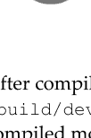
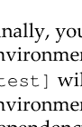
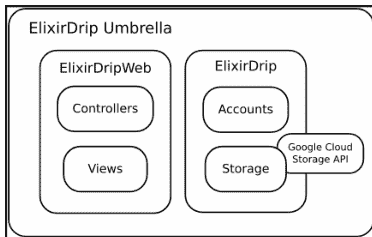
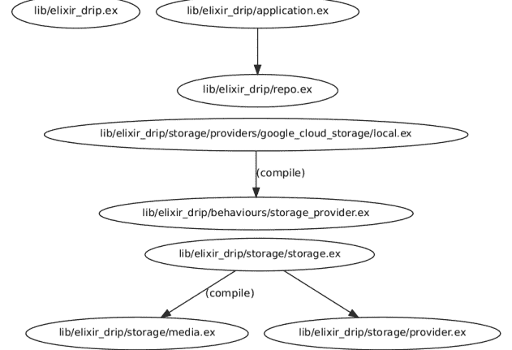
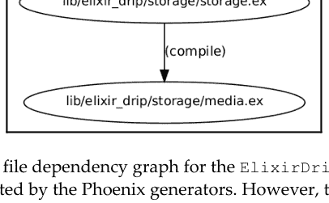

# 2 Elixir 项目的内部结构

在上一章查看了构建块之后，我们现在将探索任何 Elixir 项目的基本方面。需要遵循一些规则，但幸运的是，每一条都很容易采用，并有助于形成易于理解的项目结构。一个在整个生产生命周期中不会阻碍演进和维护任务的应用程序，是与之合作的人的喜悦，这正是我们的目标。

我们将从学习什么是 Elixir 应用程序以及如何构建 Elixir 项目开始，同时介绍一些你可以利用的现有良好实践。我们将介绍 **Umbrella applications** 以及它们如何帮助你在项目组件之间定义更严格的边界。在创建伞形项目时，我们将使用一些常见的脚手架 mix 任务，它们可以让你从头开始快速创建 Elixir 项目。之后，我们将讨论 **ElixirDrip**，这是一个精致的 Web 文件服务器，我们将在本旅程中开发它。由于我们正在为应用程序奠定基础，我们还将建立一些关于代码风格的规则和最佳实践，使用 Credo 和新的 Elixir 1.6 代码格式化程序。

在本章中，你将学习以下主题：

- 什么是 Elixir 应用程序
- 如何构建 Elixir 项目
- 指定项目依赖关系的不同方式
- 什么是伞形项目以及它如何帮助构建项目
- 使用 *mix new* 快速让新项目启动
- 为我们将在本书中开发的项目 ElixirDrip 奠定基础
- 定义 behaviours，以允许不同的行为实现
- 使用 *xref* 来了解项目文件之间的依赖关系
- 使用 Credo 和 Elixir 格式化程序建立一致的代码风格

## Elixir 应用

Elixir 从 Erlang/OTP 继承了许多概念，应用程序的行为就是其中之一。对于 Erlang VM，应用程序是可以作为一个整体启动和停止的组件，并由 .app 文件描述（例如，hello_world.app），该文件定义了 Application Module Callback 等内容。这是一个需要实现 start/2 函数的模块，该函数负责启动应用程序，通常通过生成其顶级监督者（在下一章中，你将了解有关监督者的所有内容）。某种程度上，你可以将 start/2 函数视为用其他编程语言开发的应用程序的常见 main 入口点。

由于我们使用的是 Elixir，因此无需显式指定 .app 文件。Elixir 编译器会通过查找使用 Application behaviour 的模块来找到正确的应用程序模块回调，然后为我们生成 .app 文件。

让我们使用 mix 生成一个带监督者的示例项目，以实践这些 Application 概念：

```
$ mix new sample_project --sup
* creating README.md
* creating .gitignore
* creating mix.exs
* creating config
* creating config/config.exs
* creating lib
* creating lib/sample_project.ex
* creating lib/sample_project/application.ex
* creating test
* creating test/test_helper.exs
* creating test/sample_project_test.exs

Your Mix project was created successfully.
You can use "mix" to compile it, test it, and more:

cd sample_project
mix test
```

我们刚刚运行了一个名为 new 的 Mix 任务，并传递了两个参数 sample_project 和 --sup。Mix 是随 Elixir 提供的工具，可帮助你创建、组织和维护 Elixir 项目。例如，每当你需要获取项目依赖项或运行应用程序时，都可以通过运行 mix <task> <arguments> 使用 Mix。由于依赖项也可以添加自己的 Mix 任务，你将能够以完全相同的方式运行它们。


我们正在下面的 SampleProject.Application 模块中定义 application start/2 回调函数。该函数将在项目初始化期间被调用，因为该模块使用了 Application behaviour。此回调策略也是在其他场景中应用的常见模式。

作为应用程序的入口点，您应该利用这个机会启动之后所需的一切。在我们的例子中，我们创建了一个带有 supervisor 的示例项目，以便在应用程序初始化期间看到 start/2 函数为我们启动一个 supervisor：

```
$ cat lib/sample_project/application.ex
defmodule SampleProject.Application do
  use Application

  def start(_type, _args) do
    children = []

    opts = [strategy: :one_for_one, name: SampleProject.Supervisor]
    Supervisor.start_link(children, opts)
  end
end
```

如果我们没有使用初始 supervisor 创建项目（通过省略 --sup 标志），我们将不会拥有实现 start/2 回调的 SampleProject.Application 模块，因此我们的项目无需启动。这可能是当您想要创建一个主要作为模块和函数的集合的项目时出现的情况，这些模块和函数可能包含在其他项目中，但本身不需要启动。

mix.exs 文件定义了您的 Mix 项目，并显示了在运行项目时启动哪些应用程序等信息。查看位于项目根目录的 mix.exs 中的 application/0 函数，您可以看到 SampleProject.Application 与 logger 应用程序一起启动，后者将作为额外应用程序启动。这意味着当您的应用程序启动时，logger 应用程序已经处于运行状态。mod 和 extra_applications 条目中引用的每个应用程序都需要实现相同的 start/2 应用程序模块回调，以便能够正确启动。请看下面的代码块：

```
$ cat mix.exs
defmodule SampleProject.Mixfile do
  use Mix.Project

  def project do
  [
```
```
app: :sample_project,
    version: "0.1.0",
    elixir: "~> 1.4",
    start_permanent: Mix.env == :prod,
    deps: deps()
  ]
end

def application do
  [
    extra_applications: [:logger],
    mod: {SampleProject.Application, []}
  ]
end

defp deps do
  []
end
end
```

我们也可以通过使用 `iex` 启动应用程序并调用 `Application.started_applications/0` 函数来确认这一点。我们可以观察到，除了 Elixir 启动的其他应用程序外，我们还有 `sample_project` 和 `logger` 额外应用程序。请看下面的代码：

```
$ iex -S mix
iex> Application.started_applications()
[{:sample_project, 'sample_project', '0.1.0'}, {:logger, 'logger',
'1.5.2'},
{:mix, 'mix', '1.5.2'}, {:iex, 'iex', '1.5.2'}, {:elixir, 'elixir',
'1.5.2'},
{:compiler, 'ERTS CXC 138 10', '7.1.3'},
{:stdlib, 'ERTS CXC 138 10', '3.4.2'}, {:kernel, 'ERTS CXC 138 10',
'5.4'}]
```

在之前的代码片段中，我们正在 IEx shell 中运行脚本（由于 `-S` 选项），`mix`。当我们运行 Mix 而不指定任何 `task` 时，它将运行默认的 `run` task，负责启动并运行当前应用程序及其依赖项。因此，我们在这里所做的事情相当于使用 `iex -S mix run` 执行 `run` task。



如果您的应用程序没有通过使用 `Application` 模块来实现上述的 `start/2` 回调函数，您仍然会在 `Application.started_applications/0` 函数返回的其他已启动应用程序中看到它。然而，由于您的应用程序不需要启动，即使您先使用 `Application.stop(:your_app)` 停止应用程序，您也可以调用其任何函数。

在用 `mix compile` 编译应用程序后，查看 `_build/dev/lib/sample_project/ebin` 文件夹。您将找到编译模块的扁平层次结构以及一个 `sample_project.app` 文件。该文件使用 Erlang 术语定义您的应用程序，其目的是让 Erlang VM 知道如何启动您的应用程序。Mix 会通过查看 `mix.exs` 文件自动为我们生成此文件。在下面的代码片段中，您可以看到从 `mix.exs` 文件的 `application/0` 和 `project/0` 函数设置的值中获得的 `vsn`、`extra_applications` 和 `mod` 条目。请看下面的代码块：

```
$ cat _build/dev/lib/sample_project/ebin/sample_project.app
{application,sample_project,
    [{applications, [kernel,stdlib,elixir,logger]},
     {description,"sample_project"},
     {modules, ['Elixir.SampleProject',
     'Elixir.SampleProject.Application']},
     {registered, []},
     {vsn,"0.1.0"},
     {extra_applications, [logger]},
     {mod, {'Elixir.SampleProject.Application', []}}]}.
```

使用 Elixir 开发的一个令人信服的方面是，最终每个模块都会编译为自己的 BEAM 字节码文件（使用完整的模块名称作为文件名）并放置在相应的应用程序文件夹中。请看下面的代码：

```
$ ls _build/dev/lib/sample_project/ebin
Elixir.SampleProject.Application.beam
Elixir.SampleProject.beam
sample_project.app
```

此外，Elixir 中没有命名空间。当您需要从另一个模块调用函数时，您必须使用其全名或定义显式别名，即使您调用的模块位于同一应用程序下。同样，也没有隐藏的魔法在幕后根据特定的文件夹结构为我们加载模块。

这种对显式性的倾向是 Elixir 中的一个常见方面，其中几乎没有什么（或很少）内容对开发者隐藏。Elixir 的另一个定义特征是其相对较小的语言概念和抽象集合。这种节俭直接源于 Elixir 核心团队，*他们认为一种语言可以在不妨碍其学习且不导致社区分裂的情况下提供的功能是有限的*。无论您看向何处，您都会发现显式性和简单性是 Elixir 生态系统的两个主要驱动因素。

## Elixir 项目结构

在上一节中，我们使用 Mix 创建了一个示例项目，但没有彻底探索它。尽管没有强制执行严格的结构且看起来非常简单，Elixir 项目结构为每个项目设定了基线，使您在面对新代码库时能够快速上手。

让我们创建一个更简单的项目，使用 `mix new simple_project` 为我们生成初始文件夹结构。除了创建 `.gitignore` 和 `README.md` 文件外，它还创建了 `mix.exs` 文件和三个单独的文件夹：`config`、`lib` 和 `test`。请看下面的内容：

```
$ mix new simple_project
* creating README.md
* creating .gitignore
* creating mix.exs
* creating config
* creating config/config.exs
* creating lib
* creating lib/simple_project.ex
* creating test
* creating test/test_helper.exs
* creating test/simple_project_test.exs

Your Mix project was created successfully.
You can use "mix" to compile it, test it, and more:

    cd simple_project
    mix test

Run "mix help" for more commands.
```

您可以在 `config` 文件夹中找到主配置文件 `config.exs`。在这里放置应用程序配置。配置文件首先使用 `Mix.Config` 模块，因此我们可以使用 `config/2` 宏定义配置条目。


此配置文件仅由当前运行的应用程序考虑。如果您的应用程序作为依赖项被另一个应用程序使用，其配置文件将不会被考虑。如果您的应用程序需要从 `config/config.exs` 文件获取某些配置条目，您的文档应明确说明这一点，因为这些配置需要显式添加到主应用程序的配置文件中。

下面的代码示例展示了我们 `:simple_project` 应用程序的可能配置。最后，我们通过在导入的配置文件名上插值 `Mix.env` 值来导入特定环境的配置文件。这在我们需要根据当前 Mix 环境使用不同的配置值时特别有用。然后每个配置条目都可以通过 `Application.get_env(:simple_project, :configuration_key)` 获取。如果以下配置语法感觉很奇怪，请记住配置条目的最后一个元素是一个关键字列表，由大小可变的包含两个元素的元组列表组成（即：`[{:timeout_secs, 20}, {:max_number_of_processes, 1000}, {:max_upload_size_bytes, 10_000}]`）。请看下面的内容：

```
$ cat config/config.exs
use Mix.Config

config :simple_project,
  timeout_secs: 20,
  max_number_of_processes: 1000,
  max_upload_size_bytes: 10_000

import_config "#{Mix.env}.exs"
```

代码将放置在 `lib` 文件夹中。Mix 在 `lib/simple_project.ex` 文件中创建了一个空的 `SimpleProject` 模块，并且在 `lib` 文件夹中您也会找到实现 `start/2` 应用程序模块回调的模块。需要注意的是，Elixir 不强制执行任何 `lib/` 文件夹结构以及内部实际定义模块的文件组织方式。您可以拥有一个 `lib/foo.ex` 文件，定义 `Xyz.SomeContext.My.Super.Module`，它将被编译为 `Elixir.Xyz.SomeContext.My.Super.Module.beam` 文件。

为我们创建的最后一个文件夹是 `test` 文件夹。您创建的所有测试都应放在这里。Mix 还创建了 `test_helper.exs`，负责启动 ExUnit，即随 Elixir 提供的测试框架。您可以使用此助手来配置测试运行。


`test` 文件夹中的每个测试文件都必须以 `_test.exs` 结尾。如果不是这样，当你执行 `mix test` 时，你的测试用例将不会运行。Mix 只会在 `test` 文件夹中存在名称以 `_test` 结尾但没有预期扩展名的测试文件时发出警告；如果名称与 `*_test` 不匹配，它将不会发出任何警告继续执行，你的测试文件根本不会运行。

现在让我们检查如何定义 Elixir 项目的依赖项。

## 项目依赖

我们已经分析了 `mix.exs` 文件的目的。它的重要性至关重要，因为其中包含的信息定义了 Erlang VM 实际如何运行你的 Elixir 项目。然而，我们还没有研究 Mix 如何实际使用此文件来了解我们应用程序的依赖项以及应如何获取和启动它们。

Mix 会在由 `mix.exs` 文件定义的模块的 `project/0` 函数返回的 `deps` 条目中查找应用程序依赖项。此列表中的每个条目都是一个元组，指向我们的应用程序所依赖的应用程序。

为了帮助开发者查找库，Elixir 核心团队创建了 Hex (https://github.com/hexpm/hex)，这是一个 Erlang VM 的包管理器，Mix 默认使用它。你可以在 hex.pm (https://hex.pm/) 上找到所有公开可用的库，并且也可以将你的库上传到由 hex.pm 主办的私有仓库。

如果你只在 `mix.exs` 文件中设置依赖名称和版本（也就是说，`{:library, "~> 1.0.1"}`），它将从 hex.pm 获取。如果你的依赖位于私有仓库中，你应该在 `deps` 列表中的依赖条目中添加 `organization` 选项。

你也可以为每个依赖项传递额外的选项。通过使用 `git` 或 `path` 选项，你可以分别从 Git 仓库或本地路径获取依赖项。正如你接下来会看到的，伞形应用程序内部的依赖管理也利用了相同的依赖机制：如果你的依赖项位于同一个伞形项目下，你可以通过将 `in_umbrella` 选项设置为 `true` 来使用它。

Elixir 让管理依赖变得轻而易举：默认情况下，Elixir 会将你的依赖添加到所谓的 *运行时应用程序* 中。这确保了你的依赖在应用程序启动时全部运行，并在你创建应用程序发布包时包含在内。


在之前的 Elixir 版本中，依赖项并不总是被视为运行时应用程序，因此开发者需要手动将它们添加到 `mix.exs` 文件中 `project` 函数返回的 `applications` 条目中。这是一个困惑的来源，因为即使是库应用程序（不实现应用程序模块回调，仅由一组模块和函数组成），也需要与其它运行时应用程序一起提及，否则它们将不会包含在包发布中。由于这种令人困惑的行为，自 Elixir 1.4 起，应用程序默认被视为运行时应用程序。

Mix 还允许你使用 `override` 选项锁定特定包版本。这在你的 `deps` 列表中的某个包依赖于你已依赖的包的不同版本时尤其有用。如果你的代码依赖于使用 Poison 版本 ~> 2.0 的 `http_client` 依赖项，但你在 `deps` 列表中也指定需要 Poison 版本 ~> 3.0，你将遇到冲突。向你的 `poison` 条目添加 `override` 选项将强制 Mix 获取并使用该包的 3.* 版本。



在整本书中，你会在一些代码示例中看到一些 # ... 片段。这用于表示我们省略了实际代码，因为它与我们的示例无关，可能会妨碍理解。

最后，你还可以设置仅在特定 Mix 环境中使用和获取的依赖项。将 `only` 选项定义为 `Mix.env` 值列表，例如 [:dev, :test]，将允许你在构建和运行应用程序时仅在这些环境中使用该依赖项。你可以使用这种方法从发布版本中清除开发依赖项，例如测试报告格式化程序、基准测试工具、调试器等：

```
defmodule SimpleProject.Mixfile do
  use Mix.Project

  def project do
    [
      app: :simple_project,
      deps: deps(),
      # ...
    ]
  end
  # ...
  defp deps do
    [
      {:dep_from_hexpm, "~> 3.3.0"},
      {:private_dep_from_hexpm, "~> 0.2.0", organization: "coding_co"},
      {:dep_from_git, git: "https://github.com/elixir-lang/my_dep.git", tag: "2.1.0"},
      {:local_dep, path: "../packages/local_dep"},
      {:umbrella_dep, in_umbrella: true},
      {:specific_dep, "0.7.1", override: true},
      {:dev_test_dep, ">= 1.0", only: [:dev, :test]}
    ]
  end
end
```

在下一节中，我们将了解什么是伞形项目以及如何使用它来为我们的应用程序奠定基础。

## 伞形项目

在上一节中，我们首先使用 Mix 定义并创建了一个示例 Elixir 应用程序。通过使用应用程序的行为，我们能够将其作为一个单元启动和停止，并且其他应用程序可以通过在其依赖项中指向该应用程序来依赖它。

随着时间的推移，你的应用程序变得越来越大，你开始思考如何将其划分为具有明确职责的更小的独立组件。此时，你会为最近提取的逻辑从头创建一个项目并将其添加为依赖项吗？可能不会，因为现在，这些提取的组件只有在原始应用程序的上下文中才有意义。

伞形项目可以帮助你解决这个问题，因为它允许你在同一个 Elixir 项目下拥有多个应用程序。Mix 通过将你的各个应用程序放置在伞形项目的 apps 文件夹下来实现这一点，同时仍然允许你在同一项目内单独运行每个应用程序。将来，如果你想将其中一个伞形应用程序提取到自己的项目中，只需将相应的应用程序文件夹内容复制到新的代码仓库即可。

这种方法的优点之一是，你可以在同一个代码仓库中管理独立的 Elixir 应用程序，并具有清晰的边界。而且由于它不仅允许我们在同一个伞形下分组 OTP 应用程序，还可以建立这些应用程序之间的明确定义的接口，因此伞形项目是帮助你设计项目的宝贵工具。通过解耦你的伞形应用程序，你将能够独立实现甚至运行它们。


为了简化命名法，在整本书中我们将明确使用术语 *umbrella project* 和 *umbrella application* 分别指代根项目及其包含的每个应用程序。

为了说明伞形项目如何让我们的生活更轻松，让我们开始为整本书中将要构建的项目奠定基础。在下面的片段中，我们正在创建一个新的 `elixir_drip` 伞形项目，其中包含 `ElixirDrip.Umbrella` 顶层模块。我们还将项目 OTP 应用程序命名为 `elixir_drip_umbrella`：

```
$ mix new elixir_drip --module ElixirDrip.Umbrella --app elixir_drip_umbrella --umbrella

* creating .gitignore
* creating README.md
* creating mix.exs
* creating apps
* creating config
* creating config/config.exs
```

你的伞形项目已成功创建。
在你的项目内部，你会找到一个 apps/ 目录，你可以在其中创建并托管许多应用程序：

```
cd elixir_drip
cd apps
mix new my_app
```

```
Commands like "mix compile" and "mix test" when executed in the umbrella project root will automatically run for each application in the apps/ directory.
```


在模块和应用程序名称中添加 *umbrella* 参考使它更清楚地表明这确实是一个伞形项目，并且将让我们在稍后使用名称 `elixir_drip` 来命名负责业务逻辑的伞形应用程序。

我们现在可以分析生成的 `mix.exs` 文件了。如你所见，我们有一个新的 `apps_path` 条目由 `project/0` 函数返回，并且我们没有任何依赖项。Mix 使用它来知道伞形应用程序位于何处。另请注意模块的名称：我们使用 `mix new` 命令传递的 `--module ElixirDrip.Umbrella` 选项设置了它的前缀。


否则，模块名称前缀将是传递给 `mix new <project_name>` 任务的项目名称的小驼峰版本（即 ProjectName）。请看这段代码：

```
$ cat mix.exs
defmodule ElixirDrip.Umbrella.Mixfile do
  use Mix.Project

  def project do
    [
      apps_path: "apps",
      start_permanent: Mix.env == :prod,
      deps: deps()
    ]
  end

  # Dependencies listed here are available only for this
  # project and cannot be accessed from applications inside
  # the apps folder.
  #
  # Run "mix help deps" for examples and options.
  defp deps do
    []
  end
end
```

现在我们第一个伞形项目已准备就绪。可惜的是，它目前还没有任何伞形应用程序：

```
$ tree
.
├── apps
├── config
│   └── config.exs
├── deps
├── mix.exs
└── README.md

3 directories, 3 files
```

如果尝试使用 iex -S mix 命令运行它，什么也不会发生；你只会得到 Elixir 交互式 shell 的空闲状态，等待你的输入。让我们通过创建项目的第一个伞形应用程序来解决这个问题。

我们现在将使用 Phoenix 及其 Mix 任务，这些任务依赖于已安装的 Elixir 和 Erlang。为了使用 Phoenix Mix 任务，我们需要先安装 Phoenix。


要全局安装 Phoenix，请运行 `mix archive.install https://github.com/phoenixframework/archives/raw/master/phx_new.ez`。如果我们采用这种方式，即使在伞形项目等项目中未将 Phoenix 显式设为依赖项，也可以使用 Phoenix Mix 任务。另一种在项目中启用 Phoenix Mix 任务的方法是，在伞形项目的 `mix.exs` 文件中将 Phoenix 添加为依赖项，然后运行 `mix deps.get` 将其作为项目依赖项的一部分获取。

在 `apps` 文件夹中，我们将创建一个 Elixir 应用程序，它将负责封装业务逻辑和所有数据访问流程。为此，我们将利用 Mix `phx.new.ecto` 任务，它将创建一个包含仓库和使用 Ecto 开始与数据库交互所需的一切的简易应用程序（我们将在第 7 章《使用 Ecto 持久化数据》中更深入地探讨 Ecto）。请看这段：

```
$ cd apps
$ mix phx.new.ecto elixir_drip --database postgres
* creating elixir_drip/config/config.exs
* creating elixir_drip/config/dev.exs
* creating elixir_drip/config/prod.exs
* creating elixir_drip/config/prod.secret.exs
* creating elixir_drip/config/test.exs
* creating elixir_drip/lib/elixir_drip/application.ex
* creating elixir_drip/lib/elixir_drip.ex
* creating elixir_drip/test/test_helper.exs
* creating elixir_drip/README.md
* creating elixir_drip/mix.exs
* creating elixir_drip/.gitignore
* creating elixir_drip/lib/elixir_drip/repo.ex
* creating elixir_drip/priv/repo/seeds.exs
* creating elixir_drip/test/support/data_case.ex

Fetch and install dependencies? [Y/n] Y
* running mix deps.get
```

一切就绪！我们刚刚创建了第一个 `elixir_drip` 伞形应用程序。

查看我们刚刚创建的 `elixir_drip` 应用程序的 `mix.exs` 文件，可以看到 Mix 自动为 `build_path`、`config_path`、`deps_path` 和 `lockfile` 设置了正确的值，并将其指向伞形项目根目录下的相应位置。

创建 elixir_drip 应用程序后，mix new 任务在 lockfile 配置项指向的路径上创建了一个 mix.lock 文件。该文件是在应用程序创建过程中我们也运行了 mix deps.get（请查看上面的命令输出）而创建的。此文件存储项目所依赖的每个依赖项的具体版本，应与代码的其余部分一起纳入版本控制系统。这样，我们就能确保代码的每次执行都依赖于相同的依赖项版本。创建应用程序发布时也会考虑 mix.lock 文件中包含的相同依赖项版本。因此，你的应用程序将在生产环境中使用完全相同的依赖项集运行。

请注意，lockfile 和 deps_path 条目指向伞形项目根目录中的 mix.lock 文件和 deps 文件夹。这使我们能够将伞形应用程序的所有依赖项分组并管理在一个公共文件夹中，并在同一个 lock 文件中收集它们：

```
$ cat apps/elixir_drip/mix.exs
defmodule ElixirDrip.Mixfile do
  use Mix.Project

  def project do
    [
      app: :elixir_drip,
      version: "0.0.1",
      build_path: "../../build",
      config_path: "../../config/config.exs",
      deps_path: "../../deps",
      lockfile: "../../mix.lock",
      elixir: "~> 1.4",
      elixirc_paths: elixirc_paths(Mix.env),
      start_permanent: Mix.env == :prod,
      aliases: aliases(),
      deps: deps()
    ]
  end

  def application do
    [
      mod: {ElixirDrip.Application, []},
      extra_applications: [:logger, :runtime_tools]
    ]
  end

  defp elixirc_paths(:test), do: ["lib", "test/support"]
  defp elixirc_paths(_), do: ["lib"]

  defp deps do
    [
      {:postgrex, ">= 0.0.0"},
      {:ecto, "~> 2.1"}
    ]
  end

  defp aliases do
    [
      "ecto.setup": ["ecto.create", "ecto.migrate", "run priv/repo/seeds.exs"],
      "ecto.reset": ["ecto.drop", "ecto.setup"],
      "test": ["ecto.create --quiet", "ecto.migrate", "test"]
    ]
  end
end
```

还值得注意的是之前 mix.exs 文件的两个方面：根据 Mix.env 值如何将编译路径指向编译器（例如，test/support 路径仅在测试环境中编译），以及由于我们的应用程序依赖于 Ecto 而为我们创建的任务别名。关于后者，我们现在可以在此应用程序文件夹中使用 mix ecto.reset 来删除数据库并随后重新设置。这些别名对于简化频繁命令非常有用，你应根据需要自由使用它们。

无论伞形项目中包含多少个伞形应用程序，启动项目（从而启动其所有伞形应用程序）只需在项目根目录运行 mix 即可。相反，如果你想运行每个伞形应用程序的测试套件，则应运行 mix test。现在我们在伞形项目下有一个应用程序，因此如果运行项目，我们肯定会看到一些事情发生。让我们试试：

```
$ iex -S mix
Erlang/OTP 20 [erts-9.1.5] [source] [64-bit] [smp:4:4] [ds:4:4:10] [async-threads:10] [hipe] [kernel-poll:false]

Interactive Elixir (1.5.2) - press Ctrl+C to exit (type h() ENTER for help)
iex(1)>
16:22:21.146 [error] Postgrex.Protocol (#PID<0.202.0>) failed to connect: ** (DBConnection.ConnectionError) tcp connect (localhost:5432): connection refused - :econnrefused

BREAK: (a)abort (c)ontinue (p)roc info (i)nfo (l)oaded
      (v)ersion (k)ill (D)b-tables (d)istribution
a
```

我们收到的错误意味着 elixir_drip 伞形应用程序已启动，但在尝试连接到其 config/config.exs 文件中指定的数据库时失败，因为端口 5432 上目前没有运行数据库。出现此错误是预期的，因为我们尚未运行数据库。

现在让我们处理项目的面向客户端组件。我们的项目前端将是一个 Phoenix Web 应用程序；因此，我们将使用 phx.new.web Mix 任务生成我们的 elixir_drip_web 伞形应用程序（请记住我们仍在伞形项目的 apps 文件夹中）：

```
$ mix phx.new.web elixir_drip_web
* creating elixir_drip_web/config/config.exs
* creating elixir_drip_web/config/dev.exs
* creating elixir_drip_web/config/prod.exs
* creating elixir_drip_web/config/prod.secret.exs
* creating elixir_drip_web/config/test.exs
* creating elixir_drip_web/lib/elixir_drip_web.ex
* creating elixir_drip_web/lib/elixir_drip_web/application.ex
* creating elixir_drip_web/lib/elixir_drip_web/channels/user_socket.ex
* creating elixir_drip_web/lib/elixir_drip_web/endpoint.ex
* creating elixir_drip_web/lib/elixir_drip_web/router.ex
* creating elixir_drip_web/lib/elixir_drip_web/views/error_helpers.ex
* creating elixir_drip_web/lib/elixir_drip_web/views/error_view.ex
* creating elixir_drip_web/mix.exs
* creating elixir_drip_web/README.md
* creating elixir_drip_web/test/test_helper.exs
* creating elixir_drip_web/test/support/channel_case.ex
* creating elixir_drip_web/test/support/conn_case.ex
* creating elixir_drip_web/test/elixir_drip_web/views/error_view_test.exs
* creating elixir_drip_web/lib/elixir_drip_web/gettext.ex
* creating elixir_drip_web/priv/gettext/en/LC_MESSAGES/errors.po
* creating elixir_drip_web/priv/gettext/errors.pot
* creating elixir_drip_web/lib/elixir_drip_web/controllers/page_controller.ex
* creating elixir_drip_web/lib/elixir_drip_web/templates/layout/app.html.eex
* creating elixir_drip_web/lib/elixir_drip_web/templates/page/index.html.eex
* creating elixir_drip_web/lib/elixir_drip_web/views/layout_view.ex
* creating elixir_drip_web/lib/elixir_drip_web/views/page_view.ex
* creating elixir_drip_web/test/elixir_drip_web/controllers/page_controller_test.exs
* creating elixir_drip_web/test/elixir_drip_web/views/layout_view_test.exs
* creating elixir_drip_web/test/elixir_drip_web/views/page_view_test.exs
* creating elixir_drip_web/.gitignore
* creating elixir_drip_web/assets/brunch-config.js
* creating elixir_drip_web/assets/css/app.css
```

```
* creating elixir_drip_web/assets/css/phoenix.css
* creating elixir_drip_web/assets/js/app.js
* creating elixir_drip_web/assets/js/socket.js
* creating elixir_drip_web/assets/package.json
* creating elixir_drip_web/assets/static/robots.txt
* creating elixir_drip_web/assets/static/images/phoenix.png
* creating elixir_drip_web/assets/static/favicon.ico
```

Fetch and install dependencies? [Yn] Y
* running mix deps.get
* running mix deps.compile
# ...

Phoenix uses an optional assets build tool called brunch.io that requires node.js and npm. Installation instructions for node.js, which includes npm, can be found at http://nodejs.org.

This created a Phoenix application as the elixir_drip_web umbrella application, so we now have two umbrella applications in the apps folder. Our web interface will expose the business logic implemented by the elixir_drip application, so we have to add the latter to the elixir_drip_web dependencies by editing its mix.exs file.

To access modules defined by the elixir_drip application from the elixir_drip_web application, we just need to add {:elixir_drip, in_umbrella: true} as one of the web application dependencies:

```
$ cat apps/elixir_drip_web/mix.exs
defmodule ElixirDripWeb.Mixfile do
  use Mix.Project

  def project do
    [
      # ...
    ]
  end

  def application do
    [
      mod: {ElixirDripWeb.Application, []},
      extra_applications: [:logger, :runtime_tools]
    ]
  end
  # ...
  defp deps do
    [
      {:elixir_drip, in_umbrella: true},
      {:phoenix, "~> 1.3.0"},
      {:phoenix_pubsub, "~> 1.0"},
      {:phoenix_ecto, "~> 3.2"},
      {:phoenix_html, "~> 2.10"},
      {:phoenix_live_reload, "~> 1.0", only: :dev},
      {:gettext, "~> 0.11"},
      {:cowboy, "~> 1.0"}
    ]
  end
  # ...
end
```


We could have used the `mix phx.new elixir_drip -- umbrella` command to create an umbrella project with both the `elixir_drip` and `elixir_drip_web` applications in one fell swoop, with the first being able to interact with the database, using Ecto, and the latter being a Phoenix web app. But with that approach, we would miss all the fun. You now know what the `phx.new <project_name> -- umbrella` task does behind the scenes.

By observing how easy it is to create an umbrella project with several applications, you may be tempted to use this strategy by default when bootstrapping your project. After all, it gives you a way to precisely define your project boundaries and the concerns of each application, while keeping your code under the same code repository.

However, when resorting to an umbrella project you should be aware that no circular dependencies between your applications may exist, and version conflicts between your dependencies may also arise. Remember that all dependencies, even the ones of the applications you depend on, are placed in a common `deps` folder in the umbrella root. If one of your umbrella applications depends on the version X of `utility` and the dependency `remote_dep`, fetched from Hex, depends on the version Y of the same `utility`, you have a version conflict and Mix won't be able to fix it for you. You can solve this type of conflict by using the already mentioned `override` option.

You could also find yourself creating a `common` or `core` umbrella application on which your other umbrella applications will depend. However, the newly created `common` application may not even need to live under the same umbrella project, since it is just a bundle of modules with utility functions that do not belong anywhere else. In this case, you may consider to create it as a completely separate project and import it as a "normal" dependency (from its Git repository, or, even better, a Hex repository). The first iteration of extracting that common logic from the project was to place all those modules inside the `common` umbrella application. You can now easily pull this umbrella application out of the project afterwards if you want to. If you remember, an umbrella application is an independent and fully working Elixir application in the first place.

At the end of the day, umbrella projects give you more flexibility when deciding your project architecture. One of the main benefits is that you don't need to change your code if you want to pull your application from the umbrella afterwards. You may also decide further down the road that having an umbrella project is overkill. In this case, you will have to merge all the umbrella application modules and their dependencies into a single Elixir project, being aware of how each application was previously started. For web-facing projects, our recommendation is to create an umbrella project similar to what we did here: one for the business logic and the other for the web interface. This way, we can achieve a really concise and thin web layer, since its responsibility is solely to call the service logic and present its results.


Keep in mind that you should always be able to use every feature of your project without having to pass through the web layer. This will only be possible if your web interface is really thin. A good rule of thumb is to design your project in a way that lets you use every feature from the comfort of an IEx session.

With the creation of our `elixir_drip` umbrella, we now have two of the umbrella applications that will compose our project. In the next section, we will properly introduce the project and its aspirations, and how its features will exemplify the ideas demonstrated in the chapters ahead.

## ElixirDrip – our showcase application

To clearly illustrate how you may incorporate the concepts and strategies in this book, we will develop a fully fledged web application named ElixirDrip, which was kick-started by the umbrella project we have just created.

ElixirDrip aims to be a fast and scalable web storage service, allowing the user to easily store and share their files living on the cloud. Our users will be able to upload files to their cloud storage and then share those files with other ElixirDrip users.

We will be adding features to the ElixirDrip umbrella application as we progress, taking it closer to our final goal with each chapter. The most important features of our application will be tackled in specific chapters throughout this book. Consider the following:

- The design and implementation of our domain model will be analyzed in Chapter 7, Persisting Data Using Ecto, when we talk about data persistence and the usage of Ecto to efficiently query and update our application data.
- User account management and user authentication, along with our web interface for files and folders, will be tackled in `Chapter 8`, *Phoenix – a Flying Web Development Framework*.
- The steps that apply to each processed file, whether it is being uploaded or downloaded to or from ElixirDrip, will be first defined with the **GenStage** behaviour in `Chapter 5`, *Demand-Driven Processing*. We will implement the steps responsible for the remote media storage and for the real-time notifications shown to the user.
- Afterward, we will improve on the previous steps definition by creating a **domain-specific language** (DSL) that will better express how we process each file before reaching the cloud or being downloaded. This will be done in `Chapter 6`, *Metaprogramming– Code That Writes Itself*.
- In `Chapter 8`, *Phoenix – a Flying Web Development Framework*, our notification mechanism will be implemented. Every notification pushed to our users will be delivered over Phoenix Channels, a fast and bi-directional way of communicating with a Phoenix backend.
- The correctness of our application will be put to test in `Chapter 9`, *Finding Zen through Testing*, when we talk about testing best practices, unit and integration testing.
- We will create the ElixirDrip release using **Distillery**, and then deploy and run it on the cloud with **Kubernetes**. Every Elixir node deployed by us will be connected to its peers, improving the performance of our application. We will discuss all of this and more in `Chapter 10`, *Deploying in the Cloud*.
- Our journey does not end with our application serving live requests. We also need to make sure it stays healthy and that everything runs smoothly. In `Chapter 11`, *Keeping an Eye on Your Processes*, we will implement some best practices for monitoring and metric collection, ensuring we always stay on top. Moreover, we will also learn how to profile and trace our application while it's running in production.

We will keep the two already-created umbrella applications, `elixir_drip` and `elixir_drip_web`. The first will be responsible for the business logic, and the latter will be responsible for the web interface. However, on the business logic side, we will create specific modules (let's call them *contexts*) to aggregate related functionalities under a public interface. One of those contexts is the `ElixirDrip.Storage` module, which will encapsulate all media operations. The other context is the `ElixirDrip.Accounts` context, which is responsible for user management and authentication.


下图展示了 ElixirDrip umbrella 应用的宏观视角：



我们在用 Application 模块为 elixir_drip umbrella 应用定义应用模块回调时已经使用过 behaviour 概念。现在让我们了解其目的。

## 使用 behaviours

我们项目的核心部分之一是如何代表用户在云端存储和检索文件。我们决定不将此组件放在其自己的 umbrella 应用下，因为可以在同一个 umbrella 应用下在 ElixirDrip 业务逻辑与其存储对应部分之间定义清晰的边界。为了实现关注点分离，我们将把所有存储逻辑封装在 ElixirDrip.Storage 模块下。该模块将成为每个存储相关操作的单一入口点，同时封装实际的实现细节。

我们将首先创建一个 StorageProvider behaviour，它定义了两个需要实现的回调，并依赖 typespecs 来指示每个回调的参数及其可能的返回值。behaviour 使我们能够建立每个存储提供者必须遵守的契约。来看一下：

```
$ cat apps/elixir_drip/lib/elixir_drip/behaviours/storage_provider.ex
defmodule ElixirDrip.Behaviours.StorageProvider do
  @type path :: binary()
  @type content :: bitstring()
  @type reason :: atom()
  @type details :: map()

  @callback upload(path, content) ::
      {:ok, :uploaded}
      | {:error, reason}
      | {:error, reason, details}
  @callback download(path) ::
    {:ok, content}
  | {:error, reason}
  | {:error, reason, details}
end
```

然后我们将用两个模块实现该 behaviour，即 `Local` 和 `Live` 模块，分别用于本地开发和生产环境。使用 behaviour 可确保我们的模块始终遵守相同的契约，无论是前面两个模块，还是我们在第 9 章《Finding Zen through Testing》中创建测试时用来伪造对提供者实际调用的 mock 模块。

每个实现模块只需使用 `@behaviour` 模块属性来标注其实现的 behaviour。从现在开始，对于每个实现 behaviour 的模块，编译器都会检查它是否以正确数量的参数实现了 behaviour 回调：

```
$ cat apps/elixir_drip/lib/elixir_drip/storage/providers/google_cloud_storage/local.ex
defmodule ElixirDrip.Storage.Providers.GoogleCloudStorageLocal do
  @behaviour ElixirDrip.Behaviours.StorageProvider

  require Logger

  def upload(path, content) do
    Logger.debug("Uploading #{inspect(byte_size(content))} bytes to Google Cloud Storage, path: #{path}")
    {:ok, :uploaded}
  end

  def download(path) do
    Logger.debug("Downloading #{path} from Google Cloud Storage")
    {:ok, "downloaded_content"}
  end
end
```


我们选择 Google Cloud Storage 作为 ElixirDrip 的存储提供者。由于其访问逻辑已通过 `StorageProvider` 自定义 behaviour 完全抽象化，未来可以轻松切换到其他存储提供者。这个假设的新提供者只需要遵守相同的 `StorageProvider` behaviour，因此需要同时实现 `upload/2` 和 `download/1` 回调。

在 Local 或 Live 实现之间做出选择，只需调整全局或生产配置文件即可。这是一种常见模式，当我们想根据当前的 Mix 环境注入不同的模块时就会使用它：

```
$ cat apps/elixir_drip/config/config.exs
use Mix.Config
  # ...
config :elixir_drip,
  storage_provider: ElixirDrip.Storage.Providers.GoogleCloudStorageLocal

import_config "#{Mix.env()}.exs"
```

正如以下代码所示，在 prod.exs 配置中，我们指向 ElixirDrip.Storage.Providers.GoogleCloudStorageLive 模块，该模块将实际与云存储提供者交互。由于此配置文件是在主 config.exs 配置文件之后导入的，它将覆盖之前的 storage_provider 配置项：

```
$ cat apps/elixir_drip/config/prod.exs
use Mix.Config
  # ...
config :elixir_drip,
  storage_provider: ElixirDrip.Storage.Providers.GoogleCloudStorageLive
```

最后一步是创建通用的 ElixirDrip.Storage.Provider 模块，该模块将委托给由 :storage_provider 配置项指定的 StorageProvider 实现。此模块通过将 Provider.upload/2 或 Provider.download/1 调用委托给 Application.get_env(elixir_drip, :storage_provider) 配置返回的模块，从而将实际的存储提供者实现隐藏在调用者之外。

因为我们使用了 defdelegate/2 宏，Elixir 要求 @target 模块定义 upload/2 和 download/1 公共函数，否则委托将无法工作：

```
$ cat apps/elixir_drip/lib/elixir_drip/storage/provider.ex
defmodule ElixirDrip.Storage.Provider do
  @moduledoc false

  @target Application.get_env(:elixir_drip, :storage_provider)

  defdelegate upload(path, content), to: @target
  defdelegate download(path), to: @target
end
```

之前，我们决定通过 `ElixirDrip.Storage` 模块公开所有与存储相关的函数，该模块代表我们的 `Storage` 上下文。因此，此上下文将依赖之前的 `ElixirDrip.Storage.Provider` 与我们的存储提供者交互。


如果我们不想让这个中间的 `ElixirDrip.Storage.Provider` 模块委托给实际的存储提供者模块，我们可以在消费者 `ElixirDrip.Storage` 模块中直接从配置中获取 `Local` 或 `Live` 模块（即使用 `Application.get_env(:elixir_drip, :storage_provider)`）。

这个上下文在接下来的几章中会做更多的事情，但目前它只公开两个函数，`store/2` 和 `retrieve/1`，两者都依赖于通用的存储提供者：

```
$ cat apps/elixir_drip/lib/elixir_drip/storage/storage.ex
defmodule ElixirDrip.Storage do
  alias ElixirDrip.Storage.Media
  alias ElixirDrip.Storage.Provider

  def store(%Media{} = media, content) do
    media
    |> generate_storage_key()
    |> Map.get(:storage_key)
    |> Provider.upload(content)
  end

  def retrieve(%Media{storage_key: storage_key}) do
    Provider.download(storage_key)
  end

  # ...
end
```

我们现在将通过 `xref` 工具的视角来看待我们的 ElixirDrip 应用。

## 使用 xref 查看交叉引用

自 Elixir 1.3 起，每次编译代码时，你也在使用 `xref` 来查找对不存在的模块和函数的调用。如果我们在 ElixirDrip 应用配置（`config/config.exs`）中指向的模块有拼写错误，我们会得到以下输出：

```
$ mix clean && mix compile
==> elixir_drip
Compiling 10 files (.ex)
warning: function ElixirDrip.Storage.Providers.Typo.upload/2 is undefined
(module ElixirDrip.Storage.Providers.Typo is not available)
lib/elixir_drip/storage/provider.ex:6

warning: function ElixirDrip.Storage.Providers.Typo.download/1 is undefined
(module ElixirDrip.Storage.Providers.Typo is not available)
lib/elixir_drip/storage/provider.ex:7

Generated elixir_drip app
==> elixir_drip_web
Compiling 11 files (.ex)
Generated elixir_drip_web app
```

在幕后，编译器运行 mix xref warnings，这会产生这两个警告，告诉我们通用提供者正在将 upload/2 和 download/1 函数委托给一个缺失的模块。

xref 的另一个有用功能是 graph 模式，它通过打印应用依赖图来展示应用文件之间的依赖关系。让我们生成我们的 umbrella 项目的依赖图：

```
$ mix xref graph --format dot
==> elixir_drip
Generated "xref_graph.dot" in the current directory. To generate a PNG:
    dot -Tpng xref_graph.dot -o xref_graph.png

For more options see http://www.graphviz.org/.
==> elixir_drip_web
Generated "xref_graph.dot" in the current directory. To generate a PNG:
    dot -Tpng xref_graph.dot -o xref_graph.png

For more options see http://www.graphviz.org/.
```

xref 检测到我们有一个 umbrella 项目，因此它为每个 umbrella 应用生成了依赖图。


如果我们查看下面针对业务逻辑应用的图表（此处为简洁起见已重新排列），可以观察到 application.ex 文件引用了 repo.ex 文件，我们本地的存储提供者实现指向了 StorageProvider behaviour，而我们的 Storage 上下文则同时指向 Storage.Media schema 和通用的提供者实现：



你还可以使用图模式来查看特定文件引用的所有文件，或引用给定文件的所有文件，分别使用 --source 或 --sink 选项。这在你需要重构现有代码库并想知道每个依赖于即将更改的文件的模块时尤其方便。以下是图模式应用于我们 umbrella 项目的两个示例。

通过将相关的逻辑和模块封装在同一个上下文中，你的依赖图将显示出每个上下文的或多或少自包含的中心，该中心连接到它封装的所有资源：

```
$ cd apps/elixir_drip
$ mix xref graph --format dot --source lib/elixir_drip/storage/storage.ex
Generated "xref_graph.dot" in the current directory. To generate a PNG:
    dot -Tpng xref_graph.dot -o xref_graph.png
For more options see http://www.graphviz.org/.
```

通过使用 --source 选项运行 mix xref graph 命令，我们可以获取 lib/elixir_drip/storage/storage.ex 文件引用的所有文件。在我们的例子中，我们发现它引用了两个文件，storage/media.ex 和 storage/provider.ex，这是有道理的，因为这两个文件定义的模块都位于 Storage 上下文下。上一个命令的结果也可以在前一个图表的底部看到，在那里可以看到 storage.ex 文件与这两个文件之间的关系。

现在让我们通过向 mix xref 传递 --sink 选项来查找所有引用 media.ex 文件的文件：

```
$ cd apps/elixir_drip
$ mix xref graph --format dot --sink lib/elixir_drip/storage/media.ex
Generated "xref_graph.dot" in the current directory. To generate a PNG:

dot -Tpng xref_graph.dot -o xref_graph.png

For more options see http://www.graphviz.org/
```

通过要求 xref 显示每个使用 media.ex 文件的模块，我们观察到，目前只有 Storage 上下文文件使用它。这证实了我们的 storage/media.ex 文件仅在它本应被使用在其中的上下文内部使用：



我们尚未查看 ElixirDripWeb 应用的文件依赖图，因为它是由 Phoenix 生成器自动创建的。然而，使用 xref 来快速浏览你正在深入的代码库确实很有价值。你会立即识别出具有通用逻辑并被几乎每个模块使用的模块，以及那些奇怪地孤立存在的模块。在这种情况下，请考虑是否真的想要保留它们。例如，如果你查看 ElixirDrip 的图，你会看到 lib/elixir_drip.ex 文件与所有其他文件断开连接。打开该文件，你会发现一个空模块，因此可以安全地删除它。

自 Elixir 1.6 版本起，xref Mix 任务还接受 --include-siblings 选项。传递该选项时，它会考虑项目的全部 umbrella 依赖关系，因此它还会显示不同 umbrella 应用中模块之间的相互依赖关系。

我们现在将查看一些可用于确保每个 Elixir 代码库保持可读并遵守既定最佳实践的工具。

## 采用一致的编码风格

在项目启动期间，最重要的步骤之一就是决定如何构建项目。这里做出的选择将从长远来看影响你如何维护和演进你的应用。静态代码分析工具的使用也有助于提高项目维护的便捷性，让你能够尽快捕获错误、语法错误和奇怪的代码风格。

在这里，我们将配置 Credo 来分析我们的代码，查找可能的重构、常见错误和不一致之处，然后使用 Elixir 1.6 格式化程序格式化应用的所有代码。

我们不想在生产环境中运行静态分析工具，因此我们只会将 Credo 添加为 dev 和 test 环境的依赖。我们还将通过将其 runtime 选项设置为 false 来确保在运行项目时 Credo 保持不动。这样 Mix 就知道 Credo 不是运行时应用，因此不会尝试启动它。看一下这个：

```
$ cat mix.exs
defmodule ElixirDrip.Umbrella.Mixfile do
  use Mix.Project
  # ...
  defp deps do
    [
      {:credo, "~> 0.3", only: [:dev, :test], runtime: false}
    ]
  end
end
```

在使用 mix do deps.get, deps.compile 获取并编译依赖项后，我们现在可以运行 mix credo，因为其安装添加了一个新的 Mix 任务：

```
$ mix credo
Checking 36 source files ...
```

```
Code Readability
| [R] → Modules should have a @moduledoc tag.
| apps/elixir_drip_web/lib/elixir_drip_web/application.ex:1:11
#(ElixirDripWeb.Application)

Please report incorrect results: https://github.com/rrrene/credo/issues

Analysis took 0.5 seconds (0.3s to load, 0.1s running checks)
54 mods/funs, found 1 code readability issue.
```

Credo 告诉我们缺少 ElixirDripWeb.Application 模块的文档。对于上一次执行，我们使用了 Credo 随附的默认配置。然而，建议为每个项目提供一个配置文件，以确保每个项目都根据相同的静态分析标准进行检查，而不论代码在哪里分析。我们可以使用 credo.gen.config Mix 任务生成本地配置文件：

```
$ mix credo.gen.config
* creating .credo.exs

$ cat .credo.exs
%{
  configs: [
    %{
      checks: [
        {Credo.Check.Readability.ModuleDoc},
      ]
      # ...
    }
  ]
}
```

在生成的配置文件中，除了其他多个检查之外，还存在 ModuleDoc 检查，它检测没有文档的模块。如果我们通过在其检查元组后附加 false 来禁用此检查，Credo 将停止查找没有文档的模块，从而在我们的项目中找不到任何问题：

```
$ mix credo
Checking 36 source files ...

Please report incorrect results: https://github.com/rrrene/credo/issues

Analysis took 0.5 seconds (0.3s to load, 0.1s running checks)
54 mods/funs, found no issues.
```

目前，我们将保留生成的配置文件。为了阻止 Credo 因不存在的模块文档而报告问题，我们需要将有问题的模块的 @moduledoc 属性设置为 false。通过这种方法，我们表示 ElixirDripWeb.Application 不需要定义模块文档，因此 ExDoc（负责为项目生成文档的工具）不会在模块内部查找它。这样，Credo 也不会抱怨模块缺少文档。

我们不仅希望将常见错误和不一致之处排除在代码库之外，还希望在整个代码中保持一致的风格。这里的目标是拥有看起来像是出自一人之手的代码。Credo 包含一个风格指南，因此可以通过使用 --strict 选项运行它来检查源代码是否采用一致的代码风格。

然而，我们将改用在 Elixir 1.6 版本中引入的代码格式化程序。这主要是因为所有核心 Elixir 代码库都已使用此新工具进行格式化（查看 https://github.com/elixir-lang/elixir/issues/6643），因此它很快将成为事实上的标准。

Elixir 格式化程序可用于格式化一个或多个 Elixir 文件，例如 mix format path/to/elixir/source1.ex path/to/source2.ex。或者，项目的根文件夹可以有一个 .formatter.exs 配置文件，指示应格式化哪些文件。在这里我们将采用后一种方法，通过指向所有 Elixir 文件：

```
$ cat .formatter.exs
[
  inputs: [
    "mix.exs",
    "apps/*/{config,lib,test}/**/*.{ex,exs}"
  ]
]
```

在之前的配置中，该配置位于 umbrella 项目的根目录，我们正在告诉格式化程序格式化 mix.exs 以及我们在每个 umbrella 应用中 config、lib 和 test 文件夹内存在的所有 Elixir 文件。

在 umbrella 项目内部运行 mix format 后，我们可以看到 elixir_drip 和 elixir_drip_web 两个 umbrella 应用中的文件都发生了更改。请记住，我们借助 Phoenix 提供的 Mix 任务生成了我们的 umbrella 应用，因此格式化程序更改的代码之前已为我们自动生成。


以下是运行 `mix format` 时被格式化的项目文件列表：

```
$ git status
# ...
modified: apps/elixir_drip/config/config.exs
modified: apps/elixir_drip/lib/elixir_drip/application.ex
modified: apps/elixir_drip/test/test_helper.exs
modified: apps/elixir_drip_web/config/config.exs
modified: apps/elixir_drip_web/config/dev.exs
modified: apps/elixir_drip_web/lib/elixir_drip_web.ex
modified: apps/elixir_drip_web/lib/elixir_drip_web/application.ex
modified: apps/elixir_drip_web/lib/elixir_drip_web/channels/user_socket.ex
modified: apps/elixir_drip_web/lib/elixir_drip_web/controllers/page_controller.ex
modified: apps/elixir_drip_web/lib/elixir_drip_web/endpoint.ex
modified: apps/elixir_drip_web/lib/elixir_drip_web/router.ex
modified: apps/elixir_drip_web/lib/elixir_drip_web/views/error_helpers.ex
modified: apps/elixir_drip_web/lib/elixir_drip_web/views/error_view.ex
modified: apps/elixir_drip_web/test/elixir_drip_web/controllers/page_controller_test.exs
modified: apps/elixir_drip_web/test/elixir_drip_web/views/error_view_test.exs
modified: apps/elixir_drip_web/test/support/channel_case.ex
modified: apps/elixir_drip_web/test/support/conn_case.ex
modified: apps/elixir_drip_web/test/test_helper.exs
modified: mix.exs
```


在前面的代码片段中，以及下面的段落中，我们使用 `git` 来检查哪些文件被格式化程序更改过；请随意使用最适合你的工具。

生成后的代码由格式化程序保证有效，但尽管如此，我们仍可以看到许多风格上的变化。如果我们观察 `elixir_drip` 应用中 `config/config.exs` 的更改，可以看到格式化程序为 `Mix.env` 函数调用添加了空括号：

```
$ git diff apps/elixir_drip/config/config.exs
# ...
config :elixir_drip, ecto_repos: [ElixirDrip.Repo]

-import_config "#{Mix.env}.exs"
+import_config "#{Mix.env()}.exs"
```

在同一个 umbrella 应用中，你可以看到定义应用回调模块的 application.ex 文件中的更改。格式化程序更改了启动数据库仓库监督器代码部分的缩进。如你所见，`Supervisor.start_link` 调用现在跨越七行，但可以说比以前更易读：

```
$ git diff apps/elixir_drip/lib/elixir_drip/application.ex
# ...
  def start(_type, _args) do
    import Supervisor.Spec, warn: false
-   Supervisor.start_link([
-     supervisor(ElixirDrip.Repo, []),
-   ], strategy: :one_for_one, name: ElixirDrip.Supervisor)
+   Supervisor.start_link(
+     [
+       supervisor(ElixirDrip.Repo, []),
+     ],
+     strategy: :one_for_one,
+     name: ElixirDrip.Supervisor
+   )
  end
end
```

这些只是格式化程序所执行工作的一些具体示例。自动代码格式化在许多其他语言中也发挥着作用（例如 Go 编程语言）。它旨在使代码更易于编写、更易于学习、阅读和审查，也更易于维护。

让我们通过创建一个 lint Mix 别名来结束这一部分，当我们执行 mix lint 时，它会一步运行格式化程序和 Credo。


为了执行我们的静态分析规则，你甚至可以创建一个自动运行 mix lint 的方法。如果你使用 git，可以创建一个 pre-commit 钩子来运行格式化程序，并且只有在格式化程序未更改任何文件且 Credo 未报告任何问题时才允许你继续。

从这段代码可以看出，当我们执行 mix lint 时，format 和 credo 任务都会被运行。请注意，这些别名不会出现在 mix help 返回的列表中：

```elixir
$ cat mix.exs
defmodule ElixirDrip.Umbrella.Mixfile do
  use Mix.Project

  def project do
    [
      # ...
      aliases: aliases()
    ]
  end

  defp deps do
    [
      # ...
    ]
  end

  defp aliases do
    [
      "lint": ["format", "credo"]
    ]
  end
end
```

这个别名定义只是一个示例，用来展示定义自己的别名是多么容易。如果你需要从头创建一个 Mix 任务，可以定义一个名称以 Mix.Tasks. 前缀开头的模块。该模块需要使用 Mix.Task 模块并定义一个 run/1 函数：

```elixir
defmodule Mix.Tasks.MyCustomTask do
  use Mix.Task

  def run(_args), do: IO.puts("Hello from custom task")
end
```

在本书后面，当我们分析项目发布时，我们将看到如何创建完全不依赖 Mix 的自定义任务。

## 摘要

在本章中，我们从不同角度审视了一个 Elixir 项目。在 Elixir 随附的多功能 Mix 工具的陪伴下，我们以两个 umbrella 应用启动了我们的 ElixirDrip umbrella 项目作为本章的结束。这里我们讨论的关键思想是：

- 一个 Elixir 应用定义了一个应用回调函数，当 VM 启动任何项目时会被调用，例如其他语言的 `main` 入口点。如果你不需要启动你的应用，就不需要实现回调函数。在这种情况下，你的代码将只是一个没有状态的模块和函数的简单集合。
- Mix `compile` 任务将我们的代码编译为 BEAM 字节码，并将每个模块放置在扁平的文件夹结构下，自动为我们的项目创建 `.app` 文件，以便 VM 知道如何启动每个所需的应用。
- 一个 Elixir 项目由一个 `mix.exs` 文件和三个文件夹 `config`、`lib` 和 `test` 组成。创建项目后，你可以开箱即用地管理配置值、运行测试套件，以及设置和获取项目依赖。
- 无论你的依赖来自何处，Mix 都允许你从 Hex.pm、你的代码仓库、本地路径，甚至另一个 umbrella 应用获取依赖。
- umbrella 项目让你能够在同一个 Elixir 项目下轻松拥有多个应用。我们使用 Phoenix 提供的 Mix 任务生成了我们的业务逻辑和面向 Web 的 umbrella 应用。
- ElixirDrip，一个 Web 存储服务，将在整本书中作为 umbrella 项目开发。它将作为我们探索的许多概念的孵化器。
- 为了避免被单一存储提供商束缚，我们使用 Elixir behaviours 来抽象使用特定提供商的实现细节。
- 可维护性和可读性是任何项目的必备品质。为了让 ElixirDrip 符合我们的标准，我们使用了 Credo 和 Elixir 1.6 格式化程序作为静态分析工具。

在下一章中，我们将通过查看从 Erlang 借鉴的基本概念来弄清楚 Elixir 如何实现其并发和容错特性。对这些想法的扎实理解将带来回报，因为 Elixir 背后的概念模型与命令式语言的世界显著不同。你将再也不会以同样的方式看待面向对象语言了！
