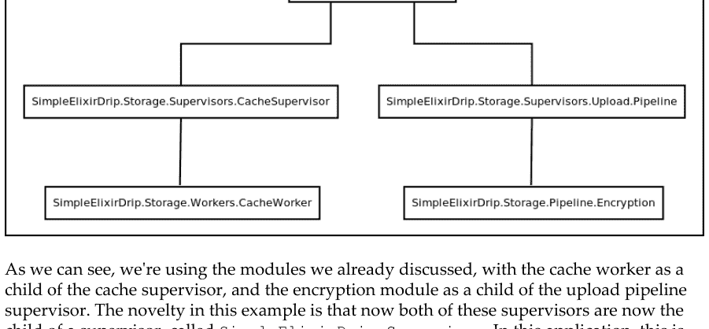
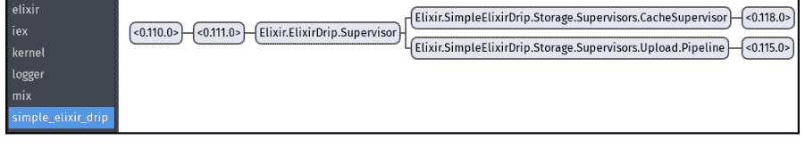

# 3 进程 – 并发和容错的基石

在学会如何在 Elixir 中创建新项目之后，我们现在将深入 Elixir 的一个基石之一（继承自 Erlang）：**进程**。理解如何使用它们对于在 Elixir 中创建并发和容错应用至关重要。你的典型应用很容易包含数百个，如果不是数千个并发运行的进程。

如果上一句话让你担心在单台机器上运行数千个进程，请注意我们指的是 Erlang VM 进程，它们比 **操作系统 (OS)** 进程轻量得多。在本章以及整本书中，*进程* 指的是 Erlang VM 进程——除非我们直接提到 OS 进程。

在本章中，我们将涵盖以下主题：

- Erlang VM 的内部工作原理和并发模型
- 创建进程并在它们之间传递消息
- 使用进程维护状态
- 构建我们 ElixirDrip 应用的组件之一 – 缓存工作进程
- 使用监督器使我们的应用具有容错性
- 构建监督树以在错误恢复中获得更高的粒度


## BEAM 内部

Erlang VM 通常被称为 **BEAM（博格丹/比约恩的 Erlang 抽象机）**。它被设计用于运行高度可靠的系统，这些系统通常具有多位九的可用性，并且几乎总是能够响应客户端请求。我们现在将研究 BEAM 背后的一些设计决策，以及它们如何实现此类系统的创建和部署。

进程是 BEAM 内部并发执行的单元。正如本章所述，它们是实现可扩展、健壮、容错系统创建的构建块。在深入探讨使用进程时的一些运行时注意事项之前，让我们先探索进程之间如何相互交互。

关于 BEAM 是否是卡尔·休伊特在 1970 年代描述的 actor 模型的合法实现，存在很多讨论。Erlang 的共同创建者 Robert Virding 反复表示，在开发 Erlang 期间，他们偶然得到了一个类似于 actor 模型的实现，直到 much later 才真正了解 actor 模型本身。不管怎样，术语 *参与者* 在 Elixir/Erlang 社区中并不广泛使用——我们主要只是使用术语 *进程*。

BEAM 中的每个进程都维护自己的私有状态，该状态永远不能与其他进程共享。进程通过异步消息传递进行通信，每个进程都有自己的邮箱，用于存储发送给该进程的消息。在接收到消息后，进程可以仅通过执行某些计算来回复它，向其他进程发送消息，生成新进程，或更改其自身内部状态。从邮箱中入队和出队消息是原子的，并且进程按顺序处理它们。

要向进程发送消息，您必须知道其 PID（一种基本类型，正如我们在 *第 1 章，准备踏上旅程* 中学到的）或其注册别名。进程也可以向自身发送消息，这将在其自己的邮箱中创建一个新消息，并在将来处理。从一个参与者发送到另一个参与者的消息保证在接收者的邮箱中保持其顺序，但请注意，由多个进程发送的多个消息的交错在接收者端是不确定的，您绝不应依赖它。

处理传入消息时，进程可以使用模式匹配。借助此机制，我们可以构建进程，使其监听、过滤特定类型的消息，或根据消息不同而不同地表现。

如前所述，消息传递是异步的，但仅从发送者角度来看——在接收消息时，进程会被阻塞，等待邮箱中的新消息，正如我们在下一节中将进一步解释的那样。

虽然这种隔离、无共享的进程模型可能会引起一些性能问题，因为每条交换的消息都必须深度复制，但它也带来了一些令人难以置信的好处，例如：

- 构建并发应用程序很容易。由于没有共享状态，因此不需要互斥锁或信号量。进程并发运行（如果至少有两个 CPU 核心，则可能并行运行），让您充分利用硬件。
- 进程崩溃后可以立即被替换。正如我们将在本章后面学到的，我们可以拥有仅负责监督其他进程的进程，并在它们宕机时采取特定操作。同样，由于没有共享状态，某个进程的崩溃在大多数情况下只需重新启动即可解决。
- 没有 Stop-the-World 垃圾回收。由于每个进程都维护自己的堆，垃圾回收发生在进程级别。此外，当进程退出时，其内存空间可以简单地被回收。垃圾回收不会停止整个 VM，这意味着当某个进程因垃圾回收而停止时，您的进程仍可以继续回复请求。
- 分布式和水平扩展非常简单。鉴于进程是隔离的，您可以通过增加计算能力来扩展应用程序，这反过来又增加了创建更多进程的能力。凭借 BEAM 的出色工作，与本机上的进程或集群中其他机器上的进程通信几乎是相同的。

正如我们之前所建议的，BEAM 内部的进程非常轻量级，可以以最小的开销生成或销毁。通常，创建新进程只需要几微秒，而其初始内存使用量在 1 到 2 KB 之间。为了便于理解，默认情况下，在 Linux x86 系统上，一个线程仅用于栈就使用 2 MB。这使您可以在单台机器上运行数百万个进程。

BEAM 在单个操作系统进程上运行，然后根据可用核心数量，默认情况下在该进程下生成线程。每个线程将运行一个调度程序，该调度程序将抢占式地管理每个进程的 CPU 时间。BEAM 是一个软实时系统，这种抢占式调度促进了公平性和活性。

这样，长时间运行的 CPU 密集型进程不会影响其他进程的性能。想象一下，在这种模型中运行 HTTP 服务器，其中每个请求由不同的进程处理。如果某个客户端的请求需要更长时间才能响应，它不会影响 HTTP 服务器的其他用户，保持系统对大多数用户保持活跃。


我们已经说过，您可以在 BEAM 内部运行数百万个进程，但默认情况下，其上限约为 256,000。您可以通过在启动 `elixir` 或 `iex` 时使用 `--erl` 标志传递选项来增加此限制，例如：`iex --erl "+P 10000000"`。`+P` 选项控制 BEAM 内部同时进程的最大数量。您可以在 http://erlang.org/doc/man/erl.html 查看其他选项。

大多数程序员都知道构建并发应用程序是一项艰苦的工作。经常情况下，使应用程序并发不仅被延迟，有时还是最后的手段，并且在性能要求没有其他解决方案时才进行。这可能是因为他们知道这是一些可怕且难以找到的 bug 的来源，并且通常这种更改使程序更难推理。

虽然对于传统的并发原语（如线程）来说这是正确的，但我们想说明对于 BEAM 进程来说并非如此。Erlang 的共同创建者 Joe Armstrong 在谈论 Erlang 时偶尔会使用一个非常有趣的表达：并发导向编程。其哲学是并发应该从一开始就融入我们的程序中，并且它是分布式和容错的基础。

好了，理论够多了！让我们现在探索如何使用 BEAM 进程。

## 使用进程

在了解了 BEAM 内部进程的工作概念模型后，我们现在将了解如何使用它们。具体来说，我们将介绍如何使用进程、如何在它们之间传递消息，并且为了展示如何使用进程来维护状态，我们将构建 ElixirDrip 应用的一个组件，即缓存工作进程。

## 创建进程

您通过调用 Kernel.spawn/1 函数来创建进程，该函数接收一个无参数的匿名函数：

```
iex> self()
#PID<0.85.0>
iex> spawn(fn ->
...>   :timer.sleep(2000)
...>   IO.puts "I'm running in process #{inspect(self())}"
...> end)
#PID<0.91.0>
I'm running in process #PID<0.91.0>
```

在此示例中，我们首先调用 self()，它返回当前进程的 PID。在这种情况下，它返回了 shell 进程的 PID。然后，我们使用 spawn 函数创建新进程。如前所述，它接收一个将在新创建的进程中运行的匿名函数。我们传递给 spawn 的匿名函数使用 timer Erlang 库休眠两秒，然后使用 IO 模块的 puts 函数将字符串打印到终端。该字符串打印当前进程的 PID。从前面的输出可以看出，当直接从 IEx 调用 self() 时，我们得到其 PID <0.85.0>，但打印到终端的字符串显示的是 <0.91.0> PID——即由 spawn 函数创建的进程的 PID。请注意，此函数的返回值是刚刚创建的进程的 PID，这将在我们开始在进程之间传递消息时变得很重要。

另一个需要指出的重要方面是，spawn 函数的调用者在进程创建后立即恢复其工作。我们在匿名函数中引入了 sleep，以便轻松观察此行为。如果您在 IEx 会话中运行此示例，您会看到在调用 spawn 后立即返回 shell——这意味着 shell 进程已完成创建新进程并准备接收输入。然后，大约两秒后，您会看到我们之前讨论的字符串被打印到屏幕上。这意味着 sleep 仅发生在新进程上，而 spawn 的调用者在更早时就被解除阻塞了。

现在让我们看一些更有趣的东西。在下面的示例中，我们将把在外部作用域中定义的变量传递给新创建的进程：

```
iex> x = 4
4
iex> spawn(fn ->
...>   x = x * x
...>   IO.puts "The number squared is #{x}"
...> end)
```


```
The number squared is 16
#PID<0.109.0>
iex> x
4
```

我们首先创建一个变量 x，将其绑定到 4。然后，我们像前面的示例一样使用 spawn，并创建一个新进程，该进程将接收此变量并对其进行平方。注意，在这个新进程中我们重新绑定了 x，然后打印其新值。由于 x 为 4，因此看到控制台打印出 16 是合理的。然而请注意，之后在 shell 进程中，我们打印 x 的值，它仍然是 4。外部作用域中的变量通过闭包机制传递给在新进程上运行的匿名函数，我们在第 1 章《为旅程做好准备》中见过这一点。由于进程不共享内存，匿名函数引用的变量会被深度复制，新进程中对 x 的重新绑定不会影响 shell 进程中定义的 x。

通常，我们不仅对生成新进程感兴趣，还希望在稍后阶段收集其结果。现在让我们看看消息传递，并了解如何实现这一点。

## 进程之间的消息传递

在初次接触 Elixir 之后，当我们开始构建具有一定复杂度的应用程序时，我们经常需要并发进程相互协作。如前所述，进程不共享内存——它们通过相互传递消息进行通信。这些消息包含 Elixir 项——基本上任何可以存储在变量中的内容都可以作为消息发送。

发送消息的本质是将它存储在接收者的邮箱中。进程的邮箱是无界的——然而，实际上它受可用内存的限制。现在让我们通过向 shell 进程自身发送一条消息来实际操作一下。要发送消息，可以使用 Kernel.send/2 函数，将进程 ID 作为第一个参数，消息本身作为第二个参数：

```
iex> send(self(), "hey, I'm messaging myself")
"hey, I'm messaging myself"
```

在此，我们使用 Kernel.self/0 函数获取自己的 PID，从而将此消息发送到自己的邮箱。请记住消息传递是异步的，send 的调用者在将消息放入接收者的邮箱后立即恢复执行。现在 shell 进程的邮箱中有一条消息。要获取它，我们使用 receive 构造：

```
iex> receive do
...>  message -> IO.puts message
...> end
hey, I'm messaging myself
:ok
```

如你所见，receive 能够从邮箱中获取我们之前发送的消息，并且该消息本身被打印到 shell 中。如果你只想处理特定类型的消息，可以在提供给 receive 的子句上使用模式匹配：

```
iex> send(self(), {:result, 2+2-1})
{:result, 3}
iex> receive do
...>  {:result, result} -> IO.puts "The result is #{result}"
...> end
The result is 3
:ok
```

此示例与之前显示的示例类似，但现在我们只从邮箱中获取第一个元素为 :result 原子的、由两个元素组成的元组消息。需要指出的是，如果一条消息与 receive 块中的任何子句都不匹配，它将保留在邮箱中以便稍后处理。这意味着如果一个进程频繁接收到在 receive 块中永远不匹配的消息，其邮箱将无限增长，这最终可能导致 BEAM 因内存使用过度而崩溃。为避免此问题，可以提供一个始终匹配的子句，以防止邮箱失控增长：

```
iex> send(self(), {:other_result, 3+3-2})
{:other_result, 4}
iex> receive do
...>  {:result, result} -> IO.puts "The result is #{result}"
...>  _ -> {:error, :unexpected_message}
...> end
{:error, :unexpected_message}
```

这样，_ 将匹配未在之前子句中匹配的消息，为该消息提供响应并将其从邮箱中移除。然后，我们返回一个错误元组，该元组还可以包含报告（无论是日志还是错误跟踪系统），以便以后可以分析它，并可能追踪意外消息的来源。


在 IEx 会话中进行开发和/或调试时，使用 `IEx.Helpers.flush/0` 函数可能会有所帮助，该函数将 shell 进程邮箱中的所有消息移除并打印到终端。

如我们所见，`receive` 将从进程的邮箱中获取一条消息，并尝试将其与提供的子句匹配。到目前为止，我们只在向 shell 进程发送消息后才调用 `receive`。如果我们用空邮箱调用它，`receive` 将阻塞，等待消息：

```
```elixir
iex> receive do
...>   message -> IO.puts "Message is #{message}"
...> end
```
```

shell 现在被阻塞了，你必须手动终止它（例如按 `Ctrl-\`）。如果邮箱中有未匹配任何提供子句的消息，我们会观察到相同的行为。如果我们不希望 `receive` 无限期地等待消息，可以提供一个 `after` 子句，指定 `receive` 等待的时间（以毫秒为单位）：

```
```elixir
iex> receive do
...> message -> IO.puts "Message is #{message}"
...> after
...> 2000 -> IO.puts "Timed out. No message received in 2 seconds."
...> end
Timed out. No message received in 2 seconds.
:ok
```
```

正如你在第一章中学到的那样，Elixir 中的一切都是表达式。与 `case` 构造发生的情况类似，`receive` 的返回值是已执行子句中最后一个表达式的结果。

我们将以一个更复杂的示例结束本节。现在我们知道如何创建进程，也知道如何在它们之间传递消息，让我们把这一切联系起来，同时展示并发运行进程的一些优势。

首先，让我们定义一个匿名函数，它通过休眠半秒来象征一个长时间运行的计算：

```
```elixir
iex> long_running_computation = fn number ->
...> :timer.sleep(500)
...> "result for #{number}"
...> end
#Function<6.99386804/1 in :erl_eval.expr/5>
```
```

它接收一个数字作为参数，表示将要应用长时间运行计算的数字。为了后续比较，让我们创建一个包含 1 到 50 的整数的列表，并在此列表的每个元素上运行此长时间计算。现在，我们将使用 Enum.map/2 顺序执行：

```
```elixir
iex> computation_results = fn ->
...> (1..50)
...> |> Enum.map(long_running_computation)
...> end
#Function<20.99386804/0 in :erl_eval.expr/5>
```
```

我们将其定义在匿名函数内部，以便可以使用 timer Erlang 模块中的 tc 函数检查执行所需的时间，如下所示：

```
```elixir
iex(3)> :timer.tc(computation_results, [])
{25063563,
["result for 1", "result for 2", "result for 3", "result for 4",
"result for 5", "result for 6", "result for 7", "result for 8", ...]}
```
```

此函数返回一个元组，第一元素为执行时间（以微秒为单位），第二元素为被计时函数的执行结果。注意，出于简洁考虑，函数的执行结果被裁剪，但它包含到第 50 个元素的结果。如我们所见，顺序版本大约花费了 25 秒，这很容易解释，因为对列表中的每个元素都发生了 50 次半秒的休眠。

由于我们现在知道如何生成进程并与之通信，让我们对列表中的每个元素并发地执行此计算，为每个元素生成一个进程，然后在之后聚合结果。

首先，让我们定义一个函数来接收发送到 shell 进程的消息：

```
```
iex> fetch_result = fn ->
... > receive do
... > {:computation_result, result} -> result
... > _ -> {:error, :unexpected_message}
... > end
... > end
#Function<20.99386804/0 in :erl_eval.expr/5>
```
```

此函数将从邮箱中获取一条消息。如果该消息格式符合预期，我们返回结果本身。对于任何不匹配我们期望格式的消息，我们只返回一个错误元组。现在让我们在并发版本中使用此匿名函数：

```
```
iex> me = self()
#PID<0.85.0>
iex> concurrent_computation_results = fn ->
... > (1..50)
... > |> Enum.map(&(spawn(fn -> send(me, {:computation_result,
long_running_computation.(&1)})) end))
... > |> Enum.map(fn _ -> fetch_result.() end)
... > end
#Function<20.99386804/0 in :erl_eval.expr/5>
```
```

让我们分解这个示例，因为这段代码非常密集。我们首先将当前进程的 PID 绑定到 me。这很重要，因为我们稍后会在 spawn 函数内部使用它，以便新进程知道其调用者的 PID 并发送回响应。我们取 50 个整数的列表，并为每个整数创建一个进程。每个进程随后会向其调用者（使用 me 变量）发送一条消息，每条消息的内容都是一个包含两个元素的元组：第一个只是标识消息用途的原子；第二个是执行长时间运行计算的结果，我们将列表中当前整数元素作为参数传递给它。在最后两个片段中，你可以看到进程的创建和它们之间的消息传递的实际操作！

现在让我们计时此版本的执行：

```
```
iex> :timer.tc(concurrent_computation_results, [])
{513566,
["result for 1", "result for 2", "result for 3", "result for 9",
"result for 4", "result for 10", "result for 5", "result for 6", ...]}
```
```


As we can see, the execution time dropped drastically, to nearly half a second. This result was obtained in a quad-core machine. This example is a bit synthetic (since the processes are just sleeping and returning a result), so the important takeaway is not from the absolute values, but the concept itself. Imagine that these processes are not sleeping but doing some sort of request to an external system (a third-party API, for instance). In this case, the process is idle for a long time as well, and you can reap great benefits from parallelizing its execution.

However, note that sometimes you can over-parallelize. For instance, if you want to calculate the square of each number in our integers list, you'd be better off doing it sequentially in one process. The overhead of creating the processes and then aggregating the results will make the parallel approach slower than the single-process one. The best solution depends on the computation we're aiming to parallelize, and this trade-off should be taken into account when architecting your program.

What we've achieved here is essentially a parallel map, and we can easily change its purpose by plugging in different anonymous functions. However, in practice, you don't have to create processes with `spawn` to parallelize your programs—you can use the abstractions Elixir provides, for instance the `Task` module, which will be covered in the next chapter. It's also noteworthy to point out that by running our computation concurrently, we have lost the original order when aggregating the results, as they arrive in a non-deterministic order. This is observable in the response from the preceding example, where the result for 9 comes in fourth place. If the order of the results matters, one possible solution would be to have some logic to sort the results properly when aggregating them.

Having seen how we can exchange messages between processes, it's now time to see how we can use processes to maintain state in our applications.

## Building a cache worker

Processes in Elixir aren't solely used to run certain tasks concurrently. Often, they are also used as entities that maintain state. These processes frequently run for a long time (or possibly forever), and know how to handle a certain type of requests. Via message passing, other processes can query and/or modify the internal state of these processes. These types of processes are frequently called **Server Processes.**

As we stated at the beginning of this chapter, inside the BEAM, a process is the unit of concurrent execution. This means that multiple server processes may run concurrently, which is important for scalability and fault tolerance.

Let's remind you that there's no `loop` construct in Elixir. As we've depicted in `Chapter 1`, *Preparing for the Journey Ahead*, looping in Elixir is always done through recursion. The same holds true for making processes run in a loop–you use recursion. Particularly, we have to use endless-tail recursion, to ensure that no additional memory is consumed as a result of the process calling itself over and over again. If the last thing a function does is call another function, or itself, the usual stack push doesn't occur and instead a simple jump is performed. This means that using tail recursion won't consume any additional memory or cause a stack overflow.

When iterating through an enumerable, we don't need to code the recursion ourselves, we simply use abstractions provided by the language. Similar to this, most of the time we won't create server processes by coding the recursion by hand. We can use abstractions, which allow the removal of most boilerplate code. In the next chapter, you'll be introduced to the OTP framework, which, among other things, provides some abstractions to create server processes (namely, `GenServer`). However, we think it's important to show a lower-level view of how to work with processes, so that you understand how they work, which will empower you to create your own solutions when the abstractions, either provided by the language or a library, don't suit your needs.

To implement a server process, we have it executing an endless loop, waiting for a message on each iteration of the loop. Upon receiving a message, the process handles it and continues the loop. If you're concerned that having the process constantly running the loop may degrade performance, note that generally the loop isn't CPU intensive–most of the time, the process is waiting for a message (using the `receive` construct), which puts the process in a suspended state and doesn't consume CPU cycles.

We'll now see an example of a stateful server process. To avoid synthetic examples, we'll be implementing a component of the ElixirDrip application, presented in the previous chapter. The component is the cache worker, which is made up of the processes spawned by the cache supervisor to maintain the content that we want to cache. Whenever one of our users wants to download a certain file, our application will download it, and the cache supervisor process (further detailed in the next section) spawns a new process for this file, which will live for a certain amount of time (60 seconds, in the next example). This way, if the user wants to access this file again within this time frame, we won't have to fetch and decrypt the file again, and can just serve it from memory.

Note that this implementation is not the final one, as this worker will be implemented again in the next chapter using some abstractions. Let's now see the code for this server process:

```
$ cat examples/cache_worker.ex
defmodule CacheWorker do
  require Logger

  @expire_time 60_000

  def init(content) do
    spawn(fn ->
      timer = Process.send_after(self(), :expire, @expire_time)
      Logger.debug("#{inspect(self())}: CacheWorker started. Will expire in #{Process.read_timer(timer)} milliseconds.")
      loop(%{hits: 0, content: content, timer: timer})
    end)
  end

  defp loop(state) do
    new_state = receive do
      {:get_content, caller} -> get_content(state, caller)
      :refresh -> refresh_timer(state)
      :expire -> terminate(state)
      message -> unexpected_message(state, message)
    end

    loop(new_state)
  end

  defp get_content(%{content: content, hits: hits} = state, caller) do
    Logger.debug("Serving request for get_content. Content is #{content}")
    send(caller, {:response, content})
    new_state = refresh_timer(state)

    %{new_state | hits: hits + 1}
  end

  defp refresh_timer(%{timer: timer} = state) do
    Process.cancel_timer(timer)
    new_timer = Process.send_after(self(), :expire, @expire_time)
    expires_in = Process.read_timer(new_timer)
    Logger.debug("#{inspect(self())}: Canceled the previous expiration timer. Will now expire in #{expires_in} milliseconds.")

    %{state | timer: new_timer}
  end
end

defp terminate(%{hits: hits}) do
  Logger.debug("#{inspect(self())}: Terminating process... Served the cached content #{hits} times.")
  Process.exit(self(), :normal)
end

defp unexpected_message(state, message) do
  Logger.warn("#{inspect(self())}: Received unexpected message: #{inspect(message)}")
  state
end
end
```

The preceding code block is quite dense, so let's go through it, bit by bit.

First of all, we have the `init` function. This function is responsible for creating our process, and initializing its state. It uses the `send_after` function from the `Process` module to send a message to itself in the future–60 seconds after the creation in this case. The message itself is `:expire`, which will cause our process to exit. This is a very powerful and concise way of having a process alive for a certain amount of time, which is especially useful for caches. Then, this function calls the loop function with our initial state–the number of cache hits is set to 0, the content we'll serve is the argument passed to `init`, and our timer is also kept in the state, so that we can manipulate it later.

Now we have our process running the `loop` recursive function. This function will fetch a message from the mailbox (or block here if the mailbox is empty, waiting for a message) and match it against the provided clauses. This server knows how to handle three types of messages:

- `:get_content`: Used to retrieve the content this process is holding
- `:refresh`: Used to refresh the timer of the current process, making it stay alive for at least another 60 seconds
- `:expire`: Used to signal the end of the current process, meaning that 60 seconds have passed without the timer being reset


无论接收到什么消息，每个子句都必须返回新的状态（可能与旧状态相同），因为 receive 的返回值绑定到 new_state 变量。然后该变量被传递给 loop 函数，本质上为循环的下一步设置状态。这是一种常见的有状态服务器方法，根据接收到的消息计算新状态，并使用新状态递归循环。

The get_content function 发送一条消息回调用者，其中包含状态中存在的内容。然后，它刷新当前进程的计时器，该计时器包含在新状态中，同时还包含当前进程已有的更新后的访问次数。

refresh_timer 函数负责取消当前计时器（以免我们的进程过早终止），并创建一个新的计时器，该计时器被添加到新状态中。

terminate 函数非常简单，因为它只是使用 Process.exit/2 函数来终止当前进程。该函数的第二个参数是 :normal，即退出原因。此退出原因可以是任意项，但它具有特殊含义——它表示进程因生命周期结束而退出，而不是因崩溃或运行时错误。我们将在下一节再次讨论退出原因。

最后，我们有 unexpected_message 函数，它只是记录一条警告，说明该进程收到了意外的消息，并保持状态不变。

让我们现在看看这个模块的实际运行情况：

```
iex> cache_worker_pid = CacheWorker.init("some binary content")
#PID<0.90.0>
03:36:07.427 [debug] #PID<0.90.0>: CacheWorker started. Will expire in 59997 milliseconds.
iex> send(cache_worker_pid, {:get_content, self()})
03:36:18.094 [debug] Serving request for get_content. Content is some binary content
03:36:18.099 [debug] #PID<0.90.0>: Canceled the previous expiration timer. Will now expire in 60000 milliseconds.
{:get_content, #PID<0.88.0>}
iex> send(cache_worker_pid, :refresh)
03:36:25.200 [debug] #PID<0.90.0>: Canceled the previous expiration timer. Will now expire in 60000 milliseconds.
:refresh
iex> send(cache_worker_pid, {:get_content, self()})
03:36:26.750 [debug] Serving request for get_content. Content is some binary content
03:36:26.750 [debug] #PID<0.90.0>: Canceled the previous expiration timer. Will now expire in 60000 milliseconds.
{:get_content, #PID<0.88.0>}
iex> flush
{:response, "some binary content"}
{:response, "some binary content"}
:ok
iex> send(cache_worker_pid, :other_message)
03:36:35.178 [warn] #PID<0.90.0>: Received unexpected message:
:other_message
:other_message
iex>
03:37:26.755 [debug] #PID<0.90.0>: Terminating process... Served the cached content 2 times.
```

我们首先调用 init 函数，它返回新创建进程的 PID。我们将其绑定到一个变量，以便我们可以向其发送消息。然后，我们发送对应于获取内容的消息。需要注意的是，请求由服务器异步处理。服务器可能在我们发出下一个命令（刷新计时器）时已经向我们响应了结果，但我们可以继续自己的执行，并在需要时再收集结果。发送刷新消息后，我们可以看到调试消息，说明计时器已更新。然后，我们发出另一个获取内容的请求。现在，我们使用 flush 函数，它会从 shell 进程的邮箱中移除消息并打印它们。预期地，我们在那里有两个消息。最后，我们发送服务器不理解的消息，我们可以看到它记录了该事件。等待几秒钟后，我们还可以看到日志消息，告知我们服务器进程已终止，因为它没有收到更多获取内容或刷新计时器的消息。

我们的服务器进程按预期工作，到目前为止我们已经知道如何使用进程来维护状态。在结束本节之前，还有一个最终的更改需要进行。目前，我们的服务器进程的调用者需要知道我们能处理的 exact 消息格式。这样，我们就泄露了通信协议，如果将来想要更改它，这可能是一个问题。为了规避这个问题，通常服务器进程都有接口函数，它们是调用实现函数（我们之前介绍的那些）的包装器。让我们扩展我们的模块以包含接口函数：

```
$ cat examples/cache_worker_with_interface_functions.ex
defmodule CacheWorker do
  # ...

  def get_content(server_pid) do
    send(server_pid, {:get_content, self()})

    receive do
      {:response, content} -> content
    after
      5000 -> {:error, :timeout}
    end
    end

    def refresh(server_pid) do
      send(server_pid, :refresh)
    end

    # ...
    end
```

请注意，我们没有为 :expire 消息定义接口函数。虽然我们的服务器知道如何解释该消息，但它是服务器内部使用的，在这种情况下我们不想将其暴露给客户端。除了抽象通信协议之外，接口函数还允许我们创建同步调用的假象——因为我们发送请求消息并在等待响应后立即阻塞，看起来就像对服务器进行了同步调用。我们还可以根据每个函数的语义具有不同的行为。例如，对于 refresh 接口函数，我们只是发出 fire-and-forget 请求，不关心响应（请注意，在这种情况下，我们无法确定该消息是否实际被传递）。让我们看看这两个函数在实际中的运行情况：

```
iex> cache_worker_pid = CacheWorker.init("some binary content")
#PID<0.90.0>
04:07:40.574 [debug] #PID<0.90.0>: CacheWorker started. Will expire in 59997 milliseconds.
iex> CacheWorker.get_content(cache_worker_pid)
04:07:49.738 [debug] Serving request for get_content. Content is some binary content
04:07:49.738 [debug] #PID<0.90.0>: Canceled the previous expiration timer. Will now expire in 60000 milliseconds.
"some binary content"
iex> CacheWorker.refresh(cache_worker_pid)
04:07:55.703 [debug] #PID<0.90.0>: Canceled the previous expiration timer. Will now expire in 60000 milliseconds.
:refresh
iex>
04:08:55.704 [debug] #PID<0.90.0>: Terminating process... Served the cached content 1 times.
```

正如我们所见，对于 `get_content` 函数，shell 进程只有在返回我们请求的内容后才恢复执行，而对于 `refresh` 函数，它立即返回。请注意，我们现在在 `CacheWorker` 模块中有函数在不同的进程中运行。这是在 Elixir 和 Erlang 应用程序中常见的模式，因为模块和进程之间没有特定的关系。模块中存在的函数可以被任何进程调用。

我们现在已经介绍了如何构建有状态的服务器进程，它们知道如何处理特定类型的请求并且可能长时间运行。现在让我们看看如何链接和监控进程，这是 Elixir 中容错的核心组件。

## 通过链接和监控进程检测错误

到目前为止，我们主要关注进程的并发方面。然而，进程还用于创建容错和可靠的系统，即使在出现错误的情况下也能继续运行。

要拥有容错应用程序，你必须首先认识到故障的存在，其中大多数是意外的。这些故障范围从我们的依赖项宕机（例如数据库）到硬件故障。此外，如果你运行的是分布式系统，你可能会遇到其他问题，例如远程机器变得不可用，或存在网络分区。无论原因如何，这些故障都必须被检测到，以便我们限制其影响并希望在没有人工干预的情况下从中恢复。

几乎不可能预见到所有可能使应用程序停止运行的场景。更有效的方法是接受任何事情都可能失败，并设计系统以做出反应。当应用程序中的某个组件确实失败时，你不需要对系统的所有组件采取行动——与失败组件完全无关的组件应继续其工作，使应用程序尽可能多地为其客户端提供服务。这些是可靠和自愈系统的特征——它们能够尽快从不可预见的错误中恢复。


正如我们在 `Chapter 1`，*为即将到来的旅程做准备* 中看到的，错误可以在多种情况下被引发。例如，当模式匹配失败或当我们尝试将一个数字除以 0 时。当这类错误发生时，执行的控制权会沿着调用栈向上转移到错误处理代码。如果没有这段代码，则发生错误的进程将被终止。除了错误（例如，通过调用 `raise` 创建）和 throws（一种控制流的最后手段），它们都在第一章中有所介绍，`exit` 在 Elixir 中也被视为运行时错误（当进程以 `:normal` 以外的原因终止时发生）。无论运行时错误的种类如何，我们也已经看到如何使用熟悉的 `try` 和 `rescue` 机制来处理它。

与更常见的主流编程语言相比，在 Elixir 中捕获运行时错误的需要要少得多。更普遍的惯用法是 *让进程崩溃*，然后再采取行动（通常是重启进程）。

虽然这种技术乍看似乎有争议，但其背后有其道理。在开发系统时，大多数 bug 要么在单元测试或集成测试中被捕获，要么最终由 QA/验收团队发现。剩下的那些是不可预测的 bug，它们只会在时断时续地、并在特定情况下发生，使其非常难以复现。这类错误的通常原因在于某种形式的不一致状态。因此，一个可能的解决方案是让进程终止，然后之后再启动一个新进程。记录此类错误通常是一种良好的实践，这样你就可以稍后调查其原因。尽管如此，以这种方式设计你的应用程序允许你几乎瞬间从错误中恢复，使其成为可靠且健壮的应用程序。在 Elixir 和 Erlang 社区中，这种思考和设计应用程序的方式通常被称为 *let it crash*，因为我们没有显式捕获错误而是让进程崩溃。这种思维方式鼓励快乐路径编程，即我们首先关注没有错误条件的场景，让我们能够集中于应用程序的目的（并在之后处理异常路径）。

值得注意的是，容错的核心原则是并发。正如我们在本章开头解释的那样，BEAM 内部的进程彼此完全分离——它们不共享内存，并且一个进程的崩溃默认情况下不会导致另一个进程崩溃。这种进程隔离使我们能够限制运行时错误对进程（或一组相关进程）的负面影响，在大多数情况下保持系统的绝大部分按预期工作。

这种隔离本身就为我们的应用程序提供了某种程度的弹性。使用上一节中定义的缓存工作进程，持有某些内容的 worker 的崩溃不会影响其他 worker 的执行流程，它们将继续工作并提供服务。然而，这种隔离不足以拥有容错应用程序。我们现在将学习 Elixir 提供的用于检测和响应进程崩溃的机制。

## 使用链接

检测进程崩溃的一种方式是通过使用链接。当两个进程被链接，并且其中一个退出时，另一个将收到一个退出信号，通知我们某个进程已崩溃。一个链接始终包含两个进程，连接是双向的。一个进程可以链接到任意数量的其他进程，系统中创建链接的数量没有预定义限制。

除了崩溃进程的 PID 外，退出信号还包含退出原因，它是一个描述进程终止原因的任意项。如果终止是正常的，这意味着已启动的进程已完成其执行，则退出原因是 :normal。默认情况下，除非退出原因是 :normal，否则当进程收到退出信号时，它也会被终止，连同被链接的进程一起终止。

要创建链接，我们可以使用 Process.link/1 函数，它将调用进程连接到作为参数提供的 PID 的进程。然而，更常见的做法是在进程被启动时创建链接，通过 spawn_link/1 函数，该函数以原子方式创建一个新进程并将其链接到调用进程。让我们通过修改我们的 CacheWorker.init/1 函数以使用 spawn_link/1 来实际看看这一点：

```
$ cat examples/cache_worker_with_spawn_link.ex
defmodule CacheWorker do
  # ...

  def init(content) do
    spawn_link(fn ->
      timer = Process.send_after(self(), :expire, @expire_time)
      Logger.debug("#{inspect(self())}: CacheWorker started. Will expire
in #{Process.read_timer(timer)} milliseconds.")
      loop(%{hits: 0, content: content, timer: timer})
    end)
  end

  # ...
end
```

现在让我们在 IEx 会话中使用它：

```
iex> cache_worker_pid = CacheWorker.init("some binary content")
#PID<0.90.0>
20:57:24.470 [debug] #PID<0.90.0>: CacheWorker started. Will expire in 59989 milliseconds.
iex> CacheWorker.get_content(cache_worker_pid)
20:57:35.401 [debug] Serving request for get_content. Content is some binary content
20:57:35.401 [debug] #PID<0.90.0>: Canceled the previous expiration timer. Will now expire in 60000 milliseconds.
"some binary content"
20:58:35.402 [debug] #PID<0.90.0>: Terminating process... Served the cached content 1 times.
iex> cache_worker_pid = CacheWorker.init("some other binary content")
21:00:33.380 [debug] #PID<0.93.0>: CacheWorker started. Will expire in 60000 milliseconds.
#PID<0.93.0>
iex> CacheWorker.get_content(cache_worker_pid)
21:00:35.956 [debug] Serving request for get_content. Content is some other binary content
21:00:35.956 [debug] #PID<0.93.0>: Canceled the previous expiration timer. Will now expire in 60000 milliseconds.
"some other binary content"
iex> Process.exit(cache_worker_pid, :kill)
** (EXIT from #PID<0.88.0>) shell process exited with reason: killed
```

我们首先调用 init 函数，它将启动一个新进程。请注意，我们现在使用 spawn_link/1，因此该进程现在与 shell 进程链接。我们然后发出 get_content 请求，它按预期工作并返回内容。然后我们等待该进程的计时器过期，我们可以看到日志消息指出该进程正在终止。由于该进程以 :normal 原因终止，我们的 shell 进程不受影响。然后，我们启动一个新进程，发出请求获取其内容，并使用 Process.exit/2 函数手动杀死它，提供 :kill 作为退出原因。退出原因可以是任何项，但 :kill 被特殊对待。当用作退出原因时，它确保目标进程无条件终止，即使它正在捕获退出（我们很快会讨论）。正如我们从最后一条消息中看到的那样，shell 进程也被终止了，因为它与我们刚刚杀死的进程链接。

链接在某种程度上破坏了我们在上一节中谈到的进程隔离。然而，这只会在你显式链接它们时发生。这种技术非常强大，如果例如我们想要始终确保某个相关进程组作为一个整体被杀死，不留下悬空进程时，就可能派上用场。

如果我们不想让自己的进程被终止，而只是想被通知链接进程的崩溃，以便我们可以采取行动怎么办？这就是 *trapping exits* 概念派上用场的地方。当进程捕获退出时，它在收到退出信号时不会被终止。相反，该退出信号会以消息的形式传递到该进程的邮箱。这样，捕获的进程就可以接收该消息并相应地采取行动。

要设置退出捕获，你使用 `Process.flag(:trap_exit, true)`，这将使当前进程捕获退出信号。传递给捕获退出的进程的消息具有以下格式：`{:EXIT, from_pid, exit_reason}`。在此消息中，`from_pid` 是崩溃进程的 PID，而 `exit_reason` 是我们之前描述的退出原因。现在让我们重新运行之前的示例，但这次 shell 进程捕获退出：

```
iex> Process.flag(:trap_exit, true)
false
iex> cache_worker_pid = CacheWorker.init("some binary content")
#PID<0.91.0>
21:41:38.453 [debug] #PID<0.91.0>: CacheWorker started. Will expire in 59995 milliseconds.
iex> CacheWorker.get_content(cache_worker_pid)
21:41:50.465 [debug] Serving request for get_content. Content is some binary content
21:41:50.466 [debug] #PID<0.91.0>: Canceled the previous expiration timer. Will now expire in 60000 milliseconds.
"some binary content"
iex> Process.exit(cache_worker_pid, :kill)
true
iex> flush
{:EXIT, #PID<0.91.0>, :killed}
:ok
```

首先，我们使 shell 进程捕获退出。它返回 `false`，因为此函数返回该标志的先前值。然后，示例与我们已经看到的类似。有趣的部分是调用 `Process.exit/2` 函数后会发生什么。现在，调用后我们的 shell 进程没有终止，而且，正如我们通过使用 `flush` 函数所看到的那样，它在其邮箱中收到了消息，通知我们其链接进程的崩溃。

让我们现在看看检测错误的另一种机制：监视器。


## 使用监视器

在某些场景下，最好让错误沿单一方向传播。这就是监视器的用例。监视器类似于链接，但后者始终是双向的，而前者始终是单向的。此外，与其他进程链接的进程在其中一个进程终止时可能会终止（除非它捕获退出信号），而监视器永远不会导致监视其他进程的进程终止，并且默认行为是它始终在其邮箱中接收消息。单个进程可以创建多个监视器。

要监视一个进程，你需要调用 `Process.monitor/1` 函数，并提供要监视的进程的 PID 作为参数。你也可以提供已注册进程的别名，我们尚未介绍过它们。它们将在下一章中介绍。调用此函数的结果是一个引用（Elixir 中的一种基本类型），它标识新创建的监视器。如果被监视的进程退出，监视进程会收到格式如下的消息：{:DOWN, monitor_reference, :process, from_pid, exit_reason}。


如果需要停止监视某个进程，可以使用 `Process` 模块中的 `demonitor` 函数，并提供作为 `Process.monitor/1` 调用返回的监视引用作为参数。

让我们现在通过示例中的 `CacheWorker` 进程来实际操作一下：

```elixir
iex> cache_worker_pid = CacheWorker.init("some binary content")
#PID<0.90.0>
22:13:41.448 [debug] #PID<0.90.0>: CacheWorker started. Will expire in 59996 milliseconds.
iex> CacheWorker.get_content(cache_worker_pid)
22:13:51.540 [debug] Serving request for get_content. Content is some binary content
22:13:51.541 [debug] #PID<0.90.0>: Canceled the previous expiration timer. Will now expire in 60000 milliseconds.
"some binary content"
iex> monitor_reference = Process.monitor(cache_worker_pid)
#Reference<0.3261553142.1274281985.104407>
22:14:51.552 [debug] #PID<0.90.0>: Terminating process... Served the cached content 1 times.
iex> flush
{:DOWN, #Reference<0.3261553142.1274281985.104407>, :process, #PID<0.90.0>, :normal}
:ok
```

请注意，我们使用的是使用 `spawn`（而不是 `spawn_link`）的 `CacheWorker` 版本，这意味着 shell 进程未链接到 `CacheWorker` 进程。在生成 `CacheWorker` 进程并向其发出请求后，我们使用 `Process.monitor/1` 函数来监视此进程。在此示例中，我们不需要使用 `Process.exit/2`，因为即使退出原因为 `:normal`，我们也会收到消息。因此，我们只需等待计时器结束，然后检查 shell 进程的邮箱，发现我们收到了预期的消息。在实际应用中，我们可以从邮箱中获取此消息并据此采取行动。

本节介绍的错误检测机制使我们能够跟踪我们感兴趣的进程。在下一节中，我们将介绍监视器，它们使用这些机制来检测错误，但也允许我们在进程崩溃时做出反应，为错误恢复铺平道路。

## 使用监视器和监督树从错误中恢复

在上一节的开始，我们解释了 *let it crash* 哲学，以及为什么你应该遵循它来构建可靠、容错的应用。了解了 Elixir 提供的检测错误的机制后，我们现在将介绍 *supervisors*，它们建立在这些机制之上，为我们提供从错误中恢复的方法。

在深入介绍监视器之前，我们想指出一个关于遵循 *let it crash* 哲学 的应用程序中错误处理的重要方面。我们一直在讨论这种方法如何改变你处理错误的方式，并且它提供容错能力，因为你可以通过检测错误并采取纠正措施来从错误中恢复。然而，这种方法不应该用于你在程序正常执行流程中事先知道可能发生的错误，特别是如果你有干净的处理方式时。例如，一个负责通过其 HTTP API 联系外部依赖的进程，在响应中遇到 404 状态码时不应该崩溃。这是一个有效的响应，你可以在应用程序中通过返回 `{:error, :not_found}` 元组给调用者来处理这种情况，等等。预期错误的定义差异很大，因为它取决于应用程序的领域。尽管如此，在构建应用程序时，请考虑花一些时间定义可能发生的预期错误，以及你的应用程序将如何处理它们。

监视器是一个其唯一职责是监视其他进程的进程。鉴于它们具有这种有限的目的，通常监视器代码非常简单直接。这很重要，因为它降低了监视器出现运行时错误的可能性，使它们不太可能崩溃。

监视器是 Elixir 和 Erlang 应用程序的核心组件，因此它们是 OTP behaviour。在第一章中，我们看到了如何使用 behaviour 来提供其他模块可以采用的接口。Behaviour 还可以用来将通用代码提取到一个地方，然后另一个模块可以插入其中，实现一些特定的回调，这些回调将包含特定于我们希望在该模块中实现的目标的代码。这是对 behaviour 工作原理的非常简单的解释，但它只是你完成本章所需的。在下一章中，我们将研究 OTP 及其提供的 behaviour，并更详细地解释这一概念。

在进入一些示例之前，让我们看看监视器进程的流程。进程创建后，监视器将配置自身以捕获退出信号。然后，它将自己与每个子进程之间创建链接。有了这个设置，如果子进程崩溃，监视器将收到退出信号，使其能够根据启动时提供的配置对该事件做出反应。监视器使用链接而不是监视器，因为双向通信意味着如果监视器崩溃，其所有子进程也将被立即终止，这有助于避免系统中出现悬空进程。

让我们现在看看如何定义和启动一个监视器，以及如何使用模块插入到监视器 behaviour 中。

## 定义和启动监视器

我们现在将看到一个监视器的示例。现在，我们将把 `CacheWorker` 模块放在一边，因为它将在下一节中使用，我们将在那里使用动态监视器。在此示例中，我们将创建上传管道监视器。在我们的应用程序中，我们将创建两个管道，一个用于下载，另一个用于上传，当用户执行相应操作时使用。这些管道包含为每次下载或上传操作执行的步骤集。其中一个步骤是加密/解密步骤，它将在将上传文件保存到远程存储之前对其进行加密，并解密下载的文件。

我们在本示例中展示的模块并不是最终应用程序中使用的模块。例如，Encryption 模块将使用 GenStage（在下一章中进一步解释），这会使我们的示例变得混乱。事实上，Encryption 模块被简化到极致，它只是一个在循环中运行的进程，等待消息并将收到的消息打印到终端。这种简化将使我们能够完全专注于监视器，而本节的重点正是监视器。请注意，你始终可以通过从书籍网站下载来查看所有源代码。

要将模块插入到监视器的 behaviour 中，我们只需要实现一个回调：init/1。此回调将提供由该监视器启动的进程的规范以及一些配置。要与监视器交互，我们使用 Elixir 提供的 Supervisor 模块。让我们看看上传管道监视器的代码：

```
$ cat examples/upload_pipeline_supervisor.ex
defmodule ElixirDrip.Storage.Supervisors.Upload.Pipeline do
  use Supervisor
  require Logger
  alias ElixirDrip.Storage.Pipeline.Encryption

  def start_link() do
    Supervisor.start_link(__MODULE__, :ok)
  end

  def init(:ok) do
    Logger.debug("#{inspect(self())} Starting the Upload Pipeline Supervisor module...")

    Supervisor.init(
      [worker(Encryption, [], restart: :transient)],
      strategy: :one_for_one
    )
  end
end
```

从 init 函数开始，我们可以看到它接收一个参数。在这种情况下，我们匹配到 :ok，因为我们不会使用它，但此参数可用于从调用进程传递选项列表。除了一些有助于调试的日志记录之外，此函数所做的唯一事情就是调用 `Supervisor.init/2`，它将启动我们作为参数传递的子进程。正如我们之前所说，我们需要向监视器提供将在该监视器下启动的进程的规范——子进程列表。这是传递给 `Supervisor.init/2` 的第一个参数。


在这种情况下，列表只有一个元素，即调用 worker 函数的结果。该函数是在我们在模块顶部调用 use Supervisor 时从 Supervisor.Spec 模块导入的。该函数将返回子进程的规范。第一个参数是将在子进程中运行的模块的名称，第二个参数是要提供给该模块的 start_link 函数的参数列表。请注意，你不需要特别指定要调用此函数。这是由于 start_link 名称是默认的。你可以覆盖它并使用不同的名称（通过在选项列表中提供 :function），但我们认为最好遵循社区使用的约定，这将帮助其他软件开发者理解你的代码。最后，worker 函数的最后一个参数是一个选项列表。在这种情况下，我们提供了 restart 值。:transient 表示子进程只有在异常终止时才会被重启。我们也可以使用 :temporary，子进程永远不会被重启；或 :permanent，子进程总会被重启，即使它以 :normal 退出原因终止。

传递给 Supervisor.init/2 的第二个参数是一个选项列表。在这种情况下，我们提供了 :strategy 选项，它定义了 supervisor 如何处理子进程的崩溃。在我们的示例中，我们使用 :one_for_one，这意味着当子进程终止时，supervisor 会在其位置生成一个新的进程。其他可能的值有 :one_for_all，表示当一个子进程崩溃时，该 supervisor 的所有子进程都会被重启；还有 :rest_for_one，它会使在崩溃进程之后启动的子进程按顺序重启（连同崩溃的进程本身，它是第一个）。这意味着当我们使用此策略时，启动 supervisor 子进程的顺序很重要。请注意，直到 Elixir 1.6，我们还拥有 :simple_one_for_one 策略，它用于让 supervisor 动态启动子进程。然而，在 Elixir 1.6 中它已被弃用，转而使用 DynamicSupervisor 模块，这将在下一节中介绍。

这里使用 worker 函数意味着该子进程不是一个 supervisor。我们也可以使用 supervisor 函数，它将返回 supervisor 的子进程规范。在此上下文中，worker 指任何不是 supervisor 的东西。让 supervisor 生成其他 supervisor 将导致一个监督树，我们将在本章最后一节介绍。

supervisor 终止子进程的方式也可以通过 :shutdown 选项进行配置。默认情况下，如果子进程是 worker，supervisor 会向其发送退出信号并等待五秒钟，如果在此间隔内未终止，则会强制杀死该子进程。如果子进程是 supervisor，默认情况下它会无限期等待。如果你有兴趣配置此项，请查看官方 Supervisor 文档 https://hexdocs.pm/elixir/Supervisor.html，其如同大多数 Elixir 文档一样非常详尽，并包含有用的示例。


在本节中，我们将只使用基于模块的 supervisor，因为它们在教学上更有利，因为我们对 supervisor 如何初始化有更大的控制权。然而，请注意你不需要为每个想要的 supervisor 创建一个模块。你可以将 Supervisor 模块中函数的调用嵌入到其他模块中，这在你熟悉后可能会简化你的代码。请查看 Supervisor 模块文档以了解如何操作的示例：https://hexdocs.pm/elixir/Supervisor.html。

现在让我们关注 start_link 函数。此函数只是 Supervisor.start_link/2 的包装器，类似于我们在为 CacheWorker 引入接口函数时所做的。另一个值得注意的点是使用 __MODULE__，它是一种特殊形式，在编译期间会被当前模块的名称所替代，这意味着传递给 Supervisor.start_link/2 的第一个参数是当前模块的名称。

现在让我们在 IEx 会话中使用它：

```
iex> c("examples/encryption.ex")
[ElixirDrip.Storage.Pipeline.Encryption]
iex> c("examples/upload_pipeline_supervisor.ex")
[ElixirDrip.Storage.Supervisors.Upload.Pipeline]
iex> {:ok, supervisor_pid} =
ElixirDrip.Storage.Supervisors.Upload.Pipeline.start_link()
19:37:33.693 [debug] #PID<0.97.0>: Starting the Upload Pipeline Supervisor module...
19:37:33.695 [debug] #PID<0.98.0>: Starting the Encryption module...
{:ok, #PID<0.97.0>}
iex> send(pid(0, 98, 0), "some message")
#PID<0.98.0>: Encryption module received a message: some message
"some message"
iex> Process.exit(pid(0, 98, 0), :kill)
true
```

```
19:39:11.208 [debug] #PID<0.102.0>: Starting the Encryption module...
iex> send(pid(0, 102, 0), "some message")
#PID<0.102.0>: Encryption module received a message: some message
"some message"
```

首先，我们编译运行此示例所需的文件。在之前的示例中我们省略了这一点，因为它们只使用单个文件。由于此示例稍微复杂一些，我们明确地编译它们。然后，我们调用 supervisor 的 `start_link/0` 函数，它将启动 supervisor 本身及其唯一的子进程，正如我们从调试消息中观察到的那样。之后，我们向加密模块发送一条消息，以验证它是否正常工作。在这种情况下，它只是将我们发送的内容打印到终端。现在我们确定 worker 进程正在运行，使用 `Process.exit/2` 函数将其杀死。我们也可以通过在代码中某处放置 `raise` 来模拟 worker 中的运行时错误，但这种方法使示例更明确。杀死进程后，我们可以看到一条调试消息，指出 `Encryption` 模块正在重新启动。这就是 supervisor 的作用！它检测到其子进程的崩溃并在其位置启动了一个新进程。最后，我们向新的 `Encryption` 进程发出请求，以证明它完全可用。

需要指出的是，如果一个子进程不断崩溃，supervisor 不会永远重启它——它依赖于最大 *restart frequency*。正如我们在上一节开头所说，拥有 supervisor 的原因在于存在一种只在某些情况下发生的错误类型。重启进程使其从头开始，具有干净的状态。如果进程不断重启，问题可能不是由某些复杂的状态引起的。默认情况下，supervisor 允许在五秒间隔内进行三次重启。如果超过此限制，supervisor 将终止自身以及其所有子进程。在这些条件下让 supervisor 终止自身非常重要，因为它允许错误在监督树中传播，正如我们将在本章最后一节看到的那样。时间段内的错误数量和时间段本身可以在启动 supervisor 时通过分别传递 `:max_restarts` 和 `:max_seconds` 选项进行配置。

## Streamlined child specs

Elixir 1.5 引入了 streamlined child specs，它允许在模块中定义子进程规范。不同于依赖于 `Supervisor.Spec` 模块中的 `worker` 和 `supervisor` 函数，supervisor 现在接收模块列表作为子进程，并将对每个子模块调用 `child_spec/1` 函数。这允许子模块控制它们在 supervisor 下的运行方式。

让我们现在使用 streamlined child specs 查看上一示例中呈现的模块。在 supervisor 中，我们仅将 init/1 函数更改为以下内容：

```
$ cat examples/upload_pipeline_supervisor_with_streamlined_child_specs.ex
defmodule ElixirDrip.Storage.Supervisors.Upload.Pipeline do
  # ...

  def init(:ok) do
    Logger.debug("#{inspect(self())} Starting the Upload Pipeline Supervisor module...")
    Supervisor.init([Encryption], strategy: :one_for_one)
  end
end
```

supervisor 上的代码现在更简单，因为部分配置已移至子进程。在 Encryption 模块中，我们现在有以下函数：

```
def child_spec(_) do
  %{
    id: __MODULE__,
    start: {__MODULE__, :start_link, []},
    restart: :transient,
    shutdown: 10000,
    type: :worker
  }
end
```

此函数有一个参数，我们未使用，但可用于允许 supervisor 在此子进程上配置某些选项。我们现在需要提供一个 id，以前它隐式为模块名称。此外，在其他版本中，shutdown（即 supervisor 等待子进程终止的时间，以毫秒为单位）默认为 5,000 ms，而这里我们看到了如何配置它的示例。与之前版本相比的另一个不同之处在于子进程规范现在只是映射，而不是依赖于 worker 和 supervisor 函数的 API。

你可能不必在每次都定义 child_spec/1 函数。例如，下一章中解释的 Agent 和 Task 模块定义了 child_spec/1 函数，如果你使用其中一个模块，可以跳过此函数的创建。请注意，在这种情况下，你始终可以覆盖它并提供自定义的子进程规范。


这目前是 Elixir 社区定义子规范的首选方式。我们想向你展示定义子规范的两种方式，因为你在浏览源代码时很可能会同时遇到这两种方式。然而，在从头开始一个项目（或重构某些代码）时，请选择我们现在介绍的选项，因为你的代码将遵循社区约定，使其他人更容易理解其内容。

## 使用动态监管器在运行时启动子进程

我们现在已经了解如何使用监管器来从错误中恢复，它会根据我们提供的配置重启崩溃的进程。然而，到目前为止，我们必须在启动前预先定义监管器的子进程，这些子进程会在监管器启动后立即启动。有时这并不能满足我们的需求，我们需要在运行时生成监管器的新子进程。这就是动态监管器变得有用的地方。

Elixir 1.6 版本引入了 DynamicSupervisor 模块。如我们所述，这个新模块弃用了常规监管器的 :simple_one_for_one 策略。之所以进行这种提取有很多原因，其中两个主要原因是 :simple_one_for_one 策略改变了监管器初始化和关闭的语义，而且 Elixir 标准库中的某些 API 会根据监管策略期望不同的输入（甚至可能不可用）。

为了演示这一概念，我们将创建一个 CacheSupervisor 模块，它将负责监管本章中一直使用的 CacheWorker 进程。然而，CacheWorker 进程需要进行一些更改，因为我们需要注册进程（在别名下），以便我们的监管正常工作。请注意，在之前的示例中，我们能够观察到监管器对 Encryption 进程崩溃的反应，通过启动一个新的进程，但在实际应用中我们需要注册被监管的进程，否则它们的客户端仍可能联系到已经终止的进程。

当我们引入监管器时，保留先前创建进程的 PID 的做法就变得无关紧要了，因为随着进程崩溃和监管器创建新进程，PID 会发生变化。我们尚未介绍 GenServer 行为，将在下一章开头进行介绍。你仍然可以毫无困难地跟随此示例，因为主要关注点是监管器——事实上，我们在这里不会展示新的 CacheWorker 的代码，因为它与示例无关。如往常一样，如果你好奇，可以在 本章的源代码中找到它。

现在让我们看看缓存监管器的代码：

```
$ cat examples/cache_supervisor.ex
defmodule ElixirDrip.Storage.Supervisors.CacheSupervisor do
  use DynamicSupervisor
  alias ElixirDrip.Storage.Workers.CacheWorker

  def start_link() do
    DynamicSupervisor.start_link(__MODULE__, [], name: __MODULE__)
  end

  def init(_) do
    DynamicSupervisor.init(strategy: :one_for_one, max_children: 100)
  end

  def put(id, content) when is_binary(id) and is_bitstring(content) do
    case find_cache(id) do
      nil -> start_worker(id, content)
      pid -> {:ok, pid}
    end
  end

  def get(id) when is_binary(id) do
    case find_cache(id) do
      nil -> {:error, :not_found}
      pid -> CacheWorker.get_media(pid)
    end
  end

  def refresh(id) when is_binary(id) do
    case find_cache(id) do
      nil -> {:error, :not_found}
      pid -> CacheWorker.refresh(pid)
    end
  end

  defp start_worker(id, content) when is_binary(id) and is_bitstring(content),
    do: DynamicSupervisor.start_child(__MODULE__, cache_worker_spec(id, content))

  defp find_cache(id) when is_binary(id) do
    GenServer.whereis(CacheWorker.name_for(id))
  end

  defp cache_worker_spec(id, content) do
    Supervisor.child_spec(
      start: {CacheWorker, :start_link, [id, content]},
      restart: :transient
    )
  end
end
```

让我们探索一下这里与之前示例相比的差异。除了模块名称不同之外，现在 init/1 不再声明任何子进程。它只是通过提供一些配置来启动监管器。在定义策略之后，我们可以看到 :max_children 选项，这是 DynamicSupervisor 模块特有的。它配置了该进程可以生成的子进程的最大数量。你可以使用它来限制并发，这也会限制资源使用。在我们的示例中，如果让缓存进程无限增长，我们可能会耗尽所有可用内存，导致 BEAM 崩溃。

该监管器管理我们已经描述过的 CacheWorker 进程。但是请注意，其接口略有变化，因为我们将每个内容与一个 id 关联。当尝试从缓存中放入或获取内容时，它会使用 find_cache 函数，而该函数又使用 GenServer.whereis/1 函数。

通过这样做，我们检查为提供的 id 是否已存在进程。如果存在，我们只需返回包含该进程 PID 的元组（使用 put 时）或使用 CacheWorker.get_media/1 函数检索对应给定 id 的内容（使用 get 时）。如果不存在，我们将创建一个新进程来保存该 id 的内容（使用 put 时）或返回一个元组表示未找到进程（使用 get 时）。当我们调用 put 且该 id 的进程尚不存在时，监管器会介入并动态创建新的子进程。这发生在 start_worker 函数中，该函数又使用 DynamicSupervisor.start_child/2。

最后，请注意我们如何传递这个动态子进程的子规范。我们本可以直接使用前面提到的简化的子规范，在 CacheWorker 模块上有一个 child_spec/1 函数。那也是完全正确的。我们只是这样做是为了让你看到如何从监管器配置子规范，从而允许你覆盖任何感兴趣的特定字段。让我们在 IEx shell 中看看它是如何工作的：

```
iex> c("examples/cache_worker_under_supervisor.ex")
[ElixirDrip.Storage.Workers.CacheWorker]
iex> c("examples/cache_supervisor.ex")
[ElixirDrip.Storage.Supervisors.CacheSupervisor]
iex> ElixirDrip.Storage.Supervisors.CacheSupervisor.start_link()
{:ok, #PID<0.97.0>}
iex> ElixirDrip.Storage.Supervisors.CacheSupervisor.put("abc", "def")
04:13:04.744 [debug] #PID<0.99.0>: CacheWorker started. Will expire in
60000 milliseconds.
{:ok, #PID<0.99.0>}
iex> ElixirDrip.Storage.Supervisors.CacheSupervisor.get("abc")
04:13:17.550 [debug] #PID<0.99.0>: Received :get_media and served 3
bytes 1 times.
04:13:17.550 [debug] #PID<0.99.0>: Canceled the previous expiration timer.
Will now expire in 60000 milliseconds.
{:ok, "def"}
iex> ElixirDrip.Storage.Supervisors.CacheSupervisor.get("xyz")
{:error, :not_found}
04:14:17.565 [debug] #PID<0.99.0>: Terminating process... Served the cached
content 1 times.
iex> ElixirDrip.Storage.Supervisors.CacheSupervisor.get("abc")
{:error, :not_found}
iex> ElixirDrip.Storage.Supervisors.CacheSupervisor.put("abc", "def")
04:14:25.386 [debug] #PID<0.104.0>: CacheWorker started. Will expire in
60000 milliseconds.
{:ok, #PID<0.104.0>}
iex> Process.exit(pid(0, 104, 0), :kill)
true
04:14:42.485 [debug] #PID<0.106.0>: CacheWorker started. Will expire in
60000 milliseconds.
iex> ElixirDrip.Storage.Supervisors.CacheSupervisor.get("abc")
04:14:46.674 [debug] #PID<0.106.0>: Received :get_media and served 3
bytes 1 times.
{:ok, "def"}
04:14:46.674 [debug] #PID<0.106.0>: Canceled the previous expiration timer.
Will now expire in 60000 milliseconds.
04:15:46.675 [debug] #PID<0.106.0>: Terminating process... Served the
cached
content 1 times.
```

编译所需文件后，我们演示了此 `CacheSupervisor` 的常规用法。然后，我们让计时器过期，可以看到监管器没有重启进程。这是因为重启策略是 `:transient`，并且进程正常退出。然后我们通过再次将内容放入缓存来启动新进程。之后，我们杀死这个新创建的进程，立即看到一条日志消息指出 `CacheWorker` 已启动。这次，由于退出原因是 `:kill`（而不是 `:normal`），监管器介入，在崩溃进程的位置启动了新进程。正如示例所示，即使我们的服务器进程崩溃，我们仍然可以访问我们的 `id` 的内容。

我们现在已经了解了如何使用动态监管器，并见证了它们能为我们的应用程序带来的灵活性。让我们进入本章的最后一部分：监管树。


## 使用监督树最小化错误影响

在上一节中，我们使用过 supervisor 并观察到它们如何实现错误恢复。它们是在构建容错应用程序时至关重要的组件，并且它们显著改变了人们对常见错误恢复机制（如 `try/catch`）的思维方式。在了解了如何使用 supervisor 检测和恢复运行时错误之后，我们现在将重点关注如何将它们组合起来，创建 *监督树*，以便在应用程序中实现细粒度的错误恢复，减少错误对整个系统的影响。

构建监督树时，你必须考虑当某个进程因错误终止时对系统其余部分的影响。这样，你可以将密切相关的进程分组在一起，可以作为一个整体启动和停止，提供一致的行为。构建监督树时，你隐式地编码了进程之间的依赖关系。如果设计得当，监督树可以最大限度地减少错误对系统某一部分的影响，让其余部分照常运行。例如，在我们的 `ElixirDrip` 示例中，某个文件的上传管道中的错误不应影响缓存 supervisor 部分，后者可以在上传管道尝试从错误中恢复的同时继续提供缓存内容。监督树的要点是首先尝试在本地恢复错误，仅影响真正需要的进程。如果这样不起作用，因为被重启的进程不断崩溃，那么 supervisor 本身就会崩溃，在树中向上移动，并将下一步行动的决策委托给其 supervisor。

经常可以看到 Elixir 被宣传为一种允许开发可靠且容错应用程序的语言——包括本书中多次提及。虽然这是真的，我们认为重要的是要重申，可靠性和容错性属性是在我们围绕它们设计应用程序时才存在的。Elixir 为你提供了构建此类系统的工具——这些属性并非 Elixir 构建的应用程序固有的。设计你的监督树是在构建具有这些特征的应用程序时的重要步骤，因此应给予适当的重视。虽然如果你不习惯以这种方式创建应用程序，这看起来可能令人不知所措，但请注意，使用进程和 supervisor 设计的技能会随着时间的推移自然增长——甚至可能成为设计新系统时你的首选方法。这一步将迫使你停下来思考系统不同部分之间的依赖关系，这将导致更简洁、更简单的设计，进而提高应用程序的可靠性。

让我们现在看看监督树在实际中的运行情况。对于此示例，我们将使用本章中开发的模块。然而，它们将在一个名为 `SimpleElixirDrip` 的新应用程序中使用，该应用程序是用 `mix` 工具创建的，你在上一章中了解过它（特别是，它是用 `mix new simple_elixir_drip --sup` 创建的）。与其使用真实的 `ElixirDrip` 应用程序，这会使以下示例变得杂乱，我们只需使用这个仅包含我们关心的模块的更简单版本。

在下面的图表中，我们可以看到 `SimpleElixirDrip` 应用程序中配置的监督树：



如我们所见，我们使用的是已经讨论过的模块，缓存 worker 是缓存 supervisor 的子进程，加密模块是上传管道 supervisor 的子进程。此示例的新颖之处在于，现在这两个 supervisor 都是一个名为 `SimpleElixirDrip.Supervisor` 的 supervisor 的子进程。在此应用程序中，这是根 supervisor。通常，根 supervisor 定义在 `application.ex` 文件中，这是我们应用程序的起点。请注意，如果你在用 Mix 创建新项目时使用 `--sup` 标志，这将由生成器自动完成。

我们现在将启动应用程序。在 simple_elixir_drip 目录的 shell 中，我们使用 iex -S mix 启动应用程序并拥有一个 IEx 会话，其中包含应用程序的所有模块已编译并加载。在开始使用此 IEx 会话杀死一些进程并查看监督树的工作情况之前，让我们先使用它在 observer Erlang 工具中获取我们监督树的可视化。首先，在我们的 IEx 中，执行以下命令：

```
iex> SimpleElixirDrip.Storage.Supervisors.CacheSupervisor.put("abc", "def")
23:30:15.139 [debug] #PID<0.118.0>: CacheWorker started. Will expire in 60000 milliseconds.
{:ok, #PID<0.118.0>}
iex> :observer.start()
:ok
```

首先，我们使用缓存 supervisor 模块中的 put/2 函数，以便其进程监督一个子进程。然后，我们调用 :observer.start()，它将启动此工具。如果你点击 Applications 选项卡，你将看到我们之前定义的监督树映射在 observer 中，如以下屏幕截图所示：



这是在开发应用程序时检查你的监督树的一种便捷方式！Observer 是一个不可思议的工具，其功能远不止于展示进程树。我们将在第 11 章《Keeping an Eye on Your Processes》中进一步探索此工具。

现在，让我们回到 IEx 会话并操作监督树。如我们在前几节中讨论的，supervisor 提供了一种从其子进程中的故障中恢复的方法，通过检测崩溃并在旧进程的位置启动新进程。如果缓存 worker 崩溃，缓存 supervisor 将检测到这一点并在其位置启动新的缓存 worker。我们还讨论过，如果子进程不断崩溃，这不会永远发生。supervisor 会根据其配置容忍一定的重启频率。如果没有提供配置（正如我们在 SimpleElixirDrip 应用程序中的情况），supervisor 将容忍五秒窗口内的三次重启。如果超过此限制，supervisor 将终止其所有子进程，然后终止自身。

让我们现在在缓存 supervisor 的一个子进程上在短时间内诱发大量故障，以便我们观察其行为：

```
iex> SimpleElixirDrip.Storage.Supervisors.CacheSupervisor.put("ghj", "klm")
00:05:36.881 [debug] #PID<0.401.0>: CacheWorker started. Will expire in
60000 milliseconds.
{:ok, #PID<0.401.0>}
iex> SimpleElixirDrip.Storage.Supervisors.CacheSupervisor.get("ghj")
00:05:42.253 [debug] #PID<0.401.0>: Received :get_media and served 3
bytes 1 times.
{:ok, "klm"}
00:05:42.253 [debug] #PID<0.401.0>: Canceled the previous expiration timer.
Will now expire in 60000 milliseconds.
iex> (1..4) \
...> |> Enum.map(fn _ ->
...> SimpleElixirDrip.Storage.Workers.CacheWorker.name_for("ghj")
...> |> GenServer.whereis()
...> |> Process.exit(:kill)
...> :timer.sleep(500)
...> end)
00:05:50.641 [debug] #PID<0.411.0>: CacheWorker started. Will expire in
60000 milliseconds.
00:05:50.843 [debug] #PID<0.412.0>: CacheWorker started. Will expire in
60000 milliseconds.
00:05:51.044 [debug] #PID<0.413.0>: CacheWorker started. Will expire in
60000 milliseconds.
00:05:51.244 [debug] #PID<0.414.0>: CacheWorker started. Will expire in
60000 milliseconds.
[:ok, :ok, :ok, :ok]
```

我们首先将一些内容放入缓存中，然后立即获取它，只是为了证明进程是活跃的。之后，我们连续四次杀死负责我们刚刚创建的 id 的进程。由于我们现在使用的是注册进程（由别名引用），我们利用它来找到我们感兴趣的进程——再次注意，注册进程将在下一章中介绍。获得进程的 PID 后，我们通过发送退出信号来终止它。之后，我们休眠半秒钟，只是为了确保新进程已启动，然后再继续迭代的下一步。

看看之后出现的调试消息。我们可以看到在我们引发的前三次崩溃中初始化了一个 CacheWorker 进程。在第四次时，supervisor意识到它已超过重启频率，并终止了其所有子进程以及自身。缓存 supervisor 的终止被根 supervisor SimpleElixirDrip.Supervisor 检测到，后者通过生成新的缓存 supervisor 来尝试从这种情况中恢复。这就是我们在监督树中寻找的行为。


请注意，错误的冒泡可能会持续下去，如果缓存主管崩溃的频率超过了根主管的重启频率，那么根主管将导致自身终止，从而停止我们的应用程序。

正如我们所见，监督树允许我们通过尽可能在本地解决错误来最小化错误的影响。当这不可能时，错误会冒泡，下一级主管会尝试通过重启系统更宽泛的部分来解决它。

## 摘要

在本章中，我们探讨了进程如何成为 Elixir 应用中并发和容错的关键。让我们通过回顾最重要的要点来总结本章：

-   在 BEAM 内部，进程彼此完全隔离，之间不共享内存。
-   进程在资源方面非常轻量，允许在单台机器上创建数百万个进程。
-   进程之间通过异步消息传递进行通信。
-   进程可以通过使用无限递归在循环中运行。此外，它还可以通过递归的参数来保持状态。
-   进程可以使用链接或监视器检测另一个进程的崩溃。链接始终是双向的，并且默认情况下，在接收到退出信号时，会导致所有链接的进程也终止。监视器是单向的，如果被监视的进程崩溃，监视进程将收到一条消息。
-   通过捕获退出，进程能够在其中一个链接进程终止时继续运行。当进程捕获退出时，如果其中一个链接进程被终止，它将收到一条消息，从而允许它对该事件做出反应。
-   监督者是一个进程，其唯一职责是监督其他进程。当其中一个子进程崩溃时，监督者会根据其配置采取某些行动。经常情况下，监督者会启动一个新进程来替代崩溃的进程。
-   动态监督者允许我们在运行时启动子进程。我们可以配置在动态监督者下可以生成的子进程的最大数量。
-   一个监督者可能在监督其他监督者，从而生成监督树。监督树是容错系统的重要组成部分，因为它允许我们最小化错误的影响，例如，当我们能够在树叶附近修复错误时。当这不可能时，错误会通过树冒泡，使应用程序保持一致，从而不会留下悬空进程。

本章包含了一些非常重要的底层构造，例如 `receive`，但它们可能不会在你的日常编码中使用。在下一章中，我们将介绍 Elixir 和 Erlang 世界中最重要的主题之一：OTP 框架提供的抽象（以及 Elixir 提供的其他抽象）。
