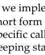
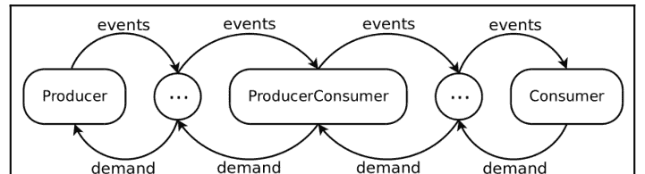

# 4 由 Erlang/OTP 驱动

正如我们在上一章中所看到的，一个常见的惯用法，在 Erlang 中也很常见，就是生成进程来保持状态并并发执行计算，其副作用之后可以通过某种方式检索。这种方法为你提供了无限的可能性，但更冗长且容易出错，因为它要求你从一开始就构建在现有的基本原语之上。

为了解决之前的问题，Erlang 的创建者决定为一些常见用例创建更高级别的抽象，并收集了在编写 Erlang 项目时应应用的推荐设计原则。因此，一组名为 **开放电信平台 (OTP)** 的库诞生了。

在本章中，我们将深入探讨 Elixir 从 Erlang 继承的那些非常有用的 OTP behaviours，例如 GenServer，以及 Elixir 在其之上提供的一些抽象，例如 Agent、Task 和 Registry。除此之外，我们还将分析 **Erlang 术语存储 (ETS)** 及其磁盘对应物，它提供了一种有用的数据存储方式。

在本章中，我们将介绍以下主题：

-   GenServer 如何工作以及我们如何使用它来实现一个 `CacheWorker` 进程
-   Agent behaviour 以及它如何促进使用进程来保持状态
-   使用 Task 模块运行异步和并行任务
-   使用 ETS 及其基于磁盘的版本高效存储和检索数据
-   使用进程注册表命名进程以及使用 Elixir 1.4 引入的 registry

## GenServer

我们现在知道 Erlang VM 允许数百万个进程各自愉快地运行，与它们通信只能通过消息交换来实现，即将消息入队到每个进程的邮箱中。

这种进程之间的交互可以被视为客户端-服务器交互，因为一个进程通过将消息入队到其邮箱来请求另一个进程代表它做某事。为了实现服务，服务器进程必须设计其 `receive` 循环，在循环中传递内部状态、处理意外消息等等。在实现服务器端逻辑时，还必须提前考虑可能破坏服务器内部状态或使其陷入死锁情况、无法再处理任何请求的边缘情况。

在处理爱立信的电信项目时，并在实现大量服务器进程之后，爱立信的优秀人士发现了一组共同特征，这些特征总是被实现。这些模式普遍存在到足以证明为它们创建抽象是合理的，以便它们可以轻松地应用于任何地方。因此，OTP 诞生了，定义了所谓的 OTP behaviours。



无论你身处大西洋的哪一边，在 Elixir 用语中，你会看到 behaviours 带 u，所以我们在这里也采用它。有趣的是，Erlang 接受两种拼写。

如果我们使用 `GenServer`（**通用服务器** 的简称）等 OTP behaviour 实现一个计算器服务器，我们只需要对特定的回调函数实现计算器逻辑，而 GenServer behaviour 将负责处理错误、保持状态、正确回复同步调用或对异步调用根本不回复等等，所有这些都在为我们提供在经过实战检验的代码之上提供计算器功能时的宁静和安心感，该代码在生产环境中实现了九个“九”的可用性。


九个“九”，即 99.9999999% 的可用性，指的是 Erlang 在电话交换机上的使用，每周服务 4000 万次呼叫，而每年仅停机 31 毫秒。你可以查看此链接以获取有关 Erlang 的更多信息，该信息来自其创建者之一 Joe Armstrong：`http://www.rabbitmq.com/resources/armstrong.pdf`。

遵循同样的方法，Elixir 也提供了一些有用的 behaviours，允许开发人员尽可能专注于手头问题的具体细节，而不必还要考虑从头开始开发并发系统的复杂性。我们将在下一章查看一些 Elixir behaviours。现在，让我们好好利用 GenServer behaviour。

## GenServer 为您服务

正如我们之前简要提到的，我们可以利用 GenServer behaviour 实现一个进程，该进程将通过定义良好的公共接口提供某种服务。为此，只需在模块中使用 GenServer 并实现必要的回调即可：

```
iex> defmodule Calculator do
...>   use GenServer
...> 
...>   def handle_call({:mult5, number}, _from, state) do
...>     {:reply, number*5, state}
...>   end
...> end

{:module, Calculator,
 <<70, 79, 82, 49, 0, 0, 12, 224, 66, 69, 65, 77, 65, 116,
 85, 56, 0, 0, 1, 138,
 0, 0, 0, 42, 17, 69, 108, 105, 120, 105, 114, 46, 67,
 97, 108, 99, 117, 108, 97, 116, 8, 95, 95, 105, 110, ...>>,
 {:handle_call, 3}}

iex> {:ok, calc} = GenServer.start_link(Calculator, [])
{:ok, #PID<0.461.0>}

iex> GenServer.call(calc, {:mult5, 7})
35
```

在前面的示例中，我们定义了一个简单的 Calculator 模块，它只知道如何回答同步的 {:mult5, number} 调用。我们知道这一点是因为它只实现了 handle_call/3 回调函数，该函数对提到的元组进行模式匹配。


请记住，如果你需要更好地理解模块函数或特定回调，文档读起来很愉快，并且距离一个 IEx shell 只有一步之遥。使用 h Module.function/arity 查看函数，使用 b Module.callback/arity 查看回调。


我们正在启动一个 Calculator 进程并随后使用 start_link/2 和 call/2 函数调用它，这两个函数都属于 GenServer 模块。为了查看调用计算器进程时实际发送的消息，让我们创建一个仅将收到的消息回显到 stdout 的虚拟进程：

```
iex> defmodule Echo do
...> def echoes() do
...> receive do
...> message ->
...> IO.puts "Echo on #{inspect(self())}: #{inspect(message)}"
...> end
...> end
...> echoes()
...> end
...> end
```

```
{:module, Echo,
<<70, 79, 82, 49, 0, 0, 5, 148, 66, 69, 65, 77, 65, 116,
85, 56, 0, 0, 0, 145, 0, 0, 0, 16, 11, 69, 108, 105,
120, 105, 114, 46, 69, 99, 104, 111, 8, 95, 95, 105,
110, 102, 95, 95, 9, 102, ...>>,
{:echoes, 0}}
```

```
iex> echo = Process.spawn(&Echo.echoes/0 , [])
#PID<0.467.0>
```

如果我们现在使用 GenServer 通过 call/2 向 echo 进程发送同步消息，就可以看到发送的消息结构。消息的格式为 {:"$gen_call", from, contents}，其中元组的第二个元素是标识发送者和消息的 {pid, reference} 元组，最后一个元素是我们通过调用传递的内容。我们出现了超时，因为 GenServer.call/2 是同步的，因此调用方期望在遵守 GenServer 协议的同时得到回复，但它没有收到任何回复：

```
iex> GenServer.call(echo, {:hello, :echo})
Echo on #PID<0.467.0>: {:"$gen_call", {#PID<0.448.0>,
#Reference<0.2270275367.1586495491.177847>}, {:hello, :echo}}

** (exit) exited in: GenServer.call(#PID<0.467.0>, {:hello, :echo}, 5000)
** (EXIT) time out
(elixir) lib/gen_server.ex:774: GenServer.call/3
```

我们现在将使用 GenServer.cast/2 发送异步请求，以便观察其消息结构。与之前的同步消息相比，它缺少标识发送者和消息的元组的第二个元素。这完全合理，因为处理请求的服务器不需要对消息进行回复。

我们也没有出现超时，因为我们没有等待服务器的任何响应：

```
iex> GenServer.cast(echo, {:hi_again, :echo})
Echo on #PID<0.467.0>: {:"$gen_cast", {:hi_again, :echo}}
:ok
```

通过使用 GenServer behaviour，当进程异常结束时，我们可以免费获得更好的错误报告。我们还获得了默认的 child_spec 定义，以便轻松地将 GenServer 进程置于监督树下。要查看回调的完整列表，我们可以检查 IEx 建议的可能补全，从 Calculator 模块开始：

```
iex> Calculator.<tab>
child_spec/1 code_change/3 handle_call/3 handle_cast/2
handle_info/2 init/1 terminate/2
```

正如以下错误输出所示，除了实际的 FunctionClauseError 之外，我们还可以了解到最后处理的邮件及其发送者、当时进程的内部状态以及有关客户端的信息，即它是否仍然存活以及调用来自何处：

```
iex> {:ok, calc} = GenServer.start(Calculator, [])
{:ok, #PID<0.526.0>}

iex> GenServer.call(calc, :unexpected)
** (exit) exited in: GenServer.call(#PID<0.526.0>, :unexpected, 5000)
  ** (EXIT) an exception was raised:
  ** (FunctionClauseError) no function clause matching in
Calculator.handle_call/3
  # ...

16:50:40.976 [error] GenServer #PID<0.526.0> terminating
** (FunctionClauseError) no function clause matching in
Calculator.handle_call/3
  iex:14: Calculator.handle_call(:unexpected, {#PID<0.515.0>,
  #Reference<0.2270275367.1586495489.187163>}, [])
  (stdlib) gen_server.erl:636: :gen_server.try_handle_call/4
  (stdlib) gen_server.erl:665: :gen_server.handle_msg/6
  (stdlib) proc_lib.erl:247: :proc_lib.init_p_do_apply/3
Last message (from #PID<0.515.0>) : :unexpected
State: []
Client #PID<0.515.0> is alive
  (stdlib) gen.erl:169: :gen.do_call/4
  (elixir) lib/gen_server.ex:771: GenServer.call/3
  (stdlib) erl_eval.erl:670: :erl_eval.do_apply/6
  (elixir) src/elixir.erl:239: :elixir.eval_forms/4
  (iex) lib/iex/evaluator.ex:231: IEx.Evaluator.handle_eval/5
```

```
(iex) lib/iex/evaluator.ex:212: IEx.Evaluator.do_eval/3
(iex) lib/iex/evaluator.ex:190: IEx.Evaluator.eval/3
(iex) lib/iex/evaluator.ex:89: IEx.Evaluator.loop/1
```

正如本节所见，GenServer behaviour 为我们做了大量繁重的工作。通过使用它，开发人员无需实现客户端和服务器之间的通信细节，而能够专门开发特定的服务器逻辑。让我们在 ElixirDrip 应用中使用这种行为。

## Implementing a CacheWorker with GenServer

我们现在将在 ElixirDrip 上实现一个 CacheWorker 进程，我们将用它来在内存中保留最近的媒体。通过使用这种缓存机制，我们希望减少文件下载所需的时间，并避免为 ElixirDrip 处理的每次下载都运行完整的下载管道。

我们的 CacheWorker 将在一段时间内将一些内容保存在内存中，并与特定的缓存键关联。在我们的例子中，缓存键将是媒体的 id。由于我们不想为同一媒体生成多个缓存进程，我们还将使用媒体 id 作为进程名称。这样，如果有人尝试缓存已存在于缓存中的媒体，就会收到已存在同名进程的通知：

```
iex> CacheWorker.start_link("1", "content")
{:ok, #PID<0.468.0>}

iex> CacheWorker.start_link("1", "other content")
{:error, {:already_started, #PID<0.468.0>}}
```

当我们使用媒体 id 和相应的内容调用 CacheWorker.start_link/2 函数时，将使用 CacheWorker 模块、要缓存的内容以及 :name 选项调用 GenServer.start_link/3。传递给它的模块必须实现 init/1 函数回调，该回调将负责服务器的初始化。


我们在注册进程时使用 {:global, {:cache, <media_id>}} 元组，以避免为每个进程使用原子作为名称的需求。通过这种方法，每个缓存进程都将命名为 {:cache, <media_id>}。应避免将原子用作进程名称，因为它们不会被垃圾回收，因此，如果我们使用它们来标识动态生成的进程，就有达到原子最大数量的风险。你可以在本章末尾了解有关注册进程的所有信息。

需要注意的是，`GenServer.start_link/3` 函数调用仍由生成 `GenServer` 的进程完成，而 `init/1` 函数已在生成的服务器上运行。对 `GenServer.start_link/3` 的调用将阻塞直到 `init/1` 回调结束，因此你应检查你的 `init/1` 函数是否花费时间过长。传递给 `GenServer.start_link/3` 函数的第二个参数始终传递给 `init/1` 函数，即使生成的服务器不需要初始化参数。在我们的例子中，我们需要将媒体内容传递给 `init/1` 函数，以便生成的进程将其存储在其内部状态中。

如果 `init/1` 上的初始化过程花费时间过长，只需在初始化期间向当前进程发送异步消息，然后再执行实际的服务器初始化工作，完全不阻塞生成进程。


这意味着在返回 `init/1` 调用之前执行 `GenServer.cast(self(), {:initialize, some_args})`，然后在 `handle_cast({:initialize, some_args}, _state)` 函数上执行实际的缓慢初始化过程，返回一个 `{:noreply, new_state}` 元组，其中包含新的进程状态。

我们还将在缓存进程上保存它提供缓存内容的次数。你可以在以下代码片段中看到 `CacheWorker` 的当前状态。它启动并将内容保存在内存中，但目前我们仍无法访问进程的内部状态，包括缓存内容：

```
$ cat apps/elixir_drip/lib/elixir_drip/storage/workers/cache_worker.ex
defmodule ElixirDrip.Storage.Workers.CacheWorker do
  use GenServer

  def start_link(media_id, content) do
    GenServer.start_link(__MODULE__, content, name: name_for(media_id))
  end

  defp name_for(media_id), do: {:global, {:cache, media_id}}

  def init(content) do
    {:ok, %{hits: 0, content: content}}
  end
end
```

缓存应允许其客户端检索其存储的内容，而我们目前的缓存不能。


通过创建 handle_call/3 函数回调来修复它，该回调知道如何回复 :get_media 消息：

```
$ cat apps/elixir_drip/lib/elixir_drip/storage/workers/cache_worker.ex
defmodule ElixirDrip.Storage.Workers.CacheWorker do
  use GenServer

  def start_link(media_id, content) do
    GenServer.start_link(__MODULE__, content, name: name_for(media_id))
  end

  defp name_for(media_id), do: {:global, {:cache, media_id}}

  def init(content) do
    {:ok, %{hits: 0, content: content}}
  end

  def handle_call(:get_media, _from, %{hits: hits, content: content} = state) do
    {:reply, {:ok, content}, %{state | hits: hits + 1}}
  end
end
```

我们现在能够以以下方式获取缓存内容：

```
iex> {:ok, cache} = CacheWorker.start_link("3", "some content")
{:ok, #PID<0.516.0>}

iex> GenServer.call(cache, :get_media)
{:ok, "some content"}
```

我们当前的缓存版本会永久驻留在内存中，而不是在一段时间后过期。它只有在我们显式终止时才会停止。我们需要的是一个过期机制。让我们在进程启动时向其自身发送一条延迟的 :expire 消息，然后当该消息实际到达时，我们将正常终止缓存进程：

```
iex> timer = Process.send_after(self(), :a_10min_delayed_message, 600_000)
#Reference<0.1448220797.3761766401.179853>

iex> Process.read_timer(timer)
574847

iex> Process.cancel_timer(timer)
554295

iex> Process.cancel_timer(timer)
false
```

如果媒体现在被访问，它可能在之后立即再次被访问。因此，每当发生缓存命中时，我们也希望推迟发送 :expire 消息。我们将采用与前一个示例类似的方法，通过保存 Process.send_after/3 返回的引用，以便稍后可以取消它，并在缓存命中时发出新的延迟 :expire 消息。

在添加过期机制后，我们的缓存如下所示：

```
$ cat apps/elixir_drip/lib/elixir_drip/storage/workers/cache_worker.ex
defmodule ElixirDrip.Storage.Workers.CacheWorker do
  use GenServer

  @expire_time 60_000

  def start_link(media_id, content) do
    GenServer.start_link(__MODULE__, content, name: name_for(media_id))
  end

  def name_for(media_id), do: {:global, {:cache, media_id}}

  def init(content) do
    timer = Process.send_after(self(), :expire, @expire_time)
    {:ok, %{hits: 0, content: content, timer: timer}}
  end

  def handle_info(:expire, %{hits: hits} = state) do
    IO.puts "#{inspect(self())}: Terminating cache, served #{hits} hits"
    {:stop, :normal, state}
  end

  def handle_info(msg, state), do: super(msg, state)

  def get_media(pid), do: GenServer.call(pid, :get_media)

  def handle_call(:get_media, _from, %{hits: hits, content: content, timer: timer} = state) do
    {:reply, {:ok, content}, %{state | hits: hits + 1, timer: refresh_timer(timer)}}
  end

  defp refresh_timer(timer) do
    Process.cancel_timer(timer)
    Process.send_after(self(), :expire, @expire_time)
  end
end
```

你可能已经注意到，我们正在使用 `handle_info/2` 函数回调来处理 `:expire` 消息，而不是我们到目前为止使用的 `call` 和 `cast` 回调。这是因为当我们执行 `Process.send_after/3` 时，我们发送的是 *plain* 消息，而不是由 GenServer 行为定制的消息。所有不遵循 GenServer 消息协议的消息都将由可用的 `handle_info/2` 回调处理，包括我们的 `:expire` 消息。


对于所有其他 *plain* 消息，我们 simply 委托给默认的 `handle_info/2` GenServer 实现。这也很重要，因为诸如 `{:EXIT, _, _}` 和 `{:DOWN, _, _, _, _}` 之类的消息元组可能会发送到你的 GenServer 进程。当你在捕获退出时尝试使用 `Process.exit/2` 结束它时，你的进程会收到第一条消息。当你的进程监视另一个进程并且后者因任何原因退出时，`:DOWN` 消息会到达你的进程。如果你不想自己显式处理这些 `:EXIT` 和 `:DOWN` 消息，让默认的 `handle_info/2` 为你处理即可。

让我们看看我们的过期机制现在是如何工作的：

```
iex> alias ElixirDrip.Storage.Workers.CacheWorker
ElixirDrip.Storage.Workers.CacheWorker

iex> CacheWorker.start_link("5", "some content")
{:ok, #PID<0.904.0>}

#PID<0.904.0>: Terminating cache, served 0 hits # after a minute

iex> {:ok, cache} = CacheWorker.start_link("6", "other content")
{:ok, #PID<0.906.0>}

iex> 1..3 |> Enum.map(fn _ -> GenServer.call(cache, :get_media) end)
[ok: "other content", ok: "other content", ok: "other content"]

#PID<0.906.0>: Terminating cache, served 3 hits # after a minute
```

在此基础上，我们还可以添加一种无需检索其内容即可刷新缓存的方法。这将允许我们通过使用 `GenServer.cast(cache_pid, :refresh)` 发送异步 `:refresh` 消息来刷新缓存：

```
$ cat apps/elixir_drip/lib/elixir_drip/storage/workers/cache_worker.ex
defmodule ElixirDrip.Storage.Workers.CacheWorker do
  use GenServer
  # ...
  def handle_cast(:refresh, %{timer: timer} = state),
    do: {:noreply, %{state | timer: refresh_timer(timer)}}
```

```
# ...
end
```

我们现在有一个合适的缓存工作进程，可以存储我们抛给它的任何内容。我们只是没有讨论一个小细节：为什么我们称它为工作进程？将受监督的进程命名为 worker 是一个常见的惯用法。在我们的例子中，每个缓存进程都由其自己的 CacheSupervisor 监督，因此得名 CacheWorker。这将是我们在上一章中讨论的动态监督的一个例子，因为在应用程序启动时不会存在任何缓存进程，我们将在运行时根据需要逐步生成进程。

我们现在将在我们的 supervisor 中添加两个函数，CacheSupervisor.put/2 和 CacheSupervisor.get/1，它们将生成一个新的缓存进程（如果不存在相同 media id 的进程）并从现有缓存进程中检索缓存的媒体内容。后者依赖于我们之前创建的 CacheWorker.name_for/1 函数，并根据 media id 为我们提供为每个进程使用的名称元组：

```
$ cat apps/elixir_drip/lib/elixir_drip/storage/supervisors/cache_supervisor.ex
defmodule ElixirDrip.Storage.Supervisors.CacheSupervisor do
  use DynamicSupervisor
  alias ElixirDrip.Storage.Workers.CacheWorker
  # ...
  def put(id, content)
    when is_binary(id) and is_bitstring(content) do
    DynamicSupervisor.start_child(
      __MODULE__,
      cache_worker_spec(id, content)
    )
  end

  def get(id) when is_binary(id) do
    case find_cache(id) do
      nil -> nil
      pid -> CacheWorker.get_media(pid)
    end
  end

  def find_cache(id) when is_binary(id) do
    GenServer.whereis(CacheWorker.name_for(id))
  end
end
```

让我们现在分析 Elixir 引入的一个抽象，以简化创建单一目的为保持内部状态的服务器。

## Agent

正如我们在上一节中所看到的，GenServer 允许你创建一个服务器进程，可以处理与其客户端的同步和异步交互，同时还提供了一种使用 handle_info/2 回调处理其他类型的低级消息（使用 Process.send/3 发送）的方法。

然而，有时你可能不想控制通信是同步还是异步。你不需要处理带外消息，你只想生成一个进程，该进程能够正确地在其内部状态中存储信息，并在需要时共享它。在这种情况下，GenServer 对于手头的任务来说显得过于复杂。

相反，你可以使用 Agent 来完成它。把它想象成一个专门用于执行内部状态管理的 GenServer。让我们尝试将我们的 CacheWorker 实现为一个 Agent，看看效果如何。

我们的 AgentCacheWorker 将像之前的 GenServer 版本一样，保持一个映射，其中 hits 作为提供缓存内容的次数的计数器，content 条目为内容本身。我们将公开一个 get_media/1 模块函数，与我们为 CacheWorker 提供的类似，以便我们的客户端可以轻松地从 agent 状态中检索内容：

```
$ cat apps/elixir_drip/lib/elixir_drip/storage/workers/agent_cache_worker.ex
defmodule ElixirDrip.Storage.Workers.AgentCacheWorker do
  use Agent
  alias ElixirDrip.Storage.Workers.CacheWorker

  def start_link(media_id, content) do
    Agent.start_link(fn ->
      %{hits: 0, content: content}
    end, name: CacheWorker.name_for(media_id))
  end

  def get_media(pid),
    do: Agent.get(pid,
      fn (%{hits: hits, content: content}) ->
        hits = hits + 1
        content
      end)
end
```

如果我们现在尝试我们的缓存 agent，看起来它工作完美无缺。但最终，当我们求助于 Agent.get/2 来查看 agent 的完整内部状态时，我们会发现 hits 的数量在我们三次访问后并未更新：

```
iex> alias ElixirDrip.Storage.Workers.AgentCacheWorker, as: AgentCache
ElixirDrip.Storage.Workers.AgentCacheWorker

iex> {:ok, agent} = AgentCache.start_link("1", "content")
{:ok, #PID<0.473.0>}

iex> 1..3 |> Enum.map(fn _ -> AgentCache.get_media(agent) end)
["content", "content", "content"]

iex> Agent.get(agent, &(&1))
%{content: "content", hits: 0}
```

让我们通过将 Agent.get/2 函数改为 Agent.get_and_update/2 来修复前面的问题，并将 lambda 的返回值改为包含两个元素的元组，其中第一个是返回给客户端的值，第二个是新的状态值，这次 hits 条目会递增：

```
defmodule ElixirDrip.Storage.Workers.AgentCacheWorker do
  use Agent
  alias ElixirDrip.Storage.Workers.CacheWorker
  # ...
  def get_media(pid),
    do: Agent.get_and_update(pid,
      fn (%{hits: hits, content: content} = state) ->
        {state.content, %{state | hits: hits + 1}}
      end)
end
```

如果我们现在使用 Agent.get_and_update/2 从一个新 agent 获取内容，就能得到正确的 hits 数量：

```
iex> {:ok, agent2} = AgentCache.start_link("2", "other content")
{:ok, #PID<0.539.0>}

iex> 1..3 |> Enum.map(fn _ -> AgentCache.get_media(agent2) end)
["other content", "other content", "other content"]

iex> Agent.get(agent, &(&1))
%{content: "other content", hits: 3}
```

需要注意的一点是，我们作为第二个参数传递的 lambda 在 Agent 进程上运行，因此在 lambda 执行期间，agent 会将其他请求挂起。如果你希望 Agent 状态能被多个客户端更新，你应该始终在服务器进程上执行状态更新（在 lambda 函数作用域内执行）。这样可以避免竞态条件，即在你忙于确定新状态时，agent 状态可能被另一个客户端更新。

乍一看，在所有相关方面，我们的 AgentCacheWorker 看起来与它的 CacheWorker 对应物做的事情一样。我们可以通过 start_link/2 启动它，传入媒体 id 和其内容，并可以使用 AgentCacheWorker.get_media/1 函数获取缓存内容。然而，我们的 agent 进程会永远存活，因为我们没有实现过期机制。我们可能设计的任何过期机制都必须在 agent 之外，因为正如我们将看到的，Agent 无法使用 handle_info/2 回调处理带外消息。如果我们像下面这样为 AgentCacheWorker 添加 handle_info/2 函数，它仍然无法处理通过 Process.send/3 发送的消息：

```elixir
defmodule ElixirDrip.Storage.Workers.AgentCacheWorker do
  use Agent
  alias ElixirDrip.Storage.Workers.CacheWorker
  # ...
  def handle_info(message, state) do
    Logger.debug("#{inspect(self())} Just got an OOB message: #{message}")
    {:noreply, state}
  end
end
```

如果我们向 AgentCacheWorker 进程发送 :oob_message，我们将在 IEx shell 上收到错误消息，提示该消息未被预期，即使 handle_info/2 已在模块上定义：

```
iex> {:ok, agent} = AgentCache.start_link("6", "alchemy for beginners")
{:ok, #PID<0.475.0>}

iex> Process.send(agent, :oob_message, [])
:ok

22:24:07.362 [error] Agent.Server #PID<0.475.0> received unexpected
message in handle_info/2: :oob_message
```

因此，使用 Process.send_after/3 和 handle_info/2 函数回调的优雅过期机制在 Agent 进程中不起作用。一种可行但可能过于复杂的替代方案是在 Agent 初始化期间生成一个链接进程，该进程随后依赖 Process.send_after/3 函数向自身发送一个 :expire 消息。收到此消息后，进程将执行 Process.exit(agent, :expired)。由于 agent 没有预期 :expired 退出信号并且未捕获退出，它将简单地以 :expired 原因退出。

我们将之前的建议留作读者的练习。请记住，如果手头的抽象从一开始就不能提供你所需的灵活性，有时最好一开始就避免使用它。查看我们的 `Agent` 示例，由于我们希望在一段时间后使缓存内容过期，选择 `GenServer` 路线更简单。


> 你写的代码越少，引入 bug 的概率就越小。在 Elixir 中，如果你尽可能多地依赖 OTP 抽象，你就能很好地保持代码在未来几年内以最少的中断运行。

我们现在将查看 `Task` 模块以及它如何允许我们并行执行一次性计算，并在需要时等待其结果。

## 任务

正如我们之前看到的，在 Elixir 中生成进程成本很低，因为我们始终处于 BEAM 的领域。这为我们提供了在需要时随时生成进程的完美条件。如果你需要并行做某事，可以生成一个进程。如果你需要并行做很多事，可以生成很多进程。虚拟机不会感到吃力，你很快就会拥有一支进程大军来完成你需要的任何任务。

然而，进程通信很繁琐，因此如果你需要这些并行计算的结果，你必须通过消息传递接收结果，并在之后终止进程。

在这种情况下，我们可以借助 `Task` 模块，使用其 `Task.async/1` 函数生成任务，然后在需要之前生成任务的结果时使用 `Task.await/1`。

假设我们想告诉用户他们相对于当前使用的磁盘空间的排名。获取每个用户的磁盘空间可能是一次昂贵的查询，因此我们希望将其卸载到并行任务中，并在真正需要时才查看这些值：

```
disk_space_by_user_task = Task.async(fn ->
  # expensive query
  [
    %{user_id: 4, disk_space: 600},
    %{user_id: 2, disk_space: 123},
    %{user_id: 1, disk_space: 1024},
    %{user_id: 5, disk_space: 50},
    %{user_id: 3, disk_space: 0.5}
  ]
end)

# performing other work here

{%{disk_space: disk_space}, user_rank} = disk_space_by_user_task
|> Task.await(timeout)
|> Enum.sort(&(&1.disk_space <= &2.disk_space))
|> Enum.with_index(1)
|> Enum.find(&(elem(&1, 0).user_id == current_user))

Notifications.send(current_user, "You're using #{disk_space} MB, making you the \##{user_rank} user in terms of disk usage.")
```

在前面的示例中，我们将昂贵的查询委托给异步 Task，因此当前进程可以继续工作，直到真正需要任务结果。当需要任务结果继续时，进程会尝试使用 Task.await/2 获取它们。如果任务在超时到期前未返回，当前进程将退出，因此在我们的例子中，我们可以确定如果磁盘使用统计数据未到达，就不会发送通知。

注意当前进程在 Task.await/2 调用处如何有效地停止等待。我们如何生成多个任务然后聚合它们的结果？不用多说，让我们深入探讨并行任务。

## 并行任务

为了帮助我们理解任务的工作方式，我们需要一种惰性缓存机制。为此，让我们定义一个 SlowCacheSupervisor 进程，它将 put/2 和 get/1 委托给已引入的良好行为的 CacheSupervisor，但在那之前，它会休眠与接收到的媒体 id 相等秒数的时间：

```elixir
defmodule ElixirDrip.Storage.Supervisors.SlowCacheSupervisor do
  @behaviour ElixirDrip.Behaviours.CacheSupervisor

  alias ElixirDrip.Storage.Supervisors.CacheSupervisor, as: RealCache

  def put(id, content), do: RealCache.put(id, content)

  def get(id) do
    secs_to_nap = case Integer.parse(id) do
      {sleep_time, _} -> sleep_time
      _ -> 1
    end

    Process.sleep(secs_to_nap * 1000)
    RealCache.get(id)
  end
  # ...
end
```

我们现在想要为我们的应用程序创建一个并行文本搜索。此 Search 模块将公开一个 search_for/2 函数，它将接收媒体标识符列表（或单个媒体 id）和一个表达式，并为给定表达式搜索每个媒体内容。我们假设我们需要的所有媒体都已存在于缓存中。

这里最小的工作单元由在单个媒体上执行搜索的函数完成。它从缓存中获取内容，将其拆分为行，然后使用 Stream.with_index/1 将每一行与其行号配对。之后，我们对刚刚创建的流进行归约，如果在当前行找到表达式，则将包含行号和内容的元组添加到结果列表中：

```elixir
defmodule ElixirDrip.Storage.Search do
  alias ElixirDrip.Storage.Supervisors.SlowCacheSupervisor, as: Cache
  # ...
  def search_for(media_id, expression) do
    raw_content_lines = media_id
      |> Cache.get()
      |> elem(1)
      |> String.split("\n")

    result = raw_content_lines
    |> Stream.with_index()
    |> Enum.reduce(
      [],
      fn({content, line}, accum) ->
        case found?(expression, content) do
          nil -> accum
          _ -> accum ++ [{line + 1, content}]
        end
      end)

    {media_id, result}
  end

  defp found?(expression, content) do
    regex = ~r/#{expression}/
    Regex.run(regex, content, return: :index)
  end
end
```


我们现在将实现我们的第一个搜索，恰当地命名为 naive_search_for/2，因为它只是依次搜索每一件媒体：

```
defmodule ElixirDrip.Storage.Search do
  # ...
  def naive_search_for(media_ids, expression) when is_list(media_ids) do
    media_ids
    |> Enum.map(&search_for(&1, expression))
    |> Enum.into(%{})
  end
end
```

前面的实现完全没有利用 Elixir 轻松创建数百万个进程的特性。让我们填充缓存数据，以便我们可以实现改进的搜索：

```
iex> alias ElixirDrip.Storage.Supervisors.SlowCacheSupervisor, as: Cache
ElixirDrip.Storage.Supervisors.SlowCacheSupervisor

iex> fill_cache = fn (how_many, offset) ->
...> offset..(offset + (how_many-1))
...> |> Enum.each(&Cache.put(to_string(&1), "Media content #{&1}."))
...> end
#Function<12.99386804/2 in :erl_eval.expr/5>

iex> fill_cache.(3, 6)
14:17:40.483 [debug] Spawning a slow cache for 6, content size: 16 bytes.
14:17:40.485 [debug] #PID<0.452.0>: CacheWorker started. Will expire in a while.
14:17:40.485 [debug] Spawning a slow cache for 7, content size: 16 bytes.
14:17:40.485 [debug] #PID<0.453.0>: CacheWorker started. Will expire in a while.
14:17:40.485 [debug] Spawning a slow cache for 8, content size: 16 bytes.
14:17:40.485 [debug] #PID<0.454.0>: CacheWorker started. Will expire in a while.
:ok
```

使用之前的代码片段，我们在缓存中存储了三个 id 为 "6"、"7" 和 "8" 的文件。如果我们随后并行从缓存中检索这些文件，我们将不得不等待八秒钟才能获取这三个文件的内容。


回想一下，SlowCacheSupervisor.get/1 函数会休眠媒体 id 所指示的秒数。如果我们并行调用此函数，所有调用返回所需的时间等于最慢调用所需的时间。

我们的改进搜索将为每次搜索生成一个任务，然后再等待所有任务完成。请注意，我们使用的是 Task.async/3 函数，它接收模块、函数名和参数，而不是像之前那样使用 lambda：

```
defmodule ElixirDrip.Storage.Search do
  # ...
  def task_search_for(media_ids, expression, timeout \\ 10_000) when
  is_list(media_ids) do
    media_ids
    |> Enum.map(&Task.async(__MODULE__, :search_for, [&1, expression]))
    |> Enum.map(&Task.await(&1, timeout))
  end
end
```

你可以在以下代码中看到它的表现。完整的调用花费了八秒钟才返回结果：启动后 1 毫秒，每个任务尝试获取缓存内容，然后三个缓存工作进程在 6、7 和 8 秒后作出响应：

```
iex> Logger.debug "#{inspect(self())} Start"; ElixirDrip.Utils.measure(fn -> Search.task_search_for_verbose(["8", "7", "6"], "media") end)

09:57:04.368 #PID<0.613.0> Start

09:57:04.369 #PID<0.613.0> Spawned a search for 8, PID: #PID<0.740.0>
09:57:04.369 #PID<0.613.0> Spawned a search for 7, PID: #PID<0.741.0>
09:57:04.369 #PID<0.613.0> Spawned a search for 6, PID: #PID<0.742.0>

09:57:04.369 #PID<0.613.0> Will now wait for task PID: #PID<0.740.0>

09:57:04.369 Fetching cached content for 8...
09:57:04.369 Fetching cached content for 7...
09:57:04.369 Fetching cached content for 6...

09:57:10.370 #PID<0.560.0>: Received :get_media and served '"Content of media 6."' bytes 1 times.
09:57:11.370 #PID<0.561.0>: Received :get_media and served '"Content of media 7."' bytes 1 times.
09:57:12.370 #PID<0.562.0>: Received :get_media and served '"Content of media 8."' bytes 1 times.

09:57:12.371 #PID<0.613.0> Task PID: #PID<0.740.0> returned with 1 result(s) for 8
09:57:12.371 #PID<0.613.0> Will now wait for task PID: #PID<0.741.0>

09:57:12.371 #PID<0.613.0> Task PID: #PID<0.741.0> returned with 1 result(s) for 7
09:57:12.371 #PID<0.613.0> Will now wait for task PID: #PID<0.742.0>
```

```
09:57:12.371 #PID<0.613.0> Task PID: #PID<0.742.0> returned with 1
result(s) for 6

09:57:12.372 Took: 8.002136 secs
```

一切看起来都不错；只是请注意，我们是依次等待每个任务完成，因此只有在当前 Task.await/1 调用返回时，我们才会为下一个任务运行 Task.await/1。这就是为什么我们立即看到 shell 进程 <0.613.0> 等待第一个任务（PID 为 <0.740.0>），但随后它要等到八秒后、第一个任务返回后，才对剩余任务执行相同的操作。


在前一个示例中调用的 task_search_for_verbose/2 函数等同于 task_search_for/2 函数，只是添加了对 Logger.debug/1 的调用，因此我们可以观察底层发生的情况。

现在，考虑以下情况：我们必须在 10 秒后返回，无论如何，并且缓存中有一个 id 为 "25" 的非常大的文件，因此从我们的慢速缓存中获取它需要 25 秒。如果我们调用 Search.task_search_for(["8", "25"], "media")，它将终止当前进程（该进程生成了两个搜索任务），因为第二个任务在超时之前没有结束（并且我们没有捕获退出）。然而，正如你在以下代码中看到的，它在 18 秒后结束，因为它等待了八秒钟让第一个任务完成，然后在 Task.await/1 对第二个任务的调用返回之前，又阻塞了另外 10 秒（await/1 调用上通过的超时）：

```
iex> Logger.debug "#{inspect(self())} Start"; ElixirDrip.Utils.measure(fn -> Search.task_search_for_verbose(["8", "25"], "media") end)
```

```
12:10:06.878 #PID<0.613.0> Start

12:10:06.878 #PID<0.613.0> Spawned a search for 8, PID: #PID<0.947.0>
12:10:06.878 #PID<0.613.0> Spawned a search for 25, PID: #PID<0.948.0>
12:10:06.878 #PID<0.613.0> Will now wait for task PID: #PID<0.947.0>
12:10:06.878 Fetching cached content for 8...
12:10:06.878 Fetching cached content for 25...

Seconds elapsed: 1 secs
# ...
Seconds elapsed: 7 secs

12:10:14.879 #PID<0.562.0>: Received :get_media and served '"Content of media 8."' bytes 1 times.
12:10:14.882 #PID<0.613.0> Task PID: #PID<0.947.0> returned with 1
result(s) for 8
```

```
12:10:14.882 #PID<0.613.0> Will now wait for task PID: #PID<0.948.0>

Seconds elapsed: 8 secs
# ...
Seconds elapsed: 17 secs

** (exit) exited in: Task.await(%Task{owner: #PID<0.613.0>, pid: #PID<0.948.0>, ref: #Reference<0.3922080717.158334979.65414>}, 10000)
  ** (EXIT) time out
  (elixir) lib/task.ex:493: Task.await/2
  (elixir_drip) lib/elixir_drip/storage/search.ex:34: anonymous fn/1 in ElixirDrip.Storage.Search.task_search_for_verbose/2
  (elixir) lib/enum.ex:1294: Enum."-map/2-lists^map/1-0-"/2
  (elixir) lib/enum.ex:1294: Enum."-map/2-lists^map/1-0-"/2
  (elixir_drip) lib/elixir_drip/utils.ex:19: anonymous fn/1 in ElixirDrip.Utils.safe_function/1
  (stdlib) timer.erl:166: :timer.tc/1
  (elixir_drip) lib/elixir_drip/utils.ex:11: ElixirDrip.Utils.measure/1
```

如果我们想使用之前的方法在一段时间后超时，我们需要跟踪到超时的剩余时间，并相应地等待每个任务。幸运的是，生成并行任务是并发编程中非常常见的模式，因此 Elixir 1.4 引入了 Task.async_stream 函数，它让我们能够（在其他不错的功能中）为其生成的所有任务设置单个超时。

Task.async_stream 函数将生成一个新的进程，并将其链接到当前进程，然后此中间进程将生成所有必需的任务，并在任务完成后聚合任务结果。我们仍然在 Task 领域，因此默认行为应该很熟悉：如果生成的任务超时或意外死亡，其退出信号将被发送到中间进程，然后该进程将终止剩余任务并将退出信号传播到原始进程。

现在让我们使用 Task.async_stream/5 函数实现我们的文本搜索功能，这样我们就可以确保它只等待 10 秒钟获取任务结果。此函数赋予我们与 Stream 模块关联的语义，因为每个任务将是惰性执行的。默认情况下，同时运行的任务数量由 VM 中的调度程序数量决定。我们也可以通过 :max_concurrency 选项来控制这一点。将此方法与之前的方法进行比较，在之前的方法中，我们预先生成了所有任务，而不考虑可用调度程序的数量。如果每个任务都需要使用有限的资源，例如数据库连接，那么使用许多任务的急切方法可能会迅速耗尽可用资源池：

```
defmodule ElixirDrip.Storage.Search do
  # ...
  def task_stream_search_for(media_ids, expression, concurrency
```

```
\\ 4, timeout \\ 10_000) when is_list(media_ids) do
  options = [max_concurrency: concurrency, timeout: timeout]

  media_ids
  |> Task.async_stream(__MODULE__, :search_for, [expression],
  options)
  |> Enum.map(&elem(&1, 1))
  |> Enum.into(%{})
end
end
```

Task.async_stream/5 函数除了 :max_concurrency 和 :timeout 选项外，还接收一个集合以及每个任务将处理的模块、函数和附加参数。集合中的每个元素都将作为第一个参数传递给函数。在我们的例子中，每次调用的第一个参数将是 media id，而我们将把搜索表达式作为最后一个参数传递。每个任务都会产生一个 {:ok, result} 元组，因此我们在将其注入到映射之前，会从每个元组的结果中提取最后一个元素：

```
iex> Logger.debug "#{inspect(self())} Start"; ElixirDrip.Utils.measure(fn -> Search.task_stream_search_for(["6", "7", "8"], "media") end)

07:04:42.859 #PID<0.883.0> Start

07:04:50.801 Took: 8.01131 secs
```

正如我们之前看到的，Task.async_stream 函数具有相同的 Task 语义，因此如果任何任务超时，退出信号将被传播到生成这些任务的进程。由于我们没有捕获退出，该进程将与所有其他任务一起退出，而此时这些任务可能已经完成。你可以在下面的代码中看到，生成两个任务的结果分别需要 25 秒和 8 秒，超时时间为 10 秒：

```
iex> Logger.debug "#{inspect(self())} Start"; ElixirDrip.Utils.measure(fn -> Search.task_stream_search_for(["25", "8"], "media") end)

07:23:00.315 #PID<0.883.0> Start

07:23:00.321 Fetching cached content for 25...
07:23:00.321 Fetching cached content for 8...

Seconds elapsed: 1 secs
# ...
Seconds elapsed: 7 secs
```

```
07:23:08.252 #PID<0.895.0>: Received :get_media and served
"Content of media 8." bytes 7 times.

Seconds elapsed: 8 secs
Seconds elapsed: 9 secs

** (exit) exited in: Task.Supervised.stream(10000)
  ** (EXIT) time out
(elixir) lib/task/supervised.ex:269: Task.Supervised.stream_reduce/7
(elixir) lib/enum.ex:1919: Enum.map/2
(elixir_drip) lib/elixir_drip/storage/search.ex:44:
ElixirDrip.Storage.Search.task_stream_search_for/4
(stdlib) timer.erl:166: :timer.tc/1
(elixir_drip) lib/elixir_drip/utils.ex:13: ElixirDrip.Utils.measure/1

Seconds elapsed: 10 secs
```

我们想要的是在 10 秒后返回我们已有的结果，而不是因为某个任务在截止时间前未结束而完全不返回。对于这种情况，我们有 :on_timeout 选项。其默认值是 :exit，意味着它会传播来自任务的退出信号，因此生成任务的进程也会退出。这就是我们刚刚观察到的行为。我们也可以将其设为 :kill_task，这样耗时过长的任务就会被简单地终止。当任务以这种方式被终止时，它产生的结果始终是一个 {:exit, :timeout} 元组，而不是成功的 {:ok, result}：

```
defmodule ElixirDrip.Storage.Search do
  # ...
  def safe_task_stream_search_for(media_ids, expression, concurrency \\ 4, timeout \\ 10_000) when is_list(media_ids) do
    options = [max_concurrency: concurrency, timeout: timeout,
    on_timeout: :kill_task]

    media_ids
    |> Task.async_stream(__MODULE__, :search_for, [expression],
    options)
    |> Enum.map(&elem(&1, 1))
    |> Enum.reject(&(&1 == :timeout))
    |> Enum.into(%{})
  end
end
```

请记住，针对 media "25" 的搜索任务超时，因此它产生了一个 {:exit, :timeout} 元组，该元组在返回结果之前会通过 Enum.reject/2 调用进行过滤。使用这个版本，对 media id 为 "25"、"8"、"6" 和 "7" 的搜索在 10 秒后产生以下结果：

```
iex> Logger.debug "#{inspect(self())} Start";
Search.safe_task_stream_search_for(["25", "8", "6", "7"], "media")

10:14:06.861 #PID<0.463.0> Start

10:14:06.873 Fetching cached content for 25...
10:14:06.873 Fetching cached content for 8...
10:14:06.873 Fetching cached content for 6...
10:14:06.874 Fetching cached content for 7...

# ...
Seconds elapsed: 6 secs
10:14:12.874 #PID<0.473.0>: Received :get_media and served
"Content of media 6." bytes 1 times.

10:14:13.868 Seconds elapsed: 7 secs
10:14:13.874 #PID<0.474.0>: Received :get_media and served
"Content of media 7." bytes 1 times.

10:14:14.869 Seconds elapsed: 8 secs
10:14:14.874 #PID<0.475.0>: Received :get_media and served
"Content of media 8." bytes 1 times.

# ...
10:14:16.871 Seconds elapsed: 10 secs

%{
  "6" => [{1, "Content of media 6."}],
  "7" => [{1, "Content of media 7."}],
  "8" => [{1, "Content of media 8."}]
}
```

我们终于可以观察到文本搜索的结果：对于每个 media id，它返回一个包含匹配搜索表达式的行号和内容的列表。它始终在我们定义的时间范围内返回，因此我们可以向用户提供更迅速的结果。

让我们现在看看如何使用随 Erlang/OTP 提供的 ETS 工具来存储在 ElixirDrip 上执行的文本搜索结果。

## 使用 (D)ETS

在上一节中，我们使用 Task.async_stream/5 实现 ElixirDrip 文本搜索功能，以便同时搜索多个文本文件。文本搜索函数位于 ElixirDrip.Storage.Search 模块中，其最后一个迭代可以这样使用：

```
iex> alias ElixirDrip.Storage.Search

iex> media_ids = ["25", "8", "6", "7"]

iex> search_expression = "media"

iex> Search.safe_task_stream_search_for(media_ids,
search_expression)

%{
  "6" => [{1, "Content of media 6."}],
  "7" => [{1, "Content of media 7."}],
  "8" => [{1, "Content of media 8."}]
}
```

它返回一个映射，其中包含在分配时间内结束搜索的每个搜索文件的条目。对于每个 media id，它产生一个由两个元素组成的元组列表，其中第一个元组元素对应于找到表达式的行，第二个元素包含该行的实际内容。

请记住，ElixirDrip 会生成一个 CacheWorker 以将文件保留在内存中一段时间以加快连续下载，但会在一段时间后回收这些进程以控制内存使用。执行实际文件搜索的 Search.search_for/2 函数假定要搜索的文件已有 CacheWorker 进程。因此，如果我们想搜索特定的文本文件，就必须先下载它，然后再进行搜索。

此处的目标是实现一个缓存来存储搜索结果，以便改进后续搜索。而不是立即下载文件仅为了搜索其内容，我们将首先查看搜索结果缓存，以确定是否已执行过相同的搜索。

我们将使用 ETS 实现此缓存，ETS 是 Erlang OTP 的一种构造，允许我们高效地在内存中存储和查询任意 Erlang 项。我们在这里使用高效这个词，是因为 ETS 表提供恒定的访问时间，无论你在其上存储的数据大小如何。由于 ETS 数据存储在内存中，如果我们告诉你每个 ETS 表都属于一个特定进程，就不会令人惊讶。在需要保留 ETS 数据的场景中，我们必须谨慎处理持有对应 ETS 表的进程的终止，以确保表不会丢失。

让我们创建一个基于 GenServer 的 SearchCacheWorker 模块来封装我们的搜索结果缓存的逻辑。由于我们只有一个 SearchCacheWorker，我们将其注册在 ElixirDrip.Storage.Workers.SearchCacheWorker 别名下（即其模块名）。

这样，我们就不需要知道 SearchCacheWorker 的 PID 就可以向其发送消息：

```
$ cat apps/elixir_drip/lib/elixir_drip/storage/workers/
search_cache_worker.ex
defmodule ElixirDrip.Storage.Workers.SearchCacheWorker do
  @moduledoc false

  use GenServer
  require Logger

  @search_cache :search_cache

  def start_link() do
    GenServer.start_link(__MODULE__, [], name: __MODULE__)
  end

  def init(_) do
    Logger.debug("#{inspect(self())}: SearchCacheWorker started.")
    search_cache = :ets.new(@search_cache, [:named_table, :set,
      :protected])

    {:ok, search_cache}
  end
end
```

正如我们所观察到的，这是一个普通的 GenServer，它在初始化期间创建一个名为 :search_cache 的新 ETS 表，并将表名存储在其状态中。如果我们没有向 :ets.new/2 函数传递 :named_table 选项，我们将获得表的引用而不是其名称。:set 选项使 ETS 表作为标准映射工作，其中每个键必须是唯一的，并且每个键只指向一个值。我们还将表的访问模式设置为 :protected，这意味着只有进程所有者可以写入表，而其他进程可以从中读取。


除了 :set 之外，ETS 表还可以像 :ordered_set、:bag 或 :duplicate_bag 一样工作。:ordered_set 按键保持表有序，而 :bag 每个键可以有多个唯一值。:duplicate_bag 去除了后者的唯一性要求。关于表的访问模式，除了 :protected 之外，你还可以将其设置为 :private 或 :public，分别表示除了进程所有者之外无人可以访问它，或每个人都有读写访问权限。

为了将文本搜索结果存储在我们的 ETS 表中，我们将实现一个 cache_search_result/3 函数，它接收 media_id、search_expression 以及我们想要存储的关联搜索结果。


由于表只能由其进程所有者写入，此函数将简单地向进程所有者执行一次 GenServer.call/2 调用，然后由其在对应的 handle_call/3 回调中负责更新 ETS 表：

```
$ cat apps/elixir_drip/lib/elixir_drip/storage/workers/
search_cache_worker.ex
defmodule ElixirDrip.Storage.Workers.SearchCacheWorker do
  # ...
  def cache_search_result(media_id, search_expression, result) do
    GenServer.call(__MODULE__, {:put, media_id, search_expression,
    result})
  end

  def handle_call({:put, media_id, search_expression, result}, _from,
  search_cache) do
    created_at = :os.system_time(:seconds)

    result = :ets.insert_new(search_cache, {{media_id,
    search_expression}, {created_at, result}})

    {:reply, {:ok, result}, search_cache}
  end
end
```

为了向 ETS 表中插入新值，我们将表名（存储在进程状态中）和新条目传递给 :ets.insert_new/2 函数。此新条目始终必须是一个以键为第一个元素的元组。在我们的例子中，我们将 {{media_id, search_expression}, {created_at, result}} 作为第二个参数传递，因此我们的键是 {media_id, search_expression} 元组，其值是另一个包含 created_at 时间戳和实际文本搜索结果的元组（在本节末尾，你将明白我们为什么也要存储时间戳）。:ets.insert_new/2 调用将返回一个布尔值，表示操作是否成功：

```
iex> SearchCacheWorker.cache_search_result("1", "media",
"lorem ipsum media 1 contents")
{:ok, true}

iex> SearchCacheWorker.cache_search_result("1", "media",
"this can't be cached")
{:ok, false}

iex> SearchCacheWorker.cache_search_result("1", "other",
"other phrase found on media 1 contents")
{:ok, true}
```

我们将表的访问模式设置为 :protected，因此每个进程都可以读取其内容。

在此场景中，我们无需要求所有者进程为我们获取表中存储的数据，可以直接与其交互。这就是为什么我们将表名存储在 @search_cache 模块属性上的原因：由于每个进程都可以从表中读取，表名不能仅存在于进程所有者的状态中。

要访问表条目，可以使用 :ets.lookup/2 函数，它接收表名或引用以及我们要查找的键。该函数返回具有该键的条目列表。在我们的例子中，每个返回的列表只有一个元素，因为我们使用的是 :set ETS 表：

```
iex> :ets.lookup(:search_cache, {"1", "media"})
[{"1", "media", {1518475143, "lorem ipsum media 1 contents"}}]

iex> :ets.lookup(:search_cache, {"1", "unknown"})
[]
```

正如你刚才看到的，当存在该键的条目时，我们会得到一个包含 {key, value} 元组的列表。为了更方便地获取存储的值，我们将 :ets.lookup/2 函数封装在了 search_result_for/2 函数中：

```
$ cat apps/elixir_drip/lib/elixir_drip/storage/workers/search_cache_worker.ex
defmodule ElixirDrip.Storage.Workers.SearchCacheWorker do
  # ...
  @search_cache :search_cache

  def search_result_for(media_id, search_expression) do
    case :ets.lookup(@search_cache, {media_id, search_expression}) do
      [] ->
        nil
      [{_key, {_created_at, search_result}}] ->
        search_result
    end
  end
end
```

使用之前的函数，我们无法获取给定 media_id 缓存的所有文本搜索。如果要实现它，我们需要查询只查看键元组的第一个元素，其中包含 media_id。:ets.match_object/2 函数正好可以做到这一点：使用它，你可以对特定字段进行模式匹配：

```
iex> :ets.match_object(:search_cache, {{"1", :"_"}, :"_"})
[
  {{"1", "other"}, {1518509888, "other phrase found on media 1 contents"}},
  {{"1", "media"}, {1518475143, "lorem ipsum media 1 contents"}}
]
```

让我们创建一个 all_search_results_for/1 函数，对键元组的 media_id 元素进行模式匹配，类似于我们刚才的做法。我们使用了特殊形式 : "_" 来表示，对于我们的 {{media_id, search_expression}, {created_at, result}} 条目，我们不关心 search_expression 元组元素，也不关心每个条目值对应的最后一个元组：

```
$ cat apps/elixir_drip/lib/elixir_drip/storage/workers/
search_cache_worker.ex
defmodule ElixirDrip.Storage.Workers.SearchCacheWorker do
  # ...
  @search_cache :search_cache

  def all_search_results_for(media_id) do
    case :ets.match_object(@search_cache, {{media_id, :"_"}, : "_"}) do
      [] ->
        nil
      all_objects ->
        all_objects
        |> Enum.map(fn {key, value} ->
          {elem(key, 1), elem(value, 1)}
        end)
    end
  end
end
```

:ets.match_object/2 返回一个包含所有匹配我们搜索条件的条目的列表。为了只返回每个条目的 search_expression 和结果，我们对结果列表进行映射，分别从条目键中获取第一个元素，从条目值中获取后者：

```
iex> SearchCacheWorker.all_search_results_for("1")
[{"other", "other phrase found on media 1 contents"}, {"media",
  "lorem ipsum media 1 contents"}]
```

最后，让我们使用每次缓存搜索结果时存储的 created_at 时间戳。这里的想法是创建一个 SearchCacheWorker.expired_search_results/0，它将返回所有创建时间超过 @expiration_secs 的搜索结果键。为此，我们必须使用 :ets.select/2 函数。此结构允许我们对正在模式匹配的每个条目应用守卫子句，这正是我们在这里想要的：

```
iex> expiration_secs = 60
60

iex> expiration_time = :os.system_time(:seconds) - expiration_secs
1518512436
```

```
iex> query = [
...> {
...> {:"$1", {:"$2", :_}},
...> [{:<, :"$2", {:const, expiration_time}}],
...> [:"$1"]
...> }
...> ]
[
{{:"$1", {:"$2", :_}}, [{:<, :"$2", {:const, 1518512436}}], [:"$1"]}
]
```

查询结构并不友好，但暂时不要担心。:ets.select 查询由一个或多个子句组成，每个子句都是一个三元素元组。让我们检查我们的单个子句查询。子句的第一个元素，{:"$1", {:"$2", :_}}，是我们将应用于表中每个条目的模式。这里，我们将 :"$1" 变量关联到 {media_id, search_expression} 键，将 :"$2" 关联到 created_at 元组元素。

第二个元素，[{:<, :"$2", {:const, expiration_time}}]，是守卫子句，告诉我们只会选择 :"$2" 值小于此作用域中定义的 expiration_time 的条目。子句元组的最后一个元素，[:"$1"]，显示了我们希望如何返回查询的值。如果我们想返回表中存储的完整条目，可以使用 :"$ _" 变量代替 :"$1"。

在查询就绪后，让我们使用它来查看哪些搜索结果已过期。首先，让我们缓存一个新的搜索结果，以确保查询正常工作：

```
iex> SearchCacheWorker.cache_search_result("7", "media", "really fresh media 7 contents")
{:ok, true}

iex> :ets.select(:search_cache, query)
[{"1","other"}, {"1","media"}, {"5","media"}]
```

:ets.select/2 调用没有返回我们刚刚缓存的搜索结果的键，所以一切正常。我们现在可以实现 SearchCacheWorker.expired_search_results/0 函数，它利用了我们刚刚创建的代码。我们将查询封装在私有 expired_search_results_query/1 中，只是为了整理一下：

```
$ cat apps/elixir_drip/lib/elixir_drip/storage/workers/
search_cache_worker.ex
defmodule ElixirDrip.Storage.Workers.SearchCacheWorker do
  # ...
  @search_cache :search_cache
```


```
@expiration_secs 60

def expired_search_results(expiration_secs \\ @expiration_secs) do
  query = expired_search_results_query(expiration_secs)

  :ets.select(@search_cache, query)
end

defp expired_search_results_query(expiration_secs) do
  expiration_time = :os.system_time(:seconds) - expiration_secs

  [
    {
      {:"$1", {:"$2", :"_"}},
      [{:<, :"$2", {:const, expiration_time}}],
      [:"$1"]
    }
  ]
end
```

即使我们现在能够理解这些 :ets.select/2 查询的语法，它们的奇特表达性意味着一两个月后，我们可能需要花点时间才能理解像这样的查询的作用。为了帮助解决这一困难，:ets Erlang 模块提供了 :ets.fun2ms/1 函数，它接收一个 lambda 函数并输出一个具有正确语法的查询，可传递给 :ets.select/3 函数。这就是我们获取过期条目等效查询的方式：

```
iex> query = :ets.fun2ms(
...> fn {key, {created_at, result}} when created_at < expiration_time ->
...>   key
...> end)

[
  {
    {:"$1", {:"$2", :"$3"}},
    [{:<, :"$2", {:const, 1518520114}}],
    [:"$1"]
  }
]
```

正如你所见，:ets.fun2ms/1 调用比我们之前的内容更易理解。它将表条目作为唯一参数接收，对 created_at 字段应用守卫以过滤掉仍然有效的条目，然后返回过期条目的键。不过有个问题：如果你在自己的模块中调用 :ets.fun2ms/1，你会得到一个 :badarg 错误，提示我们传递的函数必须是在 shell 中生成的函数，或者需要在使用前通过 Erlang 解析转换进行转换。

The *parse transform* is a feature of Erlang that allows one to access the code tree representation, a sort of Erlang metaprogramming. The introduction of Elixir 1.5 deprecated the use of these *parse transform* constructs, so we are left with using `:ets.fun2ms/1` with shell functions, like we just did previously.


如果你仍想使用基于 `:ets.fun2ms/1` 的方法，请查看 `ex2ms` 包 (https://hex.pm/packages/ex2ms)，它允许你使用 Elixir 宏实现相同的功能。对于我们的特定用例，只需在 IEx shell 中使用 `:ets.fun2ms/1` 生成 `select` 查询，然后将结果复制到 `SearchCacheWorker.expired_search_results_query/1` 就足够了。

现在让我们创建一个从搜索结果缓存中删除条目的方法。由于此操作会更改 ETS 表，因此必须由其处理器所有者执行，因此使用了 `GenServer.call/2` 函数。我们有两个 `delete_cache_search` 函数，其中一个使用接收到的 `media_id` 和 `search_expression` 创建元组键，然后执行 `GenServer.call/2`，而另一个只是将接收到的键列表传递给它：

```
$ cat apps/elixir_drip/lib/elixir_drip/storage/workers/
search_cache_worker.ex
defmodule ElixirDrip.Storage.Workers.SearchCacheWorker do
  # ...
  def delete_cache_search(media_id, search_expression) do
    GenServer.call(__MODULE__, {:delete, [{media_id, search_expression}]})
  end

  def delete_cache_search(keys) when is_list(keys) and
    length(keys) > 0 do
    GenServer.call(__MODULE__, {:delete, keys})
  end

  def handle_call({:delete, keys}, _from, search_cache)
    when is_list(keys) do
      result = delete(keys)
        |> Enum.reduce(true, fn r, acc -> r && acc end)

      {:reply, {:ok, result}, search_cache}
  end

  defp delete([]), do: []
  defp delete([key|rest]),
    do: [delete(key)] ++ delete(rest)
  defp delete(key), do: :ets.delete(@search_cache, key)
```

delete_cache_search 调用都由同一个 pattern matching {:delete, keys} 的 handle_call/3 回调处理。此处理程序依赖于私有函数 delete/1 来实际执行 :ets.delete/2 调用，并递归迭代接收到的键列表。另请注意，我们只是为了形式而对所有删除操作的结果进行归约，因为 :ets.delete/2 无论如何总是返回 true。

现在我们可以将 SearchCacheWorker.expired_search_results/0 的结果管道传输到 SearchCacheWorker.delete_cache_search/1，以便清除那些较旧的缓存搜索结果：

```
iex> SearchCacheWorker.expired_search_results
[{"1", "other"}, {"1", "media"}, {"5", "media"}]

iex> SearchCacheWorker.expired_search_results() |> SearchCacheWorker.delete_cache_search()
{:ok, true}

iex> SearchCacheWorker.expired_search_results
[]
```

考虑到我们使用 GenServer 作为 ETS 表守护进程，我们可以实现之前在 CacheWorker 上采用的相同方法使其自行过期，但这次我们将定期清理旧的缓存结果 instead。我们将此改进作为对读者的建议留下。

我们的 SearchCacheWorker 愉快地驻留在内存中并按预期运行，为其存储的数百万搜索结果提供恒定的访问时间。但正如以下代码所示，ETS 表驻留在内存中，一旦其进程所有者死亡，它就会进入 /dev/null：

```
iex> :ets.info(:search_cache)
[
  read_concurrency: false,
  write_concurrency: false,
  compressed: false,
  memory: 331,
  owner: #PID<0.672.0>,
  heir: :none,
  name: :search_cache,
  size: 1,
  node: :nonode@nohost,
  named_table: true,
  type: :set,
  keypos: 1,
  protection: :protected
]
```

```
iex> guardian = #PID<0.672.0>
#PID<0.672.0>

iex> Process.alive? guardian
true

iex> Process.exit guardian, :bye
true

iex> Process.alive? guardian
false

iex> :ets.info(:search_cache)
:undefined
```

现在让我们检查如何将 ETS 表持久化到磁盘。

## 基于磁盘的 ETS

可能存在你希望将存储在 ETS 表中的信息持久化到磁盘的场景。你会失去内存数据结构的性能，但如果出现问题，你的信息会被存储到磁盘。为此，Erlang 提供了 DETS，这是一种基于磁盘的 ETS 解决方案，几乎完全遵守你已知的和期望的相同 ETS 契约。你不能使用它如果需要 :ordered_set 表，因为数据限制为 2 GB；相反，你必须以不同的方式启动它并正确关闭它，本质上就是这样。

现在让我们实现一个 FlexibleSearchCacheWorker 模块，根据传递给其 start_link/1 函数的参数，使用 DETS 或 ETS 存储搜索结果。该模块将实现 SearchCacheWorker 提供的所有函数，但我们需要做的更改非常小：

```
$ cat apps/elixir_drip/lib/elixir_drip/storage/workers/
flexible_search_cache_worker.ex
defmodule ElixirDrip.Storage.Workers.FlexibleSearchCacheWorker do
  use GenServer
  require Logger

  @search_cache :search_cache

  def start_link(storage \\ :ets) do
    GenServer.start_link(__MODULE__, storage, name: __MODULE__)
  end

  def init(storage) do
```
```elixir
Logger.debug("#{inspect(self())}: FlexibleSearchCacheWorker started with #{storage}.")
search_cache = case storage do
  :ets -> :ets.new(@search_cache, [:named_table, :set,
    :protected])
  :dets ->
    {:ok, name} = :dets.open_file(@search_cache, [type: :set])
    name
end

{:ok, {storage, search_cache}}
end
end
```

正如你所见，根据 storage 值（:ets 或 :dets 之一），我们初始化 ETS 或 DETS 表。然后我们将 storage 和 search_cache 值都保存在进程状态中。默认情况下，:dets.open_file/2 函数如果文件尚不存在则会使用表名创建一个文件。下次启动基于 DETS 的 FlexibleSearchCacheWorker 进程时，它将从文件读取而不是从头创建表。

请记住
ElixirDrip.Storage.Workers.FlexibleSearchCacheWorker 实际上是一个模块别名，会扩展为一个原子（例如，:"Elixir.ElixirDrip.Storage.Workers.FlexibleSearchCacheWorker"）。同样，所有 Erlang 模块都表示为原子。这就是我们使用 :ets.new(...) 来调用 :ets 模块的 new/2 函数的原因，也是我们可以调用像 storage.lookup(...) 这样的函数的原因。

现在让我们看看我们为 FlexibleSearchCacheWorker 所做的更改，以便它也具有 search_result_for/2 函数。之前，我们没有使用 GenServer.call/2，而是直接在 SearchCacheWorker.search_result_for/2 上进行查找。在这里，我们使用 GenServer 方法是因为我们需要从进程状态中获取 storage 值，以便知道哪个 Erlang 模块将处理我们的函数调用。其余部分保持不变。这只有在 :ets 和 :dets API 可以互换时才可能：

```bash
$ cat apps/elixir_drip/lib/elixir_drip/storage/workers/
flexible_search_cache_worker.ex
```
```elixir
defmodule ElixirDrip.Storage.Workers.FlexibleSearchCacheWorker do
  # ...
  def search_result_for(media_id, search_expression) do
    GenServer.call(__MODULE__, {:search_result_for, media_id,
    search_expression})
```


```
end

def handle_call({:search_result_for, media_id, search_expression},
_from, {storage, search_cache}) do
  result = case storage.lookup(search_cache, {media_id,
  search_expression}) do
    [] ->
      nil
    [{_key, {_created_at, search_result}}] ->
      search_result
  end

  {:reply, {:ok, result}, {storage, search_cache}}
end
end
```

剩余的所有 FlexibleSearchCacheWorker 函数都将以相同方式实现：使用存储变量上保存的原子，而不是显式使用 :ets，并将每个 SearchCacheWorker 函数转换为普通的 GenServer.call/2 调用，并配合相应的 handle_call/3 回调，以便首先能够访问存储值。


我们在这里不会分析所有 SearchCacheWorker 函数，但你可以查看 ElixirDrip 源代码中 FlexibleSearchCacheWorker 模块的完整实现。

由于我们在初始化期间创建了一个文件，我们应该做一个好公民，在进程退出时关闭文件。为此，我们将实现 terminate/2 回调：

```
$ cat apps/elixir_drip/lib/elixir_drip/storage/workers/
flexible_search_cache_worker.ex
defmodule ElixirDrip.Storage.Workers.FlexibleSearchCacheWorker do
  # ...
  def terminate(reason, {storage, search_cache}) do
    Logger.debug("#{inspect(self())}: FlexibleSearchCacheWorker
    using #{storage} ending due to #{reason}.")

    case storage do
      :dets ->
        storage.close(search_cache)
      _ ->
        :noop
    end
  end
end
end
```

我们对 storage 值进行模式匹配，只有在进程使用 :dets 表进行存储时才执行操作。如果进程异常结束（例如，它从监督器接收到 :brutal_kill 或除 :normal 之外的退出信号），此回调将不会被调用，因此在某些情况下 DETS 表可能未被关闭。如果发生这种情况，下次打开表时，:dets 会对其进行修复。此修复过程是一项成本高昂的操作，可能需要一段时间来修复大型表，因此最好始终正确关闭表。

有了 FlexibleSearchCacheWorker，我们现在可以快速地在内存中的 ETS 表和基于磁盘的版本之间切换，反之亦然。这种灵活性之所以可能，只是因为 :ets 和 :dets 模块对于大多数常用函数具有相同的契约。

Erlang 提供的下一级数据存储是 Mnesia。我们在这本书中不会讨论它，但你应该知道它提供了更接近人们对数据库期望的抽象，包括更友好的查询语言和原子事务。它可以通过不同的节点透明地复制，允许你在不知道数据实际位置的情况下查询数据。它也可以同时持久化到内存和磁盘。把它想象成 ETS 和 DETS 模块的神童（它实际上是由它们支持的）。

我们现在将结束对 ETS 和 DETS 的分析，并深入到令人惊叹的进程注册世界。没有它们，我们就必须知道应用程序产生的所有进程的 PID，生活会困难得多。

## Registry

当我们启动基于 GenServer 的 CacheWorker 时，你可能还记得我们将 {:global, {:cache, <media_id>}} 用作 :name 选项的值，以便我们可以使用 {:cache, <media_id>} 元组作为其名称。在幕后，我们的缓存进程是使用 :global Erlang 模块注册的，该模块随每个运行的应用程序启动，并在连接多个节点时充当单个分布式进程注册表。在此阶段，我们仍然运行单个节点，因此据我们所知，我们可以使用 Registry，这是在 1.4 版本中引入的 Elixir 进程注册表。

进程注册表让我们可以将名称与给定进程关联。让我们在生成两个缓存工作进程后查询 :global 注册表：

```
iex> alias ElixirDrip.Storage.Supervisors.CacheSupervisor, as: Cache
ElixirDrip.Storage.Supervisors.CacheSupervisor

iex> Cache.put("5", "something")
```
```
{:ok, #PID<0.685.0>}

iex> Cache.put("7", "something else")
{:ok, #PID<0.687.0>}

iex> :global.registered_names()
[{:cache, "5"}, {:cache, "7"}]
```

由于注册表会监控已注册的 PID，当已注册进程退出时，注册表会相应地更新其状态。让我们终止 {:cache, "5"} 进程，看看会发生什么：

```
iex> :global.registered_names()
[{:cache, "5"}, {:cache, "7"}]

iex> cache5 = :global.whereis_name({:cache, "5"})
#PID<0.685.0>

iex> Process.exit(cache5, :some_reason)
true

iex> Process.alive?(cache5)
false

iex> :global.registered_names()
[{:cache, "7"}]

iex> :global.whereis_name({:cache, "5"})
:undefined
```

如果我们想用 Registry 替换 CacheWorker 进程中使用 :global，我们必须启动一个命名的注册表实例，我们称之为 ElixirDrip.Registry，然后必须将 {:global, {:cache, <media_id>}} 改为 {:via, Registry, {ElixirDrip.Registry, {:cache, <media_id>}}}。这个 :via 元组告知 GenServer.start_link/3 函数它应该如何注册即将生成的进程。在我们的例子中，它应该使用 Registry 模块将进程 PID 注册到名为 ElixirDrip.Registry 的现有进程上，该模块实现了 register_name/2 函数。


进程注册表应实现四个函数，register_name/2、unregister_name/1、whereis_name/1 和 send/2，实际上模仿 :global Erlang 模块所做的工作。所有这些（以及更多内容）都可以在 Erlang 文档（http://erlang.org/doc/man/gen_server.html#start_link-3）中找到。

让我们开始在应用程序初始化期间，将 ElixirDrip.Registry 作为工作进程启动到我们的主监督树下：

```
$ cat apps/elixir_drip/lib/elixir_drip/application.ex
defmodule ElixirDrip.Application do
  use Application

  def start(_type, _args) do
    import Supervisor.Spec, warn: false

    Supervisor.start_link(
      [
        supervisor(ElixirDrip.Repo, []),
        supervisor(CacheSupervisor, [], name: CacheSupervisor),
        worker(Registry, [[keys: :unique, name: ElixirDrip.Registry]])
      ],
      strategy: :one_for_one,
      name: ElixirDrip.Supervisor
    )
  end
end
```

我们现在只需要更改为每个 CacheWorker 生成名称的方式。如前所述，唯一的区别是我们现在返回一个 :via 元组，而不是之前的 :global 元组：

```
$ cat apps/elixir_drip/lib/elixir_drip/storage/workers/cache_worker.ex
defmodule ElixirDrip.Storage.Workers.CacheWorker do
  use GenServer
  # ...
  def start_link(media_id, content) do
    GenServer.start_link(__MODULE__, content, name: name_for(media_id))
  end

  def name_for(media_id), do: {:via, Registry, {ElixirDrip.Registry,
    {:cache, media_id}}}
  # ...
end
```

我们现在可以与 ElixirDrip.Registry 交互，并且每个生成的 CacheWorker 都将被注册到它上面。当我们使用 CacheSupervisor.put/2 时，会生成一个 CacheWorker 并在 CacheWorker.name_for/1 函数返回的名称下注册。如果我们尝试使用相同的名称生成进程，我们会得到一个 :already_started 错误元组：

```
iex> alias ElixirDrip.Storage.Supervisors.CacheSupervisor
ElixirDrip.Storage.Supervisors.CacheSupervisor
```
```
iex> alias ElixirDrip.Storage.Workers.CacheWorker
ElixirDrip.Storage.Workers.CacheWorker

iex> CacheSupervisor.put("3", "2 + 2 is four, minus 1 is three.")
{:ok, #PID<0.452.0>}

iex> CacheSupervisor.put("3", "2 + 2 is four, minus 1 is three.")
{:error, {:already_started, #PID<0.452.0>}}

iex> Registry.lookup(ElixirDrip.Registry, {:cache, "3"})
[{#PID<0.452.0>, nil}]

iex> Registry.lookup(ElixirDrip.Registry, :nonexistent)
[]

iex> Registry.whereis_name({ElixirDrip.Registry, {:cache, "3"}})
#PID<0.452.0>

iex> name = CacheWorker.name_for("3")
{:via, Registry, {ElixirDrip.Registry, {:cache, "3"}}}

iex> pid = GenServer.whereis(name)
#PID<0.452.0>

iex> GenServer.call(pid, :get_media)
{:ok, "2 + 2 is four, minus 1 is three."}
```

在前面的示例中，我们使用 Registry.lookup/2、Registry.whereis_name/1，最后使用 GenServer.whereis/1 获得了 PID。在第一种情况下，我们传递正在运行的注册表（ElixirDrip.Registry）和 {:cache, "3"} 键，并使用特定的 Registry API 来检索 PID。

我们在第二种情况下使用 whereis_name/1 回调。想要使用 :via 元组提供进程注册的模块需要实现此回调并模仿其 :global 对应项。由于它只接收一个参数，正在运行的注册表的名称作为名称元组的第一个元素传递。我们传递给此回调的值与 :via 元组的第三个元素匹配。

在最后一种情况下，我们使用 GenServer.whereis/1，它知道如何处理 :via 元组。因此，我们可以将 CacheWorker.name_for/1 的返回值传递给它，它将返回相应 CacheWorker 进程的 PID。


如果你启动一个 IEx shell 并尝试对 `Registry.` 进行 *Tab* 自动补全，你将看不到 `register_name/2`、`unregister_name/1`、`whereis_name/1` 和 `send/2` 这几个函数。你应该会觉得这很奇怪；毕竟进程就是通过这些函数进行注册的，因为我们使用的是 `:via` 元组，即使它是一个由 Elixir `Registry` 支持的 fancy 元组。这里的诀窍是这四个函数都用 `@doc false` 进行了注解，因此在 IEx shell 中尝试 *Tab* 自动补全时它们不会出现。你可以通过查看 https://github.com/elixir-lang/registry/blob/master/lib/registry.ex 上的 `Registry` 源码来自行确认。

如果我们想实现自己的进程注册表，比如 `ElixirDrip.ProcessRegister`，我们可以使用一个 `GenServer`，它将 map 作为状态，使用每次 `register_name/2` 调用时传入的名称作为键。然后我们需要在应用程序启动时启动这个 `ProcessRegister`，并修改 `CacheWorker.name_for/1` 函数使其返回 `{:via, ElixirDrip.ProcessRegister, {:cache, <media_id>}}`。这些改动足以让我们的进程注册表运行起来。你可以在 `./apps/elixir_drip/lib/elixir_drip/process_register.ex` 找到这个 `ElixirDrip.ProcessRegister` 的一个可能实现。

我们刚刚看到如何使用进程注册表来管理进程名称，而不必总是使用 PID。现在考虑以下情况：如果注册表不监控其包含的进程，而只是一个简单的名称到 PID 的 map，我们可能会得到已结束进程的注册 PID，而我们的注册表需要为每个死亡的注册进程手动更新。进程注册表通过在进程注册期间调用 `Process.monitor/1` 并实现 `handle_info/2` 回调来处理 `:DOWN` 元组的到来，从而克服这种情况。这样，注册表会在其中一个注册进程死亡时收到通知，从而可以安全地从其内部状态中移除对应的条目。

在对进程注册和 `:via` 元组进行这次深入探讨之后，我们将结束本节，仍然为我们的 `CacheWorker` 进程使用 `:global` 元组。由于目前我们只运行单个 Erlang 节点，使用全局注册表或本地注册表（例如 `Registry`）感觉像是次要的决定。尽管如此，当我们为 `ElixirDrip` 应用程序启动多个节点时，这对我们的缓存命中率将至关重要。

让我们分析如果我们有两个相互连接的运行节点，都进行本地进程注册会发生什么。在这种情况下，每个节点都不可能知道另一个节点上生成了哪些进程。如果第一个节点收到对媒体 "1" 的请求，并且不存在名称为 {:cache, "1"} 的进程，它将获取媒体内容，然后以该名称生成一个新的 CacheWorker。在这种多节点场景下，我们的节点位于负载均衡器后面，因此相同的请求可能会被路由到不同的节点。如果另一个对媒体 "1" 的请求到达并被路由到另一个节点，该节点将找不到名称为 {:cache, "1"} 的进程（因为我们进行的是本地进程注册），并且需要再次获取媒体内容，而无法利用另一个节点上的热缓存。

为了利用之前情况下的热缓存，我们只需要将 CacheWorker.name_for/1 改为返回 {:global, {:cache, <media_id>}} 元组即可；其他一切保持不变。通过全局注册生成的 CacheWorker 进程，处理媒体 "1" 第二次请求的节点将能够找到在另一个节点上运行的名为 {:cache, "1"} 的远程进程，然后将请求分派给它。节点连接并使用 :global 模块进行进程注册时，我们可以确定缓存的媒体只存在于单个节点中。无论由哪个节点处理，每次媒体请求如果该媒体的 CacheWorker 进程已存在，都将被路由到正确的节点。我们仅通过改变进程注册方式就在多个节点之上构建了一个分布式缓存。相当令人印象深刻，如果你问我们的话。

## Summary

在本章中，我们将不同的 OTP 构造应用到我们的 ElixirDrip 应用程序中，现在我们可以用这套新工具来解决更广泛的问题。这些工具不是完整的解决方案或框架，而是在不妨碍的情况下帮助你构建应用程序的工具。Elixir 也秉持着提供工具而非解决方案的信条，这一表述由 Erlang 的创造者之一 Robert Virding 提出。

本章强调了 Elixir 为你提供的一些优秀工具。说了很多，并介绍了许多不同的概念：

- 我们首先实现了一个基于 GenServer 的缓存工作进程，以将最近的媒体保留在内存中以加快访问速度。为了控制内存使用，我们决定在一段时间后使缓存进程过期，并通过向进程发送延迟的 :expire 消息来实现这一点。
- 我们还分析了更简单的基于 `GenServer` 的 `Agent` 抽象，用于那些只需要生成一个进程来为我们存储状态的情况。
- 通过 `Task` 模块，我们分析了如何通过运行异步任务来充分利用多个处理器。基于我们对任务工作原理的理解，我们实现了一个 `Search` 模块，能够搜索缓存中存储的文本文件。搜索函数的第一个迭代是顺序工作的，但在本节结束时，我们拥有了一个健壮的并行搜索，即使某些并行任务可能已超时，也能返回所有可用的搜索结果。
- 后来，我们检查了 Erlang Term Storage 及其基于磁盘的对应物如何提供灵活的键值存储，让我们可以通过 `:ets` 和 `:dets` 系列函数存储、管理和查询任意数据。在构建 `SearchCacheWorker` 模块时，我们使用了其中许多函数，该模块负责缓存文本搜索结果。
- 我们通过检查将进程注册在名称下时会发生什么来结束本章。我们分析了 `:global` 进程注册表，并查看了 `Registry`，这是一个在 1.4 版本中引入的 Elixir 模块，也执行进程注册。我们最后研究了我们使用全局进程注册的原因以及我们将如何利用它来提高缓存命中率。

在下一章中，我们将定义一个按需驱动的媒体管道来处理所有的下载和上传请求。你将看到在不同阶段处理事件是多么容易，而不必担心其中一个阶段会使管道停滞。

# 5 按需驱动处理

## Demand-Driven Processing

我们已经看到 Elixir 特别适合生成数百万个进程。这种能力让开发者可以轻松运行同时执行的流程，仅受机器上可用处理器数量的限制。

然而，如果有大量数据持续流向你的应用程序，所有这些能力可能都不够。如果处理速度不够快，你进程的邮箱会开始堆积，最终耗尽所有内存，导致应用程序停滞。

在本章中，我们将分析 Elixir 如何通过使用最近引入的 GenStage 行为来控制数据处理的速率，从而解决这个问题。稍后，我们将把这种行为应用到 ElixirDrip 应用程序中，以定义每个下载和上传操作执行的步骤。

最后，我们将看到 Flow 模块如何构建在 GenStage 之上，以流线型的方式提供其处理能力，并提供一组与我们在 Enum 和 Stream 模块中期望找到的功能相当的函数。

在本章中，我们将涵盖以下主题：

- GenStage 以及它如何让你以按需方式处理数据
- 使用 GenStage 实现下载和上传管道
- 使用 Flow 创建可组合的惰性查询

### GenStage

GenStage 是一个 Elixir 行为，开发了很长时间。计划是将其包含在 Elixir 标准库中，但它发展到足以证明其拥有自己的 :gen_stage 库。


Elixir 允许你使用 `Stream` 模块惰性地处理集合，我们之前看到过如何通过为集合中的每个元素生成任务来并行处理集合。然而，如果我们传递集合的流程包含多个步骤，使用 `Task.async_stream` 并不是最佳方案，因为对于每个步骤，它会等待所有任务返回或超时，然后再调用下一轮 `Task.async_stream`。

我们想要的是能够生成必要的进程来并行消费集合，但无需在每个步骤结束时进行同步。而且由于我们考虑的是多个步骤，其中某个步骤会更慢是完全可能的。在这种情况下，执行该步骤的进程不可避免地会成为整个 *assembly line* 的瓶颈。而且如果我们处理的数据足够大，我们可以通过填满试图应对数据流入的进程的邮箱来堵塞我们的生产线。

`GenStage` 抽象为我们提供了一种优雅的方式来解决这个问题，通过以不同的方式看待它。不是让每个步骤孤立地工作，简单地执行其任务然后将结果传递给下一步，`GenStage` 引入了一种让后续步骤向之前的步骤发出信号的方式，表明它们已准备好接收更多输入。这样，我们可以确保每个步骤只处理其所能处理的内容，不多也不少。这种策略称为反压，它让我们能够尽可能快地处理输入数据，而不会停止 *assembly line*。数据处理的速率不再由数据生产者控制，而是由处理数据的人控制，因此数据处理是需求驱动的。

每个 `GenStage` 管道中的步骤都将是一个 `Producer`、`Consumer` 或 `ProducerConsumer` 进程。这些进程通过消息传递相互通信；在 `GenStage` 的术语中，这些消息称为 `events`。管道的最后一步将是 `Consumer`，其特征是仅消费从管道到达它的 `events`。由于 `Consumer` 阶段之后没有更多阶段，`Consumer` 进程永远不会从后续阶段接收需求。

在任何 `GenStage` 管道的开始，我们都有一个 `Producer` 进程：这些进程的唯一职责是处理下游进程的需求，通过在管道中引入新事件。任何 `Producer` 都必须遵守接收到的需求，绝不会产生超过当前需求的事件。这正是 `GenStage` 能够在不同阶段转换大量事件，而从不停止整个流程的关键所在。

一个 `GenStage` 管道将拥有一个 `Producer` 和一个 `Consumer` 阶段。如果我们想要一个或多个中间阶段，这些阶段必须同时从上游消费事件并向下游推送事件，就像同时是一个 `Producer` 和一个 `Consumer`。这些中间阶段是 `ProducerConsumer` 阶段，它们知道如何处理来自后续阶段的需求以及如何向上游发送需求：



我们谈论的是一个 Elixir behaviour；因此为管道创建阶段将像添加 `use GenStage` 然后实现适当的函数回调一样简单。每个 `ProducerConsumer` 和 `Consumer` 都需要订阅之前的 `GenStage` 进程，以便从上游接收事件。这些订阅选项决定了阶段如何监听来自前一个进程的事件，通常在进程初始化期间传递。


你也可以单独启动阶段（例如 `GenStage.start_link/3`），然后再使用 `GenStage.sync_subscribe/2` 创建订阅。然而，我们将在它们的 `init/1` 回调上订阅我们的阶段，以确保阶段始终以有效的订阅开始，即使它之前崩溃并由其 supervisor 重启。

`Consumer` 必须在 `init/1` 上返回一个 `{:consumer, state, subscription_options}` 元组，而 `ProducerConsumer` 将返回一个类似的元组，但在第一个元素上使用 `:producer_consumer`。正如你可能猜到的那样，由于 `Producer` 不从任何人接收事件，因此它不需要订阅选项。它的 `init/1` 回调简单地返回一个 `{:producer, state}` 元组。

在 `Consumer` 或 `ProducerConsumer` 阶段初始化期间传递的 `:subscribe_to` 选项应指向我们订阅的 `GenStage` 进程，而 `:min_demand` 和 `:max_demand` 选项将分别定义通过该管道阶段的事件的最小和最大数量。

你可以在以下代码片段中看到一个假设的 Shipping 阶段的订阅选项示例。该阶段将订阅 Packaging 阶段，并且最多从前一阶段请求 10 个事件。这意味着在任何给定时间，通过该阶段的事件不会超过 10 个：

```
defmodule Shipping do
  use GenStage
  # ...
  @dummy_state []

  def start_link() do
    subscription_options = [
      subscribe_to: [{Packaging, min_demand: 3, max_demand: 10}]
    ]

    GenStage.start_link(__MODULE__, subscription_options, name:
    __MODULE__)
  end

  def init(subscription_options),
    do: {:consumer, @dummy_state, subscription_options}

  def handle_events(tasks, _from, _state) do
    Enum.each(tasks, &perform_step(&1))

    {:noreply, [], @dummy_state}
  end
end
```

让我们分析 Shipping 阶段的需求在 GenStage 管道中是如何管理的：

- `:min_demand` 选项定义了触发新需求的阈值。启动时，Shipping 阶段请求 10 个事件（对应于 `:max_demand` 值），因为它没有任何事件需要处理。
- Packaging 阶段只有五个事件可发送，因此 Shipping 阶段将只接收五个事件进行处理。由于 `:min_demand` 阈值为三，Shipping 阶段将等待再接收两个事件后才向 upstream 请求更多事件。
- 当这两个事件到达时，Shipping 阶段已从最初请求的 10 个事件中接收了七个事件，因此达到了其 `:min_demand` 阈值三。此时，它将请求另外七个事件，从而再次等待达到 `:max_demand` 数量的事件。


GenStage behaviour 基于 GenServer 构建，这意味着你也可以使用它的 handle_call/3 和 handle_cast/2 回调。然而，这两个回调允许你通过分别返回 {:reply, reply, [events], new_state} 和 {:noreply, [event], new_state} 来发出事件（注意 [events] 元素）。你可以将 GenStage 进程视为一个定制的 GenServer 进程，它还知道如何处理 handle_events/3（在 Consumer 或 ProducerConsumer 的情况下）或 handle_demand/2（在 Producer 的情况下）。

任何 Consumer 阶段也必须实现 handle_events/3 回调，通过它接收需要处理的事件。最后，它需要返回一个 {:noreply, [], state} 元组，其中第二个元素是要发出的事件，最后一个是 GenStage 进程的新状态。由于我们考虑的是 Consumer 阶段，第二个元素将始终为空列表，因为根据定义，Consumer 阶段不发出事件。

ProducerConsumer 阶段也必须实现相同的 handle_events/3 回调，但与之相反，它需要发出新事件。为了发出事件，该阶段需要返回一个类似的 {:noreply, events, state} 元组，其中 events 元素包含要传递到下游的事件。

我们刚刚观察到如何通过在初始化期间传递它们的订阅选项来启动 Consumer 和 ProducerConsumer 阶段。Producer 阶段启动起来更简单，因为它不订阅任何前一阶段。Producer 阶段的 init/1 函数只需要返回一个 {:producer, state} 元组。然后，它需要实现一个不同的回调 handle_demand/2，以便通过产生新事件来响应新需求，从而在将事件传递到下游时有效地启动管道。

我们的 ElixirDrip 应用将有两个由多个步骤组成的管道。用户的文件上传将启动一系列步骤，负责加密文件、将其存储在云端，最后通知用户上传已成功完成。在相反的方向上，当用户点击下载文件时，下载过程将开始，从云端获取文件、解密它，然后最终通知用户。

让我们开始彻底分析上传流程的工作方式。


## 上传管道

与其手动启动 GenStage 管道的每个阶段，我们将在监督树下监督上传和下载管道。每个管道监督者负责像往常一样启动和监控其子进程，但在这种情况下，它还会将订阅选项传递给它启动的每个阶段。

每个阶段都将使用名称进行注册，这样我们就可以通过使用它应接收事件的阶段的名称来订阅阶段。鉴于此，我们将在上传和下载管道上都使用阶段，因此我们需要一种根据其所属的管道为阶段生成唯一名称的方法。下面的 Common.stage_name/2 函数接收一个 GenStage 模块和管道方向（一个 :upload 或 :download 原子）并返回一个有效的阶段名称。例如，如果我们向它传递 ElixirDrip.Storage.Pipeline.Notifier 和 :upload 参数，它将返回 ElixirDrip.Storage.Pipeline.Notifier.Upload：

```
$ cat apps/elixir_drip/lib/elixir_drip/storage/pipeline/common.ex
defmodule ElixirDrip.Storage.Pipeline.Common do
  def stage_name(stage, direction) do
    direction = direction |> Atom.to_string() |> String.capitalize()

    Module.concat(stage, direction)
  end
end
```

上传管道将由四个阶段组成：Starter、Encryption、RemoteStorage 和 Notifier，它们相互订阅。我们的 Notifier 模块将是 Consumer 阶段，我们将有两个 ProducerConsumer 阶段，而 Starter 模块将是我们的 Producer 阶段，负责在管道中引入新事件。每个阶段都是一个工作进程，我们像往常一样向其传递初始化参数。我们将向每个阶段传递它应使用的名称及其订阅选项。由于 Starter 阶段是我们的 Producer，因此它将接收管道的方向而不是订阅选项，从而使其能够决定从哪个队列提取事件：

```
$ cat apps/elixir_drip/lib/elixir_drip/storage/supervisors/upload_pipeline_supervisor.ex
defmodule ElixirDrip.Storage.Supervisors.Upload.Pipeline do
  use Supervisor
  alias ElixirDrip.Storage.Pipeline.{
    Common,
    Starter,
    Encryption,
    RemoteStorage,
    Notifier
  }
}
@direction :upload
@starter_name Common.stage_name(Starter, @direction)
@encryption_name Common.stage_name(Encryption, @direction)
@storage_name Common.stage_name(RemoteStorage, @direction)
@notifier_name Common.stage_name(Notifier, @direction)

def start_link(),
  do: Supervisor.start_link(__MODULE__, [], name: __MODULE__)

def init(_) do
  # defining the subscription options for each stage
  encryption_subscription = [subscribe_to: [{@starter_name,
  min_demand: 1, max_demand: 10}]]
  remote_storage_subscription = [subscribe_to: [{@encryption_name,
  min_demand: 1, max_demand: 10}]]
  notifier_subscription = [subscribe_to: [{@storage_name,
  min_demand: 1, max_demand: 10}]]

  # starting each stage as a worker
  # supervised by the current Supervisor module
  Supervisor.init([
    worker(Starter, [@starter_name, @direction], restart:
    :permanent),
    worker(Encryption, [@encryption_name, encryption_subscription],
    restart: :permanent),
    worker(RemoteStorage, [@storage_name,
    remote_storage_subscription], restart: :permanent),
    worker(Notifier, [@notifier_name, notifier_subscription],
    restart: :permanent)
  ],
  strategy: :rest_for_one,
  name: __MODULE__
  )
end
end
```

请注意，我们使用的是通用监督者，即使子进程是 GenStage 进程，这次我们选择了 :rest_for_one 监督策略。这样我们就可以确保如果例如 Starter 进程意外终止，监督者将终止所有其他管道进程，因为它们现在将没有可消费的内容。我们还将 :restart 选项定义为 :permanent，以确保管道监督者始终重启其子进程（这是 GenStage 生成的子规范的默认值）。

## 通知器阶段

现在让我们从最后的 Notifier 阶段开始分析我们的 ElixirDrip 上传阶段。正如我们刚才看到的，当管道监督树启动时，它会向每个阶段传递名称和订阅选项。在这种情况下，我们以消费者身份启动进程，且没有相关状态：

```
$ cat apps/elixir_drip/lib/elixir_drip/storage/pipeline/notifier.ex
defmodule ElixirDrip.Storage.Pipeline.Notifier do
  use GenStage
  require Logger

  @dummy_state []

  def start_link(name, subscription_options),
    do: GenStage.start_link(__MODULE__, subscription_options, name: name)

  def init(subscription_options),
    do: {:consumer, @dummy_state, subscription_options}

  # implementing the GenStage.handle_events/3 callback
  # we delegate the event processing to the notify_step/1 function
  def handle_events(tasks, _from, _state) do
    Enum.each(tasks, &notify_step(&1))

    {:noreply, [], @dummy_state}
  end

  defp notify_step(%{media: media, content: content, type: :upload}) do
    # Invoke the notifier instead!

    Logger.debug("#{inspect(self())}: NOTIFICATION! Uploaded media #{media.id} to #{media.storage_key} with size: #{byte_size(content)} bytes.")
  end
end
```

由于 Notifier 模块是一个消费者，我们必须实现 handle_events/3 回调。此回调会在有事件需要处理时被调用。在我们的例子中，我们将使用 notify_step/1 函数遍历接收到的任务，该函数负责向相关用户发送通知。我们将空列表作为回调返回值中的第二个元素返回，因为消费者按定义不会发出事件。

Notifier 阶段处理的每个事件都是一个映射，其中包含 media（保存 ElixirDrip 中存储的所有媒体信息的结构）、实际媒体内容以及事件类型。正如你所见，我们明确地将映射的 type 字段与 :upload 值进行模式匹配，以确保此 notify_step/1 仅处理 :upload 事件。

## 远程存储阶段

Notifier 阶段将接收之前 RemoteStorage 阶段发出的事件。RemoteStorage 阶段的唯一职责是将收到的每个事件的内容存储在云端。上传成功后，它只需存储上传时间戳并更新媒体结构。对于收到的每个上传事件并执行后，它将向下游发出事件。

我们也不需要在此阶段保留状态，因此初始化后我们只需返回一个 {:producer_consumer, _, subscription_options} 元组。每个事件都经过 remote_storage_step/1 函数。此函数依赖于 Storage.Provider.upload/2 函数，使用特定的媒体 storage_key 将内容上传到云端，并使用 Storage.set_upload_timestamp/1 函数更新上传时间戳：

```
$ cat apps/elixir_drip/lib/elixir_drip/storage/pipeline/remote_storage.ex
defmodule ElixirDrip.Storage.Pipeline.RemoteStorage do
  use GenStage
  require Logger
  alias ElixirDrip.Storage
  alias Storage.Provider
  alias Storage.Supervisors.CacheSupervisor, as: Cache

  @dummy_state []

  def start_link(name, subscription_options),
    do: GenStage.start_link(__MODULE__, subscription_options,
      name: name)

  def init(subscription_options),
    do: {:producer_consumer, @dummy_state, subscription_options}
  # implementing the GenStage.handle_events/3 callback
  # we delegate the event processing to the remote_storage_step/1 function
  def handle_events(tasks, _from, _state) do
    processed = Enum.map(tasks, &remote_storage_step(&1))
{:noreply, processed, @dummy_state}
end

defp remote_storage_step(%{media: %{id: id, storage_key: storage_key} = media, content: content, type: :upload} = task) do
  Process.sleep(2000)

  Logger.debug("#{inspect(self())}: Uploading media #{id} to #{storage_key}, size: #{byte_size(content)} bytes.")

  {:ok, :uploaded} = Provider.upload(storage_key, content)

  %{task | media: Storage.set_upload_timestamp(media)}
end
end
```

存储在 ElixirDrip 中的每个文件在上传到云端之前都会被加密。现在让我们检查刚刚分析的 RemoteStorage 阶段之前的 Encryption 阶段。

## 加密阶段

上传管道的 Encryption 模块也是一个 ProducerConsumer 阶段，因此它也将实现 handle_events/3 回调。与之前的阶段类似，它不保留状态，并使用自己的 encryption_step/1 函数转换收到的每个事件：

```
$ cat apps/elixir_drip/lib/elixir_drip/storage/pipeline/encryption.ex
defmodule ElixirDrip.Storage.Pipeline.Encryption do
  @dummy_state []

  use GenStage
  require Logger
  alias ElixirDrip.Storage.Providers.Encryption.Simple, as: Provider
  alias ElixirDrip.Storage.Supervisors.CacheSupervisor, as: Cache

  def start_link(name, subscription_options),
    do: GenStage.start_link(__MODULE__, subscription_options, name: name)

  def init(subscription_options),
    do: {:producer_consumer, @dummy_state, subscription_options}

  # implementing the GenStage.handle_events/3 callback
  # we delegate the event processing to the encryption_step/1 function
  def handle_events(tasks, _from, _state) do
```


```
encrypted = Enum.map(tasks, &encryption_step(&1))

{:noreply, encrypted, @dummy_state}
end

defp encryption_step(%{media: %{id: id, encryption_key:
encryption_key},
content: content, type: :upload} = task) do
  Process.sleep(1000)

  Cache.put(id, content)

  %{task | content: Provider.encrypt(content, encryption_key)}
end
end
```

然而，这个 encryption_step/1 函数比其 RemoteStorage.remote_storage_step/1 对应函数做得更多。在实际加密媒体内容之前，该阶段通过 Cache.put/2 调用生成一个 CacheWorker 进程来缓存明文内容。不展开细节，这将允许我们在下载的媒体已存在于内存中的情况下绕过下载管道。如果我们尝试下载几秒前上传的媒体，响应会快得多，因为无需进行解密。这种策略的缺点是 CacheWorker 用于在内存中保留媒体内容一段时间而额外占用的内存。

现在让我们来看 Starter 阶段，其名称暗示它正是触发整个 Upload 管道的阶段。

## Starter 阶段

我们终于到达了本次上传管道 walk-through 的第一个阶段。作为事件生产者，我们的 Starter 阶段将实现 handle_demand/2 回调，而不是迄今为止为 Consumer 和 ProducerConsumer 阶段实现的 handle_events/3。这也将是唯一会保留状态的阶段。作为 Producer 阶段，Starter 阶段需要始终知道从中获取新上传任务的队列以及已接收但尚未满足的未决需求。因此，其 init/1 回调将返回一个 {:producer, state} 元组，其中 state 包含队列、此 Starter 阶段将创建的事件类型以及未决需求。


使用 `:upload` 调用 `QueueWorker.queue_name/1` 将返回包含上传队列的 `QueueWorker` 进程名称，类似于我们使用 `Pipeline.Common.stage_name/1` 函数为管道的每个阶段生成进程名称的方式。

我们刚刚看到的 `Encryption` 阶段订阅了 `Starter` 阶段。`Encryption` 阶段启动时需求会向上游发送，因此 `Starter` 阶段通过 `handle_demand/2` 回调接收需求。传递给回调的第一个参数是整数，对应订阅者能够接收的事件数量，而另一个参数是进程状态。

每次有新的需求到达时，`Starter` 阶段会尝试尽可能生产事件以满足总需求，因为它不仅考虑新获得的需求，还考虑之前调用中遗留的未决需求。然后它尝试从队列中弹出所需数量的事件，并发出所有这些事件以启动上传过程。如果从队列中获取的事件不足以满足总需求，我们会将未满足的需求保留在进程状态中：

```
$ cat apps/elixir_drip/lib/elixir_drip/storage/pipeline/starter.ex
defmodule ElixirDrip.Storage.Pipeline.Starter do
  use GenStage
  require Logger
  alias ElixirDrip.Storage.Workers.QueueWorker

  @queue_polling 5000

  def start_link(name, type),
    do: GenStage.start_link(__MODULE__, type, name: name)

  def init(type) do
    {
      :producer,
      %{queue: QueueWorker.queue_name(type), type: type, pending: 0}
    }
  end

  # implementing the GenServer.handle_info/2 callback
  # to check if there are more events in the queue to fulfill
  # pending demand
  def handle_info(:try_again, %{queue: queue, pending: demand} = state),
    do: send_events_from_queue(queue, demand, state)

  # implementing the GenStage.handle_demand/2 callback
  # we end up using the send_events_from_queue/1 function
  # to respond to the received demand
  def handle_demand(demand, %{queue: queue, pending: pending} = state)
when demand > 0 do
  total_demand = demand + pending

  send_events_from_queue(queue, total_demand, state)
end

defp send_events_from_queue(queue, how_many, %{type: type} = state) do
  tasks = queue
    |> QueueWorker.dequeue(how_many)
    |> Enum.map(&Map.put(&1, :type, type))

  if length(tasks) < how_many do
    Process.send_after(self(), :try_again, @queue_polling)
  end

  {:noreply, tasks, %{state | pending: how_many - length(tasks)}}
end
end
```

你可能已经注意到我们还实现了一个 handle_info/2 回调来响应 :try_again 消息。当此消息到达时，进程会再次尝试满足其未决需求。我们在 send_events_from_queue/3 函数中使用 Process.send_after/3 函数发送该消息，并在检查从队列获取的事件是否足以满足当前需求之后。为什么需要这样做？

如果没有这种轮询策略，我们的 Starter 生产者永远不会自行满足未决需求。请考虑以下 NaiveStarter 模块，它与 Starter 模块类似，只是它不会向自身发送任何 :try_again 消息：

```
```elixir
defmodule Pipeline.NaiveStarter do
  # ...
  defp send_events_from_queue(queue, how_many, %{type: type} = state) do
    tasks = queue
      |> QueueWorker.dequeue(how_many)
      |> Enum.map(&Map.put(&1, :type, type))

    # Don't send any :try_again message
    # if length(tasks) < how_many do
    # Process.send_after(self(), :try_again, @queue_polling)
    # end

    {:noreply, tasks, %{state | pending: how_many - length(tasks)}}
  end
end
```
```

初始化后，`Encryption` 阶段向 `NaiveStarter` 阶段请求 10 个事件并等待新事件。因此，`handle_demand/2` 回调被调用，`NaiveStarter` 生产者尝试从队列获取事件。尽管如此，只有四个事件可用，所以 `NaiveStarter` 阶段将这四个事件发送到下游，并将其 `pending` 需求更新为六。`Encryption` 阶段随后会接收并处理这四个事件。鉴于其 `min_threshold` 为三，并且它只获得了之前请求的 10 个事件中的四个，`Encryption` 阶段不会向上游发送新的需求。从 `NaiveStarter` 阶段的角度来看，情况也不乐观：由于它只对新需求做出反应，如果 `Encryption` 阶段不请求，它永远不会尝试将新事件推送到队列。在这种 *deadlock* 场景中，`Encryption` 阶段会永远等待剩余的六个事件，而 `NaiveStarter` 阶段会永远等待新的需求。

这就是为什么我们的 `Starter` 阶段会定期检查队列是否有足够的事件来满足未决需求，如果有事件，则立即将其推送到下游。毕竟，如果我们已注册需求，就能确定订阅者正在等待事件。由此得出的推论是，订阅者只会一次沟通其需求，因此你的生产者不仅需要跟踪未决需求，还需要尽快响应它们。

我们现在将对下载管道执行同样的 walk-through。

## 下载管道

与之前的管道类似，下载管道也由相同的四个阶段组成：`Starter`、`RemoteStorage`、`Encryption` 和 `Notifier`。然而，这次 `Encryption` 阶段是在我们获取云端存储的实际加密内容之后执行的。该管道始于下载请求被入队。然后，`Starter` 阶段从队列中获取该请求并从中生成一个事件，该事件将被 `RemoteStorage` 阶段处理。该阶段会检查请求的媒体是否已有 `CacheWorker` 进程。如果是这样，它会将明文缓存内容放置在事件上，并将事件 `status` 设置为 `:original`，从而告知后续阶段该事件已包含 *original* 媒体内容。当 `:download` 事件到达 `Encryption` 阶段时，只有在事件上不存在 `:original` `status` 时内容才会被解密。最后，`Notifier` 步骤会通知用户媒体现在可以下载了。


与上传管道监督者相比，下载管道监督者仅在不同阶段之间的订阅顺序上有所不同（现在 RemoteStorage 阶段是第二个而不是第三个），以及 @direction 模块属性的值，现在为 :download。

```
$ cat apps/elixir_drip/lib/elixir_drip/storage/supervisors/download_pipeline_supervisor.ex
defmodule ElixirDrip.Storage.Supervisors.Download.Pipeline do
  use Supervisor
  # ...
  @direction :download
  # ...
  def init(_) do
    remote_storage_subscription = [subscribe_to: [{@starter_name, min_demand: 1, max_demand: 10}]]
    encryption_subscription = [subscribe_to: [{@storage_name, min_demand: 1, max_demand: 10}]]
    notifier_subscription = [subscribe_to: [{@encryption_name, min_demand: 1, max_demand: 10}]]

    Supervisor.init([
      # ...
    ],
    strategy: :rest_for_one,
    name: __MODULE__
    )
  end
end
```

再一次，让我们从下载管道的末端开始，通过分析其消费者 Notifier 阶段。

## Notifier 阶段

下载管道的 Notifier 阶段订阅 Encryption 阶段。该阶段使用与上传管道相同的 Notifier 模块。区别在于赋予下载 Notifier 进程的进程别名（ElixirDrip.Storage.Pipeline.Notifier.Download），以及 notify_step/1 函数的新实现，该函数现在对事件类型键的 :download 值进行模式匹配。其余部分保持不变：

```
$ cat apps/elixir_drip/lib/elixir_drip/storage/pipeline/notifier.ex
defmodule ElixirDrip.Storage.Pipeline.Notifier do
  # ...
  def start_link(name, subscription_options),
    do: GenStage.start_link(__MODULE__, subscription_options, name: name)

  def init(subscription_options),
    do: {:consumer, @dummy_state, subscription_options}

  def handle_events(tasks, _from, _state) do
    Enum.each(tasks, &notify_step(&1))

    {:noreply, [], @dummy_state}
  end

  defp notify_step(%{media: %{id: id}, content: content, type:
  :download}) do
    # Invoke the notifier instead!

    Logger.debug("#{inspect(self())}: NOTIFICATION! Downloaded media
    #{id}, content: #{inspect(content)}, size: #{byte_size(content)}
    bytes.")
  end
end
```

如你所见，处理下载事件的 notify_step/1 函数目前与处理上传事件的函数相同（唯一变化的是日志消息）。我们只是使用 Logger.debug/1 函数向控制台记录一条消息，但一旦我们使用 Phoenix Channels 实现用户通知，这一点就会改变。

现在让我们检查 Encryption 阶段如何处理下载事件。

## Encryption 阶段

在下载管道中，Encryption 阶段订阅来自 RemoteStorage 阶段的事件。与 Notifier 阶段类似，处理该阶段下载事件的函数与处理上传事件的函数并存。

然而，这次 Encryption 模块有两个 encryption_step/1 函数来处理下载事件：一个对状态事件字段的 :original 值进行模式匹配，另一个处理所有其他下载事件，对应于媒体内容仍被加密的情况：

```
$ cat apps/elixir_drip/lib/elixir_drip/storage/pipeline/encryption.ex
defmodule ElixirDrip.Storage.Pipeline.Encryption do
  # ...
  def start_link(name, subscription_options),
    do: GenStage.start_link(__MODULE__, subscription_options, name: name)

  def init(subscription_options),
      do: {:producer_consumer, @dummy_state, subscription_options}

  # the GenStage.handle_events/3 callback
  # delegates the processing of each event to another encryption_step
  /1 function
  # that pattern-matches on %{type: :download}
  def handle_events(tasks, _from, _state) do
      encrypted = Enum.map(tasks, &encryption_step(&1))

      {:noreply, encrypted, @dummy_state}
  end

  # the %{status: :original} indicates the content is ready to be delivered
  defp encryption_step(%{media: media, content: _content, status:
  :original, type: :download} = task),
      do: task

  # given there's no %{status: :original}, we need to decrypt the content
  defp encryption_step(%{media: %{id: id, encryption_key:
  encryption_key},
  content: content, type: :download} = task) do
      Process.sleep(1000)

      clear_content = Provider.decrypt(content, encryption_key)
      Cache.put(id, clear_content)

      %{task | content: clear_content}
  end
end
```

在第一种情况下，下载事件到达 Encryption 阶段时已带有原始媒体内容（因为文件在之前的阶段已从缓存中获取）。因此，encryption_step/1 函数仅返回收到的相同事件。如果下载事件在 status 字段上没有 :original 值，则意味着事件中存在的媒体内容需要在向下游发出新事件之前使用媒体 encryption_key 进行解密。媒体内容在解密后会被缓存以加快后续下载速度。

## RemoteStorage 阶段

在 RemoteStorage 阶段的 remote_storage_step/1 函数中，我们尝试查找下载事件中包含的媒体是否存在 CacheWorker。该阶段从 Starter 事件生产者接收下载事件，并向下游发出带有媒体内容的事件。如果媒体存在 CacheWorker，则该阶段发出的事件内容对应于媒体原始内容，因此事件会使用 status 事件字段标记为 :original；如果不存在，则该阶段只是从云提供商获取媒体加密内容并传递下去：

```elixir
$ cat apps/elixir_drip/lib/elixir_drip/storage/pipeline/
remote_storage.ex
defmodule ElixirDrip.Storage.Pipeline.RemoteStorage do
  # ...
  def start_link(name, subscription_options),
    do: GenStage.start_link(__MODULE__, subscription_options, name: name)

  def init(subscription_options),
    do: {:producer_consumer, @dummy_state, subscription_options}

  # the GenStage.handle_events/3 callback
  # delegates the processing of each event to another
  # remote_storage_step/1 function
  # that pattern-matches on %{type: :download}
  def handle_events(tasks, _from, _state) do
    processed = Enum.map(tasks, &remote_storage_step(&1))

    {:noreply, processed, @dummy_state}
  end

  defp remote_storage_step(%{media: %{id: id, storage_key:
  storage_key}, type: :download} = task) do
    Process.sleep(2000)

    result = case Cache.get(id) do
      nil ->
        {:ok, content} = Provider.download(storage_key)
        %{content: content}

      {:ok, content} ->
        %{content: content, status: :original}
    end

    Map.merge(task, result)
  end
end
```

## Starter 阶段

当我们之前分析上传管道的 Starter 阶段的工作方式时，我们看到如何将 type 作为初始化参数传递，以便上传 Starter 阶段知道应从哪个 QueueWorker 进程获取新的上传请求。对于下载 Starter 阶段，采用的方法完全相同：我们在下载管道监督者上使用 @starter_name 和 @direction 参数初始化 Starter 进程，在本例中它们的值分别为 ElixirDrip.Storage.Pipeline.Starter.Download 和 :download。这足以让 Starter 阶段开始在下载管道上生成事件：

```
iex> alias ElixirDrip.Storage.Pipeline.Common
ElixirDrip.Storage.Pipeline.Common

iex> alias ElixirDrip.Storage.Pipeline.Starter
ElixirDrip.Storage.Pipeline.Starter

iex> starter_name = Common.stage_name(Starter, :download)
ElixirDrip.Storage.Pipeline.Starter.Download

iex> starter_process = Process.whereis(starter_name)
#PID<0.426.0>

iex> Process.alive?(starter_process)
true
```

由于从 QueueWorker 进程获取新的下载请求并将其注入下载管道的逻辑与我们在上传管道中已使用的逻辑完全相同，因此 Starter.handle_demand/2 和 Starter.handle_info/2 回调使用的 send_events_from_queue/3 函数的实现也可以完全相同。该函数可同时服务于下载和上传管道，因为在从队列检索传输请求（无论是上传还是下载）之后，对 send_events_from_queue/3 的调用也会在事件映射上放置 type 条目：

```
$ cat apps/elixir_drip/lib/elixir_drip/storage/pipeline/starter.ex
defmodule ElixirDrip.Storage.Pipeline.Starter do
  # ...
  defp send_events_from_queue(queue, how_many, %{type: type} = state) do
    tasks = queue
      |> QueueWorker.dequeue(how_many)
      |> Enum.map(&Map.put(&1, :type, type))
```


```
if length(tasks) < how_many do
  Process.send_after(self(), :try_again, @queue_polling)
end

{:noreply, tasks, %{state | pending: how_many - length(tasks)}}
end
end
```

本节我们已经涵盖了 GenStage 的很多内容。不过我们还有一点内容需要完成。

## 最后说明

尽管 GenStage 及其表亲 Flow 都是令人印象深刻的工具，但它们并不是万能的解决方案。使用这些抽象会因初始设置而产生一定的开销。请记住，在底层，进程正在被创建，消息正在被交换并可能被缓冲。因此，请考虑你是否真的需要使用 GenStage，还是只需要一个多步骤的管道来处理事件，而不需要背压机制。如果你追求的是并行处理，我们之前讨论过的 Task.async_stream/1 可能就能胜任。

你可以通过 Process.info/1 结果中的 :message_queue_len 条目来了解某个进程当前邮件箱中有多少条消息。以下片段展示了使用 Process.info/1 的情况，其中进程只是无限等待：

```
iex> pid = spawn(fn -> Process.sleep(:infinity) end)
#PID<0.450.0>

iex> Process.info(pid, [:message_queue_len])
0

iex> Process.send(pid, :hi_there, [])
:ok

iex> Process.send(pid, :hows_the_weather, [])
:ok

iex> Process.info(pid, [:message_queue_len])
2

iex> Process.info(pid)
[
  current_function: {Process, :sleep, 1},
  initial_call: {:erlang, :apply, 2},
  status: :waiting,
  message_queue_len: 2,
  messages: [:hi_there, :hows_the_weather],
  # ...
]
```

在软件工程中，我们应避免过早优化。如果你发现进程变慢且消息队列堆积，这表明某些进程无法应对需求，此时你可以考虑使用 GenStage 来解决该问题。

你还应避免在 GenStage 模块上编写业务逻辑。毕竟，它们的唯一目的是在运行时控制事件的流向。将业务逻辑代码放在单独的模块中，可以更轻松地修改、测试它，并清晰地了解每个步骤在做什么。应用 GenStage 只是编排这些步骤执行方式的一种特定方法。

另一个值得注意的方面是，我们以每个阶段一个工作进程的方式启动了两个 GenStage 管道，因此每个步骤只创建了一个进程。这有助于说明 GenStage 的工作原理，但并不意味着你必须这样做。你可以在每个步骤中创建多个工作进程（即 Consumer 或 ProducerConsumer 阶段），然后将它们全部订阅到一个或多个生产者（即 Producer 或 ProducerConsumer 阶段）。这就是为什么 :subscribe_to 选项接收一个元组列表的原因，每个元组配置一个特定的订阅。通过采用这种方法，你可以控制执行每个步骤的并行进程数量，从而扩展成为瓶颈的特定阶段。

如果你想看一个具有并行步骤的 GenStage 管道示例，可以在我们的 ElixirDrip 伞形项目 examples/parallel_genstage 文件夹中找到一个。它与 ElixirDrip 应用一起编译，因此要查看其运行效果，只需启动一个 IEx shell 并运行 ParallelGenStage.Supervisor.start_link 即可。你也可以查看下一章，我们在其中实现了一种领域特定语言，以便轻松定义新的管道，并可选择为每个阶段定义应创建多少个工作进程。

我们现在将研究 Flow，这是一个基于 GenStage 的 Elixir 库，可让我们轻松并行处理集合。

## Flow

从早期开始，Elixir 就允许我们使用 `Enum` 和 `Stream` 模块轻松处理集合。在前一种情况下，集合会在到达 `Enum` 调用时立即遍历，如果改用相应的 `Stream` 函数，则可以将集合的实际枚举延迟到最后一刻。这就是我们说 `Stream` 函数是惰性的而 `Enum` 函数是急切的原因。

因此，如果我们通过链接 `Enum.map/2` 调用来转换集合，则对每个 `Enum` 函数的调用都会创建一个中间集合。这种行为与链接一堆 `Stream.map/2` 调用所得到的行为形成对比。在后一种情况下，整个集合最多只会被遍历一次，并且仅当生成的流到达 `Enum` 函数（如 `Enum.to_list/1`）时，才会强制评估流的每个元素。

`Enum` 和 `Stream` 模块提供了处理集合的宝贵工具集，但并未利用 Elixir 并行运行多个执行流的能力。在引入 `Flow` 之前，如果有人想并行处理集合，就必须实现实际的处理逻辑，创建负责执行它的进程，最后定义如何聚合这些多个执行流的结果。

`Flow` 的创建是为了简化这种场景。与其以困难的方式实现并行处理，人们只需使用熟悉的一组函数，如 `each/2`、`map/2`、`filter/2` 或 `reduce/3`，但由 `Flow` 模块提供即可。这些函数在语义上等同于 `Enum` 模块上同名函数，但内置了并行因子。

`Flow` 使用相同的事件、`Producer` 和 `Consumer` 阶段的概念，并且可以有多个中间阶段，即 `ProducerConsumer` 阶段，我们的事件通过这些阶段流动，因此不足为奇的是 `Flow` 利用了在 `GenStage` 行为上所做的一切出色工作。`Flow` 甚至能够处理直接来自其他 `GenStage` 进程的事件，将这些进程转变为正在创建的新 `Flow` 的 `Producers` 阶段。


你应该知道，默认情况下，Flow 以 500 个元素的批次处理输入集合。如果你与天真的急切解决方案相比时没有看到性能测试的改善，这可能是原因。尝试微调 :min_demand 和 :max_demand 参数，它们有效地控制每次并行处理的元素数量。此外，如果使用 Flow 无法获得更好的性能，这可能意味着对于那种类型的数据和数据量，你最好不用它。

即使目前我们还没有一种高效查询 ElixirDrip 中存储的媒体的方法，让我们尝试应用 Flow 工具集来找出每个用户使用的磁盘空间。

## 示例数据

要执行查询，我们需要数据。让我们创建 ElixirDrip.Search.SampleData 模块来封装所有负责数据创建的方法。我们将从 users/0 函数开始，它返回一个包含九个用户的列表，将每个用户的 id 与其电子邮件关联：

```
$ cat examples/sample_data.exs
defmodule ElixirDrip.Search.SampleData do
  @moduledoc false

  def users do
    [
      %{id: 1, email: "andre_albuquerque@elixir.pt"},
      %{id: 2, email: "daniel_caixinha@elixir.pt"},
      %{id: 3, email: "jose_valim@elixir.br"},
      %{id: 4, email: "joe_armstrong@erlang.uk"},
      %{id: 5, email: "robert_virding@erlang.se"},
      %{id: 6, email: "mike_williams@erlang.wls"},
      %{id: 7, email: "jose_lusquinos@panda.pt"},
      %{id: 8, email: "atenas@meow.cat"},
      %{id: 9, email: "billy_boy@woof.dog"},
    ]
  end
end
```

我们的目标是了解每个用户的磁盘使用情况，但我们也希望用户信息尽可能易于理解，以便可以在某种仪表板上显示。让我们创建一些函数来改进我们对用户的相关信息：

```
$ cat examples/sample_data.exs
defmodule ElixirDrip.Search.SampleData do
# ...
def set_name_domain(%{email: email} = user) do
{name, domain} = email
|> String.split("@")
|> List.to_tuple()

user
|> Map.put(:name, name)
|> Map.put(:domain, domain)
end

def set_full_name(%{name: name} = user) do
full_name = name
|> String.split(" ")
|> Enum.map(&String.capitalize(&1))
|> Enum.join(" ")

Map.put(user, :full_name, full_name)
end

def set_country(%{domain: domain} = user) do
country = domain
|> String.split(".")
|> Enum.reverse()
|> Enum.at(0)
|> String.upcase()

Map.put(user, :country, country)
end

def set_preferences(%{domain: domain} = user) do
preferences = domain
|> String.split(".")
|> Enum.at(0)

Map.put(user, :preferences, preferences)
end
end
```

我们现在将使用 import_file/1 函数，该函数由 IEx.Helpers 模块提供，在我们的 search.exs 脚本中使用之前的示例数据模块。正如我们将看到的，如果我们将用户通过由这些函数中的每一个组成的数据转换过程，我们将获得更美观的信息集：

```
$ cat examples/search.exs
import_file("./examples/sample_data.exs")

alias ElixirDrip.Search.SampleData, as: Data
```


```
users = Data.users()

pretty_users = users
|> Flow.from_enumerable(max_demand: 1)
|> Flow.map(&Data.set_name_domain(&1))
|> Flow.map(&Data.set_full_name(&1))
|> Flow.map(&Data.set_country(&1))
|> Flow.map(&Data.set_preferences(&1))
```

由于其惰性特性，Flow 并不会立即枚举集合。为了强制执行挂起的 Flow 操作，我们必须将其结果传递给一个急切的函数，例如 Enum.to_list/1。请注意我们正是这样做的，通过将前一个 search.exs 脚本中的 pretty_users 变量的值传递给 Enum.to_list/1 函数：

```
iex> import_file("./examples/search.exs")
# ...

iex> pretty_users |> Enum.to_list()
[
  # ...

  %{
    country: "WLS",
    domain: "erlang.wls",
    email: "mike_williams@erlang.wls",
    full_name: "Mike Williams",
    id: 6,
    name: "mike_williams",
    preferences: "erlang"
  },
  %{
    country: "PT",
    domain: "panda.pt",
    email: "jose_lusquinos@panda.pt",
    full_name: "Jose Lusquinos",
    id: 7,
    name: "jose_lusquinos",
    preferences: "panda"
  },

  # ...
]
```

如果我们关注 pretty_users 值，就会看到定义该数据管道实际如何处理的 Flow 配方。在我们的例子中，可以看到四个 map 操作，它们从包含用户初始形式的枚举集合中获取输入。


import_file/1 函数运行脚本，就好像它是在当前 shell 中输入的一样。我们能够访问 pretty_users 变量是因为求值改变了当前作用域。如果我们不想改变当前作用域，可以使用 Code.eval_file/1 函数，它返回一个 {result, bindings} 元组。如果使用后者，pretty_users 变量只能通过 bindings[:pretty_users] 变量访问。

同时请注意为我们默认声明的阶段数。这些阶段是并行执行流的数量，它们将处理我们的数据，默认情况下对应于可用调度器的数量（由 System.schedulers_online/0 给出）。我的笔记本电脑配备了 Intel i5 处理器，有两个核心，每个核心可运行两个线程，因此有四个阶段：

```
iex> pretty_users
%Flow{
  operations: [
    {:mapper, :map, [&ElixirDrip.Search.SampleData.set_preferences/1]},
    {:mapper, :map, [&ElixirDrip.Search.SampleData.set_country/1]},
    {:mapper, :map, [&ElixirDrip.Search.SampleData.set_full_name/1]},
    {:mapper, :map, [&ElixirDrip.Search.SampleData.set_name_domain/1]}
  ],
  options: [stages: 4, max_demand: 1],
  producers: {:enumerables,
  [
  [
  %{email: "andre_albuquerque@elixir.pt", id: 1},
  %{email: "daniel_caixinha@elixir.pt", id: 2},
  %{email: "jose_valim@elixir.br", id: 3},
  %{email: "joe_armstrong@erlang.uk", id: 4},
  %{email: "robert_virding@erlang.se", id: 5},
  %{email: "mike_williams@erlang.wls", id: 6},
  %{email: "jose_lusquinos@panda.pt", id: 7},
  %{email: "atenas@meow.cat", id: 8},
  %{email: "billy_boy@woof.dog", id: 9}
  ]
  ]},
  window: %Flow.Window.Global{periodically: [], trigger: nil}
}
```

我们现在有一组用户，但仍没有可查询的媒体。让我们通过在 SampleData 模块上创建一些辅助函数来生成媒体来解决这个问题：

```
$ cat examples/sample_data.exs
defmodule ElixirDrip.Search.SampleData do
  # ...
  def media_set do
    [
      generate_media_for_user(1, 3),
      generate_media_for_user(4, 3),
      generate_media_for_user(6, 3),
      generate_media_for_user(2, 2),
      generate_media_for_user(3, 1),
      generate_media_for_user(5, 4),
    ]
  end

  defp generate_media_for_user(id, user_id) do
    possible_extensions = [".bmp", ".jpg", ".png", ".mp3", ".md",
      ".doc", ".pdf"]

    file_name = 10
      |> :crypto.strong_rand_bytes()
      |> Base.encode32()
      |> String.downcase()

    %Media{
      id: id,
      user_id: user_id,
      file_name: file_name <> random_from(possible_extensions),
      file_size: :rand.uniform(10_000)
    }
  end

  defp random_from([]), do: nil
  defp random_from([item]), do: item
  defp random_from(collection) do
    index = :rand.uniform(length(collection) - 1)
    Enum.at(collection, index)
  end
end
```

之前的 SampleData.media_set/0 函数将返回一个包含六个 Media 结构的集合，其中三个属于用户 3，其余项目属于用户 2、1 和 4。


在本节中，在显示的每个 IEx shell 输出之前，我们都会运行 `import_file("./examples/search.exs")`，与我们在上一个 IEx 交互示例中所做的类似。这样可以在与结果交互之前运行 `examples/search.exs` 脚本的当前版本。我们将通过添加一个 # 'search.exs' already evaluated 注释来表示这一点，而不是每次都显示之前的片段。

如果我们现在生成一个新的媒体集，将会得到与以下示例类似的结果。那些额外的字段出现是因为我们实际上是在创建由 Ecto schema 支持的 `Storage.Media` 结构。我们将在第 7 章 *Persisting Data Using Ecto* 中创建这些 schema 时对此进行彻底分析，但现在你可以忽略这些新字段：

```
iex> raw_media_set = SampleData.media_set()
[
  %ElixirDrip.Storage.Media{
    __meta__: #Ecto.Schema.Metadata<:built, "storage_media">,
    encryption_key: nil,
    file_name: "kignrrplwpcvtnsa.mp3",
    file_size: 4152,
    full_path: nil,
    id: 1,
    inserted_at: nil,
    metadata: %{},
    storage_key: nil,
    updated_at: nil,
    uploaded_at: nil,
    user_id: 3
  },
  %ElixirDrip.Storage.Media{
    __meta__: #Ecto.Schema.Metadata<:built, "storage_media">,
    encryption_key: nil,
    file_name: "b2zj7loja6ie4cnp.md",
    file_size: 285,
    full_path: nil,
    id: 2,
    inserted_at: nil,
    metadata: %{},
    storage_key: nil,
    updated_at: nil,
    uploaded_at: nil,
    user_id: 2
  },
  # ...
]
```

```
] 

iex> raw_media_set |> Enum.count()
6
```

让我们在 search.exs 脚本中过滤 raw_media_set，以便只保留集合中所需的字段：

```
$ cat examples/search.exs
import_file("./examples/sample_data.exs")
# ...
media_set = raw_media_set
  |> Flow.from_enumerable()
  |> Flow.map(&Map.take(&1, [:id, :user_id, :file_name,
:file_size]))
  |> Enum.to_list()
```

通过运行之前的脚本，我们现在得到一个精简的 media_set 列表，只包含我们需要的字段：

```
# 'search.exs' already evaluated

iex> media_set
[
%{file_name: "ylcab53cvp5gauei.doc", file_size: 8915, id: 1, user_id: 3},
%{file_name: "5clgulo2hg241ayj.mp3", file_size: 7644, id: 4, user_id: 3},
%{file_name: "ym5yj435shtlenih.png", file_size: 5309, id: 6, user_id: 3},
%{file_name: "qvs3igorje7gc4ko.mp3", file_size: 540, id: 2, user_id: 2},
%{file_name: "cgdsam3gqp56gzvk.mp3", file_size: 8695, id: 3, user_id: 1},
%{file_name: "m4yijgulci jddvmp.mp3", file_size: 5922, id: 5, user_id: 4}
]
```

media_set 准备好后，我们现在就可以开始将其“流式传输”到我们的数据查询管道中。

## 惰性查询

我们想要做的第一件事是使用 Flow 来统计每个用户当前在 ElixirDrip 上存储了多少文件。实际上，我们想要通过为每个文件递增每个用户的计数器来减少我们的 media_set。朴素的方法可能如下所示：

```
$ cat examples/search.exs
import_file("./examples/sample_data.exs")
# ...
files_by_user_v1 = media_set
  |> Flow.from_enumerable(max_demand: 1)
```

```
|> Flow.reduce(fn -> %{} end,
              fn media, accum ->
                Map.update(accum, media.user_id, 1, &(&1 + 1))
              end)
```

然而，如果我们运行脚本并检查 files_by_user_v1 flow 的结果，我们会看到一个奇怪的结果：

```
# 'search.exs' already evaluated

iex> files_by_user_v1 |> Enum.to_list()
[{1, 1}, {3, 1}, {2, 1}, {3, 2}, {4, 1}]
```

这里发生的事情的解释在于集合元素如何在不同阶段之间分布。请记住，由于我们的集合是与 Flow 并行处理的，并且我们将 max_demand 参数设置为 1，因此它将以单个元素的批次形式被消费。我们正在并行减少集合，因此在四个阶段的情况下，有四个并发的 reduce 操作正在进行。由于我们直接将 from_enumerable/2 的结果传递给 reduce/3 函数，Flow 只是将第一步阶段发出的输入批次发送到最后的 reduce 阶段，而不考虑这些下游发送的消息是否发送到了正确的 reduce 阶段。

在这种情况下，有六个媒体元素被传递给四个阶段，因此属于用户 3 的文件之一可能到达一个 reduce 阶段，而其余两个文件则进入其他阶段。这正是前面输出中发生的情况；在结果列表中，我们有用户 3 的两个元组 {3, 1} 和 {3, 2}，这表明一个阶段只处理了一个文件，而另一个阶段获得了同一用户的剩余文件。

我们需要一种方法来控制将哪些元素传递给每个 reduce 阶段。Flow 允许我们使用 Flow.partition/2 函数将事件路由到特定的 reduce 阶段。此函数根据特定条件创建一组新的中间阶段，从而允许我们将同一用户的 fiy 文件定向到同一个 reduce 阶段。

让我们通过定义 Flow.partition/2 函数用于创建新阶段的哈希函数来实现这一点：

```
$ cat examples/search.exs
import_file("./examples/sample_data.exs")
# ...
files_by_user_v2 = media_set
  |> Flow.from_enumerable(max_demand: 1)
  |> Flow.partition(hash: fn m -> {m, m.user_id-1} end)
  |> Flow.reduce(fn -> %{} end,
  fn media, accum ->
```

```
Map.update(accum, media.user_id, 1, &(&1 + 1))
end
```

在前面的函数中，我们将一个 lambda 函数作为 :hash 选项传递给 Flow.partition/2 调用。此 lambda 接收集合中的一个元素，并必须生成一个包含两个元素的元组，其中包含将被发出的结果元素以及将指向正确阶段的哈希函数的值。


我们从 user_id 值中减去一：partition/2 调用创建的每个阶段都是基于 0 的索引，因此对于从 id=1 开始的 N 个用户，我们希望从 0 开始的 N-1 个哈希值。如果我们错误地将 :hash lambda 定义为 fn m -> {m, m.user_id} end，我们将得到类似 [{2, 1}, {1, 1}, {3, 3}] 的结果。可以看出，拥有单个文件的用户 4 没有被考虑，因为它被分配到了阶段 4，而我们只有 0 到 3 的阶段。

使用这个 :hash 函数，我们现在得到了预期的结果。你还应该注意，使用 Flow 时结果默认不会排序。我们无法控制结果产生的速度，因此无法保证顺序。我们现在可以看到用户 3 在 ElixirDrip 上有三个文件，而其他三个用户各有一个：

```
# 'search.exs' already evaluated

iex> files_by_user_v2 |> Enum.to_list()
[{1, 1}, {2, 1}, {4, 1}, {3, 3}]
```

在我们想要按阶段分发集合项并且每个项都由一个键唯一标识的情况下，我们可以改用 Flow.partition/2 函数的 :key 选项。此选项允许你完全不实现哈希函数。如果你将 {:key, :user_id} 元组作为此选项值传递，它假定所有项都是映射，以便使用项的 :user_id 字段作为哈希值。如果你改为传递 {:elem, 2}，它假定所有项都是元组，并且应使用第三个元素（元组是基于 0 的索引）作为哈希值来将项路由到阶段。

让我们再对前面已经正常工作的版本迭代一次：

```
$ cat examples/search.exs
import_file("./examples/sample_data.exs")
# ...
files_by_user_v3 = media_set
|> Flow.from_enumerable(max_demand: 1)
|> Flow.partition(key: {:key, :user_id})
|> Flow.reduce(fn -> %{} end,
fn media, accum ->
Map.update(accum, media.user_id, 1, &(&1 + 1))
end
```

查看前面的查询，可以很容易地辨别其步骤：我们获取 media_set，使用 :user_id 字段创建一组新的阶段来划分项，然后按用户统计现有媒体文件。与此查询的 eager 版本相比，我们所做的更改并不大，实际的 reduce 操作与 eager reduce 操作具有完全相同的语义。只需最小的努力，我们就获得了一个可以利用机器所有可用资源的惰性并行查询。这是每个想要最大化代码效率的程序员的乐趣所在。

## 磁盘使用量排名查询

在上一节中，我们最终得到了每个用户的[content]
```
Map.update(accum, media.user_id, 1, &(&1 + 1))
end
```

在前面的函数中，我们将一个 lambda 函数作为 :hash 选项传递给 Flow.partition/2 调用。此 lambda 接收集合中的一个元素，并必须生成一个包含两个元素的元组，其中包含将被发出的结果元素以及将指向正确阶段的哈希函数的值。


我们从 user_id 值中减去一：partition/2 调用创建的每个阶段都是基于 0 的索引，因此对于从 id=1 开始的 N 个用户，我们希望从 0 开始的 N-1 个哈希值。如果我们错误地将 :hash lambda 定义为 fn m -> {m, m.user_id} end，我们将得到类似 [{2, 1}, {1, 1}, {3, 3}] 的结果。可以看出，拥有单个文件的用户 4 没有被考虑，因为它被分配到了阶段 4，而我们只有 0 到 3 的阶段。

使用这个 :hash 函数，我们现在得到了预期的结果。你还应该注意，使用 Flow 时结果默认不会排序。我们无法控制结果产生的速度，因此无法保证顺序。我们现在可以看到用户 3 在 ElixirDrip 上有三个文件，而其他三个用户各有一个：

```
# 'search.exs' already evaluated

iex> files_by_user_v2 |> Enum.to_list()
[{1, 1}, {2, 1}, {4, 1}, {3, 3}]
```

在我们想要按阶段分发集合项并且每个项都由一个键唯一标识的情况下，我们可以改用 Flow.partition/2 函数的 :key 选项。此选项允许你完全不实现哈希函数。如果你将 {:key, :user_id} 元组作为此选项值传递，它假定所有项都是映射，以便使用项的 :user_id 字段作为哈希值。如果你改为传递 {:elem, 2}，它假定所有项都是元组，并且应使用第三个元素（元组是基于 0 的索引）作为哈希值来将项路由到阶段。

让我们再对前面已经正常工作的版本迭代一次：

```
$ cat examples/search.exs
import_file("./examples/sample_data.exs")
# ...
files_by_user_v3 = media_set
|> Flow.from_enumerable(max_demand: 1)
|> Flow.partition(key: {:key, :user_id})
|> Flow.reduce(fn -> %{} end,
fn media, accum ->
Map.update(accum, media.user_id, 1, &(&1 + 1))
end
```

查看前面的查询，可以很容易地辨别其步骤：我们获取 media_set，使用 :user_id 字段创建一组新的阶段来划分项，然后按用户统计现有媒体文件。与此查询的 eager 版本相比，我们所做的更改并不大，实际的 reduce 操作与 eager reduce 操作具有完全相同的语义。只需最小的努力，我们就获得了一个可以利用机器所有可用资源的惰性并行查询。这是每个想要最大化代码效率的程序员的乐趣所在。

## 磁盘使用量排名查询

在上一节中，我们最终得到了每个用户的[content]
```
Map.update(accum, media.user_id, 1, &(&1 + 1))
end
```

在前面的函数中，我们将一个 lambda 函数作为 :hash 选项传递给 Flow.partition/2 调用。此 lambda 接收集合中的一个元素，并必须生成一个包含两个元素的元组，其中包含将被发出的结果元素以及将指向正确阶段的哈希函数的值。


我们从 user_id 值中减去一：partition/2 调用创建的每个阶段都是基于 0 的索引，因此对于从 id=1 开始的 N 个用户，我们希望从 0 开始的 N-1 个哈希值。如果我们错误地将 :hash lambda 定义为 fn m -> {m, m.user_id} end，我们将得到类似 [{2, 1}, {1, 1}, {3, 3}] 的结果。可以看出，拥有单个文件的用户 4 没有被考虑，因为它被分配到了阶段 4，而我们只有 0 到 3 的阶段。

使用这个 :hash 函数，我们现在得到了预期的结果。你还应该注意，使用 Flow 时结果默认不会排序。我们无法控制结果产生的速度，因此无法保证顺序。我们现在可以看到用户 3 在 ElixirDrip 上有三个文件，而其他三个用户各有一个：

```
# 'search.exs' already evaluated

iex> files_by_user_v2 |> Enum.to_list()
[{1, 1}, {2, 1}, {4, 1}, {3, 3}]
```

在我们想要按阶段分发集合项并且每个项都由一个键唯一标识的情况下，我们可以改用 Flow.partition/2 函数的 :key 选项。此选项允许你完全不实现哈希函数。如果你将 {:key, :user_id} 元组作为此选项值传递，它假定所有项都是映射，以便使用项的 :user_id 字段作为哈希值。如果你改为传递 {:elem, 2}，它假定所有项都是元组，并且应使用第三个元素（元组是基于 0 的索引）作为哈希值来将项路由到阶段。

让我们再对前面已经正常工作的版本迭代一次：

```
$ cat examples/search.exs
import_file("./examples/sample_data.exs")
# ...
files_by_user_v3 = media_set
|> Flow.from_enumerable(max_demand: 1)
|> Flow.partition(key: {:key, :user_id})
|> Flow.reduce(fn -> %{} end,
fn media, accum ->
Map.update(accum, media.user_id, 1, &(&1 + 1))
end
```

查看前面的查询，可以很容易地辨别其步骤：我们获取 media_set，使用 :user_id 字段创建一组新的阶段来划分项，然后按用户统计现有媒体文件。与此查询的 eager 版本相比，我们所做的更改并不大，实际的 reduce 操作与 eager reduce 操作具有完全相同的语义。只需最小的努力，我们就获得了一个可以利用机器所有可用资源的惰性并行查询。这是每个想要最大化代码效率的程序员的乐趣所在。

## 磁盘使用量排名查询

在上一节中，我们最终得到了每个用户的[content]
```
Map.update(accum, media.user_id, 1, &(&1 + 1))
end
```

在前面的函数中，我们将一个 lambda 函数作为 :hash 选项传递给 Flow.partition/2 调用。此 lambda 接收集合中的一个元素，并必须生成一个包含两个元素的元组，其中包含将被发出的结果元素以及将指向正确阶段的哈希函数的值。


我们从 user_id 值中减去一：partition/2 调用创建的每个阶段都是基于 0 的索引，因此对于从 id=1 开始的 N 个用户，我们希望从 0 开始的 N-1 个哈希值。如果我们错误地将 :hash lambda 定义为 fn m -> {m, m.user_id} end，我们将得到类似 [{2, 1}, {1, 1}, {3, 3}] 的结果。可以看出，拥有单个文件的用户 4 没有被考虑，因为它被分配到了阶段 4，而我们只有 0 到 3 的阶段。

使用这个 :hash 函数，我们现在得到了预期的结果。你还应该注意，使用 Flow 时结果默认不会排序。我们无法控制结果产生的速度，因此无法保证顺序。我们现在可以看到用户 3 在 ElixirDrip 上有三个文件，而其他三个用户各有一个：

```
# 'search.exs' already evaluated

iex> files_by_user_v2 |> Enum.to_list()
[{1, 1}, {2, 1}, {4, 1}, {3, 3}]
```

在我们想要按阶段分发集合项并且每个项都由一个键唯一标识的情况下，我们可以改用 Flow.partition/2 函数的 :key 选项。此选项允许你完全不实现哈希函数。如果你将 {:key, :user_id} 元组作为此选项值传递，它假定所有项都是映射，以便使用项的 :user_id 字段作为哈希值。如果你改为传递 {:elem, 2}，它假定所有项都是元组，并且应使用第三个元素（元组是基于 0 的索引）作为哈希值来将项路由到阶段。

让我们再对前面已经正常工作的版本迭代一次：

```
$ cat examples/search.exs
import_file("./examples/sample_data.exs")
# ...
files_by_user_v3 = media_set
|> Flow.from_enumerable(max_demand: 1)
|> Flow.partition(key: {:key, :user_id})
|> Flow.reduce(fn -> %{} end,
fn media, accum ->
Map.update(accum, media.user_id, 1, &(&1 + 1))
end
```

查看前面的查询，可以很容易地辨别其步骤：我们获取 media_set，使用 :user_id 字段创建一组新的阶段来划分项，然后按用户统计现有媒体文件。与此查询的 eager 版本相比，我们所做的更改并不大，实际的 reduce 操作与 eager reduce 操作具有完全相同的语义。只需最小的努力，我们就获得了一个可以利用机器所有可用资源的惰性并行查询。这是每个想要最大化代码效率的程序员的乐趣所在。

## 磁盘使用量排名查询

在上一节中，我们最终得到了每个用户的[content]
```
Map.update(accum, media.user_id, 1, &(&1 + 1))
end
```

在前面的函数中，我们将一个 lambda 函数作为 :hash 选项传递给 Flow.partition/2 调用。此 lambda 接收集合中的一个元素，并必须生成一个包含两个元素的元组，其中包含将被发出的结果元素以及将指向正确阶段的哈希函数的值。


我们从 user_id 值中减去一：partition/2 调用创建的每个阶段都是基于 0 的索引，因此对于从 id=1 开始的 N 个用户，我们希望从 0 开始的 N-1 个哈希值。如果我们错误地将 :hash lambda 定义为 fn m -> {m, m.user_id} end，我们将得到类似 [{2, 1}, {1, 1}, {3, 3}] 的结果。可以看出，拥有单个文件的用户 4 没有被考虑，因为它被分配到了阶段 4，而我们只有 0 到 3 的阶段。

使用这个 :hash 函数，我们现在得到了预期的结果。你还应该注意，使用 Flow 时结果默认不会排序。我们无法控制结果产生的速度，因此无法保证顺序。我们现在可以看到用户 3 在 ElixirDrip 上有三个文件，而其他三个用户各有一个：

```
# 'search.exs' already evaluated

iex> files_by_user_v2 |> Enum.to_list()
[{1, 1}, {2, 1}, {4, 1}, {3, 3}]
```

在我们想要按阶段分发集合项并且每个项都由一个键唯一标识的情况下，我们可以改用 Flow.partition/2 函数的 :key 选项。此选项允许你完全不实现哈希函数。如果你将 {:key, :user_id} 元组作为此选项值传递，它假定所有项都是映射，以便使用项的 :user_id 字段作为哈希值。如果你改为传递 {:elem, 2}，它假定所有项都是元组，并且应使用第三个元素（元组是基于 0 的索引）作为哈希值来将项路由到阶段。

让我们再对前面已经正常工作的版本迭代一次：

```
$ cat examples/search.exs
import_file("./examples/sample_data.exs")
# ...
files_by_user_v3 = media_set
|> Flow.from_enumerable(max_demand: 1)
|> Flow.partition(key: {:key, :user_id})
|> Flow.reduce(fn -> %{} end,
fn media, accum ->
Map.update(accum, media.user_id, 1, &(&1 + 1))
end
```

查看前面的查询，可以很容易地辨别其步骤：我们获取 media_set，使用 :user_id 字段创建一组新的阶段来划分项，然后按用户统计现有媒体文件。与此查询的 eager 版本相比，我们所做的更改并不大，实际的 reduce 操作与 eager reduce 操作具有完全相同的语义。只需最小的努力，我们就获得了一个可以利用机器所有可用资源的惰性并行查询。这是每个想要最大化代码效率的程序员的乐趣所在。

## 磁盘使用量排名查询

在上一节中，我们最终得到了每个用户的[content]
```
Map.update(accum, media.user_id, 1, &(&1 + 1))
end
```

在前面的函数中，我们将一个 lambda 函数作为 :hash 选项传递给 Flow.partition/2 调用。此 lambda 接收集合中的一个元素，并必须生成一个包含两个元素的元组，其中包含将被发出的结果元素以及将指向正确阶段的哈希函数的值。


我们从 user_id 值中减去一：partition/2 调用创建的每个阶段都是基于 0 的索引，因此对于从 id=1 开始的 N 个用户，我们希望从 0 开始的 N-1 个哈希值。如果我们错误地将 :hash lambda 定义为 fn m -> {m, m.user_id} end，我们将得到类似 [{2, 1}, {1, 1}, {3, 3}] 的结果。可以看出，拥有单个文件的用户 4 没有被考虑，因为它被分配到了阶段 4，而我们只有 0 到 3 的阶段。

使用这个 :hash 函数，我们现在得到了预期的结果。你还应该注意，使用 Flow 时结果默认不会排序。我们无法控制结果产生的速度，因此无法保证顺序。我们现在可以看到用户 3 在 ElixirDrip 上有三个文件，而其他三个用户各有一个：

```
# 'search.exs' already evaluated

iex> files_by_user_v2 |> Enum.to_list()
[{1, 1}, {2, 1}, {4, 1}, {3, 3}]
```

在我们想要按阶段分发集合项并且每个项都由一个键唯一标识的情况下，我们可以改用 Flow.partition/2 函数的 :key 选项。此选项允许你完全不实现哈希函数。如果你将 {:key, :user_id} 元组作为此选项值传递，它假定所有项都是映射，以便使用项的 :user_id 字段作为哈希值。如果你改为传递 {:elem, 2}，它假定所有项都是元组，并且应使用第三个元素（元组是基于 0 的索引）作为哈希值来将项路由到阶段。

让我们再对前面已经正常工作的版本迭代一次：

```
$ cat examples/search.exs
import_file("./examples/sample_data.exs")
# ...
files_by_user_v3 = media_set
|> Flow.from_enumerable(max_demand: 1)
|> Flow.partition(key: {:key, :user_id})
|> Flow.reduce(fn -> %{} end,
fn media, accum ->
Map.update(accum, media.user_id, 1, &(&1 + 1))
end
```

查看前面的查询，可以很容易地辨别其步骤：我们获取 media_set，使用 :user_id 字段创建一组新的阶段来划分项，然后按用户统计现有媒体文件。与此查询的 eager 版本相比，我们所做的更改并不大，实际的 reduce 操作与 eager reduce 操作具有完全相同的语义。只需最小的努力，我们就获得了一个可以利用机器所有可用资源的惰性并行查询。这是每个想要最大化代码效率的程序员的乐趣所在。

## 磁盘使用量排名查询

在上一节中，我们最终得到了每个用户的[content]
```
Map.update(accum, media.user_id, 1, &(&1 + 1))
end
```

在前面的函数中，我们将一个 lambda 函数作为 :hash 选项传递给 Flow.partition/2 调用。此 lambda 接收集合中的一个元素，并必须生成一个包含两个元素的元组，其中包含将被发出的结果元素以及将指向正确阶段的哈希函数的值。


我们从 user_id 值中减去一：partition/2 调用创建的每个阶段都是基于 0 的索引，因此对于从 id=1 开始的 N 个用户，我们希望从 0 开始的 N-1 个哈希值。如果我们错误地将 :hash lambda 定义为 fn m -> {m, m.user_id} end，我们将得到类似 [{2, 1}, {1, 1}, {3, 3}] 的结果。可以看出，拥有单个文件的用户 4 没有被考虑，因为它被分配到了阶段 4，而我们只有 0 到 3 的阶段。

使用这个 :hash 函数，我们现在得到了预期的结果。你还应该注意，使用 Flow 时结果默认不会排序。我们无法控制结果产生的速度，因此无法保证顺序。我们现在可以看到用户 3 在 ElixirDrip 上有三个文件，而其他三个用户各有一个：

```
# 'search.exs' already evaluated

iex> files_by_user_v2 |> Enum.to_list()
[{1, 1}, {2, 1}, {4, 1}, {3, 3}]
```

在我们想要按阶段分发集合项并且每个项都由一个键唯一标识的情况下，我们可以改用 Flow.partition/2 函数的 :key 选项。此选项允许你完全不实现哈希函数。如果你将 {:key, :user_id} 元组作为此选项值传递，它假定所有项都是映射，以便使用项的 :user_id 字段作为哈希值。如果你改为传递 {:elem, 2}，它假定所有项都是元组，并且应使用第三个元素（元组是基于 0 的索引）作为哈希值来将项路由到阶段。

让我们再对前面已经正常工作的版本迭代一次：

```
$ cat examples/search.exs
import_file("./examples/sample_data.exs")
# ...
files_by_user_v3 = media_set
|> Flow.from_enumerable(max_demand: 1)
|> Flow.partition(key: {:key, :user_id})
|> Flow.reduce(fn -> %{} end,
fn media, accum ->
Map.update(accum, media.user_id, 1, &(&1 + 1))
end
```

查看前面的查询，可以很容易地辨别其步骤：我们获取 media_set，使用 :user_id 字段创建一组新的阶段来划分项，然后按用户统计现有媒体文件。与此查询的 eager 版本相比，我们所做的更改并不大，实际的 reduce 操作与 eager reduce 操作具有完全相同的语义。只需最小的努力，我们就获得了一个可以利用机器所有可用资源的惰性并行查询。这是每个想要最大化代码效率的程序员的乐趣所在。

## 磁盘使用量排名查询

在上一节中，我们最终得到了每个用户的[content]
```
Map.update(accum, media.user_id, 1, &(&1 + 1))
end
```

在前面的函数中，我们把一个 lambda 作为 :hash 选项传给 Flow.partition/2 调用。该 lambda 接收集合中的一个元素，必须返回一个二元组，包含要发出的结果元素和指向正确阶段的哈希值。


我们对 user_id 减一：partition/2 创建的阶段是 0 起始索引，所以 id 从 1 开始的 N 个用户，需要从 0 开始的 N-1 个哈希值。若把 :hash lambda 错误写成 fn m -> {m, m.user_id} end，会得到类似 [{2, 1}, {1, 1}, {3, 3}]。可见用户 4 的单个文件未被考虑，因为它被分配到阶段 4，而我们只有 0 到 3。

使用此 :hash 函数后得到预期结果。注意 Flow 默认不排序，结果产生速度不可控，顺序无保证。现在可看到用户 3 在 ElixirDrip 上有 3 个文件，其余三人各 1 个：

```
# 'search.exs' already evaluated

iex> files_by_user_v2 |> Enum.to_list()
[{1, 1}, {2, 1}, {4, 1}, {3, 3}]
```

若想按阶段分发集合且每项由唯一键标识，可改用 Flow.partition/2 的 :key 选项。此选项无需自行实现哈希。若传 {:key, :user_id}，它假设所有项为 map，使用 :user_id 字段作哈希值。若传 {:elem, 2}，它假设所有项为元组，使用第三个元素作哈希值，元组为 0 起始索引。

再对前面已工作的版本迭代一次：

```
$ cat examples/search.exs
import_file("./examples/sample_data.exs")
# ...
files_by_user_v3 = media_set
|> Flow.from_enumerable(max_demand: 1)
|> Flow.partition(key: {:key, :user_id})
|> Flow.reduce(fn -> %{} end,
fn media, accum ->
Map.update(accum, media.user_id, 1, &(&1 + 1))
end
```

该查询步骤清晰：取 media_set，用 :user_id 字段分区，再按用户计数。与 eager 版本相比改动不大，reduce 语义相同。少量工作即可得到可利用机器资源的惰性并行查询，这是追求效率的程序员的乐趣。

## 磁盘使用量排名查询

上一节得到每个用户的[content]
```
Map.update(accum, media.user_id, 1, &(&1 + 1))
end
```

在前面的函数中，我们将一个 lambda 函数作为 :hash 选项传递给 Flow.partition/2 调用。此 lambda 接收集合中的一个元素，并必须生成一个包含两个元素的元组，其中包含将被发出的结果元素以及将指向正确阶段的哈希函数的值。


我们从 user_id 值中减去一：partition/2 调用创建的每个阶段都是基于 0 的索引，因此对于从 id=1 开始的 N 个用户，我们希望从 0 开始的 N-1 个哈希值。如果我们错误地将 :hash lambda 定义为 fn m -> {m, m.user_id} end，我们将得到类似 [{2, 1}, {1, 1}, {3, 3}] 的结果。可以看出，拥有单个文件的用户 4 没有被考虑，因为它被分配到了阶段 4，而我们只有 0 到 3 的阶段。

使用这个 :hash 函数，我们现在得到了预期的结果。你还应该注意，使用 Flow 时结果默认不会排序。我们无法控制结果产生的速度，因此无法保证顺序。我们现在可以看到用户 3 在 ElixirDrip 上有三个文件，而其他三个用户各有一个：

```
# 'search.exs' already evaluated

iex> files_by_user_v2 |> Enum.to_list()
[{1, 1}, {2, 1}, {4, 1}, {3, 3}]
```

在我们想要按阶段分发集合项并且每个项都由一个键唯一标识的情况下，我们可以改用 Flow.partition/2 函数的 :key 选项。此选项允许你完全不实现哈希函数。如果你将 {:key, :user_id} 元组作为此选项值传递，它假定所有项都是映射，以便使用项的 :user_id 字段作为哈希值。如果你改为传递 {:elem, 2}，它假定所有项都是元组，并且应使用第三个元素（元组是基于 0 的索引）作为哈希值来将项路由到阶段。

让我们再对前面已经正常工作的版本迭代一次：

```
$ cat examples/search.exs
import_file("./examples/sample_data.exs")
# ...
files_by_user_v3 = media_set
|> Flow.from_enumerable(max_demand: 1)
|> Flow.partition(key: {:key, :user_id})
|> Flow.reduce(fn -> %{} end,
fn media, accum ->
Map.update(accum, media.user_id, 1, &(&1 + 1))
end
```

查看前面的查询，可以很容易地辨别其步骤：我们获取 media_set，使用 :user_id 字段创建一组新的阶段来划分项，然后按用户统计现有媒体文件。与此查询的 eager 版本相比，我们所做的更改并不大，实际的 reduce 操作与 eager reduce 操作具有完全相同的语义。只需最小的努力，我们就获得了一个可以利用机器所有可用资源的惰性并行查询。这是每个想要最大化代码效率的程序员的乐趣所在。

## 磁盘使用量排名查询

在上一节中，我们得到了每个用户的[content]
```
Map.update(accum, media.user_id, 1, &(&1 + 1))
end
```

在前面的函数中，我们把一个 lambda 作为 :hash 选项传给 Flow.partition/2 调用。该 lambda 接收集合元素，必须返回一个二元组，包含要发出的元素和指向正确阶段的哈希值。


我们对 user_id 减一：partition/2 的阶段是 0 起始索引，id 从 1 开始的 N 个用户需要从 0 开始的 N-1 个哈希值。若把 :hash 写成 fn m -> {m, m.user_id} end，会得到 [{2, 1}, {1, 1}, {3, 3}]。用户 4 的单个文件未被考虑，因其被分配到阶段 4，而我们只有 0-3。

用此 :hash 后得到预期结果。注意 Flow 默认不排序，顺序无保证。现在可看到用户 3 在 ElixirDrip 有 3 个文件，其余三人各 1 个：

```
# 'search.exs' already evaluated

iex> files_by_user_v2 |> Enum.to_list()
[{1, 1}, {2, 1}, {4, 1}, {3, 3}]
```

若需按阶段分发且每项由唯一键标识，可用 Flow.partition/2 的 :key 选项，无需自行实现哈希。传 {:key, :user_id} 时假设项为 map，用 :user_id 字段作哈希。传 {:elem, 2} 时假设项为元组，用第三个元素作哈希，元组 0 起始。

再迭代一次前面已工作的版本：

```
$ cat examples/search.exs
import_file("./examples/sample_data.exs")
# ...
files_by_user_v3 = media_set
|> Flow.from_enumerable(max_demand: 1)
|> Flow.partition(key: {:key, :user_id})
|> Flow.reduce(fn -> %{} end,
fn media, accum ->
Map.update(accum, media.user_id, 1, &(&1 + 1))
end
```

查询步骤清晰：取 media_set，用 :user_id 分区，再按用户计数。与 eager 版本相比改动不大，reduce 语义相同。少量工作即可得到可利用机器资源的惰性并行查询。

## 磁盘使用量排名查询

上一节得到每个用户的文件数。现在基于此创建磁盘使用量排名。需更新 files_by_user_v3 flow，使其按用户 id 累积文件大小：

```
$ cat examples/search.exs
import_file("./examples/sample_data.exs")
# ...
disk_usage_by_user = media_set
|> Flow.from_enumerable(max_demand: 1)
|> Flow.partition(key: {:key, :user_id})
|> Flow.reduce(fn -> %{} end,
fn %{user_id: user_id, file_size: size}, accum ->
Map.update(accum, user_id, size, &(&1 + size))
end)
```

该 flow 给出预期结果，显示各用户磁盘使用量。用户 3 使用明显更多：

```
# 'search.exs' already evaluated

iex> disk_usage_by_user |> Enum.to_list()
[{2, 540}, {1, 8695}, {3, 21868}, {4, 5922}]
```

用户 3 是谁？最好知道用户姓名而非仅 id。disk_usage_by_user 和 pretty_users 都有 flow，可用 Flow.bounded_join/6 合并为新的惰性并行查询。

创建 disk_usage_ranking_v1：

```
$ cat examples/search.exs
import_file("./examples/sample_data.exs")
# ...
disk_usage_ranking_v1 = Flow.bounded_join(
  :inner,
  pretty_users,
  disk_usage_by_user,
  &(&1.id),
  &(elem(&1, 0)),
  fn user, {_user_id, total_size} ->
    %{user: user.full_name, disk_usage: total_size/1000}
  end)
|> Enum.sort(&(&1.disk_usage >= &2.disk_usage))
```

Flow 不保证顺序，最后按 disk_usage 降序排序。测试：

```
# 'search.exs' already evaluated

iex> disk_usage_ranking_v1 |> Enum.to_list()
[
  %{disk_usage: 21.868, user: "Jose Valim"},
  %{disk_usage: 8.695, user: "Andre Albuquerque"},
  %{disk_usage: 5.922, user: "Joe Armstrong"},
  %{disk_usage: 0.54, user: "Daniel Caixinha"}
]
```

结果更清晰，José 在 ElixirDrip 使用近 22 MB。但共有九个用户，为何只看到部分？类似 SQL 的 `inner join`，这里使用 `:inner` bounded join，结果只有左右流都有匹配项时才发出。我们只为 pretty_users 中也有文件的用户发出事件。

我们希望对所有用户都有事件，无论是否有文件。把 join 模式从 `:inner` 改为 `:left`，left 流为 pretty_users，即可为 left 流的每个项发出事件：

```
$ cat examples/search.exs
import_file("./examples/sample_data.exs")
# ...
disk_usage_ranking_v2 = Flow.bounded_join(
  :left_outer,
  pretty_users,
  disk_usage_by_user,
  &(&1.id),
  &(&1.id),
  fn user, right_elem ->
    disk_usage = case right_elem do
      nil -> 0
      {_user_id, total_size} -> total_size
    end

    %{user: user.full_name, disk_usage: disk_usage}
  end)
|> Enum.sort(&(&1.disk_usage >= &2.disk_usage))
```

需修改最后的 lambda。做 `:left` join 时，`user` 可能在 disk_usage_by_user 中无条目，此时 right 流元素为 `nil`。若 `right_elem` 为 `nil`，表示用户未使用磁盘空间，disk_usage 为 0。

现在得到完整的磁盘使用量排名：

```
# 'search.exs' already evaluated

iex> disk_usage_ranking_v2 |> Enum.to_list()
[
  %{disk_usage: 21868, user: "Jose Valim"},
  %{disk_usage: 8695, user: "Andre Albuquerque"},
  %{disk_usage: 5922, user: "Joe Armstrong"},
  %{disk_usage: 540, user: "Daniel Caixinha"},
  %{disk_usage: 0, user: "Mike Williams"},
  %{disk_usage: 0, user: "Atenas"},
  %{disk_usage: 0, user: "Robert Virding"},
  %{disk_usage: 0, user: "Jose Lusquinos"},
  %{disk_usage: 0, user: "Billy Boy"}
]
```

之前示例使用有限数据集，处理完后进程结束。但 Flow 也可处理无限流。ElixirDrip 若需实时排名，需决定更新时机，不能等所有上传完成。此时窗口概念很有用：Flow 可创建每五分钟处理一次事件的管道，期间缓冲。处理无限数据还有很多内容，Flow 不仅用于有限数据集。

与 GenStage 相比，Flow 让事件处理更流畅。Flow 基于 GenStage，使用它可获 GenStage 特性，但需注意进程创建和消息传递开销。Flow 不是银弹，适合处理数 GB 数据或 CPU/I/O 密集型场景，最终需靠基准测试决定是否使用。


## 摘要

在本章中，我们学习了 Elixir 如何通过分析 `GenStage` 和 `Flow` 抽象，优雅地处理分阶段的事件处理问题：

- 我们使用 `GenStage` 实现了媒体上传和下载管道，充分利用了其优雅的反压机制。为了实现这一点，我们必须在管道各阶段背后的不同模块上实现所需的回调，并在应用程序初始化时启动每个管道监督者。
- 然后我们研究了 `Flow`，它是一个基于 `GenStage` 的抽象，允许你以惰性和并发的方式处理集合，同时保留与 `Enum` 和 `Stream` 模块相关联的大部分语义。

使用 `GenStage` 的优势在于媒体管道中的任何步骤都永远不会被上游传来的请求压垮。如果你想处理大型数据集或当大部分处理是 CPU 或 I/O 密集型时，这正是 `Flow` 大放异彩的时候。在当今多核处理器已成为常态的时代，像 `Flow` 这样的工具是无价的，因为它让你能够使用机器上所有可用的核心。

在下一章中，我们将首先了解 Elixir 中元编程的工作原理，到本章结束时，我们将拥有一个 DSL 来表示我们在此实现的下载和上传管道。让我们直接开始吧！
