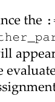
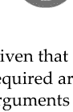

# 6 元编程 – 代码编写自身

我们现在将分析如何开发在最终转换为 BEAM 字节码之前为我们编写代码的代码。这将使我们能够扩展 Elixir，向现有模块注入新代码，甚至编写领域特定语言来简化我们的媒体管道定义。

本章中你将看到的一切之所以可能，是因为 Elixir 提供了在代码转换为字节码之前操作抽象语法树的令人难以置信的工具。让我们直接开始吧！

本章中，我们将涵盖以下内容：

- 什么是抽象语法树以及如何访问它？
- 使用特殊形式 `quote/2` 和 `unquote/1`
- 宏卫生以及调用者和宏上下文
- 应用 `use` 及其 `__using__/1` 函数
- 使用模块属性收集有关调用者模块的信息
- 使用宏创建领域特定语言

## 抽象语法树

你可能已经在其他语言中听说过 **抽象语法树 (ASTs)**。正如名称所示，这些是表示代码语法的树状数据结构。在 Elixir 中，我们称这些表示为 *引用表达式*。

如果我们尝试获取简单表达式的引用表达式，例如单个原子、字符串、整数或浮点数、列表或两个元素的元组，我们会发现它们的引用表示与正常表示相比没有变化。这些元素被称为文字，因为引用它们后我们得到相同的值。请看以下代码：

```
iex> quote do: :"Funky.Atom"
:"Funky.Atom"

iex> quote do: ["a", "b", "c", "z"]
["a", "b", "c", "z"]

iex> quote do: 1.88
1.88

iex> quote do: "really big string but still simple"
"really big string but still simple"

iex> {:elixir, :rocks} == quote do: {:elixir, :rocks}
true
```

引用表达式的树形式是通过嵌套三元素元组创建的，可以在由不仅仅是 Elixir 文字组成的复杂代码片段中看到：

```
iex> quoted_case = quote do
...> case 1 == 2 do
...> true -> "it seems 1 == 2 is true"
...> _ -> IO.puts "1 == 2 isn't true after all"
...> end
...> end
{:case, [],
 [
  {:==, [context: Elixir, import: Kernel], [1, 2]},
  [
   do: [
    {:->, [], [[true], "it seems 1 == 2 is true"]},
    {:->, [],
     [
      [{:_, [], Elixir}],
      {{:., [], [{:__aliases__, [alias: false], [:IO]}, :puts]}, [], ["1 == 2 isn't true after all"]}
     ]}
   ]
  ]
 ]
}
```

在前面的示例中，我们正在获取 case 语句的引用表示。每个三元素元组通常由一个原子（或另一个三元素元组）作为函数名、一个包含元数据的列表和一个参数列表组成。如果元组表示一个变量，则元组的最后一个元素将改为原子。

要评估引用表达式，我们可以使用 Code.eval_quoted/3 函数。如果我们评估之前的 quoted_case 表示，我们将得到一个二元素元组，其中包含评估结果和评估后传递的绑定值（:ok 原子是调用 IO.puts/1 的返回值）：

```
iex> Code.eval_quoted quoted_case
1 == 2 isn't true after all
{:ok, []}
```

我们的引用 case 表达式没有变量，因此我们无法观察绑定是如何工作的。现在让我们看看使用变量 x 的以下引用表达式中的绑定是什么：

```
iex> quoted_case_with_vars = quote do
...>   case x == 2 do
...>     true -> "it seems x == 2"
...>     _ -> IO.puts "x == 2 isn't true after all"
...>   end
...> end
{:case, [],
 [
   {:==, [context: Elixir, import: Kernel], [{:x, [], Elixir}, 2]},
   [
     do: [
       {:->, [], [[true], "it seems x == 2"]},
       {:->, [],
         [
           [{:_, [], Elixir}],
           {{:., [], [{:__aliases__, [alias: false], [:IO]}, :puts]}, [], ["x == 2 isn't true after all"]}
         ]
       }
     ]
   ]
 ]
}
```

如果你将此引用表达式与前一个进行比较，除了我们使用的字符串的最小更改之外，你可以观察到唯一的变化是，在 case 等值比较中，我们不再有 1，而是有一个获取 x 值的引用表示。

然而，如果我们使用显式的 `[x: 3]` 绑定来评估 `quoted_case_with_vars` 表达式，它不会产生预期的结果：

```
iex> Code.eval_quoted quoted_case_with_vars, [x: 3]
warning: variable "x" does not exist and is being expanded to "x()", please use parentheses to remove the ambiguity or change the variable name
nofile:1

** (CompileError) nofile:1: undefined function x/0
(stdlib) lists.erl:1354: :lists.mapfoldl/3
```

我们在这里看到的行为是有意的，其主要原因是为了在以后避免头痛；默认情况下，这些表达式是在单独的上下文中评估的，无法访问外部变量（即使在这种情况下我们传递了 x）。如果我们希望我们的表达式能够访问外部值，例如 x，我们必须用对 `var!/1` 的调用包装 x：

```
iex> quoted_case_with_external_vars = quote do
...> case var!(x) == 2 do
...> true -> "it seems x == 2"
...> _ -> IO.puts "x == 2 isn't true after all"
...> end
...> end
{:case, [],
 [
  {:==, [context: Elixir, import: Kernel],
   [{:var!, [context: Elixir, import: Kernel], [{:x, [], Elixir}]}, 2]},
  [
   do: [
    {:->, [], [[true], "it seems x == 2"]},
    {:->, [],
     [
      [{:_, [], Elixir}],
      {{:., [], [{:__aliases__, [alias: false], [:IO]}, :puts]}, [], ["x == 2 isn't true after all"]}
     ]
    }
   ]
  ]
]}
```

这样，我们的 case 表达式最终可以访问我们在 `Code.eval_quoted/2` 调用上设置的绑定：

```
iex> Code.eval_quoted quoted_case_with_external_vars, [x: 2]
{"it seems x == 2", [x: 2]}
```

前面的示例强调了 Elixir 元编程的一个非常重要的方面：我们生成的最终引用表达式，只有在我们通过 `var!/1` 明确说明的情况下，才能访问其上下文之外的变量。

这种默认情况下无法访问外部上下文的能力称为 *宏卫生*，它是保持事物分离而不泄漏到调用者上下文中的保障。访问（并可能更改）外部上下文的决定应由开发人员充分考虑，这种 *默认分离* 规则有助于保持事物的合理性。

在查看了代码在实际编译为字节码之前的表示之后，我们现在将了解宏的工作原理以及如何利用它们来操作语法树的特定部分。

## 尝试宏

尽管有所有的 *元* 宣传，我们可以将宏视为需要遵守其参数和输出某些限制的普通函数。传递给宏的每个参数首先被转换为其引用表示，而宏返回的值也应为有效的引用表示。这就是为什么你通常会看到宏的最后一个语句是一个 `quote` 块。还值得回想的是，宏作为函数，只能在模块内部定义。

另一个值得提及的方面是宏在编译时之前展开。宏展开是指编译器评估宏代码然后用评估宏的结果替换对宏的调用的过程（请记住宏需要返回有效的引用表达式）。在编译我们的应用程序时，Elixir 编译器在找到宏时就会展开它。此展开过程是递归的，因为宏返回的引用表达式可能仍包含另一个宏的使用。当编译器完成展开所有用户定义的宏后，它仍必须展开随 Elixir 提供的宏，例如 `alias` 和 `def`。其中一些宏位于 `Kernel` 模块中，而其他宏则位于 `Kernel.SpecialForms` 模块中。


如果你需要查看每个展开步骤中发生的情况，可以使用 `Macro.expand_once/2` 函数。如果你想查看将编译为 BEAM 字节码的最终引用表达式，请改用 `Macro.expand/2` 函数。


现在让我们定义一个 Demo 模块，它将包含我们的第一个 simple/1 宏：

```
iex> defmodule Demo do
...>   defmacro simple(param) do
...>     IO.puts "Inside the Demo.simple/1 macro"
...>     IO.inspect param
...>
...>     result = quote do
...>       IO.puts "This will be injected into the caller context"
...>       :os.system_time(:seconds)
...>     end
...>
...>     IO.puts "Demo.simple/1 result"
...>     IO.inspect result
...>
...>     result
...>   end
...> end
{:module, Demo, <<70, 79, ...>>, {:simple, 1}}
```

在前面的 Demo 模块中，我们记录了传递给 simple/1 宏的 param，并在最后在返回之前也记录了宏的结果。我们的宏返回一个由对 IO.puts/1 的调用和对 :os.system_time/1 的第二次调用组成的块。我们将在前面的 Playground.do_something/0 函数中调用它。宏调用将在扩展时立即被给定的代码块替换在 Playground 模块的语法树上。

通过评估 Playground 模块，我们的宏也会在 Demo.simple/1 宏扩展时被评估。这就是为什么在交互式 shell 上定义模块后，我们会立即看到为 param 和最终宏结果变量生成的由 IO.inspect/1 调用产生的输出的原因：

```
iex> defmodule Playground do
...> import Demo
...>
...> def do_something do
...>   IO.puts "Inside the Playground.do_something/0 function"
...>
...>   simple(5 == (25/5))
...> end
...> end
```

```
Inside the Demo.simple/1 macro
{:==, [line: 9], [5, {:/, [line: 9], [25, 5]}]}

Demo.simple/1 result
```

```
{:__block__, [],
[
  {{:., [], [{:__aliases__, [alias: false], [:IO]}, :puts]}, [],
   ["This will be injected into the caller context"]},
  {{:., [], [:os, :system_time]}, [], [:seconds]}
]}

{:module, Playground, <<70, 79, ...>>, {:do_something, 0}}
```

在前面的示例中，我们可以看到传递参数的引用表示以及 simple/1 宏返回的结果。正如我们所预期的那样，param 变量包含 5 == 25/5 的引用表达式，我们的宏的结果由一个代码块组成（请看 __block__ 元组），其中包含两个条目：一个用于 IO.puts/1 调用，另一个用于 :os.system_time/1 调用。

一切看起来都不错，但让我们真正确保这两个引用表达式代表我们期望的代码。为此，我们将使用 `Macro.to_string/1` 函数，它接收一个引用表达式并返回等效的 Elixir 代码：

```
iex> IO.puts Macro.to_string({:==, [line: 9], [5, {:/, [line: 9], [25, 5]}]})
5 == 25 / 5
:ok
```

```
iex> IO.puts Macro.to_string({:__block__, [],
...> [
...>   {{:., [], [{:__aliases__, [alias: false], [:IO]}, :puts]}, [],
...>    ["This will be injected into the caller context"]},
...>   {{:., [], [:os, :system_time]}, [], [:seconds]}
...> ]})
(
  IO.puts("This will be injected into the caller context")
  :os.system_time(:seconds)
)
:ok
```

如我们所见，两个引用表达式都返回了我们期望的 Elixir 代码。我们现在可以在确信世界仍然有意义的情况下继续探索宏的工作原理。


你上面看到的 :ok 原子，每个对应一次 IO.puts Macro.to_string ... 调用，是执行 IO.puts/1 的结果。我们使用它是因为 `Macro.to_string/1` 返回结果 Elixir 代码的漂亮字符串，带缩进和换行符。

现在让我们了解控制我们的宏代码如何访问其所在外部上下文的规则。

## 卫生访问

每当我们处于一个 quote 块内部时，Elixir 会为我们生成该代码块的引用表示。如果在该过程中找到一个 inexisting_var 变量，Elixir 很乐意在代码块的引用表示上返回其引用表示，{:inexisting_var, [], Elixir}。然而，如果我们将此引用表达式注入到调用者模块中，我们会得到一个错误，因为 inexisting_var 在生成的代码将运行的上下文中根本不存在。


即使变量 inexisting_var 在调用者上下文中定义，宏也无法访问它，因为我们没有对 inexisting_var 使用 var!/1 包装器。如果我们尝试编译 Playground 模块，我们会收到一个警告，提示变量 "inexisting_var" 不存在并且正在扩展为 "inexisting_var()"，最后我们会收到一个 CompileError，提示未定义函数 inexisting_var/0。

如果我们在 Demo.simple/1 宏返回的引用表达式上添加一个 IO.puts inexisting_var 调用，我们会在 __block__ 元组中看到它（就在编译失败之前）：

```
# Demo.simple/1 result doing `IO.puts inexisting_var`
{:__block__, [],
[
  {{:., [], [{:__aliases__, [alias: false], [:IO]}, :puts]}, [],
   [{:inexisting_var, [], Demo}]},
  {{:., [], [{:__aliases__, [alias: false], [:IO]}, :puts]}, [],
   ["This will be injected into the caller context"]},
  {{:., [], [:os, :system_time]}, [], [:seconds]}
]}
```

将之前的 __block__ 元组与下一个进行比较，在下一个中我们改为执行 IO.puts var!(inexisting_var)。我们可以看到 var!/1 的使用，因此我们能够在外部上下文中访问 inexisting_var，在本例中是调用者的上下文。这只有在调用者最初确实定义了 inexisting_var 变量时才有效：

```
# Demo.simple/1 result doing `IO.puts var!(inexisting_var)`
{:__block__, [],
[
  {{:., [], [{:__aliases__, [alias: false], [:IO]}, :puts]}, [],
   [{:var!, [context: Demo, import: Kernel], [{:inexisting_var, [], Demo}]}]},
  {{:., [], [{:__aliases__, [alias: false], [:IO]}, :puts]}, [],
   ["This will be injected into the caller context"]},
  {{:., [], [:os, :system_time]}, [], [:seconds]}
]}
```

我们说宏返回的引用表达式在调用者上下文中运行，因为它被注入到调用者代码自身的引用表示中。最终，宏的引用表示与调用者的所有其他代码无法区分，并在同一时间执行。

你宏中位于返回的 quote 块之外的所有语句，都在 Elixir 编译器在代码中找到你的宏被使用并因此扩展它时进行评估。当这些语句运行时，它们在宏代码被评估时运行，因此我们说它们在宏上下文中运行。

如果你考虑我们之前定义的 Demo.simple/1 宏，语句 IO.puts "This will be injected into the caller context" 在调用者上下文中执行，而语句 IO.puts "Inside the Demo.simple/1 macro" 在宏上下文中执行。

即使你在宏返回的引用表达式内部定义一个变量，引用表达式被注入的位置也无法访问它，因为在 Elixir 中宏是卫生的。我们在研究 quote/2 的工作原理时已经看到这一点，这里行为相同：宏 quote 块内部定义或操作的一个变量只有在被包裹在 var!/1 函数调用中时才能影响调用者上下文。

你也可以向 var!/2 函数传递第二个参数，指示给定变量应存在于哪个上下文中。这在你想在宏引用块内部定义一个变量但又不想污染调用者上下文时很有用。请考虑以下模块：

```
iex> defmodule CleanAccess do
...>   defmacro start_counter(counter) do
...>     quote do
...>       var!(counter_var, CleanAccess) = unquote(counter)
...>     end
...>   end
...> 
...>   defmacro get_counter() do
...>     quote do
...>       var!(counter_var, CleanAccess)
...>     end
...>   end
...> 
...>   defmacro multiply_by(number) do
...>     quote do
...>       var!(counter_var, CleanAccess) =
...>       unquote(number)*var!(counter_var, CleanAccess)
...>     end
...>   end
...> end
{:module, CleanAccess, <<70, 79, 82, ...>>, {:multiply_by, 1}}
```

让我们将之前的 CleanAccess 模块导入到一个新的 CleanAccessDemo 模块中：

```
iex> defmodule CleanAccessDemo do
...>   import CleanAccess
...>   def show_it() do
...>     IO.puts "Start with: #{start_counter(3)}"
...>     IO.puts "Counter: #{get_counter()}"
...>     IO.puts "Multiply by 5: #{multiply_by(5)}"
...>     IO.puts "Counter: #{get_counter()}"
...>     IO.puts "Start with: #{start_counter(1)}"
...>     IO.puts "Counter: #{get_counter()}"
...>     IO.puts "Binding on the CleanAccessDemo module: #{inspect(binding(CleanAccessDemo))}"
...>   end
...> end
```

```
iex> CleanAccessDemo.show_it
Start with: 3
Counter: 3
Multiply by 5: 15
Counter: 15
Start with: 1
Counter: 1
Binding on the CleanAccessDemo module: []
:ok
```

```
iex> counter_var
** (CompileError) iex:117: undefined function counter_var/0
```

CleanAccess 模块内部的宏在 CleanAccess 上下文中操作 counter_var，但正如我们所观察到的，counter_var 从未泄漏到调用者上下文。当你创建自己的宏时，请考虑你是否真的需要访问调用者上下文，或者是否能够像我们在这里所做的那样，简单地在定义宏的模块的上下文中定义这些变量。


## 著名的（反）引语

现在让我们研究 `unquote` 的作用，并了解它在 `quote` 和 `unquote` 这对动态组合中的作用。直到现在，我们只在调用者模块上注入了引用的表达式（回想一下由 `Demo.simple/1` 宏注入到 `Playground` 模块的代码块）。

正如你将看到的，`unquote/1` 宏会被广泛使用，几乎在我们使用宏时都会用到。`unquote/1` 宏只能在 `quote` 块内部使用，并允许我们注入在外部作用域中定义变量的值。

让我们继续使用之前的 `Demo` 模块，但这次我们希望 `param` 变量在 `Demo.simple/1` 宏返回的 `quote` 块内部使用：

```elixir
iex> defmodule Demo do
...>   defmacro simple(param) do
...>     IO.puts "Inside the Demo.simple/1 macro"
...>     IO.inspect param
...> 
...>     result = quote do
...>       param_value = unquote(param)
...>       IO.puts "(injected into the caller context) param value is #{param_value}"
...>       :os.system_time(:seconds)
...>     end
...> 
...>     IO.puts "Demo.simple/1 result with unquoted param"
...>     IO.inspect result
...> 
...>     result
...>   end
...> end
{:module, Demo,
<<70, 79, ...>>, {:simple, 1}}
```

如你所见，唯一显著的区别是我们正在 `quote` 块内部为 `param_value` 变量分配未引用的 `param` 值。为了将 `quote` 块转换为其正确引用的表示形式，Elixir 会评估其包含的代码。当它找到 `unquote` 语句时，Elixir 会停止转换为引用格式，并简单地注入 `unquote` 语句内部内容的值。因此，调用 `unquote/1` 的返回值需要是一个有效的引用表达式：

```elixir
iex> defmodule Playground do
...>   import Demo
...>
...> def do_something do
...>   IO.puts "Inside the Playground.do_something/0 function"
...>
...>   simple(5 == (25/5))
...> end
...> end
```

在 Demo.simple/1 宏内部

```
{:=, [line: 8], [5, {:/, [line: 8], [25, 5]}]}
```

带未引用 param 的 Demo.simple/1 结果

```
{:__block__, [],
[
  {:=, [],
    [{:param_value, [], Demo}, {:=, [line: 8], [5, {:/, [line: 8], [25, 5]}]}]},
  {{:., [], [{:__aliases__, [alias: false], [:IO]}, :puts]}, [], [# ...]}
]}
```

如果我们现在再次将宏导入到 Playground 模块，我们可以观察到代码块上的第一个语句正在绑定到一个 param_value 变量，该变量与 Demo.simple/1 通过 param 参数接收到的完全相同的引用值。要查看这一点，请检查 :__block__ 元组的最后一个元素以识别块语句，然后考虑以 := 开头的第一个元组，在该元组中进行绑定操作。请回忆 {:=, [line: 8], [5, {:/, [line: 8], [25, 5]}]} 表达式是 5 == (25/5) 的引用表示形式，该表达式最初是通过 param 宏参数传递的。



请记住，param 参数以其引用表示形式注入，因为这就是宏的工作方式：它们将参数已经作为引用表达式传递。如果我们将 [1, 2, 3, 4, 5, "a big list whose quoted representation is the same"] 作为 param 值传递，它将在生成的引用块上完全按原样注入，因为列表是字面量。

由于 := 元组包含 5 == (25/5) 的引用表示形式，如果我们使用相同的 unquote 方法绑定一个新的 other_param_value 变量，则 other_param_value 赋值会出现一个相同的 := 元组。这意味着 == 比较将被评估两次，一次用于 param_value，另一次用于 other_param_value 赋值：

```elixir
defmodule Demo do
  defmacro simple(param) do
    # ...
    result = quote do
      param_value = unquote(param)
      other_param_value = unquote(param)
      # ...
    end
  end
end
```

此新的绑定将按预期在 Demo.simple/1 宏上生成的引用块中添加另一个绑定语句，但正如我们所说，它也再次注入 == 比较的引用表示形式。这就是事情变得棘手的地方：由于它注入的是比较的引用表示形式，而不是比较的结果（这就是 unquote/1 所做的；它将作为参数传递给它的表达式注入到引用块中），当 Playground 模块调用 do_something/0 时，它将执行相同的比较两次，以得出 25/5 与 5 正比较的结论。你可以在以下片段中准确地观察到这一点，在其中我们可以观察到两个赋值（检查两个 := 元组）以及相应的两个相等性比较（检查两个 := 元组）：

```
# ...
Demo.simple/1 result
{:__block__, [],
[
    {:=, [], # first assignment
      [
        {:param_value, [], Demo},
        {:=, [line: 31], [5, {:/, [line: 31], [25, 5]}]}
      ]},
    {:=, [], # second assignment
      [
        {:other_param_value, [], Demo},
        {:=, [line: 31], [5, {:/, [line: 31], [25, 5]}]}
      ]},
    {{:., [], [{:__aliases__, [alias: false], [:IO]}, :puts]}, [],
# ...
```

我们刚刚考虑的重复执行场景通常是我们不想要的。想象一下，如果被运行两次的表达式具有副作用——糟糕！我们刚刚发射了两艘探测器前往冥王星，而不是我们计划中的一艘。这就是 quote 宏的 bind_quoted 选项发挥作用的地方。与其两次使用 unquote，我们可以绑定（正如名称所示）一个引用值到一个变量，然后可以在 quote 块内部使用该变量：

```elixir
defmodule Demo do
  defmacro simple(param) do
    # ...
    result = quote bind_quoted: [evaluated_param: param] do
      param_value = evaluated_param
      other_param_value = evaluated_param
      IO.puts "(injected into the caller context) param value is #{param_value}"
      :os.system_time(:seconds)
    end
  end
end
```

前面的 quote 块将根据 quote 块开头 bind_quoted 关键字列表中的条目执行 as 多次绑定。在我们的例子中，它将首先在引用块内部将 param 引用值分配给 evaluated_param 变量（请注意第一个 := 元组）：

```
# ...
Demo.simple/1 result
{:__block__, [],
[
  {:=, [], # bind_quoted assignment
    [
      {:evaluated_param, [], Demo},
      {:=, [line: 38], [5, {:/, [line: 38], [25, 5]}]} # param quoted value
    ]},
  {:__block__, [],
    [
      {:=, [], [{:param_value, [], Demo}, {:evaluated_param, [], Demo}]},
      {:=, [], [{:other_param_value, [], Demo}, {:evaluated_param, [], Demo}]},
      {{:., [], [{:__aliases__, [alias: false], [:IO]}, :puts]}, [],
# ...
```

在从 bind_quoted 关键字列表派生的所有绑定之后，引用块开始。然而，这次 param_value 和 other_param_value 赋值都指向 evaluated_param 值，而不是各自使用 5 == 25/5 比较的自己的引用表示形式。请注意，param 引用值仅在初始绑定阶段注入一次。此方法的另一个优点是，你的宏内部的 quote 块不再因所有 unquote/1 调用而杂乱无章。


在带有 bind_quoted 选项的 quote 块内部，unquote/1 的使用默认情况下被禁用。这意味着如果你在此场景中使用 unquote/1 宏，例如在 quote 块内部执行 unquote(x)，它将被扩展为 {:unquote, [], [{:x, [], Elixir}]}, 而不是将 x 的内容注入到当前引用表达式中。

这在你希望 unquote 语句仅在运行时求值时可能很有用（请回忆宏扩展阶段发生在编译时间之前）。


使用你的宏定义一个函数是应用此方法的典型示例。要做到这一点，你首先将 [fun_name: :do_work] 关键字列表作为你宏返回的 quote 块的 bind_quoted 选项的值传递。通过使用 bind_quoted，我们知道 unquote 被禁用，因此它不会立即将我们传递给它的值注入到当前引用表示形式中。这意味着你将能够在宏返回的 quote 块内部像这样定义一个函数：def unquote(fun_name) (), do: "working!"。unquote(fun_name) 将在调用者上下文中求值，在那里 fun_name 变量存在（由于 bind_quoted 的使用）。

你可以将使用 unquote 视为字符串插值的类似操作。当你组合一个字符串时，如果你的字符串有 #{some_var}，组合就会停止，并且 some_var 值会被注入到其位置。当你定义一个由你的宏返回的 quote 块时，无论何时出现 unquote(some_var) 调用，转换为引用表示形式都会暂停，并且 some_var 值会被无任何转换地注入到 quote 块的当前 AST 中。

## 宏——一颗银弹？

在看到你如何轻松地操作代码的引用表示形式，甚至创建代码以毫不费力地为你生成代码之后，考虑在处理新问题或实现新应用程序时使用宏可能具有诱惑性。毕竟，即使是 Elixir 也为其许多自己的构造使用宏，例如 Kernel.is_nil/1 或 Kernel.if/3。

不过，你也应该牢记，宏故意隐藏了代码的一些复杂性，因此可能会阻碍对其全部范围的理解。而且，正如你所见，使用宏时有一些重要的细微差别你应该注意。编写代码时的经验法则是，你应该优先考虑可读性而不是 cleverness。因此，你应该始终问自己，是否可以通过不使用宏，使用语言的其他构造来实现同样的目的，这些构造可能会增加代码的显式性。


一般来说，由宏生成的代码调试在很多情况下更棘手。而且，正如 Kernighan 所说，*调试的难度是最初编写代码的两倍*，因此你应该绝对谨慎使用宏。

尽管宏有造成混乱的潜力，但在像 Elixir 这样的现代语言中，宏仍有其用武之地，并且能让你解决否则会非常棘手或极其繁琐的问题。许多 Elixir 库使用宏来降低在其他项目中使用它们的摩擦。例如，通过导入 `Ecto` 库的 `Ecto.Query` 模块（我们将在下一章讨论这个问题），你可以创建如下查询：`query = from m in Media, where: m.file_size > 500, select: m`。这是一个有效的 Elixir 表达式，说明了宏能为你的代码带来的表达力。

一条非常明智的拉丁谚语可以适用于宏，正如它也可以适用于生活：*abusus non tollit usum*，通常被翻译为 *滥用并不会消除其用途*。尽管宏可能导致不必要的复杂性，但它们是方便的工具，在正确使用时可以让你写出更好的代码。而且，即使有时宏没有被正确使用，它们也可能是解决你问题的恰好所需。

关于元编程，取得正确的平衡是关键。现在让我们应用我们所学的内容来创建一个宏，该宏将允许我们测量函数执行所需的时间。

## 扩展模块

在理解了宏的工作原理之后，我们现在将应用刚刚获得的见解，看看如何创建向调用者模块添加功能的宏。我们此处的目标是创建一个宏，`ElixirDrip.Chronometer.defchrono/2`，它等同于现有的 `def/2` 宏，但额外具有记录函数调用花费时间的特性。

让我们先看看最终结果。我们希望能够定义类似 `defchrono fun_name(arg1, arg2), do: ...` 的函数，并且当我们调用 `fun_name/2` 函数时，它会告诉我们 `Took 123 µs to run SomeModule.fun_name/2`。下面的 `MeasuredModule` 将是我们的研究对象：

```
$ cat examples/measured_module.exs
defmodule MeasuredModule do
  import ElixirDrip.Chronometer

  defchrono_vn slow_times(x, y) do
    Process.sleep(2000)
    x * y
  end
end
```

在之前的片段中，我们为宏名称使用 _vn 后缀，因为我们正在开发的 `defchrono` 宏将有多个迭代，从 v0 开始到 v5 结束。每次引入新迭代时，先前的 `MeasuredModule` 将被更新以使用新的 `defchrono` 宏版本。

我们 `defchrono` 宏的第一个迭代的唯一目的是分析传递给它的参数。由于 `function_definition` 和 `body` 参数已经被引用（就像其他任何宏参数一样），我们只需使用 `unquote/1` 将它们的值注入宏返回的 `quote` 块中即可：

```elixir
$ cat apps/elixir_drip/lib/elixir_drip/chronometer.ex
defmodule ElixirDrip.Chronometer do

  defmacro defchrono_v0(function_definition, do: body) do
    IO.puts "On defchrono_v0, function definition:"
    IO.inspect function_definition
    IO.puts "Body:"
    IO.inspect body

    quote do
      def unquote(function_definition) do
        unquote(body)
      end
    end
  end
end
```

让我们在 IEx shell 中尝试一下，以便观察宏参数的值：

```
iex> c "./examples/measured_module.exs"
On defchrono_v0, function definition:
{:slow_times, [line: 4], [{:x, [line: 4], nil}, {:y, [line: 4], nil}]}
Body:
{:__block__, [],
 [
  {{:., [line: 5], [{:__aliases__, [line: 5], [:Process]}, :sleep]},
   [line: 5],
   [2000]},
  {:*, [line: 6], [{:x, [line: 6], nil}, {:y, [line: 6], nil}]}
 ]}
[MeasuredModule]

iex> MeasuredModule.slow_times(2, 3)
6
```

根据我们在这里看到的内容，函数定义是一个普通的三个元素元组，其中最后一个元素是包含函数参数的列表，而函数体则由一个 __block__ 元组组成，其最后一个元素是包含两个语句的引用表示的列表，所以这里也没有什么新东西。

我们能够调用 slow_times/2 函数是因为我们的宏返回的本身是一个 def 宏，其函数定义和函数体与我们作为参数传递的相同。现在的下一步是实际测量函数执行所需的时间。为此，我们将使用 Erlang 函数 :timer.tc/1，它接收一个 lambda 函数并执行它，返回花费的时间（以微秒为单位）和 lambda 结果。

我们可以在宏返回的引用块中直接执行此操作，但最好在 Chronometer 模块中单独创建一个函数来执行。这样更容易测试它，并且我们减少了注入到调用者上下文的代码。让我们创建 Chronometer.run_and_measure/1 函数：

```
$ cat apps/elixir_drip/lib/elixir_drip/chronometer.ex
defmodule ElixirDrip.Chronometer do
  # ...
  def run_and_measure(to_measure) do
    {time_us, result} = :timer.tc(to_measure)
    IO.puts "Run in #{time_us} µs"

    result
  end
end
```

这样，我们甚至无需使用任何宏就可以使用此函数。如果我们调用 result = Chronometer.run_and_measure(fn -> Process.sleep(1000) end)，我们将看到 Run in 1000961 µs，并且 result 将获得 Process.sleep/1 调用返回的 :ok 原子。

现在让我们在下一个宏迭代 defchrono_v1 上使用 run_and_measure/1：

```
$ cat apps/elixir_drip/lib/elixir_drip/chronometer.ex
defmodule ElixirDrip.Chronometer do
  # ...
  defmacro defchrono_v1(function_definition, do: body) do
    IO.puts "On defchrono_v1, function definition:"
    IO.inspect function_definition

    quote do
      def unquote(function_definition) do
        Chronometer.run_and_measure(fn -> unquote(body) end)
      end
    end
  end
end
```

如果我们现在调用 MeasuredModule.slow_times/2 函数，我们知道它需要两秒。但如果我们使用宏来测量多个函数，仅通过查看日志就很难弄清楚哪个测量时间对应哪个函数：

```
iex> c "./examples/measured_module.exs"
On defchrono_v1, function definition:
{:slow_times, [line: 4], [{:x, [line: 4], nil}, {:y, [line: 4], nil}]}
[MeasuredModule]

iex> MeasuredModule.slow_times(4, 5)
Run in 2000621 µs
20
```

为了解决之前的问题，让我们创建一个 v2 宏，除了实际花费的时间外，还记录函数名称。查看前一个代码块中的 IEx 输出，你可以看到在编译 MeasuredModule 时，我们打印了函数定义。这个函数定义是一个预期的三元素元组，其中函数名位于第一个元素，函数参数列表位于最后一个元素。我们可以对这个元组进行模式匹配以提取函数名和参数，但已经有 Macro.decompose_call/1 函数可以为我们完成此操作。下面是 defchrono_v2 宏现在的样子：

```
$ cat apps/elixir_drip/lib/elixir_drip/chronometer.ex
defmodule ElixirDrip.Chronometer do
  # ...
  defmacro defchrono_v2(function_definition, do: body) do
    {function, args} = Macro.decompose_call(function_definition)
    IO.puts "On defchrono_v2, function definition:"
    IO.inspect function_definition
    IO.puts "Function"
    IO.inspect function
    IO.puts "Arguments"
    IO.inspect args

    quote do
      def unquote(function_definition) do
        Chronometer.run_and_measure(unquote(function), fn ->
          unquote(body) end)
      end
    end
  end
end
```

对于之前的迭代，我们创建了一个 run_and_measure/2 函数，除了要运行的 lambda 之外，它还接收函数名作为参数：

```
$ cat apps/elixir_drip/lib/elixir_drip/chronometer.ex
defmodule ElixirDrip.Chronometer do
  # ...
  def run_and_measure(to_run, to_measure) do
    {time_µs, result} = :timer.tc(to_measure)
    IO.puts "Took #{time_µs} µs to run #{to_run}"

    result
  end
end
```

通过在 MeasuredModule 上使用 defchrono_v2 宏，我们现在得到了更漂亮的结果。也可以观察到应用 Macro.decompose_call/1 函数的结果：

```
iex> c "./examples/measured_module.exs"
On defchrono_v2, function definition:
{:slow_times, [line: 4], [{:x, [line: 4], nil}, {:y, [line: 4], nil}]}
Function
:slow_times
Arguments
[{:x, [line: 4], nil}, {:y, [line: 4], nil}]
[MeasuredModule]

iex> MeasuredModule.slow_times(6, 7)
Took 2000960 µs to run slow_times
42
```

但如果我们有许多 slow_times 函数，具有不同的元数或它们位于不同的模块中呢？我们宏的当前输出只显示函数名，因此如果有多个 slow_times 函数，仅通过查看宏输出就无法知道哪个函数已运行。让我们创建一个 Chronometer.pretty_signature/3 函数，它接收模块、函数名和参数列表，并返回格式为 Module.function/arity 的字符串：

```
$ cat apps/elixir_drip/lib/elixir_drip/chronometer.ex
defmodule ElixirDrip.Chronometer do
  # ...
  def pretty_signature(module, function, args) when is_list(args) do
    module = module
              |> Atom.to_string()
              |> String.replace_leading("Elixir.", "")
```

"#{module}.#{function}/#{length(args)}"
end
end

让我们在 v3 宏迭代中使用 pretty_signature/3 函数。这次，我们打印由我们的 quote 块生成的 ast_to_return，以查看传递给创建函数全名的 pretty_signature/3 函数的值：

```
$ cat apps/elixir_drip/lib/elixir_drip/chronometer.ex
defmodule ElixirDrip.Chronometer do
  # ...
  defmacro defchrono_v3(function_definition, do: body) do
    {function, args} = Macro.decompose_call(function_definition)
    IO.puts "On defchrono_v3"
    IO.inspect function_definition
    IO.puts "Function"
    IO.inspect function
    IO.puts "Arguments"
    IO.inspect args

    ast_to_return = quote do
      def unquote(function_definition) do
        signature =
          Chronometer.pretty_signature(__MODULE__, unquote(function),
          unquote(args))

        Chronometer.run_and_measure(signature, fn -> unquote(body) end)
      end
    end

    IO.puts "Returning"
    ast_to_return
    |> Macro.to_string()
    |> IO.puts()

    ast_to_return
  end
end
```

如果我们现在编译 MeasuredModule 并再次运行其 slow_times/2 函数，我们对被测量的函数没有任何疑问：

```
iex> c "./examples/measured_module.exs"
On defchrono_v3
{:slow_times, [line: 4], [{:x, [line: 4], nil}, {:y, [line: 4], nil}]}
Function
:slow_times
Arguments
[{:x, [line: 4], nil}, {:y, [line: 4], nil}]
Returning
def(slow_times(x, y)) do
  signature = Chronometer.pretty_signature(__MODULE__, :slow_times, [x, y])
  Chronometer.run_and_measure(signature, fn ->
    Process.sleep(2000)
    x * y
  end)
end
[MeasuredModule]
```

```
iex> MeasuredModule.slow_times(8, 9)
Took 2001016 µs to run MeasuredModule.slow_times/2
72
```

你可能已经注意到，我们对传递给 pretty_signature/3 函数的 function 和 args 值调用了 unquote/1。相比之下，我们没有对用于获取被测量函数模块的 __MODULE__/0 调用执行此操作。这是有道理的，因为 __MODULE__/0 实际上是一个宏，我们希望它在调用者上下文中展开。这就是为什么我们在 defchrono_v3 宏返回的 AST 的文本表示中看到 __MODULE__ 表达式的原因。如果我们改为使用 pretty_signature(unquote(__MODULE__), ..., ...)，__MODULE__ 表达式将在宏上下文中被求值，导致 ElixirDrip.Chronometer。

v3 迭代产生我们期望的结果，一切看起来都很好。现在让我们尝试将我们的宏应用于定义了默认参数的 slow_square/1 函数：

```
$ cat examples/measured_module.exs
defmodule MeasuredModule do
  import ElixirDrip.Chronometer
  # ...
  defchrono_v3 slow_square(x \\ 3) do
    Process.sleep(2000)
    x * x
  end
end
```

从这段代码可以看出，如果我们再次编译 MeasuredModule，现在会收到一个错误，提示没有 \\/2 函数：

```
iex> c "./examples/measured_module.exs"
On defchrono_v3
{:slow_square, [line: 4], [{:\\, [line: 4], [{:x, [line: 4], nil}, 3]}]}
Function
:slow_square
Arguments
[{:\\, [line: 4], [{:x, [line: 4], nil}, 3]}]
Returning
def(slow_square(x \\ 3)) do
  signature = Chronometer.pretty_signature(__MODULE__, :slow_square,
    [x \\ 3])
  Chronometer.run_and_measure(signature, fn ->
    Process.sleep(2000)
    x * x
  end)
end
```

```
== Compilation error in file examples/measured_module.exs ==
** (CompileError) examples/measured_module.exs:4: undefined function \\/2
  (stdlib) lists.erl:1338: :lists.foreach/2
  (stdlib) erl_eval.erl:670: :erl_eval.do_apply/6
**
```

为什么编译器会抱怨奇怪的 \\/2 函数？由于我们使用了默认参数，args 值仍然是一个列表，但现在包含一个单个 :\\ 元组，其参数（元组的第三个元素）是 x 变量和 3 默认值。这完全合理，我们实际上可以使用老式的 quote 来重现它：

```
iex> quote do: x \\ 3
{:\\, [], [{:x, [], Elixir}, 3]}

iex> quote do: [x, y]
[{:x, [], Elixir}, {:y, [], Elixir}]
```

因为我们对将传递给 pretty_signature/3 函数的 args 值应用了 unquote/1，所以我们将 [x \\ 3] 的引用表示注入到 Chronometer.pretty_signature(...) 语句的第三个参数中。当编译器尝试编译此表达式时，它会评估 x \\ 3 部分并中断，因为没有 \\/2 函数。

我们现在知道问题所在了。让我们通过在宏上下文中直接计算 arity 并将其直接传递给更新后的 pretty_signature/3 函数来修复它，该函数现在接收 arity 值而不是 args 列表作为最后一个参数：

```
$ cat apps/elixir_drip/lib/elixir_drip/chronometer.ex
defmodule ElixirDrip.Chronometer do
  # ...
  defmacro defchrono_v4(function_definition, do: body) do
    {function, args} = Macro.decompose_call(function_definition)
    arity = length(args)
    IO.puts "On defchrono_v4"
    IO.inspect function_definition
```
```elixir
IO.puts "Function"
IO.inspect function
IO.puts "Arguments"
IO.inspect args

ast_to_return = quote do
  def unquote(function_definition) do
    signature =
      Chronometer.pretty_signature(__MODULE__, unquote(function),
      unquote(arity))

    Chronometer.run_and_measure(signature, fn -> unquote(body) end)
  end
end

IO.puts "Returning"
ast_to_return
|> Macro.to_string()
|> IO.puts()

ast_to_return
end

def pretty_signature(module, function, arity) do
  module = module
    |> Atom.to_string()
    |> String.replace_leading("Elixir.", "")

  "#{module}.#{function}/#{arity}"
end
end
```

即使使用默认参数，它现在也能工作，因为我们在 advance 计算了 arity 值：

```
```elixir
iex> c "./examples/measured_module.exs"
On defchrono_v4
{:slow_square, [line: 4], [{:\\, [line: 4], [{:x, [line: 4], nil}, 3]}]}
Function
:slow_square
Arguments
[{:\\, [line: 4], [{:x, [line: 4], nil}, 3]}]
Returning
def(slow_square(x \\ 3)) do
  signature = Chronometer.pretty_signature(__MODULE__, :slow_square, 1)
  Chronometer.run_and_measure(signature, fn ->
    Process.sleep(2000)
```
```
    x * x
    end)
end
[MeasuredModule]

iex> MeasuredModule.slow_square()
Took 2000981 µs to run MeasuredModule.slow_square/1
9

iex> MeasuredModule.slow_square(5)
Took 2000324 µs to run MeasuredModule.slow_square/1
25
```

这提供了一个在使用宏时应遵循的宝贵教训。在宏上下文中尽可能多地完成工作，以将尽可能小的代码块注入调用者上下文。并且当你的宏接收参数时，尝试思考这些参数可能被传递的每一种方式，以应对所有边缘情况。使用你宏的人可能不如你精通元编程，而使用宏产生的错误有时是晦涩的，与我们从普通 Elixir 中期望并欣赏的详细错误信息形成对比。这就是为什么你在使用宏时应加倍谨慎的原因之一。

我们的 defchrono_v4 宏现在按预期工作。让我们再进一步，使用 quote 块上的 bind_quoted 选项来实现这一点。这是我们的 defchrono 宏中最棘手的部分，因为宏被评估的时间点不同。

在此次新的宏迭代中，我们将首次使用 Macro.escape/1 函数。让我们稍作 digression 来了解它是如何工作的。你可以将此函数视为 quote/1 宏的表亲，因为它也返回一个引用表达式。然而，它并不是总是返回接收到的代码的引用表示，而是先评估接收到的代码，然后再返回其引用表示。查看以下片段以说明这种差异：

```
iex> a = %{this: "is", a: "map"}
%{a: "map", this: "is"}

iex> quoted_a = quote do: a
{:a, [], Elixir}

iex> escaped_a = Macro.escape a
{:%{}, [], [a: "map", this: "is"]}
```

我们现在将分析 defchrono_v5 宏如何与 bind_quoted 选项一起工作。正如我们已经看到的，bind_quoted 选项让你可以在 quote 块上访问由它定义变量，因为它为我们定义了与 bind_quoted 关键字列表中条目一样多的赋值。其使用还默认禁用了 unquote/1，因此那些 unquote/1 调用（针对 function_definition、function、arity 和 body）将以其 AST 形式出现在宏返回的引用表示上：

```
```elixir
$ cat apps/elixir_drip/lib/elixir_drip/chronometer.ex
defmodule ElixirDrip.Chronometer do
  # ...
  defmacro defchrono_v5(function_definition, do: body) do
    {function, args} = Macro.decompose_call(function_definition)
    arity = length(args)
    IO.puts "On defchrono_v5"
    IO.inspect function_definition
    IO.puts "Escaped function_definition"
    IO.inspect Macro.escape(function_definition)
    IO.puts "Function"
    IO.inspect function
    IO.puts "Arguments"
    IO.inspect args

    ast_to_return = quote bind_quoted: [
      function_definition: Macro.escape(function_definition),
      body: Macro.escape(body),
      function: function,
      arity: arity
    ] do
      def unquote(function_definition) do
        signature =
          Chronometer.pretty_signature(__MODULE__, unquote(function),
          unquote(arity))

        Chronometer.run_and_measure(signature, fn -> unquote(body) end)
      end
    end

    IO.puts "Returning"
    ast_to_return
    |> Macro.to_string()
    |> IO.puts()

    ast_to_return
  end
end
```


由于 unquote/1 调用现在被禁用，它们将被注入到调用者上下文中，其求值将被推迟，而不是在编译时求值。当它们最终被求值时，预计每个被反引用的变量都已包含以其引用形式存在的代码，准备好被注入到最终的 AST 中。这就是我们对 function_definition 和 body 参数使用 Macro.escape/1 的原因，根据定义，它们已经是引用的（如果你还记得的话，两者都是宏参数）。

这就是使用 defchrono_v5 宏编译 MeasuredModule 时我们看到的内容：

```
iex> c "./examples/measured_module.exs"
On defchrono_v5
{:slow_square, [line: 4], [{:\\, [line: 4], [{:x, [line: 4], nil}, 3]}]}
Escaped function_definition
{:(), []},
[
  :slow_square,
  [line: 4],
  [{:{}, [], [:\\\, [line: 4], [{:{}, [], [:x, [line: 4], nil]}, 3]]}]
]
Function
:slow_square
Arguments
[{:\\, [line: 4], [{:x, [line: 4], nil}, 3]}]
Returning
(
function_definition = {:slow_square, [line: 4], [{:\\, [line: 4],
  [{:x, [line: 4], nil}, 3]}]}
body = {:__block__, [], [{:., [line: 5], [{:__aliases__, [line: 5],
  [:Process]}, :sleep], [2000]}, {:*, [line: 6], [{:x,
  [line: 6], nil}, {:x, [line: 6], nil}]}]}
function = :slow_square
arity = 1

def(unquote(function_definition)) do
  signature = Chronometer.pretty_signature(__MODULE__,
    unquote(function), unquote(arity))
  Chronometer.run_and_measure(signature, fn -> unquote(body) end)
end
)
[MeasuredModule]

iex> MeasuredModule.slow_square(9)
Took 2009285 µs to run MeasuredModule.slow_square/1
81
```

注意我们在 def/2 调用之前注入到调用者模块中的四个赋值，每个 bind_quoted 变量一个。因为我们在通过 bind_quoted 选项将其注入到 quote 块之前对 function_definition 进行了转义，所以我们可以在 function_definition 赋值上看到其预期的引用表示：

```
# ...
Returning
(
    function_definition = {:slow_square, [line: 4], [{:\\, [line: 4], [{:x, [line: 4], nil}, 3]}]}
    # ...
```

如果我们忘记转义 function_definition 变量，我们将看到以下赋值（在因 slow_square/1 函数未定义而导致编译错误之前）：

```
# ...
Returning
(
    function_definition = slow_square(x \\ 3)
    # ...

== Compilation error in file examples/measured_module.exs ==
** (CompileError) examples/measured_module.exs:4: undefined function
slow_square/1
    (elixir_drip) expanding macro: ElixirDrip.Chronometer.defchrono_v5/2
    examples/measured_module.exs:4: MeasuredModule (module)
** (CompileError) compile error
    (iex) lib/iex/helpers.ex:183: IEx.Helpers.c/2
```

这个错误完全合理，因为如果不转义 function_definition 变量，该表达式将作为普通表达式而不是引用表达式到达调用者模块，编译器会尝试像往常一样对其求值。由于此时不存在 slow_square/1 函数，它会使用我们刚刚看到的错误停止编译。

你还可以看到我们对 function_definition 和 body 变量都使用了 Macro.escape/1，但没有对 function 和 arity 变量使用。这是因为后两个变量都是字面量，因为它们始终是一个原子和一个整数。由于无论是否被引用，它们始终以相同的方式表示，我们决定不应用 Macro.escape/1 函数。

现在让我们专注于 `defchrono_v5` 宏生成的代码。我们将创建一个 `MeasuredModuleExpanded`，它*手动*完成宏自动为我们完成的工作。如你所见，我们使用有效的引用表示定义了 `function_definition` 和 `body` 变量（每个元组的元数据部分被设置为 `[]` 以减少噪音）：

```
$ cat examples/measured_module_expanded.exs
defmodule MeasuredModuleExpanded do
  alias ElixirDrip.Chronometer

  function_definition = {:slow_square, [], [{:\\, [], [{:x, [], nil}, 3]}]}
  body = {:__block__, [], [{:., [], [{:__aliases__, [], [:Process]}, :sleep], [2000]}, {:*, [], [{:x, [], nil}, {:x, [], nil}]}]}
  function = :slow_square
  arity = 1

  def(unquote(function_definition)) do
    signature =
      Chronometer.pretty_signature(__MODULE__, unquote(function), unquote(arity))
    Chronometer.run_and_measure(signature, fn -> unquote(body) end)
  end
end
```

你可能会觉得奇怪，看到几个没有封闭 `quote` 块的 `unquote/1` 调用，鉴于我们之前说过 `unquote/1` 宏只能在 `quote` 块内部使用。但如果你仔细观察，你会看到两个隐藏的 quote 块。

我们使用 `def/2` 宏像往常一样定义函数。由于它是一个宏，其参数始终通过 `quote/1` 转换为其引用表示。因此，我们能够在 `def/2` 宏的第一个和第二个参数内部执行 `unquote(function_definition)` 和 `unquote(function|arity|body)`，分别是因为这些 `unquote/1` 调用发生在每个 `def/2` 宏参数的 `quote` 块内部。

编译 `MeasuredModuleExpanded` 后，我们能够调用*手动*定义的 `slow_square/1` 函数：

```
iex> c "./examples/measured_module_expanded.exs"
[MeasuredModuleExpanded]

iex> MeasuredModuleExpanded.slow_square 5
Took 2000906 µs to run MeasuredModuleExpanded.slow_square/1
25
```

```
iex> MeasuredModuleExpanded.slow_square
Took 2000317 µs to run MeasuredModuleExpanded.slow_square/1
9
```

到目前为止我们涵盖了很多新的概念和技术，一开始可能会让人望而生畏。但请放心，无论我们对宏做什么，唯一发生的“魔法”就是我们将代码注入到调用者模块中。注入的代码需要采用特定的引用格式，仅此而已。

## 使用 use 和 __using__/1 宏

我们的目标现在是选择用于计时函数的时间单位。为此我们将使用 use 宏，你可能已经多次看到过它（我们之前实现的 CacheWorker 模块使用了 GenServer）。我们现在不再导入 ElixirDrip.Chronometer 模块，而是使用它：

```
$ cat examples/measured_module.exs
defmodule MeasuredModule do
  use ElixirDrip.Chronometer, unit: :secs

  defchrono slow_times(x, y) do
    Process.sleep(2000)
    x * y
  end

  defchrono slow_square(x \\ 3) do
    Process.sleep(2000)
    x * x
  end
end
```

当编译器在 MeasuredModule 上找到 use 语句时，它将运行 ElixirDrip.Chronometer 模块的 __using__/1 宏。你会经常看到这种策略，因为它为被使用的模块提供了一种标准调用方式，并且大多数时候会将所需内容注入到调用者模块中。use 的另一个非常有用的特性是它允许我们向被调用的 __using__/1 宏传递参数。在前面的示例中，我们传递了一个包含单个 :unit 条目的关键字列表。

让我们分析 Chronometer.__using__/1 宏为我们做了什么。鉴于我们将 [unit: :secs] 关键字列表传递给宏（请注意 use Chronometer, unit: :secs 语句），我们能够将 :secs 原子存储在 time_unit 变量上。由于 __using__/1 是一个宏，它需要遵守所有宏规则；即，它需要返回一个引用表达式。

在注入到调用者模块的引用块中，我们导入 ElixirDrip.Chronometer 模块，然后注册一个 @time_unit 模块属性来存储所选的时间单位。请注意，如果在 use 语句中未作为 :unit 传递时间单位，@time_unit 将为 nil：

```
$ cat apps/elixir_drip/lib/elixir_drip/chronometer.ex
defmodule ElixirDrip.Chronometer do
  # ...
  defmacro __using__(options) do
    time_unit = options[:unit]

    quote do
      import unquote(__MODULE__)

      Module.register_attribute(__MODULE__, :time_unit, [])
      @time_unit unquote(time_unit)
    end
  end

  defmacro defchrono(function_definition, do: body) do
    {function, args} = Macro.decompose_call(function_definition)
    arity = length(args)

    quote bind_quoted: [
      function_definition: Macro.escape(function_definition),
      body: Macro.escape(body),
      function: function,
      arity: arity
    ] do
      def unquote(function_definition) do
        signature =
          pretty_signature(__MODULE__, unquote(function),
            unquote(arity))

        run_and_measure(@time_unit, signature, fn -> unquote(body) end)
      end
    end
    # ...
  end
end
```


我们更改 defchrono/2 宏的唯一方式（除了清理我们之前拥有的那些 debug IO.puts/1 调用之外）是调用一个新的 run_and_measure/3 函数，该函数还接收要使用的时间单位。然后我们将 @time_unit 值传递给新的 run_and_measure/3 实现，如下所示：

```
$ cat apps/elixir_drip/lib/elixir_drip/chronometer.ex
defmodule ElixirDrip.Chronometer do
  # ...
  def run_and_measure(time_unit, to_run, to_measure) do
    {time_µs, result} = :timer.tc(to_measure)

    {units, measured_time} = convert_time(time_unit, time_µs)
    IO.puts "Took #{measured_time} #{units} to run #{to_run}"

    result
  end

  defp convert_time(:hrs, time), do: {"hrs", time/(1_000_000*60*60)}
  defp convert_time(:mins, time), do: {"mins", time/(1_000_000*60)}
  defp convert_time(:secs, time), do: {"secs", time/1_000_000}
  defp convert_time(:millisecs, time), do: {"ms", time/1000}
  defp convert_time(:microsecs, time), do: {"µs", time}
  defp convert_time(_, time), do: {"µs", time}
end
```

通过 use 机制传递时间单位，我们能够使用多种单位测量 MeasuredModule 函数调用花费的时间。如果一开始没有将 :unit 条目作为 use 参数传递，@time_unit 将作为 nil 传递给 run_and_measure/3 函数，我们将默认以微秒显示时间（请注意最后的 catch-all convert_time/2 函数）：

```
iex> c "./examples/measured_module.exs"
[MeasuredModule]

iex> MeasuredModule.slow_square
Took 2.001091 secs to run MeasuredModule.slow_square/1
9

iex> MeasuredModule.slow_times(9, 34)
Took 2.001472 secs to run MeasuredModule.slow_times/2
306
```

正如你现在可能已经猜到的，use 宏的重要性至关重要。无论你看哪里，无论是 Elixir 本身还是许多第三方库，你都会发现 use 宏是进入其他模块的通用入口。鉴于其普遍性，它可能被视为向调用者模块注入代码的标准方式。

然而，如果你只想在调用者模块上定义一些新函数，`import/1` 宏已经足够了。

请记住，调用 `import ElixirDrip.Chronometer` 的模块将能够调用 `Chronometer` 模块中定义的所有公共宏和函数，而无需首先指定模块。你甚至可以认为，为了达到与之前 `use` 示例相同的效果，我们本可以更改 `defchrono/2` 宏，使其除了函数定义和被测函数的主体之外，还接收 `time_unit` 作为参数。考虑以下宏，它接收 `time_unit` 参数且不改变其他任何内容：

```
$ cat apps/elixir_drip/lib/elixir_drip/chronometer.ex
defmodule ElixirDrip.Chronometer do
  # ...
  defmacro defchrono_with_units(time_unit, function_definition,
  do: body) do
    {function, args} = Macro.decompose_call(function_definition)
    arity = length(args)

    quote bind_quoted: [
      function_definition: Macro.escape(function_definition),
      body: Macro.escape(body),
      function: function,
      arity: arity,
      time_unit: time_unit
    ] do
      def unquote(function_definition) do
        signature =
          pretty_signature(__MODULE__, unquote(function),
          unquote(arity))

        run_and_measure(unquote(time_unit), signature, fn ->
          unquote(body) end)
      end
    end
  end
end
```

通过使用 `defchrono_with_units/3` 宏，我们就不需要 `use` 机制，因为我们根本不需要注册模块属性，而 `import` 构造对于我们的需求来说已经足够了：

```
iex> defmodule SlowMath do
...> import ElixirDrip.Chronometer
...> defchrono_with_units :mins, slow_sum(x, y) do
```

```
...> Process.sleep(1500)
... > IO.puts("slow sum: #{x + y}")
... > x+y
... > end
... > end
```

```
{:module, SlowMath,
<<70, 79, 82, 49, 0, 0, 6, 248, 66, 69, 65, 77, 65, 116, 85, 56, 0,
0, 1, 37,
0, 0, 0, 27, 8, 69, 108, 105, 120, 105, 114, 46, 90, 8, 95, 95,
105, 110,
102, 111, 95, 95, 9, 102, 117, 110, 99, ...>>, {:slow_sum, 2}}
```

```
iex> SlowMath.slow_sum(33, 44)
slow sum: 77
Took 0.02501955 mins to run SlowMath.slow_sum/2
77
```

在我们之前的宏研究中，我们首先直接将 Chronometer 模块导入到 MeasuredModule 中，而在最后一次迭代中，我们借助 __using__/1 宏注入了 import Chronometer 语句。与公共函数的工作方式不同，宏在你明确表示想要使用它们之前无法使用。除了 import/1 宏之外，你还可以使用 require/2 宏来访问模块的所有公共宏。然而，这种方法仍然要求我们为每个宏调用加上相应的模块前缀。如果我们在示例中使用 require 而不是 import，我们就必须使用 ElixirDrip.Chronometer.defchrono/2 来定义所有 MeasuredModule 函数调用。

这也是原因所在，即使执行了 require Logger，你仍然需要为 debug/1 宏调用加上 Logger 前缀：

```
iex> Logger.debug "hi there"
** (CompileError) iex:2: you must require Logger before invoking the macro Logger.debug/1
(elixir) src/elixir_dispatch.erl:97:
:elixir_dispatch.dispatch_require/6
iex> require Logger
Logger
iex> debug "still problematic"
** (CompileError) iex:3: undefined function debug/1

iex> Logger.debug "finally working"
08:28:53.657 [debug] finally working
:ok
```

我们现在将继续我们进入宏世界的旅程。在下一个站点，我们将有机会应用到目前为止学到的知识，并创建一个领域特定语言来帮助我们定义 GenStage Pipelines。让我们开始吧！

## 创建领域特定语言

你可能还记得我们使用 GenStage 实现上传和下载管道的那一章。这使我们能够定义每个步骤的角色，而 GenStage 行为将处理步骤之间的订阅和消息传递逻辑，确保没有步骤会被太多事件阻塞。

我们现在想要在之前取得的成果上改进，通过简化管道和步骤的定义。为了实现这一点，我们将创建我们自己的领域特定语言（DSL），借助一些有趣的宏工具来帮助定义基于 GenStage 的管道。这将使我们能够从管道定义中移除样板代码并提高其表达力。


鉴于使用宏时我们编写的代码将为我们生成代码，因此在开始时，每当你更改代码生成逻辑时，检查最终生成的代码是一个不错的做法。请记住，Macro.to_string/1 会给出任何引号表达式的漂亮字符串表示，包括你从 __using__/1 宏返回的 AST。

让我们先看看最终结果，这样我们就知道目标是什么。从我们希望管道定义如何实现的草案开始，可以更清晰地了解我们需要实现的内容：

```
$ cat apps/elixir_drip/lib/elixir_drip/storage/supervisors/
streamlined_upload_pipeline.ex
defmodule ElixirDrip.Storage.Supervisors.Upload.StreamlinedPipeline do
  alias ElixirDrip.Pipeliners
  alias ElixirDrip.Storage.Pipeline.{
    Starter,
    Encryption,
    RemoteStorage,
    Notifier
  }

  use Pipeliner,
    name: :upload_pipeline, min_demand: 1, max_demand: 10, count: 1

  start Starter, args: [:upload]
```

```
step RemoteStorage
step Encryption
finish Notifier
end
```

在这个简化的上传管道中，我们设置了默认的 `:min_demand`、`:max_demand` 和 `:count` 选项，如果它们没有显式覆盖，这些选项将被每个管道步骤尊重。可选地，对于每个步骤，我们可以传递参数，这些参数将用于初始化 GenStage 进程的状态。我们在 Starter 阶段正是这样做的，以指示它应从哪个队列获取上传任务以创建并发出相应的事件。其他步骤根本不需要任何初始化参数。

现在回到 ElixirDrip.Storage.Supervisors.Upload.Pipeline 并将我们的简化版本与原始上传管道进行比较。这个版本可以说更清晰，展示了阶段的顺序，而没有订阅选项的额外语句。正如我们稍后会看到的，订阅选项是从管道阶段的相对顺序推断出来的。

我们的计划如下：
- 我们将首先将默认管道选项设置为模块属性。
- 然后，我们将收集包含管道中每个阶段的列表。
- 之后，我们将为每个阶段定义 worker 规范，以便在管道监督者下监督每个阶段。就在这里，我们还将创建逻辑来为所有 ProducerConsumer 和 Consumer 步骤生成订阅选项。
- 最后一步将是定义管道的 start_link/0 和 init/1 函数，因为我们的管道实际上是常规的监督者。
- 最后，我们还将借此机会简化我们的 Producer、ProducerConsumer 和 Consumer 模块定义。

让我们直接开始吧！

## 注册模块属性

让我们开始设置默认管道选项。我们希望将它们作为 @default_min_demand、@default_max_demand 和 @default_count 注册在调用者模块上。如果它们没有通过 use 参数传递，我们将分别将它们设置为 1、10 和 1。


将 count 设为 1 意味着每个步骤只有一个进程。这有助于调试和可视化，但没有利用 Elixir 并发运行数千个进程的能力。min_demand 和 max_demand 也非常小，在生产环境中应予以增加。作为参考，并且因为这些值也表明 GenStage 构造适用于批处理的程度，默认的 max_demand 设置为 1000，min_demand 为其一半：

```
$ cat apps/elixir_drip/lib/elixir_drip/dsl/pipeliner.ex
defmodule ElixirDrip.Pipeliner do
  @pipeliner_default_count 1
  @pipeliner_default_min_demand 1
  @pipeliner_default_max_demand 10

  defmacro __using__(opts) do
    # defining the parameter values
    name = get_or_default(opts, :name, random_name(:pipeliner))
    default_count = get_or_default(opts, :count, @pipeliner_default_count)
    default_min_demand = get_or_default(opts, :min_demand, @pipeliner_default_min_demand)
    default_max_demand = get_or_default(opts, :max_demand, @pipeliner_default_max_demand)

    IO.puts "Building Pipeliner: #{name}"
    quote do
      use Supervisor
      import unquote(__MODULE__)

      # registering the needed module attributes
      Module.register_attribute(__MODULE__, :default_count, [])
      Module.register_attribute(__MODULE__, :default_min_demand, [])
      Module.register_attribute(__MODULE__, :default_max_demand, [])
      @default_count unquote(default_count)
      @default_min_demand unquote(default_min_demand)
      @default_max_demand unquote(default_max_demand)

      # helper function to see the pipeline default values
      def show_default_values do
        IO.puts "Defaults: count, min_demand, max_demand"
        [@default_count, @default_min_demand, @default_max_demand]
        |> Enum.map(&IO.inspect(&1))
      end
    end
  end

  # to get the parameter value from the `__using__/1` keyword options
  def get_or_default(options, _key, default \\ nil)
```

```
def get_or_default([], _key, default), do: default
def get_or_default(options, key, default) do
  case options[key] do
    nil -> default
    value -> value
  end
end

# to generate random names for each process and pipeline
defp random_name(name), do: Module.concat(name, random_suffix())
defp random_suffix, do: "p" <> (:crypto.strong_rand_bytes(4) |>
Base.encode16())
end
```

正如你所见，我们使用 use/2 和 __using__/1 宏将带有默认 GenStage 参数的生成的模块属性注入到调用者模块中。我们暂时注入 show_default_values/0 函数，仅用于断言我们设置了期望的值。在下面的代码片段中，我们使用当前版本的 ElixirDrip.Pipeliner 定义了两个候选模块；前者未定义任何参数，后者定义了所有可用参数：

```
iex> defmodule Foo do
...> use ElixirDrip.Pipeliner
...> end
Building Pipeliner: Elixir.pipeliner.P95BE84C3

{:module, Foo,
<<70, 79, 82, ...>>, {:show_default_values, 0}}

iex> Foo.show_default_values
Defaults: count=1, min_demand=1, max_demand=10
:ok
```

```
iex> defmodule Bar do
...> use ElixirDrip.Pipeliner, name: :bar, min_demand: 3, max_demand: 5,
count: 4
...> end
Building Pipeliner: bar

{:module, Bar,
<<70, 79, 82, ...>>, {:show_default_values, 0}}

iex> Bar.show_default_values
Defaults: count=4, min_demand=3, max_demand=5
```

我们能够按预期传递管道参数。现在让我们将所有管道步骤收集到一个列表中，以便稍后创建订阅选项和工作进程定义。

## 收集管道步骤列表

为了收集管道步骤，我们将注册一个 @pipeline_steps 模块属性。但这次，我们将传递 :accumulate 选项，这意味着每次使用此模块属性时，它都会将传递给它的值追加到当前值。当编译结束时，@pipeline_steps 模块属性将包含所有这些值的列表，在我们的例子中就是所有管道步骤：

```
$ cat apps/elixir_drip/lib/elixir_drip/dsl/pipeliner.ex
defmodule ElixirDrip.Pipeliner do
  # ...
  defmacro __using__(opts) do
    # ...
    IO.puts "Building Pipeliner: #{name}"
    quote do
      # ...
      Module.register_attribute(__MODULE__, :pipeline_steps,
      accumulate: true)

      @before_compile unquote(__MODULE__)

      def show_pipeline_steps do
        IO.puts "Trying to directly get the @pipeline_steps is a no-go:"
        IO.inspect(@pipeline_steps)

        IO.puts "Here are the pipeline steps:"
        get_pipeline_steps()
        |> IO.inspect()
      end
    end
  end

  defmacro __before_compile__(_environment) do
    quote do
      def get_pipeline_steps do
        Enum.reverse(@pipeline_steps)
      end
    end
  end
end
```

正如前面的片段所示，我们还使用了 @before_compile 模块属性。此模块属性指示编译器在编译结束前立即运行所指示模块的 __before_compile__/1 宏。在我们的例子中，我们只是返回 get_pipeline_steps/0 函数的引用表示，该函数产生 @pipeline_steps 模块属性的反转值。

如果我们只是尝试访问 @pipeline_steps，就像我们在 show_pipeline_steps/0 函数的第一部分中所做的那样，我们将得不到我们想要的收集步骤。这是因为当编译器在该 IO.inspect/1 语句中展开模块属性时，管道步骤尚未被收集。通过定义一个在编译结束前返回管道步骤的 get_pipeline_steps/0 函数，我们可以确保所有步骤都已被收集：

```
iex> defmodule Baz do
...> use ElixirDrip.Pipeliner
...> @pipeline_steps "a first step"
...> @pipeline_steps "a second step"
...> @pipeline_steps %{name: "a third step"}
...> @pipeline_steps 4.04
...> @pipeline_steps ["the", "last", "step"]
...> end
Building Pipeliner: Elixir.pipeliner.PC16BC9E5

{:module, Baz,
<<70, 79, 82, ...>>, :ok}

iex> Baz.show_pipeline_steps
Trying to directly get the @pipeline_steps is a no-go:
[]
Here are the pipeline steps:
[
"a first step",
"a second step",
%{name: "a third step"},
4.04,
["the", "last", "step"]
]
```

在之前的示例中，我们手动定义了各种步骤，以说明它们是如何收集到 @pipeline_steps 列表中的。现在让我们创建 start/2、step/2 和 finish/2 宏，它们将实际为每个步骤创建配方，这些配方稍后将用于创建相应的工作进程规范。

让我们专注于 start/2 宏，因为所有提到的宏都是等价的。唯一的区别在于返回的关键字列表的第一个元素：这里它有一个 :producer 键，而在 step/2 和 finish/2 宏中，键分别是 :producer_consumer 和 :consumer 原子：

```elixir
$ cat apps/elixir_drip/lib/elixir_drip/dsl/pipeliner.ex
defmodule ElixirDrip.Pipeliner do
  # ...
  defmacro start(producer, opts \\ []) do
    quote bind_quoted: [producer: producer, opts: opts] do
      options_and_args = get_options_and_args(opts, @default_count,
      @default_min_demand, @default_max_demand)

      @pipeline_steps [producer: producer] ++ options_and_args
      IO.puts "START: #{producer}, #{inspect(options_and_args)}"
    end
  end

  def get_options_and_args(opts, default_count, default_min_demand,
  default_max_demand) do
    options_and_args = fill_options_and_args(opts, default_count,
    default_min_demand, default_max_demand)

    options = Keyword.drop(options_and_args, [:args])
    [
      args: options_and_args[:args],
      options: options
    ]
  end

  def fill_options_and_args(options, default_count, default_min_demand,
  default_max_demand) do
    [{:args, []},
    {:count, default_count},
    {:min_demand, default_min_demand},
    {:max_demand, default_max_demand}]
    |> Enum.reduce([], fn {key, default}, result ->
      Keyword.put(result, key, get_or_default(options, key, default))
    end)
  end
end
```


在 start/2 宏中，在绑定 opts 变量之后，我们依赖 get_options_and_args/4 函数来构建 options_and_args 值。该函数接收类似 [args: [:a, :b], min_demand: 3] 的关键字列表，并返回包含 args 和 options 条目的关键字列表，例如 [args: [:a, :b], options: [count: 1, min_demand: 3, max_demand: 10]]。参数和选项将分别用作 GenStage 进程的内部状态和 worker 规范的创建。

现在让我们定义剩余的 step/2 和 finish/2 宏：

```
$ cat apps/elixir_drip/lib/elixir_drip/dsl/pipeliner.ex
defmodule ElixirDrip.Pipeliner do
# ...
defmacro step(producer_consumer, opts \\ []) do
  quote bind_quoted: [producer_consumer: producer_consumer, opts: opts] do
    options_and_args = get_options_and_args(opts, @default_count,
      @default_min_demand, @default_max_demand)

    @pipeline_steps [producer_consumer: producer_consumer] ++
      options_and_args
    IO.puts "STEP: #{producer_consumer}, #{inspect(options_and_args)}"
  end
end

defmacro finish(consumer, opts \\ []) do
  quote bind_quoted: [consumer: consumer, opts: opts] do
    options_and_args = get_options_and_args(opts, @default_count,
      @default_min_demand, @default_max_demand)

    @pipeline_steps [consumer: consumer] ++ options_and_args
    IO.puts "CONSUMER: #{consumer}, #{inspect(options_and_args)}"
  end
end
```

如果我们现在定义一个管道，其管道步骤将连同所有需要的选项一起初始化：

```
iex> defmodule Qaz do
...> use ElixirDrip.Pipeliner
...> start StartModule, args: [:start_arg1, :start_arg2], count: 2
...> step Step1Module, min_demand: 4, max_demand: 6, count: 3,
...> step Step2Module, count: 5
...> finish FinishModule
...> end
Building Pipeliner: Elixir.pipeliner.P4B05D0B0
```

```
START: Elixir.StartModule, [args: [:start_arg1, :start_arg2], options:
[max_demand: 10, min_demand: 1, count: 2]]
STEP: Elixir.Step1Module, [args: [], options: [max_demand: 6, min_demand:
4, count: 3]]
STEP: Elixir.Step2Module, [args: [], options: [max_demand: 10, min_demand:
1, count: 5]]
CONSUMER: Elixir.FinishModule, [args: [], options: [max_demand: 10,
min_demand: 1, count: 1]]
```

```
{:module, Qaz,
<<70, 79, 82, ...>>, :ok}
```

我们可以使用 show_pipeline_steps/0 函数来分析这些步骤：

```
iex> Qaz.show_pipeline_steps
Trying to directly get the @pipeline_steps is a no-go:
[]
Here are the pipeline steps:
[
  [
    producer: StartModule,
    args: [:start_arg1, :start_arg2],
    options: [max_demand: 10, min_demand: 1, count: 2]
  ],
  [
    producer_consumer: Step1Module,
    args: [],
    options: [max_demand: 6, min_demand: 4, count: 3]
  ],
  [
    producer_consumer: Step2Module,
    args: [],
    options: [max_demand: 10, min_demand: 1, count: 5]
  ],
  [
    consumer: FinishModule,
    args: [],
    options: [max_demand: 10, min_demand: 1, count: 1]
  ]
]
```

我们的下一个目标是将之前的管道步骤转换为 worker 规范，以便之后可以用相应的订阅选项初始化每个 worker。

## 生成 worker 规范和订阅选项

正如我们之前所做的，让我们从将 start 步骤转换为功能性 worker 规范的逻辑开始。

### 生产者阶段

由于我们正在创建管道 worker 规范，我们需要导入 Supervisor.Spec 模块，以便可以使用 Supervisor.Spec.worker/3 函数。

由于 GenStage 生产者不会订阅任何阶段，我们只需要根据 count 选项指示创建相同数量的 worker 规范。我们将生成的随机名称连接到可选参数上，以确保在生产者进程初始化期间调用 start_link 函数时传递该名称。最后，我们返回一个包含两个列表的元组（由 {name, worker_spec} 元组解压创建），一个包含生产者 worker 名称，另一个包含相应的 worker 规范：

```
$ cat apps/elixir_drip/lib/elixir_drip/dsl/pipeliner.ex
defmodule ElixirDrip.Pipeliner do
  import Supervisor.Spec
  # ...
  def get_worker_specs(producer: producer, args: args, options: options) do
    {count, _options} = Keyword.pop(options, :count)

    1..count
    |> Enum.map(fn _ ->
      name = random_name(producer)
      {name, worker(producer, args ++ [name], id: Atom.to_string(name))}
    end)
    |> Enum.unzip()
  end
end
```

如果我们使用 Qaz 管道的第一个步骤调用 get_worker_specs/1 函数，我们将得到以下结果：

```
iex> producer_step = Qaz.show_pipeline_steps |> Enum.at(0)
[
  producer: StartModule,
  args: [:start_arg1, :start_arg2],
  options: [max_demand: 10, min_demand: 1, count: 2]
]
```

```
iex> ElixirDrip.Pipeliner.get_worker_specs(producer_step)
{
  [StartModule.P5EDD23C9, StartModule.P12858ABF], # worker names
  [ # worker specs
    {"Elixir.StartModule.P5EDD23C9",
    {StartModule, :start_link,
    [:start_arg1, :start_arg2, StartModule.P5EDD23C9]},
    :permanent, 5000, :worker, [StartModule]},
    {"Elixir.StartModule.P12858ABF",
    {StartModule, :start_link,
    [:start_arg1, :start_arg2, StartModule.P12858ABF]},
    :permanent, 5000, :worker, [StartModule]}
  ]
}
```

注意 worker 规范列表。当 supervisor 初始化这些 worker 时，它将调用 StartModule.start_link/3 函数，并将 :start_arg1、:start_arg2 和 StartModule.x 名称作为参数传递。鉴于我们需要始终传递 name 参数，生产者模块的 start_link 函数需要接收 n+1 个参数，其中 n 为可选参数的数量。

现在让我们看看稍微复杂一些的消费者阶段案例，这些阶段在启动时也需要订阅选项。

### ProducerConsumer 和 Consumer 阶段

我们现在想要创建一个等效的 get_worker_specs/1 函数，该函数还接收每个 worker 应使用的订阅选项。为了说明这种情况，让我们使用之前 Qaz 管道的第二个阶段：

```
iex> producer_consumer_step = Qaz.show_pipeline_steps |> Enum.at(1)
[
  producer_consumer: Step1Module,
  args: [],
  options: [max_demand: 6, min_demand: 4, count: 3]
]
```

我们将生成三个 Step1Module 进程（由 count 选项给出），并且这些进程将全部订阅前一阶段的每个进程。前一阶段将有两个进程（我们已经分析了它们的 worker 规范）；因此，三个 Step1Module 进程中的每一个都将订阅名称已生成的生产者进程。这就是我们还为给定阶段返回一个包含所有进程名称的列表的原因：

```
$ cat apps/elixir_drip/lib/elixir_drip/dsl/pipeliner.ex
```

```
defmodule ElixirDrip.Pipeliner do
  import Supervisor.Spec
  # ...
  def get_worker_specs(producer_consumer: producer_consumer,
    args: args, options: options, names_to_subscribe:
    names_to_subscribe),
    do: get_worker_specs_with_subscriptions(producer_consumer,
    args: args, options: options, names_to_subscribe:
    names_to_subscribe)

  defp get_worker_specs_with_subscriptions(consumer,
    args: args, options: options, names_to_subscribe: names_to_subscribe) do
    {count, options} = Keyword.pop(options, :count)

    subscriptions = names_to_subscribe
                    |> Enum.map(fn to_subscribe ->
                      {to_subscribe, options}
                    end)

    1..count
    |> Enum.map(fn _ ->
      name = random_name(consumer)
      args = args ++ [name, subscriptions]

      {name, worker(consumer, args, id: Atom.to_string(name))}
    end)
    |> Enum.unzip()
  end
end
```

如你所见，我们有一个 `get_worker_specs/1` 函数，它对包含 `:producer_consumer` 和 `:names_to_subscribe` 条目的关键字列表进行模式匹配。该函数将工作委托给 `get_worker_specs_with_subscriptions/2` 函数，后者与我们为生产者阶段所拥有的函数非常相似，但它除了现有的 `name` 之外，还将 subscriptions 作为 *必需* 参数添加。我们将对 `ProducerConsumer` 和 `Consumer` 阶段都使用最后一个函数，因为它们各自的进程需要订阅发出事件的进程：

```
iex> ElixirDrip.Pipeliner.get_worker_specs(producer_consumer_step ++
[names_to_subscribe: [StartModule.P5EDD23C9, StartModule.P12858ABF]])
{
  # worker names
  [Step1Module.P44712585, Step1Module.P68393018, Step1Module.P0F918D60],
  [ # worker specs
    {"Elixir.Step1Module.P44712585",
     {Step1Module, :start_link,
```


```
[ Step1Module.P44712585, # name [ # subscriptions {StartModule.P5EDD23C9, [max_demand: 6, min_demand: 4]}, {StartModule.P12858ABF, [max_demand: 6, min_demand: 4]} ], ]}, :permanent, 5000, :worker, [Step1Module]}, {"Elixir.Step1Module.P68393018", ...}, {"Elixir.Step1Module.P0F918D60", ...} ] }
```

正如你所见，该函数返回了三个名为 Step1Module.P44712585、Step1Module.P68393018 和 Step1Module.P0F918D60 的 Step1Module 工作者规范，每个规范都订阅了通过 :names_to_subscribe 关键字传递的两个 StartModule 进程。鉴于 Step1Module 阶段未定义任何参数，只有名称和订阅将被传递给 Step1Module.start_link/2 函数。

在继续之前，我们需要创建一个类似的 get_worker_specs/1 函数，该函数改为匹配 :consumer 关键字条目：

```
$ cat apps/elixir_drip/lib/elixir_drip/dsl/pipeliner.ex
defmodule ElixirDrip.Pipeliner do
  import Supervisor.Spec
  # ...
  def get_worker_specs(producer_consumer: producer_consumer,
    args: args, options: options, names_to_subscribe:
    names_to_subscribe) do
    get_worker_specs_with_subscriptions(producer_consumer,
      args: args, options: options, names_to_subscribe:
      names_to_subscribe)
  # ...
  end
```

我们现在可以着手处理下一个阶段：如何收集每个阶段的工作者规范。

## 收集管道工作者规范

目标现在是生成并聚合每个阶段的工作者规范，同时将前一阶段的进程名称传递给它们（第一个生产者阶段除外，该阶段不订阅任何阶段）。

这正是下面的 pipeline_specs/1 函数所做的：它首先减少接收到的所有步骤。当 resulting worker_specs 为空时，表示我们正在查看第一个生产者步骤，因此我们只需将 get_worker_specs(step) 的结果添加到最终结果中。如果它不为空，则表示我们正在处理 ProducerConsumer 或 Consumer 阶段，因此在获取其工作者规范之前需要向步骤添加 names_to_subscribe 关键字：

```
$ cat apps/elixir_drip/lib/elixir_drip/dsl/pipeliner.ex
defmodule ElixirDrip.Pipeliner do
  import Supervisor.Spec
  # ...
  def pipeline_specs(steps) do
    steps
    |> Enum.reduce([], fn step, worker_specs ->
      step = case Enum.empty?(worker_specs) do
        true -> step
        _ ->
          {names_to_subscribe, _} = Enum.at(worker_specs, -1)
          step ++ [names_to_subscribe: names_to_subscribe]
      end
      worker_specs ++ [get_worker_specs(step)]
    end)
    |> Enum.unzip()
    |> elem(1)
    |> List.flatten()
  end
end
```

Enum.reduce/2 的结果是一个列表，其中每个元素都是包含工作者名称及其规范的元组，因此我们对其进行解包，以获得一个元组，其中一个元素包含所有工作者名称的列表，另一个元素包含所有工作者规范的列表，获取包含工作者规范的列表并将其展平。我们最终拥有可由管道监督器解析的工作者规范！请看下面的示例：

```
iex> Qaz.show_pipeline_steps |> ElixirDrip.Pipeliner.pipeline_specs
[
  # two StartModule processes
  {"Elixir.StartModule.PB6AD0F42",
    {StartModule, :start_link, [:start_arg1, :start_arg2,
    StartModule.PB6AD0F42]},
    :permanent, 5000, :worker, [StartModule]},
  {"Elixir.StartModule.PDD3D519D", ...},

  # three Step1Module processes subscribing
  # to the two previous stage processes
  {"Elixir.Step1Module.PAEC81181",
{Step1Module, :start_link,
  [
    Step1Module.PAEC81181,
      [ # two subscriptions for each process
        {StartModule.PB6AD0F42, [max_demand: 6, min_demand: 4]},
        {StartModule.PDD3D519D, [max_demand: 6, min_demand: 4]}
      ]
  ], :permanent, 5000, :worker, [Step1Module]},
{"Elixir.Step1Module.PAEC1AE45", ...},
{"Elixir.Step1Module.PAEC5EBB3", ...},

# five Step2Module processes subscribing
# to the previous three stage processes
{"Elixir.Step2Module.P08E72352",
{Step2Module, :start_link,
  [
    Step2Module.P08E72352,
      [ # three subscriptions for each process
        {Step1Module.PAEC81181, [max_demand: 10, min_demand: 1]},
        {Step1Module.PAEC1AE45, [max_demand: 10, min_demand: 1]},
        {Step1Module.PAEC5EBB3, [max_demand: 10, min_demand: 1]}
      ]
  ], :permanent, 5000, :worker, [Step2Module]},
{"Elixir.Step2Module.P1470075A", ...},
{"Elixir.Step2Module.P9200FBE7", ...},
{"Elixir.Step2Module.PD4EB8A27", ...},
{"Elixir.Step2Module.P7A005C99", ...},

# one FinishModule process subscribing
# to the previous five stage processes
{"Elixir.FinishModule.PA2194E2F",
{FinishModule, :start_link,
  [
    FinishModule.PA2194E2F,
      [
        {Step2Module.P08E72352, [max_demand: 10, min_demand: 1]},
        {Step2Module.P1470075A, [max_demand: 10, min_demand: 1]},
        {Step2Module.P9200FBE7, [max_demand: 10, min_demand: 1]},
        {Step2Module.PD4EB8A27, [max_demand: 10, min_demand: 1]},
        {Step2Module.P7A005C99, [max_demand: 10, min_demand: 1]}
      ]
  ], :permanent, 5000, :worker, [FinishModule]}
]
```

如果我们将前面提到的所有工作者规范传递给 Supervisor.init/2 函数，它将愉快地启动全部 11 个管道进程，前提是 StartModule、Step1Module、Step2Module 和 FinishModule 模块存在并实现了所需的 GenStage 回调函数；也就是说，生产者阶段的 handle_demand/2 以及 ProducerConsumer 或 Consumer 阶段的 handle_events/3。

现在让我们定义管道监督器函数，以便拥有一个完全功能齐全的 DSL！

## 定义监督器函数

鉴于前面的章节中所有繁重的工作都已完成，我们只需要在调用者模块中注入 start_link/0 和 init/1 函数，以便它可以像普通监督器一样启动：

```
$ cat apps/elixir_drip/lib/elixir_drip/dsl/pipeliner.ex
defmodule ElixirDrip.Pipeliner do
  import Supervisor.Spec
  # ...
  defmacro __using__(opts) do
    # ...
    IO.puts "Building Pipeliner: #{name}"
    quote do
      # ...
      Module.register_attribute(__MODULE__, :pipeline_steps,
        accumulate: true)

      @before_compile unquote(__MODULE__)

      def start_link(),
        do: Supervisor.start_link(__MODULE__, [], name: unquote(name))

      def init(_) do
        worker_specs_to_start = get_pipeline_steps()
          |> pipeline_specs()

        Supervisor.init(
          worker_specs_to_start,
          strategy: :rest_for_one,
          name: __MODULE__
        )
      end

      def show_pipeline_steps do
        # ...
      end
    end
  end
end
```

```
end
end
end
```

在 start_link/0 函数中，我们只需使用之前获得的名称启动监督器。在 init/1 函数中，我们获取管道步骤，将其转换为工作者规范，然后使用提到的工作者规范初始化监督器。

请注意，用于 DSL 的大多数函数并未注入到调用者模块中。我们选择改为调用存在于 ElixirDrip.Pipeliner 模块中的函数（调用者模块可以访问这些函数，因为它导入了 Pipeliner 模块）。这是一种良好的实践，旨在避免调用者模块被仅在编译时用于宏展开的函数所 clutter。


要查看 ElixirDrip.Pipeliner 模块的完整代码，请查看 ElixirDrip umbrella 项目中的 apps/elixir_drip/lib/elixir_drip/dsl/pipeliner.ex 文件。

我们本可以在这里结束并收工；毕竟，管道 DSL 已完成且按预期工作。但如果有一个机制也能简化管道阶段的定义，不是更好吗？请查看下一节，了解更多元编程技巧。

## 简化 GenStage 模块

目前，我们的管道模块（即 Starter、Encryption、RemoteStorage 和 Notifier）仍自行定义所需的 start_link 和 init/1 函数。让我们先从简化管道生产者模块开始。

## 更简单的管道生产者

对于生产者阶段，我们目前通过 start_link/2 函数传递名称和类型：

```
$ cat apps/elixir_drip/lib/elixir_drip/storage/pipeline/starter.ex
defmodule ElixirDrip.Storage.Pipeline.Starter do
  use GenStage
  require Logger
  alias ElixirDrip.Storage.Workers.QueueWorker

  @queue_polling 5000
```


```
def start_link(name, type) do
  GenStage.start_link(__MODULE__, type, name: name)
end

def init(type) do
  Logger.debug("#{inspect(self())}: #{type} Pipeline Starter started.")

  {
    :producer,
    %{queue: QueueWorker.queue_name(type), type: type, pending: 0}
  }
end
# ...
end
```

我们可以在这里看到一个模式：name 参数仅由 start_link/2 函数使用，用于在启动时设置生产者进程名称，而 type 参数则简单地通过 GenStage.start_link/3 调用传递给 init/1 函数，并用于初始化进程状态。从某种意义上说，我们可以将 name 参数视为必需的，因为进程启动依赖于它，而 type 参数是可选的，因为它仅对进程的初始状态有贡献。最终，init/1 函数返回一个包含 :producer 和初始进程状态的二元元组。

让我们创建一个 Pipeliner.Producer 宏模块，帮助定义前面两个函数。我们将再次应用 use/__using__/1 构造来指示可选参数是什么。前面的代码片段将被简化为以下内容：

```
$ cat apps/elixir_drip/lib/elixir_drip/storage/pipeline/starter.ex
defmodule ElixirDrip.Storage.Pipeline.Starter do
  require Logger
  alias ElixirDrip.Storage.Workers.QueueWorker

  use ElixirDrip.Pipeliner.Producer, args: [:type]

  @impl ElixirDrip.Pipeliner.Producer
  def prepare_state([type]) do
    Logger.debug("#{inspect(self())}: #{type} Pipeline Starter started.")

    %{queue: QueueWorker.queue_name(type), type: type, pending: 0}
  end
  # ...
end
```

查看最终结果，我们可以理解该模块是一个生产者，它有一个可选参数，需要执行一些额外的步骤来准备初始进程状态。在幕后，`Pipeliner.Producer` 模块为我们设置了一个 `start_link/2` 函数，该函数为进程设置随机名称，以及一个调用 `prepare_state/1` 函数的 `init/1` 函数。

我们依赖 `Pipeliner.get_or_default/3` 函数来获取通过 `__using__/1` 选项传递的 `args`，然后使用 `create_args/2` 函数创建可选和必需的参数。该函数依赖于 `Macro.var/2` 函数来生成每个变量的引用表示。



请记住，每个引用表示都是一个（可能嵌套的）三元素元组。因此，函数变量也以相同的方式表示。执行 `Macro.var(:name, __MODULE__)` 将产生 `{:name, [], __MODULE__}`，即变量的引用表示，准备注入到另一个 AST 中。

由于生成的 `start_link` 函数必须接收可选和必需的参数，我们将它们合并到一个新的 `function_args` 变量中。该函数接收的参数数量与我们拥有的可选参数数量成比例变化。在这种情况下，`unquote_splicing/1` 非常有用，因为它原地取消引用它接收到的列表中的每个元素，使其成为定义具有可变参数的函数时的完美辅助。

在此示例中，`function_args` 变量将包含 `[{:type, [], __MODULE__}, {:name, [], __MODULE__}]`；也就是说，`type` 和 `name` 变量的引用表示。

当我们使用 `unquote_splicing(function_args)` 参数定义 `start_link` 函数时，函数参数将有效地变为 `unquote(type)`、`unquote(name)`。在 `start_link` 函数体中，我们使用 `name` 参数作为新的进程名称，并通过 `GenStage.start_link/3` 函数的第二个参数将 `optional_args` 列表传递给 `init/1` 函数：

```elixir
$ cat apps/elixir_drip/lib/elixir_drip/dsl/pipeliners_producer.ex
defmodule ElixirDrip.Pipeliner.Producer do
  import ElixirDrip.Pipeliner
  # ...
  defmacro __using__(opts) do
    args = get_or_default(opts, :args, [])

    optional_args = create_args(__MODULE__, args)
    required_args = create_args(__MODULE__, [:name])
```

```
function_args = optional_args ++ required_args

quote do
  use GenStage
  # ...
  def start_link(unquote_splicing(function_args)) do
    GenStage.start_link(__MODULE__, unquote(optional_args), name: name)
  end
  # ...
end
end
```

```
defp create_args(_, []), do: []
defp create_args(module, arg_names),
  do: Enum.map(arg_names, &Macro.var(&1, module))
end
```

让我们现在分析 init/1 函数是如何生成的。如我们之前所见，optional_args 列表被传递给 init/1 函数（请注意用于匹配 init/1 函数单个参数的包围 [...]）。因此，该函数接收列表然后调用 prepare_state/1 函数的默认实现，该实现也由 Pipeliner.Producer 模块注入到调用者模块中。最终，它返回 GenStage 行为所需的预期 {:producer, state} 元组：

```
$ cat apps/elixir_drip/lib/elixir_drip/dsl/pipeliner_producer.ex
defmodule ElixirDrip.Pipeliner.Producer do
  import ElixirDrip.Pipeliner

  @callback prepare_state(list(any)) :: any

  defmacro __using__(opts) do
    # ... optional_args, required_args and function_args definition

    quote do
      use GenStage
      @behaviour unquote(__MODULE__)
      @behaviour GenStage
      # ...

      @impl GenStage
      def init([unquote_splicing(optional_args)]) do
        args = prepare_state(unquote(optional_args))

        {:producer, args}
      end
```

```
```elixir
@impl unquote(__MODULE__)
def prepare_state(args), do: args

deoverridable unquote(__MODULE__)
end
end
# ...
end
```
```

prepare_state/1 函数的默认实现由一个恒等函数组成，因为它返回接收到的确切参数。为了允许调用者模块实现自己的 prepare_state/1 函数版本并覆盖默认版本，我们将 prepare_state/1 函数定义为 @callback，然后我们使用 deoverridable Pipeliner.Producer 表示可以覆盖被注入模块的函数。通过使用模块调用 deoverridable/1，我们表示指示模块的每个已实现回调函数都是可覆盖的。在我们的例子中，鉴于唯一的回调是 prepare_state/1 函数，我们本可以使用 deoverridable [prepare_state: 2] 来指定特定的回调。

我们使用 @impl Foo 注解来指示编译器这些函数正在实现来自 Foo 模块的回调。这样做的好处之一是，一旦编译器看到一个 @impl 注解，它将检查所有覆盖函数的函数名和元数是否与相应行为回调的签名匹配。只需使用一次 @impl 机制，编译器就足以检查模块实现的所有行为。因此，如果我们在注入到调用者模块的 init/1 函数中省略 @impl GenStage，将会引发以下警告：

```
```
iex> recompile
==> elixir_drip
Compiling 12 files (.ex)
```
```

```
```
warning: module attribute @impl was not set for function init/1 callback
(specified in GenStage). This either means you forgot to add the "@impl
true" annotation before the definition or that you are accidentally
overriding this callback
lib/elixir_drip/storage/pipeline/starter.ex:24
```
```

让我们现在应用相同的方法来简化我们的管道消费者。

## 更简单的管道（生产者）消费者

我们现在采用的方法与之前针对生产者阶段的方法非常相似。
目前，RemoteStorage 阶段看起来是这样的：

```
$ cat apps/elixir_drip/lib/elixir_drip/storage/pipeline/
remote_storage.ex
defmodule ElixirDrip.Storage.Pipeline.RemoteStorage do
  use GenStage
  require Logger
  alias ElixirDrip.Storage
  alias Storage.Provider
  alias Storage.Supervisors.CacheSupervisor, as: Cache

  @dummy_state []

  def start_link(name, subscription_options),
    do: GenStage.start_link(__MODULE__, subscription_options, name: name)

  def init(subscription_options) do
    Logger.debug("#{inspect(self())}: Pipeline RemoteStorage started. Options: #{inspect(subscription_options)}")

    {:producer_consumer, @dummy_state, subscription_options}
  end
  # ...
  end
```

让我们看看应用于同一 RemoteStorage 阶段的最终结果，该阶段是一个生产者消费者。这里的主要区别在于通过 use 选项传递的额外 type 选项（我们将创建的模块将同时被生产者消费者和消费者使用）以及新的订阅选项，两者都由 init/1 回调需要：

```
$ cat apps/elixir_drip/lib/elixir_drip/storage/pipeline/
remote_storage.ex
defmodule ElixirDrip.Storage.Pipeline.RemoteStorage do
  require Logger
  alias ElixirDrip.Storage
  alias Storage.Provider
  alias Storage.Supervisors.CacheSupervisor, as: Cache

  use ElixirDrip.Pipeliners.Consumer, type: :producer_consumer

  @impl ElixirDrip.Pipeliners.Consumer
  def prepare_state(_dummy_state) do
    Logger.debug("#{inspect(self())}: Streamlined Pipeline RemoteStorage started.")
```

```
@dummy_state
end
# ...
end
```

在此场景中，我们仅覆盖了 `prepare_state/1` 函数的默认实现以记录调试信息，因为我们的实现返回与函数参数最初传入相同的值。

正如我们之前简要暗示的那样，`Pipeliner.Consumer` 也需要将订阅选项传递给 `init/1` GenStage 回调。除了可选参数之外，`start_link` 函数将接收 `name` 和 `sub_options` 必需参数。由于 `name` 参数在此阶段仅使用，因此不会传递给 `init/1` 函数。只有可选参数和 `sub_options` 参数才会被传递给它。这就是为什么我们在 `init/1` 回调定义上使用 `optional_and_subscription_args`，而不是像在 `Pipeliner.Producer` 模块中那样只传递可选参数的原因：

```
$ cat apps/elixir_drip/lib/elixir_drip/dsl/pipeliner_consumer.ex
defmodule ElixirDrip.Pipeliner.Consumer do
  import ElixirDrip.Pipeliner

  @callback prepare_state(list(any)) :: any

  defmacro __using__(opts) do
    # validating the :type option
    type = get_or_default(opts, :type)
    if type not in [:producer_consumer, :consumer] do
      raise ArgumentError, ":type needs to be one of :producer_consumer or :consumer"
    end

    # creating the arguments passed to
    # the start_link and init/1 functions
    args = get_or_default(opts, :args, [])

    optional_args = create_args(__MODULE__, args)
    required_args = create_args(__MODULE__, [:name, :sub_options])

    # start_link arguments
    function_args = optional_args ++ required_args

    # init/1 arguments with the subscription options
    optional_and_subscription_args = optional_args ++
    create_args(__MODULE__, [:sub_options])

    quote do
```

```
# returning the quoted block macro result
end
end
# ...
end
```

在之前的代码片段中，我们首先通过 `use/2` 选项验证了传递的 `type` 选项。之后，我们将 `unquote` `type` 选项作为 `init/1` 回调返回的三元素元组的第一个元素，以指示该阶段是 `:producer_consumer` 还是 `:consumer` 阶段：

```
$ cat apps/elixir_drip/lib/elixir_drip/dsl/pipeliner_consumer.ex
defmodule ElixirDrip.Pipeliner.Consumer do
  import ElixirDrip.Pipeliner
  # ...
  defmacro __using__(opts) do
    # ...
    quote do
      use GenStage
      @behaviour unquote(__MODULE__)
      @behaviour GenStage

      # we are passing the optional_and_subscription_args
      # to the init/1 function via the GenStage.start_link/3 function
      def start_link(unquote_splicing(function_args)) do
        GenStage.start_link(
          __MODULE__, unquote(optional_and_subscription_args), name: name)
      end

      @impl GenStage
      def init([unquote_splicing(optional_and_subscription_args)]) do
        state = prepare_state(unquote(optional_args))

        # injecting the stage type
        {unquote(type), state, subscribe_to: sub_options}
      end

      @impl unquote(__MODULE__)
      def prepare_state(args), do: args

        defoverridable unquote(__MODULE__)
      end
    end
    # ...
  end
end
```

要使用同一个模块来简化 Notifier 阶段的定义，只需在使用 Pipeliner.Consumer 模块时将 :consumer 作为 type 选项传递即可：

```
$ cat apps/elixir_drip/lib/elixir_drip/storage/pipeline/notifier.ex

defmodule ElixirDrip.Storage.Pipeline.Notifier do
  require Logger

  @dummy_state []

  use ElixirDrip.Pipeliner.Consumer, type: :consumer

  @impl ElixirDrip.Pipeliner.Consumer
  def prepare_state([]) do
    Logger.debug("#{inspect(self())}: Streamlined Pipeline Notifier started.")
  end

  @dummy_state
end
  # ...
end
```

我们不仅创建了一个 DSL 来更好地表达 GenStage 管道，还通过使用最近创建的 Pipeliner.Producer 和 Pipeliner.Consumer 模块简化了每个阶段的定义。通过应用一些巧妙的宏模式，我们能够去除大量样板代码。

我们现在将回顾我们使用的一些构造和工具。

## 宏速查表

元编程起初可能令人望而生畏。我们在编译开始之前就做了很多工作，有时收到的错误和警告可能显得晦涩难懂。保持清晰的最终目标在脑海中，并进行小规模迭代，将使你能够熟悉 `quote/2` 和 `unquote/1` 的舞蹈，并让你实现一些不错的基于宏的功能。

下面是对我们应用的主要概念和工具的简要汇编，你现在可以将它们纳入你的工具箱：

- 任何表达式的抽象语法树，也称为 *引用表示*，是一个嵌套的三元素元组结构，编译器知道如何将其转换为 BEAM 字节码。你可以使用 `quote/2` 宏获取此引用表示。
- 在 `quote/1` 块内部，编译器正在生成每个语句的引用表示。当它遇到 `unquote/1` 时，会停止 AST 生成并计算并注入其得到的值。
- `quote/2` 宏的 `bind_quoted` 选项不仅有助于清理你的宏，还能避免潜在的错误，因为你只会一次性计算 *绑定引用的* 变量。默认情况下，它会禁用 `quote` 块内部的 `unquote/1` 调用。鉴于 `bind_quoted` 选项期望变量以其引用形式出现，对于非字面量变量你可能需要使用 `Macro.escape/1`。
- `Code.eval_quoted/3` 接收一个引用表达式并对其求值，返回结果和由此产生的绑定。
- `Macro.to_string/1` 接收一个引用表达式并返回相应的源代码，已缩进并可直接通过管道传递给 `IO.puts/1` 函数。
- 保存宏的 `result`（以其引用形式）并在返回宏 `result` 之前执行 `Macro.to_string(result) |> IO.puts`，有助于你查看宏实际生成的代码。
- 当使用 `var!/2` 来覆盖宏卫生性时，你最好将宏所在的模块作为变量上下文传递。这样，我们只会泄漏到宏模块中，而不是调用者模块。如果真的需要污染调用者模块，请三思。
- 如果你需要在 `__using__/1` 上执行某些操作，例如在调用者模块上创建模块属性等，则应用 `use/2` 宏。否则，你可以简单地使用 `import/2` 使宏模块的宏和函数可访问。
- 尽可能减少注入到调用者模块中的代码。通过调用宏模块上的普通函数，你可以更轻松地对其进行测试，这样可以尽可能简化实际注入到调用者模块中的代码。
- 编译时钩子让你在代码生命周期的不同时刻执行自定义逻辑。像我们应用的 `@before_compile` 允许我们在编译开始前访问模块属性上累积的值一样，还有其他钩子如 `@after_compile`、`@on_definition` 和 `@on_load`。
- 如果你希望调用者模块能够覆盖你注入的一些函数，`@behaviour`、`@impl` 和 `defoverridable/1` 宏可以帮助你安全地实现采用的行为，并允许调用者模块重新定义其中一些默认实现。

你现在可以带着所有这些新工具去探索。元编程要求你去摆弄它并尝试新的应用方式。在这个阶段，你不再局限于入口处提供的标准构建块，而是现在能够从头创建你自己的构建块！

## 总结

我们在本章中完成了很多工作。让我们回顾一下我们涵盖的主要主题：

- Elixir 的抽象语法树由嵌套的三元素元组组成，代表你的代码的树状数据结构。此数据结构可使用 `quote/2` 和 `unquote/1` 构造进行操作，也称为 *引用表达式*。
- 默认情况下，Elixir 强制执行宏卫生规则，除非我们特别想要，否则不允许我们侵入调用者模块。
- 宏是其参数在到达函数体之前会被引用的函数，并且也必须返回有效的引用表达式。宏在编译前立即展开。
- `use` 和 `__using__/1` 宏允许宏模块向调用者模块注入代码。我们使用这些构造在调用者模块中注册 `@time_unit` 模块属性，以便控制 `defchrono/2` 宏使用的时间单位。
- 我们创建了一种领域特定语言来简化并行 GenStage 管道的定义，并且我们还改进了管道阶段的定义，只要求实现 `handle_demand/2` 和 `handle_events/2` 回调。

在这里，我们已经了解了元编程的工作原理。在下一章中，我们将深入探讨 Ecto 以及它如何帮助我们持久化和查询应用程序数据。鉴于 Ecto 大量使用元编程，你会感觉如鱼得水！


