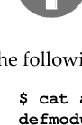
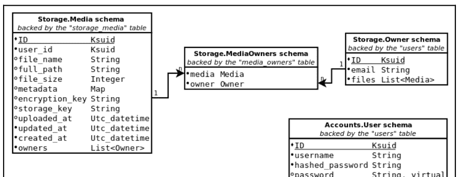
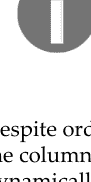

# 7 使用 Ecto 持久化数据

鉴于我们正在开发的应用程序具有数据存储的特性，确保存储在 ElixirDrip 中的所有媒体信息都能正常持久化至关重要。为此，我们将使用 PostgreSQL 作为数据库，并使用 Ecto 作为一个易于让我们与数据库交互并访问应用程序数据的工具。

正如你将看到的，在 Elixir 中使用数据库是一种乐趣，这得益于精心设计的抽象层，它们使我们的代码更具表达力，同时确保所有数据访问操作所需的性能。

Ecto 的一个显著特点是它从不试图隐藏数据库或强迫你使用其抽象层。你拥有完全的灵活性，这意味着你始终可以通过直接从 Elixir 应用程序发出 SQL 语句来突破抽象层，而 Ecto 会乐意将结果转换为普通的 Elixir 数据结构。毕竟，数据库是为帮助我们而存在的！

本章我们将涵盖以下主题：

- 连接到数据库
- 创建数据库表及其 Elixir 表示
- 使用更改集更新我们的数据
- 管理表之间的关系
- 使用数据库约束确保数据完整性
- 组合富有表现力的查询

让我们开始连接 ElixirDrip 数据库。

### 连接到数据库

在引言中，我们暗示了如何使用 Ecto 将应用程序数据存储在 PostgreSQL 数据库中。Ecto 能够连接到许多数据库，但对于每个数据库，它都需要相应的驱动程序来建立连接、支持查询等。

在我们的例子中，我们将使用 `postgrex` 库，它提供了 PostgreSQL Elixir 驱动程序。但不要认为 Ecto 以任何方式绑定到 PostgreSQL，因为 Ecto 支持其他数据库，如 MySQL、DynamoDB 和 SQLite 等。

让我们首先将 `ecto` 和 `postgrex` 库添加到我们的 `elixir_drip` 伞形应用依赖项中：

```
$ cat apps/elixir_drip/mix.exs
defmodule ElixirDrip.Mixfile do
  use Mix.Project

  defp deps do
    [
      {:postgrex, "~> 0.13"},
      {:ecto, "~> 2.1"},
      # ...
    ]
  end
end
```

这两个依赖项将在我们运行 `mix deps.get` 时立即被 `mix` 获取。下一步是定义和配置 Ecto 仓库。每个数据库操作都通过它进行，而仓库的职责是要求底层的数据库驱动程序代表它与数据库交互。



仓库将使用一个 Ecto 适配器，在我们的例子中是 `Ecto.Adapters.Postgres`，正是这个适配器将与 `postgrex` 驱动程序交互。

下面的 `ElixirDrip.Repo` 模块实现了我们的 Ecto 仓库：

```
$ cat apps/elixir_drip/lib/elixir_drip/repo.ex
defmodule ElixirDrip.Repo do
  use Ecto.Repo, otp_app: :elixir_drip

  def init(_, opts) do
    {:ok, Keyword.put(opts, :url, System.get_env("DATABASE_URL"))}
  end
end
```

通过使用 `Ecto.Repo`，我们将能够通过 `ElixirDrip.Repo` 模块执行所有数据库操作。`:otp_app` 选项是强制性的，它指示哪个应用程序具有仓库配置；在我们的例子中，仓库配置存在于 `elixir_drip` 应用程序配置下。

我们正在覆盖 Ecto.Repo.init/2 回调，以便在应用程序启动时动态设置数据库 URL。这可能是有用的，因为 Elixir 是一种编译语言，因此在编译时设置配置值最终会固化到你的应用程序中。通过这种方法，你可以在运行应用程序之前设置给定的 DATABASE_URL 环境变量，从而将编译后的 ElixirDrip 应用程序连接到不同的数据库。

通过分析 elixir_drip 配置文件，我们将找到 :ecto_repos 条目，它指向一个 Ecto 仓库列表。这些仓库在我们运行任何 Ecto Mix 任务时使用，例如负责数据库创建的 ecto.create 任务，我们稍后会查看它：

```
$ cat apps/elixir_drip/config/config.exs
use Mix.Config

config :elixir_drip, ecto_repos: [ElixirDrip.Repo]
# ...
import_config "#{Mix.env()}.exs"
```

最后，我们正在导入一个 "#{Mix.env()}.exs" 配置文件（使用 Mix.Config.import_config/1 宏）。因此，让我们检查开发中使用的 dev.exs 配置文件：

```
$ cat apps/elixir_drip/config/dev.exs
use Mix.Config

config :elixir_drip, ElixirDrip.Repo,
  adapter: Ecto.Adapters.Postgres,
  username: System.get_env("DB_USER"),
  password: System.get_env("DB_PASS"),
  database: System.get_env("DB_NAME"),
  hostname: System.get_env("DB_HOST"),
  port: System.get_env("DB_PORT"),
  pool_size: 10
```

在之前的代码片段中，我们在 :elixir_drip 应用程序的范围内配置了 ElixirDrip.Repo（正如我们在定义仓库时使用 :otp_app 选项所指出的那样）。我们正在使用 Ecto Postgres 数据库适配器，并且在开发环境中，我们从 DB_* 环境变量中获取用户名、密码、数据库、主机名和端口值。

我们在当前开发环境中在 5432 端口运行 PostgreSQL 数据库，因此我们将 DB_* 环境变量的值设置为如下：

```
$ env | grep DB_
DB_PORT=5432
DB_NAME=elixir_drip_dev
DB_PASS=123456
DB_HOST=localhost
DB_USER=postgres
```

正如我们在开发配置文件中所看到的，这些环境变量用于设置启动 ElixirDrip.Repo 所需的所有配置。

在之前的配置就位后，我们只需要最后一块拼图即可让仓库运行起来：我们需要实际将仓库作为一个监督进程启动。为此，我们将编辑 ElixirDrip.Application 模块，并将 ElixirDrip.Repo 监督进程添加为另一个子进程，由 elixir_drip 根监督进程启动：

```
$ cat apps/elixir_drip/lib/elixir_drip/application.ex
defmodule ElixirDrip.Application do
  use Application

  def start(_type, _args) do
    import Supervisor.Spec, warn: false

    Supervisor.start_link(
      [
        supervisor(ElixirDrip.Repo, []),
        # ...
      ],
      strategy: :one_for_one,
      name: ElixirDrip.Supervisor
    )
  end
end
```

我们现在终于可以与数据库交互了！让我们首先使用 ecto.create Mix 任务创建数据库。此任务将根据 dev Mix 环境中 ElixirDrip.Repo 配置的 :database 条目创建数据库：

```
$ echo $MIX_ENV
dev

$ mix ecto.create
The database for ElixirDrip.Repo has been created
```

```
$ mix ecto.create
The database for ElixirDrip.Repo has already been created
```

如果你再次尝试创建数据库，Ecto 会告诉你数据库已存在。现在让我们执行我们的第一个 SQL 查询，通过查看每个 PostgreSQL 数据库中都存在的 pg_catalog.pg_tables 表。为此，我们将要求 ElixirDrip.Repo 使用 Repo.query/1 函数为我们运行一个原始 SQL 查询：

```
iex> {:ok, result} = ElixirDrip.Repo.query("select * from
pg_catalog.pg_tables")
16:29:16.295 [debug] QUERY OK db=3.4ms
select * from pg_catalog.pg_tables []

{:ok,
  %Postgrex.Result{
    columns: ["schemaname", "tablename", "tableowner", "tablespace",
    "hasindexes", "hasrules", "hastriggers", "rowsecurity"],
    command: :select,
    connection_id: 27527,
    num_rows: 62,
    rows: [
      ["pg_catalog", "pg_statistic", "postgres", nil, true, false,
      false, false],
      # ...
    ]
  }
}
```

```
iex> result.rows |> Enum.slice(0, 3)
[
  ["pg_catalog", "pg_statistic", "postgres", nil, true, false, false,
  false],
  ["pg_catalog", "pg_type", "postgres", nil, true, false, false, false],
  ["pg_catalog", "pg_authid", "postgres", "pg_global", true, false, false,
  false]
]
```

调试日志消息向我们展示了执行的查询，我们得到一个 :ok 元组，其中包含一个 Postgrex.Result，检索到 62 行。rows 字段中的每个列表对应查询结果中的一行。

我们刚刚使用 ElixirDrip.Repo.query/1 函数运行了一个原始 SQL 查询。正如你将在以下各节中看到的，我们将使用 Repo.one/2 和 Repo.all/2 回调来运行查询，分别检索一个或多个结果。


现在让我们使用 ElixirDrip.Repo.all/2 回调来运行之前的查询，但这次只获取 tablename 列：

```
iex> ElixirDrip.Repo.all(from r in "pg_tables", select: [:tablename])
17:02:58.339 [debug] QUERY OK source="pg_tables" db=11.9ms decode=7.3ms queue=0.1ms
SELECT p0."tablename" FROM "pg_tables" AS p0 []
[
%(tablename: "pg_statistic"),
%(tablename: "pg_type"),
%(tablename: "pg_authid"),
# ...
]
```

不必太担心我们使用的查询语法，本章末尾有一个专门的章节来介绍它。正如你可能猜到的那样，Ecto 不仅仅是关于从数据库读取数据。你有 Repo.update/2、Repo.insert/2、Repo.delete/2 以及许多其他回调，可以让你按需操作数据库。我们将在本章中探索其中的许多内容。

现在，我们将首先定义 ElixirDrip Ecto schemas，以简化我们与数据库的交互并实现应用程序业务逻辑。

## Schemas and migrations

既然我们现在已连接到数据库，我们将为项目奠定数据基础。在本节中，我们将创建表示用户及其媒体的模式，以及相应的数据迁移。

## Schemas

我们的 ElixirDrip 项目允许用户安全地存储媒体，并最终与其他用户共享。因此，我们需要一种方法将用户和媒体表示为数据库表。

为帮助开发者实现这一点，Ecto 提供了 schema 构造。它的目的是在数据库中存储的任何信息与其在 Elixir 数据结构中的表示之间建立映射。

让我们定义一个模式来表示用户的媒体：

```
$ cat apps/elixir_drip/lib/elixir_drip/storage/media.ex
defmodule ElixirDrip.Storage.Media do
  use Ecto.Schema

  schema "storage_media" do
    field :user_id, :id
    field :file_name, :string
    field :full_path, :string
    field :file_size, :integer
    field :metadata, :map, default: %{}
    field :encryption_key, :string
    field :storage_key, :string
    field :uploaded_at, :utc_datetime

    timestamps()
  end
end
```

我们将此模式定义在 Storage 上下文中，因为同一个数据库表可能有多个模式。假设我们有一个 Audit 上下文，它只需要知道媒体创建者（由 user_id 给出）、文件路径、名称以及相应的存储键。在这种情况下，可以创建 Audit.Media 模式，它只会公开所需字段。这样，我们就可以避免拥有一个需要公开每个表字段的单一模式，从而导致不必要的臃肿和噪音。

我们首先使用 Ecto.Schema 模块，以便利用 schema/2 宏。它的第一个参数标识模式的来源；在我们的例子中，它是 storage_media 数据库表。然后，我们有一系列字段，每个字段都有其名称和类型。由于我们省略了 :id 字段，Ecto 会添加一个 :id 字段，其类型为 :integer，用作主键。我们还使用 timestamps/1 宏为我们生成 :inserted_at 和 :updated_at 时间戳字段。

整数作为主键是顺序分配的，因此我们可能会遇到聪明的用户尝试通过 ID 查找其他文件。让我们通过为标识符使用自定义类型来缓解这个问题。

## Custom field types

鉴于 Ecto 追求的灵活性，如果我们告诉你，除了开箱即用的字段类型如 `:string`、`:integer` 和 `:map` 之外，Ecto 还允许你定义自己的自定义类型，这应该不会让你感到惊讶。

要创建自定义类型模块，你需要实现 `Ecto.Type` 行为。我们将创建一个自定义的 `Ksuid` Ecto 类型用作所有模式的主键。KSUID，即 *K-可排序唯一标识符*，与 UUID 一样安全且随机，但具有可按字典顺序排序的酷特性。这些标识符长度为 20 字节，其字符串表示始终为 27 个字符长。

我们只需将 `ksuid` 库添加到 `elixir_drip` 伞形应用 `mix.exs` 文件中声明的 ElixirDrip 依赖项（即，将 `{:ksuid, "~> 0.1.2"}` 添加到 `deps/0` 函数返回的列表中），然后创建以下模块：

```
$ cat apps/elixir_drip/lib/elixir_drip/ecto/ksuid.ex
defmodule ElixirDrip.Ecto.Ksuid do
  @behaviour Ecto.Type

  def type, do: :string

  def cast(ksuid)
    when is_binary(ksuid) and byte_size(ksuid) == 27, do: {:ok, ksuid}
  def cast(_), do: :error

  def load(ksuid), do: {:ok, ksuid}

  def dump(binary) when is_binary(binary), do: {:ok, binary}
  def dump(_), do: :error

  def autogenerate, do: Ksuid.generate()
end
```

要实现 `Ecto.Type` 行为，我们的 `Ecto.Ksuid` 模块需要实现四个函数：`type/0`、`cast/1`、`load/1` 和 `dump/1`。第一个函数表示底层模式类型；在我们的例子中，KSUID 将作为 `:string` 存储。`cast/1` 函数在我们检查 changeset 参数时被调用；对于任何 KSUID 字段，只需将其作为二进制数据保留即可。

最后两个函数 `load/1` 和 `dump/1` 分别用于从数据库加载数据和将数据存储到数据库。由于它在每个字段中强制执行存储的数据类型，因此在从数据库加载数据时无需应用任何守卫子句。

由于我们使用 KSUID 自定义类型作为主键，因此我们还需要实现 autogenerate/0 函数，如果我们在模式主键定义上传递 :autogenerate 选项，Ecto 在持久化模式时将调用该函数。


KSUID 的随机部分比 UUID 长 6 位，因此我们可以放心，其冲突概率甚至小于 UUID。你可以在 https://github.com/segmentio/ksuid 找到有关 KSUID 的更多信息。

现在让我们调整我们的 Storage.Media 模式以使用新创建的 Ecto.Ksuid 自定义类型：

```
$ cat apps/elixir_drip/lib/elixir_drip/storage/media.ex
defmodule ElixirDrip.Storage.Media do
  use Ecto.Schema

  @primary_key {:id, ElixirDrip.Ecto.Ksuid, autogenerate: true}
  schema "storage_media" do
    field :user_id, ElixirDrip.Ecto.Ksuid
    # ...
  end
end
```

我们使用 @primary_key 模块属性来配置模式主键。第一个元组元素指示应用作键的字段，第二个元素设置字段类型，第三个用于传递附加选项。通过将 :autogenerate 选项设为 true，我们知道每当需要新主键时都会调用 Ecto.Ksuid.autogenerate/0 函数。


在 Storage.Media 模式的初始版本中，@primary_key 属性默认定义为 {:id, :id, autogenerate: true}，因为我们没有显式定义它。如果你不想在模式中设置主键，请将此 @primary_key 属性设为 false。

现在让我们创建将表示我们的 ElixirDrip 用户的模式。

## Users or media owners?

我们的用户管理功能与存储本身无关，因此我们将把它们封装在新的 ElixirDrip.Accounts 上下文中。自然地，我们将创建的 User 模式也将位于那里：

```
$ cat apps/elixir_drip/lib/elixir_drip/accounts/user.ex
defmodule ElixirDrip.Accounts.User do
  use Ecto.Schema
  import Ecto.Changeset

  alias __MODULE__

  @primary_key {:id, ElixirDrip.Ecto.Ksuid, autogenerate: true}
  schema "users" do
    field :username, :string
    field :hashed_password, :string
    field :password, :string, virtual: true
    field :email, :string

    timestamps()
  end
    # ...
  end
```

与我们对 Media 模式所做的非常相似，User 模式也由 KSUId 标识。除了 id 之外，此模式还具有四个字符串字段：username、password、hashed_password 和 email。请注意，由于我们将 password 字段设为 virtual，因此它不会持久化到数据库。我们将在分析 Ecto changesets 的工作原理时使用此虚拟字段。

正如以下代码所示，ElixirDrip.Accounts 上下文负责创建新用户并验证有人尝试登录时提交的密码。现在，我们将只分析 Accounts 上下文如何依赖 Comeonin.Bcrypt 模块以安全的方式验证密码（Ecto 模式的创建和检索将在以下章节中彻底检查）：

```
$ cat apps/elixir_drip/lib/elixir_drip/accounts/accounts.ex
defmodule ElixirDrip.Accounts do
  alias ElixirDrip.Repo
  alias ElixirDrip.Accounts.User

  def create_user(attrs \\ %{}), do: # ...

  def get_user_by_username(username), do: # ...

  def login_user_with_pw(username, password) do
    with %User{} = user <- get_user_by_username(username),
         true <- verify_user_password(user, password) do
      {:ok, user}
    else
      _ ->
        Comeonin.Bcrypt.dummy_checkpw()
      :error
    end
  end
```

```
end
end

defp verify_user_password(%User{} = user, password) do
  Comeonin.Bcrypt.checkpw(password, user.hashed_password)
end
end
```

在找到具有给定用户名的用户后，我们调用 verify_user_password/2 函数来检查密码是否有效。如果密码不匹配，我们调用 Comeonin.Bcrypt.dummy_checkpw/0 函数。此函数返回所需的时间不是恒定的，因此攻击者无法对我们的登录系统执行时序攻击。

在 Accounts 上下文中保留之前的 User schema 完全合理，但也产生了一个需要解决的问题。因为该 schema 位于 Accounts 上下文中，Storage 上下文不允许与之交互。但我们仍然需要在 Storage 端拥有用户的概念，因为所有媒体文件都由一个或多个用户拥有。

为了解决这个问题，让我们定义一个新的 Owner schema，位于 Storage 上下文中，它也由同一个 users 表支持：

```
$ cat apps/elixir_drip/lib/elixir_drip/storage/owner.ex
defmodule ElixirDrip.Storage.Owner do
  use Ecto.Schema

  @primary_key {:id, ElixirDrip.Ecto.Ksuid, autogenerate: true}
  schema "users" do
    field :email, :string
  end
end
```

如果你有 ORM 工具的使用经验，你可能会觉得为同一个数据库表设置多个 schema 很奇怪。然而，采用分离的有界上下文并使用最终反映同一数据库表的独立 schema 的方法，有助于我们避免拥有一个需要服务于所有目的的庞大 schema。这样，我们可以拥有用于用户管理的 schema、用于媒体拥有的 schema，以及用于审计目的的 schema 等，每个 schema 对用户都有自己的视角。

Schema 非常有用，但它们不是强制性的。因此，你如何决定是否需要它们呢？

## Schema 与否——这就是问题

到目前为止，我们谈论 schema 时似乎它们在使用 Ecto 实现数据库访问时是强制性的。在 Ecto 2.0 之前，这在某种程度上是正确的，因为没有 schema 的许多数据库查询比使用 schema 的对应查询更冗长，而且某些数据库操作只有在选择 schema 方式时才可能。

幸运的是，那些日子已经过去了，现在你可以在没有 schema 的情况下执行所有操作和查询。例如，假设我们有一个 `users` 数据库表，其中包含 `:username` 和 `:email` 字段。你可以通过调用 `Repo.insert_all/2` 函数并传递一个列表的列表，例如 `[[username: "andre", email: "aa@elixir.pt"], [username: "daniel", email: "dc@elixir.pt"]]`, 来在此表上插入两个新条目，表示要插入的两行。

当你想从数据库检索数据并且查询涉及大量表连接时也是如此。是否值得尝试将所有结果适配到查询中涉及的不同 schema 中？可能不是。最好只是将结果映射到 Elixir 标准数据结构（比如一个 map），然后结束。

这里的关键要点是，你可以为同一个数据库表拥有多个 schema，也可以没有。这取决于你的需求，而且幸运的是 Elixir 使你在之后更改它变得很容易。想象一下，你对某个表没有 schema，你的查询返回的是一个 map 列表。如果你决定添加一个 `Foo` schema，只需做最小的更改，你的查询现在就可以返回 `Foo` 结构列表。之前 map 列表的现有模式匹配可能仍然有效，因为 Elixir struct 实际上只是一个特殊的 map。

我们定义的 `Storage.Media` schema 将由数据库表支持。让我们看看如何使用 Ecto `migrations` 创建它。

## 迁移

正如我们已经看到的，我们的 `Media` schema 的目的是在 Elixir 世界中表示从数据库检索的数据。由于我们使用的是关系数据库，数据会持久化在数据库表中。

为了创建表，而不是直接在数据库上执行 SQL 脚本，我们将使用 Ecto migrations 来为我们应用每个数据库 schema 更改。

Migrations 以 Elixir 脚本的形式存放在 priv/repo/migrations 文件夹中，其名称应遵循 <timestamp>_<snake_case_name>.exs 格式，例如 20180112095312_create_media.exs。要执行迁移或回滚现有迁移，你应分别使用 ecto.migrate 或 ecto.rollback。

以下是负责创建 storage_media 数据库表的 CreateMedia 迁移：

```
$ cat apps/elixir_drip/priv/repo/migrations/
20180112095312_create_media.exs
defmodule ElixirDrip.Repo.Migrations.Storage.Media do
  use Ecto.Migration

  def change do
    create table(:storage_media, primary_key: false) do
      add :id, :string, primary_key: true, size: 27
      add :file_name, :string
      add :full_path, :string
      add :metadata, :map
      add :encryption_key, :string
      add :storage_key, :string
      add :uploaded_at, :utc_datetime

      timestamps(type: :utc_datetime)
    end
  end
end
```

如你所见，迁移由一个使用 Ecto.Migration 模块的普通模块组成。在这里你可以看到我们使用 create/2 宏和 table/2 函数来创建 storage_media 表。

因为我们在迁移模块上实现了 change/0 函数，Ecto 预计在我们运行 ecto.rollback Mix 任务时能够自动撤销操作，而无需我们明确指示撤销操作。

如果你愿意，或者如果 Ecto 无法自动判断如何回滚迁移，你可以改为实现 up/0 和 down/0 函数，它们将在分别执行 ecto.migrate 和 ecto.rollback Mix 任务时运行。

我们在 table/2 调用中将 :primary_key 选项设为 false，因为我们希望之后显式地将其定义为 27 个字符的字符串字段。table/2 函数将返回一个表示将要创建的表的 Table struct，而 create/2 宏将接收 Table struct 和字段列表，并创建相应的表。

让我们运行迁移，然后使用 ecto.migrations Mix 任务检查其状态：

```
$ mix ecto.migrate
18:16:18.548 [info] == Running
ElixirDrip.Repo.Migrations.Storage.Media.change/0 forward
18:16:18.548 [info] create table storage_media
18:16:18.572 [info] == Migrated in 0.0s

$ mix ecto.migrations

Repo: ElixirDrip.Repo

| Status | Migration ID | Migration Name |
|---|---|---|
| up | 20180112095312 | create_media |
```

如你所见，我们的 create_media 迁移已正确应用。我们现在将定义 schema 和迁移，以实现我们用户与其媒体之间的关系。

## 关系

我们此处的目标是实现 Media 和 Owner schema 之间的关系。一开始，媒体文件只有一个所有者：上传媒体到系统中的用户。该用户随后可以与其它用户共享。因此，媒体文件可能由一个以上用户拥有，并且肯定至少由一个用户拥有。

在此关系的另一侧，我们有媒体所有者。最近创建的用户可能没有任何媒体文件，但最终它将拥有数十个文件：



用数据库术语来说，我们有一个经典的多对多关系。因此，我们需要一个额外的关联表，因为我们已经有 media 和 users 数据库表。让我们使用迁移创建 media_owners 表：

```
$ cat apps/elixir_drip/priv/repo/migrations/20180408150211_create_media_owners.exs
defmodule ElixirDrip.Repo.Migrations.CreateMediaOwners do
  use Ecto.Migration

  def change do
    create table(:media_owners) do
      add :media_id, references(:storage_media, type: :string)
      add :user_id, references(:users, type: :string)

      timestamps(type: :utc_datetime)
    end
  end
end
```

此迁移创建 media_owners 表，其中包含两个字符串列 media_id 和 user_id。通过对两个字段使用 references/2 宏，它们将被定义为外键。我们放置在 media_id 和 user_id 列上的每个值都需要在 storage_media 和 users 表的 id 列上存在，分别对应。我们不需要使用 name 选项来指示被引用表的 primary key，因为它默认为 :id，这也是我们两个表上 primary key 字段的名称。


现在我们只需要运行 `mix ecto.migrate` 即可创建 `media_owners` 表。下一步是创建一个由 `media_owners` 表支持的 `MediaOwners` schema，以便关联 `Media` 和 `Owner` schemas。

与我们对其他 schema 已做的工作类似，我们声明新的 `MediaOwners` schema 由 "media_owners" 表支持。除了拥有 `inserted_at` 和 `updated_at` 时间戳外，该 schema 还使用 `Schema.belongs_to/3` macro 来定义 `media` 和 `owner` 字段。

通过使用 `belongs_to/3` macro，我们告诉 Ecto 该 schema 可能属于 `Media` 和 `Owner` schema，分别通过 `media_id` 和 `user_id` 外键。由于我们为 ID 使用了自定义类型，也需要将此信息告知 Ecto。


我们本可以使用 `file` 和 `person` 作为字段名，因为字段名不需要与它们指向的 schema 名称匹配。我们也可以省略 `media` 字段的外键名称，因为默认情况下 Ecto 会将其命名为 `<field_name>_id`。

此时，连接表和 schema 已经就位。现在让我们修改现有的 `Media` 和 `Owner` schema 以完成多对多关系。以下更改将使我们能够轻松访问特定媒体文件的全部 `owners` 以及特定用户的全部 `files`：

```
$ cat apps/elixir_drip/lib/elixir_drip/storage/media.ex
defmodule ElixirDrip.Storage.Media do
  use Ecto.Schema
  # ...
  alias ElixirDrip.Storage.{
    Owner,
    MediaOwners
  }

  @primary_key {:id, ElixirDrip.Ecto.Ksuid, autogenerate: true}
  schema "storage_media" do
    # ...
    field :uploaded_at, :utc_datetime
    many_to_many :owners, Owner, join_through: MediaOwners,
    join_keys: [media_id: :id, user_id: :id]

    timestamps()
  end
  # ...
end
```

在 Media schema 上，我们使用 many_to_many/3 macro 添加了一个新的 owners 字段。我们指示每个元素将由 Owner schema 支持，并且 Ecto 可以在 MediaOwners schema 上找到有关要获取哪些媒体所有者的信息（:join_through 选项是必需的）。我们还传递了 :join_keys 选项，指示连接 schema 的外键名称。在我们的例子中，MediaOwners schema 具有指向当前 Media schema 上 id 字段的 media_id 字段，以及指向关联 Owner schema 上 id 字段的 user_id 字段。


如果 Ecto 默认设置的键与连接 schema 中的键匹配，则可以省略 :join_keys 选项。我们在 Media schema 上定义了与 Owner schema 的关联，因此 Ecto 会查看 schema 名称并将连接键设为 [media_id: :id, owner_id: :id]。此外，:join_keys 关键字列表中条目的顺序很重要：两个条目应分别指示 Ecto 如何到达当前 schema 和关联 schema。

现在我们只需要更新 Owner schema 以实现多对多关系：

```
$ cat apps/elixir_drip/lib/elixir_drip/storage/owner.ex
defmodule ElixirDrip.Storage.Owner do
  use Ecto.Schema

  alias ElixirDrip.Storage.{
    Media,
    MediaOwners
  }

  @primary_key {:id, ElixirDrip.Ecto.Ksuid, autogenerate: true}
  schema "users" do
    field :email, :string
    many_to_many :files, Media, join_through: MediaOwners, join_keys:
    [user_id: :id, media_id: :id]
  end
end
```

与之前的 Media 更改类似，我们使用 Schema.many_to_many/3 macro 向 Owner schema 添加了一个新的 files 字段。此关联也由 MediaOwners schema 中介，Ecto 可以分别通过连接 schema 的 user_id 和 media_id 字段到达当前和关联的 Media schema。

对 `Owner` schema 的最后一次更改是拼图的最后一块。随着数据库的创建和数据模型的连接，我们可以开始持久化媒体数据。让我们检查如何利用 Ecto 来验证我们想要应用于存储数据的更改。

## 更改集

现在让我们分析如何更新数据库中存储的信息。Ecto 允许你更改信息的方式起初可能感觉很奇怪，因为它要求你始终使用一个 `changeset` 来描述数据操作应如何完成。这些更改集将帮助我们确保我们持久化的更改是有效的，并且不会破坏已有的任何约束。

为了理解更改集如何有所帮助，让我们想象以下场景，使用面向对象的语言和对象关系映射框架：你有一个包含数十个字段的 `media` 对象，你更新其中几个字段，然后执行 `media.save`，这几个字段就会在该特定媒体的数据库行中更新。为了组成实际的 SQL `update` 语句，ORM 需要知道如何识别已更改的字段，并仅对这些字段发出 `update` 语句。ORM 还会为你执行一些验证，如果某些情况看起来不对，就会停止 SQL 语句的执行。

那里有一些我们通常不控制也不想控制的魔法，但在某些情况下，结果可能不是你所期望的。使用 Ecto，没有人会为你识别字段，你需要显式指定想要验证的字段以及如何验证它们。

所有这些工作可能让你觉得过于繁琐，但 Ecto 允许你以优雅且合理的方式完成所有这些工作，给予你对每个数据库操作的完全控制。由于这些代表数据库操作的更改集是 Elixir struct，你将通过 `Ecto.Changeset` 模块提供的函数传递这些 struct 来使用常规数据转换操作它们。每次操作时，你都会对更改集进行迭代，从而可以轻松推理底层发生的情况。


不要犹豫使用 inspect/1 检查一个 Ecto changeset，它会显示非常有用的信息，例如你正在操作的数据、将应用于该数据的更改、可能的验证错误，以及在 changeset 实际持久化到数据库时应执行的操作。你可能最常使用的字段是 valid?，它可以让你知道 changeset 是否适合持久化。

我们现在将看到如何创建一个新的 Media schema 来表示我们用户的媒体。

## 媒体

Media schema 初始版本的更改集将由 Storage.Media 模块公开的 create_initial_changeset/4 函数创建。

鉴于数据库不知道 KSUID 是什么，我们在此阶段生成一个唯一标识符。它还将用于生成 storage_key，即存储在云存储上的文件的实际名称：

```
$ cat apps/elixir_drip/lib/elixir_drip/storage/media.ex
defmodule ElixirDrip.Storage.Media do
  use Ecto.Schema

  alias __MODULE__
  alias Ecto.Changeset
  # ...
  def create_initial_changeset(user_id, file_name, full_path,
    file_size) do
    id = Ksuid.generate()

    attrs = %{
      id: id,
      user_id: user_id,
      storage_key: generate_storage_key(id, file_name),
      encryption_key: Encryption.generate_key(),
      file_name: file_name,
      full_path: full_path,
      file_size: file_size,
    }

    %Media{}
    |> Changeset.cast(attrs, cast_attrs())
    |> Changeset.validate_required(required_attrs())
    |> validate_field(:full_path)
```

```
|> validate_field(:file_name)
end

defp cast_attrs, do: [:id, :user_id, :file_name, :full_path,
:file_size, :metadata, :encryption_key, :storage_key, :uploaded_at]

defp required_attrs, do: [:id, :user_id, :file_name, :full_path,
:file_size, :encryption_key, :storage_key]
end
```

管道的第一个步骤是将 %Media{}，一个空的 Media struct，作为 Changeset.cast/3 函数的第一个参数传递，同时传递 attrs 和应转换的属性列表作为最后一个参数。由于我们是首次创建 Media struct，因此我们转换所有属性。只有在实际应用更改集时，最后一个参数列表中包含的参数才会被 Ecto 考虑。

对于列表中的每个属性，Ecto 将检查 Media schema 上的字段类型，并据此转换 attrs map 上的相应值。例如，假设 attrs map 包含一个整数 id。当 Ecto 尝试根据 Media:id 字段类型将其转换时，它将返回一个无效的更改集：

```
iex> %Media{} |> Ecto.Changeset.cast(%{id: 123}, [:id])
#Ecto.Changeset<
action: nil,
changes: %{},
errors: [
id: {"is invalid", [type: ElixirDrip.Ecto.Ksuid, validation:
:cast]}
],
data: #ElixirDrip.Storage.Media<>,
valid?: false
>
```

```
iex> %Media{} |> Ecto.Changeset.cast(%{id: "13KyEPDoSJ5HbEfEEd30XPTMhW1"}, [:id])
#Ecto.Changeset<
action: nil,
changes: %{id: "13KyEPDoSJ5HbEfEEd30XPTMhW1"},
errors: [],
data: #ElixirDrip.Storage.Media<>,
valid?: true
>
```

像这样验证更改集尤其有用，因为这些新值可能直接来自最终用户，因此需要被视为不安全。


正如你所见，无效的 changeset 包含有关哪个字段无效的有用信息，因此你可以在前端使用此 changeset 来显示有意义的错误消息。

在下一个 pipeline 步骤中，我们使用 Changeset.validate_required/2 函数验证 changeset 上是否包含所有必填字段。如果传递的 required_attrs 中有任何一个为 nil 或为空，此函数将使 changeset 无效。

我们在 pipeline 的最后两个步骤中使用 validate_field/1 函数来验证 :full_path 和 :file_name 字段。这是一个 Storage.Media 函数，它依赖于使用 Changeset.validate_change/4 函数应用的 Ecto 自定义字段验证：

```elixir
$ cat apps/elixir_drip/lib/elixir_drip/storage/media.ex
defmodule ElixirDrip.Storage.Media do
  # ...
  @custom_validations [
    full_path: %{validator: &__MODULE__.is_valid_path?/1, error_msg:
    "Invalid full path"},
    file_name: %{validator: &__MODULE__.is_valid_name?/1, error_msg:
    "Invalid file name"},
  ]

  def validate_field(changeset, field) do
    validator = @custom_validations[field][:validator]
    error_msg = @custom_validations[field][:error_msg]

    Changeset.validate_change(changeset, field, fn _, value ->
      case validator.(value) do
        {:ok, :valid} -> []
        _ -> [{field, error_msg}]
      end
    end)
  end

  def is_valid_path?(path) when is_binary(path) do
    valid? = String.starts_with?(path, "$") && !String.ends_with?(path,
    "/")

    case valid? do
      true -> {:ok, :valid}
      false -> {:error, :invalid_path}
    end
  end

  def is_valid_name?(name) when is_binary(name) do
    valid? = byte_size(name) > 0 && !String.contains?(name, "/")
case valid? do
    true -> {:ok, :valid}
    false -> {:error, :invalid_name}
  end
end
end
```

正如你所见，Changeset.validate_change/3 的最后一个参数接收一个 lambda 函数作为字段验证器，它将返回包含最终字段错误的列表。如果不存在错误，它将简单地返回一个空列表。否则，它将返回字段名称和错误消息。我们在该 lambda 函数内部根据字段名称将验证委托给 Media.is_valid_path?/1 或 Media.is_valid_name?/1 函数。


由于在此阶段我们仅关注 Media schema，我们的 Storage.store/3 函数执行的唯一数据库操作是插入新的 Media 条目。Storage.store/3 函数的最终版本将在 Media 归属部分进行分析。

最后，如果 Media.create_initial_changeset/4 的结果有效，我们就可以在数据库中插入新的 Media。创建初始 changeset 是 Storage.store/4 函数的职责，这样我们就可以在数据库中插入新的 Media 并将上传任务入队以供我们的 pipeline 处理：

```elixir
$ cat apps/elixir_drip/lib/elixir_drip/storage/storage.ex
defmodule ElixirDrip.Storage do

  alias Ecto.Changeset
  alias ElixirDrip.Repo
  alias ElixirDrip.Storage.Media
  alias ElixirDrip.Storage.Workers.QueueWorker, as: Queue

  def store(user_id, file_name, full_path, content) do
    file_size = byte_size(content)
    with %Owner{} = owner <- get_owner(user_id),
         %Changeset{} = changeset <-
           Media.create_initial_changeset(owner.id, file_name, full_path,
           file_size),
         {:ok, %Media{} = media} <- Repo.insert(changeset)
    do
      upload_task = %{
        media: media,
        content: content,
        type: :upload
      }
    }
Queue.enqueue(Queue.Upload, upload_task)
    {:ok, :upload_enqueued, media}
else
    error -> error
end
end
# ...
end
```

在前面的函数中，我们首先使用传递的 user_id 检索 Owner schema，它将作为媒体创建者与新的 Media 一起持久化。此后，我们使用 Media.create_initial_changeset/4 函数创建 changeset 并将其结果传递给 Repo.insert/1 函数。

Repo.insert/1 函数与所有其他 Ecto.Repo 回调一样，只有在传入有效 changeset 时才会继续操作。如果不是这样，它将返回一个元组错误，我们在 with 构造的 else 子句中处理该错误。以下是使用 Repo.update/1 回调的更新操作示例，由于 changeset 无效而未成功：

```
iex> media
|> Ecto.Changeset.cast(%{full_path: "an/invalid/path"}, [:full_path])
|> Media.validate_field(:full_path)
|> ElixirDrip.Repo.update()

{:error,
#Ecto.Changeset<
  action: :update,
  changes: %{full_path: "an/invalid/path"},
  errors: [full_path: {"Invalid full path", []}],
  data: #ElixirDrip.Storage.Media<>, 
  valid?: false
>}
```

使用 changeset 显式验证你要更改的信息起初可能感觉很奇怪，但这种显式性是有帮助的，因为你现在可以拥有不同的 changesets。由于我们始终需要转换要考虑的参数，因此当你只想更新 uploaded_at 时间戳时，不可能出现字段更新未被注意的情况。通过查看数据操作函数正在转换的字段，你立即知道该函数可能更改哪些字段。

现在让我们看看如何创建新的 ElixirDrip 用户。

## Users

在 Schemas 部分，我们使用虚拟 password 字段定义了 Accounts.User schema。这在你希望 schema 拥有某个字段但又不想将其持久化时很有用。

我们永远不想以明文形式存储用户密码。这里的想法是将明文密码暂时放在此 password 字段上，然后在 User.create_changeset/2 函数的最后一步将其哈希并作为 hashed_password 字段的值插入：

```elixir
$ cat apps/elixir_drip/lib/elixir_drip/accounts/user.ex
defmodule ElixirDrip.Accounts.User do
  # ...
  @email_regex ~r/^[A-Z0-9._%+-]+@[A-Z0-9.-]+\.[A-Z]{2,}$/i

  def create_changeset(%User{} = user, attrs) do
    user
    |> cast(attrs, [:username, :password, :email])
    |> validate_required([:username, :password, :email])
    |> validate_length(:username, min: 1, max: 30)
    |> validate_length(:password, min: 8, max: 100)
    |> validate_format(:email, @email_regex)
    |> put_hashed_password()
  end

  defp put_hashed_password(%Ecto.Changeset{valid?: false} = changeset),
    do: changeset
  defp put_hashed_password(%Ecto.Changeset{valid?: true, changes: %{password: pw}} = changeset) do
    changeset
    |> put_change(:hashed_password, Comeonin.Bcrypt.hashpwsalt(pw))
  end
end
```

除了我们在之前的 User.create_changeset/2 函数中已经使用过的 validate_required/2 函数外，我们还使用了 Changeset 模块的 validate_length/2 和 validate_format/2 函数。如名称所示，前者让我们验证某个字段的字符串长度，而后者函数允许我们根据正则表达式验证字符串字段。


我们使用 comeonin 库来安全地生成密码哈希。因此，我们在 elixir_drip umbrella 应用的 Mix 文件的 deps/0 函数中添加了 {:comeonin, "~> 4.1"} 元组。

在 pipeline 的最后一步，我们调用 put_hashed_password/1 私有函数，它将使用 Changeset.put_change/3 函数用 Comeonin.BCrypt.hashpwsalt/1 函数返回的哈希密码更新 changeset。

此 put_change/3 函数接收 changeset、要更新的字段名称和新值，并盲目地为相关字段向 changeset 添加更改。只有当你想用你自己创建的数据或来自其他安全位置的数据（例如应用程序的另一个组件）更新 changeset 时，才应使用 put_change/3 函数：

```
iex> changeset = %User{} |> Changeset.cast(%{email: "abc@good.mail"}, [:email])
#Ecto.Changeset<
  action: nil,
  changes: %{email: "abc@good.mail"},
  errors: [],
  data: #ElixirDrip.Accounts.User<>, 
  valid?: true
>
```

```
iex> changeset |> Changeset.cast(%{email: 123}, [:email])
#Ecto.Changeset<
  action: nil,
  changes: %{email: "abc@good.mail"},
  errors: [email: {"is invalid", [type: :string, validation: :cast]}],
  data: #ElixirDrip.Accounts.User<>, 
  valid?: false
>
```

```
iex> changeset |> Changeset.put_change(:email, 123)
#Ecto.Changeset<
  action: nil,
  changes: %{email: 123},
  errors: [],
  data: #ElixirDrip.Accounts.User<>, 
  valid?: true
>
```

在前面的代码片段中，如果我们使用 cast/3，就不允许将用户电子邮件设置为 123，但如果改用 put_change/3 函数，Ecto 就会很高兴地让我们将电子邮件更改为 123（注意它返回的是一个有效 changeset）。当你确定提供的数据是安全时，put_change/3 函数允许你跳过可能拥有的任何验证。在考虑使用 put_change/3 而非 cast/3 函数时，请记住这一点。

在下一节中，我们将学习 changesets 如何也应用于 schema 之间的关联。在我们的例子中，我们将媒体文件与其各自的所有者关联起来。


## 媒体所有权

在之前的 Media 部分，我们在为用户保存媒体文件时使用 Storage.store/3 函数简单地插入了一个新的 Media 条目。然而，这只是一个部分解决方案，因为 Media 和 Owner 模式之间存在多对多关系。

我们此处的目标是在首次使用 Storage.store/3 函数存储文件时创建一个新的 MediaOwners 模式条目，从而将用户与上传的媒体关联起来：

```
$ cat apps/elixir_drip/lib/elixir_drip/storage/storage.ex
defmodule ElixirDrip.Storage do
  # ...
  def store(user_id, file_name, full_path, content) do
    file_size = byte_size(content)
    with %Owner{} = owner <- get_owner(user_id),
         %Changeset{} = changeset <- Media.create_initial_changeset
           (owner.id, file_name, full_path, file_size),
         %Changeset{} = changeset <- Changeset.put_assoc(changeset,
           :owners, [owner]),
         {:ok, %Media{} = media} <- Repo.insert(changeset)
    do
      # ... upload task enqueue

      {:ok, :upload_enqueued, media}
    else
      error -> error
    end
  end
  # ...
end
```

如你所见，与 store/3 函数的先前版本相比，唯一的变化是在将 changeset 插入数据库之前使用 Changeset.put_assoc/3。通过它，我们在 changeset 中添加了新 Media 条目与在第一个 with 步骤中从数据库获取的 Owner 之间的关联：

iex> changeset = Media.create_initial_changeset(owner.id, file_name, full_path, file_size)
#Ecto.Changeset<
action: nil,
changes: %{
  # ...
},
errors: [],
data: #ElixirDrip.Storage.Media<>, 
valid?: true
>

iex> changeset = Changeset.put_assoc(changeset, :owners, [owner])
#Ecto.Changeset<
    action: nil,
    changes: %{
        # ...
        owners: [
            #Ecto.Changeset<action: :update, changes: %{}, errors: [],
            data: #ElixirDrip.Storage.Owner<>, valid?: true>
        ]
    },
    errors: [],
    data: #ElixirDrip.Storage.Media<>, 
    valid?: true
>

通过使用 Changeset.put_assoc/3 函数，Ecto 将为我们更新 Media 模式的 owners 字段。此函数期望我们传递整个关联（在我们的情况下，是给定媒体的所有所有者），然后它将相应地更新它。在这里我们正在创建新的媒体，因此我们确定它只有一个所有者（因此列表中只有一个所有者元素）。

现在考虑一个之前与 prev_owner 用户关联的媒体。如果您为其创建了一个 changeset 并尝试执行 put_assoc(changeset, :owners, [prev_owner, new_owner])，您将得到一个有效的 changeset，因为我们只是添加了一个新的所有者。然而，如果我们尝试通过传递 [new_owner] 作为新的所有者列表来更改现有所有者（我们试图删除与 prev_owner 的现有关联），默认情况下 Ecto 将引发错误。Ecto 在此场景中的反应方式由在定义 many_to_many 字段时使用的 :on_replace 选项控制。如果我们希望 Ecto 为我们删除陈旧的关联，我们应该将此选项设置为 :delete。

现在让我们尝试完整的 Storage.store/3 函数。如你所见，在获取我们传递的 ID 的所有者后，Ecto 按预期在 storage_media 和 media_owners 表上插入新行。请注意 Ecto 甚至将这两个插入包装在单个事务中，确保无论发生什么情况，我们数据库的一致性：

iex> xpto_user = Accounts.get_user_by_username("xpto")
%ElixirDrip.Accounts.User{
  __meta__: #Ecto.Schema.Metadata<:loaded, "users">,
  id: "13ix90kpmblgJF4Ful762gqb6m2",
  # ...
}

iex> Storage.store(xpto_user.id, "hello_world.txt", "$/hello/world", "Hi there, this is a test.")

19:39:17.617 [debug] QUERY OK source="users" db=0.6ms
SELECT u0."id", u0."email" FROM "users" AS u0 WHERE (u0."id" = $1)
["13ix90kpmblgJF4Ful762gqb6m2"]

19:39:17.618 [debug] QUERY OK db=0.1ms queue=0.1ms
begin []

19:39:17.634 [debug] QUERY OK db=15.9ms
INSERT INTO "storage_media"
("encryption_key","file_name","file_size","full_path","id","metadata","storage_key","user_id","inserted_at","updated_at") VALUES ($1,$2,$3,$4,$5,$6,$7,$8,$9,$10) [...] 

19:39:17.636 [debug] QUERY OK db=1.9ms
INSERT INTO "media_owners"
("media_id","user_id","inserted_at","updated_at") VALUES ($1,$2,$3,$4)
RETURNING "id" ["13j6fLDkPbkbq6Fo2Cuyb2MF4s", "13ix90kpmblgJF4Ful762gqb6m2", ...]

19:39:17.640 [debug] QUERY OK db=3.2ms
commit []
# ...

我们的 ElixirDrip 用户也将能够与其他用户共享他们的媒体。每次共享文件时，我们都需要更新媒体-用户关联。然而这次，我们将直接操作 MediaOwners 连接模式：

```
$ cat apps/elixir_drip/lib/elixir_drip/storage/storage.ex
defmodule ElixirDrip.Storage do
  # ...
  def share(user_id, media_id, allowed_user_id) do
    with {:ok, :creator} <- is_creator?(user_id, media_id) do
      %MediaOwners{}
      |> Changeset.cast(%{user_id: allowed_user_id, media_id: media_id}, [:user_id, :media_id])
      |> Repo.insert()
    else
      error -> error
    end
  end
end
```

在 Storage.share/3 函数中，我们首先确保共享媒体的用户是最初上传该媒体的用户（is_creator?/2 函数将在本章后面分析）。如果用户是媒体创建者，我们将继续创建并插入一个将 media_id 与 allowed_user_id 关联的 changeset，允许新用户查看和下载相关媒体。通过在 MediaOwners 连接模式中创建新条目，我们允许更多用户访问给定的媒体文件。

如果我们也想在这里使用 Changeset.put_assoc/3 方法，我们必须首先获取所有现有媒体所有者的列表，然后将新的允许用户添加到该列表中。尽管这是一个有效的替代方案，但这种方法意味着额外的数据库查询来获取现有所有者。

本节分析的一些操作使用底层数据库约束来确保我们数据的一致性。在下一节中，我们将了解 Ecto 如何利用数据库约束并允许我们轻松地使用它们。

## 约束

当我们分析 User.create_changeset/2 函数时，我们没有设置任何验证来检查我们存储在数据库中的用户名是否已存在。对于我们这样的系统，这可能意味着麻烦。因此，让我们为 users 表的 username 列创建一个唯一索引：

```
$ cat apps/elixir_drip/priv/repo/migrations/
20180320101722_unique_users_constraint.exs
defmodule ElixirDrip.Repo.Migrations.UniqueUsersConstraint do
  use Ecto.Migration

  def change do
    create unique_index(:users, [:username])
  end
end
```

在我们使用 mix ecto.migrate 应用此迁移后，数据库将开始在 users 表的任何操作上强制执行用户名唯一性。让我们看看如果我们尝试将 xpto_user 用户名更新为已存在的用户名会发生什么：

iex> xpto_user
%ElixirDrip.Accounts.User{ ... }

iex> update_op = Changeset.cast(xpto_user, %{username: "jose"},
  [:username])
#Ecto.Changeset<
action: nil,
changes: %{username: "jose"},
errors: [],
data: #ElixirDrip.Accounts.User<>, 
valid?: true
>

iex> Repo.update(update_op)
07:43:57.503 [debug] QUERY ERROR db=29.6ms queue=0.1ms
UPDATE "users" SET "username" = $1, "updated_at" = $2 WHERE "id" = $3
["jose", {{2018, 4, 26}, {7, 43, 57, 470077}},
"13ix90kpmblgJF4Ful762gqb6m2"]
** (Ecto.ConstraintError) constraint error when attempting to update struct:
  * unique: users_username_index
  # ...

正如预期的那样，数据库不允许更新并且 Ecto 引发了约束错误。尽管正确，但这种行为对我们帮助不大，因为我们通常使用 valid? 和 errors changeset 字段来检查是否发生错误。为了解决这种情况，Ecto 提供了 Changeset.unique_constraint/3 函数，该函数在执行数据库操作时检查唯一性约束，如果操作违反了现有的约束，则返回一个 {:error, changeset} 元组。

让我们将此 Changeset.unique_constraint/3 应用于 User.create_changeset/2 函数，我们在创建新的 ElixirDrip 用户时使用它：

```
$ cat apps/elixir_drip/lib/elixir_drip/accounts/user.ex
defmodule ElixirDrip.Accounts.User do
  use Ecto.Schema
  import Ecto.Changeset
  # ...
  def create_changeset(%User{} = user, attrs) do
    user
    |> cast(attrs, [:username, :password, :email])
    |> validate_required([:username, :password, :email])
    |> validate_length(:username, min: 1, max: 30)
    |> validate_length(:password, min: 8, max: 100)
    |> validate_format(:email, @email_regex)
    |> unique_constraint(:username)
    |> put_hashed_password()
  end
end


如果我们现在尝试使用相同的 "jose" 用户名创建一个新用户，我们将得到预期的错误元组，其中包含无效的更改集：

```
iex> Accounts.create_user(%{username: "jose", email: "abc@web.com", password: "secur3pwd"})
```

```
08:15:18.585 [debug] QUERY ERROR db=2.6ms
INSERT INTO "users" ("email","hashed_password","username","id","inserted_at","updated_at") VALUES ($1,$2,$3,$4,$5,$6) ["abc@web.com", "$2b$12$natqyxpfEjE2zYxbroZf4h.xXUOPclczH1lGxfOxapyi6BTF2uqRBm", "jose", "13jOqf9qgZePNpSRNOChyPfHfp8", {{2018, 4, 26}, {8, 15, 18, 582405}}, {{2018, 4, 26}, {8, 15, 18, 582420}}]
```

```
{:error,
#Ecto.Changeset<
  action: :insert,
  changes: %{
    email: "abc@web.com",
    hashed_password: "$2b$12$natqyxpfEjE2zYxbroZf4h.xXUOPclczH1lGxfOxapyi6BTF2uqRBm",
    password: "secur3pwd",
    username: "jose"
  },
  errors: [username: {"has already been taken", []}],
  data: #ElixirDrip.Accounts.User<>, 
  valid?: false
>}
```

请注意，由于我们依赖数据库唯一索引，只有在实际使用 Repo.insert/2（或 Repo.update/2）函数命中数据库时，我们才会得到预期的错误。

现在让我们使用相同的方法来确保每个媒体只能与同一用户共享一次。我们还将创建一个数据库唯一索引，但这次应用于 media_owners 表上的两个外键字段 media_id 和 user_id。如果有人尝试将文件与用户共享，而该媒体和用户 ID 对在 MediaOwners 中已存在条目，则操作不应该被允许：

```
$ cat apps/elixir_drip/priv/repo/migrations/20180408161233_unique_shares_constraint.exs
defmodule ElixirDrip.Repo.Migrations.UniqueSharesConstraint do
  use Ecto.Migration

  def change do
    create unique_index(:media_owners, [:media_id, :user_id], name: :single_share_index)
  end
end
```

在这次最后的迁移中，除了指定两个 media_id 和 user_id 列之外，我们还明确将此唯一约束命名为 :single_share_index。所有约束都有名称，因此如果我们不设置它，Ecto 将根据表和字段名称为我们生成一个名称。在这种情况下，默认名称将是 :media_owners_media_id_user_id_index，我认为太冗长了。

我们定义了一个约束名称，因为正如你在这里看到的，在 Storage.share/3 函数上调用 Changeset.unique_constraint/3 时需要指定它：

```
$ cat apps/elixir_drip/lib/elixir_drip/storage/storage.ex
defmodule ElixirDrip.Storage do
  # ...
  def share(user_id, media_id, allowed_user_id) do
    with {:ok, :creator} <- is_creator?(user_id, media_id) do
      %MediaOwners{}
      |> Changeset.cast(%{user_id: allowed_user_id, media_id: media_id}, [:user_id, :media_id])
      |> Changeset.unique_constraint(:existing_share, name: :single_share_index)
      |> Changeset.foreign_key_constraint(:user_id)
      |> Changeset.foreign_key_constraint(:media_id)
      |> Repo.insert()
    else
      error -> error
    end
  end
end
```

现在让我们看看当我们再次尝试将文件与同一用户共享时会发生什么（xpto_user 已经有权访问给定的文件）：

```
iex> Storage.share(jose_user.id, file.id, xpto_user.id)
09:10:17.572 [debug] QUERY OK source="storage_media" db=2.5ms queue=0.1ms
SELECT s0."id", s0."user_id", s0."file_name", s0."full_path", s0."file_size", s0."metadata", s0."encryption_key", s0."storage_key", s0."uploaded_at", s0."inserted_at", s0."updated_at" FROM "storage_media" AS s0 WHERE (s0."id" = $1) AND (s0."user_id" = $2)
["13Kvv5GQey9oPFWEAqqSFECYGag", "13KvtrMQ9uRB8MqkJpKSSQZxnBa"]

09:10:17.572 [debug] QUERY OK db=0.3ms queue=0.1ms
begin []

09:10:17.575 [debug] QUERY ERROR db=2.0ms
INSERT INTO "media_owners" ("media_id","user_id","inserted_at","updated_at") VALUES ($1,$2,$3,$4)
RETURNING "id" ["13Kvv5GQey9oPFWEAqqSFECYGag",
"13ix90kpmblgJF4Fu1762gqb6m2", {{2018, 4, 26}, {9, 10, 17, 572987}},
{{2018, 4, 26}, {9, 10, 17, 573007}}]

09:10:17.575 [debug] QUERY OK db=0.2ms
rollback []

{:error,
 #Ecto.Changeset<
   action: :insert,
   changes: %{
     media_id: "13Kvv5GQey9oPFWEAqqSFECYGag",
     user_id: "13ix90kpmblgJF4Fu1762gqb6m2"
   },
   errors: [existing_share: {"has already been taken", []}],
   data: #ElixirDrip.Storage.MediaOwners<>, 
   valid?: false
 >}
```

正如预期的那样，数据库回滚了插入操作，我们得到一个错误，提示 `existing_share` "has already been taken"。这是默认的错误消息；如果你想更改它，可以在调用 `unique_constraint/3` 函数时传递 `:message` 选项。

请注意，我们还使用 `Changeset.foreign_key_constraint/3` 函数来实现相同的错误处理行为，但这次针对我们拥有的两个外键。如果我们没有这些调用，当使用不存在的 ID 作为外键之一时，Ecto 将引发错误：

```
iex> Storage.share(jose_owner.id, file.id, "13Kvv5GQey9oPFWEAqqINVALID!")
# ...
{:error,
 #Ecto.Changeset<
   action: :insert,
   changes: %{
     media_id: "13Kvv86zvDHF6xJSZMNsfBZrN5o",
     user_id: "13Kvv5GQey9oPFWEAqqINVALID!"
   },
   errors: [user_id: {"does not exist", []}],
   data: #ElixirDrip.Storage.MediaOwners<>, 
   valid?: false
 >}
```

除了共享之外，我们还允许用户删除他们的 ElixirDrip 媒体（前提是它们是由他们上传的）。这些文件在中间可能已被与其它用户共享，因此我们还需要处理 `MediaOwners` 模式上残留的媒体共享。

为优雅地解决这个问题，我们将再次让数据库为我们做繁重的工作。我们将重新创建 media_owners 表上已有的 media_id 外键，以便当数据库中删除一个 Media 条目时，所有在 MediaOwners 中引用已删除 Media 的现有媒体共享也将被删除。为了实现这种级联行为，我们只需再次创建外键，并将 :on_delete 选项设置为 :delete_all：

```
$ cat apps/elixir_drip/priv/repo/migrations/20180409214938_change_media_owners_on_delete_media.exs
defmodule ElixirDrip.Repo.Migrations.ChangeMediaOwnersOnDeleteMedia do
  use Ecto.Migration

  def change do
    drop constraint(:media_owners, :media_owners_media_id_fkey)

    alter table(:media_owners) do
      modify :media_id, references(:storage_media, type: :string,
        on_delete: :delete_all)
    end
  end
end
```

上一次迁移使我们的 Storage.delete/2 函数尽可能简洁，因为媒体共享的删除将由数据库自动处理。由于 Repo.delete/2 期望一个结构体，我们将只传递一个仅包含要删除的媒体 ID 的 Media 结构体：

```
$ cat apps/elixir_drip/lib/elixir_drip/storage/storage.ex
defmodule ElixirDrip.Storage do
  # ...
  def delete(user_id, media_id) do
    with {:ok, :creator} <- is_creator?(user_id, media_id) do
      %Media{id: media_id}
      |> Repo.delete()
    else
      error -> error
    end
  end
end
```

现在如果 jose_user，即我们使用的文件的拥有者，删除它，我们将看到 xpto_user 的文件数量减少了 1。在下面的示例中，我们使用 Repo.preload/3 回调来获取与拥有者关联的文件。这就是我们获取或预加载给定结构体所有关联的方式。由于我们向其传递了 :force 选项，即使关联已在结构体上加载，Ecto 也会尝试再次获取关联：

```
iex> xpto_user_with_files = Storage.get_owner(xpto_user.id) |>
Repo.preload(:files)
# ...

iex> xpto_user_with_files.files |> Enum.count
2

iex> Storage.delete(jose_user.id, file.id)
08:55:04.018 [debug] QUERY OK db=3.3ms
DELETE FROM "storage_media" WHERE "id" = $1 ["13Kvv5GQey9oPFWEAqqSFECYGag"]
# ...

{:ok,
  %ElixirDrip.Storage.Media{
    __meta__: #Ecto.Schema.Metadata<:deleted, "storage_media">,
    id: "13Kvv5GQey9oPFWEAqqSFECYGag",
    # ...
  }}

iex> xpto_user_with_files = xpto_user_with_files |> Repo.preload(:files,
force: true)
# ...

iex> xpto_user_with_files.files |> Enum.count
1
```

在本节中，我们看到了 Ecto 如何让我们轻松地利用数据库提供的强大工具。在下一节中，我们将继续与数据库交互，从使用 Elixir 语法编写查询到在需要时使用纯 SQL。

## 查询

在本章开始时，我们在建立数据库连接后立即使用 Repo.query/3 运行了一个 SQL 查询，以验证我们的连接按预期工作。
最终，Ecto 的全部意义在于灵活性，因此它让你可以像使用其查询 API 一样轻松地使用原始 SQL。


我们需要导入 Ecto.Query 模块，以便我们可以编写 Ecto 查询，而无需始终为所需的宏添加前缀（例如 where/3 和 group_by/3）。


如果你习惯使用 SQL，你会发现使用 Ecto 查询就像在家一样。Ecto 使用相同的 SQL 关键字（from、where、select 等），语义与你预期一致，因此以下查询，即选择具有特定用户名的 User，不会让你措手不及：

```
iex> query = from u in User,
...> where: u.username == "andre",
...> select: u
#Ecto.Query<from u in ElixirDrip.Accounts.User,
  where: u.username == "andre", select: u>

iex> Repo.one(query)
08:23:09.189 [debug] QUERY OK source="users" db=1.8ms queue=0.1ms
SELECT u0."id", u0."username", u0."hashed_password", u0."email",
u0."inserted_at", u0."updated_at" FROM "users" AS u0 WHERE (u0."username" =
'andre') []

%ElixirDrip.Accounts.User{
  username: "andre"
  # ...
}
```

正如我们之前讨论的，模式是可选的。因此，同样查询如果不使用模式，则需要指定表名（"users"）以及应从数据库中选择的字段。这是因为，如果没有模式，Ecto 不知道哪些字段属于该表：

```
iex> query = from u in "users",
...> where: u.username == "andre",
...> select: [:id, :username]
#Ecto.Query<from u in "users", where: u.username == "andre",
  select: [:id, :username]>

iex> Repo.one(query)
08:29:34.550 [debug] QUERY OK source="users" db=1.6ms
SELECT u0."id", u0."username" FROM "users" AS u0 WHERE (u0."username" =
'andre') []

%{id: "13ucZ46LTdsfvezCPviNJ96gYqu", username: "andre"}
```

为了理解我们如何组合 Ecto 查询，我们将看看 ElixirDrip 如何为特定用户获取给定文件夹中的所有媒体。

## 媒体文件夹查询

我们的 Phoenix 伞形应用会发送 user_id 和 folder_path 值，我们需要获取给定路径上的所有 Media 条目。ElixirDrip 中的路径始终以 $ 开头，因此 $、$/folder 和 $/a/b/c/d/e/f/g 都是有效路径（请注意，路径不能以斜杠结尾）。

在内部，我们存储每个媒体文件的完整路径，但我们将所有媒体存储在 Google Cloud Storage 中的单个文件夹中（由每个媒体的 storage_key 指定）。因此，典型的文件操作，例如移动和重命名，只需相应地更改媒体的 full_path 和 file_name 即可：

```
iex> Storage.list_all_media
    |> Enum.map(fn m -> %{user_id: m.user_id,
                         file_name: m.file_name,
                         path: m.full_path,
                         storage_key: m.storage_key}
                   end)
# ...
```

下表显示了之前 IEx 交互的输出（之前代码段的结果是一个映射列表，每个映射包含 file_name、path、storage_key 和 user_id 字段）：

| 文件名 | 路径 | 存储键 | 用户 ID |
|---|---|---|---|
| "test6.txt" | "$/this/is/the/full/path6" | "13uhI..._20180429T165535.txt" | "...Yqu" |
| "222.txt" | "$/second/folder" | "13Kvv8..._20180416T210715.txt" | "...nBa" |
| "README.md" | "$" | "13Kvvb..._20180416T210718.md" | "...nBa" |
| # ... | | | |

我们可以看到，目前 ElixirDrip 至少包含三个文件；第一个属于以 Yqu 结尾的用户 ID，另外两个属于 nBa 用户。

如果 nBa 用户请求 $ 文件夹中的文件，他将至少获得两个条目：一个 README.md 文件和一个 second 文件夹，因为根文件夹包含 markdown 文件和嵌套的 second/folder/222.txt 文件。我们的目标是实现以下 Storage.media_by_folder/2 函数：

```
iex> Storage.media_by_folder("13KvtrMQ9uRB8MqkJpKSSQZxnBa",
    "$")
%{
  files: [
    %{
      full_path: "$",
```
```
id: "13Kvvb4o0gzSYT2HcCGAhAkEZGt",
  name: "README.md",
  size: 14
}
],
  folders: [ %{files: 1, name: "second", size: 19} ]
}
```

```
iex> Storage.media_by_folder("13KvtrMQ9uRB8MqkJpKSSQZxnBa",
  "$/nowhere/to/be/found")
%{files: [], folders: []}
```

借助之前的数据结构，ElixirDripWeb 伞形应用将能够为任何路径渲染漂亮的文件和文件夹列表。

我们将逐步组合之前的函数，在过程中重用可能遇到的任何部分查询。我们将首先实现 Storage.user_media_query/1 函数，该函数返回给定用户可以访问的所有媒体：

```
$ cat apps/elixir_drip/lib/elixir_drip/storage/storage.ex
defmodule ElixirDrip.Storage do
  import Ecto.Query
  # ...
  defp user_media_query(user_id) do
    from media_owner in MediaOwners,
      join: media in Media,
      on: media_owner.media_id == media.id,
      where: media_owner.user_id == ^user_id,
      select: media
  end
end
```

此查询连接 MediaOwners 和 Media 模式，并返回该 user_id 的所有媒体。要在查询中使用外部值，例如我们的 user_id，我们需要用 ^ 为其加上前缀。另请注意，我们可以通过指定 select: media 子句来仅选择媒体字段。如果我们省略 select 子句，查询将返回两个模式的所有字段。

之前的查询在不同的 Storage 函数中使用，包括以下 user_media_on_folder/2 函数：

```
$ cat apps/elixir_drip/lib/elixir_drip/storage/storage.ex
defmodule ElixirDrip.Storage do
  import Ecto.Query
  import ElixirDrip.Storage.Macros
```
```
# ...
defp user_media_on_folder(user_id, folder_path) do
  folder_path_size = String.length(folder_path)
  folder_path_size = -folder_path_size

  user_media = user_media_query(user_id)
  |> exclude(:select)

  from [_mo, m] in user_media,
    where: like(m.full_path, "^#{folder_path}%"),
    select: %{
      id: m.id,
      full_path: m.full_path,
      file_name: m.file_name,
      file_size: m.file_size,
      remaining_path: remaining_path(^folder_path_size, m.full_path)
    }
  end
end
```

在重用之前的查询之前，我们重置 user_media 查询的 select 子句，使其再次返回两个模式（原始查询中连接的模式）。我们必须重置查询的 select 子句，因为我们需要重新定义它，而一个查询只能有一个 select 子句。

我们使用 Query.API.like/2 函数来搜索 full_path 以 folder_path 开头的条目（例如，folder_path 为 "$" 将产生 "$%" 搜索表达式，匹配以 $ 开头的所有 full_path）。Ecto 然后会将其转换为底层数据库特定的 SQL LIKE 查询。

这次，我们将结果选择到一个新映射中，并为最后一个映射条目调用 remaining_path/2 宏。对于 folder_path 为 $ 的情况，full_path 为 $/second/folder 的媒体文件的剩余路径将为 /second/folder。


当我们使用 like/2 函数时，Ecto 将其转换为相应的 SQL LIKE 查询。鉴于 Ecto 可以使用（使用相应的适配器）的大量异构数据库，为每个数据库实现每种操作是不切实际的（甚至在数据库不支持时是不可能的）。因此，Ecto 允许我们在想要直接在数据库中执行给定表达式而不进行干预时使用以下 fragment 构造。

remaining_path/2 宏位于 Storage.Macros 模块上，并利用 Ecto 提供的 fragment 构造：

```
$ cat apps/elixir_drip/lib/elixir_drip/storage/macros.ex
defmodule ElixirDrip.Storage.Macros do
  defmacro remaining_path(pwd_size, full_path) do
    quote do
      fragment("RIGHT(?, ?)", unquote(full_path), unquote(pwd_size))
    end
  end
end
```

我们的 remaining_path/2 宏使用 fragment 执行 RIGHT SQL 函数，该函数返回给定字符串的最后 n 个字符，如果 n 值为负，则删除前 n 个字符。

在之前的 user_media_on_folder/2 函数中，我们本可以直接在查询上使用 fragment/1 函数，但这样我们得到的是一个 arguably 更清晰的查询，没有 SQL 的痕迹。此 user_media_on_folder/2 函数将返回一个查询，但其结果尚未处于预期格式，如以下代码段所示。你也可以观察到 RIGHT 和 LIKE SQL 函数被调用：

```
iex> Storage.user_media_on_folder("13KvtrMQ9uRB8MqkJpKSSQZxnBa", "$")
    |> Repo.all
08:55:04.570 [debug] QUERY OK source="media_owners" db=2.7ms
SELECT s1."id", s1."full_path", s1."file_name", s1."file_size",
right(s1."full_path", $1) FROM "media_owners" AS m0 INNER JOIN
"storage_media" AS s1 ON m0."media_id" = s1."id" WHERE (m0."user_id" = $2)
AND (s1."full_path" LIKE $3) [-1, "13KvtrMQ9uRB8MqkJpKSSQZxnBa", "$%"]

[
  %{
    file_name: "222.txt",
    file_size: 19,
    full_path: "$/second/folder",
    id: "13Kvv86zvDHF6xJSZMNsfBZrN5o",
    remaining_path: "/second/folder"
  },
  %{
    file_name: "README.md",
    file_size: 14,
    full_path: "$",
    id: "13Kvvb4O0gzSYT2HcCGAhAkEZGt",
    remaining_path: ""
  }
]
```


我们随后将上一个 user_media_on_folder/2 函数的结果作为子查询用于下面的 _media_by_folder/2 函数。除了将某些字段映射为更短的名称（即 file_name 到 name，file_size 到 size）之外，我们还使用 Storage.Macros.is_folder/1 基于片段的宏为每个结果映射添加一个新的 is_folder 条目。


通过将之前的结果用作子查询，我们能够再次选择其输出，这与您对常规 SQL 子查询的期望行为完全相同。如果您尝试在不将其包装在 subquery/1 调用中的情况下再次选择之前的结果，您将收到一个错误，提示每个查询不能有超过一个 select 子句。

is_folder/1 宏依赖于 SQL LENGTH 函数来决定文件条目是否应显示为文件夹：

```
$ cat apps/elixir_drip/lib/elixir_drip/storage/macros.ex
defmodule ElixirDrip.Storage.Macros do
  defmacro is_folder(remaining_path) do
    quote do
      fragment("LENGTH(?) > 0", unquote(remaining_path))
    end
  end
end
```

每个由上一个函数返回的条目都包含一个 remaining_path 字段。如果该字段为空，则表示对应的文件存在于给定文件夹中；否则，该文件嵌套在当前文件夹的一个或多个文件夹内，因此只应展示其文件夹：

```
$ cat apps/elixir_drip/lib/elixir_drip/storage/storage.ex
defmodule ElixirDrip.Storage do
  import Ecto.Query
  import ElixirDrip.Storage.Macros
  # ...
  defp _media_by_folder(user_id, folder_path) do
    user_media_on_folder = user_media_on_folder(user_id, folder_path)

    folder_media = from e in subquery(user_media_on_folder),
      select: %{
        id: e.id,
        name: e.file_name,
        full_path: e.full_path,
        size: e.file_size,
        remaining_path: e.remaining_path,
        is_folder: is_folder(e.remaining_path)
      }
  end
```

```
folder_media
|> Repo.all()
|> files_and_folders_to_present()
end
end
```

我们随后使用 `Storage.files_and_folders_to_present/1` 函数将带有 `is_folder` 字段的 `folder_media` 条目转换为 ElixirDrip Web 控制器期望的包含 `files` 和 `folders` 条目的映射。此函数将这些条目归约为最终映射。根据 `is_folder` 值，它将条目添加到映射的正确字段中（您可以查看本章源代码以获取完整函数定义）。

我们刚刚分析的查询逻辑由 `Storage` 模块通过 `media_by_folder/2` 函数公开，该函数在将工作委托给之前的 `_media_by_folder/2` 函数之前验证 `folder_path`：

```
$ cat apps/elixir_drip/lib/elixir_drip/storage/storage.ex
defmodule ElixirDrip.Storage do
  import Ecto.Query
  import ElixirDrip.Storage.Macros
  # ...
  def media_by_folder(user_id, folder_path) do
    with {:ok, :valid} <- Media.is_valid_path?(folder_path) do
      _media_by_folder(user_id, folder_path)
    else
      error -> error
    end
  end
end
```

我们现在将看到 Ecto 如何获取与其它模式关联的模式。

## 加载模式及其关联

默认情况下，Ecto 不会为我们加载任何关联。如果我们检索一个 `Owner` 模式，Ecto 会告诉你 `files` 字段尚未加载：

```
iex> owner = Repo.get!(Owner, "13KvtrMQ9uRB8MqkJpKSSQZxnBa")
11:15:18.878 [debug] QUERY OK source="users" db=1.2ms decode=2.8ms
SELECT u0."id", u0."email" FROM "users" AS u0 WHERE (u0."id" = $1)
["13KvtrMQ9uRB8MqkJpKSSQZxnBa"]

%ElixirDrip.Storage.Owner{
  __meta__: #Ecto.Schema.Metadata<:loaded, "users">,
  email: "jose@hey.ho",
  files: #Ecto.Association.NotLoaded<association :files is not loaded>,
  id: "13KvtrMQ9uRB8MqkJpKSSQZxnBa"
}
```

如果您想访问其文件，需要显式调用 Repo.preload/2 回调，并传入模式和要加载的字段：

```
iex> Repo.preload(owner, :files)
11:18:06.335 [debug] QUERY OK source="storage_media" db=4.1ms decode=0.1ms
SELECT s0."id", s0."user_id", s0."file_name", s0."full_path",
s0."file_size", s0."metadata", s0."encryption_key", s0."storage_key",
s0."uploaded_at", s0."inserted_at", s0."updated_at", u1."id" FROM
"storage_media" AS s0 INNER JOIN "users" AS u1 ON u1."id" = ANY($1) INNER
JOIN "media_owners" AS m2 ON m2."user_id" = u1."id" WHERE (m2."media_id" =
s0."id") ORDER BY u1."id" [["13KvtrMQ9uRB8MqkJpKSSQZxnBa"]]

%ElixirDrip.Storage.Owner{
__meta__: #Ecto.Schema.Metadata<:loaded, "users">,
email: "jose@hey.ho",
files: [
%ElixirDrip.Storage.Media{ ... },
],
id: "13KvtrMQ9uRB8MqkJpKSSQZxnBa"
}
```

可以说，显式性总是好的。然而，这种方法意味着需要额外一次查询来检索文件（请注意我们在调用 Repo.preload/2 回调后出现的额外 SELECT 语句）。

我们也可以在组合 Ecto 查询时使用 Query.preload/3 宏。因此，前面的查询可以重写为：

```
iex> query = from o in Owner,
...> where: o.id == "13KvtrMQ9uRB8MqkJpKSSQZxnBa",
...> preload: [:files]
#Ecto.Query<from o in ElixirDrip.Storage.Owner,
where: o.id == "13KvtrMQ9uRB8MqkJpKSSQZxnBa",
preload: [:files]>

iex> Repo.one(query)
14:23:22.140 [debug] QUERY OK source="users" db=1.5ms
# ...
14:23:22.143 [debug] QUERY OK source="storage_media" db=2.1ms decode=0.1ms
queue=0.2ms
# ...

%ElixirDrip.Storage.Owner{
__meta__: #Ecto.Schema.Metadata<:loaded, "users">,
email: "jose@hey.ho",
files: [
  %ElixirDrip.Storage.Media{ ... }
]
}
```

然而，我们仍然观察到我们必须执行多于一个 SQL 查询来检索 Owner 模式及其对应的文件。为了在一次操作中获取所有关联文件，我们可以这样做：

```
iex> query = from o in Owner,
...> join: mo in MediaOwners,
...> on: o.id == mo.user_id,
...> join: f in Media,
...> on: mo.media_id == f.id,
...> where: o.id == "13KvtrMQ9uRB8MqkJpKSSQZxnBa",
...> preload: [files: f]
#Ecto.Query<from o in ElixirDrip.Storage.Owner,
join: m0 in ElixirDrip.Storage.MediaOwners,
on: o.id == m0.user_id, join: m1 in ElixirDrip.Storage.Media,
on: m0.media_id == m1.id,
where: o.id == "13KvtrMQ9uRB8MqkJpKSSQZxnBa",
preload: [files: m1]>
```

```
iex> Repo.one(query)
14:53:45.680 [debug] QUERY OK source="users" db=2.9ms decode=0.4ms
SELECT ...
```

```
%ElixirDrip.Storage.Owner{
__meta__: #Ecto.Schema.Metadata<:loaded, "users">,
email: "jose@hey.ho",
files: [
%ElixirDrip.Storage.Media{ ... }
]
}
```

在之前的查询中，我们必须手动连接 Owner、MediaOwners 和 Media 模式，然后再告诉 Ecto 使用关联的 Media 行预加载 files 字段。我们现在将创建完全相同的查询，但使用 Ecto.assoc/2 构造，它将为我们处理内部连接。

Ecto.assoc/2 函数接收一个已存在的结构体，例如我们一直在使用的 owner，以及我们想要填充的关联，并返回相应的查询。在下面的示例中，我们将 owner 和 :files 字段传递给它，并得到一个将 Owner 和 Media 模式关联起来的查询（通过 MediaOwners 模式）：

```
iex> Ecto.assoc(owner, :files)
#Ecto.Query<from m0 in ElixirDrip.Storage.Media,
join: o in ElixirDrip.Storage.Owner,
on: o.id in ^["13KvtrMQ9uRB8MqkJpKSSQZxnBa"],
join: m1 in ElixirDrip.Storage.MediaOwners,
on: m1.user_id == o.id, where: m1.media_id == m0.id>
```

在下一个查询中，我们使用相同的 assoc/2 函数将 Owner 模式中的 o 结构体与 assoc(o, :files) 给出的关联进行连接。然后我们告诉 Ecto 使用 f 结构体预加载 files 字段，就像之前所做的那样：

```
iex> query = from o in Owner,
...> join: f in assoc(o, :files),
...> where: o.id == "13KvtrMQ9uRB8MqkJpKSSQZxnBa",
...> preload: [files: f]
#Ecto.Query<from o in ElixirDrip.Storage.Owner,
join: f in assoc(o, :files),
where: o.id == "13KvtrMQ9uRB8MqkJpKSSQZxnBa",
preload: [files: f]>
```

```
iex> owner = Repo.one(query)
14:39:33.862 [debug] QUERY OK source="users" db=3.7ms decode=0.1ms
SELECT u0."id", u0."email", s1."id", s1."user_id", s1."file_name",
s1."full_path", s1."file_size", s1."metadata", s1."encryption_key",
s1."storage_key", s1."uploaded_at", s1."inserted_at", s1."updated_at" FROM
"users" AS u0 INNER JOIN "media_owners" AS m2 ON m2."user_id" = u0."id"
INNER JOIN "storage_media" AS s1 ON m2."media_id" = s1."id" WHERE (u0."id"
= '13KvtrMQ9uRB8MqkJpKSSQZxnBa') []
```

```
%ElixirDrip.Storage.Owner{
  __meta__: #Ecto.Schema.Metadata<:loaded, "users">,
  email: "jose@hey.ho",
  files: [
    %ElixirDrip.Storage.Media{ ... }
  ]
}
```

现在假设其中一个 owner 文件在我们已经加载其文件之后被重命名了。假设，222.txt 的名称被 Storage.rename/3 函数更改为 proper_name.txt。然而，如果我们再次尝试预加载 owner 文件，我们仍然会看到带有旧名称的文件。这是因为，默认情况下，Repo.preload/2 只有在关联尚未加载时才会从数据库获取关联记录。要强制执行此操作，我们需要将 :force 选项设为 true：

```
iex> Repo.preload(owner_with_files, :files, force: true)
17:27:10.174 [debug] QUERY OK source="storage_media" db=0.9ms
SELECT ...
```

```
%ElixirDrip.Storage.Owner{
  __meta__: #Ecto.Schema.Metadata<:loaded, "users">,
  email: "jose@hey.ho",
  files: [
    %ElixirDrip.Storage.Media{
      file_name: "proper_name.txt",
      # ...
    },
  ]
}
```

在下一节中，我们将学习如何在执行移动或重命名操作之前验证文件是否已存在。

## 使用原始 SQL 进行查询

move/3 和 rename/3 这两个函数都依赖于私有的 _move/4 函数，该函数能够同时更改媒体文件的完整路径和文件名：

```
$ cat apps/elixir_drip/lib/elixir_drip/storage/storage.ex
defmodule ElixirDrip.Storage do
  # ...
  def move(user_id, media_id, new_path),
    do: _move(user_id, media_id, new_path, nil)

  def rename(user_id, media_id, new_name),
    do: _move(user_id, media_id, nil, new_name)

  defp _move(user_id, media_id, new_path, new_name), do: ...
  # ...
end
```

这个 _move/4 函数仅允许媒体文件的创建者更改其文件夹或文件名。然后，它获取媒体文件、新路径和文件名，并检查新路径上是否存在具有新名称的文件。如果一切顺利，它将创建 changeset，验证新的 full_path 和 file_name 字段，并更新 Media schema：

```elixir
defp _move(user_id, media_id, new_path, new_name) do
  with {:ok, :creator} <- is_creator?(user_id, media_id),
    %Media{} = media <- get_media(media_id),
    new_path <- new_path(media, new_path),
    new_name <- new_name(media, new_name),
    {:ok, :nonexistent} <- media_already_exists?(user_id, new_path, new_name)
  do
    media
    |> Changeset.cast(%{full_path: new_path, file_name: new_name},
[:full_path, :file_name])
    |> Media.validate_field(:full_path)
    |> Media.validate_field(:file_name)
    |> Repo.update()
  else
    error -> error
  end
end
```

我们现在将分析 media_already_exists?/3 函数的工作原理。这里的思路是利用 user_media_query/1 函数并搜索具有给定 full_path 和 file_name 的媒体文件。

我们可以通过 Repo.all/1 运行此查询，如果有一行或多行，我们就知道具有给定 full_path 和 file_name 的文件已存在。然而，这种方法效率非常低，因为在我们的情况下，数据库一旦找到一个结果就可以停止查询。

我们在这里想要的是对我们构建的查询应用 SQL EXISTS 运算符。这样，只要有一个匹配条件的行，数据库就足以返回预期结果。

为此，我们将使用 Repo.to_sql/2 函数获取原始 SQL 查询，然后将 resulting 查询字符串包装在 SELECT TRUE WHERE EXISTS (...) SQL 语句中。我们得到的元组中的 vars 元素包含我们在查询中插值的 values 列表，即我们正在搜索的 user_id、full_path 和 file_name：

```elixir
def media_already_exists?(user_id, full_path, file_name) do
  user_media = user_media_query(user_id)

  query = from [_mo, m] in user_media,
  where: m.full_path == ^full_path,
  where: m.file_name == ^file_name

  {query, vars} = Repo.to_sql(:all, query)
  query = "SELECT TRUE WHERE EXISTS (#{query})"

  Repo.query!(query, vars).rows
  |> Enum.empty?()
  |> case do
  true -> {:ok, :nonexistent}
  _ -> {:error, :already_exists}
  end
end
```

然后我们将得到的 SQL 查询字符串和 vars 传递给 Repo.query! /2 函数，以便最终从数据库获取结果。查询只有在子查询产生任何行时才返回 TRUE，因此我们检查 rows 字段是否为空以返回结果元组。

正如你在这里看到的，Repo.query! /2 返回一个 Postgrex.Result 结构体，其中除了其他字段外，还包含我们使用的 rows 字段。rows 字段由列表的列表组成，对应于从数据库获取的每一行：

```
iex> Repo.query!("SELECT * FROM users", [])
06:46:24.907 [debug] QUERY OK db=11.9ms
SELECT * FROM users []
%Postgrex.Result{
  columns: ["id", "username", "hashed_password", "inserted_at",
    "updated_at", "email"],
  command: :select,
  connection_id: 15974,
  num_rows: 4,
  rows: [
    [
      "13KvtrMQ9uRB8MqkJpKSSQZxnBa",
      # ...
    ],
    # ...
  ]
}
```

在这种情况下，我们没有使用 fragment，因为我们需要注入一个完整的子查询而不是更简单的 Ecto 表达式（Ecto 仅允许在 from 和 join 子句中使用子查询）。我们现在能够有效地检测是否存在具有特定路径和名称的媒体。

在下一节中，我们将回答问题：谁是我们的 ElixirDrip 应用的顶级用户？

## 使用聚合查找顶级用户

在当前的 ElixirDrip 应用中，有四个用户，jose、xpto、daniel 和 andre：

```
iex> Repo.all(from u in User, select: map(u, [:id, :username, :email]))

10:48:41.609 [debug] QUERY OK source="users" db=7.4ms queue=0.1ms
SELECT u0."id", u0."username", u0."email" FROM "users" AS u0 []
[
%{email: "jose@hey.ho", id: "13KvtrMQ9uRB8MqkJpKSSQZxnBa", username:
"jose"},
%{email: "xp@to.foo", id: "13ix90kpmblgJF4Fu1762gqb6m2", username:
"xpto"},
%{email: "daniel@right.here", id: "13ucVBdFw40QqbYjwm65jEm17P9", username: "daniel"},
%{email: "andre@somewhere.com", id: "13ucZ46LTdsfvezCPviNJ96gYqu", username: "andre"}
]
```

注意我们如何使用 Query.API.map/2 函数为 Ecto 选择结果到一个仅包含 id、username 和 email 字段的 map 中，而不是手动定义 map 如 %{id: u.id, ...}。我们本可以把查询定义为 from User, select: [:id, :username, :email]，但这样会得到一个 User schema 的列表，每个 schema 只有这三个字段被填充。

由于我们为每个 Media 存储上传用户的 ID（media.user_id 字段），因此我们只需查看此 schema 即可统计每个用户的[content]
```
%ElixirDrip.Storage.Owner{
  __meta__: #Ecto.Schema.Metadata<:loaded, "users">,
  email: "jose@hey.ho",
  files: [
    %ElixirDrip.Storage.Media{
      file_name: "proper_name.txt",
      # ...
    },
  ]
}
```

在下一节中，我们将学习如何在执行移动或重命名操作之前验证文件是否已存在。

## 使用原始 SQL 进行查询

move/3 和 rename/3 这两个函数都依赖于私有的 _move/4 函数，该函数能够同时更改媒体文件的完整路径和文件名：

```
$ cat apps/elixir_drip/lib/elixir_drip/storage/storage.ex
defmodule ElixirDrip.Storage do
  # ...
  def move(user_id, media_id, new_path),
    do: _move(user_id, media_id, new_path, nil)

  def rename(user_id, media_id, new_name),
    do: _move(user_id, media_id, nil, new_name)

  defp _move(user_id, media_id, new_path, new_name), do: ...
  # ...
end
```

这个 _move/4 函数仅允许媒体文件的创建者更改其文件夹或文件名。然后，它获取媒体文件、新路径和文件名，并检查新路径上是否存在具有新名称的文件。如果一切顺利，它将创建 changeset，验证新的 full_path 和 file_name 字段，并更新 Media schema：

```elixir
defp _move(user_id, media_id, new_path, new_name) do
  with {:ok, :creator} <- is_creator?(user_id, media_id),
    %Media{} = media <- get_media(media_id),
    new_path <- new_path(media, new_path),
    new_name <- new_name(media, new_name),
    {:ok, :nonexistent} <- media_already_exists?(user_id, new_path, new_name)
  do
    media
    |> Changeset.cast(%{full_path: new_path, file_name: new_name},
[:full_path, :file_name])
    |> Media.validate_field(:full_path)
    |> Media.validate_field(:file_name)
    |> Repo.update()
  else
    error -> error
  end
end
```

我们现在将分析 media_already_exists?/3 函数的工作原理。这里的思路是利用 user_media_query/1 函数并搜索具有给定 full_path 和 file_name 的媒体文件。

我们可以通过 Repo.all/1 运行此查询，如果有一行或多行，我们就知道具有给定 full_path 和 file_name 的文件已存在。然而，这种方法效率非常低，因为在我们的情况下，数据库一旦找到一个结果就可以停止查询。

我们在这里想要的是对我们构建的查询应用 SQL EXISTS 运算符。这样，只要有一个匹配条件的行，数据库就足以返回预期结果。

为此，我们将使用 Repo.to_sql/2 函数获取原始 SQL 查询，然后将 resulting 查询字符串包装在 SELECT TRUE WHERE EXISTS (...) SQL 语句中。我们得到的元组中的 vars 元素包含我们在查询中插值的 values 列表，即我们正在搜索的 user_id、full_path 和 file_name：

```elixir
def media_already_exists?(user_id, full_path, file_name) do
  user_media = user_media_query(user_id)

  query = from [_mo, m] in user_media,
  where: m.full_path == ^full_path,
  where: m.file_name == ^file_name

  {query, vars} = Repo.to_sql(:all, query)
  query = "SELECT TRUE WHERE EXISTS (#{query})"

  Repo.query!(query, vars).rows
  |> Enum.empty?()
  |> case do
  true -> {:ok, :nonexistent}
  _ -> {:error, :already_exists}
  end
end
```

然后我们将得到的 SQL 查询字符串和 vars 传递给 Repo.query! /2 函数，以便最终从数据库获取结果。查询只有在子查询产生任何行时才返回 TRUE，因此我们检查 rows 字段是否为空以返回结果元组。

正如你在这里看到的，Repo.query! /2 返回一个 Postgrex.Result 结构体，其中除了其他字段外，还包含我们使用的 rows 字段。rows 字段由列表的列表组成，对应于从数据库获取的每一行：

```
iex> Repo.query!("SELECT * FROM users", [])
06:46:24.907 [debug] QUERY OK db=11.9ms
SELECT * FROM users []
%Postgrex.Result{
  columns: ["id", "username", "hashed_password", "inserted_at",
    "updated_at", "email"],
  command: :select,
  connection_id: 15974,
  num_rows: 4,
  rows: [
    [
      "13KvtrMQ9uRB8MqkJpKSSQZxnBa",
      # ...
    ],
    # ...
  ]
}
```

在这种情况下，我们没有使用 fragment，因为我们需要注入一个完整的子查询而不是更简单的 Ecto 表达式（Ecto 仅允许在 from 和 join 子句中使用子查询）。我们现在能够有效地检测是否存在具有特定路径和名称的媒体。

在下一节中，我们将回答问题：谁是我们的 ElixirDrip 应用的顶级用户？

## 使用聚合查找顶级用户

在当前的 ElixirDrip 应用中，有四个用户，jose、xpto、daniel 和 andre：

```
iex> Repo.all(from u in User, select: map(u, [:id, :username, :email]))

10:48:41.609 [debug] QUERY OK source="users" db=7.4ms queue=0.1ms
SELECT u0."id", u0."username", u0."email" FROM "users" AS u0 []
[
%{email: "jose@hey.ho", id: "13KvtrMQ9uRB8MqkJpKSSQZxnBa", username:
"jose"},
%{email: "xp@to.foo", id: "13ix90kpmblgJF4Fu1762gqb6m2", username:
"xpto"},
%{email: "daniel@right.here", id: "13ucVBdFw40QqbYjwm65jEm17P9", username: "daniel"},
%{email: "andre@somewhere.com", id: "13ucZ46LTdsfvezCPviNJ96gYqu", username: "andre"}
]
```

注意我们如何使用 Query.API.map/2 函数为 Ecto 选择结果到一个仅包含 id、username 和 email 字段的 map 中，而不是手动定义 map 如 %{id: u.id, ...}。我们本可以把查询定义为 from User, select: [:id, :username, :email]，但这样会得到一个 User schema 的列表，每个 schema 只有这三个字段被填充。

由于我们为每个 Media 存储上传用户的 ID（media.user_id 字段），因此我们只需查看此 schema 即可统计每个用户的[content]
```
%ElixirDrip.Storage.Owner{
  __meta__: #Ecto.Schema.Metadata<:loaded, "users">,
  email: "jose@hey.ho",
  files: [
    %ElixirDrip.Storage.Media{
      file_name: "proper_name.txt",
      # ...
    },
  ]
}
```

在下一节中，我们将学习如何在执行移动或重命名操作之前验证文件是否已存在。

## 使用原始 SQL 进行查询

move/3 和 rename/3 这两个函数都依赖于私有的 _move/4 函数，该函数能够同时更改媒体文件的完整路径和文件名：

```
$ cat apps/elixir_drip/lib/elixir_drip/storage/storage.ex
defmodule ElixirDrip.Storage do
  # ...
  def move(user_id, media_id, new_path),
    do: _move(user_id, media_id, new_path, nil)

  def rename(user_id, media_id, new_name),
    do: _move(user_id, media_id, nil, new_name)

  defp _move(user_id, media_id, new_path, new_name), do: ...
  # ...
end
```

这个 _move/4 函数仅允许媒体文件的创建者更改其文件夹或文件名。然后，它获取媒体文件、新路径和文件名，并检查新路径上是否存在具有新名称的文件。如果一切顺利，它将创建 changeset，验证新的 full_path 和 file_name 字段，并更新 Media schema：

```elixir
defp _move(user_id, media_id, new_path, new_name) do
  with {:ok, :creator} <- is_creator?(user_id, media_id),
    %Media{} = media <- get_media(media_id),
    new_path <- new_path(media, new_path),
    new_name <- new_name(media, new_name),
    {:ok, :nonexistent} <- media_already_exists?(user_id, new_path, new_name)
  do
    media
    |> Changeset.cast(%{full_path: new_path, file_name: new_name},
[:full_path, :file_name])
    |> Media.validate_field(:full_path)
    |> Media.validate_field(:file_name)
    |> Repo.update()
  else
    error -> error
  end
end
```

我们现在将分析 media_already_exists?/3 函数的工作原理。这里的思路是利用 user_media_query/1 函数并搜索具有给定 full_path 和 file_name 的媒体文件。

我们可以通过 Repo.all/1 运行此查询，如果有一行或多行，我们就知道具有给定 full_path 和 file_name 的文件已存在。然而，这种方法效率非常低，因为在我们的情况下，数据库一旦找到一个结果就可以停止查询。

我们在这里想要的是对我们构建的查询应用 SQL EXISTS 运算符。这样，只要有一个匹配条件的行，数据库就足以返回预期结果。

为此，我们将使用 Repo.to_sql/2 函数获取原始 SQL 查询，然后将 resulting 查询字符串包装在 SELECT TRUE WHERE EXISTS (...) SQL 语句中。我们得到的元组中的 vars 元素包含我们在查询中插值的 values 列表，即我们正在搜索的 user_id、full_path 和 file_name：

```elixir
def media_already_exists?(user_id, full_path, file_name) do
  user_media = user_media_query(user_id)

  query = from [_mo, m] in user_media,
  where: m.full_path == ^full_path,
  where: m.file_name == ^file_name

  {query, vars} = Repo.to_sql(:all, query)
  query = "SELECT TRUE WHERE EXISTS (#{query})"

  Repo.query!(query, vars).rows
  |> Enum.empty?()
  |> case do
  true -> {:ok, :nonexistent}
  _ -> {:error, :already_exists}
  end
end
```

然后我们将得到的 SQL 查询字符串和 vars 传递给 Repo.query! /2 函数，以便最终从数据库获取结果。查询只有在子查询产生任何行时才返回 TRUE，因此我们检查 rows 字段是否为空以返回结果元组。

正如你在这里看到的，Repo.query! /2 返回一个 Postgrex.Result 结构体，其中除了其他字段外，还包含我们使用的 rows 字段。rows 字段由列表的列表组成，对应于从数据库获取的每一行：

```
iex> Repo.query!("SELECT * FROM users", [])
06:46:24.907 [debug] QUERY OK db=11.9ms
SELECT * FROM users []
%Postgrex.Result{
  columns: ["id", "username", "hashed_password", "inserted_at",
    "updated_at", "email"],
  command: :select,
  connection_id: 15974,
  num_rows: 4,
  rows: [
    [
      "13KvtrMQ9uRB8MqkJpKSSQZxnBa",
      # ...
    ],
    # ...
  ]
}
```

在这种情况下，我们没有使用 fragment，因为我们需要注入一个完整的子查询而不是更简单的 Ecto 表达式（Ecto 仅允许在 from 和 join 子句中使用子查询）。我们现在能够有效地检测是否存在具有特定路径和名称的媒体。

在下一节中，我们将回答问题：谁是我们的 ElixirDrip 应用的顶级用户？

## 使用聚合查找顶级用户

在当前的 ElixirDrip 应用中，有四个用户，jose、xpto、daniel 和 andre：

```
iex> Repo.all(from u in User, select: map(u, [:id, :username, :email]))

10:48:41.609 [debug] QUERY OK source="users" db=7.4ms queue=0.1ms
SELECT u0."id", u0."username", u0."email" FROM "users" AS u0 []
[
%{email: "jose@hey.ho", id: "13KvtrMQ9uRB8MqkJpKSSQZxnBa", username:
"jose"},
%{email: "xp@to.foo", id: "13ix90kpmblgJF4Fu1762gqb6m2", username:
"xpto"},
%{email: "daniel@right.here", id: "13ucVBdFw40QqbYjwm65jEm17P9", username: "daniel"},
%{email: "andre@somewhere.com", id: "13ucZ46LTdsfvezCPviNJ96gYqu", username: "andre"}
]
```

注意我们如何使用 Query.API.map/2 函数为 Ecto 选择结果到一个仅包含 id、username 和 email 字段的 map 中，而不是手动定义 map 如 %{id: u.id, ...}。我们本可以把查询定义为 from User, select: [:id, :username, :email]，但这样会得到一个 User schema 的列表，每个 schema 只有这三个字段被填充。

由于我们为每个 Media 存储上传用户的 ID（media.user_id 字段），因此我们只需查看此 schema 即可统计每个用户的

以下查询按上传文件数量以降序排列结果。如你所见，它只是在 schemaless_users_media 查询中添加了 order_by 子句：

```
iex> schemaless_ordered_users_media = from [u,m] in schemaless_users_media,
...> order_by: [desc: 1]
```

```
#Ecto.Query<from u in "users", left_join: s in "storage_media",
 on: u.id == s.user_id, group_by: [u.id], order_by: [desc: 1],
 select: %{media_count: count(s.id), disk_usage: sum(s.file_size),
 username: u.username}>
```

```
iex> Repo.all(schemaless_ordered_users_media)
```

```
13:54:24.179 [debug] QUERY OK source="users" db=1.5ms queue=0.1ms
SELECT count(s1."id"), sum(s1."file_size"), u0."username" FROM "users" AS u0 LEFT OUTER JOIN "storage_media" AS s1 ON u0."id" = s1."user_id" GROUP BY u0."id" ORDER BY 1 DESC []
```

```
[
 %{disk_usage: 103, media_count: 8, username: "jose"},
 %{disk_usage: 161, media_count: 7, username: "andre"},
 %{disk_usage: 25, media_count: 1, username: "xpto"},
 %{disk_usage: nil, media_count: 0, username: "daniel"}
]
```

Ecto 按文件数量降序排列结果，因为我们向 order_by/2 宏传递了 [desc: 1] 关键字列表。1 表示我们希望按查询的第一个列排序——在我们的例子中，是包含计数结果的数据库列。



尽管 media_count 条目在查询结果的每个映射中都作为第二个条目出现（即 [%{disk_usage: 103, media_count: 8, username: "jose"}, ...]），文件计数出现在查询的第一列（即 SELECT count(s1."id"), sum(s1."file_size"), u0."username" ...），因此 desc: 1 排序条件指向结果的第一列。

尽管排序符合预期，但指定列号并不直观，并且依赖于列顺序。让我们将之前的查询用作子查询，并看看如何动态定义排序列和方向，而不必依赖任意整数：

```
iex> sort_order = :desc
:desc
```

```
iex> dynamic_order_schemaless_users_media = from e in subquery(schemaless_users_media),
...> order_by: [^sort_order, e.media_count}]
```

```
#Ecto.Query<from u in subquery(from u in "users",
    left_join: s in "storage_media",
    on: u.id == s.user_id,
    group_by: [u.id],
    select: %{media_count: count(s.id), disk_usage: sum(s.file_size),
    username: u.username}),
    order_by: [desc: u.media_count]>

iex> Repo.all(dynamic_order_schemaless_users_media)
14:11:59.452 [debug] QUERY OK db=1.8ms queue=0.2ms
SELECT s0."media_count", s0."disk_usage", s0."username" FROM (SELECT
count(s1."id") AS "media_count", sum(s1."file_size") AS "disk_usage",
u0."username" AS "username" FROM "users" AS u0 LEFT OUTER JOIN
"storage_media" AS s1 ON u0."id" = s1."user_id" GROUP BY u0."id") AS s0
ORDER BY s0."media_count" DESC []
[
  %{disk_usage: 103, media_count: 8, username: "jose"},
  %{disk_usage: 161, media_count: 7, username: "andre"},
  %{disk_usage: 25, media_count: 1, username: "xpto"},
  %{disk_usage: nil, media_count: 0, username: "daniel"}
]
```

由于 `order_by` 子句期望一个关键字列表，我们将 `sort_order` 值作为 `{^sort_order, e.media_count}` 元组的第一个元素注入，将其转换为 `:asc` 或 `:desc` 键。我们还可以指向 `schemaless_users_media` 查询的 `media_count` 字段，而不是依赖列号，因为我们现在将其用作 `subquery`。

此查询的最后一次迭代也将允许动态设置排序字段。为此，我们需要使用 `Query.API.field/2` 函数，该函数允许我们动态访问结构体字段：

```
$ cat apps/elixir_drip/lib/elixir_drip/storage/storage.ex
defmodule ElixirDrip.Storage do
  # ...
  def get_top_users_by_usage(sort_field \\ :media_count, sort_order \\
:desc, top \\ 10) do
    schemaless_users_media = from u in "users",
      # same query we previously defined ...

    dynamic_schemaless_users_media = from e in subquery
      (schemaless_users_media),
      order_by: [{^sort_order, field(e, ^sort_field)}],
      limit: ^top

    Repo.all(dynamic_schemaless_users_media)
  end
```

```
end
```

通过将 top 变量传递给 limit/2 子句，之前的 get_top_users_by_usage/3 函数限制了数据库返回的结果。实际上，这设置了我们在 ElixirDrip 排行榜上想要的最大用户数：

```
iex> Storage.get_top_users_by_usage(:media_count, :desc, 2)
15:14:21.644 [debug] QUERY OK db=3.3ms queue=0.1ms
SELECT s0."media_count", s0."disk_usage", s0."username" FROM (SELECT count(s1."id") AS "media_count", sum(s1."file_size") AS "disk_usage", u0."username" AS "username" FROM "users" AS u0 LEFT OUTER JOIN "storage_media" AS s1 ON u0."id" = s1."user_id" GROUP BY u0."id") AS s0 ORDER BY s0."media_count" DESC LIMIT $1 [2]
[
  %{disk_usage: 103, media_count: 8, username: "jose"},
  %{disk_usage: 161, media_count: 7, username: "andre"}
]
```

要计算简单的聚合，你也可以依赖 Repo.aggregate/3 回调。它接收一个可查询对象、聚合操作和字段，并计算给定的聚合：

```
iex> Repo.aggregate(Media, :avg, :file_size)
15:24:44.901 [debug] QUERY OK source="storage_media" db=1.6ms
SELECT avg(s0."file_size") FROM "storage_media" AS s0 []
#Decimal<18.062500000000000>
```

前面的示例告诉我们，本地 ElixirDrip 实例中的平均文件大小为 18 字节。假设我们现在想要计算每个用户的平均文件数。由于我们仍然可以访问 schemaless_users_media 查询，如果我们能直接将其传递给 Repo.aggregate(:avg, :media_count) 函数就好了。然而，当我们这样做时，我们会收到一个错误，提示 Ecto 不允许我们对已经包含 group_by 子句的查询进行聚合：

```
iex> schemaless_users_media |> Repo.aggregate(:avg, :media_count)
** (Ecto.QueryError) cannot aggregate on query with group_by in query:
# ...
```

如果我们考虑到 Ecto 依赖可用的 SQL 函数来计算聚合，这完全合理。毕竟，在标准 SQL 中，包含多个 GROUP BY 子句的查询是不合法的。因此，我们将 schemaless_users_media 包装在 subquery/2 中，从而修复 Repo.aggregate/3 调用。通过使用 subquery，最外层的查询最终不再包含任何 GROUP BY 子句，从而允许 Repo.aggregate/3 添加自己的 GROUP BY 子句：

```
iex> subquery(schemaless_users_media) |> Repo.aggregate(:avg, :media_count)
15:40:50.854 [debug] QUERY OK db=4.5ms queue=0.1ms
SELECT avg(s0."media_count") FROM (SELECT count(s1."id") AS "media_count", sum(s1."file_size") AS "disk_usage", u0."username" AS "username" FROM "users" AS u0 LEFT OUTER JOIN "storage_media" AS s1 ON u0."id" = s1."user_id" GROUP BY u0."id") AS s0 []
#Decimal<4.0000000000000000>
```

我们现在知道，每个用户在 ElixirDrip 中平均存储四个文件。

正如本节所示，Ecto 为我们提供了一些出色的查询工具，提供了大量的功能和灵活性。你可以依赖已定义的模式来查询数据，也可以直接与数据库表交互并手动挑选要检索的字段。如果 Ecto 没有为你需要的特定 SQL 函数提供抽象，你可以直接从查询中调用 SQL 函数，无需任何问题。

值得注意的是，我们完全不依赖于 Ecto 模式。对于计算聚合和/或跨越多个表的查询，采用无模式通常是最简单的解决方案，并且可以避免尝试将查询输出适配到你可能已有的现有模式的痛苦。

## Summary

在本章中，我们不仅了解了 Ecto 是什么，还将它的四个主要概念——Repository、Schemas、Changesets 和 Queries——应用到了我们的 ElixirDrip 伞形项目中：

- 我们配置了应用程序仓库，以便能够（在 Ecto 适配器和数据库驱动程序的帮助下）连接到我们的 PostgreSQL 数据库
- 我们定义了代表数据库表的模式
- 我们学习了如何使用 changesets 来验证对数据库中存储的信息所做的更改


- 我们以多种不同的方式查询数据，从无模式查询到聚合查询，使用 Ecto 抽象的 SQL 函数以及其他需要通过 Ecto fragments 运行的函数

在这次旅程中，我们引入并随后运行了迁移，这些迁移使我们能够通过创建所需的表和约束来塑造数据库的结构。其中这些更改包括塑造 ElixirDrip schemas 之间关系的 外键约束。我们在用户和媒体之间实现了一个多对多关系，使用了一个中间 schema，该 schema 还说明了如何一对多关系工作。

作为 Ecto 灵活性的证明，我们定义了多个由同一个 `users` 数据库表支持的 schema，以便在 `Accounts` 和 `Storage` 上下文中处理用户。这种可能性有助于开发者避免所谓的 *fat model* 反模式，并且与其它常见的数据库映射器形成对比，后者倾向于在每个数据库表和相应的代码表示之间进行一对一映射。

在下一章中，你将看到所有这些后端工作被 Phoenix – 一个 Elixir Web 框架 精彩地呈现出来。
