# 8 Phoenix – A Flying Web Framework

在了解了 Ecto 以及如何使用它为我们的应用程序添加持久层之后，我们现在将深入研究 Phoenix，即 Elixir 中最流行的 Web 框架。Phoenix 通常被描述为一个富有成效、可靠且快速的框架。

**Productive** 因为它尽可能地移除了样板代码，同时不会影响 Elixir 社区珍视的显式性。这样，你可以快速前进并利用 Phoenix 提供的宏和抽象，而无需降低应用程序的可维护性。此外，Phoenix 非常适合构建交互式应用程序，因为它提供了 channels——客户端与服务器之间的永久连接。与传统的请求-响应模型绑定不同，你可以使用 channels 与客户端保持有状态的对话，这从根本上改变了构建交互式应用程序的方式。在本章的后半部分，我们将向我们的应用程序添加 channels，这将展示 Phoenix 为交互式应用程序带来的生产力提升。

**Reliable** 因为它建立在经过实战检验的技术之上，例如 Erlang/OTP，该技术以在世界上一些最可靠的应用程序中使用而闻名。这是在任何应用程序中，无论应用程序类型或行业如何，都最重要的因素之一：我们总是希望最大化正常运行时间。这正是 Phoenix 展翅高飞的地方，使其与大多数 Web 框架区别开来。通过利用 Erlang 运行时的特性，Phoenix 中的请求彼此完全隔离，因为它们在单独的进程中处理。由于进程之间没有任何共享，等待数据库的长时间运行的请求不会减慢不与数据库通信的其他更简单的请求，从而最大化系统的整体吞吐量。此外，Phoenix 使用 supervisors 和 supervision trees 来创建自愈组件，正如我们在 *Chapter 3, Processes – The Bedrock for Concurrency and Fault-Tolerance.* 中所看到的那样。

**Fast** 因为它优化了请求-响应流程中最关键的部分，例如路由请求或渲染响应。此外，由于每个请求都在单独的进程中处理，它们将并发运行并利用所有可用的 CPU 内核。Phoenix 以在某些情况下响应时间以微秒计而闻名。在本章中我们将指出一些使 Phoenix 具有如此惊人性能的方面。

到上一章结束时，我们应用程序的核心已经完全构建。从现在开始，ElixirDrip 内部的业务逻辑将不会改变。本章的目的是为我们的应用程序添加一个表示层，特别是使用 Phoenix 框架的 Web 层。

这可能看起来是一个小细节，但在 Elixir 社区中经常被讨论，一般认为应该在你的领域逻辑和表示层之间有清晰的分离。例如，如果除了 Web 界面之外，你还想要应用程序的 **Command Line Interface (CLI)**，你就不应该需要更改你的应用程序。CLI 呈现器只需调用应用程序公开的 API，并转换数据以不同的方式呈现它。Phoenix *不是* 你的应用程序，而是一个用于为其添加 Web 表示层的框架。

这就是为什么在 `Chapter 2, Innards of an Elixir Project` 中，我们将 Phoenix 分离到一个名为 `elixir_drip_web` 的不同 umbrella 应用程序中。我们划清了一条清晰的界线，区分了应用程序的核心是什么以及与如何呈现它相关的内容。在这种分离到位后，`elixir_drip_web` 应用程序将只调用 `elixir_drip` 应用程序的公共 API 的函数。

即使我们没有在 umbrella 下拆分应用程序，Phoenix 也鼓励在单个应用程序内部分离关注点。尽管 Phoenix 是一个传统的 MVC Web 框架，但 *model* 这个词在 Phoenix 社区中几乎不被使用，并且从 Phoenix 1.3 开始，生成器将不再创建 `models/` 目录。其理由是应用程序域内的所有内容都是模型，而在 `models/` 目录内有一堆文件并不能传达任何意义。相反，Phoenix 鼓励你有意地设计并围绕上下文创建模型，借鉴了领域驱动设计方法的一些概念。上一章中展示了一个例子，其中 `user` 模型位于 `accounts` 上下文中，并且应用程序的其余部分始终通过此 `accounts` 上下文与 `user` 交互。然而请注意，在不同的上下文中可能还有另一个 `user` 模型，它可能具有不同的 schema，适应其所在的上下文。通过这种方法，我们只需查看目录结构，而无需阅读任何源代码，就能对我们正在探索的应用程序获得很多见解。这也告诉我们每个模型与我们应用程序的域的相关性，而不仅仅是反映底层数据库结构，就像 `models/` 目录的情况一样。

在深入研究 Phoenix 之前，我们将先看看 Plug，即 Phoenix 建立其上的底层库。

本章将涵盖以下内容：
- Plug 规范
- 路由请求
- 在控制器中处理请求
- 渲染视图
- 用户认证
- 实现 JSON API
- 使用 channels 构建交互式应用程序

### The Plug specification

Plug 是 Phoenix 的一个非常核心的组件，正如文档中所说，*lives at the heart of Phoenix’s HTTP layer*。Plug 规范允许我们在 Web 应用程序中组合模块，抽象出连接的概念。Plug 拥抱了 Elixir 的函数式特性，并通过对连接进行一系列转换来处理 Web 请求，这些转换最终将用于渲染响应。

有两种类型的 plugs：函数 plugs 和模块 plugs。无论类型如何，Plug 的规范非常简单：一个 Plug 必须接受一个连接并返回一个（可能）被修改的连接。在本节后面，我们将探讨连接是什么。阅读这个基本描述，很难想象 Plug 是 Phoenix 的核心。然而，这个简单的概念非常强大，当你开始将 plugs 链接在一起以实现复杂的功能时就会变得明显。Phoenix 的许多强大构造，例如路由器和控制器，内部只是 plugs，这进一步证明了它们的强大。此外，Plug 也是不同 Web 服务器的连接适配器的抽象层，目前随附了 `cowboy` Web 服务器的适配器。

我们将在本章后面为 ElixirDrip 应用程序构建一个 plug，当我们为其添加身份验证时。现在，我们将看到如何构建模块和函数 plugs 的简单示例，以及如何将它们链接起来，以便第一个 plug 的连接转换可供第二个 plug 使用。


## 创建模块插件

一个模块插件必须导出两个函数：init 和 call。init 函数在编译时被调用，接收一个参数，其目的是准备将传递给 call 的选项。call 函数在运行时被调用，接收两个参数：连接和由 init 返回的选项。这个函数是我们根据需要转换连接的地方。有了 init，你就可以在编译期间完成插件的部分工作。这样，call 可以更高效，因为它的重点仅在于处理请求。让我们看一个例子：

```
$ cat my_module_plug.ex

defmodule MyModulePlug do
  import Plug.Conn

  def init(options), do: options

  def call(conn, _options) do
    conn
    |> assign(:username, "Gabriel")
  end
end
```

在 init 中，我们什么也不做，只是返回传递给我们的选项。然后，在 call 函数中，我们调用 assign，由于我们在模块顶部导入了 Plug.Conn，因此在此上下文中可用。此函数将确保提供的键/值对保存在连接中，以便后续插件可以访问它。这些键/值对将在连接的 assigns 字段中可用。现在让我们看看函数插件是如何工作的，以及如何为这两个插件创建一个管道。

## 创建函数插件

函数插件与模块插件类似，但它们包含在函数中而不是模块中。这意味着我们不必调用 init 来安排选项。然而，函数插件接收两个参数，正如模块插件中的 call 函数一样：连接和选项。下面的函数是一个函数插件：

```
def my_function_plug(conn, _options) do
  conn
  |> put_resp_content_type("text/plain")
  |> send_resp(200, "Hello #{conn.assigns.username}")
end
```

在此函数中，我们获取连接并将其传递给 `put_resp_content_type`，它将修改连接以设置响应的内容类型。然后，我们使用此修改后的连接发送响应，将状态码设置为 200 并返回一个简单字符串。请注意，我们将 `conn.assigns.username` 插值到此字符串中，该值之前由我们的模块插件填充。`put_resp_content_type` 和 `send_resp` 都是从 `Plug.Conn` 导入的函数。该模块除了定义一些处理连接的便捷函数外，还定义了一个结构体 `%Plug.Conn{}`，它是我们一直在讨论的连接的表示。它将保存有关请求和响应的信息，包含诸如请求方法、请求和响应的头信息或请求参数等字段。有关此结构体中存在的所有字段的完整列表，请参阅官方文档 https://hexdocs.pm/plug/Plug.Conn.html。

如何在模块插件和函数插件之间选择？如果你想在不同模块之间共享一个插件，则需要创建模块插件。如果你的插件需要对可能传递给它的选项进行大量前期准备工作，那么使用模块插件会更好，因为这样你的插件可能更高效。如果你的需求不符合上述任何条件，你可以简单地使用函数插件，它可以在任何其他模块内部创建。现在让我们看看如何将这两个插件链接在一起：

```
$ cat my_plug_pipeline.ex

defmodule MyPlugPipeline do
  use Plug.Builder

  plug MyModulePlug
  plug :my_function_plug

  def my_function_plug(conn, _options) do
    conn
    |> put_resp_content_type("text/plain")
    |> send_resp(200, "Hello #{conn.assigns.username}!")
  end
end
```

除了我们之前讨论的 `my_function_plug` 函数外，此模块还包含我们的管道。`plug` 宏（由 `Plug.Builder` 导出）允许我们定义将成为管道一部分的插件。第一个是我们的模块插件 `MyModulePlug`，第二个是我们的函数插件 `my_function_plug`。如你所见，使用模块插件时我们传递模块的名称，而使用函数插件时我们提供函数名称作为原子。

如果插件通过调用 `Plug.Conn.halt/1` 函数来停止 Plug 管道，则后续插件将不再被调用。例如，如果 `MyModulePlug` 调用了 `halt/1` 函数，则 `my_function_plug` 将不会被调用。我们将在本章后面实现身份验证时看到此示例。

现在我们来试运行一下我们的管道。在 ElixirDrip 根目录下使用 `iex -S mix` 启动一个 IEx 会话：

```
iex> c("my_module_plug.ex")
[MyModulePlug]
iex> c("my_plug_pipeline.ex")
[MyPlugPipeline]
iex> {:ok, _pid} = Plug.Adapters.Cowboy.http(MyPlugPipeline, [])
{:ok, #PID<0.481.0>}
```

编译完这两个模块后，我们启动 `cowboy` Web 服务器，将我们的 Plug 管道作为入口点传递。`cowboy` 适配器将负责与 Web 服务器交互，创建连接，然后调用我们的 Plug 管道。`http` 的第二个参数是一组选项，对于本示例而言并不相关。服务器运行时，在浏览器中访问 `http://localhost:4000`，你将看到文本 **Hello Gabriel!**。这演示了我们的两个插件协同工作，第一个插件将信息放入连接中，第二个插件消费它。

我们现在已经完成了对 Plug 的巡览。如你所见，它既简单又强大，是 Phoenix 的基础。说到 Phoenix，是时候开始探索它了！我们将从了解 Phoenix 中请求如何路由开始。

## 路由请求

我们现在将探索传统 HTTP 请求的流程，分析从请求到响应渲染的每个步骤。正如我们在上一节所看到的，Plug 为 Cowboy Web 服务器提供了一个适配器，我们用它来演示我们创建的两个插件。Phoenix 也使用此适配器与 Cowboy Web 服务器交互。当请求到达服务器时，此适配器会处理它，创建一个新的 conn（一个 `%Plug.Conn{}` 结构体），并调用应用程序中配置的端点。默认情况下，端点名为 `<name_of_your_app>.Endpoint`。端点是 Web 服务器与我们应用程序代码之间的边界，因此本质上端点是请求的开始。让我们看看端点的配置：

```
$ cat apps/elixir_drip_web/config/config.exs

config :elixir_drip_web, ElixirDripWeb.Endpoint,
```

```
url: [host: "localhost"],
secret_key_base: "ez09 ...9cbq",
render_errors: [view: ElixirDripWeb.ErrorView, accepts: ~w(html json)],
pubsub: [name: ElixirDripWeb.PubSub, adapter: Phoenix.PubSub.PG2]
```

这是端点的默认配置。`url` 选项配置整个应用程序的 URL 生成。在此情况下，主机名设置为 `localhost`。`secret_key_base` 是用作生成用于加密或签名数据的密钥的基础，例如 cookie 或令牌。`render_errors` 选项配置在应用程序出现故障时调用的模块。我们将在本章后面讨论视图时进一步探讨这一点。最后，还有 `pubsub` 配置，它配置 Phoenix Channels 的 pubsub 层，我们将在本章末尾讨论它，并且我们使用此 pubsub 层来广播消息。

在了解了如何配置端点后，让我们看一下其模块的一个片段：

```
$ cat apps/elixir_drip_web/lib/elixir_drip_web/endpoint.ex
```

```
defmodule ElixirDripWeb.Endpoint do
  use Phoenix.Endpoint, otp_app: :elixir_drip_web

  # ...

  plug(Plug.RequestId)
  plug(Plug.Logger)

  # ...

  plug(ElixirDripWeb.Router)
end
```

端点本身是一个插件，由插件管道组成。正如我们在本章开头所看到的，插件只是接收连接并返回（可能已修改的）连接的函数。端点管道包含执行生产 Web 服务器中典型操作的插件，例如记录请求、处理静态内容或解析参数。在之前的片段中，我们只展示了 Endpoint 中存在的一部分插件。第一个插件 `Plug.RequestId` 负责从请求头（默认为 `x-request-id`）中获取请求 ID 或生成新的请求 ID，并将其放置在响应头中（再次以 `x-request-id` 为默认值）。第二个插件 `Plug.Logger` 负责记录每个请求。

我们现在开始看到，在 Phoenix 中，处理请求是通过应用一系列函数来完成的，这些函数将转换连接，最终导致响应的创建。


你可以保持高效、快速推进，并直接使用默认配置，或轻松地根据自己的需求微调框架，因为这些只是可组合的小函数。例如，如果你不想在应用中记录任何请求，只需从 endpoint 中移除 plug(Plug.Logger) 行即可。这种模块化设计在长期来看非常重要，因为随着应用的演进和需求的变化，Phoenix（也借鉴自 Plug）的这种模块化设计非常重要。


虽然在 ElixirDripWeb 中我们只使用一个 endpoint，但一个应用运行多个 endpoint 是可能的。例如，你可以拥有一个具有不同 plug 流水线的 endpoint，并强制执行特定的安全策略。然而这并不常见，因为你也可以通过在独立的 umbrella 应用中运行这些 endpoint 来实现这一点。

在之前的示例中，我们可以看到 endpoint 中的最后一个 plug 是 ElixirDripWeb.Router，它是我们的应用的路由器。现在让我们来看一下它：

```
$ cat apps/elixir_drip_web/lib/elixir_drip_web/router.ex

defmodule ElixirDripWeb.Router do
  use ElixirDripWeb, :router

  pipeline :browser do
    plug(:accepts, ["html"])
    plug(:fetch_session)
    plug(:fetch_flash)
    plug(:protect_from_forgery)
    plug(:put_secure_browser_headers)
  end

  pipe_through(:browser)

  get("/files", ElixirDripWeb.FileController, :index)
  get("/files/:id", ElixirDripWeb.FileController, :show)
  get("/files/new", ElixirDripWeb.FileController, :new)
  post("/files", ElixirDripWeb.FileController, :create)

  get("/", PageController, :index)
end
```

模块内部的第一行是 use ElixirDripWeb, :router。这行代码会运行 ElixirDripWeb 模块中的 router 函数，该函数位于 apps/elixir_drip_web/lib/elixir_drip_web.ex。该函数会调用 use Phoenix.Router 并导入一些模块，例如 Plug.Conn。相同的策略也适用于控制器、视图和通道。

你可以编辑此文件，但要小心——例如，对 controller 函数所做的更改将应用于应用中的每个控制器。

如我们所见，我们的路由器有一个名为 :browser 的流水线。在讨论流水线之前，让我们先讨论路由器最重要的部分——路由。我们的第一个路由是：

```
get("/files", ElixirDripWeb.FileController, :index)
```

该路由由 get 创建，它是对应 HTTP 动词 GET 的 Phoenix 宏。每个 HTTP 动词都有一个 Phoenix 宏，其名称始终对应该动词。传递给此宏的第一个参数是我们想要匹配的路径，而第二个和第三个参数则是将处理此请求的控制器及其内部的 action。当 get 宏被展开时，它会为 Phoenix.Router.match/5 函数生成一个子句。在我们的示例中，该子句为：

```
def match(:get, "/files", ElixirDripWeb.FileController, :index, [])
```

对于其他 HTTP 动词对应的宏也会发生同样的情况。在本章开头，我们提到 Phoenix 令人难以置信的性能之一原因是它优化了传统请求-响应流程的核心部分。这里我们看到了这一点的第一个证据。虽然路由器看起来非常简洁易读，但在表面之下它由模式匹配驱动，特别是 Phoenix.Router.match/5 函数。这使得我们的路由层性能非常出色，因为模式匹配可以由 Erlang VM 进一步优化。

现在让我们查看所有与 "/files" 路径相关的路由：

```
get("/files", ElixirDripWeb.FileController, :index)
get("/files/:id", ElixirDripWeb.FileController, :show)
get("/files/new", ElixirDripWeb.FileController, :new)
post("/files", ElixirDripWeb.FileController, :create)
```

这种模式在 Phoenix 应用中如此常见，以至于它提供了一个 resources 宏，允许我们用一行代码表达这四个路由：

```
resources("/files", ElixirDripWeb.FileController, only: [:index, :show, :new, :create])
```

默认情况下，resources 宏会为八个 HTTP 动词生成路由，包括 PATCH 和 PUT。由于在该应用中我们并不需要全部，因此我们传递 only 选项，以便它仅为这些 action 生成路由。我们也可以改用 except 选项，其作用相反。resources 宏也可以嵌套在其他 resources 宏内部。

这将根据资源的层级关系生成嵌套路由。我们不会在 ElixirDrip 应用中探索此选项，但在构建更复杂的系统时这可能会很有用。


Phoenix 创建了一个名为 `mix phx.routes` 的 mix 任务，可让你查看应用的路由。此任务在构建应用的路由层时非常有帮助，因为它允许你查看存在的路由并调试潜在问题。

现在让我们查看路由器中的 `:browser` 流水线：

```
pipeline :browser do
  plug(:accepts, ["html"])
  plug(:fetch_session)
  plug(:fetch_flash)
  plug(:protect_from_forgery)
  plug(:put_secure_browser_headers)
end
```

流水线与 endpoint 类似，是一组 plug 的列表。这些 plug 会按顺序调用，除非其中一个终止了流水线。顾名思义，此流水线用于浏览器发出的请求。第一个 plug 会尊重 Accept 头，定义被接受的请求格式。然后，`fetch_session` plug 会获取会话并将其添加到连接中。接下来的 plug `fetch_flash` 会获取在当前请求时可能存在的任何 flash 消息。然后，我们有两个与安全相关的 plug，它们保护表单提交免受诸如跨站请求伪造（CSRF）等攻击。

`pipe_through` 函数配置对某个路由将调用哪些流水线。鉴于目前我们在路由器的根级别仅有 `pipe_through(:browser)`，`:browser` 流水线将在匹配任何路由时都被调用。目前我们不需要引入 scopes，因为我们只提供浏览器请求。当我们在本章后面构建 JSON API 时，你会看到路由器被更新以使用 scopes，这将允许我们根据请求的路径运行不同的流水线。请注意，Phoenix 生成器会创建一个 scope（用于根路径 "/"）并将 `pipe_through` 放在该 scope 内。目前我们简化并移除了该 scope，因为现在不需要——我们会在应用中需要时再讨论 scopes。

在进入控制器之前，让我们快速回顾一下请求的流程：

- endpoint 从适配器接收请求并调用其流水线中的 plug，路由器是最后一个
- 路由器会尝试为请求的路径找到一个路由
- 一旦找到，它会保存控制器模块的名称以及将在其上调用的 action
- 在调用控制器之前，路由器会运行 `pipe_through` 调用中定义的 Plug 流水线（如果有）
- 在执行流水线中的所有 plug 之后，路由器会调用控制器上的 action，两者均在路由中配置

到此为止，路由器的任务已完成。现在让我们看看控制器内部发生了什么。

## 在控制器中处理请求

此时，请求已进入控制器，该控制器是根据我们描述的逻辑由路由器调用的。我们将构建在路由器中看到的 FileController，并逐步介绍我们为其创建了路由的四个 action：index、show、new 和 create。让我们从 index action 开始：

```
$ cat apps/elixir_drip_web/lib/elixir_drip_web/controllers/file_controller.ex
```

```
defmodule ElixirDripWeb.FileController do
  use ElixirDripWeb, :controller

  alias ElixirDrip.Storage

  def index(conn, %{"path" => path}) do
    with {:ok, media} <- Storage.media_by_folder("hardcoded_user_id", path) do
      render(conn, "index.html", files: media.files, folders: media.folders, current_path: path)
    else
      {:error, :invalid_path} ->
        conn
        |> put_flash(:error, "The path provided is invalid.")
        |> redirect(to: file_path(conn, :index, "path": "$"))
      _ ->
        conn
        |> put_flash(:error, "Unexpected error.")
        |> redirect(to: file_path(conn, :index, "path": "$"))
    end
  end
end
```

```
def index(conn, _params), do: redirect(conn, to: file_path(conn,
:index, "path": "$"))
end
```

与路由器中发生的情况类似，use 宏会引入并导入控制器正常工作所需的模块。控制器的函数接收两个参数：第一个是连接，第二个是参数。我们的 index 函数在 action 为 index 时被调用，这意味着我们将列出特定路径下的文件和文件夹。我们为 index 函数提供了两个子句。第一个中，我们对参数进行模式匹配以获取 "path" 键并将其值保存到 path 变量中。path 是一个查询参数，包含用户想要查看的文件夹路径。当该键存在时，我们调用位于 elixir_drip umbrella 应用中的 Storage.media_by_folder/2 函数。这个例子展示了将 ElixirDrip 应用拆分为两个 umbrella 应用的一个优势。如你所见，我们的表现层非常精简，只调用核心应用的公共 API 中的函数。


如第一个 index 函数子句所示，参数映射使用字符串键。这是有意为之的，因为我们不能安全地将外部数据转换为原子，否则可能会超过 Erlang VM 对原子数量的限制，导致 VM 崩溃。在应用的边界处，我们可以以受控的方式将这些字符串转换为原子，然后在整个应用中使用原子键。

目前，我们使用硬编码的用户 ID 调用此函数，因为我们还没有让用户登录应用的方式。我们将沿着这条路径继续，让 Storage 模块的函数在提供此 ID 时返回一个静态的文件夹和文件列表。我们将对该函数的调用包装在 with 块中，以便对其返回值进行模式匹配。当调用成功时，我们调用 Phoenix.Controller.render/3 函数。该函数的第一个参数是连接，第二个是想要渲染的模板名称，第三个是一个关键字列表，通常称为 assigns，将传递给视图。在下一节中，我们将看到它们在视图和模板中的使用方式。render 函数的第二个参数 "index.html" 在本例中并非必需。如果未提供，Phoenix 将使用 action 的名称和请求的格式来查找要渲染的模板。由于本例遵循约定，我们可以直接省略它。


虽然本章中我们只使用 `render` 函数来生成响应，但渲染响应还有其他可能性。我们可以使用 `text/2` 发送文本响应，使用 `json/2` 发送 JSON 响应，或使用 `html/2` 发送 HTML 响应。这些函数都位于 `Phoenix.Controller` 模块中，且不需要视图即可返回响应。

当 `media_by_folder` 函数返回 `{:error, :invalid_path}` 元组，表示提供的路径无效时，我们首先通过调用 `put_flash` 函数来处理错误，以便用户获得反馈，然后重定向到根路径 (`"$"`)，这是我们已知有效的路径。让我们进一步拆解，因为在这两行中发生了很多事情。

首先，`put_flash` 函数会将一条 flash 消息放入连接中。然后它会在浏览器中显示，因为在应用布局上有一个 `get_flash` 函数调用。我们将在下一节讨论布局。目前，由于一图胜千言，请看以下截图中 flash 消息的显示效果：

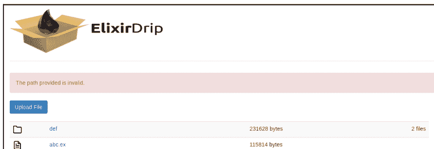

其次，我们使用 `redirect/2` 函数将用户重定向到根路径。这个函数非常有用，因为它使重定向变得非常简单。该函数的第一个参数，如常，是连接，第二个参数是要重定向到的路径。为此，我们使用 `file_path` 函数，在本例中它会为文件控制器的 index action 生成路径，并将路径作为查询参数传递。该函数由 Phoenix 动态生成，通常称为路径助手。如你所猜，这些动态函数的名称源自路由定义中使用的控制器的名称。不是将路径硬编码，我们使用路径助手生成它们。

这样，当我们更新路由时，就不需要在整个应用中更新路径——只需更新路由本身即可。由于路径助手是基于路由动态生成的，即使路由发生变化，我们的应用仍能正常工作。

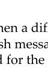

为了增强安全性，redirect 函数的 :to 选项只接受路径。如果要重定向到任意 URL，请使用 :external 选项。

当发生不同类型的错误时，我们使用 _ 模式捕获它，并简单地放置一条 flash 消息说明发生了意外错误，然后重定向到根路径，就像对无效路径错误的处理一样。

最后，当在没有 path 参数的情况下调用 index action 时，我们将用户重定向到根路径，这将调用 index 函数的第一个子句。现在让我们转向 show action，其目的是展示某个文件的详细信息：

```elixir
def show(conn, %{"id" => id}) do
  with {:ok, file} <- Storage.get_file_info("hardcoded_user_id", id) do
    render(conn, file: file)
  else
    {:error, :not_found} ->
      conn
      |> put_flash(:error, "File not found.")
      |> redirect(to: file_path(conn, :index, "path": "$"))
    _ ->
      conn
      |> put_flash(:error, "Unexpected error.")
      |> redirect(to: file_path(conn, :index, "path": "$"))
  end
end
```

此 action 的逻辑与 index 的非常相似。我们通过对第二个参数进行模式匹配从查询参数中提取 id，然后调用 elixir_drip umbrella 应用的 Storage 模块中的函数。我们对该函数调用的结果进行模式匹配以相应地处理每种情况。因此，这个 action 没有太多需要讨论的地方。然而，让我们借此机会演示一个非常强大的 Phoenix 特性：action fallbacks。

如我们所见，catch all 模式与 index action 中存在的完全相同。为了本例的 sake，假设 {:error, :not_found} 和 {:error, :invalid_path} 的块也在其他 action 中重复出现。我们现在将看到 action fallback 如何允许我们消除这种重复并统一在此控制器中处理错误的方式。

首先，我们需要在 index 函数之前添加以下行：

```
action_fallback(ElixirDripWeb.FallbackController)
```

Phoenix.Controller.action_fallback/1 函数会将你作为参数传递的 plug 注册为控制器正在执行 action 的回退。当控制器 action 失败且未返回有效的 %Plug.Conn{} 结构体时，会使用此回退。发生这种情况时，回退 plug 将接收两个参数：action 被调用之前的连接，以及控制器 action 的返回值。

现在让我们看看我们作为参数传递的模块的代码，即 fallback controller：

```
$ cat apps/elixir_drip_web/lib/elixir_drip_web/controllers/fallback_controller.ex
```

```
defmodule ElixirDripWeb.FallbackController do
  use Phoenix.Controller
  import ElixirDripWeb.Router.Helpers, only: [file_path: 3]

  def call(conn, {:error, :invalid_path}) do
    conn
    |> put_flash(:error, "The path provided is invalid.")
    |> redirect(to: file_path(conn, :index, "path": "$"))
  end

  def call(conn, {:error, :not_found}) do
    conn
    |> put_flash(:error, "File not found.")
    |> redirect(to: file_path(conn, :index, "path": "$"))
  end

  def call(conn, _error) do
    conn
    |> put_flash(:error, "Unexpected error.")
    |> redirect(to: file_path(conn, :index, "path": "$"))
  end
end
```


本质上，我们已将错误处理逻辑复制到此控制器中，并对控制器 action 返回的元组进行模式匹配，以便适当处理每种错误。这非常有益，因为错误处理逻辑通常分散在我们的应用程序各处。例如，匹配全部子句已在 index 和 show action 中重复出现。请注意，在 Elixir 中处理意外错误并不常见，因为我们通常更关注 happy path。

然而，你可能希望确保客户端始终获得有效的响应，在我们的例子中这涉及重定向到根路径。在真实的生产部署中，我们很可能会将此错误标记到错误跟踪系统中，以便日后调查其原因。

使用 fallback controller 的另一个巨大优势是控制器可读性的提高。让我们查看此更改后 show action 的代码：

```elixir
def show(conn, %{"id" => id}) do
  with {:ok, file} <- Storage.get_file_info("hardcoded_user_id", id) do
    render(conn, file: file)
  end
end
```

现在，我们的代码完全专注于 happy path，从而得到一个更容易理解的函数。这个函数如此简单，以至于 show action 中无需再添加任何内容。让我们通过最后两个 action new 和 create 来结束本节。我们将一起讨论它们，因为这两个 action 是耦合的：new 用于渲染表单以允许用户上传新文件，而 create action 用于处理表单提交。在下一节讨论视图和模板时，我们将看到此表单是如何创建和提交的。现在，让我们先看看 new action 的代码：

```elixir
def new(conn, %{"path" => path}) do
  render(conn, changeset: Storage.Media.create_changeset(%Storage.Media{}), path: path)
end
```

```elixir
def new(conn, _params) do
  render(conn, changeset: Storage.Media.create_changeset(%Storage.Media{}), path: "$")
end
```

正如我们所见，此 action 的代码非常简单。当调用此 action 时，我们只需渲染 "new.html" 模板。正如我们在下一节将看到的，此模板需要一个 changeset。因此，我们生成一个空的 changeset 并将其传递给模板。我们有两个函数子句，就像 index action 一样：一个用于 "path" 参数提供的情况，另一个用于未提供的情况。此 action 的代码只是将来自路由器的请求连接到正确的视图和模板的一种方式。现在让我们分析 create action 的代码：

```elixir
def create(conn, %{"file" => file_params}) do
  file_content =
    file_params
    |> Map.get("file")
    |> Map.get(:path)
    |> File.read!()

  with {:ok, :upload_enqueued, _changeset} <- Storage.store(
    "hardcoded_user_id", file_params["file_name"],
    file_params["full_path"], file_content) do
    conn
    |> put_flash(:info, "Your file upload is enqueued. A confirmation will appear shortly.")
    |> redirect(to: file_path(conn, :index, "path": file_params["full_path"]))
  else
    {:error, changeset} ->
      conn
      |> put_flash(:error, "Unable to upload file. Please check the errors below.")
      |> render(:new, changeset: changeset, path: file_params["full_path"])
  end
end
```

此 action 稍微复杂一些，让我们逐段分析。我们将 file_params 绑定到通过表单提交的数据。在这种情况下，它将是一个包含有关正在上传的文件的信息以及文件本身的 map。我们首先获取文件的二进制内容。我们使用 File.read!/1 是因为 Phoenix 为通过表单提交的文件创建了一个临时文件。我们将文件的二进制内容绑定到 file_content，然后将其传递给 Storage.store/4。除了内容本身之外，此函数还接收文件所有者的用户 ID，以及文件的名称和路径。

当文件正确存储时，我们会弹出一条 flash 消息以向用户提供反馈，并将其重定向到刚刚上传的文件的路径。请注意，此操作仅在管道上排队上传。当我们在本章末尾讨论 Phoenix Channels 时，我们将着手提供确认文件已成功上传的通知。

当 store 函数返回错误时，我们会弹出一条 flash 消息说明发生了某些错误，并使用包含错误的 changeset 渲染 "new.html" 模板。此细节将允许我们直接从 changeset 渲染错误。我们将在下一节更详细地了解其工作原理。现在，我们只需要记住将失败的 changeset 传递给模板很重要。还值得指出的是，在这种情况下，我们需要将模板名称传递给 render 函数，因为如果省略它，Phoenix 将尝试渲染名为 "create.html" 的模板，而该模板不存在。在这种情况下，我们只传递一个原子 (:new)，而不是字符串 "new.html"。我们之所以可以这样做，是因为当向 render 传递原子时，Phoenix 将使用当前请求（在我们的例子中为 HTML）的格式来构建模板的完整名称。

我们现在已经完成了控制器部分！接下来，我们将看看控制器完成所有处理并开始渲染视图后会发生什么。

## 渲染视图

在探索了 Phoenix 中控制器的工作方式后，我们现在将看看下一步：渲染视图。视图是一个包含渲染函数的模块，其目的是将数据转换为最终用户可以消费的格式。延续我们在前两节中给出的示例，我们将查看文件以及它们在我们的应用程序中如何被渲染。我们将创建一个文件视图模块，命名为 ElixirDripWeb.FileView。以下是它的代码：

```
$ cat apps/elixir_drip_web/lib/elixir_drip_web/views/file_view.ex

defmodule ElixirDripWeb.FileView do
  use ElixirDripWeb, :view

  def parent_directory(path) do
    Path.dirname(path)
  end
end
```

首先，我们给这个模块起的名字很重要。正如我们在上一节中看到的，文件控制器在渲染响应时从未提及视图模块。我们之所以能够做到这一点，是因为 Phoenix 会根据控制器模块的名称推断出视图模块的名称。为避免在此问题上产生混淆，Phoenix 在模块名称中始终使用单数形式。如果由于某种原因你无法遵循这些规则，并且想要指定要调用的视图的名称，你只需要在控制器中调用 render 时传递视图模块的名称即可。这又是 Phoenix 让你保持高效并从应用程序中移除样板代码的另一个例子，同时也给你根据需要调整框架的选项。

在这个视图模块内部，我们只看到一个函数 parent_directory，它将在模板中使用，正如我们稍后将看到的那样。首先我们需要澄清 Phoenix 中的视图和模板是什么。在许多其他框架中，这两个词可以互换使用，但在该框架中它们是两个不同的概念。视图，正如我们之前描述的那样，是一个包含渲染函数的模块。这些渲染函数可以是模块本身中的 render 函数（就像其他任何 Elixir 函数一样），也可以从模板定义。模板是从包含标记语言与 EEx 代码混合的文件编译而来的，这使我们能够在模板中替换变量并对其进行循环。此文件的编译会在相应的视图模块中生成一个函数。视图与模板之间的关注点分离使我们能够以任何所需的形式渲染数据，无论是从常规的 Elixir 函数、模板引擎（如 EEx）还是其他任何形式。现在，我们将只使用模板来渲染视图，但在本章后面构建 JSON API 时，我们将看到直接在视图模块中使用 render 函数的示例。

我们已经看到控制器如何将要渲染的模板名称传递给视图（或如何根据 action 名称推断它）。但视图是如何找到模板的呢？答案在于 Phoenix 使用的一种约定。它会在一个目录中查找模板，默认情况下是 lib/elixir_drip_web/templates。下一个目录的名称是从视图模块的名称推断出来的；在我们的例子中，视图模块名为 FileView，因此它会在 file 目录中查找模板。该目录包含以当前 action 命名的文件（或控制器传递的参数）。例如，文件索引 action 的模板位于 apps/elixir_drip_web/lib/elixir_drip_web/templates/file/index.html.eex。我们现在就来看看它。由于其中代码相当多，我们将逐段进行。你随时可以在我们提到的路径中查看完整文件。当为用户索引文件时，我们做的第一件事是渲染一个用于上传新文件的链接：

```
<%= link("Upload File", to: file_path(@conn, :new, "path": @current_path), class: "btn btn-primary") %>
```


首先要指出的是 `<%= %>` 的使用。这些标签内的代码由 EEx 引擎执行，结果会被注入到模板中。我们也可以在 `<% %>` 内放置代码，它同样会被 EEx 引擎执行，但在这种情况下结果不会被注入回模板。如你在本书其余部分会看到的，我们大多会使用 `<%= %>` 形式。

然后，在这些标签内部，我们调用了 `link` 函数，它来自 `Phoenix.HTML.Link` 模块。这个函数以及我们在后续模板中会使用的其他 HTML 助手，在我们调用 `use ElixirDripWeb, :view` 时会被导入。这些助手非常有用，可以让我们在模板中创建常见的 HTML 结构。link 函数会创建一个锚元素。第一个参数是锚上显示的文本，而第二个参数是一个关键字列表。`to:` 键指定了链接的目标。我们使用之前见过的路径助手来创建一个指向文件资源 `:new` 动作的链接。注意我们如何将当前路径传递给这个函数。EEx 允许我们通过在名称前加上 `@` 来引用传递给模板的 assigns。这种语法会在 `@current_path` 未传递给模板时生成异常。为了避免在这种情况下抛出异常，我们可以使用 `assigns[:current_path]`。最后，我们传递了 `class:` 键，它允许我们定义正在创建的锚的类——在这个例子中，我们用它来将链接样式化为按钮。这些类之所以可用，是因为 Phoenix 生成器导入了 Bootstrap CSS 库（默认情况下放置在 `apps/elixir_drip_web/assets/css/phoenix.css`）。

现在让我们继续看下一部分：

```
<%= if Enum.empty?(@folders) && Enum.empty?(@files) do %>
  <p class="lead">This folder is empty!</p>
  <% else %>
  # ...
<% end %>
```

现在，我们使用条件表达式来检查 assigns 中提供的 folders 和 files 是否都为空。如果是，我们插入一段说明此事的段落。否则，我们执行 `else` 块中的内容，我们接下来会看到。在此之前，重要的是要注意，即使使用 `if`，我们仍在使用 `<%= %>` 记法。如第一章所述，Elixir 中的一切都是表达式，因此如果我们希望将 `if` 的结果注入到模板中，就应该使用适当的记法。现在让我们看看 else 块中的内容：

```
<table class="table table-striped">
  <%= if @current_path != "/" do %>
    <tr>
      <td>"></td>
      <td colspan="3"><%= link("..", to: file_path(@conn, :index, "path":
        parent_directory(@current_path))) %></td>
        </tr>
        <% end %>
```

这里是我们开始渲染文件夹和文件的地方。我们首先打开一个 table 元素，在其中插入每个文件夹和文件。在遍历之前，我们检查当前路径是否不是根路径。如果不是，我们希望渲染一个指向当前目录父目录的虚拟文件夹。在链接之前，我们渲染一个图像，这展示了如何指向静态文件夹内的文件：使用 static_path 路径助手，将文件的相对路径作为参数传递。图像之后，我们渲染一个文本为 ".." 的链接，指向当前目录的父级。注意我们如何传递路径查询参数：通过调用在 FileView 模块上定义的 parent_directory 函数。该函数以当前路径作为参数并返回父目录的路径。请注意，我们不需要在函数名前加上其模块。猜猜为什么？因为此模板将被编译为该模块内部的一个函数，这意味着我们可以像在其中编写常规 Elixir 函数一样调用该模块中的函数。让我们继续看下一部分：

```
<%= for folder <- @folders do %>
    <tr>
        <td>"></td>
        <td><%= link(folder.name, to: file_path(@conn, :index, "path": @current_path <> "/" <> folder.name)) %></td>
        <td><%= folder.size %> bytes</td>
        <td><%= folder.files %> files</td>
    </tr>
<% end %>
```

这里，我们看到了模板中循环的第一个示例。也就是说，我们使用 comprehension 来遍历作为参数传递的 folders 列表中的每个文件夹。除此之外，逻辑与我们已经看到的示例非常相似。首先，我们渲染一个图像，然后是一个链接，这个链接允许用户进入当前文件夹。最后，我们不是注入两个空列，而是用当前文件夹的大小（其下文件和文件夹大小的总和）和当前文件夹拥有的文件数量来填充它们。让我们继续看此模板的最后一部分：

```
<%= for file <- @files do %>
    <tr>
        <td>"></td>
        <td><%= link(file.name, to: file_path(@conn, :show, file.id)) %></td>
        <td colspan="2"><%= file.size %> bytes</td>
    </tr>
<% end %>
</table>
```

这个示例与上一个非常相似。不同之处在于，我们现在遍历的是 files 而不是 folders。我们渲染了一个不同的图像，并且我们创建的链接指向特定的文件（使用其 ID）。

如前所述，模板会被编译为其各自视图模块内部的函数。这意味着在运行时，模板已经在内存中，不需要进行磁盘读取或模板引擎计算。此外，Phoenix 使用链表构建模板，而不是像许多其他框架那样拼接巨大的字符串。这样，Phoenix 在渲染模板时就不会在字符串之间来回复制。由于 Elixir 中的数据类型是不可变的，Phoenix 可以共享响应的静态部分，因为它们永远不会被修改。模板渲染时的这种效率是 Phoenix 的一个非常重要的部分，使其能够实现我们在本章开头描述的惊人性能。

在继续下一个模板之前，让我们看一下此模板运行时的截图：

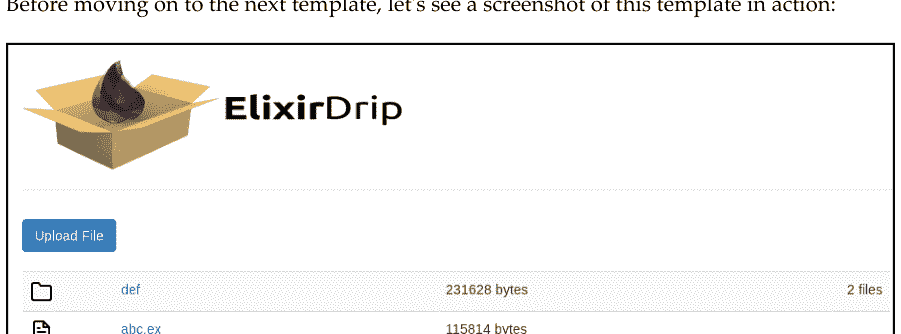

我们现在将探索 show 动作的模板，它位于 `apps/elixir_drip_web/lib/elixir_drip_web/templates/file/show.html.eex`。在 show 动作的模板中，我们可能会复制 index 模板中渲染文件的内容，但这会造成逻辑重复。在本示例中，我们将看到如何嵌套模板，从而消除重复。首先，我们将创建一个新模板：

```
$ cat apps/elixir_drip_web/lib/elixir_drip_web/templates/file/
file.html.eex

<tr>
    <td>"></td>
    <td><%= link(@file.name, to: file_path(@conn, :show, @file.id)) %></td>
    <td><%= @file.size %> bytes</td>
</tr>
```

```
<td/>
</tr>
```

这与我们在 index 模板最后一部分中展示的内容是一份拷贝，只是我们读取 file 的地方现在看到的是 @file，因为文件现在来自 assigns 而不是循环。现在，让我们在 show 模板中使用它：

```
$ cat apps/elixir_drip_web/lib/elixir_drip_web/templates/file/show.html.eex
```

```
<div>
  <table class="table table-striped">
    <%= render("file.html", conn: @conn, file: @file) %>
    <tr>
      <td> Full path: </td>
      <td colspan="3"><%= @file.full_path %></td>
    </tr>
    <tr>
      <td> Uploaded at: </td>
      <td colspan="3"><%= @file.uploaded_at %></td>
    </tr>
  </table>
  <%= link("Back to folder", to: file_path(@conn, :index, "path": @file.full_path), class: "btn btn-default") %>
</div>
```

为了使用 file 模板，我们只需调用 render，传递模板名称作为属性（连同必要的 assigns）。这样，我们在整个应用程序中就有了一种统一的方式来渲染文件，这不仅消除了重复，也促进了视觉一致性。我们还更新了 index 动作以使用 file 模板。由于这是 show 动作，除了渲染文件的一般信息外，我们还显示文件的完整路径以及上传时间。最后，我们渲染一个链接，允许用户返回此文件所属的文件夹。我们使用在 index 模板中看到的相同技术来实现这一点。

我们现在将探索最后一个模板，在其中学习如何在 Phoenix 中生成表单。这是 new 动作的模板：

```
$ cat apps/elixir_drip_web/lib/elixir_drip_web/templates/file/
new.html.eex
```

```
<h1>Upload a File</h1>
<%= form_for @changeset, file_path(@conn, :create), [multipart: true, as: :file], fn f -> %>
  <div class="form-group">
    <%= text_input f, :file_name, placeholder: "File Name", class: "form-control" %>
    <%= error_tag f, :file_name %>
```

```
</div>
<div class="form-group">
  <%= text_input f, :full_path, value: @path, placeholder: "Full Path",
    class: "form-control" %>
  <%= error_tag f, :full_path %>
</div>
<div class="form-group">
  <label>File</label>
  <%= file_input f, :file, class: "form-control" %>
</div>
<%= submit("Upload", class: "btn btn-primary") %>
<% end %>
```

模板的核心部分是 Phoenix.HTML.Form.form_for/4 函数。该函数的第一个参数可以是 changeset（正如我们在模板中所使用的），也可以是 connection——事实上，它可以是实现 Phoenix.HTML.FormData 协议的任何内容。这些随后被用来填充表单数据，例如默认值或错误信息。请记住，我们在控制器中调用 render 时将 changeset 传递给了模板。第二个参数是表单提交时调用的 action——在我们的例子中，是 file 控制器上的 create action。第三个参数是一个关键字列表，允许我们配置表单的行为。在本例中，我们传递了两个选项：multipart: true，它将表单的 enctype 设置为 multipart/form-data，使我们能够在此表单中上传文件；以及 as: :file，它定义了在服务器端收集表单所有参数的参数。这就是为什么在 file 控制器的 create action 中，我们对 file 参数进行模式匹配的原因。最后，form_for 的最后一个参数是一个接收表单作为参数的 lambda。form_for 函数将第一个参数（在我们的例子中是 changeset）转换为表单，并将其传递给上述 lambda。

现在，我们使用 Phoenix.HTML.Form 模块中的辅助函数来生成我们想要的输入字段。这些函数接收表单 (f) 作为参数。使用表单，这些函数还可以从 changeset 中获取数据并预填充字段。例如，如果我们的 changeset 为 filename 设置了默认值，它将自动显示在表单中。此外，Phoenix 表单与 Ecto change set 之间的集成允许我们直接在表单中渲染 changeset 的错误。这就是为什么我们对两个输入都调用 error_tag 的原因。error_tag 函数由 Phoenix 生成，默认位于应用程序的 ErrorHelpers 模块中（在我们的例子中是 ElixirDripWeb.ErrorHelpers）。

让我们通过有意在表单中生成错误来实际查看其效果：

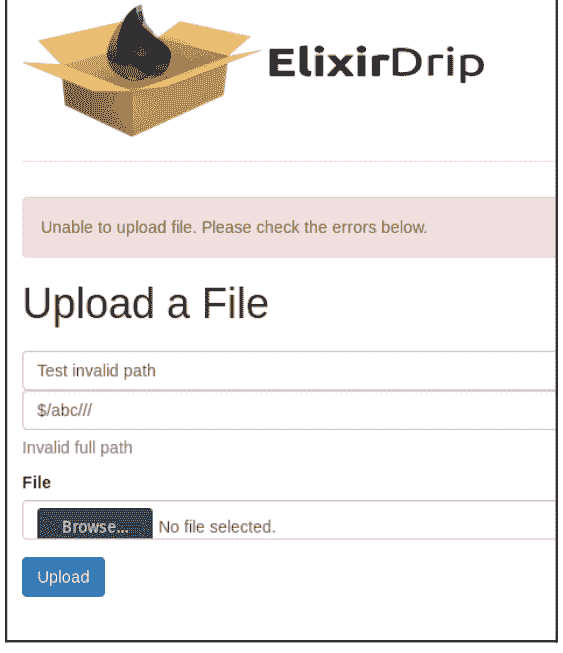

我们在表单中插入了一条无效路径。后端检测到该路径无效，并返回了一个包含错误的 changeset。正如截图中所见，表单能够从 changeset 中获取错误并将其显示在对应字段旁边。如果未对 changeset 应用 action（或 action 为 :ignore），则错误不会显示，即使 changeset 的 :errors 字段中包含错误。通常，表单是使用空的 changeset 创建的，该 changeset 可能携带错误（例如由于缺少必填字段）。然而，我们不希望在用户对表单执行操作之前向其显示错误。


为了在应用程序中促进 HTML 安全，Phoenix 模板不会直接将数据类型转换为字符串。相反，Phoenix 为大多数数据类型实现了 `Phoenix.HTML.Safe`，从而保证返回安全的 HTML 表示。

表单的最后一部分是对 `submit` 函数的调用，该函数生成一个用于提交表单的按钮。第一个参数是按钮上显示的文本，第二个参数是一个选项关键字列表，这些选项会转发给底层的按钮标签。最后关于表单的一个说明，我们想指出在 Phoenix 中，表单会自动生成一个 CSRF token。默认情况下，Phoenix 也会检查此 token（通过 `:protect_from_forgery` plug），从而保护应用程序免受 CSRF 攻击。

## 布局

到目前为止，我们已经看到了一些模板示例以及它们如何用于渲染响应。然而，当控制器调用视图来渲染模板时，该视图并不会直接渲染；控制器首先渲染布局视图，然后布局视图再渲染模板本身。这样，我们可以在整个应用程序中保持一致的样式（例如设置页眉和页脚），而无需在各个模板中重复它们。

然而，布局是普通的模板。你对模板学到的所有内容同样适用于布局。Phoenix 生成器会创建一个 `app` 布局，在我们的例子中它位于 `apps/elixir_drip_web/lib/elixir_drip_web/templates/layout/app.html.eex`。该布局将被编译为 `ElixirDripWeb.LayoutView` 上的一个函数（位于 `apps/elixir_drip_web/lib/elixir_drip_web/views/layout_view.ex`）。

为了渲染你在控制器中设置的模板，Phoenix 会将该模板嵌套在 `app` 布局中。负责执行此操作的特定行是：

```
<%= render(@view_module, @view_template, assigns) %>
```

类似于我们对 `file` 模板所做的操作，我们正在调用 `render` 函数在当前布局（它本身也是一个模板）内部渲染另一个模板。`@view_module` 和 `@view_template` 变量由 Phoenix 分配，分别包含正在渲染的视图的模块名称和该视图内部的模板名称。如果出于某种原因你想更改正在渲染的布局，你有几个选项：调用控制器中的 `render` 时传递 `layout:` 选项；在控制器中调用 `put_layout/2` plug；或在路由器管道中调用 `put_layout/2` plug，使此更改对通过该管道的每个请求都生效。

在结束本节之前，我们想谈谈 `ErrorView`。该视图由 Phoenix 生成，是集中处理应用程序中错误渲染逻辑的地方。

Phoenix 会检测任何 400 或 500 级别的错误，并使用该视图中的 render/2 函数来渲染错误信息。以下是 Phoenix 生成的两个子句：

```
$ cat apps/elixir_drip_web/lib/elixir_drip_web/views/error_view.ex

defmodule ElixirDripWeb.ErrorView do
  use ElixirDripWeb, :view

  def render("404.html", _assigns) do
    "Page not found"
  end

  def render("500.html", _assigns) do
    "Internal server error"
  end

  # ...
end
```

这只会向浏览器返回文本，但在实际应用程序中，你可以自定义它以渲染你想要的适当的 404 和 500 页面。如果 Phoenix 找不到与当前错误匹配的 render/2 函数子句，则会执行 template_not_found/2 函数：

```
$ cat apps/elixir_drip_web/lib/elixir_drip_web/views/error_view.ex

defmodule ElixirDripWeb.ErrorView do
  # ...

  def template_not_found(_template, assigns) do
    render("500.html", assigns)
  end
end
```

正如我们所见，默认情况下它只会调用 "500.html" 模板。我们将在本章后面实现应用程序的 JSON API 时再次涉及该模块。

我们现在已经到达了视图部分的结尾。此时，我们已经涵盖了 Phoenix 工作原理的基础，从 endpoint 开始，经过 router，涉及 controller，最后结束于 view。结合我们在这些部分中获得的所有知识，我们现在将把它们应用到为我们的 ElixirDrip 应用程序添加身份验证。

## 用户认证

在上一章中，我们看到了如何在 Accounts 上下文中处理用户密码，使用 comeonin 库对其进行签名和验证。在本章中，我们的重点是扩展我们的 Web 界面，以允许用户注册和登录我们的应用程序，并限制某些页面仅对已登录用户开放。Elixir 生态系统中有一系列库可以在几行代码内实现此功能。然而，实现我们自己的身份验证解决方案有两个好处：它将给我们机会更深入地探索 Phoenix，并且它将给予我们在身份验证方式上更大的自由度，使我们能够将其调整以适应我们的需求。

为了让用户通过身份验证，我们首先需要在应用程序中创建用户的能力。我们将从下而上完成这部分工作，围绕用户身份验证构建逻辑，并在该部分完成后，我们将着手允许用户注册和登录。

正如我们在本章开头所暗示的，我们将使用 plugs 实现身份验证。我们将创建两个 plugs：第一个负责从 session 中提取用户 ID 并将对应的用户加载到连接中，第二个负责验证连接中是否存在当前用户，并在不存在时限制对某些内容的访问。让我们从第一个名为 FetchUser 的 plug 开始：

```
$ cat apps/elixir_drip_web/lib/elixir_drip_web/plugs/fetch_user.ex

defmodule ElixirDripWeb.Plugs.FetchUser do
  import Plug.Conn

  alias ElixirDrip.Accounts

  def init(options), do: options

  def call(conn, _options) do
    user_id = get_session(conn, :user_id)
    find_user(conn, user_id)
  end

  defp find_user(conn, nil), do: conn
  defp find_user(conn, user_id) do
    user = Accounts.find_user(user_id)
    assign_current_user(conn, user)
  end

  defp assign_current_user(conn, nil), do: conn
  defp assign_current_user(conn, user) do
    conn
```

```
|> assign(:current_user, user)
|> assign(:user_id, user.id)
end
end
```

我们在本章开头看到了 plugs 的工作原理：它们接收一个 connection 并返回一个 connection，可能对其进行修改。这里是我们应用中第一个 plug 的示例。init/1 函数只是返回传入的 options，而这些 options 在 call/2 函数中不会被使用。在 call/2 函数内部，我们首先从 session 中获取 :user_id 键的值。然后我们将该值传递给 find_user/2 函数。接着我们对函数子句使用模式匹配来检查该变量是否为 nil。如果是，我们就直接返回未修改的 connection。如果不是，我们就尝试查找对应 user_id 的用户。我们再次在 assign_current_user 函数上使用模式匹配。如果找不到具有该 ID 的用户，我们就直接返回 connection。如果能找到用户，我们就将其分配到 :current_user 键（并将其 ID 分配到 :user_id 键），它将被存储在 connection 内部。assign/3 函数是从 Plug.Conn 模块导入的，用于在 connection 的 assigns 字段中设置键/值对。在下一个 plug 中，我们将看到如何访问该字段中的对。让我们现在更新 router 中的 :browser pipeline 以调用此 plug：

```
$ cat apps/elixir_drip_web/lib/elixir_drip_web/router.ex

defmodule ElixirDripWeb.Router do
  use ElixirDripWeb, :router

  alias ElixirDripWeb.Plugs.FetchUser

  pipeline :browser do
    plug(:accepts, ["html"])
    plug(:fetch_session)
    plug(:fetch_flash)
    plug(:protect_from_forgery)
    plug(:put_secure_browser_headers)
    plug(FetchUser)
  end

  # ...

end
```

现在，FetchUser plug 将为调用 :browser pipeline 的所有请求运行，目前就是全部请求。如我们所见，此 plug 会尝试从 session 中加载 :user_id，如果找到，就将对应的用户放入 connection 的 assigns 字段中，后续的 plugs 可以使用它。让我们看看下一个名为 Auth 的 plug 如何查询此字段：

```
$ cat apps/elixir_drip_web/lib/elixir_drip_web/plugs/auth.ex

defmodule ElixirDripWeb.Plugs.Auth do
  import Plug.Conn
  import Phoenix.Controller, only: [put_flash: 3, redirect: 2]
  import ElixirDripWeb.Router.Helpers, only: [page_path: 2]

  def init(options), do: options

  def call(conn, _options) do
    case conn.assigns[:current_user] do
      nil ->
        conn
        |> put_flash(:error, "You need to be logged in to view this content.")
        |> halt()
        |> redirect(to: page_path(conn, :index))
      _ ->
        conn
    end
  end
end
```

除了一些必要的设置，例如导入模块和定义所需的 init/1 函数之外，此 plug 会检查 connection 的 assigns 字段中是否存在 :current_user，该字段可能已被 FetchUser plug 填充。然后我们对访问 conn.assigns[:current_user] 的结果进行模式匹配。如果它是 nil，意味着 session 中没有 :user_id（或存在但不对应任何用户），因此 :current_user 未被加载到 connection 上。在这种情况下，我们会弹出一条 flash 消息告知用户需要登录，调用 halt/1 函数，并将用户重定向到我们的应用的登陆页面，该页面不需要用户登录。请注意，halt/1 函数仅将 connection 的 :halted 字段设置为 true，意味着后续的 plugs 不会被调用，而我们的重定向仍然会执行。

那么，我们应该在哪里调用此 plug？在任何需要检查用户是否已登录的地方。为了举例，我们将 FileController 提供的任何 action 限制为已登录用户。实现此目的的方法不止一种。例如，我们可以在 router 中创建一个新的 scope 和 pipeline，仅对某些路径调用此 plug。然而，我们尚未讨论 scopes，我们将在下一节看到一个示例。我们将借此机会演示另一种实现方式：在 controller 内部调用 plug。让我们按如下方式更新我们的 file controller：

```
$ cat apps/elixir_drip_web/lib/elixir_drip_web/controllers/
file_controller.ex

defmodule ElixirDripWeb.FileController do
  use ElixirDripWeb, :controller

  alias ElixirDrip.Storage

  plug ElixirDripWeb.Plugs.Auth

  # ...

end
```

除了在 router 中定义的 pipeline(s) 之外，controllers 内部也可以拥有 plugs 的 pipeline。在本例中，此 pipeline 仅包含一个元素，它将在 controller 的任何 action 执行之前被调用。如果我们只想在某些 action 上对用户进行身份验证，可以使用以下方式：

```
plug ElixirDripWeb.Plugs.Auth when action in [:index]
```

这样将导致仅在 action 为 index 时调用 plug。由于我们已经建立了将已登录用户放在 conn.assigns map 上的管道，现在可以将对 "hardcoded_user_id" 的引用替换为当前用户的 ID。例如，让我们看看 file controller 的更新后的 index action：

```
$ cat apps/elixir_drip_web/lib/elixir_drip_web/controllers/
file_controller.ex

defmodule ElixirDripWeb.FileController do

  # ...

  def index(conn, %{"path" => path}) do
    user = conn.assigns.current_user

    with {:ok, media} <- Storage.media_by_folder(user.id, path) do
```
```
# ...
end

# ...

end
```

有了这个设置，我们的应用现在会为当前已登录的用户加载文件和文件夹。我们也在 controller 的其他 action 中更新了对 "hardcoded_user_id" 的其他引用。现在让我们在登录之前尝试访问我们的文件列表，以检查我们是否不被允许访问：

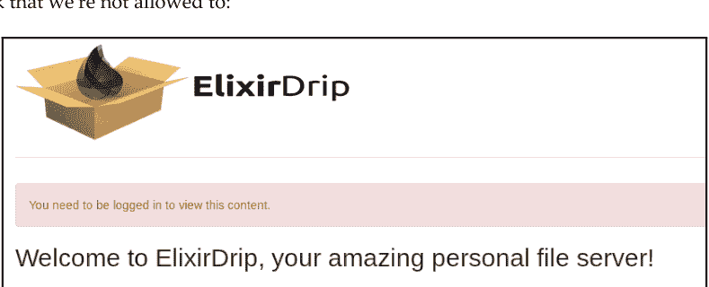

如你所见，我们现在能够将应用的部分功能限制为已登录用户。唯一缺少的是允许用户注册或登录我们的应用。为了允许用户注册，我们将创建与本章中展示的文件非常相似的模块。我们首先在 router 中添加以下内容：

```
resources("/users", ElixirDripWeb.UserController, only: [:new, :create])
```

这一行将创建 GET /users/new 和 POST /users 路由。我们在此不会展示 user controller、view 和 templates 的代码，因为它与我们为文件资源所做的工作类似。你可以在 lib/elixir_drip_web/controllers/user_controller.ex 找到 controller 的代码，view 的代码在 lib/elixir_drip_web/views/user_view.ex，模板则在 elixir_drip_web umbrella 应用文件夹内的 lib/elixir_drip_web/templates/user 文件夹中。

在接下来的几段中，我们将看到在应用中何处使用与用户相关的资源。现在，让我们专注于身份验证部分。现在我们有了用户注册的方式，我们需要为已注册用户添加登录方式。为此，我们将创建一个 session controller，它将渲染并处理登录表单，同时也负责登出。首先，我们在 router 中添加以下内容：

```
resources("/sessions", ElixirDripWeb.SessionController, only: [:new,
:create])
delete("/sessions", ElixirDripWeb.SessionController, :delete)
```

new 和 create action 与文件和用户的情况相同，分别与渲染表单和处理其提交相关。delete action 在用户想要退出系统时被调用。现在让我们转向 session controller：

```
$ cat apps/elixir_drip_web/lib/elixir_drip_web/controllers/
session_controller.ex

defmodule ElixirDripWeb.SessionController do
  use ElixirDripWeb, :controller

  alias ElixirDrip.Accounts
  alias ElixirDripWeb.Plugs.Auth

  def new(conn, _params), do: render(conn)

  def create(conn, %{"username" => username, "password" => password}) do
    with {:ok, user} <- Accounts.login_user_with_pw(username, password) do
      conn
      |> Auth.login(user)
      |> put_flash(:info, "#{user.username}, you're now logged in. Welcome back!")
      |> redirect(to: file_path(conn, :index))
    else
      :error ->
        conn
        |> put_flash(:error, "Invalid username/password combination.")
        |> render(:new)
    end
  end

  def delete(conn, _params) do
    conn
    |> Auth.logout()
    |> redirect(to: page_path(conn, :index))
  end
end
```


到目前为止，你可能已经对这种代码很熟悉了。无论如何，让我们逐个函数地过一遍。new/2 函数非常简单，因为我们只是调用 render(conn)。这段代码的作用只是将请求与适当的模板连接起来，并在 session view 模块中渲染它。这个函数中唯一值得强调的点是，与文件和用户的 new action 相反，这里我们没有向模板传递 changeset。我们只是传递 connection，表单将根据 connection 中存在的信息创建，正如我们很快会看到的那样。

然后我们有 create/2 函数，用于处理登录表单提交。我们从 Accounts 模块调用 login_user_with_pw/2 来检查提供的用户名/密码组合是否有效。如果有效，我们调用 Auth.login/2 函数，显示一条欢迎用户的 flash 消息，并重定向到文件根目录。如果用户名或密码错误，我们会显示一条表明登录不成功的 flash 消息，并再次渲染表单。最后，我们有 delete/2 函数，它调用 Auth.logout/1 函数并将用户重定向到我们应用的根路径。

此时我们缺少 Auth 模块中的 login/2 和 logout/1 函数。在继续实现这些函数之前，让我们先看看 session view 以及 new action 的模板：

```
$ cat apps/elixir_drip_web/lib/elixir_drip_web/views/session_view.ex

defmodule ElixirDripWeb.SessionView do
  use ElixirDripWeb, :view
end
```

如你所见，这个模块几乎是空的，只是调用了 use ElixirDripWeb, :view。即使在这些情况下，你也必须为你的资源创建一个 view 模块，因为与其关联的模板将被编译成该模块内部的一个函数。现在让我们检查 new action 的模板：

```
$ cat apps/elixir_drip_web/lib/elixir_drip_web/templates/session/new.html.eex

<h1>Login</h1>
<%= form_for @conn, session_path(@conn, :create), fn f -> %>
  <div class="form-group">
    <%= text_input f, :username, placeholder: "Username", class: "form-control" %>
  </div>
  <div class="form-group">
    <%= password_input f, :password, placeholder: "Password", class: "form-control" %>
  </div>
```

```
```eex
<%= submit("Login", class: "btn btn-primary") %>
<% end %>
```
```

正如我们之前提到的，现在我们向 form_for/4 函数传递的是 connection，而不是 changeset。这意味着表单在可能的情况下将用来自 connection 的信息填充。例如，当我们登录失败时，表单将使用 connection 重新渲染。在这种情况下，connection 将在 conn.params["username"] 下包含用户名，这将使表单自动填充用户名输入框中的此信息。此表单使用了一个我们尚未见过的函数：password_input/3。这个函数与 text_input/3 类似，不同之处在于在此输入中输入的文本将被掩码（并且永远不会基于 connection 信息自动填充）。

此时，身份验证工作几乎完成了。现在让我们用我们需要的函数扩展 Auth 模块：

```
```bash
$ cat apps/elixir_drip_web/lib/elixir_drip_web/plugs/auth.ex
```
```

```
```elixir
defmodule ElixirDripWeb.Plugs.Auth do
  # ...

  def login(conn, user) do
    conn
    |> put_session(:user_id, user.id)
    |> assign(:current_user, user)
    |> configure_session(renew: true)
  end

  def logout(conn), do: configure_session(conn, drop: true)

  # ...

end
```
```

login/2 函数接收一个 connection 和一个 user，并分三步更新 connection：
- 1. 首先，它将提供的用户的 ID 放入 session 中，键为 :user_id。这样，后续请求将可以访问此 :user_id，并且我们之前见过的 FetchUser plug 将能够找到对应此 ID 的用户。
- 2. 其次，它将提供的用户分配给 :current_user 键。正如本章创建的两个 plug 所示，我们通过查看 :current_user assign 并检查它是否为空来检查用户是否已登录。由于我们现在正在登录，我们也希望填充此 assign。
- 3. 第三，它使用 :renew 选项设置为 true 调用 configure_session/2。这告诉 Phoenix 向客户端发送响应时使用不同的 session cookie 标识符，这使我们能够保护应用免受会话固定攻击。

为了让用户在注册后自动登录，我们已在 user controller 的 create action 中添加了对 Auth.login/2 的调用。你可以在 lib/elixir_drip_web/controllers/user_controller.ex（在 elixir_drip_web umbrella 应用中）查看这段代码。

logout/1 函数只有一行，因为它只是使用 :drop 选项设置为 true 调用 configure_session/2 函数。这意味着响应中将不包含 session cookie，本质上是在请求结束时删除 session。

完成这两个函数后，我们现在准备将所有内容整合在一起，并为用户提供在 ElixirDrip 上注册和登录的方式。为此，我们将稍微修改应用布局，在 header 中包含这些操作的链接，就像大多数网站一样。我们将更新 <header> 标签以包含以下内容：

```
$ cat apps/elixir_drip_web/lib/elixir_drip_web/templates/layout/app.html.eex

<!-- ... -->

<ul class="breadcrumb text-right">
  <%= if assigns[:current_user] do %>
    <li>Hi, <%= assigns[:current_user].username %>!</li>
    <li><%= link("Logout", to: session_path(@conn, :delete), method: "delete") %></li>
  <% else %>
    <li><%= link("Sign Up", to: user_path(@conn, :new)) %></li>
    <li><%= link("Login", to: session_path(@conn, :new)) %></li>
  <% end %>
</ul>

<!-- ... -->
```

我们首先检查 connection 中是否分配了 :current_user。如果有，我们向用户问好并显示注销链接。如果没有，我们渲染两个链接：一个用于注册，另一个用于登录。请注意，我们使用 path helpers 生成所有这些链接。在结束本节之前，让我们看几张截图，展示我们到目前为止所做的工作。

首先，当我们访问应用的主页时，我们会在右上角看到两个链接，允许用户注册或登录：

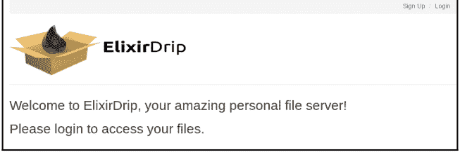

假设我们已经使用一个用户注册了，身份验证失败时登录表单如下所示：

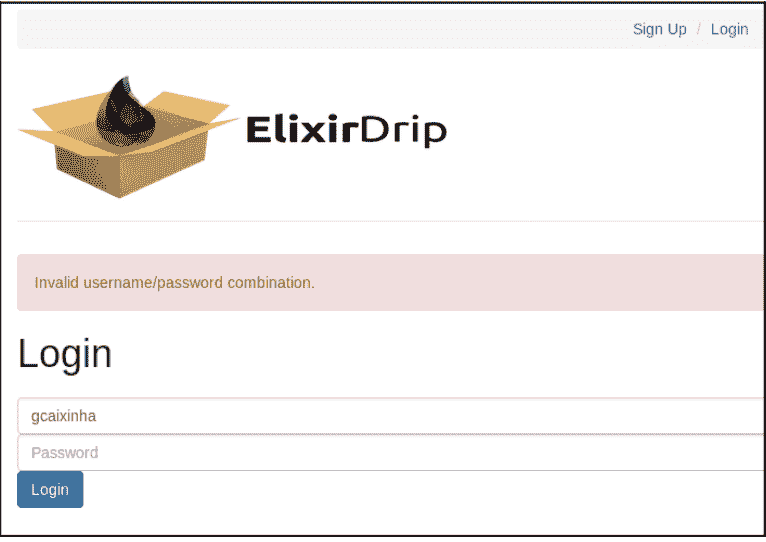

如我们所见，我们收到一条 flash 消息，告知我们用户名/密码组合无效。在输入正确的凭据后，我们会看到以下内容：

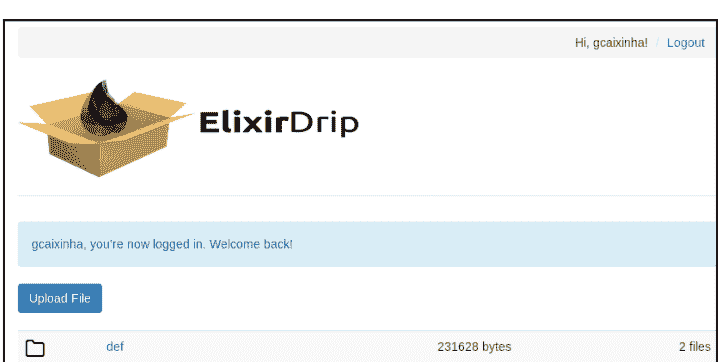

登录后，我们会看到一条欢迎用户回来的 flash 消息，并为已登录用户展示文件夹和文件列表。我们还可以观察到右上角的链接已发生变化，现在只有一个链接，允许用户注销。如果我们点击那里，我们会看到与本列表第一张截图中相同的页面。

我们现在已为 ElixirDrip 应用添加了身份验证，从头开始实现且毫无麻烦。通过整个请求生命周期跟踪身份验证逻辑，我们完全掌控应用中身份验证的执行方式。我们可以轻松扩展此实现以满足应用特定的安全要求。现在让我们继续看看如何为应用添加 JSON API。

## 实现 JSON API

到目前为止，我们一直专注于为浏览器请求提供服务并返回 HTML 响应。在本节中，我们将了解如何通过 JSON API 扩展 ElixirDrip 应用，使我们的用户能够在浏览器之外与文件交互。为了演示如何实现这一点，我们将实现 file controller 的 index action，以及通过 API 登录的能力。像往常一样，让我们先看看更新后的 router：

```
$ cat apps/elixir_drip_web/lib/elixir_drip_web/router.ex

defmodule ElixirDripWeb.Router do
  use ElixirDripWeb, :router

  # ...

  pipeline :api do
    plug(:accepts, ["json"])
  end

  scope "/", ElixirDripWeb do
    pipe_through(:browser)

    resources("/files", FileController, only: [:index, :new, :create,
      :show])

    # ...
  end

  scope "/api", ElixirDripWeb.Api as: :api do
    pipe_through(:api)

    get("/files", FileController, :index)
  end
end
```

我们创建了一个名为 :api 的新管道，目前它只是接受 JSON 请求。我们将在本节后面添加 API 身份验证时更新此管道。接下来，我们可以看到如何在 Phoenix 路由器中定义作用域。作用域提供了一种方法，可以在公共前缀路径下对路由进行分组，并在该前缀路径下的路由上运行管道。 在我们的例子中，我们将本章之前定义好的路由放在第一个作用域下，其前缀路径是根路径 "/"。这通常被称为应用程序作用域。对于此作用域内的路由，将调用 :browser 管道，就像路由器之前的版本一样。还需要注意的是，我们为 scope 函数提供了第二个参数，它是可选的。该参数是模块名称前缀，将被添加到控制器模块名称之前。与路由器第一个版本相比，我们之前必须为控制器名称提供完全限定名称，现在我们只需写控制器名称，因为我们已将 ElixirDripWeb 作为此作用域的模块名称前缀。例如，我们之前在文件路由中使用 ElixirDripWeb.FileController，现在可以简单地写成 FileController。最后，我们提供的 :as 选项是命名辅助作用域。如果没有它，此作用域的路径辅助函数将与应用程序作用域的冲突；例如，对于 GET "/files" 路由，它们都将使用 file_path(conn, :index) 调用，这是不正确的。

通过传递此选项，我们可以将此路径辅助函数用作 api_file_path(conn, :index)，而应用程序作用域中的辅助函数则以相同的方式调用。

现在看下一个作用域，可以看到路径前缀是 "api"。我们将在此作用域中放置所有与 API 相关的路由，并且每个路由都会调用我们之前描述的 :api 管道。请注意，在此作用域中我们传递了不同的模块名称前缀 ElixirDripWeb.Api。这样我们将拥有不同的控制器来处理 API 请求。实现方式有多种。例如，我们可以让同一个控制器处理两种类型的请求，然后使用 `Phoenix.Controller.get_format/1` 函数来判断传入请求是 HTML 还是 JSON。

我们选择使用独立的控制器，因为我们的文件控制器中存在针对 HTML 请求的特定代码，例如 put_flash 函数。我们认为，如果将每种类型请求的逻辑放在各自的模块中，代码会更容易阅读和理解。现在让我们来看一下 API 请求的文件控制器：

```
$ cat apps/elixir_drip_web/lib/elixir_drip_web/api/controllers/file_controller.ex

defmodule ElixirDripWeb.Api.FileController do
  use ElixirDripWeb, :controller

  alias ElixirDrip.Storage

  def index(conn, %{"path" => path}) do
    with {:ok, media} <- Storage.media_by_folder("hardcoded_user_id", path) do
      render(conn, files: media.files, folders: media.folders)
    else
      {:error, :invalid_path} ->
        render(conn, ElixirDripWeb.ErrorView, "400.json", message: "The path provided is invalid.")
    end
  end

  def index(conn, _params), do: render(conn, ElixirDripWeb.ErrorView, "400.json", message: "Missing 'path' query parameter")
end
```

目前我们通过 API 还没有身份验证，因此我们只是将一个硬编码的用户 ID 传递给 `media_by_folder/2` 函数。这段代码与 HTML 控制器中 index 动作的代码非常相似。当 `media_by_folder/2` 返回预期结果时，我们调用 render 函数，并像在 HTML 控制器中一样传递 files 和 folders assigns。

请注意，我们没有传递要渲染的模板名称，因为 Phoenix 会根据动作名称和请求格式推断出来。由于这是 index 动作且请求格式为 JSON，推断出的名称是 "index.json"。

当提供的路径无效时，`media_by_folder/2` 函数会返回错误，我们在 else 块中处理它。这里我们没有使用动作回退控制器，但如果此错误的处理在不同动作甚至控制器之间共享，我们也可以像在 HTML 控制器中那样使用它。在处理此错误时，我们还可以看到我们在调用 render 时传递了模块名称。这使我们能够将 JSON 错误视图集中在一个模块中，该模块将被 API 中的所有控制器使用。除了视图和错误名称（本例中为 "400.json"，意为 Bad Request）之外，我们还在 assigns 中传递了 :message 选项，这使我们能够提供有关此错误原因的一些详细信息。在查看 ErrorView 模块之前，请注意我们有 index 函数的第二个子句，用于在未提供 path 查询参数时。在这种情况下，我们也使用 "400.json" 调用 ErrorView，但这次传递了不同的消息：

```
$ cat apps/elixir_drip_web/lib/elixir_drip_web/views/error_view.ex

defmodule ElixirDripWeb.ErrorView do
  use ElixirDripWeb, :view

  def render("400.json", %{message: message}) do
    %{
      error: "bad request",
      details: message
    }
  end

  # ...

  end
```

我们正在为 render 函数定义一个函数子句，使用模式匹配对第一个参数进行匹配以设置错误类型，并对第二个参数进行匹配以提取控制器中传递的消息。然后我们对其进行格式化，返回给客户端的响应会告知用户这是一个无效请求，并提供有关此错误发生原因的一些详细信息。现在让我们来看一下 API 文件视图的代码：

```
$ cat apps/elixir_drip_web/lib/elixir_drip_web/api/views/file_view.ex

defmodule ElixirDripWeb.Api.FileView do
  use ElixirDripWeb, :view

  def render("index.json", %{files: files, folders: folders}) do
```
```
%{
  response: %{
    files: render_many(files, __MODULE__, "file.json"),
    folders: render_many(folders, __MODULE__, "folder.json", as:
    :folder)
  }
}
end

def render("file.json", %{file: file}) do
  %{id: file.id, name: file.name, full_path: file.full_path, size:
  file.size}
end

  def render("folder.json", %{folder: folder}) do
  %{name: folder.name, size: folder.size, files: folder.files}
end
end
```

与在 HTML 中我们始终使用模板来渲染响应不同，这里我们看到一个示例，说明如何直接在视图模块中使用 render 函数构建响应。与错误视图一样，我们对动作名称使用模式匹配，也用于提取 assigns。然后，我们使用 `Phoenix.View.render_many/4` 函数构建响应。files 和 folders 变量包含映射列表，这意味着我们本可以直接使用 files: files 而不是调用 render_many 函数。然而，这样做我们定义了文件或文件夹在 JSON 请求中的表示方式，一旦此视图模块中有更多动作，就能消除重复。除了这些列表之外，render_many 函数还接收一个模块名称，在这两种情况下我们都将其设置为 `__MODULE__`，因为文件和文件夹的 render 函数都定义在当前模块中。下一个参数是模板名称，我们为文件和文件夹相应地设置它。最后，最后一个参数是 assigns 映射，它是可选的。对于文件夹，我们传递了 :as 选项并使用 :folder，这定义了提供给 render 函数的 assign 的名称（我们在 "file.json" 和 "folder.json" 模板的 render 函数中对其进行模式匹配）。默认情况下，Phoenix 会从当前视图模块名称推断名称。我们不需要指定名称，因为我们位于 FileView 模块内，Phoenix 会为我们推断。然而，对于文件夹这是必要的。

现在分析最后两个函数，我们可以看到它们被用来定义文件或文件夹的表示。我们只是构建一个映射，其中包含我们感兴趣显示的键，并从每个资源中获取相应的信息。由于这是 index 动作，我们使用 render_many 函数遍历这些资源并呈现每一个。


为了实现 show 操作，即我们想要展示单个资源，可以使用 `render_one` 函数，它与 `render_many` 函数非常相似，但不同于接收一个列表并渲染其中的每个元素，它只是渲染一个资源。

此时，对于文件控制器的 index 操作，我们的 JSON API 已完全可用！我们现在可以向 API 发出请求，它将为我们硬编码的用户 ID 渲染文件和文件夹。我们目前还没有让用户在 API 中进行身份验证的方式，这正是我们在下一节要解决的问题。

## 在 API 中对用户进行身份验证

我们现在将了解如何为本节中创建的 API 添加身份验证。我们将实现基于会话的身份验证，这可能不是在 API 中对用户进行身份验证最常见的方式——最常见的是基于令牌的身份验证。然而，我们想展示如何将我们为 HTML 请求构建的内容移植过来。此外，我们将在下一节演示如何在 Phoenix 中使用令牌进行身份验证，当我们为频道加入添加身份验证时。照常，让我们先来看一下更新后的路由器：

```
$ cat apps/elixir_drip_web/lib/elixir_drip_web/router.ex

defmodule ElixirDripWeb.Router do
  # ...

  pipeline :api do
    plug(:accepts, ["json"])
    plug(:fetch_session)
    plug(FetchUser)
  end

  # ...

  scope "/api", ElixirDripWeb.Api, as: :api do
    pipe_through(:api)

    get("/files", FileController, :index)

    post("/sessions", SessionController, :create)
    delete("/sessions", SessionController, :delete)
  end
end
```

首先，我们更新了 :api pipeline，除了接受 JSON 请求外，它现在还会获取会话和 cookie（使用 :fetch_session plug），最后调用我们创建的 FetchUser plug，如果会话中存在有效的 :user_id，它会将当前用户加载到连接中。

我们还在 API 作用域中添加了两条路由，一条允许用户登录（post 路由），另一条允许用户注销（delete 路由）。让我们继续并查看 API 会话控制器的代码：

```
$ cat apps/elixir_drip_web/lib/elixir_drip_web/api/controllers/
session_controller.ex

defmodule ElixirDripWeb.Api.SessionController do
  use ElixirDripWeb, :controller

  alias ElixirDrip.Accounts
  alias ElixirDripWeb.Plugs.Auth

  def create(conn, %{"username" => username, "password" => password}) do
    with {:ok, user} <- Accounts.login_user_with_pw(username, password) do
      conn
      |> Auth.login(user)
      |> render("login.json", user: user)
    else
      _ ->
        conn
        |> put_status(:unauthorized)
        |> render(ElixirDripWeb.ErrorView, "401.json", message:
        "Invalid username/password combination.")
        |> halt()
    end
  end

  def delete(conn, _params) do
    conn
    |> Auth.logout()
    |> render("logout.json")
  end
end
```

该模块中的逻辑与我们之前创建的会话控制器中的逻辑非常相似。要登录，我们使用 Accounts.login_user_with_pw/2 函数，然后调用本章之前见过的 Auth.login/2 函数，它会将当前用户放入会话中。最后，我们渲染 "login.json" 模板，并将当前用户作为 assign 传递。如果登录不成功，我们会以与之前对 "400.json" 模板解释相同的方式，从 ErrorView 模块渲染 "401.json" 模板。

注销由 delete 操作处理，它仅调用 Auth.logout/1 函数，该函数会丢弃当前会话然后渲染 "logout.json" 模板。

现在让我们看看与此控制器配对的视图代码：

```
$ cat apps/elixir_drip_web/lib/elixir_drip_web/api/views/session_view.ex

defmodule ElixirDripWeb.Api.SessionView do
  use ElixirDripWeb, :view

  def render("login.json", %{user: user}) do
    %{response: "Logged in as #{user.username}"}
  end

  def render("logout.json", _assigns) do
    %{response: "Logged out"}
  end
end
```

该模块包含从我们之前看到的控制器调用的 render 函数。与我们在 API 文件视图中所做的那样，我们只是使用映射来构建将返回给用户的响应。我们现在已经完成了在 API 中处理登录和注销的逻辑。此时，我们只缺少一件事：一种限制内容仅对已登录用户可见的方式。我们将遵循基于浏览器的身份验证的相同方法，并在文件控制器中调用我们的 Auth plug。以下是 API 文件控制器的更新代码：

```
defmodule ElixirDripWeb.Api.FileController do
  # ...

  plug ElixirDripWeb.Plugs.Auth, :json

  # ...
end
```

与 HTML 文件控制器一样，我们在执行此控制器的任何操作之前调用 Auth plug，本质上要求所有操作都需要已登录用户。然而，有一个区别，我们向 plug 传递了一个参数 :json。此更新是必需的，因为我们已更新 Auth plug 以处理 HTML 和 JSON 请求。因此，在调用它时我们需要提供此选项。对应的更新已在 HTML 文件控制器中完成，向 Auth plug 传递 :html。让我们检查此 plug 的更新版本：

```
$ cat apps/elixir_drip_web/lib/elixir_drip_web/plugs/auth.ex

defmodule ElixirDripWeb.Plugs.Auth do
```

```elixir
# ...

def init(format), do: format

def call(conn, format) do
  case conn.assigns[:current_user] do
    nil -> logged_out(conn, format)
    _ -> conn
  end
end

# ...

defp logged_out(conn, :html) do
  conn
  |> put_flash(:error, "You need to be logged in to view this content.")
  |> halt()
  |> redirect(to: page_path(conn, :index))
end

defp logged_out(conn, :json) do
  conn
  |> put_status(:unauthorized)
  |> halt()
  |> render(ElixirDripWeb.ErrorView, "401.json", message:
    "Unauthenticated user.")
end
end
```

处理已登录用户的逻辑没有改变。如果 conn.assigns 中存在当前用户，我们只需返回未修改的连接。只有在需要处理未登录用户时，请求的格式才变得必要。正如本章开头所见，传递给模块 plug 的选项随后作为 call/2 函数的第二个参数。现在，我们使用该参数并将其传递给 logged_out/2 函数。我们使用模式匹配来相应地处理每种请求格式。对 HTML 请求的未登录用户处理是我们在此模块中已有的功能；我们只是将其提取到此函数中。新部分是对 JSON 请求的未登录用户处理。在这种情况下，我们为响应设置正确的状态码，中断 Plug 管道，然后渲染错误视图，并将 "Unauthenticated user." 作为 message assign 传递。

我们将通过实际操作来结束本节。首先，我们发出请求列出当前用户在根路径 ($) 的文件（对 `api/files?path=$` 的 GET 请求）。由于我们尚未登录，我们收到的响应如下：

```
{
  "error": "Unauthenticated user."
}
```

现在让我们通过向 `api/sessions` 发出 POST 请求来登录，并在请求体中传递用户名和密码。对此请求，我们收到的响应如下：

```
{
  "response": "Logged in as gcaixinha"
}
```

如果我们重复列出文件的请求，现在会看到：

```
{
  "response": {
    "folders": [
      {"size": 1034634, "name": "def", "files": 2}
    ],
    "files": [
      {"size": 115814, "name": "abc.ex", "id": "14...PZ", "full_path": "$"}
    ]
  }
}
```

这是为我们的用户渲染的 JSON 文件列表！如果我们想注销，只需向 `api/sessions` 发出 DELETE 请求即可。至此，我们已完成了对 Phoenix 中 JSON API 的巡览。我们现在将进入本章的最后一节，在那里我们将使用著名的 Phoenix Channels 为我们的应用程序添加交互性。

## 使用频道实现交互式应用程序

到目前为止，我们一直在探索如何使用 Phoenix 构建传统的 Web 应用程序，其中服务器接收请求并返回响应。请求彼此隔离，服务器有责任保持与每个客户端的对话状态。这一直是大多数 Web 应用程序的构建方式，因为它使我们能够轻松扩展它们。由于每个请求都是无状态的，服务器始终可以将它们视为新的请求，从而使我们能够水平扩展应用程序。


在本节中，我们将重点关注为我们的应用程序添加通道，正如本章中我们将看到的那样，这显著简化了交互式应用程序的实现。与我们已经描述过的传统请求/响应流程（贯穿本章）不同，使用通道时，客户端与服务器之间会建立永久连接，该连接仅在其中一方退出或崩溃时才会被关闭。打开网页时，浏览器将连接到服务器上的一个通道，服务器会为每个客户端维护一个单独的进程。

此连接随后保持打开状态，允许客户端和服务器相互发送消息。这些消息通常被称为 *事件*。由于连接保持打开，我们在客户端和服务器之间进行有状态的对话。

从根本上说，Phoenix 通道是两个参与者之间的对话。正如我们所说，通信是双向的，因此消息的发送方和接收方可以随时切换角色。一次对话始终围绕一个主题展开，发送方在该主题上广播消息，接收方订阅该主题以获取这些消息。发送方和接收方都可能参与任意数量的主题。双向通信为我们的应用程序提供了很大的灵活性。与传统的请求/响应流程中客户端必须发起请求才能渲染内容不同，现在服务器只需在通道中发出一个事件，交付后客户端即可相应地采取行动。我们将在本节中看到一些示例。

这种解决方案并未被广泛采用，因为大多数 Web 服务器根本无法为每个客户端保持一个连接打开。Phoenix 利用了本书中描述的所有 Erlang 运行时特性，使我们能够做到这一点。Phoenix 核心团队进行了一些基准测试，最终在单台服务器上实现了两百万个通道同时打开（更多细节请参见此处：http://phoenixframework.org/blog/the-road-to-2-million-websocket-connections）。该基准测试并不算新，博客文章发布于 2015 年 11 月。尽管如此，这一惊人的数字表明 Phoenix 提供了一个能够实现这种架构的基础。

在本节中，我们将把所有这些应用到我们的 ElixirDrip 应用程序中，使用通道向用户发送下载准备就绪的通知，并提供下载文件的链接。正如我们在构建上传和下载文件的管道时所看到的，这些操作是异步的。每个管道的最后一步是调用 `Notifier` 模块，该模块负责通知相应用户操作（上传或下载）已完成。为了演示这一点，我们在文件控制器上实现了 `enqueue_download` 和 `download` 动作，与本章前面展示的类似。现在让我们开始，先为通道准备服务器。

## 准备服务器

我们现在将调整服务器以允许客户端使用 Phoenix Channels 连接。与传统 Web 应用程序一样，我们的旅程始于 endpoint。当 Phoenix 生成 endpoint 模块时，它包含了以下行：

```
$ cat apps/elixir_drip_web/lib/elixir_drip_web/endpoint.ex

defmodule ElixirDripWeb.Endpoint do
  # ...

  socket("/socket", ElixirDripWeb.UserSocket)

  # ...
end
```

`Phoenix.Endpoint.socket/2` 定义了 socket 处理程序的挂载点，其中将包含通道定义。在这种情况下，我们说想要连接到通道的客户端可以连接到 `/socket` 路径，该路径将由我们作为第二个参数传递的模块处理。现在让我们看看该模块的代码：

```
$ cat apps/elixir_drip_web/lib/elixir_drip_web/channels/user_socket.ex

defmodule ElixirDripWeb.UserSocket do
  use Phoenix.Socket

  ## Channels
  channel "users:*", ElixirDripWeb.UserChannel

  ## Transports
  transport(:websocket, Phoenix.Transports.WebSocket)
  # transport :longpoll, Phoenix.Transports.LongPoll

  def connect(_params, socket) do
    {:ok, socket}
  end

  def id(_socket), do: nil
end
```

首先，此模块定义了应用程序公开的通道。传递给 `channel` 函数（从 `Phoenix.Socket` 模块导入）的第一个参数是主题匹配模式。按照惯例，主题通常采用某种应用程序概念，然后是冒号，后跟该概念的 ID。在我们的例子中，由于我们将让每个用户通过自己的通道连接到服务器，因此我们创建了 `"users:*"` 匹配主题。这只是一个约定；你的主题也可以只是纯字符串，并且订阅了该主题的每个客户端都会收到该主题上的广播。传递给 `channel` 函数的第二个参数是模块，该模块将处理与此主题相关的事件的生命周期。可以说，该模块是通道的路由器，将每个主题映射到相应的处理器，在这种类比中即控制器。


`channel` 函数有一个 `:via` 选项，用于定义在此通道上接受的传输适配器。默认值是 `[:websocket, :longpoll]`。例如，如果你只想允许特定通道使用 WebSocket 协议连接，可以将 `via: [:websocket]` 作为最后一个参数传递给 `Phoenix.Socket.channel/3` 函数。

Phoenix 生成器创建了以下两行，与 `Transports` 相关。这些定义了传输协议，将在通道上交换事件时使用。默认情况下，它附带 `WebSocket` 传输处于活动状态，而长轮询被注释掉。无论传输机制如何，最终结果都相同。随着我们在应用程序中添加或删除传输协议，我们的通道代码无需更改。传输仅提供客户端连接的方式，与通道的逻辑无关。如今，大多数 Web 浏览器都支持 WebSockets，但你可以取消长轮询传输的注释以支持通过不同机制连接的旧浏览器——仍然通过我们定义的通道运行。

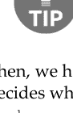

如果你有特殊需求，可以通过实现 `Phoenix.Socket.Transport` behaviour 来构建自己的传输机制。

然后，我们在此模块中有两个函数：`connect/2` 和 `id/1`。`connect` 函数决定是否允许客户端连接。目前，我们简单地返回 `{:ok, socket}`，本质上允许所有连接通过。本节后面我们将处理身份验证，并更新此函数。`id` 函数接收 `connect` 返回的 socket，并根据 socket 中存储的一些信息来标识 socket，通常将连接绑定到特定用户。

目前，我们只是返回 nil，因为我们还没有身份验证。与 connect 函数一样，我们将在处理身份验证时稍后重新审视它。现在让我们继续查看用户通道模块，该模块是 `"users:*"` 主题的处理程序：

```
$ cat apps/elixir_drip_web/lib/elixir_drip_web/channels/user_channel.ex

defmodule ElixirDripWeb.UserChannel do
  use ElixirDripWeb, :channel

  def join("users:" <> user_id, _params, socket) do
    {:ok, assign(socket, :user_id, user_id)}
  end
end
```

我们看到了通道的第一个回调：join/3。当用户想要加入我们正在模式匹配的主题时，此函数会被调用，并且可用于决定是否允许客户端加入。同样，我们只是让所有人进入。注意我们如何使用函数子句上的二进制模式匹配来提取 user_id。然后，我们调用 `Phoenix.Socket.assign/3` 函数在 socket 中保存一些状态。这与我们对连接所见的工作方式类似。assign 函数将返回更新后的 socket，这意味着我们实际上返回的是 `{:ok, socket}`，从而允许客户端加入此主题。与传统请求/响应流程中在返回响应时被转换并销毁的连接不同，socket 在循环中被转换；只要连接可用，socket 的状态就可用。这样，被处理的每个事件都可以访问 socket 的更新状态，使客户端与服务器之间的对话具有状态。

除了 join 回调之外，Phoenix Channels 还必须实现 terminate/2、handle_in/3 和 handle_out/3。terminate/2 回调在连接终止时被调用，接收错误原因和 socket。这可能由于多种原因发生，例如客户端离开或连接关闭。如果需要，你可以使用此回调执行一些清理工作。我们将在本节后面探索另外两个回调。有了这些设置，我们的服务器就可以接受连接并让用户加入通道。现在让我们看看客户端需要做什么。


## 在客户端加入频道

在服务器准备就绪后，我们现在将探索 Phoenix Channels 的客户端部分。首先，我们将快速浏览 Phoenix 为我们生成的结构，然后再看看如何对其进行更新。我们应用程序布局中，在 body 关闭之前的最后一行是：

```
<script src="<%= static_path(@conn, "/js/app.js") %>"></script>
```

这需要 app.js 文件，该文件存储在 apps/elixir_drip_web/assets/js/app.js 中。这是我们 JavaScript 代码的入口点。现在让我们分析其内容：

```
$ cat apps/elixir_drip_web/assets/js/app.js

import "phoenix_html"
import socket from "./socket"

import Notification from "./notification"
Notification.init(socket, window.userId)
```

前两行由 Phoenix 生成，而最后两行由我们创建。除了导入一些处理 HTML 的通用辅助函数外，我们还在导入 socket 对象。我们可以在这里看到它的代码：

```
$ cat apps/elixir_drip_web/assets/js/socket.js

import {Socket} from "phoenix"

let socket = new Socket("/socket", {
  params: {token: window.userToken},
  logger: (type, message, data) => { console.log(`${type}: ${message}`, data) }
})

export default socket
```

Phoenix 自带了一个 socket 实现，我们在第一行导入它。然后，我们实例化它，传入接受 socket 连接的路径（我们在服务器上定义的那个）。我们还将一个对象作为第二个参数传入。logger 键只是定义了一个有用的调试消息，它将被打印到浏览器控制台。params 键包含将作为参数传递给服务器的内容。我们已经将 token 传递给服务器，但目前会被忽略。它包含在这里是因为 Phoenix 生成了这段代码，并且它正是我们用于执行身份验证的内容。正如我们所见，使用 Phoenix JavaScript channel 客户端的 socket 定义非常简单。

让我们看看我们的最后一个 JavaScript 文件，其中包含与通知相关的逻辑：

```
$ cat apps/elixir_drip_web/assets/js/notification.js

let Notification = {
  init(socket, userId) {
    socket.connect()

    let userChannel = socket.channel("users:" + userId)

    userChannel.join()
      .receive("ok", resp => { console.log("Joined successfully", resp) })
      .receive("error", reason => { console.log("Unable to join", reason) })
  }
}

export default Notification
```

在这里，我们创建了 Notification 对象，其职责是从 Phoenix Channels 接收事件并在页面中呈现它们。目前，我们将重点关注连接到 socket 并加入频道。正如我们已经看到的，init 函数接收两个参数：socket 和用户的 ID。socket 是我们在之前分析过的对象。用户 ID，正如我们在 app.js 中看到的，是作为 window.userId 传递的。这是因为我们在应用程序布局中，在 require app.js 文件之前添加了以下行：

```
<script>window.userId = "<%= assigns[:user_id] %>"</script>
```

这一行从连接的 assigns 中获取 :user_id，该 assigns 是本章中我们已创建的 plugs 设置的。我们需要用户的 ID，因为它将用于标识主题，从而允许我们加入频道。这样，我们的应用程序中的每个用户都将拥有一个单独的频道。继续分析 Notification 对象，在连接到 socket 之后，我们定义用户频道，将频道的主题作为参数传入。最后，我们尝试使用上一行指定的主题加入频道，在用户频道上调用 join。然后我们打印一些有用的调试消息，显示此操作的结果。

在此代码就位后，如果你打开浏览器控制台并访问我们应用程序中的页面，你将看到类似以下的输出：

```
transport: connected to
ws://localhost:4000/socket/websocket?token=&vsn=2.0.0
Joined successfully
```

我们现在已通过 Phoenix channel 使用 WebSocket 协议连接到服务器。在完成连接步骤后，我们现在准备好开始在频道中交换事件。

## 交换事件

在建立频道连接后，我们现在可以专注于在频道上发送和接收事件。对于上传和下载管道来说，最后一步都是 notifier，它负责通知用户其上传/下载已完成。现在，我们需要修改此步骤以调用 ElixirDripWeb 伞形应用程序，以便发出通知用户其操作已完成的事件。以下是 notifier 步骤的更新代码：

```
$ cat apps/elixir_drip/lib/elixir_drip/storage/pipeline/notifier.ex

defmodule ElixirDrip.Storage.Pipeline.Notifier do
  # ...

  defp notify_step(%{media: %{id: id}, user_id: user_id, type: :download})
  do
    ElixirDripWeb.Notifications.notify(:download, id, user_id)
  end

  # ...
end
```

当我们到达下载管道的末尾时，我们现在调用 ElixirDripWeb.Notifications.notify/3 函数。现在让我们看看这个新创建的模块的代码：

```
$ cat apps/elixir_drip_web/lib/elixir_drip_web/notifications/notifications.ex

defmodule ElixirDripWeb.Notifications do
  use GenServer
  import ElixirDripWeb.Router.Helpers, only: [file_path: 3]
  alias ElixirDripWeb.Endpoint

  def start_link do
    GenServer.start_link(__MODULE__, :ok, name: __MODULE__)
  end

  def init(:ok) do
    {:ok, []}
  end
```

```elixir
def notify(:download, id, user_id) do
  GenServer.cast(__MODULE__, {:download, id, user_id})
end

def handle_cast({:download, id, user_id}, state) do
  link = file_path(Endpoint, :show, id) <> "/download"
  Endpoint.broadcast("users:#{user_id}", "download", %{link: link,
  message: "Your download is ready. Start it by clicking here."})
  {:noreply, state}
end
end
```

这是一个普通的 GenServer，其中 notify 函数调用 GenServer.cast，而它又将被旁边的 handle_cast 函数回调处理。在此回调内部，我们首先使用其 ID 构建文件下载的链接。然后，我们调用 Endpoint.broadcast，将主题、事件和消息（必须是可以序列化的 map）作为参数传入。在这种情况下，事件是 "download"，消息通知用户下载已准备就绪。

在这种情况下，我们需要传递主题，因为我们在 channel 模块之外广播消息，这意味着我们没有 socket 的引用。对于这些情况，Phoenix.Endpoint 模块提供了 broadcast 回调，它允许我们在无需传递 socket 的情况下，通过提供主题来广播消息。我们很快将看到从用户 channel 模块广播事件的示例。

当我们广播消息时，它将发送给所有对该主题感兴趣并连接到我们服务器的客户端。在实际完成之前，我们可能会在事件发送前拦截它，从而允许我们自定义负载甚至完全不发送它。这是通过在 channel 模块上调用 Phoenix.Channel.intercept/1 函数并实现相应的 handle_out/3 回调来完成的。虽然这在处理事件时提供了更大的灵活性，但请注意，这可能会严重影响应用程序的性能。在拦截消息时，广播将被编码的次数与该主题的订阅者数量相同，而不是在不拦截事件时仅进行一次编码。

最后，我们想指出，如果我们的应用程序部署在多个连接的节点上，其他节点链接的客户端也会接收到广播事件，因为 Phoenix 使用 Phoenix.PubSub 在同一集群的节点之间中继事件。由于我们现在已在服务器上发出事件，让我们查看客户端接收此事件所需的更改：

```
$ cat apps/elixir_drip_web/assets/js/notification.js

let Notification = {

```
init(socket, userId) {
  // ...
  let infoArea = document.getElementById("notify_info")
  let successArea = document.getElementById("notify_success")
  userChannel.on("download", ({link, message}) =>
    this.renderDownloadNotification(infoArea, successArea, message,
    link))
  },
  renderDownloadNotification(infoArea, successArea, message, link) {
    infoArea.innerHTML = ""
    successArea.innerHTML = `<a href="${link}">${message}</a>`
  }
}

export default Notification
```

我们已更改应用程序布局，为闪现消息元素添加 ID，以便在 init 函数中获取它们。获取这些元素后，我们可以看到如何在用户频道上定义事件处理程序。我们在上面调用 on 函数，传入我们将处理的事件名称和一个 lambda，每当接收到此类事件时就会调用该 lambda。请注意，lambda 将接收我们在广播消息上定义的关键字的取值作为参数——在此示例中为 link 和 message。在 lambda 内部，我们只是调用 renderDownloadNotification 函数，它将在 successArea 元素中显示一个链接。在此之前，我们会清空 infoArea 元素，以便之前的闪现消息消失，我们只显示当前正在渲染的通知。

让我们通过一些截图来看一下这一切的实际效果。当我们点击“Download File”按钮时，会显示一条闪现消息，告知我们下载已排队，链接很快就会出现：

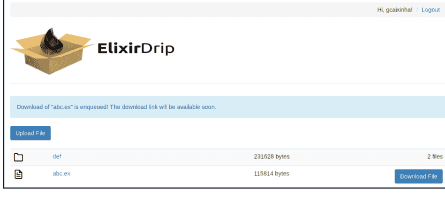

这将触发下载管道，其中包括从 Google Cloud Storage 下载文件、解密它并将其内容存储在内存中。最后一步是通知器，它将调用我们之前见过的 GenServer 模块。该模块反过来会向当前用户的频道广播“download”事件，提供下载文件的链接。以下截图显示了此通知的显示方式，为用户提供下载文件的链接：

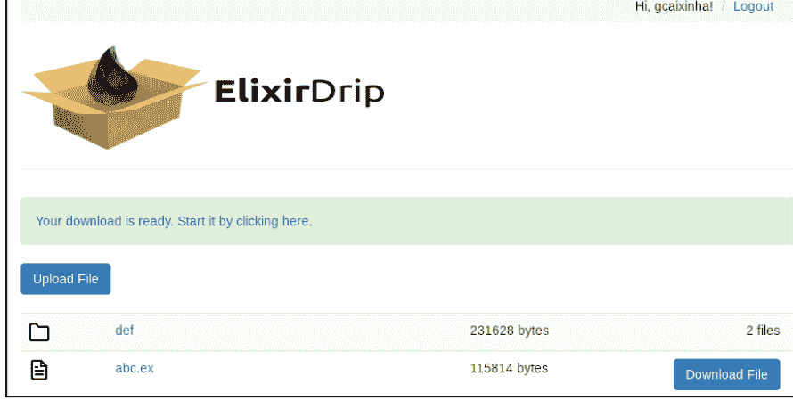

在结束本节并转到 socket 连接认证之前，让我们看看如何从客户端发送事件。为此，我们将创建允许用户与其他用户共享文件的功能。这将完全由频道驱动，路由器或控制器无需任何更改。

我们在文件的 show 操作中添加了一个按钮，并将该按钮的回调定义为以下函数：

```
$ cat apps/elixir_drip_web/assets/js/notification.js

let Notification = {
  // ...
  sharePopUp(userChannel) {
    let username = prompt("Share file with:", "username")
    if (username != null && username != "") {
      let splitUrl = window.location.href.split('/')
      let fileId = splitUrl.pop() || splitUrl.pop()

      userChannel.push("share", {username: username, file_id: fileId})
    }
  }
}

export default Notification
```

此函数接收 userChannel 参数，即我们在本文件中之前创建的频道。我们首先渲染一个提示，以便用户可以输入将与之共享此文件的用户的用户名。然后，我们有几行代码用于从当前路径中提取文件 ID。这只是对重要函数调用的准备工作：最后，我们向 userChannel 推送一个 share 消息。我们提供事件名称以及共享所需的必要参数。这将在当前用户的频道上发出事件。现在让我们看看如何在服务器上处理此事件。我们需要调整用户频道模块：

```
$ cat apps/elixir_drip_web/lib/elixir_drip_web/channels/user_channel.ex

defmodule ElixirDripWeb.UserChannel do
  # ...
  alias ElixirDripWeb.Endpoint
  alias ElixirDrip.{Accounts, Storage}

  def handle_in("share", %{"username" => username, "file_id" =>
  file_id}, socket) do
    sharee = Accounts.get_user_by_username(username)
    case sharee do
      nil -> broadcast_sharee_not_found(socket, username)
      _ -> share_file(socket, socket.assigns.user_id, file_id, sharee)
    end

{:noreply, socket}
end

defp share_file(socket, owner_id, file_id, sharee) do
  case Storage.share(owner_id, file_id, sharee.id) do
    {:ok, _media_owners} ->
      broadcast_to_owner(socket, sharee.username)
      broadcast_to_sharee(sharee.id, socket.assigns.user_id)
    {:error, _reason} ->
      broadcast_error_to_owner(socket, sharee.username)
  end
end

defp broadcast_to_owner(socket, sharee_username) do
  broadcast(socket, "share", %{message: "Successfully shared the file with #{sharee_username}."})
end

defp broadcast_to_sharee(sharee_user_id, owner_user_id) do
  owner = Accounts.find_user(owner_user_id)
  Endpoint.broadcast("users:#{sharee_user_id}", "share", %{message:
  "#{owner.username} has just shared a file with you!"})
end

defp broadcast_sharee_not_found(socket, username) do
  broadcast(socket, "share", %{message: "Couldn't find a user with #{username} username."})
end

defp broadcast_error_to_owner(socket, username) do
  broadcast(socket, "share", %{message: "Couldn't share the file with #{username}."})
end
end
```

我们使用 handle_in 回调来处理服务器上的事件（这些事件可能来自客户端甚至另一个服务器）。我们在事件名称上进行模式匹配，也对执行此操作所需的参数进行模式匹配。请注意，此示例的规模相当大，但与频道相关的代码非常小。我们有代码来处理数据库中不存在的用户名，也处理共享文件时可能发生的错误（例如，文件已与该用户共享）。

让我们回顾一下此示例的高层逻辑。我们尝试查找具有提供用户名的用户，成功后，我们尝试与该用户共享文件。如果此操作也成功，我们将发出两个事件：一个针对拥有者用户，通知文件已成功共享；第二个针对我们共享文件的用户（被共享者），通知有人与他/她共享了文件。每当尝试共享文件时出现错误，我们仅向拥有者用户发出事件，通知文件共享未发生。在此截图中，我们可以看到两个用户之间成功共享的结果，以及他们收到的通知：

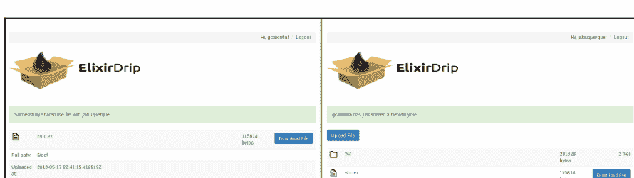

两个用户之间成功共享的结果

我们现在已经介绍了如何在 Phoenix 频道中交换事件。本节中我们为下载所做的管道和逻辑也应用于上传。你可以在随书附带的 ElixirDrip 应用程序的最终版本中查看。

在结束本节并转到为 socket 连接添加认证之前，我们想探讨在实时环境中使用频道的一些注意事项。虽然本书不涵盖如何处理网络分割和频道崩溃，但部署实际应用程序时考虑这一点很重要。这些事件最终会发生，你最好在设计应用程序时考虑到它们。好消息是 Phoenix 已经附带了一些有用的行为。例如，如果频道崩溃，Phoenix JavaScript 客户端将尝试使用指数退避策略重新连接到服务器，如果能够重新连接，它将尝试重新加入崩溃前订阅的主题。除此之外，你还应考虑网络错误情况下的消息传递保证（客户端和服务器）。官方 Phoenix Channels 指南，网址为 https://hexdocs.pm/phoenix/channels.html，包含了一些处理这些情况的有用提示。

## 认证 socket 连接

到目前为止，我们一直允许应用程序的任何用户连接 socket，即使他们未经过认证。在这种情况下，由于 :user_id 为 nil，他们都连接到 users: 主题。我们必须更新应用程序，以便只有已登录的用户才能连接 socket 并加入频道。在之前的章节中我们实现了基于会话的认证，这次我们将实现基于令牌的认证。这意味着我们将为每个已认证用户分配一个令牌，然后在用户想要连接 socket 时验证该令牌。

当我们探索 apps/elixir_drip_web/assets/js/socket.js 中的代码时，我们看到我们已经使用 window.userToken 将令牌传递给服务器。让我们首先在应用程序布局中添加以下 script 标签，类似于我们为 window.userId 所做的操作：

```
<script>window.userToken = "<%= assigns[:user_token] %>"</script>
```

我们将此行添加到 window.userId 的那一行之后。现在，window.userToken 将保存 assigns[:user_token] 中的内容。现在让我们在有已登录用户时填充此 assign。为此，我们将使用以下内容更新本章前面创建的 FetchUser plug：

```
$ cat apps/elixir_drip_web/lib/elixir_drip_web/plugs/fetch_user.ex

defmodule ElixirDripWeb.Plugs.FetchUser do
  # ...

  defp assign_current_user(conn, user) do
    token = generate_token(conn, user.id)

    conn
    |> assign(:current_user, user)
    |> assign(:user_id, user.id)
    |> assign(:user_token, token)
  end

  defp generate_token(conn, user_id) do
    Phoenix.Token.sign(conn, "user socket auth", user_id)
  end
end
```


在分配当前用户（即用户已登录）之前，我们调用 generate_token/2 函数。该函数使用来自 Phoenix.Token 模块的 sign 函数。该函数接收连接、一个盐值和要编码的数据，并会创建一个签名令牌，我们将其绑定到 token 变量。然后，在分配 :current_user 和 :user_id 键之后，我们还使用刚刚创建的令牌为 :user_token 键赋值。我们将连接作为第一个参数传递给 Phoenix.Token.sign/4 函数，这将使该模块使用配置在端点中的 :secret_key_base 对令牌进行签名，而该端点位于连接内部。我们同样可以轻松地直接传递端点或 secret key base 字符串。

在完成此设置后，剩下的就是在用户尝试连接 socket 时验证此令牌。让我们看看更新后的 UserSocket 模块：

```
$ cat apps/elixir_drip_web/lib/elixir_drip_web/channels/user_socket.ex

defmodule ElixirDripWeb.UserSocket do
  # ...

  @one_week_seconds 7 * 24 * 60 * 60

  def connect(%{"token" => token}, socket) do
    case Phoenix.Token.verify(socket, "user socket auth", token,
    max_age: @one_week_seconds) do
      {:ok, user_id} -> {:ok, assign(socket, :user_id, user_id)}
      {:error, _reason} -> :error
    end
  end

  def id(socket), do: "users_socket:#{socket.assigns.user_id}"
end
```

第一点不同之处在于，现在我们对第一个参数进行模式匹配，提取 "token" 参数的值。然后，我们使用 Phoenix.Token.verify/4 函数验证用户提供的令牌。我们将 socket 作为第一个参数传递，它将被用来获取 secret key base——这与签名时使用的相同，因为端点相同。接下来需要注意的重要一点是，该函数可以接收 :max_age 选项（以秒为单位），允许我们在一定时间后使令牌过期。在此示例中，我们不接受超过一周的令牌，这意味着如果用户在过去一周内未登录，则无法连接到 socket。然后我们在 case 块内部使用模式匹配相应地处理每种情况。如果 verify 函数返回 {:ok, user_id}，我们接受连接，返回 {:ok, socket}。我们已将 :user_id 在 socket 上的赋值移至此处，并从 UserChannel 模块中删除了它。当出现错误时，我们只需返回 :error，阻止该用户连接到 socket。最后，我们还更新了 id/1 函数，使其返回一个标识连接到此 socket 的用户的主题字符串。这样，我们就可以识别属于某个用户的所有 socket，例如，可以向该主题发送广播消息以终止特定用户的所有 socket 连接。

现在，如果你在未登录的情况下打开浏览器控制台，你会看到一些错误消息，因为 socket 的连接失败了。如果你使用的是 Firefox，你会看到类似这样的错误消息：

```
Firefox can't establish a connection to the server at
ws://localhost:4000/socket/websocket?token=&vsn=2.0.0.
```

此错误意味着我们已实现目标，只有已登录的用户才能连接到 socket。让我们继续本章的最后一部分，在其中将 Phoenix.Presence 整合到我们的 ElixirDrip 应用中。

## 使用 Presence 跟踪用户状态

为了完成本章，我们将快速了解一下如何向应用中添加在线用户列表，并在过程中展示使用 Phoenix Presence 实现这一功能是多么简单。该功能在 Phoenix 1.2 中发布，并构建在 Phoenix PubSub 和 Channels 之上。Phoenix Presence 允许我们在主题上注册进程信息，该信息会在集群内部透明地复制。

Presence 的一个特殊之处在于没有单一的事实来源，因此也没有单一的故障点。与之相比，在其他编程语言中，你可能会使用数据库（或其他中央组件）来存储每个用户的状态，而 Phoenix Presence 实现了使用无冲突复制数据类型（CRDT）跨集群节点同步状态的分布式 gossip 协议。这种方法相比中央数据存储有两个主要优势：你可以通过添加更多服务器来扩展系统，并且由于没有单一服务器保存数据，系统在出现故障（服务器崩溃或网络分区）时能够自我修复。正如 Chris McCord 所说，Phoenix 将前沿的计算机科学研究付诸实践！

尽管 Presence 通常用于跟踪应用中用户的状态，这也是我们的示例，但它提供的抽象是通用的，使得该库可以在其他场景中使用。例如，Presence 可用于服务发现。与 Channels 类似，Presence 结合了服务器端和客户端库。现在我们来看该功能的代码，首先从服务器端的更改开始。第一步是使用 Phoenix 生成器，我们在 elixir_drip_web umbrella 应用的目录中运行它：

```
apps/elixir_drip_web/$ mix phx.gen.presence
```

此任务将在 apps/elixir_drip_web/lib/elixir_drip_web/ channels/presence.ex 中创建一个文件，并且输出指示我们将新生成的模块添加到应用的监督树中。因此，我们在 children 变量中添加了 supervisor(ElixirDripWeb.Presence, [])，该变量定义在 apps/elixir_drip_web/lib/elixir_drip_web/application.ex 中。让我们看看我们刚刚生成的 Presence 模块的代码：

```
$ cat apps/elixir_drip_web/lib/elixir_drip_web/channels/presence.ex
```

```
defmodule ElixirDripWeb.Presence do
  use Phoenix.Presence, otp_app: :elixir_drip_web,
                      pubsub_server: ElixirDripWeb.PubSub
end
```

通过调用 use Phoenix.Presence，我们设置该模块以拥有跟踪用户存在的所需函数。我们传递必要的配置，即 OTP 应用的名称以及 Presence 将使用的 PubSub 服务器。

下一个更改在 user channel 模块中：

```
$ cat apps/elixir_drip_web/lib/elixir_drip_web/channels/user_channel.ex

defmodule ElixirDripWeb.UserChannel do
  # ...
  alias ElixirDripWeb.Presence
  def join("users:lobby", _auth_message, socket) do
    send(self(), :after_join)
    {:ok, socket}
  end
  def handle_info(:after_join, socket) do
    push(socket, "presence_state", Presence.list(socket))
    user = ElixirDrip.Accounts.find_user(socket.assigns.user_id)
    {:ok, _} =
      Presence.track(socket, socket.assigns.user_id, %{
        username: user.username
      })
    {:noreply, socket}
  end
end
```

我们定义了一个新的 join 回调，因为我们有一个名为 "users:lobby" 的新主题。迄今为止，我们为每个用户提供一个 channel。由于现在我们想要跟踪每个用户的存在，我们需要一个公共主题，在该主题中，channel 的用户将被通知该 channel 上发生的加入和离开。在通过返回 {:ok, socket} 接受连接之前，我们向当前进程发送一条消息，该消息稍后将由 handle_info 回调处理。这使得我们可以在 join 函数上保持较低的执行时间，因为它只需发送一条消息并接受连接，而 Presence 初始化则异步处理。

在 handle_info 回调中，我们首先向刚刚加入的用户发送一个事件，向其发送 presences 变量的当前状态（由 Presence.list/1 函数生成）。之后，我们调用 Accounts 上下文中的一个函数来获取 socket 中存在的 user_id 的用户，这将在稍后用于将用户名传递给 Presence.track/3 函数。该函数告诉 Presence 模块开始跟踪当前用户。


除了 socket 之外，`track` 函数还会接收一个用于标识我们正在跟踪的客户端的键（在我们的例子中是 `user_id`），以及一个包含我们可能想要为此连接跟踪的额外信息的映射。在我们的示例中，我们传递了该用户的用户名，以便稍后可以在客户端使用它来在在线用户列表中显示用户名。请注意，此信息不需要与用户模式相关。例如，我们也可以使用此映射来保存用户最后一次在线的时间戳。

在服务器端，为我们的应用程序添加 Presence 就只需要这些。让我们现在看看客户端。由于此逻辑与我们之前看到的通知没有真正关系，而且甚至使用的是不同的频道主题，在线用户列表位于不同的对象中。我们可以在这里看到它的代码：

```
$ cat apps/elixir_drip_web/assets/js/online_users.js
```

```
import {Presence} from "phoenix"

let OnlineUsers = {
  init(socket) {
    let lobbyChannel = socket.channel("users:lobby")
    let presences = {}

    lobbyChannel.join()
      .receive("ok", resp => { console.log("Joined successfully", resp) })
      .receive("error", reason => { console.log("Unable to join", reason) })

    lobbyChannel.on("presence_state", state => {
      presences = Presence.syncState(presences, state)
      this.renderOnlineUsers(presences)
    })

    lobbyChannel.on("presence_diff", diff => {
      presences = Presence.syncDiff(presences, diff)
      this.renderOnlineUsers(presences)
    })
  },

  renderOnlineUsers(presences) {
    let response = ""

    Presence.list(presences, (id, {metas: [user, ...rest]}) => {
      let count = rest.length + 1
      response += `<li>${user.username} (count: ${count})</li>`
    })

    document.getElementById("online_users").innerHTML =
`<ul>${response}</ul>`
  }
}

export default OnlineUsers
```

我们首先导入 Phoenix 提供的 Presence 库。然后，这段代码的第一部分与我们在上一节中看到的内容非常相似：我们加入之前提到的 "users:lobby" 主题，并为该频道上发生的事件定义处理程序。特别是，我们关注两个事件："presence_state" 和 "presence_diff"。

"presence_state" 事件会包含初始状态，并在用户加入频道时触发。"presence_diff" 事件在其他用户加入或离开频道时触发。Presence 库包含两个函数来轻松处理这两个事件，称为 Presence.syncState 和 Presence.syncDiff。这些函数会保持 presences 变量始终是最新的。

在将事件负载与 presences 变量同步之后，在这两种情况下我们都会调用 renderOnlineUsers 函数来在浏览器中显示更新后的状态。此函数接收 presences 并遍历它们以构建在线用户列表。我们可以使用 Presence.list 函数轻松地遍历 presences。除了一个 Presences 对象之外，此函数还接收一个回调函数，该函数会为每个 Presence 调用两次参数：Presence 的 ID 和一个 metas 列表。此列表将包含与同一 Presence ID 相同数量的项目。由于我们的 Presence ID 是 user_id，因此我们可以使用它来了解用户在线的设备数量。metas 列表中的每个元素都是一个对象，其中包含我们在用户频道模块中作为 track 函数的最后一个参数传递的额外信息。在这种情况下，我们使用额外信息来显示在线用户列表及其用户名（通过调用 user.username）。最后，我们更新 online_users 元素以渲染我们的列表，该元素是我们已添加到应用程序布局中的 div 元素。

只需几段代码，我们的应用程序中就有了在线用户列表的工作版本，它会随着应用程序运行的服务器数量而扩展，并且在出现故障时也会自行恢复。让我们看一下它的实际运行截图：

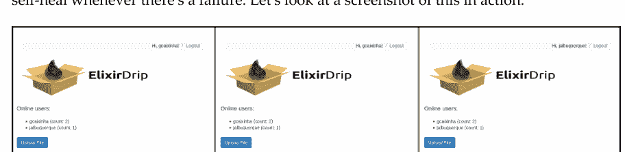

三个不同的浏览器窗口

在此场景中，`gcaixinha` 用户登录到两个不同的浏览器会话，而 `jalbuquerque` 用户登录到第三个浏览器会话。正如截图所示，每个用户都会获得正确的在线用户列表，并且 `gcaixinha` 用户的计数显示为 2，因为他打开了两个会话。如果我们注销这些用户中的任何一个（或使用不同的用户登录），我们会看到在线用户列表相应地调整。随着在线用户列表的正常工作，我们已经到达本节的末尾。现在让我们总结一下，回顾本章最相关的要点。

## Summary

在为我们的应用程序添加 Web 层的过程中，本章涵盖了很多内容。让我们回顾一下本章最重要的要点：

- Phoenix 建立在 Plug 规范之上，该规范有两种形式：模块插件和函数插件。它们都接收一个连接并返回一个连接，可能在返回前对其进行修改。
- 端点是我们 Web 应用程序所有请求开始的边界，默认情况下它包含一个对每个请求都运行的插件列表。
- 使用宏，Phoenix 中的路由器会被编译成高效的模式匹配。除了定义路由之外，我们还可以在路由器中创建管道，它是一组按顺序运行的插件。
- 控制器操作是接收两个参数的函数：连接和请求的参数。通常，我们希望尽可能保持控制器代码尽可能简洁，调用其他模块并根据其响应渲染视图。
- 视图是带有渲染函数的普通模块。模板是从包含标记语言与 EEx 代码混合的文件编译成视图上的渲染函数。这种视图与模块之间的分离使我们能够以任何我们想要的形式渲染数据，无论是从常规的 Elixir 函数还是从模板引擎。
- 基于会话的身份验证可以使用 Phoenix 随附的 `:fetch_session` 插件完成，我们可以使用它为每个请求加载会话。
- 连接的 assigns 提供了很大的灵活性，因为此功能允许我们在请求生命周期内保存状态，该状态将可供后续模块使用。我们看到了一些使用它的示例，例如在为应用程序添加身份验证时。
- Phoenix 路由器中的作用域是一种将路由分组在公共前缀路径下的方式。此外，我们能够指定模块前缀名称，从而为特定组的路由提供不同的控制器、视图和模板集合，就像我们在实现 JSON API 时所做的那样。
- Phoenix channels 在我们构建应用程序的方式上是一个变革者，因为它们提供了一个简单且易于使用的抽象。在用户连接到我们的 socket 之后，连接保持打开状态，这使得客户端和服务器之间能够进行有状态的对话。你不需要努力去弄清请求的上下文，因为它保存在 socket 中。在这种模型中，你只需要发送和接收频道上的事件，并相应地对每个事件做出反应。

在下一章中，我们将处理一个经常被忽视但非常重要的主题：测试。随着 ElixirDrip 应用程序的完成，我们现在将看到如何从不同角度对其进行适当的测试。
