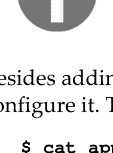

# 10 部署到云端

到目前为止，我们能够提供在旅程开始时设想的所有媒体服务器功能，但 ElixirDrip 仍在本地运行。这一切将在本章中改变；在本章结束时，我们将拥有一个精简版的 ElixirDrip 运行在托管的 Kubernetes 环境中，并有多个连接的节点运行该应用程序。

我们将遵循一些现有的最佳实践来将 ElixirDrip 部署到生产环境。顺便说一下，我们将深入探讨发布、容器化、Kubernetes 和持续集成。这将是一次精彩的旅程！

本章将涵盖以下主题：

- 使用 Distillery 发布
- 容器化我们的应用程序
- 部署到 Kubernetes
- 使用 Travis CI 进行持续部署
- 连接已部署的 Elixir 节点

### 使用 Distillery 发布

到目前为止，我们一直使用 `mix` 或 `mix phx.server` 运行应用程序，并且在运行前代码是即时编译的。这样，只有在上次编译后更改的文件在运行应用程序前会被重新编译，有助于快速的开发体验。


如果你在 IEx shell 中（即你使用 `iex -S mix` 启动了应用程序），你也可以在想要编译刚刚所做的更改时调用 `recompile/0` 函数，而不必退出并重新启动应用程序。这仅在你在 Mix 项目内部时才有效。

我们运行的代码完全有能力在生产环境中履行其职责，但我们不想这样部署它。如果我们将 umbrella 项目文件夹复制到生产环境然后使用 mix phx.server 运行它，我们也会部署开发和测试依赖项以及应用程序的整个源代码，导致生产环境低效且不安全。

由于其 Erlang 继承，Elixir 应用程序也可以像 Erlang/OTP 发布版一样部署。发布的概念只不过是一种标准方式，用于打包运行一个或多个应用程序所需的一切，可选择包含 Erlang 运行时（ERTS），从而使该捆绑包自给自足。

与其使用 Erlang 工具为我们的 ElixirDrip umbrella 创建发布并处理 Erlang 特定的细节，我们将依赖一个名为 Distillery 的库来创建自包含的发布。Distillery 获取任何 Mix 项目并生成符合规范的 Erlang/OTP 发布版，其中包含你选择的运行时依赖项，可随时部署。


预计 Elixir 1.7 将为 Mix 带来发布工具。然而，该功能的初始版本不会涵盖 Distillery 当前拥有的所有功能（例如热升级）。因此，我们可以预期 Distillery 只有在 Mix 中的发布工具实现其所有功能时才会被弃用。

由于 Distillery 是一个库，我们将通过将其作为依赖项添加到项目中来安装它（我们运行时不需要该库，因此相应地设置其 :runtime 选项）：

```
$ cat mix.exs
# ...
  defp deps do
    [
      {:distillery, "~> 1.5", runtime: false},
      {:credo, "~> 0.3", only: [:dev, :test], runtime: false}
    ]
  end
# ...
```

现在，我们只需要运行 mix do deps.get, compile 即可执行 Distillery Mix 任务。

在以下部分中，我们将配置并构建 ElixirDrip umbrella 项目的发布。


## 配置发布

Distillery 会在项目根目录中查找 rel 文件夹，以确定应如何构建发布。在最简单的形式下，该文件夹只需要包含一个 config.exs 文件。

要创建典型的发布配置，我们将在项目根目录中运行 Mix release.init 任务：

```
$ mix release.init
An example config file has been placed in rel/config.exs, review it,
make edits as needed/desired, and then run `mix release` to build the
release
```

生成的配置文件首先加载 rel/plugins 文件夹中可能存在的任何插件，然后使用 Mix.Releases.Config 模块以便使用其宏。因为我们将 :default_release 设置为 :default，如果我们只是执行 mix release（即未选择任何 :release 配置），它将使用 rel/config.exs 文件中定义的第一个发布。我们还将 :default_environment 设置为 Mix.env()，意味着它将根据当前的 Mix 环境从此文件中获取其中一个发布环境。

在以下片段中，默认配置还定义了一个 :dev 环境。通过将 :dev_mode 设置为 true，Distillery 不会将任何 BEAM 代码文件复制到发布文件夹中；相反，它只会创建符号链接，从而提高 :dev 中的发布速度。通过将 :include_erts 设置为 false，Erlang 运行时的副本不会被放置在发布中，因此当 :dev 发布运行时，它将使用可用的运行时。

Distillery 还为我们生成了一个 Erlang 魔法 cookie，它将在我们想要连接不同的 Erlang 节点时用作身份验证令牌。由于拥有此令牌的任何人可能都能够连接到我们的运行节点，因此你不应以明文形式将其存储在代码库中：

```
$ cat rel/config.exs
Path.join(["rel", "plugins", "*.exs"])
|> Path.wildcard()
|> Enum.map(&Code.eval_file(&1))

use Mix.Releases.Config,
    default_release: :default,
    default_environment: Mix.env()

environment :dev do
  set dev_mode: true
  set include_erts: false
  set cookie: :"c{E|>.dCI>YT>M7v@1iF&VNHs)^1M^?*e?=3dcD..."
end
# ...
```

我们在开发中不会使用发布，因此让我们分析配置 :prod 发布环境和单个 :elixir_drip 发布配置文件的其余部分。:prod 环境包含 Erlang 运行时，并通过将 :include_src 选项设置为 false 来从发布中移除源代码。通过将运行时捆绑在发布中，我们确保应用程序能够在没有 Erlang 或 Elixir 可用的情况下运行。我们在此处设置的 cookie 将不会被使用，因为正如我们稍后将看到的，我们将通过自定义 vm.args 文件来设置它。

在以下片段中，你可以找到 Distillery 使用 mix release.init 设置初始值后所应用的更改：

```
$ cat rel/config.exs
# ...
environment :prod do
  set include_erts: true
  set include_src: false
  set cookie: ":won't be used, we set it via a custom vm.args file (rel/custom.vm.args)"
end

release :elixir_drip do
  set vm_args: "rel/custom.vm.args"
  set version: current_version(:elixir_drip)
  set applications: [
    :runtime_tools,
    elixir_drip: :permanent,
    elixir_drip_web: :permanent
  ]
end
```

我们的 rel/config.exs 文件只定义了一个 :elixir_drip 发布，其中包含它将包含的 :applications 实例。除了必需的 :runtime_tools 之外，Distillery 还将 :elixir_drip 和 :elixir_drip_web 伞形应用添加到列表中。它还将每个应用程序的启动类型设置为 :permanent，这意味着如果其中一个应用程序终止，所有其他应用程序以及整个 Erlang 节点都将被终止。

我们使用 current_version/1 宏将发布版本设置为 elixir_drip 伞形应用的版本。我们本可以改为设置一个简单的 "0.1.0" 字符串。

通过设置 `:vm_args` 值，我们告诉 Distillery 我们想要使用自己的 `vm.args` 文件，位于 `rel/custom.vm.args` 中。

一个 `vm.args` 文件让我们定义传递给 Erlang VM 的参数。如果我们不指定任何自定义 `vm.args`，Distillery 默认会为我们生成以下文件：

```
# Name of the node
-name elixir_drip@127.0.0.1

# Cookie for distributed erlang
-setcookie a_random_big_and_complex_cookie_value

# Enable SMP automatically based on availability
-smp auto
```

如你所见，默认情况下，Distillery 向 VM 传递三个参数：第一个 `name`，使用 `<name>@<host>` 格式设置 Erlang 节点的名称；第二个 `setcookie`，设置如果你想连接到 Erlang 节点所需的 cookie；第三个参数 `smp`，控制 Erlang 运行时是否应启用对称多处理功能启动。


你可以在 Erlang 文档 http://erlang.org/doc/man/erl.html#init_flags 中查看所有可用的 Erlang VM 参数。在这里，我们只会使用 Distillery 默认设置的参数。

因为我们在 `:elixir_drip` 发布配置中指向了一个自定义的 `vm.args` 文件，Distillery 将不会从头生成 `vm.args` 文件，而是基于 `rel/custom.vm.args` 文件生成 `vm.args`：

```
$ cat rel/custom.vm.args
-name <%= release_name %>@${POD_IP}

-setcookie ${ERLANG_COOKIE}

-smp auto
```

前一个文件将被解释为 **嵌入式 Elixir (EEx)** 模板，因此 `<%= release_name %>` 将变为 `elixir_drip`，即发布配置的名称。另一个区别在于我们设置主机和 cookie 值的方式。我们没有使用实际值，而是使用 `${POD_IP}` 和 `${ERLANG_COOKIE}` 作为实际值的占位符。

我们使用这种 ${...} 构造是因为我们只想在运行时设置这些值。对于主机值，这是硬性要求，因为我们只有在应用程序即将启动时才知道应用程序主机 IP。关于 cookie 值，我们完全可以在编译时、发布创建时设置它。尽管如此，鉴于其安全重要性，我们更倾向于在最后可能的时刻才设置它。

在下一节中，我们将了解 ${...} 构造背后的原因。

## 插值环境变量

让我们先看看在本地开发时，我们如何在 elixir_drip 伞形应用中设置数据库配置：

```
$ cat apps/elixir_drip/config/dev.exs
use Mix.Config

config :elixir_drip, ElixirDrip.Repo,
  adapter: Ecto.Adapters.Postgres,
  username: System.get_env("DB_USER"),
  password: System.get_env("DB_PASS"),
  database: System.get_env("DB_NAME"),
  hostname: System.get_env("DB_HOST"),
  port: System.get_env("DB_PORT"),
  pool_size: 10
```

所有这些 Mix 配置条目都在运行时求值，因此当我们使用 mix 或 mix phx.server 运行应用程序时，我们知道所有这些条目都将根据现有的 DB_* 环境变量设置。如果其中一个环境变量不存在，Mix 仍将能够运行项目，但相关配置条目将被设置为 nil。

当我们构建发布时，这些配置文件（如 config/config.exs 和 config/dev.exs）会被求值并因此在 sys.config 发布文件中被固定下来。看看如果我们在构建发布前设置一个奇怪的数据库主机名值会发生什么：

```
$ MIX_ENV=dev DB_HOST=weird_value_crystallized_forever mix release
  # ...
==> Release successfully built!

$ cat _build/dev/rel/elixir_drip/releases/0.0.8/sys.config
  # ...
{elixir_drip,
  [{ecto_repos, ['Elixir.ElixirDrip.Repo']},
{storage_provider,
'Elixir.ElixirDrip.Storage.Providers.GoogleCloudStorageLocal'},
{'Elixir.ElixirDrip.Repo',
  [{adapter, 'Ecto.Adapters.Postgres'},
   {username,<<"postgres">>},
   {password,<<"123456">>},
   {database,<<"elixir_drip_dev">>},
   {hostname,<<"weird_value_crystallized_forever">>},
   {port,<<"5432">>},
   {pool_size,10}]},
# ...
```

即使我们之后在设置了 DB_HOST 环境变量的情况下运行发布，主机名配置也始终为 "weird_value_crystallized_forever"。

为了解决这个问题，Distillery 允许你设置用 ${...} 包裹的配置值（如 "${DB_HOST}"），这些值将在运行时由相应的环境变量替换。通过这种方法，我们在构建发布时不需要访问所有配置值。生产凭据或主机 IP 就是在运行时才可用的值的例子，原因有很多。在我们的案例中，发布将由外部持续集成服务 Travis CI 构建，这尤其有用。

这就是为什么我们的 config/prod.exs 配置文件，由 :prod Mix 环境使用，看起来像这样：

```
$ cat apps/elixir_drip/config/prod.exs
use Mix.Config

config :elixir_drip, ElixirDrip.Repo,
  adapter: Ecto.Adapters.Postgres,
  username: "${DB_USER}",
  password: "${DB_PASS}",
  database: "${DB_NAME}",
  hostname: "${DB_HOST}",
  port: "${DB_PORT}",
  pool_size: 15
  # ...
```

构建 prod 发布后，你将在 sys.config 中找到以下内容：

```
$ cat _build/prod/rel/elixir_drip/releases/0.0.8/sys.config
# ...
{elixir_drip,
  [{ecto_repos,['Elixir.ElixirDrip.Repo']},
   {storage_provider,
    'Elixir.ElixirDrip.Storage.Providers.GoogleCloudStorageLive'},

```
{'Elixir.ElixirDrip.Repo',
  [{adapter,'Elixir.Ecto.Adapters.Postgres'},
   {username,<<"${DB_USER}">>},
   {password,<<"${DB_PASS}">>},
   {database,<<"${DB_NAME}">>},
   {hostname,<<"${DB_HOST}">>},
   {port,<<"${DB_PORT}">>},
   {pool_size,15}]},
# ...
```

如果我们现在在将 REPLACE_OS_VARS 环境变量设置为 true 的情况下运行发布，Distillery 将会用对应的环境变量值替换 sys.config 文件中所有的 "${...}" 值。

与这种运行时和构建时二元性相关的常见陷阱（尤其是对于来自 Ruby 等解释型语言的开发者）是，定义其值来自环境变量的模块属性。

假设我们的应用程序需要使用唯一的 URL 向外部 API 发送信息。由于此 URL 是敏感信息，我们不能将其与代码库的其余部分一起存储，因此我们决定从环境变量中获取它，如下所示：

```
defmodule ExternalApi do
  @url System.get_env("EXTERNAL_API_URL")

  def send_information(payload),
    do: HTTPotion.post(@url, payload)
end
```

一切在本地都能正常工作，因此我们决定发布此功能。当它到达生产环境时，一个晦涩的错误开始出现，我们无法找出原因。我们再次检查生产环境中设置的环境变量，可以看到 EXTERNAL_API_URL 已被正确设置。

你能看出哪里出了问题吗？Elixir 是一种编译型语言；因此，我们的 ExternalApi 模块在构建发布时与应用程序的其他部分一起被编译。在编译时，EXTERNAL_API_URL 环境变量未被设置，因此 @url 模块属性变为 nil，导致错误发生。


即使我们将 @url 值设置为 "${EXTERNAL_API_URL}"，错误仍然会发生，因为该值永远不会被实际的 URL 值替换（@url 值将始终为 "${EXTERNAL_API_URL}"）。只有 Distillery 才会在 sys.config 文件中放置 config.exs 配置项。在运行时，当 Distillery 检测到 REPLACE_OS_VARS 标志时，它会用实际环境变量的值替换 sys.config 文件中存在的所有 ${...} 占位符。

在了解了如何在运行时安全地使用环境变量来配置应用程序之后，让我们实际构建并运行发布！

## 创建发布

要构建发布，我们只需使用 mix release 运行发布 Mix 任务。由于我们在 rel/config.exs 文件中设置了 default_environment: Mix.env()，因此发布的默认环境由 MIX_ENV 环境变量给出。

在下面的代码片段中，我们正在构建发布。我们在 mix.exs 文件中将 elixir_drip 伞形应用的版本设置为 0.0.8，因此发布变为 elixir_drip:0.0.8（elixir_drip 是发布名称，0.0.8 是在 rel/config.exs 文件中将发布版本设置为 current_version(:elixir_drip) 的结果）：

```
$ MIX_ENV=prod mix release
==> elixir_drip
# ...
Generated elixir_drip app
==> elixir_drip_web
Compiling 12 files (.ex)
Generated elixir_drip_web app

==> Assembling release..
==> Building release elixir_drip:0.0.8 using environment prod
==> Including ERTS 9.3.1 from /usr/local/lib/erlang/erts-9.3.1
==> Packaging release..
==> Release successfully built!
  You can run it in one of the following ways:
  Interactive: _build/prod/rel/elixir_drip/bin/elixir_drip console
  Foreground: _build/prod/rel/elixir_drip/bin/elixir_drip foreground
  Daemon: _build/prod/rel/elixir_drip/bin/elixir_drip start
```

如果查看生成的 *.tar.gz 发布归档内部，你会找到四个文件夹（如果不包含 ERTS 则为三个）：bin、erts-<version>、lib 和 releases/<app-version>。

在 bin 文件夹中，你会找到我们用来启动应用程序的 Shell 脚本，而在 lib 文件夹中，你会找到所有编译后的依赖项。

releases/<app-version> 文件夹包含一个发布资源文件 *.rel、一个 *.script 文件和一个 *.boot 文件。因此，elixir_drip.rel 包含一个元组，其中包含此发布中包含的所有应用程序及其各自的版本。现在，elixir_drip.script 是一个 Erlang 脚本，它将启动 Erlang 节点然后运行发布。Erlang 运行时将使用此脚本的二进制格式，即 elixir_drip.boot 文件，该文件也存在于此文件夹中。

要运行发布，我们首先需要为 Distillery 设置预期的环境变量以便在运行时进行插值，然后我们就可以使用 _build/prod/rel/elixir_drip/bin/elixir_drip console 交互式运行发布：

```
$ export REPLACE_OS_VARS=true POD_IP=127.0.0.1 ERLANG_COOKIE=cookie
DB_HOST=postgres DB_PORT=5432 DB_NAME=elixir_drip_dev DB_USER=postgres
DB_PASS=123456

$ env $(cat secrets/credentials.dev.env | xargs)
_build/prod/rel/elixir_drip/bin/elixir_drip console

Erlang/OTP 20 [erts-9.3.1] [source] [64-bit] [smp:4:4] [ds:4:4:10] [async-threads:10] [hipe] [kernel-poll:false]

04:29:37.923 [info] Running ElixirDripWeb.Endpoint with Cowboy using
http://:::4000
Interactive Elixir (1.6.4) - press Ctrl+C to exit (type h() ENTER for help)
iex(elixir_drip@127.0.0.1)1>
```

还记得我们在自定义 vm.args 文件中之前设置的 ${POD_IP} 和 ${ERLANG_COOKIE} 占位符吗？在运行发布之前，我们需要将它们定义为环境变量，以及 Distillery 应插值并在 elixir_drip 和 elixir_drip_web config/prod.exs 配置文件中提到的每一个其他环境变量。

通过在运行发布之前执行 env $(cat secrets/credentials.dev.env | xargs)，我们能够临时设置两个仅在当前发布运行期间存在的环境变量。这样，我们就可以避免永久设置包含敏感信息的 SECRET_KEY_BASE 和 GOOGLE_STORAGE_CREDENTIALS 环境变量：

```
$ cat secrets/credentials.dev.env
SECRET_KEY_BASE=vhlpO...
GOOGLE_STORAGE_CREDENTIALS=ewogI...
```

在下一节中，我们将看到如何实现一个自定义发布任务，这将允许我们运行数据库迁移。

## 创建自定义发布任务

当我们使用 Distillery 创建发布时，我们的 Elixir 应用程序会被转换为 Erlang/OTP 发布，与任何其他 Erlang 应用程序包无法区分。没有 Mix 项目，理想情况下也没有 Elixir 源代码，只有包含 BEAM 字节码的文件和启动发布所需的特定发布文件。

然而，这种节俭带来了问题：由于我们没有 Mix，使用 ecto.migrate Mix 任务与发布一起运行数据库迁移是不可能的。而且我们决心不将整个 Elixir 项目发送到生产环境，因此我们需要找到一种不依赖 Mix 任务的方法。

为了解决这个问题，我们将实现一个自定义发布任务，将迁移执行委托给 ElixirDrip.ReleaseTasks 模块，该模块仅依赖于 :ecto 和 :postgrex 应用程序：

```
$ cat apps/elixir_drip/lib/elixir_drip/release_tasks.ex
defmodule ElixirDrip.ReleaseTasks do
  alias Ecto.Migrator

  @start_apps [:postgrex, :ecto]

  def migrate_up, do: migrate(:up)
  def migrate_down, do: migrate(:down)

  defp migrate(direction) do
    options = case direction do
      :up -> [all: true]
      :down -> [step: 1]
    end

    IO.puts("Loading ElixirDrip umbrella app...")
    :ok = Application.load(:elixir_drip)

    IO.puts("Starting dependencies...")
    Enum.each(@start_apps, &Application.ensure_all_started/1)

    IO.puts("Starting ElixirDrip repo...")
    ElixirDrip.Repo.start_link(pool_size: 1)

    IO.puts("Running migrations for ElixirDrip...")
    run_migrations(direction, options)

    IO.puts("Success!")
    :init.stop()
  end
```

```
defp priv_dir(app), do: "#{ :code.priv_dir(app) }"

defp run_migrations(direction, options) do
  Migrator.run(ElixirDrip.Repo, migrations_path(:elixir_drip), direction, options)
end

defp migrations_path(app), do: Path.join([priv_dir(app), "repo", "migrations"])
end
```

在此代码片段中，大部分工作由 migrate/1 私有函数执行。根据迁移方向，它会应用尚未运行的所有迁移（:up 方向）或还原最后一次应用的迁移（:down 方向）。在依赖 Ecto.Migrator 运行迁移之前，它会加载 :elixir_drip 应用程序并等待 :ecto 和 :postgrex 应用程序启动，因为我们需要它们处于运行状态才能正确应用/还原迁移。

在重新构建发布后，我们可以通过依赖 Distillery 提供的 command 工具来运行 ReleaseTasks.migrate_up/0 函数：

```
$ ERLANG_COOKIE=cookie REPLACE_OS_VARS=true
_build/prod/rel/elixir_drip/bin/elixir_drip command
Elixir.ElixirDrip.ReleaseTasks migrate_up
Loading ElixirDrip umbrella app...
Starting dependencies...
Starting ElixirDrip repo...
Running migrations for ElixirDrip...
Success!
17:12:06.169 [info] Already up
```

请记住，每个 Elixir 模块都有一个 Elixir. 前缀（ElixirDrip.ReleaseTasks == Elixir.ElixirDrip.ReleaseTasks 的计算结果为 true）。我们在之前的代码片段中必须为 ElixirDrip.ReleaseTasks 添加前缀，因为我们处于 Erlang 的领域，因此没有 IEx 来自动为我们添加 Elixir. 前缀。

与其使用 Distillery command 工具，我们将在 rel/commands 文件夹中创建两个 shell 脚本 migrate_up.sh 和 migrate_down.sh，以帮助我们运行这些自定义任务。如你所见，migrate_up.sh 脚本只是模仿了我们在上一个代码片段中所做的事情：

```
$ cat rel/commands/migrate_up.sh
#!/bin/sh
$RELEASE_ROOT_DIR/bin/elixir_drip command Elixir.ElixirDrip.ReleaseTasks migrate_up
```


The last step is to define two custom commands in the `:elixir_drip` release, `migrate_up` and `migrate_down`, which will respectively run the previous two shell scripts:

```
$ cat rel/config.exs
  # ...
release :elixir_drip do
  set vm_args: "rel/custom.vm.args"
  set version: current_version(:elixir_drip)
  set applications: [
    :runtime_tools,
    elixir_drip: :permanent,
    elixir_drip_web: :permanent
  ]
  set commands: [
    "migrate_up": "rel/commands/migrate_up.sh",
    "migrate_down": "rel/commands/migrate_down.sh"
  ]
end
```

If we now run the `elixir_drip` release with no arguments, it shows the two custom commands we've just created:

```
$ _build/prod/rel/elixir_drip/bin/elixir_drip
Usage: elixir_drip <task>

Service Control
====================
  # ...
Custom Commands
====================
/opt/app/elixir_drip/_build/prod/rel/elixir_drip/releases/0.0.8/commands/migrate_down.sh
/opt/app/elixir_drip/_build/prod/rel/elixir_drip/releases/0.0.8/commands/migrate_up.sh
```

We can now run the new custom commands as follows:

```
$ ERLANG_COOKIE=cookie REPLACE_OS_VARS=true _build/prod/rel/elixir_drip/bin/elixir_drip migrate_up
Loading ElixirDrip umbrella app...
Starting dependencies...
Starting ElixirDrip repo...
Running migrations for elixir_drip...
Success!
15:13:25.946 [info] Already up
```

We're well on our way to having our application running on the cloud. In the next section, we'll use Docker to *containerize* our application.

## Containerizing our application

Before we start laying the foundation of how we deploy our application to the cloud, we need to have our application running inside containers. To introduce containers, let's first analyze the problem they try to solve.

To build and run our ElixirDrip project, we need Erlang, Elixir, and Node.js correctly installed and available in the current $PATH, ready to be used. To deploy the application in production, we need to make sure those dependencies have the exact same version and are installed in production in the exact same way, because only then we can be sure the application behavior will be the same.

Doing things like this is cumbersome and time-consuming, but not an impossible endeavor. If only we had a cleaner way of building the environment and then saving it, so we could reuse it at a later time, wherever we needed it. This is exactly what containers allow us to do.

Containers are lightweight wrappers for applications, which not only contain the applications themselves, but also everything needed to successfully run them. Each container has its own processes, memory, and network interfaces, and runs in a secure way, isolated from other containers and the host operating system.

Since a containerized application is self-contained, it can be deployed to different environments as is. Because containers are lightweight, their deployment is fast and requires a fewer resources than fully fledged virtual machines.

Containers are instantiated from *images*, which are nothing more than snapshots of applications in their habitats. These images are created from *recipes* that describe how the application code, its configuration, and dependencies are set up inside the container. When we want to run a container, we indicate from which image the container will be instantiated.

An application running inside a container is able to write to the filesystem as it normally would, but it will never change the underlying image. Images are read only, so you can be sure that if an application runs locally with a given image, it will also run in other environments with the same image.


So far, we have talked about generic container concepts. From this point forward, we will analyze Docker examples, since this is the tool we'll use to create, manage, and run our application containers. All the examples in this chapter could also be achieved with other equivalent tools, such as rkt.

When you want to use an image you've just built locally on a remote machine, you can push it to a Docker registry and then fetch it from there. Since the image will be the same in both places, you can be sure the containers instantiated from it will be identical, with no more unpleasant surprises after deploying.

```
$ cat examples/Dockerfile.simple
FROM elixir:1.6.4-alpine

EXPOSE 4001

CMD while true; do echo "Hello World!" | nc -l -p 4001; done
```

In the previous snippet, you can find Dockerfile, a simple image recipe, based on an elixir:1.6.4-alpine image that already exists in the Docker public registry. After fetching this image, Docker exposes port 4001 and in the end runs a shell script forever that uses Netcat to deliver a Hello World! message.

To build the previous image, we are specifying the image tag (with -t) and indicating a specific examples/Dockerfile.simple (with -f). The last argument is the context in which the image is created; in our case, it's the examples folder:

```
$ docker build -t hello_world -f examples/Dockerfile.simple examples
Sending build context to Docker daemon 53.25kB
Step 1/3 : FROM elixir:1.6.4-alpine
---> cb08ed0e151a
Step 2/3 : EXPOSE 4001
---> Using cache
---> 43710db729b1
Step 3/3 : CMD while true; do echo "Hello World!" | nc -l -p 4001; done
---> Using cache
---> 9d2c59bb56f7
Successfully built 9d2c59bb56f7
Successfully tagged hello_world:latest
```

We can now see the image labeled as hello_world:latest with docker images:

```
$ docker images
REPOSITORY TAG IMAGE ID CREATED SIZE
hello_world latest 9d2c59bb56f7 12 minutes ago 84.1MB
```

We can now run the image with docker run -p 4001:4001 hello_world:latest. The -p option binds port 4001 in the container to port 4001 in the host. If we now open another terminal, we can interact with the container by sending requests to local port 4001:

```
$ curl localhost:4001
Hello World!
```

We can observe our running container with docker ps. Since we are executing an infinite loop, the container will never end on its own if we don't stop it:

```
$ docker ps
CONTAINER ID IMAGE COMMAND STATUS PORTS NAMES
eefca9fe7d54 hello_world:latest "/bin/sh -c 'while...'" Up 4 minutes 0.0.0.0:4001->4001/tcp determined_shtrn
```

Docker named our container determined_shtrn, so we can do all container operations with this name, instead of using the unmemorable eefca9fe7d54 container ID. If we want to set the container name, we can use the --name option when we do docker run. To stop the container we've just started, it is just a matter of running docker stop <container name|id>.

After this crash course on Docker, we can now run our application inside a Docker container.

## Creating a development container

To create our container, we need to define the recipe describing how the image is assembled. Docker recipes are called Dockerfiles, and are nothing more than text files describing the operations needed to build the images.

The following snippet shows our Dockerfile.dev, since this is the Dockerfile that we'll use while developing:

```
$ cat Dockerfile.dev
FROM elixir:1.6.4-alpine

ENV TERM xterm
ENV LANG en_US.UTF-8
ENV LANGUAGE en_US:en
ENV LC_ALL en_US.UTF-8

ENV REFRESHED_AT 2018-06-05

ENV APP_PATH /opt/app
ENV APP_NAME elixir_drip
ENV HTTP_PORT 4000
ENV MIX_ENV dev

RUN apk add --no-cache build-base git inotify-tools nodejs nodejs-npm
RUN mix archive.install https://github.com/phoenixframework/archives/raw/master/phx_new.ez --force
RUN mix local.hex --force && mix local.rebar --force

COPY . $APP_PATH/$APP_NAME

WORKDIR $APP_PATH/$APP_NAME

EXPOSE $HTTP_PORT

CMD ["mix run --no-halt"]
```

In this Dockerfile, the first lines starting with FROM indicate the parent image that we'll use; in our case, it will be the elixir:1.6.4-alpine image, which already comes with Elixir and Erlang installed in a compact Linux distribution called Alpine. We then set some environment variables (using the ENV instructions), such as the application path, name, the port it will use, and the MIX_ENV that controls the Mix environment.

Afterward, we use the RUN Docker instruction to install some dependencies in our container: git, nodejs, and the accompanying npm are installed with apk (the package management tool of Alpine Linux, on which our image is based). We then use mix to install Phoenix, Hex, and rebar3 (an Erlang tool to create Erlang releases, used by many library dependencies).

The last portion of the Dockerfile copies the current directory (the root of the umbrella project) to the /opt/app/elixir_drip container path, sets the current directory inside the container, exposes the port, and ends by running the project with mix run --no-halt.


We could have run the application with CMD mix run --no-halt (without the command being inside an array, that is, in shell form), but in this situation Docker prefixes the command with /bin/sh -c '<command>', which may bring some funky behavior (in this case, your command wouldn't be running as PID 1, among other shell subtleties). Hence, it's usually better to run the command as we do in the Dockerfile with the array, also called exec form.

We've just created our first Dockerfile. Let's see how can we run it alongside other containers that we'll need.


## 协调多个容器

每次启动 ElixirDrip 时，它都会尝试连接到正在运行的 Postgres 数据库。如果我们在本地开发环境中在容器内运行它，情况不会有所不同。在这种情况下，我们可以本地安装 Postgres，可以将应用程序设置为连接到作为服务提供的远程数据库，或者可以启动一个运行 Postgres 数据库的新容器。由于这仅用于本地开发目的，容器选项很适合我们。因为我们不在乎临时存储的数据，容器停止后它就可以被删除。

下一步可以是为数据库容器编写 Dockerfile，然后创建 Docker 网络管道以连接 ElixirDrip 和数据库容器。虽然这种方法可行，但有一个名为 Docker Compose 的工具可以帮助处理这种情况。

与我们为 ElixirDrip Docker 镜像所做的工作类似，我们现在将创建说明如何运行和连接多个容器的配方。然后 docker-compose 工具会处理这个配方，即一个普通的 YAML 文件，并启动容器以及所有其他声明的 Docker 资源。


默认情况下，docker-compose 输入文件名为 docker-compose.yml。我们将其命名为 docker-compose.dev.yml，因为我们将有多个 docker-compose 文件（另一个文件将负责运行应用程序测试套件并创建应用程序发布版）。

让我们先分析 docker-compose.dev.yml 如何启动 ElixirDrip 应用程序：

```
$ cat docker-compose.dev.yml
version: '2.1'
services:
  app:
    image: elixir_drip:dev
    build:
      context: .
      dockerfile: Dockerfile.dev
    env_file: ./env/dev.env
    environment:
      SECRET_KEY_BASE:
      GOOGLE_STORAGE_CREDENTIALS:
    ports:
      - 4000:4000
    command: sh /opt/app/elixir_drip/script/start.sh
    depends_on:
```

```
postgres:
  condition: service_healthy
  networks:
    - default
  volumes:
    - ./opt/app/elixir_drip
# ...
```

在之前的片段中，我们声明了一个名为 app 的服务，它将使用从 Dockerfile.dev 文件构建的镜像（该镜像将被标记为 elixir_drip:dev）。除了 Dockerfile 中设置的环境变量外，它还将设置 env/dev.env 文件中存在的新变量（该文件的每一行都有 <name>=<value> 格式）。

我们还在 environment 部分设置了 SECRET_KEY_BASE 和 GOOGLE_STORAGE_CREDENTIALS 环境变量，但未为其定义任何值。因为这是敏感信息，我们不会将其存储在 env/dev.env 文件中。由于我们未为这些变量设置值，在启动容器时，docker-compose 会在主机环境中查找这两个环境变量并将其值设置在容器内部。

然后，我们将主机端口 4000 绑定到相同的容器端口，并通过运行 script/start.sh shell 脚本来覆盖 Dockerfile.dev 中设置的初始命令。在 depends_on 部分，我们声明 app 服务依赖于 postgres 服务以健康状态运行（我们稍后会定义什么是健康）并且它应加入名为 default 的网络。

我们通过挂载卷来完成 app 服务的定义，这意味着当前目录（即 umbrella 项目根目录）中的每个更改都将反映在容器内的 /opt/app/elixir_drip 文件夹中（反之亦然）。

正如我们所见，app 服务依赖于 postgres 服务，但我们尚未定义它。让我们修复这个问题：

```
$ cat docker-compose.dev.yml
version: '2.1'
services:
  app:
    # ...
postgres:
  environment:
    POSTGRES_USER: postgres
    POSTGRES_PASSWORD: "123456"
    PSQL_TRUST_LOCALNET: 'true'
    ENCODING: UTF8
```

```
image: postgres:9.6
healthcheck:
  test: ["CMD", "pg_isready", "-d", "postgres", "-U", "postgres"]
  interval: 10s
  timeout: 3s
  retries: 10
ports:
  - 5000:5432
networks:
  - default
```

这个 postgres 服务更简单，因为它没有 Dockerfile 或自己的 env_file。我们声明其环境变量、用于启动容器的镜像，然后定义应如何执行健康检查。在这种情况下，如果 pg_isready -d postgres -U postgres shell 命令成功返回，Docker Compose 认为 postgres 服务是健康的，从而启动 app 服务。然后我们像之前一样映射端口，并确保 postgres 服务加入相同的 default 网络。

正如你在这里看到的，当 app 服务启动时，script/start.sh shell 脚本会获取所有 Mix 依赖项，创建并迁移数据库，然后启动 Phoenix 服务器：

```
$ cat script/start.sh
mix deps.get
mix ecto.create && mix ecto.migrate
mix phx.server
```

在第一次运行 compose 文件之前，我们只需在当前 shell 中设置 secret 环境变量。由于我们处于开发环境，可以简单地使用 export $(cat secrets/credentials.test.env | xargs) 使用假的测试值。

我们现在能够使用 docker-compose -f docker-compose.dev.yml up 运行 docker-compose.dev.yml compose 文件。如果是第一次运行，你会看到 Docker 正在构建 Dockerfile.dev 镜像，获取 postgres:9.6 镜像，启动 postgres 服务，然后启动 app 服务。


使用 `docker-compose` 启动所有容器时传递 `-d` 选项（即 `docker-compose -f docker-compose.dev.yml up -d`）以*分离*模式启动它们，这意味着它们不会占用当前的 `STDOUT` shell，并将在后台继续运行。如果你仍想查看 `docker-compose.dev.yml` 文件启动的所有容器的日志，请运行 `docker-compose -f docker-compose.dev.yml logs -ft`，其中 `-f` 选项表示我们想要跟随所有容器的日志输出，`-t` 选项表示我们想要查看每条日志消息的时间戳。

我们也可以使用 `docker ps` 查看两个正在运行的容器（由于 `umbrella` 项目文件夹名称，两个容器名称都有 `umbrella_` 前缀）：

$ docker ps

| 容器 ID | 镜像 | 命令 | 创建时间 | 状态 | 端口 | 名称 |
|---|---|---|---|---|---|---|
| a1935721c401 | elixir_drip:dev | "sh /opt/app/elixir_..." | 8 minutes ago | Up 5 minutes | 0.0.0.0:4000->4000/tcp | umbrella_app_1 |
| a895dda2e1cd | postgres:9.6 | "docker-entrypoint.s..." | 8 minutes ago | Up 5 minutes (healthy) | 0.0.0.0:5000->5432/tcp | umbrella_postgres_1 |

你现在应该能够从主机机器访问容器内运行的 ElixirDrip 应用程序：

```
$ curl http://localhost:4000
<!DOCTYPE html>
<html lang="en">
    <head>
        <meta charset="utf-8">
# ...
```

如果你想在 `umbrella_app_1` 容器内运行一个 shell，只需执行 `docker exec -it umbrella_app_1 sh` 即可。我们需要同时使用 `-i` 和 `-t` 选项才能与容器内运行的 shell 进程进行交互。

在下面的代码片段中，我们可以看到容器内运行的所有进程。启动脚本是 PID 1 进程，它生成了在 Erlang VM 之上运行我们应用程序的其他进程：

```
$ docker exec -i -t umbrella_app_1 sh

/opt/app/elixir_drip> ps aux
PID USER TIME COMMAND
  1 root 0:00 sh /opt/app/elixir_drip/script/start.sh
 152 root 0:02 /usr/local/lib/erlang/erts-9.3.1/bin/beam.smp -- -root
/usr/local/lib/erlang -progname erl -- -home /root -- -pa
```

```
173 root 0:00 erl_child_setup 1048576
197 root 0:00 inet_gethost 4
198 root 0:00 inet_gethost 4
199 root 0:00 sh
204 root 0:00 ps aux
```

由于应用程序已经在运行并监听端口 4000，我们无法再次启动应用程序并附加 IEx shell（即 `iex -S mix phx.server`）。


如果你想在通过 `docker-compose up` 启动容器时强制构建 `docker-compose.yml` 文件中存在的镜像，请传递 `--build` 选项，如 `docker-compose -f docker-compose.dev.yml up --build -d`。

为克服此问题，你可以暂时将 `start.sh` 脚本中的 `mix phx.server` 行替换为 `tail -f /dev/null` 并以相同方式再次启动容器。由于 `tail -f /dev/null` 永不结束，它将使 app 服务容器无限期运行。当你再次在容器内运行 shell 时，你会发现：

```
$ docker exec -i -t umbrella_app_1 sh

/opt/app/elixir_drip> ps aux
PID USER TIME COMMAND
1 root 0:00 sh /opt/app/elixir_drip/script/start.sh
153 root 0:00 tail -f /dev/null
154 root 0:00 sh
160 root 0:00 ps aux
```

由于没有应用程序在运行，我们现在能够*手动*使用 `iex -S mix phx.server` 或如果不需要 IEx shell 则使用 `mix phx.server` 启动应用程序。


如果你不想更改 `start.sh` 脚本，也可以改用 `docker-compose -f docker-compose.dev.yml run -d app tail -f /dev/null` 运行 app 服务来覆盖 `docker-compose.dev.yml` 文件中设置的命令。因为我们没有运行 `start.sh` 脚本，在能够运行应用程序之前，我们仍需要在容器 shell 内运行 `mix deps.get` 和 `mix ecto.create && mix ecto.migrate` 命令。


我们现在拥有一个容器化的开发环境，可以轻松启动并进行试验。我们的部署也将大量依赖容器，因此在下一节中，我们将学习我们的解决方案如何随之改变以满足部署需求。

## 组合部署容器

我们的目标是拥有一种自动化方式来运行项目测试套件，如果一切顺利，则构建一个仅包含发布版本的新镜像并推送到生产环境。

为此，我们将使用特定的 compose 文件 docker-compose.test.yml，它执行两个步骤：首先，它启动构建发布、运行测试并将镜像标记为 release_prepared:latest 的 release 服务。然后，它启动 app 服务，该服务通过从上一个镜像复制发布来创建最终镜像：

```
$ cat umbrella/docker-compose.test.yml
version: '2.3'
services:
  app:
    # ...
  release:
    image: release_prepared:latest
    build:
      context: .
      dockerfile: Dockerfile
    env_file:
      - ./env/test.env
    working_dir: /opt/app/elixir_drip
    command: ["/bin/sh", "script/test.sh"]
    ports:
      - 4000:4000
    depends_on:
      postgres:
        condition: service_healthy
  postgres:
    # ...
```

如以下代码所示，Compose `release` 服务使用的 `Dockerfile` 执行了发布所需的大部分工作。它首先获取依赖项，编译应用程序和 Phoenix 资产，然后构建发布。最后，它将 `elixir_drip.tar.gz` 复制到 `/tmp/elixir_drip` 文件夹。

```
$ cat Dockerfile
FROM elixir:1.6.4-alpine

# Setting the needed environment variables
ENV APP_PATH /opt/app
ENV APP_NAME elixir_drip
ENV APP_VERSION 0.0.8
ENV HTTP_PORT 4000
ENV HTTPS_PORT 4040
ENV MIX_ENV prod

# Installing the dependencies
RUN apk add --no-cache build-base git nodejs nodejs-npm
RUN mix archive.install https://github.com/phoenixframework/archives/raw/master/phx_new.ez --force
RUN mix local.hex --force && mix local.rebar --force

# Copying the host current folder to the container
COPY . $APP_PATH/$APP_NAME
WORKDIR $APP_PATH/$APP_NAME

# Compiling the project and the Phoenix static assets
RUN MIX_ENV=$MIX_ENV mix do clean, deps.get, compile
RUN cd apps/elixir_drip_web/assets \
    && npm install \
    && ./node_modules/brunch/bin/brunch b -p

# Building the release
RUN cd $APP_PATH/$APP_NAME \
    && MIX_ENV=$MIX_ENV mix phx.digest \
    && MIX_ENV=$MIX_ENV mix release --env=$MIX_ENV

# Setting up the release to be copied
RUN mkdir -p /tmp/$APP_NAME
RUN cp $APP_PATH/$APP_NAME/_build/$MIX_ENV/rel/$APP_NAME/releases/$APP_VERSION/$APP_NAME.tar.gz /tmp/$APP_NAME

WORKDIR /tmp/$APP_NAME
RUN tar -xzf $APP_NAME.tar.gz
RUN rm -rf $APP_NAME.tar.gz
RUN echo "Release in place, ready to be copied."

EXPOSE $HTTP_PORT $HTTPS_PORT

CMD ["sh", "-c", "/bin/$APP_NAME foreground"]
```

与之前的 release 服务相比，app 服务稍微简单一些。该服务基于 Dockerfile.deploy 配方构建镜像，并将其标记为 gcr.io/${PROJECT_ID}/elixir-drip-prod:${BUILD_TAG}。由于它依赖于 release 服务，app 服务只有在 release 已经启动后才会开始。

在下一节中，我们将了解我们设置的镜像标签背后的原因，但现在，请注意此标签需要在 Compose docker-compose.test.yml 文件启动之前设置 PROJECT_ID 和 BUILD_TAG 环境变量：

```
$ cat umbrella/docker-compose.test.yml
version: '2.3'
services:
  app:
    image: gcr.io/${PROJECT_ID}/elixir-drip-prod:${BUILD_TAG}
    build:
      context: .
      dockerfile: Dockerfile.deploy
    depends_on:
      - release
    command: ["echo", "Release image ready to be deployed."]
  release:
    # ...
  postgres:
    # ...
```

Dockerfile.deploy 文件的主要目的是将由 Compose release 服务构建的 release_prepared:latest 镜像中的发布文件夹复制到将部署到生产环境的镜像中。为此，源镜像在第一个 FROM 命令中被别名为 builder，然后作为 COPY 命令的 --from 选项的源使用：

```
$ cat Dockerfile.deploy
FROM release_prepared:latest as builder

RUN ls -la /tmp/elixir_drip \
&& echo "Found the release, will copy it to the final image."

FROM elixir:1.6.4-alpine as runner
# ...
ENV APP_PATH /opt/app
ENV APP_NAME elixir_drip
ENV HTTP_PORT 4000
ENV HTTPS_PORT 4040
ENV REPLACE_OS_VARS true

RUN apk add --no-cache bash

COPY --from=builder /tmp/$APP_NAME $APP_PATH/$APP_NAME

WORKDIR $APP_PATH/$APP_NAME

EXPOSE $HTTP_PORT $HTTPS_PORT

CMD ["sh", "-c", "bin/$APP_NAME foreground"]
```

通过这种方法，我们能够部署一个仅包含发布版本及其运行所需依赖项（即 bash）的镜像，将部署镜像的大小从 575 MB 减少到 122 MB：

```
$ docker images
REPOSITORY TAG IMAGE ID CREATED SIZE
gcr.io/<project_id>/elixir-drip-prod v0.0.8 c8b38f6bbdb2 7 hours ago 122MB
release_prepared latest 7f7043ed9ac8 7 hours ago 575MB
# ...
```

除了体积更小之外，部署的镜像不包含任何源代码，因此如果恶意用户获得了生产服务器之一的访问权限，其影响也会降低。

如果我们现在运行 PROJECT_ID=<project_id> BUILD_TAG=<build_tag> docker-compose -f docker-compose.test.yml run app，我们将触发刚刚分析的过程，最后，一个标记为 <project_id>:<build_tag> 的镜像将存在，准备好部署。

在下一节中，我们将了解 ElixirDrip 生产环境的工作方式以及使应用程序在云上运行所需的步骤。

## 部署到 Kubernetes

我们现在将 ElixirDrip 应用程序部署到 Google Kubernetes Engine (GKE)，这是 Google 提供的托管 Kubernetes (K8s) 解决方案。Kubernetes 是一个开源工具，它允许我们通过依赖配置文件并提供统一的自动化每项操作的方式来配置、编排和扩展大量容器。


Google 提供 12 个月的免费试用期，附带 300 美元的信用额度，用于尝试组成 Google Cloud Platform 的服务，包括 Google Kubernetes Engine（请查看 https://cloud.google.com/free/）。这使我们的读者能够免费尝试托管的 K8s 解决方案。作为替代方案，本节及以下各节中的所有示例也适用于 `minikube`，这是一种可在本地计算机上运行 K8s 集群的工具（请查看 https://kubernetes.io/docs/getting-started-guides/minikube/）。

在深入部署任务之前，我们需要澄清 Kubernetes 使用的一些概念和命名法。一个 **集群** 由一个或多个 **节点** 组成，每个节点都提供计算资源，例如 CPU、内存和磁盘。如果您想分离集群的资源，可以创建 **命名空间**，它们像虚拟集群一样工作。

由于这些计算资源是集群化的，当您部署某项内容时，只需说明它需要多少 CPU 和内存，Kubernetes 就会确保应用程序拥有其工作所需的一切。请注意，您不需要指定应用程序运行在哪個节点上；您只需指定应用程序需求，Kubernetes 就会为您处理负载分配。如果某个节点突然损坏，负载将被透明地转移到其他可用节点。

在之前的章节中，我们已经对应用程序进行了容器化，但我们不会直接将容器部署到 Kubernetes。相反，K8s 有 **Pod** 的概念，它只不过是一组一个或多个容器。由于 pod 的创建方式，同一 pod 中的容器共享相同的 IP 地址和端口空间。

为了部署我们的 ElixirDrip 应用程序，我们将适当使用 **部署** 控制器，它描述了如何创建将为我们的应用程序提供服务的 pod。部署 pod 后，只要其资源需求得到满足，它就会愉快地运行。

默认情况下，集群外部无法访问任何 pod，因此如果我们想用它来为客户端请求提供服务，就必须以某种方式将其暴露。在任何给定时刻，都可能启动 pod 以应对请求激增，那么我们如何将请求路由到本质上是临时的 pod 呢？这是通过创建 **服务** 实现的，该服务将从外部可访问的端口映射到由其标签而不是 IP 标识的特定 pod 组。


同样重要的是要注意，所有这些 Kubernetes 对象，例如 pods、services 和 deployments，都使用相似的 YAML 配置文件表示。这是一个至关重要的方面，因为它有效地使你能够将基础设施作为代码存储在代码仓库中。此外，你与 Kubernetes 集群的所有交互，包括应用基础设施更改，都可以使用 `kubectl` 工具完成。使用单一的通用接口处理所有与 Kubernetes 相关的内容，显著简化了用户体验。


在 Google Cloud Platform 上创建账户后，安装并运行 Google Cloud SDK 工具（`gcloud init`）以登录并创建一个新项目。你现在可以使用 `gcloud container clusters create <cluster-name>` 创建集群。如果尚未安装 `kubectl`，请使用 `gcloud` 安装（即 `gcloud components install kubectl`），它将被自动配置为访问集群。如果已安装 `kubectl`，请运行 `gcloud container clusters get-credentials <cluster-name>` 以使用集群凭据更新你的 `kubectl` 配置。

此时，你应该已创建 Google Cloud Platform 项目，并且 Kubernetes 集群正在运行中：

```
$ gcloud projects list
PROJECT_ID NAME PROJECT_NUMBER
intense-talent-188323 My First Project 5338223468

$ gcloud container clusters list
NAME LOCATION MASTER_VERSION MASTER_IP MACHINE_TYPE NODE_VERSION NUM_NODES STATUS
elixir-drip-prod-cluster europe-west1-b 1.8.8-gke.0 35.205.44.153 n1-standard-1 1.8.8-gke.0 1 RUNNING

$ kubectl cluster-info
Kubernetes master is running at https://35.205.44.153
GLBCDefaultBackend is running at
https://35.205.44.153/api/v1/namespaces/kube-system/services/default-http-backend:http/proxy
Heapster is running at
https://35.205.44.153/api/v1/namespaces/kube-system/services/heapster/proxy
KubeDNS is running at
https://35.205.44.153/api/v1/namespaces/kube-system/services/kube-dns:dns/proxy
kubernetes-dashboard is running at
https://35.205.44.153/api/v1/namespaces/kube-system/services/https:kubernetes-dashboard:/proxy
```

我们将使用的大多数 Google Cloud Platform 服务都需要关联到一个计费账户。前往 https://console.cloud.google.com，选择左侧的 Billing，然后选择 New billing account 以创建并启用计费账户。创建账户后，使用其计费账户 ID 将当前项目链接到它：

```
$ gcloud beta billing projects link intense-talent-188323 --billing-account=012345-6789AB-CDEF01
billingAccountName: billingAccounts/012345-6789AB-CDEF01
billingEnabled: true
name: projects/intense-talent-188323/billingInfo
projectId: intense-talent-188323

$ gcloud beta billing projects list --billing-account=012345-6789AB-CDEF01
PROJECT_ID BILLING_ACCOUNT_ID BILLING_ENABLED
intense-talent-188323 012345-6789AB-CDEF01 True
```

我们还需要在项目上激活以下 Google API：Kubernetes Engine API（container.googleapis.com）、Container Registry API（containerregistry.googleapis.com）、Cloud SQL（sql-component.googleapis.com）、Cloud SQL API（sqladmin.googleapis.com）、Cloud Storage（storage-component.googleapis.com）以及 Cloud Storage JSON API（storage-api.googleapis.com）。要激活这些服务，请对每个 API URL 运行 gcloud services enable <API> 命令，如下所示：

```
$ gcloud services enable container.googleapis.com
Waiting for async operation operations/tmo-acf.b1897824-... to complete...
Operation finished successfully.
```


由于你拥有的额度，在免费试用期间不会被计费。尽管如此，请记住在完成工作后停止所有 Google Cloud Platform 服务并删除所有 Kubernetes 对象，以避免仅因空闲计算而耗尽所有免费额度。快速停止所有操作的方法是关闭与项目关联的计费账户。

让我们现在配置在部署到云端时将由我们的应用程序使用的数据库。

## 配置云数据库

在本地开发环境中，我们每次使用 docker-compose up 启动应用程序时都会启动一个 Postgres 数据库。当我们将应用程序部署到 Kubernetes 集群时，我们不会采用这种方法，因为我们将使用 Google 提供的 Cloud SQL 数据库解决方案。

使用 gcloud sql 创建新的数据库实例（这需要几分钟时间）：

```
$ gcloud sql instances create elixir-drip-production --database-version=POSTGRES_9_6
# ...

$ gcloud sql instances list
NAME DATABASE_VERSION LOCATION TIER ADDRESS STATUS
elixir-drip-production POSTGRES_9_6 europe-west1-b db-custom-1-3840 35.195.47.137 RUNNABLE
```

让我们现在创建应用程序将使用的 postgres 数据库用户：

```
$ gcloud sql users create postgres % --instance=elixir-drip-production --password=a-really-c0mplex-password
Creating Cloud SQL user...done.
Created user [exampleuser].

$ gcloud sql users list --instance=elixir-drip-production
NAME HOST
postgres
```

由于 Cloud SQL 的工作方式，没有任何应用程序应能够直接连接到数据库。相反，应用程序应连接到 Cloud SQL 代理，后者将安全地处理数据库连接。为此，我们将部署包含两个容器的 pods，一个运行我们的应用程序，另一个运行 SQL 代理。

每次外部应用程序需要访问 Google Cloud 资源时，我们都需要为其创建一个服务账户。然后我们可以通过定义分配给服务账户的角色来限制外部应用程序的访问。在这种情况下，服务账户需要访问数据库，因此我们将为其分配 roles/cloudsql.client：

```
$ gcloud iam service-accounts create elixirdrip-prod-sql-client --display-name "ElixirDrip Prod SQL client"
Created service account [elixirdrip-prod-sql-client].

$ gcloud projects add-iam-policy-binding intense-talent-188323 --member serviceAccount:elixirdrip-prod-sql-client@intense-talent-188323.iam.gserviceaccount.com --role roles/cloudsql.client
```

```
bindings:
  # ...
- members:
  - serviceAccount:elixirdrip-prod-sql-client@intense-talent-188323.iam.gserviceaccount.com
    role: roles/cloudsql.client
  # ...

$ gcloud iam service-accounts keys create secrets/elixirdrip-prod-sql.json --iam-account elixirdrip-prod-sql-client@intense-talent-188323.iam.gserviceaccount.com
created key [6fbd...] of type [json] as [secrets/elixirdrip-prod-sql.json]
for [elixirdrip-prod-sql-client@intense-talent-188323.iam.gserviceaccount.com]
$ cat secrets/elixirdrip-prod-sql.json
{
  "type": "service_account",
  "project_id": "intense-talent-188323",
  "private_key_id": "6fbd...",
  "private_key": "abcdef..."
  # ...
}
```

在之前的代码片段中，我们创建了 `elixirdrip-prod-sql-client` 服务账户，为其分配了 `cloudsql.client` 角色，然后创建了一个服务账户密钥，该密钥将由 Cloud SQL 代理用于连接到数据库。


生成的密钥授予任何人更新数据库的权限，因此我们必须安全地存储它！不要将密钥与应用程序代码的其余部分一起存储！

当我们的应用程序 pod 部署时，Cloud SQL 代理容器将需要使用此密钥连接到数据库。为了使 pods 能够安全地访问此类敏感信息，Kubernetes 提供了一种称为 **密钥** 的对象类型。

密钥也按命名空间隔离，因此让我们在创建所有密钥之前先创建 `production` 命名空间。

## 创建命名空间

由于我们使用的是单个集群，我们将创建两个命名空间，`staging` 和 `production`，以隔离分配给每个环境的资源。在实际场景中，你将拥有两个独立的集群，以降低 staging 故障影响生产应用程序的风险：

```
$ kubectl create namespace production
namespace "production" created

$ kubectl create namespace staging
namespace "staging" created

$ kubectl get namespaces
NAME STATUS AGE
default Active 31d
kube-public Active 31d
kube-system Active 31d
production Active 45s
staging Active 52s
```

这次我们只使用了 `kubectl` 命令行语法来创建命名空间，因为我们唯一需要配置的就是命名空间名称。尽管如此，我们也可以通过运行 `kubectl apply -f deploy/elixir-drip-namespace-prod.yml` 实现相同的效果。如你所见，等效的 YAML 配置文件仅声明了一个名称为 `production` 的 Namespace 类型的资源：

```
$ cat deploy/elixir-drip-namespace-prod.yml
apiVersion: v1
kind: Namespace
metadata:
    name: production
```

在下一节中，我们将创建所有应用程序密钥。请注意，我们始终向 `kubectl` 传递 `-n production` 选项，因此在 `production` 命名空间中创建每个密钥。


## 创建密钥

我们已经在 `secrets/elixirdrip-prod-sql.json` 中拥有 Cloud SQL 代理凭据，因此现在只需基于此文件创建一个密钥即可。在下面的片段中，我们正在创建一个名为 `cloudsql-proxy-credentials` 的密钥，其中包含一个名为 `credentials.json` 的基于文件的值，因此使用了 `--from-file` 选项：

```
$ kubectl -n production create secret generic cloudsql-proxy-credentials --from-file=credentials.json=secrets/elixirdrip-prod-sql.json
secret "cloudsql-proxy-credentials" created
```

我们还需要将数据库用户凭据传递给应用程序容器。下面的 `cloudsql-postgres-credentials` 密钥有两个字面值，分别命名为 `username` 和 `password`：

```
$ kubectl -n production create secret generic cloudsql-postgres-credentials --from-literal=username=postgres --from-literal=password=a-really-c0mplex-password
secret "cloudsql-postgres-credentials" created
```

我们将把用于连接运行应用程序的 Erlang 节点的 Erlang cookie 值设置为 `erlang-cookie` 密钥，并将 Phoenix 用于加密和签名数据（如 cookies 和 token）的密钥设置为 `secret-key-base` 密钥：

```
$ kubectl -n production create secret generic erlang-cookie --from-literal=cookie=a-really-long-big-and-difficult-to-memorize-string
secret "erlang-cookie" created
```

```
$ kubectl -n production create secret generic secret-key-base --from-literal=value=complex-random-and-high-entropy-char-string
secret "secret-key-base" created
```

我们使用 Google Cloud Storage 服务来存储上传的文件，因此我们的应用程序需要一个与 `roles/storage.objectAdmin` 角色关联的服务账号。与为 SQL 代理服务账号所做的工作类似，为了配置 Cloud Storage 服务账号，我们需要创建服务账号，将其分配给正确的角色，然后生成并下载密钥文件。


创建 Cloud Storage 服务账号与我们为 SQL 代理服务账号所做的工作类似，因此我们将其作为读者的练习留下来。

不过，这次我们使用的 Elixir 库期望凭据以 Base64 编码的字符串形式提供，因此在创建 `google-storage-credentials` 密钥之前，我们将把 `secrets/elixirdrip-prod-storage.json` 文件转换为 Base64：

```
$ export STORAGE_CREDENTIALS=$(cat secrets/elixirdrip-prod-storage.json | base64 -w 0)

$ kubectl -n production create secret generic google-storage-credentials --from-literal=base64-credentials=$STORAGE_CREDENTIALS
secret "google-storage-credentials" created
```

所有密钥创建完成后，我们现在可以创建在 Kubernetes 中运行 ElixirDrip 应用程序所需的剩余 Kubernetes 对象。

## 发布生产镜像

在部署第一个 Pod 之前，我们需要构建 Docker 生产镜像并将其推送到 Docker 镜像仓库。然后我们的 Pod 定义将指向已推送的镜像。

我们首先需要配置 `docker` 在向 `gcr.io`（Google 的私有 Docker 镜像仓库）推送镜像时使用 `gcloud`。要将 `gcloud` 添加为 Docker 凭据助手，只需运行 `gcloud auth configure-docker` 并按照说明操作即可。

要构建镜像，我们将运行 `docker-compose.test.yml` compose 文件，最后我们将拥有准备发布的 `gcr.io/intense-talent-188323/elixir-drip-prod:manual_build` 镜像：

```
$ PROJECT_ID=intense-talent-188323 BUILD_TAG=manual_build docker-compose -f docker-compose.test.yml run app
Building release
Step 1/30 : FROM elixir:1.6.4-alpine
---> 707fdc843c25
# ...
Successfully built ca929a3cf856
Successfully tagged gcr.io/intense-talent-188323/elixir-drip-prod:manual_build
Release image ready to be deployed.

$ docker images
REPOSITORY TAG IMAGE ID CREATED SIZE
gcr.io/intense-talent-188323/elixir-drip-prod manual_build ca929a3cf856 12 minutes ago 122MB
release_prepared latest e3094176e0a7 12 minutes ago 493MB
# ...
```

要推送镜像，我们将使用标准的 Docker push 命令，由于镜像名称以 gcr.io 开头，它将使用 gcloud 作为凭据助手：

```
$ docker push gcr.io/intense-talent-188323/elixir-drip-prod:manual_build
The push refers to repository [gcr.io/intense-talent-188323/elixir-drip-prod]
3e0c1e866df3: Pushed
768e7e3dd3aa: Pushed
8d66bb10e0bf: Pushed
121882a60274: Pushed
cd7100a72410: Layer already exists
manual_build: digest:
sha256:18d5b7b44c7ac87b347af3022069a959bef289320f28037f7b27b16dd07f90e9
size: 1373
```

现在我们可以在 Cloud Container 镜像仓库中看到该镜像，耐心等待发布：

```
$ gcloud container images list
NAME
gcr.io/intense-talent-188323/elixir-drip-prod

$ gcloud container images list-tags gcr.io/intense-talent-188323/elixir-drip-prod
DIGEST TAGS TIMESTAMP
18d5b7b44c7a manual_build 2018-06-13T17:02:14
  # ...
```

完成所有配置和构建步骤后，我们终于可以部署第一个 Pod 了！

## 部署第一个 Pod

要部署第一个 Pod，我们将定义一个 Kubernetes Deployment 配置文件。该文件将声明部署策略（spec.strategy）、我们希望在任何给定时刻拥有的 Pod 数量（spec.replicas）、将提供给 Pod 的卷（spec.template.spec.volumes），以及用于启动 Pod 容器的配方（spec.template.spec.containers）：

```
$ cat deploy/elixir-drip-deployment-prod.yml
apiVersion: extensions/v1beta1
kind: Deployment
metadata:
  name: elixir-drip
  namespace: production
  labels:
```

```
app: elixir-drip
  env: production
spec:
  replicas: 3
  strategy:
    type: RollingUpdate
    rollingUpdate:
      maxUnavailable: 1
      maxSurge: 2
template:
  metadata:
    labels:
      app: elixir-drip
      env: production
  spec:
    volumes:
      - name: cloudsql-proxy-creds-volume
        secret:
          secretName: cloudsql-proxy-credentials
    containers:
      # ...
```

除了定义两个标签（app 和 env）外，我们将部署命名为 elixir-drip 并将命名空间设置为 production。然后我们指定希望运行三个 Pod，并且在更新时，最多允许一个 Pod 不可用，并且同时最多运行五个 Pod（一个 Pod 已终止，三个新 Pod 运行）。

在 spec.template 部分，我们声明 Pod 配方：每个 Pod 将具有相同的 app 和 env 标签，并将具有基于先前创建的 cloudsql-proxy-credentials 密钥的卷。在 spec.template.spec.containers 部分，我们定义 Pod 容器：

```
$ cat deploy/elixir-drip-deployment-prod.yml
apiVersion: extensions/v1beta1
kind: Deployment
  # ...
  template:
    # ...
    spec:
      # ...
      containers:
      - image: gcr.io/intense-talent-188323/elixir-drip-prod:manual_build
        name: elixir-drip-prod
        livenessProbe:
          httpGet:
```

```
path: /health
port: 4000
initialDelaySeconds: 60
timeoutSeconds: 15
readinessProbe:
  httpGet:
    path: /health
    port: 4000
  initialDelaySeconds: 60
  timeoutSeconds: 15
ports:
  - name: http
    containerPort: 4000
env:
  # ...
```

第一个容器 elixir-drip-prod 将基于我们刚刚构建并推送到 Docker 镜像仓库的镜像。它定义了两个探针，一个存活探针和一个就绪探针，并暴露端口 4000，然后定义启动应用程序所需的所有环境变量。顾名思义，就绪探针将由 Kubernetes 用于检测容器在部署后是否准备好接受请求，而存活探针则用于决定 Kubernetes 是否应重启容器。

这里可以看到我们在容器内设置的一些环境变量。某些环境变量，例如 DB_HOST 和 DB_PORT，不包含敏感信息，因此我们以明文传递其值。其他变量，例如 GOOGLE_STORAGE_CREDENTIALS 和 DB_PASS，则从我们之前创建的密钥中获取其值。

```
$ cat deploy/elixir-drip-deployment-prod.yml
apiVersion: extensions/v1beta1
kind: Deployment
# ...
template:
  # ...
  spec:
    # ...
    containers:
      - image: gcr.io/intense-talent-188323/elixir-drip-prod:manual_build
        name: elixir-drip-prod
        env:
          # ...
          - name: DB_HOST
            value: 127.0.0.1
          - name: DB_PORT
            value: "5432"
```

```
  - name: GOOGLE_STORAGE_CREDENTIALS
    valueFrom:
      secretKeyRef:
        name: google-storage-credentials
        key: base64-credentials
  - name: DB_USER
    valueFrom:
      secretKeyRef:
        name: cloudsql-postgres-credentials
        key: username
  - name: DB_PASS
    valueFrom:
      secretKeyRef:
        name: cloudsql-postgres-credentials
        key: password
```

还记得我们说过同一个 Pod 中的容器共享相同的 IP 和端口空间吗？这就是为什么我们告诉在 `elixir-drip-prod` 容器中运行的 ElixirDrip 应用连接到在 *本地* 端口 5432 上运行的数据库的原因，尽管这是运行在同一 Pod 中另一个容器里的 Cloud SQL 代理：

```
$ cat deploy/elixir-drip-deployment-prod.yml
apiVersion: extensions/v1beta1
kind: Deployment
  # ...
template:
  # ...
spec:
  volumes:
    - name: cloudsql-proxy-creds-volume
      secret:
        secretName: cloudsql-proxy-credentials
  containers:
    - image: gcr.io/cloudsql-docker/gce-proxy:1.11
      name: cloudsql-proxy
      command: ["/cloud_sql_proxy",
                "--instances=intense-talent-188323:europe-west1:elixir-drip-production=tcp:5432",
                "--credential_file=/secrets/cloudsql/credentials.json"]
  ports:
    - name: postgres
      containerPort: 5432
  volumeMounts:
    - name: cloudsql-proxy-creds-volume
      mountPath: /secrets/cloudsql
      readOnly: true
```

Cloud SQL 代理容器使用 Google 提供的 Docker 镜像，并通过传递 /secrets/cloudsql/credentials.json 凭据文件来启动代理。该文件存在是因为我们在 /secrets/cloudsql 路径中将 cloudsql-proxy-creds-volume 挂载到容器内部，并且我们在创建 secret 时说过 cloudsql-proxy-credentials secret 只有一个 credentials.json 文件。

在我们能够部署 Pod 之前，我们需要在生产数据库中运行项目的数据库迁移。如果不运行它们，ElixirDrip 应用在容器启动时会失败，因为它期望找到具有特定表和关系的数据库。

为了解决这个问题，我们将定义并稍后创建一个名为 elixir-drip-migrations 的 Kubernetes Job，负责运行迁移。

## 创建 Kubernetes Job

我们的 elixir-drip-migrations Job 配置文件将与之前的 Deployment 配置非常相似，但我们不会运行容器的默认命令（即在 Dockerfile.deploy 上设置的 sh -c bin/$APP_NAME foreground），而是覆盖应用程序容器启动时运行的命令（即 sh -c bin/$APP_NAME migrate_up）。我们还告诉 Kubernetes 永不重启这类 Job，并且无论如何都应在 300 秒后终止该 Job：

```
$ cat deploy/elixir-drip-migrations-prod.yml
apiVersion: batch/v1
kind: Job
metadata:
  generateName: elixir-drip-migrations
  namespace: production
  labels:
    env: production
spec:
  activeDeadlineSeconds: 300
  template:
    metadata:
      labels:
        env: production
    spec:
      restartPolicy: Never
      volumes:
        # ...
      containers:
      - image: gcr.io/intense-talent-188323/elixir-drip-prod:manual_build
        name: elixir-drip-migrations
        command: ["sh", "-c", "bin/$APP_NAME migrate_up"]
        env:
          # ...
```

通常，当 Kubernetes 检测到相应的 Pod 容器已结束时，Job 就会结束。运行完迁移后，elixir-drip-migrations 容器将返回一个退出代码（希望为 0），因此按预期终止。这里的问题在于 Cloud SQL 代理容器，它会无限期运行，即使在另一个容器结束之后也是如此。因此，我们依赖 activeDeadlineSeconds 来终止 Pod。

因为我们使用了 metadata.generateName 字段，Kubernetes 会为 elixir-drip-migrations Job 名称附加一个随机后缀。通过这种方式，我们可以确保永远不会有两个名称相同的 Job。

其余的配置文件完全相同，因为我们运行的是完全相同的版本来运行数据库迁移（请回忆 migrate_up 任务是我们之前实现的自定义发布任务）。让我们运行迁移：

```
$ kubectl -n production create -f deploy/elixir-drip-migrations-prod.yml
job.batch "elixir-drip-migrationskv6tm" created
```

```
$ kubectl -n production get jobs
```

| 名称 | 期望 | 成功 | 年龄 |
|---|---|---|---|
| elixir-drip-migrationskv6tm | 1 | 0 | 4s |

```
$ kubectl -n production get pods
```

| 名称 | 就绪 | 状态 | 重启次数 | 年龄 |
|---|---|---|---|---|
| elixir-drip-646fb5cc94-7d2fs | 2/2 | 运行中 | 0 | 1d |
| elixir-drip-646fb5cc94-dmt2c | 2/2 | 运行中 | 0 | 1d |
| elixir-drip-646fb5cc94-pwgsq | 2/2 | 运行中 | 0 | 1d |
| elixir-drip-migrationskv6tm-lzx2n | 2/2 | 运行中 | 0 | 7s |

过了一会儿，我们看到其中一个 Pod 容器已完成：

```
$ kubectl -n production get pods
NAME READY STATUS RESTARTS AGE
  # ...
elixir-drip-migrationskv6tm-lzx2n 1/2 Completed 0 56s
```

```
$ kubectl -n production logs elixir-drip-migrationskv6tm-lzx2n elixir-drip-migrations
Loading ElixirDrip umbrella app...
Starting dependencies...
Starting ElixirDrip repo...
Running migrations for ElixirDrip...
Success!
18:08:46.048 [info] Already up
```

我们现在终于能够将 Pod 部署到生产环境了：

```
$ kubectl -n production apply -f deploy/elixir-drip-deployment-prod.yml
deployment.extensions "elixir-drip" configured
$ kubectl -n production get pods
```

| 名称 | 就绪 | 状态 | 重启次数 | 年龄 |
|---|---|---|---|---|
| elixir-drip-646fb5cc94-7d2fs | 2/2 | 终止中 | 0 | 1d |
| elixir-drip-646fb5cc94-dmt2c | 2/2 | 运行中 | 0 | 1d |
| elixir-drip-646fb5cc94-pwgsq | 2/2 | 运行中 | 0 | 1d |
| elixir-drip-68b7944c95-c4nhd | 0/2 | 创建容器中 | 0 | 5s |
| elixir-drip-68b7944c95-ct6k7 | 0/2 | 创建容器中 | 0 | 5s |
| elixir-drip-68b7944c95-kqqcv | 0/2 | 创建容器中 | 0 | 5s |

这里我们使用 kubectl 命令，因为如果对象已存在，它会更新具有相同名称的 Kubernetes 对象，这正是我们想要的。过了一会儿，只有新的 Pod 在运行：

```
$ kubectl -n production get pods
```

| 名称 | 就绪 | 状态 | 重启次数 | 年龄 |
|---|---|---|---|---|
| elixir-drip-68b7944c95-c4nhd | 2/2 | 运行中 | 0 | 3m |
| elixir-drip-68b7944c95-ct6k7 | 2/2 | 运行中 | 0 | 3m |
| elixir-drip-68b7944c95-kqqcv | 2/2 | 运行中 | 0 | 3m |

要访问我们的应用程序，我们只需要借助 Kubernetes Service 将其暴露给世界。

## 将 Pod 暴露给世界

在本节中，我们将创建一个 Kubernetes Service，负责暴露我们刚刚创建的 Pod。Service 根据 selector 部分的标签值将请求路由到特定的 Pod：

```
$ cat deploy/elixir-drip-loadbalancer-prod.yml
apiVersion: v1
kind: Service
metadata:
  name: elixir-drip-loadbalancer
  namespace: production
  labels:
    env: production
spec:
  type: LoadBalancer
  selector:
    app: elixir-drip
    env: production
  ports:
    - port: 80
      targetPort: 4000
```

我们将通过负载均衡器的 80 端口到达的请求路由到带有 app=elixir-drip 和 env=production 标签的 Pod 的 4000 端口。创建像我们这样的 LoadBalancer Service 会使用云提供商的负载均衡器来暴露服务。这意味着一个 TCP 负载均衡器将在 Kubernetes 之外运行并拥有自己的 IP，并将请求路由到我们的 Pod。


使用 LoadBalancer Service 时，Kubernetes 会自动创建路由请求到 Pod 所需的对象，即 NodePort 和 ClusterIP。负载均衡器的工作方式取决于云提供商，但每个部署的服务始终拥有自己的负载均衡器，因此仅依赖负载均衡器可能成本高昂。更好的替代方案是使用 Kubernetes Ingress，它能够执行 SSL 终止、HTTP 路由等操作，并且可以在服务之间共享。在本书中，我们将只使用 LoadBalancer Service。

如果我们现在检查现有的服务，我们会看到以下内容（我们使用 --watch 选项，因此 kubectl 会在其中一个对象更新时更新其输出）：

```
$ kubectl create -f deploy/elixir-drip-loadbalancer-prod.yml
service "elixir-drip-loadbalancer" created

$ kubectl -n production get service --watch
```

| 名称 | 类型 | 集群 IP | 外部 IP | 端口 | 年龄 |
|---|---|---|---|---|---|
| elixir-drip-loadbalancer | 负载均衡器 | 10.43.254.164 | <待定> | 80:32153/TCP | 9s |
| elixir-drip-loadbalancer | 负载均衡器 | 10.43.254.164 | 35.205.152.228 | 80:32153/TCP | 1m |

一开始，负载均衡器 IP 为待定（可能是因为尚未配置），但在几分钟后，我们终于获得了外部 IP。我们现在可以从外部访问我们的应用程序，如下所示：

```
$ curl http://35.205.152.228
<!DOCTYPE html>
<html lang="en">
  <head>
    <meta charset="utf-8">
    <meta http-equiv="X-UA-Compatible" content="IE=edge">
    <meta name="viewport" content="width=device-width, initial-scale=1">
    <meta name="description" content="">
    <meta name="author" content="">
```

```
<title>Welcome to ElixirDrip!!!</title>
<link rel="stylesheet" href="/css/app-ddf53b1....css?vsn=d">
</head>
# ...
```

我们从本节开始时应用程序在本地开发环境中运行，到结尾时它已上线并在托管的 Kubernetes 解决方案中运行，由三个冗余 Pod 提供服务。


到目前为止，我们已经设置了 Kubernetes 生产环境并托管着我们的 ElixirDrip 应用。现在我们应该对 staging 环境做完全相同的事情，以便在实际发布前预览我们想要发布的功能。你可以通过创建新的 Kubernetes staging 命名空间来创建环境，然后继续操作，或者更进一步从一开始就创建一个新集群。再一次，新的集群意味着使用更多资源，所以请留意你的 Google Cloud 免费额度。

然而，与其每次都与 Kubernetes 交互，我们希望在每次更改时都能重新部署应用程序，确保始终提供最新版本的实时请求。我们将借助 Travis CI 实现这一点。

## 使用 Travis CI 进行持续部署

与其每次都依赖之前的 kubectl 命令和 Kubernetes 配置文件来更新我们的应用程序，我们希望自动化此过程。手动操作很繁琐、容易出错且不可确定。

为了自动化此过程，我们将使用 Travis CI（https://travis-ci.org/），这是一项对开源项目免费的持续集成服务。要使用它，我们需要将源代码托管在 GitHub 仓库（https://github.com/）中，并让 Travis CI 访问我们的 GitHub 项目。每当代码仓库出现新的更改时，Travis CI 就会检测到它并尝试构建项目，根据也属于项目源代码的配方文件（.travis.yml）进行操作。


将代码推送到 GitHub 后，在代码仓库中添加 Travis CI GitHub 应用。现在你需要使用 GitHub 凭据登录 Travis CI 并为仓库激活 Travis CI 自动构建。你可以在 https://docs.travis-ci.com/user/getting-started/ 找到更多信息。由于我们希望在提交到达特定分支时触发构建，请在 Travis CI 中激活 *构建推送分支* 选项。

在我们的案例中，我们将要求 Travis CI 构建发布镜像（项目测试也在此阶段运行），运行 Kubernetes 迁移任务，然后使用刚刚构建的发布镜像应用新的 Kubernetes 部署配置文件。

我们现在将在项目根目录中创建一个 `.travis.yml` 文件，确定 Travis CI 将为我们执行的构建步骤：

```
$ cat .travis.yml
sudo: required

services:
  - docker

env:
  global:
    - PROJECT_ID=intense-talent-188323

before_install:
  # update Docker and install Docker Compose
  # ...

script:
  - BUILD_TAG=$TRAVIS_COMMIT docker-compose -f docker-compose.test.yml run app

before_deploy:
  # install gcloud and kubectl
  # ...

deploy:
  - provider: script
    script: bash deploy/travis_deploy.sh $TRAVIS_COMMIT production
    skip_cleanup: true
    on:
      branch: master

after_script:
  - BUILD_TAG=$TRAVIS_COMMIT docker-compose -f docker-compose.test.yml down
```

在之前的片段中，我们根据构建所处的阶段告诉 Travis 执行不同的操作。在 `before_install` 阶段，它会更新 Docker 并安装 Docker Compose。然后，在 `script` 阶段，它会启动 `docker-compose.test.yml` compose 文件以构建镜像发布。如果上一步成功，它会在 `before_deploy` 阶段安装所需的 `gcloud` 和 `kubectl` 工具。在 `deploy` 阶段，Travis 将运行实际部署应用程序到 Kubernetes 的 `deploy/travis_deploy.sh` 脚本。最后的 `after_script` 步骤会停止并移除在之前的 `script` 阶段启动的容器。


由于我们使用了 `sudo: required` 选项，Travis 会为构建过程启动一台 Ubuntu 机器。`before_install` 和 `before_deploy` 阶段为简洁起见被省略，但你可以在本书的代码中找到完整的 `.travis.yml` 文件。

当 Travis 检测到 `master` Git 分支中的新提交时，它将启动一个临时虚拟机，从 GitHub 仓库获取特定代码版本，并开始之前描述的步骤。在 `.travis.yml` 文件中，我们设置了 `PROJECT_ID` 环境变量，但 Travis 也会为我们设置 `TRAVIS_COMMIT` 变量（以及其他变量），我们将使用它来标记发布镜像。

还记得 `docker-compose.test.yml` compose 文件中 `app` 服务将生成的 Docker 镜像标记为 `gcr.io/${PROJECT_ID}/elixir-drip-prod:${BUILD_TAG}` 吗？这就是为什么我们在启动 compose 文件之前需要设置 `PROJECT_ID` 和 `BUILD_TAG` 环境变量的原因（我们使用 Git 提交作为 `BUILD_TAG` 值）。

在深入研究 `deploy/travis_deploy.sh` 脚本之前，我们需要创建一个 Google Cloud 服务账号，Travis CI 将使用它来推送新的发布镜像并应用 Kubernetes 迁移任务和部署配置文件：

```
$ gcloud iam service-accounts create travis-ci-k8s-deployment-prod --display-name "Travis CI K8s Prod Account"
Created service account [travis-ci-k8s-deployment-prod].
```

```
$ gcloud projects add-iam-policy-binding intense-talent-188323 --member serviceAccount:travis-ci-k8s-deployment-prod@intense-talent-188323.iam.gserviceaccount.com --role roles/container.developer
```

```
$ gcloud projects add-iam-policy-binding intense-talent-188323 --member serviceAccount:travis-ci-k8s-deployment-prod@intense-talent-188323.iam.gserviceaccount.com --role roles/cloudbuild.builds.builder
  # ...
```

```
$ gcloud iam service-accounts keys create secrets/travis-ci-k8s-prod.json --iam-account travis-ci-k8s-deployment-prod@intense-talent-188323.iam.gserviceaccount.com
created key [ca400...] of type [json] as [secrets/travis-ci-k8s-prod.json] for [travis-ci-k8s-deployment-prod@intense-talent-188323.iam.gserviceaccount.com]
```

我们为这个新的 `travis-ci-k8s-deployment-prod` 服务账号分配了 `container.developer` 和 `cloudbuild.builds.builder` 角色并生成了密钥。我们现在将使用 `travis` Ruby gem 来加密服务账号密钥。我们首先需要登录，然后只需运行 `travis encrypt-file` 即可：

```
$ travis login
We need your GitHub login to identify you.
This information will not be sent to Travis CI, only to api.github.com.
The password will not be displayed.
Try running with --github-token or --auto if you don't want to enter your password anyway.
Username: <username>
Password for <username>: ***********
Successfully logged in as <username>!
```

```
$ travis encrypt-file secrets/travis-ci-k8s-prod.json secrets/travis-ci-k8s-prod.json.enc --pro
encrypting secrets/travis-ci-k8s-prod.json for elixirdrip/ElixirDrip
storing result as secrets/travis-ci-k8s-prod.json.enc
storing secure env variables for decryption
```

请将以下内容添加到你的构建脚本中（例如 `.travis.yml` 中的 `before_install` 阶段）：

```
openssl aes-256-cbc -K $encrypted_69f31b87e2af_key -iv $encrypted_69f31b87e2af_iv -in secrets/travis-ci-k8s-prod.json.enc -out secrets/travis-ci-k8s-prod.json -d
```

专业提示：你可以通过使用 `--add` 运行来自动添加它。

确保将 `secrets/travis-ci-k8s-prod.json.enc` 添加到 git 仓库。确保不要将 `secrets/travis-ci-k8s-prod.json` 添加到 git 仓库。提交对 `.travis.yml` 的所有更改。

我们现在只需将建议的 openssl 命令作为 before_install 步骤添加到 .travis.yml 文件中：

```
$ cat .travis.yml
# ...
before_install:
  # ...
  - openssl aes-256-cbc -K $encrypted_69f31b87e2af_key -iv $encrypted_69f31b87e2af_iv -in secrets/travis-ci-k8s-prod.json.enc -out secrets/travis-ci-k8s-prod.json -d
```

当 Travis 运行 before_install 阶段时，它将解密代码仓库中存在的 secrets/travis-ci-k8s-prod.json.enc 并临时创建一个 secrets/travis-ci-k8s-prod.json 密钥用于部署。


我们需要在 deploy 阶段设置 skip_cleanup 选项，因为默认情况下 Travis 会清理之前阶段创建的所有产物，包括我们在 before_install 阶段解密的服务账号密钥。

现在让我们分析 deploy/travis_deploy.sh 脚本的作用。正如你在 deploy 阶段注意到的那样，此脚本使用两个参数调用，分别是提交 ID 和我们要部署到的环境。正如我们之前讨论的，我们使用 Kubernetes 命名空间来分隔 staging 和生产环境，因此每当我们使用 kubectl 时，我们都会使用最后一个脚本参数作为命名空间值：

```
$ cat deploy/travis_deploy.sh
#!/bin/bash

COMMIT="$1"
ENVIRONMENT="$2"
echo "Deploying ${COMMIT} to ${ENVIRONMENT}"

gcloud auth activate-service-account --key-file secrets/travis-ci-k8s-prod.json

ZONE=europe-west1-b
PROJECT_ID=intense-talent-188323
CLUSTER=elixir-drip-prod-cluster

gcloud --quiet config set compute/zone ${ZONE}
gcloud --quiet config set project ${PROJECT_ID}
gcloud --quiet config set container/cluster ${CLUSTER}
```

```
gcloud --quiet container clusters get-credentials ${CLUSTER}
yes | gcloud auth configure-docker
docker push gcr.io/${PROJECT_ID}/elixir-drip-prod:${COMMIT}
cat deploy/elixir-drip-migrations-prod.yml | sed "s/\${BUILD_TAG}/\${COMMIT}/g" > travis-migrations-prod.yml
kubectl -n ${ENVIRONMENT} create -f travis-migrations-prod.yml
cat deploy/elixir-drip-deployment-prod.yml | sed "s/\${BUILD_TAG}/\${COMMIT}/g" > travis-deployment-prod.yml
kubectl -n ${ENVIRONMENT} apply -f travis-deployment-prod.yml
echo "[SCRIPT] Success!"
```

脚本首先配置 gcloud 使用我们迄今为止一直使用的服务账号密钥、项目和集群。然后它配置 docker 使用 gcloud 并将发布镜像推送到项目的 Docker 仓库。


要查找你的项目区域、项目 ID 和集群，请查看 `gcloud projects list` 和 `gcloud container clusters list` 的输出。

在运行迁移任务并执行部署之前，我们从 `elixir-drip-migrations-prod.yml` 和 `elixir-drip-deployment-prod.yml` 模板生成 `travis-migrations-prod.yml` 和 `travis-deployment-prod.yml` 配置文件。因为 `kubectl` 不会用相应的 VAR 环境变量替换任何 `${VAR}` 条目，所以我们将两个模板都通过 `sed` 处理，以将 `${BUILD_TAG}` 的任何实例替换为脚本开头设置的 COMMIT 变量的值。

如果在上一节中我们在 Kubernetes job 和部署配置文件中都使用了 `manual_build` 标签，这次我们使用 `${BUILD_TAG}` 占位符来表示镜像标签将在之后设置：

```
$ cat deploy/elixir-drip-deployment-prod.yml
apiVersion: extensions/v1beta1
kind: Deployment
  # ...
  template:
    # ...
```

```
spec:
  # ...
  containers:
    - image: gcr.io/intense-talent-188323/elixir-drip-prod:${BUILD_TAG}
```

借助此 Travis CI 设置，每当我们向 master 分支推送一次提交时，Travis CI 就会为我们执行所有这些步骤。最终，我们将在云上运行 ElixirDrip 的更新版本。在下一节中，我们将连接已部署的 Elixir 节点，以便更好地使用我们之前实现的媒体缓存。

## 连接已部署的 Elixir 节点

本节的目标是连接 Kubernetes 中运行的每个 ElixirDrip 节点。在当前设置下，每个 Elixir 节点都在自己的 Pod 中运行，甚至没有尝试连接其他 Pod。

当我们介绍 Kubernetes 部署模板时，我们简要谈到了 readiness 和 liveness probe 使用的 /health 端点。让我们使用此端点来获取对我们的 HTTP GET 请求做出响应的节点的信息。在这里你可以找到将处理对 /health 的请求的 Phoenix 控制器：

```
$ cat apps/elixir_drip_web/lib/elixir_drip_web/controllers/health_controller.ex
defmodule ElixirDripWeb.HealthController do
  @moduledoc false

  use ElixirDripWeb, :controller

  def health(conn, _params) do
    {_, timestamp} = Timex.format(DateTime.utc_now, "%FT%T%:z", :strftime)

    {:ok, hostname} = :inet.gethostname

    json(conn, %{
      ok: timestamp,
      hostname: to_string(hostname),
      node: Node.self(),
      connected_to: Node.list()
    })
  end
end
```

除了时间戳之外，JSON 响应还会提供我们主机名、节点名称以及当前节点已连接的节点列表。控制器需要一个路由来处理请求，所以让我们实现我们的路由：

```
$ cat apps/elixir_drip_web/lib/elixir_drip_web/router.ex
defmodule ElixirDripWeb.Router do
  use ElixirDripWeb, :router
  # ...
  get("/health", ElixirDripWeb.HealthController, :health)
  # ...
end
```

我们将 /health GET 请求路由到 HealthController 中的 :health 操作。请注意，我们没有将任何管道（如 :api 或 :logger）关联到此路由条目，因为在响应请求之前我们不需要执行任何身份验证或日志记录逻辑。Kubernetes 将不断使用此端点来评估运行应用程序的 Pod 容器的健康状况。

在尝试新的端点之前，让我们检查当前运行我们应用程序的 Pod：

```
$ kubectl -n production get pods
```

| 名称 | 就绪 | 状态 | 重启次数 | 年龄 |
|------|-------|--------|----------|-----|
| elixir-drip-6c4d8d64dc-28vjc | 2/2 | Running | 0 | 7h |
| elixir-drip-6c4d8d64dc-n5x29 | 2/2 | Running | 0 | 7h |
| elixir-drip-6c4d8d64dc-rrvfg | 2/2 | Running | 0 | 7h |

如果我们现在向负载均衡器的外部 IP 发送带有 /health 路径的 GET 请求，我们会得到以下内容：

```
$ curl http://35.205.152.228/health
{"ok":"2018-06-16T16:09:16+00:00","node":"elixir_drip@10.40.2.70","hostname":"elixir-drip-6c4d8d64dc-n5x29","connected_to":[]}

$ curl http://35.205.152.228/health
{"ok":"2018-06-16T16:09:19+00:00","node":"elixir_drip@10.40.2.68","hostname":"elixir-drip-6c4d8d64dc-28vjc","connected_to":[]}
```

注意不同的请求最终会被不同的 Pod 处理。由于我们现在知道了两个 Pod 的 IP，让我们在 n5x29 Pod 内手动运行我们的应用程序并尝试连接到另一个 28vjc Pod：

```
$ kubectl -n production exec -it elixir-drip-6c4d8d64dc-n5x29 -c elixir-drip-prod sh

# sed -i.bak "s/elixir_drip/console/g" releases/0.0.8/vm.args
# PORT=5555 ./bin/elixir_drip console
Erlang/OTP 20 [erts-9.3.1] [source] [64-bit] [smp:1:1] [ds:1:1:10] [async-threads:10] [hipe] [kernel-poll:false]

16:26:35.319 [info] Running ElixirDripWeb.Endpoint with Cowboy using
http://:::5555
Interactive Elixir (1.6.4) - press Ctrl+C to exit (type h() ENTER for help)
iex(console@10.40.2.70)1> # ...
```

我们通过使用 kubectl exec -it 在 n5x29 容器内打开一个 shell 来开始之前的代码片段（请注意与 docker exec 语法的相似之处）。然后我们使用 console 选项在交互式 IEx shell 中运行 ElixirDrip 发布版。

我们首先必须借助 sed 工具将 vm.args 中的名称从 elixir_drip 改为 console，因为容器内已经有一个 ElixirDrip 应用程序在运行。这也是我们必须让应用程序监听另一个端口而不是 4000 的原因。

如我们所见，这个控制台节点开始时未连接到任何节点，但我们可以轻松地将其连接到 28vjc Pod 中运行的节点：

```
iex(console@10.40.2.70)> Node.list()
[]

iex(console@10.40.2.70)> Node.connect(:"elixir_drip@10.40.2.68")
true

iex(console@10.40.2.70)> Node.list()
[:"elixir_drip@10.40.2.68"]
```

为了在节点启动时自动连接节点，我们将使用 libcluster 库。有了这个库，每个节点都可以通过查询 Kubernetes API 获取 ElixirDrip Pod IP，然后连接到其他现有 Pod。该库还将定期查询 API 以检测 Pod 数量是否发生变化，确保节点始终连接到活动节点。



我们能够连接到另一个节点是因为两个节点共享相同的 Erlang cookie。如果不是这样，我们可以通过使用 Node.set_cookie/2 函数在控制台中更新 cookie。

除了在 mix.exs 文件中添加 {:libcluster, "~> 2.5"} 条目之外，我们还需要对其进行配置。我们是这样做的：

```
$ cat apps/elixir_drip/config/prod.exs
use Mix.Config
# ...
config :libcluster,
  topologies: [
    elixir_drip_topology: [
      strategy: Cluster.Strategy.Kubernetes,
      config: [
        kubernetes_selector: "app=elixir-drip,env=production",
        kubernetes_node_basename: "elixir_drip"]]]
```

通过之前的配置，我们表示想要使用 Kubernetes 策略来查找要连接的其他节点，然后指定 libcluster 将搜索的端点标签。kubernetes_node_basename 值定义了每个节点的基本名称。在我们的例子中，每个节点都命名为 elixir_drip@<pod-ip>（请记住我们使用 Distillery 设置的自定义 vm.args），因此 libcluster 将从 Kubernetes API 获取 Pod IP，例如 ip-a、ip-b 和 ip-c，然后连接到这三个 Erlang 节点中的两个，名称分别为 elixir_drip@ip-a、elixir_drip@ip-b 和 elixir_drip@ip-c。

因为我们使用的是 Kubernetes 负载均衡器，所以为每个 Pod 自动创建了一个端点。我们可以使用 kubectl describe 命令观察端点标签（同时请注意我们在第一种情况下是如何通过标签获取端点的；这与 libcluster 查询的做法类似）：

```
$ kubectl -n production get endpoints -l app=elixir-drip,env=production
```

| 名称 | 端点 | 年龄 |
|------|-----------|-----|
| elixir-drip-loadbalancer | 10.40.2.68:4000,10.40.2.69:4000,10.40.2.70:4000 | 32d |

```
$ kubectl -n production describe endpoints elixir-drip-loadbalancer
Name: elixir-drip-loadbalancer
Namespace: production
Labels: app=elixir-drip
        env=production
Annotations: <none>
Subsets:
  Addresses: 10.40.2.68,10.40.2.69,10.40.2.70
```

NotReadyAddresses: <none>
端口:
| 名称 | 端口 | 协议 |
| --- | --- | --- |
| <unset> | 4000 | TCP |

事件: <none>

代码层面，我们不需要做任何其他更改。然而，在借助 `libcluster` 将节点连接起来后重新部署应用程序之前，我们需要做最后一次更改。默认情况下，`libcluster` 将用于查询 Kubernetes API 的服务账号无权查询端点。因此，我们将创建一个自定义的 `list-endpoints` 角色，然后将此新角色绑定到默认的生产服务账号：

```
$ cat deploy/elixir-drip-role-list-endpoints.yml
apiVersion: rbac.authorization.k8s.io/v1
kind: Role
metadata:
  name: list-endpoints
  namespace: production
rules:
- apiGroups: [""]
  resources: ["endpoints"]
  verbs: ["get", "list", "watch"]
```

关联前一个角色与默认服务账号，我们需要创建以下 `RoleBinding` 对象：

```
$ cat deploy/elixir-drip-role-binding-default-service-account.yml
apiVersion: rbac.authorization.k8s.io/v1
kind: RoleBinding
metadata:
  name: default-service-account-lists-endpoints
  namespace: production
subjects:
- kind: ServiceAccount
  name: default
  namespace: production
roleRef:
  kind: Role
  name: list-endpoints
  apiGroup: rbac.authorization.k8s.io
```

默认情况下，只有管理员用户（不是我们一直使用的那个）才具有创建角色并绑定它们的权限。因此，我们需要从当前集群获取管理员凭据（运行 gcloud container clusters list 以获取集群名称）：

```
$ gcloud container clusters list --format="table(name,zone)"
NAME LOCATION
elixir-drip-prod-cluster europe-west1-b

$ gcloud container clusters describe elixir-drip-prod-cluster --zone europe-west1-b | grep -A 1 password
password: <admin-password>
username: admin
```

现在我们拥有使用集群管理员凭据创建 list-endpoints 角色和相应角色绑定的所需的一切：

```
$ kubectl -n production --username=admin --password=<admin-password> create -f deploy/elixir-drip-role-list-endpoints.yml
role.rbac.authorization.k8s.io "list-endpoints" created

$ kubectl -n production --username=admin --password=<admin-password> create -f deploy/elixir-drip-role-binding-default-service-account.yml
rolebinding.rbac.authorization.k8s.io "default-service-account-lists-endpoints" created
```

重新部署应用程序后，libcluster 现在将能够查询具有所需 app 和 env 标签的现有端点。如果我们再次访问 /health 端点，我们将得到以下内容：

```
$ curl http://35.205.152.228/health
{"ok":"2018-06-17T00:19:33+00:00","node":"elixir_drip@10.40.2.68","hostname":"elixir-drip-6c4d8d64dc-28vjc","connected_to":["elixir_drip@10.40.2.69","elixir_drip@10.40.2.70"]}

$ curl http://35.205.152.228/health
{"ok":"2018-06-17T00:19:36+00:00","node":"elixir_drip@10.40.2.69","hostname":"elixir-drip-6c4d8d64dc-rrvfg","connected_to":["elixir_drip@10.40.2.68","elixir_drip@10.40.2.70"]}
```

太棒了，我们现在已连接所有节点！如果我们这么说的话，这相当令人印象深刻，因为这只是配置一个新库并允许服务账号查询 Kubernetes API 的问题。

让我们现在看看如何对已连接的节点进行测试。

## 测试已连接的节点

还记得我们如何开始本节，通过登录到一个 Pod 并运行 ElixirDrip 控制台，以便手动连接到另一个 Pod 中的 Erlang 节点吗？这正是我们将要做的，但这次我们只需要分别在两个不同的 Pod 中运行 ElixirDrip 控制台，因为节点已经连接了。

我正在 n5x29 和 28vjc Pod 中运行 ElixirDrip 控制台，这次当我在 28vjc Pod（IP 以 .68 结尾）中启动控制台时，我们立即看到 libcluster 告诉我们它已成功连接到三个 Erlang 节点：

```
# PORT=6666 ./bin/elixir_drip console
Erlang/OTP 20 [erts-9.3.1] [source] [64-bit] [smp:1:1] [ds:1:1:10] [async-threads:10] [hipe] [kernel-poll:false]

00:39:34.130 [info] [libcluster:elixir_drip_topology] connected to :"elixir_drip@10.40.2.68"
00:39:34.132 [info] [libcluster:elixir_drip_topology] connected to :"elixir_drip@10.40.2.69"
00:39:34.135 [info] [libcluster:elixir_drip_topology] connected to :"elixir_drip@10.40.2.70"
00:39:34.167 [info] Running ElixirDripWeb.Endpoint with Cowboy using http://:::6666
Interactive Elixir (1.6.4) - press Ctrl+C to exit (type h() ENTER for help)
iex(console@10.40.2.68)1> Node.list()
[:"elixir_drip@10.40.2.68", :"elixir_drip@10.40.2.69", :"elixir_drip@10.40.2.70", :"console@10.40.2.70"]
```

当我启动 ElixirDrip 控制台时，它仅在 libcluster 的帮助下连接到现有的 elixir_drip@<pod-ip> 节点。然而，由于 Erlang 连接默认是传递性的，两个控制台最终会相互连接，正如 Node.list/0 输出所示。

我们现在将在其中一个控制台（Pod n5x29，IP 以 .70 结尾）中上传一个文件：

```
iex(console@10.40.2.70)> user = Accounts.get_user_by_username("jose")
%ElixirDrip.Accounts.User{
  id: "167fsqnimMuu0pkSpBcuwiK3K7h",
  # ...
}

iex(console@10.40.2.70)> Storage.store(user.id,
"distributed_cache_test.txt", "$/distributed_test",
"(•‿•)(•‿•)(•‿•)¯\(ツ)/¯ (¬_¬)")
{:ok, :upload_enqueued, %ElixirDrip.Storage.Media{ ... }}
```

```
iex(console@10.40.2.70)10>
CacheSupervisor.find_cache("168isa6wYsW6sz5CaX5be30YbLp")
#PID<0.2037.0>
```

一旦前一个文件被缓存，另一个控制台（Pod 28vjc）也能够立即从缓存中检索该文件：

```
iex(console@10.40.2.68)> user_id = "167fsqnimMuu0pkSpBcuwiK3K7h"
"167fsqnimMuu0pkSpBcuwiK3K7h"
```

```
iex(console@10.40.2.68)>
CacheSupervisor.find_cache("168isa6wYsW6sz5CaX5be30YbLp")
#PID<37846.2037.0>
```

```
iex(console@10.40.2.68)> Storage.retrieve_content(user_id,
"168isa6wYsW6sz5CaX5be30YbLp")
09:53:23.491 [info] Found cached content for 168isa6wYsW6sz5CaX5be30YbLp!
{:ok,
%ElixirDrip.Storage.Media{ ... },
"(.•‿•.)(.•‿•.)(•‿•.)¯\(ツ)/¯(¬_¬)"
```

这只有在我们通过将它们命名为 {:global, {:cache, <media_id>}} 来全局注册 CacheWorker 进程时才有可能。当我们连接 Erlang 节点时，每个节点上运行的全局名称服务器能够协同工作并提供一个公共进程注册表。因此，运行在 28vjc Pod 中的控制台能够像与本地进程一样找到并与远程 CacheWorker 进程（#PID<37846.2037.0>）交互。而不是必须从云存储下载文件，它可以简单地从远程进程检索文件。

采用这种方法，无论你向哪个 Pod 发送下载请求都不重要；如果媒体在某处被缓存，它将被从缓存中检索！

## 总结

我们以分布式且托管在云端并正在运行的 ElixirDrip 版本结束了本章。从我们谦逊的开始，研究 Distillery 下发布的工作原理，到最后，应用程序在 Kubernetes 中运行并由 Travis CI 自动部署，我们应用了许多有趣的概念和工具。我们还对应用程序进行了容器化，并应用了一些主要 Kubernetes 构建块，例如 Pod、服务和密钥。

你还应该注意，本章示例的安全性并不是主要关注点，因此不要认为这些详尽的示例已准备好应用于生产环境，而应将其视为几乎每个 Elixir 应用程序常见方面的可能起点：

- 使用自定义发布任务配置 Distillery 发布
- 对应用程序进行容器化，最终目标是构建精简的发布镜像并简化本地环境中的开发
- 通过使用 `kubectl` 并应用 Kubernetes 配置文件与 Kubernetes 集群交互
- 使用 Travis CI 等持续集成工具来自动化部署流程
- 连接运行在不同 Kubernetes Pod 中的 Erlang 节点

在云环境中的安全性、构建发布、容器化、Kubernetes 和持续部署都是复杂的话题，每个话题都值得一本书。本章是对这些概念的介绍，并展示了如何由一个人手持笔记本电脑，通过依赖当今存在的出色云工具，以稳健且可扩展的方式将应用程序提供给世界。

在下一章中，我们将学习如何收集应用程序指标并轻松检查、分析并追踪正在运行的进程，扩展我们对生产环境中应用程序发生情况的可见性。


